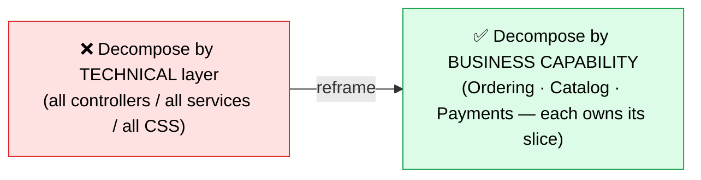
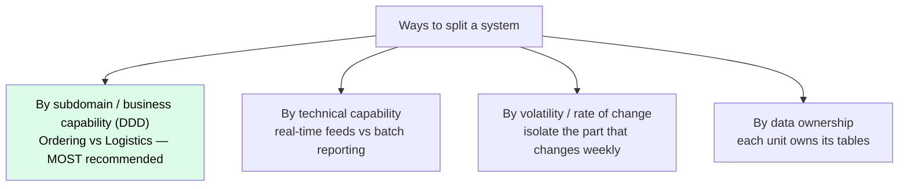
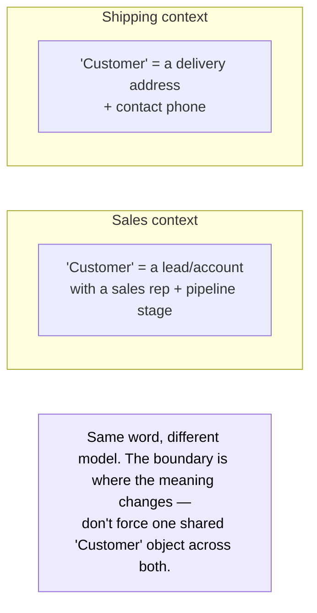
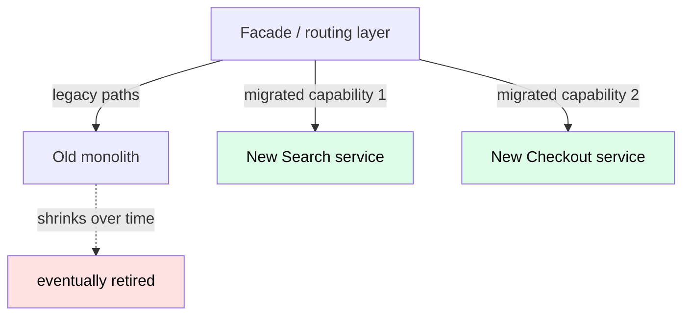
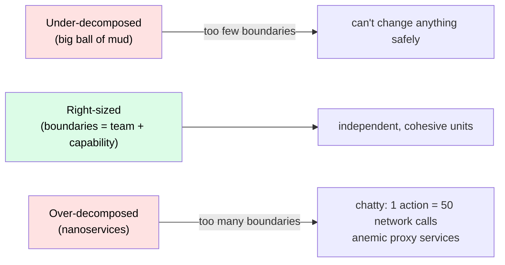
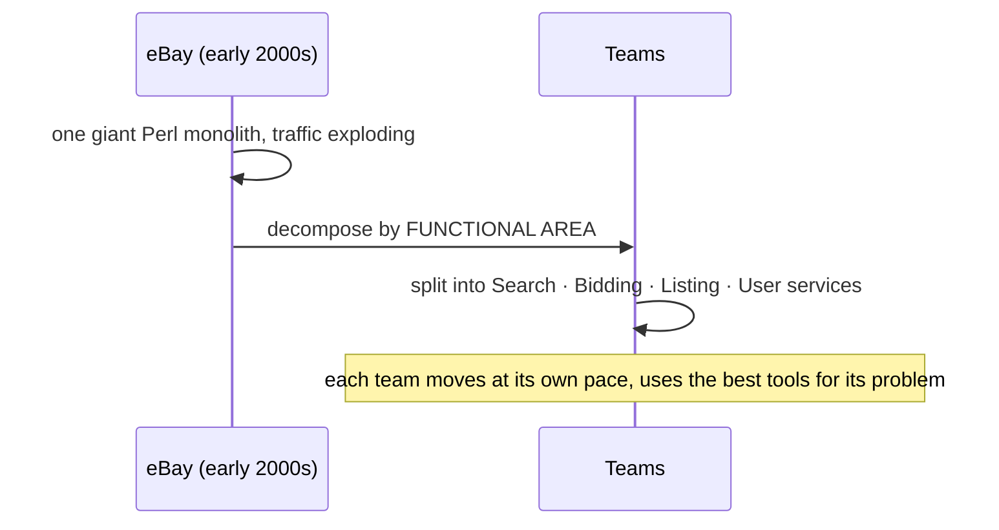
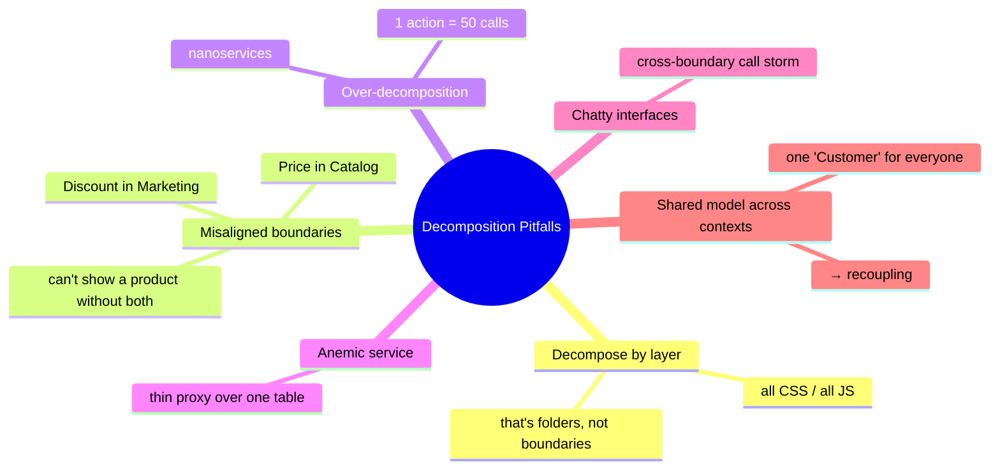

# System Decomposition

> **One line:** Decomposition is organizing a chaotic library into sections, shelves, and books — splitting one tangled system into independent parts **by business capability (bounded context)**, not by technical layer, so teams and components can evolve without disturbing each other.

---

## Table of Contents
1. [Why You Must Master This](#1-why-you-must-master-this)
2. [The Mental Model](#2-the-mental-model)
3. [How to Decompose (the axes)](#3-how-to-decompose-the-axes)
4. [Bounded Contexts — Drawing the Line](#4-bounded-contexts--drawing-the-line)
5. [The Strangler Fig (decomposing a legacy monolith)](#5-the-strangler-fig-decomposing-a-legacy-monolith)
6. [Over- and Under-Decomposition](#6-over--and-under-decomposition)
7. [Worked Example — eBay's Journey](#7-worked-example--ebays-journey)
8. [Real-Life Use Cases](#8-real-life-use-cases)
9. [Failure Modes](#9-failure-modes)
10. [🏋️ Practice Drills](#-practice-drills)
11. [🎤 Interview Q&A Bank](#-interview-qa-bank)
12. [🎯 Staff+ Nuances](#-staff-nuances)
13. [Cheat Sheet](#13-cheat-sheet)
14. [Connections & Further Reading](#14-connections--further-reading)

---

## 1. Why You Must Master This

Decomposition is the skill behind every "split the monolith," "design the services," and "draw the boxes" interview prompt — and behind every real system that scales past one team.

- **Untangle the web** — without decomposition every part depends on every other part; a change to the User Profile UI can brick the Billing backend.
- **Scale the org** — you can't put 100 people on one file. Decomposition is how you physically divide the *work* so humans collaborate without constant collision.
- **Independent evolution** — it lets you rewrite Search in a new language without touching the Home Page.

> **The core problem it solves:** *monolithic entanglement* — the spaghetti where business logic, data access, and UI are fused. And the key insight: real decomposition is by **capability**, not by **technology**. Putting all CSS in one folder and all JS in another is *organization*, not decomposition.

---

## 2. The Mental Model

Decomposition is **organizing a massive library.** You don't dump every book on the floor. You divide it into **sections** (genre), **shelves** (author), and **books**. Someone after a cookbook goes to the Cooking section and never disturbs the History readers.





---

## 3. How to Decompose (the axes)



The primary axis is **business capability** (Domain-Driven Design): separate Ordering logic from Logistics logic, each owned end-to-end by a team. Secondary axes — technical capability, rate of change, data ownership — refine the boundaries. The same boundary work applies whether the result is modules in a [modular monolith](./Modular_Monolith.md) or separate [microservices](./Monolith_vs_Microservices.md).

```python
# Before: global mixed logic — UI, business rules, and SQL fused
def order_process(user_id, item_id):
    user = db.query(f"SELECT * FROM users WHERE id={user_id}")
    item = db.query(f"SELECT * FROM inventory WHERE id={item_id}")
    if user["balance"] > item["price"]:
        db.execute("UPDATE inventory SET stock=stock-1 ...")
        send_email(user["email"])

# After: clean capability boundaries — each service speaks to others' APIs, not their DBs
class OrderService:
    def process(self, user_id, item_id):
        user = UserService.get_profile(user_id)
        if InventoryService.is_in_stock(item_id):
            PaymentService.charge(user_id, item_id)
            NotificationService.send_confirmation(user.email)
```

---

## 4. Bounded Contexts — Drawing the Line

The hardest part of decomposition is deciding *where* to draw the boundary. DDD's answer: the **bounded context** — a boundary within which a domain term has one consistent meaning.



> **The tell:** when the same word (`Customer`, `Product`, `Order`) means something *different* to two parts of the business, that's a context boundary. Forcing a single shared model across that line is how you get a coupled, can't-change-anything monolith. Each context owns its own model — and its own data.

---

## 5. The Strangler Fig (decomposing a legacy monolith)

You almost never decompose a live system in a big-bang rewrite — you strangle it gradually.



Put a facade in front of the monolith, then peel off one capability at a time into a new service, routing that capability's traffic to the new code. The monolith shrinks until it can be retired. Named after the strangler fig vine that grows around a tree and gradually replaces it — *incremental, reversible, low-risk*, unlike a rewrite.

---

## 6. Over- and Under-Decomposition



There's a sweet spot. **Under-decomposition** leaves a tangled monolith. **Over-decomposition** ("nanoservices") makes one user action trigger 50 cross-service calls and produces "anemic" services that are just thin proxies over a database table. The right grain follows **team boundaries and capability cohesion** — usually one service per team that needs independent deploys.

---

## 7. Worked Example — eBay's Journey



eBay split its Perl monolith by **functional area** (Search, Bidding, Listing, User) as traffic exploded — each becoming an independently-owned, independently-scalable unit. Capability-aligned boundaries let each team move and choose tools independently.

---

## 8. Real-Life Use Cases

| Situation | How decomposition applies |
|-----------|---------------------------|
| **Splitting a monolith** | Identify bounded contexts, then extract via Strangler Fig — capability by capability. |
| **Org scaling** | Draw service boundaries along team ownership so teams deploy independently (Conway's Law). |
| **Scaling one hot capability** | A clean boundary lets you extract and scale just that capability (e.g., Search). |
| **Cell-based architecture** | Group related services into self-contained "cells" deployed as a unit (AWS, Slack) for fault isolation. |
| **Greenfield design** | Map bounded contexts up front; implement as modular-monolith modules, extract later. |
| **Replatforming legacy** | Strangler Fig lets you modernize without a risky big-bang rewrite. |

> Real-world habit: **decompose along business capabilities and team ownership; verify each boundary by asking "does the same term mean the same thing on both sides?"** Then implement as modules first, services later.

---

## 9. Failure Modes



- **Decompose by technical layer** — the fundamental mistake; folders aren't boundaries.
- **Misaligned boundaries** — putting `Price` in Catalog but `Discount` in Marketing means you can't display a product without calling both. Cohesion broke.
- **Over-decomposition / nanoservices** — too many tiny services → chatty interfaces and anemic proxies.
- **Anemic services** — a "service" that just wraps one DB table adds network cost for no behavior.
- **Shared model across contexts** — forcing one `Customer` object across Sales and Shipping re-couples them through the model.

---

## 🏋️ Practice Drills

> *Draw boundaries by capability and spot the mis-cut.*

**Drill 1 — Real decomposition or just folders?** A team reorganizes a monolith by moving all controllers into `/controllers`, all services into `/services`, all models into `/models`. Did they decompose the system?

<details><summary>Solution</summary>

No — that's organization by technical layer (package-by-layer), not decomposition by capability. A single feature like "Checkout" is still smeared across all three folders, and nothing is independently changeable or deployable. Real decomposition is vertical: an `Ordering` unit that owns its controller, logic, *and* data. Package by feature, not by layer.
</details>

**Drill 2 — Spot the boundary mistake.** `Price` lives in the Catalog service, but `Discount` lives in the Marketing service, so rendering a product page requires calling both on every request. What went wrong?

<details><summary>Solution</summary>

The boundary cut through a cohesive capability — pricing. Things that change together should live together; splitting "price" from "discount" created a chatty, tightly-coupled pair where neither is useful alone. Re-draw the boundary so the full pricing capability (base price + discounts) lives in one context.
</details>

**Drill 3 — Migrate a legacy monolith.** You must modernize a 15-year-old monolith without a 2-year big-bang rewrite. What pattern, and what's the first move?

<details><summary>Solution</summary>

Strangler Fig. First move: put a facade/routing layer in front of the monolith so you control where each request goes. Then pick one well-bounded capability (often a read-heavy or low-risk one like Search), build it as a new service, and route just that traffic to it. Repeat capability by capability; the monolith shrinks until you can retire it. Incremental and reversible, never big-bang.
</details>

---

## 🎤 Interview Q&A Bank

**Q1. How would you split a monolith into services?**
> Identify bounded contexts / business capabilities (DDD), confirm each by checking that domain terms have one consistent meaning inside it, ensure each owns its own data, then extract incrementally with the Strangler Fig pattern — starting with a well-bounded, lower-risk capability. Align boundaries with team ownership.

**Q2. What's the difference between decomposing by capability vs by layer?**
> By capability = vertical slices (Ordering, Catalog) that each own UI→logic→data and can evolve independently. By layer = horizontal tiers (all controllers / all services) where one feature spans every tier and nothing is independently deployable. Capability is real decomposition; layer is just organization.

**Q3. What is a bounded context?**
> A DDD boundary within which a domain model and its terms have one consistent meaning. The boundary is where the meaning of a term (Customer, Order) changes between parts of the business — and that's where you split.

**Q4. What is the Strangler Fig pattern?**
> An incremental migration: wrap the legacy system in a facade, peel off one capability at a time into new services (routing that traffic to the new code), and let the old system shrink until it's retired. Avoids the risk of a big-bang rewrite.

**Q5. What's over-decomposition and why is it bad?**
> Splitting into too many tiny "nanoservices," so one user action fans out to dozens of network calls and you get anemic proxy services. It adds latency, failure surface, and ops overhead with no cohesion benefit. Right-size to team + capability.

**Q6. How do you know a boundary is wrong?**
> Symptoms: two services must always be called together (chatty), things that change together live apart, the same term means the same thing on both sides (should be one context), or a "service" just proxies a table (anemic). These signal a mis-cut to redraw.

**Q7. How does decomposition relate to Conway's Law?**
> Boundaries should align with team ownership — each unit owned and deployed by one team. If your decomposition cuts across team lines, you get constant cross-team coordination; if it matches them, teams move independently.

---

## 🎯 Staff+ Nuances

- **Decompose along axes of change, not just nouns.** The deepest boundary heuristic isn't "what entities exist" but "what changes together." Group capabilities that change for the same reason and at the same rate; isolate the volatile part (the thing the business tweaks weekly) from the stable core. A noun-based decomposition that ignores change rate produces boundaries that thrash.
- **Boundaries are organizational *and* technical (the Inverse Conway Maneuver).** Since systems mirror team structure, you can *deliberately shape teams* to get the architecture you want. Drawing service boundaries without aligning team ownership produces a design the org will fight; reorganizing teams to match desired boundaries is a legitimate (and underused) architectural lever.
- **Data is the real boundary; behavior is negotiable.** Two units can share code via a library, but the moment they share a *writable table* they're one unit. The decomposition that matters is the data decomposition — who owns which tables — because that's the coupling that survives every refactor and blocks every extraction (ties to [Modular_Monolith.md](./Modular_Monolith.md)'s data-ownership rule).
- **Decompose in-process first, distribute later.** Get the boundaries right as modules in a monolith (cheap, compiler-checked) before promoting any to network services. A boundary proven correct in-process is a safe extraction; a boundary guessed and then deployed across the network is an expensive mistake to undo. Decomposition ≠ distribution — they're separable decisions.
- **The "right size" is a moving target — expect to merge as well as split.** Early on, broader boundaries beat fine ones (you don't yet understand the domain). As understanding grows you split; when you over-split, you *merge*. Treating boundaries as immutable is the mistake — they're hypotheses you revise. (Segment merged services back; that's healthy, not failure.)
- **Cross-context integration is where the design lives or dies.** Once decomposed, contexts integrate via published APIs, events, or anti-corruption layers (a translation shim that stops one context's model from leaking into another). Skipping the anti-corruption layer is how a "clean" decomposition silently re-couples through leaked models.

---

## 13. Cheat Sheet

```
DECOMPOSE BY BUSINESS CAPABILITY (DDD bounded context), NOT by technical layer.
  ✓ vertical slices: Ordering · Catalog · Payments (each owns UI→logic→DATA)
  ✗ horizontal layers: all controllers / all services / all CSS  ← that's folders, not boundaries

DRAW THE LINE where a term's MEANING changes (Sales 'Customer' ≠ Shipping 'Customer').
DATA is the real boundary — shared writable table = one unit. Each context owns its tables.

MIGRATE a legacy monolith with the STRANGLER FIG: facade → peel off one capability at a time → retire.
RIGHT-SIZE to team + capability (Conway's Law). Decompose in-process FIRST, distribute later.

TRAPS: by-layer (not decomposition) · misaligned boundary (Price/Discount split) ·
       over-decomposition (nanoservices, 1 action = 50 calls) · anemic proxy services ·
       shared model across contexts (re-couples) — use an anti-corruption layer
```

---

## 14. Connections & Further Reading

**Within this repo:**
- [Modular_Monolith.md](./Modular_Monolith.md) — decomposition as modules; [Monolith_vs_Microservices.md](./Monolith_vs_Microservices.md) — when boundaries become services.
- [Component_Responsibilities.md](./Component_Responsibilities.md) — decomposition at the component level; [SOA.md](./SOA.md) — coarse-grained decomposition.
- [04 · Low-Level Design](../04_Low_Level_Design/) — DDD & SOLID; [10 · Microservices](../10_Microservices_Distributed_Systems/) — Sagas across contexts.

**External classics:**
- [Martin Fowler — StranglerFigApplication](https://martinfowler.com/bliki/StranglerFigApplication.html) · [BoundedContext](https://martinfowler.com/bliki/BoundedContext.html).
- [microservices.io — Decompose by business capability](https://microservices.io/patterns/decomposition/decompose-by-business-capability.html).
- *Domain-Driven Design* (Eric Evans); *Team Topologies* (Skelton & Pais) — the org side.

---

## TL;DR
System decomposition splits a tangled system into independent parts **by business capability (DDD bounded context), not by technical layer** — the boundary is where a domain term's *meaning* changes, and the real boundary is **data ownership** (each context owns its tables). Right-size to **team + capability** (Conway's Law), avoiding both under-decomposition (ball of mud) and over-decomposition (chatty nanoservices). Decompose **in-process first** (cheap, reversible), distribute later, and migrate legacy systems incrementally with the **Strangler Fig** — never a big-bang rewrite. Boundaries are hypotheses: split *and* merge as the domain reveals itself.
