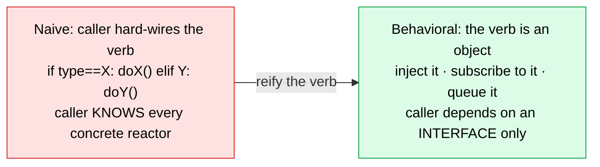
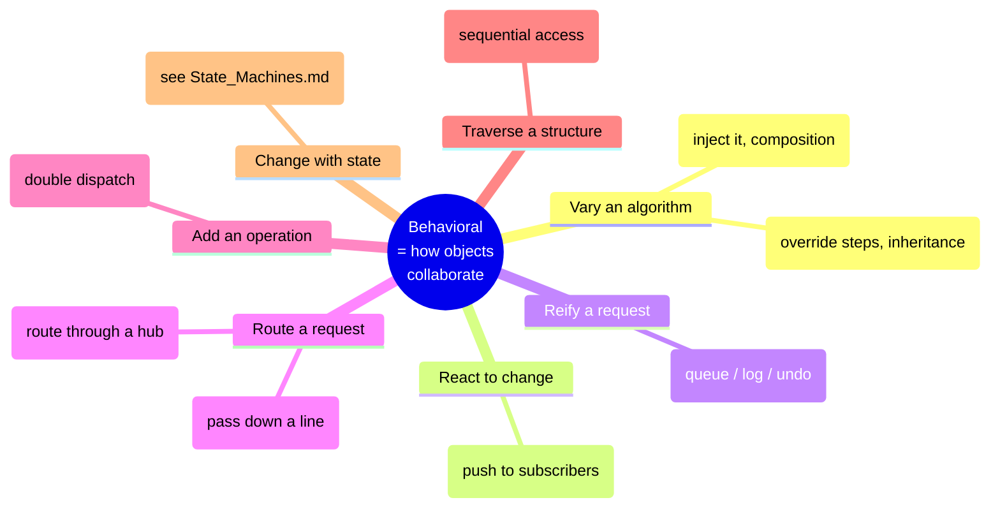
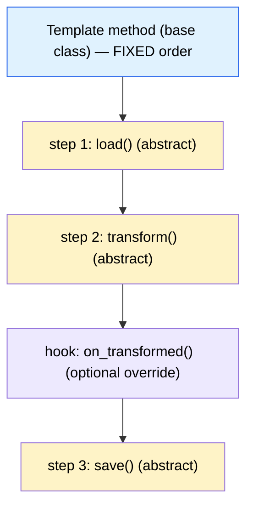
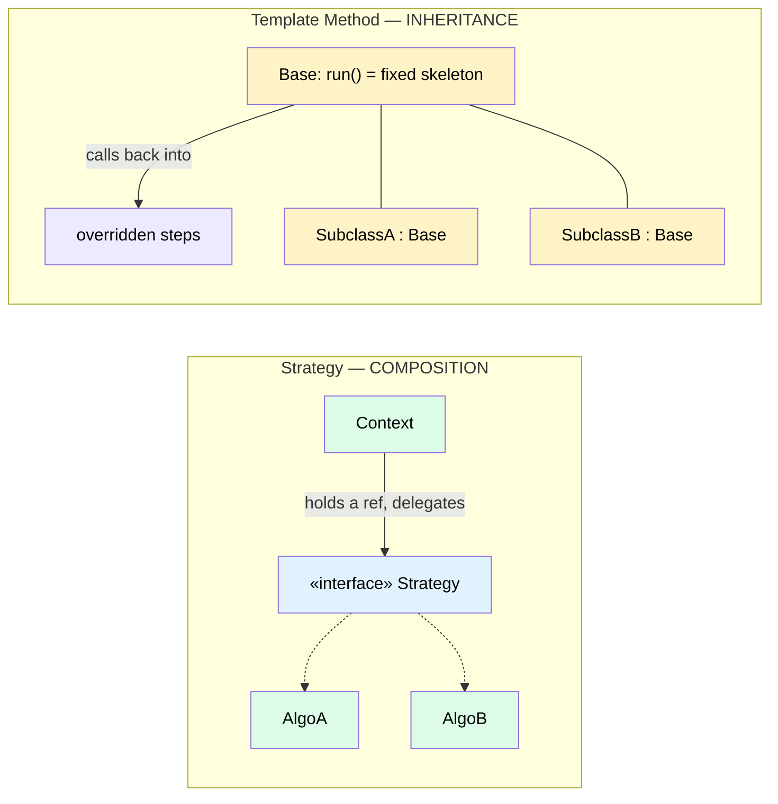
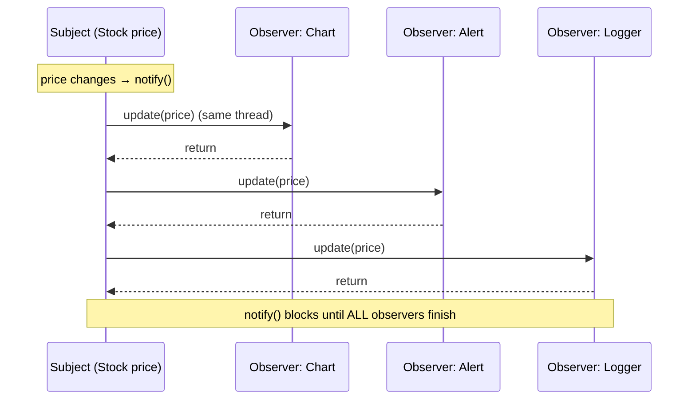
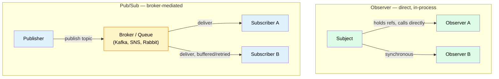
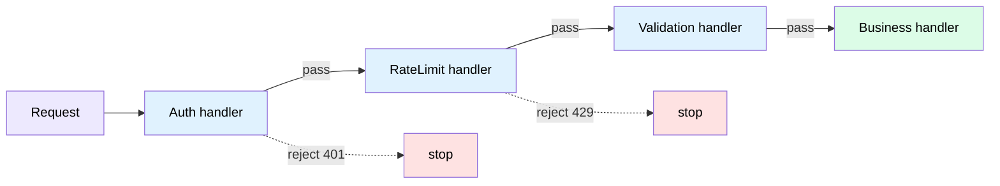
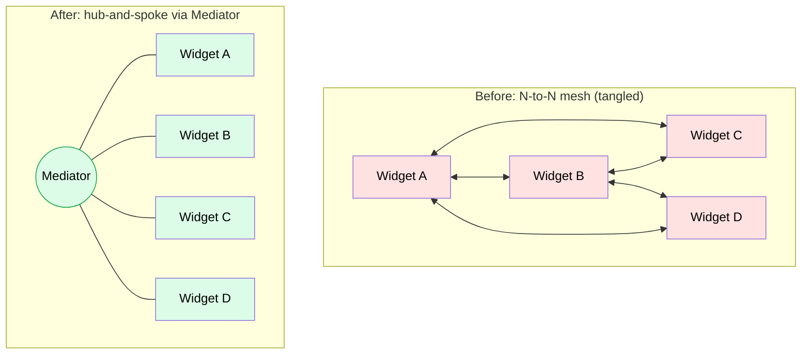
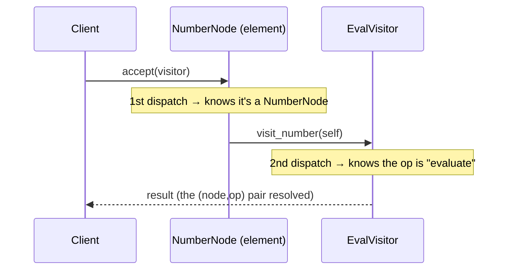
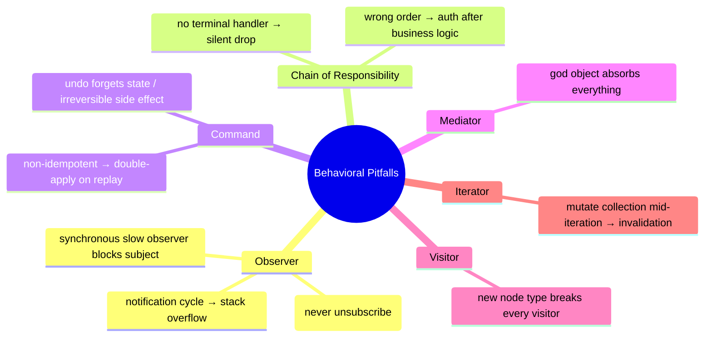

# Behavioral Design Patterns

> **One line:** Behavioral patterns are the GoF recipes for *who talks to whom and how the "what" varies* — they turn tangled `if/elif` chains and hard-wired call graphs into named, swappable, testable collaborations.

---

## Table of Contents
1. [Why You Must Master This](#1-why-you-must-master-this)
2. [The Mental Model](#2-the-mental-model)
3. [Strategy — Swap the Algorithm](#3-strategy--swap-the-algorithm)
4. [Template Method — Fix the Skeleton, Vary the Steps](#4-template-method--fix-the-skeleton-vary-the-steps)
5. [Strategy vs Template Method — The Classic Follow-Up](#5-strategy-vs-template-method--the-classic-follow-up)
6. [Observer — Notify the Dependents](#6-observer--notify-the-dependents)
7. [Observer vs Pub/Sub — In-Process vs Broker-Mediated](#7-observer-vs-pubsub--in-process-vs-broker-mediated)
8. [Command — Request as an Object](#8-command--request-as-an-object)
9. [Chain of Responsibility — Pass It Down the Line](#9-chain-of-responsibility--pass-it-down-the-line)
10. [Mediator — Route Through a Hub](#10-mediator--route-through-a-hub)
11. [Visitor — Add Operations Without Touching the Nodes](#11-visitor--add-operations-without-touching-the-nodes)
12. [Iterator — Traverse Without Exposing the Guts](#12-iterator--traverse-without-exposing-the-guts)
13. [Worked Example — A Text Editor](#13-worked-example--a-text-editor)
14. [Real-Life Use Cases](#14-real-life-use-cases)
15. [Failure Modes](#15-failure-modes)
16. [🏋️ Practice Drills](#-practice-drills)
17. [🎤 Interview Q&A Bank](#-interview-qa-bank)
18. [🎯 Staff+ Nuances](#-staff-nuances)
19. [Cheat Sheet](#19-cheat-sheet)
20. [Connections & Further Reading](#20-connections--further-reading)

---

## 1. Why You Must Master This

Creational patterns decide *how an object is born*; structural patterns decide *how objects compose*; behavioral patterns decide *how objects interact and how that interaction is allowed to change*. This is the family that actually shows up when a codebase rots — not because the objects are wrong, but because the *collaboration* between them was welded shut.

- **This is where the `if/elif` sprawl lives.** Almost every "this method has a giant switch on a type/mode/status" smell is a behavioral pattern knocking — Strategy, State, Chain, or Command. Naming the seam before the conditional metastasizes across ten call sites is the single highest-leverage LLD move.
- **It's the family interviewers probe deepest.** "Strategy vs Template Method?" and "Observer vs pub/sub?" are near-universal follow-ups precisely because they separate people who memorized names from people who understand the *mechanism* (composition vs inheritance; in-process coupling vs a broker).
- **These patterns scale straight into architecture.** Observer becomes an event bus and then Kafka; Chain of Responsibility becomes your HTTP middleware stack; Command becomes your job queue and your event-sourcing log; Mediator becomes the API gateway / orchestrator. The intent is identical at 10 lines and at 10 services.
- **Getting it wrong has a signature failure.** A hidden Observer cycle causes a stack overflow in production; a Chain with no terminal handler silently drops requests; a Command log that isn't idempotent double-charges on replay. These are real incident classes, not textbook trivia.

> **The core problem it solves:** how to let *behavior* vary — which algorithm runs, who reacts to a change, how a request flows — without every caller knowing (and depending on) the concrete details. Absorb the variation at one named seam instead of leaking it everywhere.

**Prerequisites:** [Design_Patterns_Overview.md](./Design_Patterns_Overview.md) (the three GoF families and when *not* to use a pattern), [SOLID_Principles.md](./SOLID_Principles.md) (Open/Closed and Dependency Inversion, which these patterns realize), and [Object_Oriented_Design.md](./Object_Oriented_Design.md) (composition over inheritance).

---

## 2. The Mental Model

Structural patterns are about the *nouns* of your system (how the boxes fit together). Behavioral patterns are about the *verbs* — the arrows between the boxes. The naive design hard-wires every verb: the caller knows exactly which algorithm to run, exactly who to notify, exactly how to dispatch. The behavioral move is to **turn a verb into a thing you can name, inject, queue, or reroute.**



The eight behavioral patterns in this file split cleanly by *what verb they reify*:



> **Hold onto this:** every behavioral pattern answers "how does control or data flow between objects, and where is that flow allowed to change?" Strategy/Template vary *the algorithm*; Observer varies *who reacts*; Command reifies *the request*; Chain/Mediator vary *the routing*; Visitor varies *the operation*; Iterator varies *the traversal*. State (its own file, [State_Machines.md](./State_Machines.md)) varies *behavior by lifecycle phase*.

---

## 3. Strategy — Swap the Algorithm

**What.** Put a family of interchangeable algorithms behind one interface, and let a *context* object hold a reference to whichever one it currently needs. The client picks the algorithm; the context just calls the interface.

**Why.** Without it, "which algorithm" becomes a conditional (`if mode == "fast": ... elif "cheap": ...`) that (a) duplicates across every method that cares, and (b) forces you to edit the context every time a new variant appears — a direct Open/Closed violation.

**How under the hood.** Strategy is pure *composition + delegation*. The context holds a field of the interface type; at call time it forwards to `self._strategy.execute(...)`. Because the field is settable, you can swap algorithms at runtime — the object identity of the context never changes, only the collaborator it points at. This is [Design_Patterns_Overview.md §5](./Design_Patterns_Overview.md#5-behavioral-patterns--how-objects-collaborate) worked in full, so here we go one level deeper: notice there is *no inheritance* anywhere. The variation point is a reference, not an override.

```python
from abc import ABC, abstractmethod

# The strategy interface — the ONE seam where behavior varies.
class RouteStrategy(ABC):
    @abstractmethod
    def route(self, start: str, end: str) -> list[str]: ...

# Interchangeable, self-contained algorithms. Each knows nothing of the others.
class FastestRoute(RouteStrategy):
    def route(self, start: str, end: str) -> list[str]:
        return [start, "highway", end]          # optimize for time

class ScenicRoute(RouteStrategy):
    def route(self, start: str, end: str) -> list[str]:
        return [start, "coast_road", "viewpoint", end]  # optimize for views

# The context depends on the INTERFACE, never a concrete class.
class Navigator:
    def __init__(self, strategy: RouteStrategy) -> None:
        self._strategy = strategy               # composition, injected

    def set_strategy(self, strategy: RouteStrategy) -> None:
        self._strategy = strategy               # swap the algorithm at RUNTIME

    def build_route(self, start: str, end: str) -> list[str]:
        return self._strategy.route(start, end) # pure delegation

nav = Navigator(FastestRoute())
print(nav.build_route("A", "B"))                # ['A', 'highway', 'B']
nav.set_strategy(ScenicRoute())                 # user toggles "avoid highways"
print(nav.build_route("A", "B"))                # ['A', 'coast_road', 'viewpoint', 'B']
```

**Trade-off.** Strategy adds a class (and an object) per algorithm and an indirection the reader must follow. It wins when variation is *real and runtime-selectable*; it loses when there is exactly one algorithm forever, or when the algorithms need to share deep intermediate state (that couples them and Template Method fits better — see §4). In Python, a single-method strategy is often better expressed as **a plain function passed in** — `sorted(data, key=fn)` is Strategy with the class ceremony dropped.

**Real system.** Java's `Collections.sort(list, Comparator)` — the comparator *is* the injected strategy. `java.util.concurrent`'s `RejectedExecutionHandler`, Spring's `Resource`/`Cache` abstractions, and every payment-gateway `charge()` abstraction are Strategy. Nginx/Envoy load-balancing policies (round-robin, least-conn, ring-hash) are Strategy selected by config.

---

## 4. Template Method — Fix the Skeleton, Vary the Steps

**What.** Define the *skeleton* of an algorithm in a base-class method, but leave specific steps as methods that subclasses override. The overall sequence is fixed and lives in one place; only the pluggable steps vary.

**Why.** Some algorithms are 90% identical across variants and 10% different, and the *order* of steps is the invariant you want to protect. If you copy the whole algorithm per variant (or make it a Strategy), you duplicate — or expose — the skeleton, and a maintainer can accidentally reorder steps. Template Method locks the sequence and opens only the holes.

**How under the hood.** This is *inheritance + the Hollywood Principle* ("don't call us, we'll call you"). The base class's public template method calls `self.step_a(); self.step_b(); self.step_c()`. Those steps are either abstract (subclass *must* supply) or *hook methods* — non-abstract, empty-or-default methods the subclass *may* override to tap into the flow. Control lives in the base class; the subclass only fills holes. The inversion is the whole point: the framework runs the loop, your code is called back into it.



> The base class owns the arrows (the order); the subclass owns only the amber/purple boxes (the step bodies). You cannot reorder the pipeline from a subclass — that invariant is protected.

```python
from abc import ABC, abstractmethod

class DataPipeline(ABC):
    # THE TEMPLATE METHOD — fixed skeleton. Not overridden; it's `final` in spirit.
    def run(self, path: str) -> None:
        raw = self.load(path)              # step varies
        clean = self.transform(raw)        # step varies
        self.on_transformed(clean)         # HOOK — optional, default no-op
        self.save(clean)                   # step varies

    @abstractmethod
    def load(self, path: str) -> list[str]: ...
    @abstractmethod
    def transform(self, rows: list[str]) -> list[str]: ...
    @abstractmethod
    def save(self, rows: list[str]) -> None: ...

    def on_transformed(self, rows: list[str]) -> None:
        pass                               # HOOK METHOD: subclass MAY tap in here

class CsvToDb(DataPipeline):
    def load(self, path: str) -> list[str]:      return open(path).read().splitlines()
    def transform(self, rows: list[str]) -> list[str]: return [r.strip().lower() for r in rows]
    def save(self, rows: list[str]) -> None:     print(f"INSERT {len(rows)} rows")
    def on_transformed(self, rows: list[str]) -> None:  # opt into the hook
        print(f"metrics: transformed {len(rows)} rows")

CsvToDb().run("data.csv")   # base class drives the sequence; subclass filled the holes
```

**Trade-off.** You get single-source-of-truth over the algorithm's *shape* and zero duplication of the skeleton — but you pay with inheritance's rigidity: one skeleton per class hierarchy, variation fixed at *compile/definition time* (you can't swap steps on a live object the way Strategy swaps algorithms), and the classic fragile-base-class risk — changing the template can break every subclass silently. Overuse produces deep hierarchies that are hard to reason about.

**Real system.** Framework lifecycle hooks are Template Method: JUnit's `setUp()`/`tearDown()`, Android's `Activity.onCreate()`/`onResume()`, React class components' `render()` + lifecycle methods, Spring's `AbstractController`, Django's class-based-view `get()`/`post()` dispatch, servlet `HttpServlet.service()` calling `doGet()`/`doPost()`. In every case the framework owns `run()`; you override the holes.

---

## 5. Strategy vs Template Method — The Classic Follow-Up

Both solve "an algorithm has parts that vary." The difference is the *mechanism* and therefore the *binding time* — this is the interview follow-up you must nail.



| Axis | **Strategy** | **Template Method** |
|------|--------------|---------------------|
| Mechanism | **Composition** — inject an object | **Inheritance** — override methods |
| What varies | The *whole* algorithm | *Specific steps* of a fixed skeleton |
| Who owns the control flow | The *strategy* owns its own logic end-to-end | The *base class* owns the sequence |
| Binding time | **Runtime** — swap the object anytime | **Definition/compile time** — chosen by which subclass you instantiate |
| Can swap on a live object? | Yes (`set_strategy`) | No (identity is tied to the subclass) |
| Number of variation points | One (the whole algo), or several composed strategies | Many (one per overridable step / hook) |
| Coupling between variants | None — variants are independent | Share the base's skeleton and protected members |
| Reuse of common code | Duplicated unless you compose more strategies | Lives once in the base class |
| Prefers SOLID | Dependency Inversion, Open/Closed cleanly | Open/Closed, but risks fragile base class |

**The one-liner:** *Strategy varies the whole algorithm by composition and binds at runtime; Template Method varies steps of a fixed skeleton by inheritance and binds at definition time.* Use Strategy when the algorithms are independent and swappable per instance/request; use Template Method when the *sequence* is the invariant worth protecting and variants share a lot of skeleton. They also combine: a Template Method's individual step can itself be a Strategy.

---

## 6. Observer — Notify the Dependents

**What.** A *subject* maintains a list of *observers* and notifies them automatically whenever its state changes, without knowing who they are or what they do. One-to-many, push-based.

**Why.** Without it, the subject must hard-code calls to every interested party — `self.ui.refresh(); self.logger.log(); self.cache.invalidate()` — so adding a fourth reactor edits the subject, and the subject depends on all of them (a dependency-inversion violation). Observer flips the dependency: reactors depend on the subject's interface and *register themselves*.

**How under the hood.** The subject holds `list[Observer]`. `subscribe()` appends; `unsubscribe()` removes; `notify()` iterates and calls `observer.update(state)` on each. The mechanism is a synchronous, in-process loop — when `notify()` returns, every observer has run *on the same thread and call stack*. That single fact drives every failure mode below (a slow observer blocks the subject; a throwing observer can abort the rest; an observer that mutates the subject can recurse).



```python
from typing import Protocol

class Observer(Protocol):
    def update(self, price: float) -> None: ...

class Stock:                                   # the Subject / Observable
    def __init__(self, symbol: str) -> None:
        self._symbol = symbol
        self._price = 0.0
        self._observers: list[Observer] = []   # subject knows only the interface

    def subscribe(self, o: Observer) -> None:   self._observers.append(o)
    def unsubscribe(self, o: Observer) -> None: self._observers.remove(o)

    @property
    def price(self) -> float: return self._price

    @price.setter
    def price(self, value: float) -> None:
        self._price = value
        self._notify()                          # state change → push to all

    def _notify(self) -> None:
        for o in list(self._observers):         # copy: observers may unsubscribe mid-loop
            o.update(self._price)               # synchronous, in-process call

class PriceAlert:
    def __init__(self, threshold: float) -> None: self._t = threshold
    def update(self, price: float) -> None:
        if price > self._t: print(f"ALERT: price {price} > {self._t}")

apple = Stock("AAPL")
apple.subscribe(PriceAlert(threshold=150))
apple.price = 148.0     # no alert
apple.price = 152.0     # ALERT: price 152.0 > 150
```

**Trade-off.** You decouple emitter from reactors and can add reactors freely — but you trade away *explicitness and control*. Notification order is usually undefined; debugging is harder because the call graph is dynamic ("who fired this?"); and because it's synchronous, one slow or failing observer degrades the subject. The lapsed-listener leak (observers that never unsubscribe keep the subject alive) is a real memory bug. When you need durability, ordering guarantees, or cross-process fan-out, you've outgrown Observer and want pub/sub — see §7.

**Real system.** GUI event listeners (a button's click listeners are observers). RxJS / ReactiveX. Node.js `EventEmitter`. Vue/MobX reactivity (a computed value observes its dependencies). Django/Rails model signals. Kafka consumer groups are the distributed evolution of the same idea.

---

## 7. Observer vs Pub/Sub — In-Process vs Broker-Mediated

This is the second must-nail follow-up. People conflate them because both are "one-to-many notification," but they differ on *coupling* and *delivery guarantees* — and that difference is exactly what separates a design decision from a distributed-systems decision.



| Axis | **Observer (GoF)** | **Pub/Sub (messaging)** |
|------|--------------------|-------------------------|
| Coupling | Subject holds *direct references* to observers | Publisher & subscriber know only the **broker/topic**; never each other |
| Who knows whom | Subject has a list of observers | Neither side has a reference to the other |
| Transport | In-memory method call | Network + a message broker |
| Timing | **Synchronous** (blocks until all run) | **Asynchronous** (fire-and-forget; broker buffers) |
| Process boundary | Same process / same address space | Across processes, hosts, datacenters |
| Delivery guarantee | Best-effort; a crash loses in-flight state | At-least-once / exactly-once, durable, replayable |
| Failure isolation | A slow/throwing observer hurts the subject | Broker absorbs it; subscriber retries independently |
| Ordering | Registration order (undefined-ish) | Per-partition/topic ordering guarantees |
| Backpressure | None — synchronous | Broker queue + consumer lag handles it |
| Scale | Dozens of observers, one process | Millions of events/s, many services |

**The one-liner:** *Observer is direct and in-process — the subject calls the observers itself on the same thread. Pub/Sub inserts a broker so publisher and subscriber are fully decoupled, asynchronous, durable, and cross-process.* Observer is a class-design pattern; pub/sub is a distributed-systems pattern. You reach for pub/sub the moment you need cross-service delivery, durability, replay, or failure isolation — and that is where this topic hands off to [../09_Message_Queues_Event_Streaming](../09_Message_Queues_Event_Streaming). A useful rule: Observer becomes pub/sub the same way a function call becomes an RPC — you added a network and a queue in the middle, and now you must reason about delivery, ordering, and partial failure.

---

## 8. Command — Request as an Object

**What.** Encapsulate a request as a standalone object carrying everything needed to perform it later: the action, the receiver, and the parameters. Because the request is now a *value*, you can store it, pass it, queue it, log it, and reverse it.

**Why.** A bare method call (`light.on()`) happens *now*, on *this* thread, and vanishes — you can't queue it, retry it, log it for audit, or undo it. The instant you need any of "do it later / do it elsewhere / do it again / take it back," you must reify the request. That's Command.

**How under the hood.** A `Command` interface has `execute()` (and often `undo()`). Each concrete command holds a reference to its *receiver* (the object that does the real work) plus the arguments, captured at construction. An *invoker* holds commands and calls `execute()` without knowing what the command does. For undo, `execute()` records enough prior state (or its inverse) so `undo()` can restore it — this is why an undo stack is just `list[Command]` you pop and `undo()`.

```mermaid
flowchart LR
    Client["Client<br/>builds command"] -->|configures| Cmd["«Command»<br/>execute() / undo()"]
    Inv["Invoker<br/>(button, queue, undo-stack)"] -->|execute()| Cmd
    Cmd -->|acts on| Recv["Receiver<br/>(does real work)"]
    style Client fill:#ede9fe,color:#000
    style Cmd fill:#dcfce7,stroke:#16a34a,color:#000
    style Inv fill:#e0f2fe,color:#000
    style Recv fill:#fef3c7,color:#000
```

```python
from abc import ABC, abstractmethod

class Command(ABC):
    @abstractmethod
    def execute(self) -> None: ...
    @abstractmethod
    def undo(self) -> None: ...

class Document:                                 # the Receiver
    def __init__(self) -> None: self.text = ""

class InsertText(Command):
    def __init__(self, doc: Document, s: str) -> None:
        self._doc, self._s = doc, s             # capture receiver + args now
    def execute(self) -> None:
        self._doc.text += self._s
    def undo(self) -> None:                      # inverse of execute
        self._doc.text = self._doc.text[: -len(self._s)]

class History:                                   # the Invoker (undo stack)
    def __init__(self) -> None: self._stack: list[Command] = []
    def do(self, cmd: Command) -> None:
        cmd.execute(); self._stack.append(cmd)   # run, then remember
    def undo(self) -> None:
        if self._stack: self._stack.pop().undo() # pop, reverse

doc = Document(); hist = History()
hist.do(InsertText(doc, "Hello"))
hist.do(InsertText(doc, " World"))
print(doc.text)     # 'Hello World'
hist.undo()
print(doc.text)     # 'Hello'   ← request-as-object made undo trivial
```

**Trade-off.** You gain queueing, logging/audit, undo/redo, macro-recording, and the ability to move work across threads or machines — but every action becomes a class/object, which is heavy for a plain call, and *undo correctness is subtle* (you must capture enough state, and side effects like sending an email can't truly be undone). When you serialize commands to run later or elsewhere, they must be **idempotent** or your retry/replay will double-apply.

**Real system.** Text-editor undo stacks. Job/task queues (a Celery/Sidekiq task *is* a serialized command). Database transaction logs and redo logs. Event Sourcing stores commands/events to replay state. Redux/Flux "actions" are commands dispatched to a reducer. The GoF Command is also the seed of the `Runnable`/`Callable` you hand to a thread pool.

---

## 9. Chain of Responsibility — Pass It Down the Line

**What.** Give a request a *chain* of handler objects; each handler either processes the request or passes it to the next. The sender doesn't know which handler will deal with it.

**Why.** Without it, one object accretes every check in sequence — auth, then rate-limit, then validation, then logging — as a nested `if` pyramid that's impossible to reorder or reuse. Chain makes each concern a standalone handler you can add, remove, or reorder independently, and decouples the sender from *which* handler responds.

**How under the hood.** Each handler holds a reference to the *next* handler and a `handle(request)` method. It does its bit, then either short-circuits (returns / rejects) or calls `self._next.handle(request)`. The chain is a linked list of behavior. Two flavors exist: *pure* (exactly one handler consumes the request — e.g., a support-ticket escalation) and *pipeline* (every handler runs and enriches/filters — e.g., HTTP middleware). The critical design choice is the **terminal case**: what happens when no handler handles it — reject, or default?



```python
from abc import ABC, abstractmethod
from typing import Optional

class Handler(ABC):
    def __init__(self) -> None:
        self._next: Optional["Handler"] = None
    def set_next(self, h: "Handler") -> "Handler":
        self._next = h
        return h                                 # return next → fluent chaining
    def handle(self, req: dict) -> Optional[str]:
        if self._next:
            return self._next.handle(req)        # default: pass it down
        return None                              # terminal: nobody handled it

class AuthHandler(Handler):
    def handle(self, req: dict) -> Optional[str]:
        if not req.get("token"):
            return "401 Unauthorized"            # short-circuit the chain
        return super().handle(req)               # else pass down

class RateLimitHandler(Handler):
    def handle(self, req: dict) -> Optional[str]:
        if req.get("rpm", 0) > 100:
            return "429 Too Many Requests"
        return super().handle(req)

class BusinessHandler(Handler):
    def handle(self, req: dict) -> Optional[str]:
        return f"200 OK: served {req['path']}"   # terminal success

auth = AuthHandler()
auth.set_next(RateLimitHandler()).set_next(BusinessHandler())  # build the chain
print(auth.handle({"token": "x", "rpm": 5, "path": "/home"}))  # 200 OK
print(auth.handle({"rpm": 5, "path": "/home"}))                # 401 Unauthorized
```

**Trade-off.** You get single-responsibility handlers, runtime-configurable order, and Open/Closed extension — but you lose a guarantee that *anything* handles the request (an unterminated chain silently drops it, a nasty production bug), you add per-hop latency, and debugging means tracing a dynamic chain. Deeply nested chains can also blow the call stack if implemented recursively without care.

**Real system.** HTTP middleware is the canonical example: Express `app.use()`, Django/Rails middleware, ASP.NET Core pipeline, Netty's `ChannelPipeline`, Java Servlet `Filter` chains. Also logging frameworks (a log record walks handlers by level), GUI event bubbling (DOM events propagate up the tree), and firewall/iptables rule chains.

---

## 10. Mediator — Route Through a Hub

**What.** Introduce a *mediator* object that encapsulates how a set of objects interact. Instead of objects referring to each other directly, they refer only to the mediator, which coordinates them.

**Why.** When N objects all talk to each other, you get up to N² direct references — a tangle where every object knows every other, and changing one interaction ripples everywhere. Mediator collapses the many-to-many mesh into a hub-and-spoke: each object knows only the hub. This is the classic "reduce coupling in a crowd" pattern.

**How under the hood.** Each *colleague* holds a reference to the mediator and, on any event, calls `mediator.notify(self, event)`. The mediator holds references to all colleagues and contains the interaction logic: "when the login field changes, enable the button; when submit fires, validate then call the API." The coupling didn't disappear — it *moved into the mediator*, which is the point (one place to understand and change the choreography). The risk: the mediator becomes a god object if it absorbs too much.



```python
from typing import Protocol

class Mediator(Protocol):
    def notify(self, sender: str, event: str) -> None: ...

class AuthDialog:                                # the concrete Mediator
    def __init__(self) -> None:
        self.username = ""
        self.remember = False
        self.button_enabled = False
    def notify(self, sender: str, event: str) -> None:
        # ALL cross-widget coordination lives HERE, in one readable place.
        if sender == "username" and event == "changed":
            self.button_enabled = bool(self.username)      # enable on non-empty
        elif sender == "submit" and event == "click":
            print(f"login {self.username} (remember={self.remember})")

class TextField:                                 # a Colleague — knows only the mediator
    def __init__(self, name: str, m: AuthDialog) -> None:
        self._name, self._m = name, m
    def type(self, value: str) -> None:
        setattr(self._m, self._name, value)
        self._m.notify(self._name, "changed")    # report UP to the hub

dialog = AuthDialog()
user = TextField("username", dialog)
user.type("ada")
print(dialog.button_enabled)                     # True — mediator coordinated it
```

**Trade-off.** You get loose coupling among colleagues, centralized and reusable interaction logic, and colleagues that are simpler and independently testable — but the mediator can grow into an unmaintainable god object that *knows everything*, and it becomes a single point of failure and a bottleneck for changes. The remedy is to keep mediators small and split them by cohesive interaction cluster. Mediator vs Observer: Observer is one-way broadcast (subject→observers); Mediator is multi-directional coordination among peers.

**Real system.** The controller in MVC/MVP is a Mediator between view and model. Air-traffic control (the textbook analogy — planes talk to the tower, not each other). Chat-room servers (clients send to the room, which fans out). UI dialog controllers, workflow/orchestration engines, and the API-gateway/orchestrator in microservices (services coordinate through it rather than a mesh of direct calls — contrast with a choreographed event bus).

---

## 11. Visitor — Add Operations Without Touching the Nodes

**What.** Represent an operation to be performed on the elements of an object structure as a separate *visitor* object. You can define a new operation over the whole structure without modifying the element classes.

**Why.** You have a stable set of node types (an AST, a file-system tree, a shape hierarchy) but a *growing* set of operations over them (evaluate, pretty-print, type-check, optimize, compute size). If each operation is a method on every node, adding an operation edits every node class, and node classes bloat with unrelated concerns. Visitor pulls each operation into its own class.

**How under the hood.** The trick is **double dispatch**. Single dispatch (a normal method call) picks the method by *one* type — the receiver. Visitor needs to pick behavior by *two* types: which node *and* which operation. So each node implements `accept(visitor)`, whose one job is to call back `visitor.visit_<ThisNodeType>(self)`. The first dispatch (`accept`) resolves the node type; the second (`visit_X`) resolves the operation. Together they select the exact `(node, operation)` pair — something you can't do with a single virtual call in most OO languages.



```python
from abc import ABC, abstractmethod

# --- Stable element hierarchy: an arithmetic AST ---
class Node(ABC):
    @abstractmethod
    def accept(self, v: "Visitor"): ...          # enables double dispatch

class Num(Node):
    def __init__(self, value: float) -> None: self.value = value
    def accept(self, v: "Visitor"):
        return v.visit_num(self)                  # calls back → resolves node type

class Add(Node):
    def __init__(self, left: Node, right: Node) -> None:
        self.left, self.right = left, right
    def accept(self, v: "Visitor"):
        return v.visit_add(self)

# --- Operations live in VISITORS, not in the nodes ---
class Visitor(ABC):
    @abstractmethod
    def visit_num(self, n: Num): ...
    @abstractmethod
    def visit_add(self, n: Add): ...

class Evaluate(Visitor):                          # operation #1
    def visit_num(self, n: Num): return n.value
    def visit_add(self, n: Add):
        return n.left.accept(self) + n.right.accept(self)   # recurse via accept

class Print(Visitor):                             # operation #2 — ZERO node edits
    def visit_num(self, n: Num): return str(n.value)
    def visit_add(self, n: Add):
        return f"({n.left.accept(self)} + {n.right.accept(self)})"

tree = Add(Num(1), Add(Num(2), Num(3)))
print(tree.accept(Evaluate()))    # 6.0
print(tree.accept(Print()))       # (1.0 + (2.0 + 3.0))
```

**Trade-off — the Expression Problem.** Visitor makes adding *operations* cheap (one new visitor class, zero node edits) but makes adding *node types* expensive (every visitor must add a `visit_NewNode` method, or fail to compile). It's the exact inverse of putting methods on nodes. So: **use Visitor when node types are stable and operations keep growing; avoid it when node types churn.** It also often forces you to expose node internals to the visitor, weakening encapsulation. In dynamic languages, `functools.singledispatch` or pattern matching (`match` on node type) achieves the same with far less ceremony.

**Real system.** Compilers and interpreters walk the AST with visitors (type-checking, optimization, codegen are separate passes = separate visitors). Python's own `ast.NodeVisitor`, linters/formatters (Black, ESLint traverse the AST), Roslyn (C#) `CSharpSyntaxVisitor`, XML/DOM traversal, and serialization frameworks all use Visitor.

---

## 12. Iterator — Traverse Without Exposing the Guts

**What.** Provide a way to access the elements of an aggregate object *sequentially* without exposing its underlying representation (array, tree, hash, linked list, or a paged remote API).

**Why.** If clients loop with `for i in range(len(collection)): collection.items[i]`, they're welded to the fact that it's an array. Change to a tree and every caller breaks. Iterator hides "how to get the next element" behind a uniform interface, so the same client code walks any structure — and lets you offer *multiple* traversal orders (in-order, BFS, DFS) over one structure without bloating it.

**How under the hood.** An iterator object holds the *cursor state* — where you are in the traversal — separately from the collection, so multiple independent iterations can run at once. Its contract is minimal: "is there a next element?" and "give me the next element." In Python this is the `__iter__`/`__next__` protocol; `__next__` raises `StopIteration` when exhausted, and the `for` loop is syntactic sugar over exactly this. **Generators are Iterator with the boilerplate erased** — `yield` suspends the function and preserves local state as the cursor, which is why lazy, potentially-infinite sequences (streaming a huge file, paginating an API) cost O(1) memory instead of materializing everything.

```python
from typing import Iterator

# A binary tree that offers IN-ORDER traversal without exposing its node structure.
class TreeNode:
    def __init__(self, val: int, left=None, right=None) -> None:
        self.val, self.left, self.right = val, left, right

class BST:
    def __init__(self, root: TreeNode) -> None: self._root = root
    def __iter__(self) -> Iterator[int]:         # generator == lazy iterator
        yield from self._in_order(self._root)    # cursor state lives in the stack frame
    def _in_order(self, node) -> Iterator[int]:
        if node:
            yield from self._in_order(node.left)
            yield node.val                        # suspend here; resume on next()
            yield from self._in_order(node.right)

tree = BST(TreeNode(2, TreeNode(1), TreeNode(3)))
print(list(tree))            # [1, 2, 3] — client never touched TreeNode
for v in tree:               # uniform: same syntax as any iterable
    pass                     # a SECOND iterator runs independently of the first
```

**Trade-off.** Iterator decouples traversal from structure and enables lazy/streaming access and multiple concurrent walks — but it's overkill for a plain list (just loop), and *iterator invalidation* is a real hazard: mutating a collection mid-iteration corrupts the cursor (Java throws `ConcurrentModificationException`; Python raises `RuntimeError: dictionary changed size during iteration`). External iterators (client drives `next()`) give more control; internal iterators (`for_each(fn)`) are simpler but less flexible.

**Real system.** Every language's `for-each` / `foreach` loop. Java `Iterator`/`Iterable`, C++ STL iterators (the whole STL is built on them), Python generators, C#/JS `IEnumerator`/iterators, Rust's `Iterator` trait. Database cursors and paginated REST clients (`next_page` token) are Iterator over data that doesn't fit in memory.

---

## 13. Worked Example — A Text Editor

A text editor is a behavioral-pattern showcase: it needs undo/redo (Command), it must let the user swap how text renders or exports (Strategy), and its UI widgets must coordinate without knowing each other (Mediator). Let's see how *one number* — "users expect the last 100 actions to be undoable" — forces the architecture.

```mermaid
flowchart TD
    UI["Toolbar / shortcuts (Invoker)"] -->|do(cmd)| HIST["History (undo/redo stacks)"]
    HIST -->|execute / undo| CMD["«Command»: Insert / Delete / Bold"]
    CMD -->|mutates| DOC["Document (Receiver)"]
    MED["EditorMediator"] --- UI
    MED --- STAT["Status bar"]
    DOC -->|export| STRAT["«Strategy»: MarkdownExporter / HtmlExporter"]
    style UI fill:#e0f2fe,color:#000
    style HIST fill:#dcfce7,stroke:#16a34a,color:#000
    style CMD fill:#dcfce7,color:#000
    style DOC fill:#fef3c7,color:#000
    style MED fill:#ede9fe,color:#000
    style STAT fill:#ede9fe,color:#000
    style STRAT fill:#e0f2fe,color:#000
```

```python
# Undo/redo requires reifying every edit as a Command with an inverse (§8).
class History:
    def __init__(self, limit: int = 100) -> None:
        self._undo: list = []
        self._redo: list = []
        self._limit = limit                       # the NUMBER that drives the design
    def do(self, cmd) -> None:
        cmd.execute()
        self._undo.append(cmd)
        if len(self._undo) > self._limit:
            self._undo.pop(0)                     # bound memory: drop oldest
        self._redo.clear()                        # a new action invalidates redo
    def undo(self) -> None:
        if self._undo:
            cmd = self._undo.pop(); cmd.undo(); self._redo.append(cmd)
    def redo(self) -> None:
        if self._redo:
            cmd = self._redo.pop(); cmd.execute(); self._undo.append(cmd)
```

**Concept → consequence.** "Undo the last 100 actions" is impossible if edits are bare method calls — a method call leaves no object to reverse. That single requirement *forces* Command: every edit must become an object with `execute()`/`undo()`. And "last 100" forces a bounded stack (drop-oldest), which forces each command to hold its own undo state (you can't reconstruct it after eviction). Meanwhile "let the user export to Markdown or HTML" is orthogonal variation over a stable document → Strategy, one class per format, the editor untouched when you add PDF. The patterns don't compete; each absorbs a *different* axis of change at its own named seam.

---

## 14. Real-Life Use Cases

| Situation | How a behavioral pattern applies | The decision it forces |
|-----------|----------------------------------|------------------------|
| HTTP request must pass auth → rate-limit → validate | **Chain of Responsibility** (middleware pipeline) | Each concern is a reorderable handler; define the terminal case |
| Editor / IDE needs undo, redo, macros | **Command** (each edit is an object with `undo()`) | Every action must reify + capture inverse state |
| "Followers get notified when I post" | **Observer** in-process; **pub/sub** across services | Cross-process/durable? → broker (Kafka/SNS), not Observer |
| Swap sort / compression / routing / pricing algorithm | **Strategy** (inject the algorithm) | Interface-first; add a variant = one class |
| Framework `setUp()`/`render()`/`onCreate()` hooks | **Template Method** (framework owns the loop) | You override holes; you can't reorder the skeleton |
| Compiler passes over an AST (typecheck, codegen) | **Visitor** (double dispatch) | Node types must be stable; ops grow freely |
| `for x in collection` over tree / paged API / stream | **Iterator** (generators) | Lazy O(1) memory; beware mutation during iteration |
| UI widgets / chat room / MVC controller coordination | **Mediator** (hub-and-spoke) | Centralize choreography; keep the hub from becoming a god object |
| Job/task queue (Celery, Sidekiq) | **Command** serialized + replayed | Commands must be idempotent for safe retry |
| Order behaves differently when Paid vs Shipped | **State** — see [State_Machines.md](./State_Machines.md) | Self-transitioning behavior → State, not Strategy |

> Real-world habit: **when a method grows a switch on a "type", "mode", or "status", or when you catch yourself hard-coding a list of "and then also notify X", stop and name the seam.** That reflex — "which behavioral pattern is this?" — is what keeps a codebase from ossifying.

---

## 15. Failure Modes



- **Observer — synchronous blocking.** *Symptom:* the subject's update latency spikes when one subscriber is slow; a p99 that tracks the *slowest* listener. *Root cause:* `notify()` calls observers on the subject's thread and blocks until all return. *Fix:* make heavy observers async (dispatch to a queue), add per-observer timeouts, or graduate to real pub/sub with a broker (§7).
- **Observer — notification cycle.** *Symptom:* `RecursionError` / stack overflow, or an infinite update storm. *Root cause:* observer A's `update()` mutates subject B, whose `notify()` updates A, forever. *Fix:* break the cycle with a "dirty" flag / re-entrancy guard, or coalesce updates (only notify if value actually changed, as in the §6 example's setter).
- **Observer — lapsed-listener leak.** *Symptom:* memory grows unboundedly; dead objects never collected. *Root cause:* observers registered but never `unsubscribe`d, so the subject's list pins them alive. *Fix:* explicit unsubscribe on teardown, or weak references in the subject's list.
- **Chain — unterminated chain.** *Symptom:* requests vanish with no error and no response. *Root cause:* the last handler passed the request onward to `None`, or no handler matched and there's no default. *Fix:* always define the terminal case — a catch-all handler that rejects/logs, so "nobody handled it" is loud, not silent.
- **Command — non-idempotent replay.** *Symptom:* a job runs twice on retry and double-charges / double-sends. *Root cause:* a serialized command with side effects re-executed by at-least-once delivery. *Fix:* make commands idempotent (dedup key / idempotency token), or record "already applied."
- **Mediator — god object.** *Symptom:* one class balloons to thousands of lines; every feature edits it; it's a merge-conflict magnet. *Root cause:* the mediator absorbed *all* interaction logic. *Fix:* split by cohesive interaction cluster into multiple smaller mediators; push pure per-widget logic back into the widgets.
- **Visitor — node churn.** *Symptom:* adding one AST node type triggers "abstract method not implemented" errors across a dozen visitors. *Root cause:* Visitor optimizes for stable nodes / growing ops — you have the opposite. *Fix:* reconsider — if node types churn more than operations, put the methods back on the nodes (or use pattern matching).

---

## 🏋️ Practice Drills

> *Cover the solutions and attempt first — active recall is the point.*

**Drill 1 — Strategy or Template Method?** You're building a report generator. Every report does the same steps in the same order: fetch data → aggregate → render → email. Only *aggregate* and *render* differ per report type, and the *order must never change*. Which pattern, and why not the other?

<details><summary>Solution</summary>

**Template Method.** The invariant you must protect is the *sequence*, and variants share most of the skeleton — that's Template Method's sweet spot. Put `generate()` in a base class calling `fetch(); aggregate(); render(); email()`, make `aggregate()`/`render()` abstract, keep `fetch()`/`email()` concrete (shared), and let `on_generated()` be a hook. Not Strategy: Strategy would let a caller swap the *whole* algorithm and wouldn't protect the step order — you'd risk each strategy re-implementing (and reordering) the pipeline. If, later, `aggregate` itself needs runtime-swappable variants per instance, make *that step* a Strategy inside the template — the two compose.
</details>

**Drill 2 — Observer or pub/sub?** "When a user uploads a video, generate thumbnails, transcode to 3 resolutions, and notify subscribers." The upload service and the transcode service run on different hosts, transcode can take minutes, and no event may be lost. Which, and what's the deciding factor?

<details><summary>Solution</summary>

**Pub/Sub with a broker** (e.g., publish an `upload.completed` event to Kafka/SNS; transcode + thumbnail + notify are independent consumers). Deciding factors: (1) *cross-process/host* — Observer only works in one address space; (2) *durability* — "no event lost" needs a broker that persists and retries, which in-memory Observer can't; (3) *async + slow work* — minutes-long transcode must not block the uploader, and the broker provides backpressure. Observer would be right only if all reactors lived in the uploader's process and best-effort delivery were acceptable. This is exactly the handoff to [../09_Message_Queues_Event_Streaming](../09_Message_Queues_Event_Streaming).
</details>

**Drill 3 — Design a small thing: middleware.** Sketch a request pipeline that runs Logging → Auth → RateLimit → Handler, where Auth can reject (401) and RateLimit can reject (429), and a request that passes all reaches the Handler. What pattern, and what's the one bug you must not ship?

<details><summary>Solution</summary>

**Chain of Responsibility** (pipeline flavor). Each middleware holds `next`, does its work, then either short-circuits with a rejection or calls `next.handle(req)`. The bug you must not ship: **an unterminated chain** — if the last real handler calls `next` on `None` (or no handler matches and there's no default), the request is silently dropped with no response. Always install a terminal handler that produces a definite result (a 404/500 catch-all), so "nobody handled it" is explicit. Secondary correctness point: *order matters* — Logging first (so you log everything), Auth before RateLimit before business logic; reordering changes behavior.
</details>

**Drill 4 — Which pattern, and what's the cost of the next change?** You have a fixed set of shape classes (Circle, Square, Triangle) and you keep needing new operations over *all* of them: area, perimeter, SVG-export, bounding-box. Today each is a method on every shape. What pattern fixes the bloat, and what does it make *harder*?

<details><summary>Solution</summary>

**Visitor.** Move each operation into its own visitor (`AreaVisitor`, `SvgVisitor`, …) so a new operation is one new class and *zero* edits to the shape classes — cleaning up the bloat where every shape carried every unrelated operation. What it makes harder is the **Expression Problem**'s other side: adding a *new shape type* (say, `Hexagon`) now forces you to add a `visit_hexagon` to *every* visitor. So Visitor is right only because your *shapes are stable and your operations grow*. If you expected to add shapes constantly instead, you'd keep methods on the shapes (or use `functools.singledispatch`).
</details>

---

## 🎤 Interview Q&A Bank

**Q1. Strategy vs Template Method — what's the real difference?**
> Same goal (vary part of an algorithm), opposite mechanism. Strategy uses *composition*: you inject an object implementing an interface, and can swap it at runtime on a live object. Template Method uses *inheritance*: a base class owns the fixed skeleton and calls overridable step/hook methods, so variation is bound at definition time by which subclass you instantiate. Strategy when the whole algorithm varies and must be swappable per instance; Template Method when the *sequence* is the invariant worth protecting and variants share a skeleton. *(signal: names composition-vs-inheritance and binding time, not just "one uses inheritance")*

**Q2. Observer vs pub/sub — aren't they the same thing?**
> Both are one-to-many notification, but Observer is *direct and in-process* — the subject holds references to observers and calls them synchronously on its own thread; publisher and subscriber are the same program. Pub/Sub inserts a *broker*, so publisher and subscriber know only a topic, never each other; delivery is async, durable, replayable, and cross-process. Observer is a class-design pattern; pub/sub is a distributed-systems pattern. You move to pub/sub when you need cross-service delivery, durability, or failure isolation. *(signal: identifies the broker and coupling/durability as the axis)*

**Q3. When would you reach for Command, and what does it buy you?**
> When you need to do something "later, elsewhere, again, or in reverse." Reifying a request as an object with `execute()` (and `undo()`) lets you queue it, log it for audit, schedule it, retry it, or build an undo stack — none of which a bare method call supports. The classic uses are editor undo/redo and job queues. The catch: for queued/replayed commands you must ensure idempotency, and undo must capture enough state to reverse (some side effects can't be undone). *(signal: connects reification to queue/log/undo, mentions idempotency)*

**Q4. What is Chain of Responsibility and where have you actually used it?**
> A request travels a chain of handlers; each either handles it or passes it to the next, so the sender doesn't know who responds. I've used it as HTTP middleware — logging, auth, rate-limit, then the business handler — because each concern becomes an independent, reorderable unit. The one thing to get right is the terminal case: an unterminated chain silently drops requests, so you always install a catch-all. *(signal: names middleware + the silent-drop failure)*

**Q5. Explain the double dispatch in Visitor and its main trade-off.**
> A normal method call dispatches on one type (the receiver). Visitor needs to pick behavior by *two* types — which node and which operation — so each node's `accept(visitor)` calls back `visitor.visit_ThisType(self)`: the first call resolves the node type, the second resolves the operation. The trade-off is the Expression Problem — Visitor makes adding *operations* cheap (one class, no node edits) but adding *node types* expensive (every visitor must change). Use it only when node types are stable and operations grow. *(signal: explains WHY double dispatch is needed, names the Expression Problem)*

**Q6. Mediator vs Observer — how do you choose?**
> Observer is one-directional broadcast: a subject notifies many observers of its own state change. Mediator is multi-directional coordination among peers: colleagues report events to a hub that decides how they should react to each other, replacing an N-to-N mesh with hub-and-spoke. Choose Observer for "many things react to one thing changing"; choose Mediator for "many things need to coordinate and I want to kill the spaghetti of direct references." The Mediator risk is it becoming a god object. *(signal: broadcast vs coordination, and the god-object caveat)*

**Q7. Why are generators the Iterator pattern, and when does it matter?**
> A generator holds its cursor state in a suspended stack frame and yields elements one at a time — exactly Iterator's contract ("has next / give next") with the boilerplate removed. It matters for *laziness*: iterating a 100 GB file or a paginated API generator by generator is O(1) memory instead of materializing everything. The hazard is iterator invalidation — mutating the underlying collection mid-iteration corrupts the cursor and most languages raise on it. *(signal: laziness/memory + invalidation)*

**Q8. Give an example where you deliberately did NOT use a behavioral pattern.**
> A config with one hard-coded formatting rule that had no second variant on the horizon — I wrote the direct code instead of a Strategy, because a pattern trades simplicity now for flexibility that didn't exist yet. The mature move is often the language facility over the class hierarchy: a function passed as `key=` instead of a Strategy class, a closure instead of a Command, `functools.singledispatch` instead of a full Visitor. Add the pattern when the *second* variant actually arrives. *(signal: restraint, language-facility-over-ceremony)*

---

## 🎯 Staff+ Nuances

- **Most behavioral patterns are workarounds for missing language features.** With first-class functions a Strategy is a function you pass, a Command is a closure, and an internal Iterator is `map`/`filter`. Python's `functools.singledispatch` and structural `match` subsume much of Visitor; generators subsume Iterator. Reach for the language facility before the class hierarchy — the GoF book predates first-class functions in mainstream OO languages, and it shows. See [Object_Oriented_Design.md](./Object_Oriented_Design.md).
- **The Observer→pub/sub jump is the "function call → RPC" jump in disguise.** The moment you cross a process boundary you inherit every distributed-systems concern: delivery semantics (at-least/at-most/exactly-once), ordering, backpressure, poison messages, consumer lag. Teams that "just add a message queue" without deciding these ship duplicate-processing and lost-event bugs. This is the seam into [../09_Message_Queues_Event_Streaming](../09_Message_Queues_Event_Streaming).
- **State and Strategy share a skeleton but not an intent — and State earns its own file.** Both delegate to a swappable object. But Strategy's alternatives are independent and chosen *by the client*; State's objects know each other and *transition themselves* over the object's lifecycle. If the object flips its own behavior as it moves through phases, it's State — model it as an executable state machine to prevent code/diagram drift. See [State_Machines.md](./State_Machines.md).
- **Command is the seed of event sourcing and CQRS.** Once every mutation is a reified, serializable command/event, you can persist the *log of commands* as the source of truth and rebuild state by replay — which demands idempotency and careful versioning of the command schema. Undo in an editor and "rebuild the read model from the event log" are the same pattern at two scales.
- **Chain of Responsibility and Decorator are structurally twins.** Both are a linked list of objects sharing an interface, each wrapping/pointing at the next. The intent differs: Decorator *always* delegates and *adds* behavior (every layer runs); Chain *may* short-circuit (one handler consumes the request). Middleware blurs the line — it's a Chain that behaves like stacked Decorators. See [Structural_Design_Patterns.md](./Structural_Design_Patterns.md).
- **Dependency Injection is the delivery mechanism for the whole family.** Strategy, Observer, Command, and Mediator all *receive* their collaborators rather than construct them, which is exactly what makes them unit-testable — you inject a fake strategy, a spy observer, a stub receiver. A behavioral pattern with `new` hard-coded inside is a behavioral pattern you can't test. See [Dependency_Injection.md](./Dependency_Injection.md).
- **These patterns are the LLD→HLD bridge, and interviewers grade the transition.** Naming "this is a Chain" at the class level and "this is our middleware/gateway" at the service level in the same breath signals you see patterns as scale-invariant intents, not memorized class diagrams. Observer=event bus, Command=job queue, Mediator=orchestrator, Strategy=plugin/feature-flag. The best answers zoom fluidly between both. See [Design_Patterns_Overview.md](./Design_Patterns_Overview.md).

---

## 19. Cheat Sheet

```
BEHAVIORAL PATTERNS = how objects COLLABORATE & how the "what" VARIES.
Reify a verb → name it, inject it, queue it, reroute it.

PATTERN            WHAT VARIES / IT DOES              REAL SYSTEM              MECHANISM
Strategy           swap the whole ALGORITHM (runtime) Comparator, LB policy    composition + inject
Template Method    override STEPS of fixed skeleton   JUnit setUp, onCreate    inheritance + hooks
Observer           who REACTS to a change (in-proc)   GUI listeners, RxJS      subject holds list, sync notify
Command            reify the REQUEST (queue/log/undo) editor undo, job queue   object w/ execute()+undo()
Chain of Resp.     ROUTE down a line of handlers      HTTP middleware, filters linked handlers, may short-circuit
Mediator           ROUTE through a hub (kill N²)      MVC controller, chat rm  colleagues → hub → coordinate
Visitor            add OPERATIONS over stable nodes   compiler AST passes      double dispatch (accept→visit)
Iterator           TRAVERSE without exposing guts     for-each, generators     cursor obj: has-next/next
State (own file)   behavior by LIFECYCLE phase        order/TCP lifecycle      self-transitions → State_Machines.md

TWO CLASSIC FOLLOW-UPS ─────────────────────────────────────────────
STRATEGY vs TEMPLATE METHOD
  Strategy = COMPOSITION, whole algo, RUNTIME swap, variants independent
  Template = INHERITANCE, fixed skeleton + step holes, DEFINITION-time, share base
  one-liner: inject an object (Strategy) vs override a hook (Template)

OBSERVER vs PUB/SUB
  Observer = direct refs, in-process, SYNCHRONOUS, best-effort, dozens, class pattern
  Pub/Sub  = broker in the middle, cross-process, ASYNC, durable/replayable, millions
  one-liner: Observer calls you; Pub/Sub posts to a broker that delivers. → 09_Message_Queues

TWINS & CONFUSIONS
  Chain ~ Decorator: both linked lists; Decorator ALWAYS delegates+adds, Chain MAY short-circuit
  Mediator vs Observer: coordinate peers (multi-dir) vs broadcast (one-dir)
  Strategy vs State: client picks & independent  vs  self-transitions & aware

FAILURE FLAGS
  Observer: sync slow observer blocks · notify cycle → stack overflow · lapsed-listener leak
  Chain:    NO terminal handler → SILENT DROP · wrong order
  Command:  non-idempotent → double-apply on replay
  Mediator: god object · Visitor: new node breaks all visitors · Iterator: mutate-during-iter

RULES
  A switch on type/mode/status = a behavioral pattern knocking (Strategy/State/Chain).
  Prefer language facility (fn, closure, singledispatch, generator) over class ceremony.
  Add the pattern when the SECOND variant arrives — not speculatively.
  DI delivers the collaborator → that's what makes these testable.
```

---

## 20. Connections & Further Reading

**Prerequisites (learn first):**
- [Design_Patterns_Overview.md](./Design_Patterns_Overview.md) — the three GoF families, the Strategy archetype worked once, and the discipline of *not* over-applying patterns.
- [SOLID_Principles.md](./SOLID_Principles.md) — Open/Closed and Dependency Inversion, which every pattern here actualizes.
- [Object_Oriented_Design.md](./Object_Oriented_Design.md) — composition over inheritance, the foundation Strategy/Command/Observer rest on.

**Builds toward / pairs with:**
- [State_Machines.md](./State_Machines.md) — State is the behavioral pattern that lives here; a State hierarchy *is* an executable state diagram.
- [Creational_Design_Patterns.md](./Creational_Design_Patterns.md) — a Factory usually *builds* the Strategy or Command you inject.
- [Structural_Design_Patterns.md](./Structural_Design_Patterns.md) — Chain of Responsibility and Decorator are structural twins; know why the intents differ.
- [Dependency_Injection.md](./Dependency_Injection.md) — the delivery mechanism that makes behavioral collaborators swappable and testable.
- [../09_Message_Queues_Event_Streaming](../09_Message_Queues_Event_Streaming) — where Observer graduates into durable, cross-process pub/sub (Kafka, SNS/SQS) and you inherit delivery/ordering guarantees.

**Gaps this topic exposes (candidates for the section's Gap Analysis):**
- Event Sourcing & CQRS as the architectural scale-up of Command — deserves treatment where LLD meets data/persistence.
- The Expression Problem as a first-class topic (Visitor vs methods-on-nodes vs pattern matching / typeclasses).

**External classics:**
- *Design Patterns: Elements of Reusable Object-Oriented Software* (Gamma, Helm, Johnson, Vlissides — the "Gang of Four"), the behavioral chapter.
- *Head First Design Patterns* (Freeman & Robson) — the approachable, example-driven walk through Strategy, Observer, Command, Template Method.
- [Refactoring.Guru — Behavioral Patterns](https://refactoring.guru/design-patterns/behavioral-patterns) — the best visual catalog on the web.

---

## TL;DR
Behavioral patterns govern **how objects collaborate and how that behavior is allowed to vary** — they reify a *verb* (an algorithm, a reaction, a request, a route, an operation, a traversal) into something you can name, inject, queue, or reroute at one seam instead of hard-wiring it into every caller. Master the two interview-defining distinctions: **Strategy vs Template Method** (compose-and-inject-at-runtime vs inherit-and-override-steps-at-definition-time) and **Observer vs pub/sub** (direct, synchronous, in-process notification vs a broker that makes delivery async, durable, and cross-process). Know Command as the backbone of undo stacks and job queues (watch idempotency on replay), Chain of Responsibility as your middleware stack (always terminate it or requests silently vanish), Mediator as the coordination hub that kills N² coupling (but can become a god object), Visitor as double dispatch for stable-nodes/growing-operations (the Expression Problem), and Iterator as the generator that makes traversal lazy. **When a method sprouts a switch on type/mode/status, a behavioral pattern is knocking — name the seam, but prefer the language facility over ceremony, and only pay for the pattern once the second variant actually exists.**
