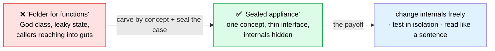
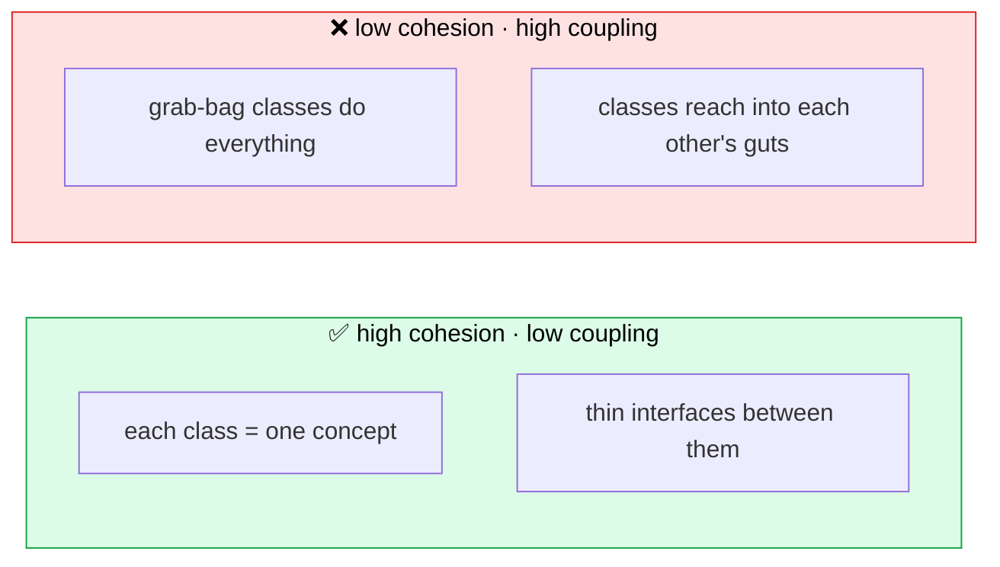
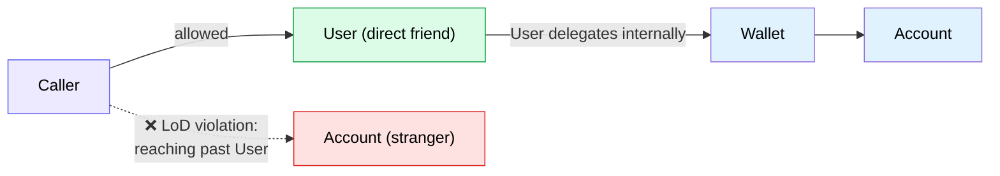
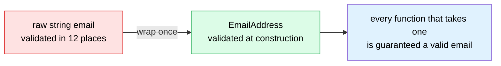
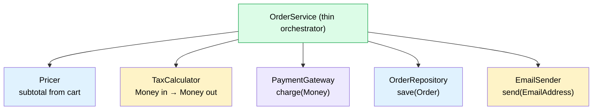

# Class Design

> **One line:** A class is a *watch* — a clean face anyone can read, with the messy gears sealed inside; good class design is the discipline of deciding what belongs behind the glass, what shows on the face, and who is allowed to reach in.

---

## Table of Contents
1. [Why You Must Master This](#1-why-you-must-master-this)
2. [The Mental Model](#2-the-mental-model)
3. [Cohesion &amp; Coupling — the two dials](#3-cohesion--coupling--the-two-dials)
4. [The Law of Demeter — don't talk to strangers](#4-the-law-of-demeter--dont-talk-to-strangers)
5. [Encapsulation &amp; Immutability](#5-encapsulation--immutability)
6. [Primitive Obsession](#6-primitive-obsession)
7. [Worked Example — refactoring a God `OrderService`](#7-worked-example--refactoring-a-god-orderservice)
8. [Real-Life Use Cases](#8-real-life-use-cases)
9. [Failure Modes](#9-failure-modes)
10. [🏋️ Practice Drills](#-practice-drills)
11. [🎤 Interview Q&A Bank](#-interview-qa-bank)
12. [🎯 Staff+ Nuances](#-staff-nuances)
13. [Cheat Sheet](#13-cheat-sheet)
14. [Connections & Further Reading](#14-connections--further-reading)

---

## 1. Why You Must Master This

Classes are the **atomic units** of most backend systems. You can nail the high-level architecture and still ship a codebase that is agony to change — because the failure lives *inside* the classes, one design decision at a time.

- **Poor classes make the whole system brittle.** A beautiful [Modular Monolith](../03_High_Level_Design/Modular_Monolith.md) built from God classes is still a ball of mud — the boundaries just moved one level down.
- **Maintainability is a class-level property.** If it takes 30 minutes to understand what a 400-line class does, that's not a documentation gap — it's a design defect you'll pay for on every edit.
- **Change safety comes from encapsulation.** Good classes let you change *how* something works without touching *who* uses it. Bad classes force a shotgun edit across ten files for one conceptual change.
- **It's the most-tested skill in LLD interviews.** "Design a parking lot / rate limiter / vending machine" is really "show me you can carve a problem into cohesive, loosely-coupled classes."

> **The core problem it solves:** *the drift from "a class models a concept" to "a class is a folder for functions."* It stops the God class that knows everything, the caller that reaches three levels into another object's guts, and the `String` masquerading as an email address.

---

## 2. The Mental Model

A class is a **sealed appliance**. The **face** (public interface) is small, obvious, and hard to misuse; the **gears** (private state and helpers) are complex but hidden. You read the time off a watch without knowing about the escapement — and crucially, *you can't jam the gears from outside*, because the case is sealed.

Two failure directions pull against this ideal: a class that does *too many unrelated things* (low cohesion), and a class that is *wired too tightly into others* (high coupling). Good design pushes both dials to their good ends at once.





---

## 3. Cohesion & Coupling — the two dials

Almost all of class design reduces to two dials you turn in *opposite* directions.

- **Cohesion** — do the parts inside a class genuinely belong together? A high-cohesion `EmailSender` does one thing well. A low-cohesion `Utils` is a grab-bag: parse dates, format currency, hash passwords — a dumping ground with no reason to exist as one unit.
- **Coupling** — how much does this class depend on the *internals* of others? Low coupling means classes interact through thin, stable interfaces; high coupling means a change in class B ripples into A, C, and D.

The target is the **top-left of the classic quadrant: high cohesion + low coupling** — the sweet spot the SVG above contrasts against the tangled opposite.

| Property | Low (bad) | High |
|----------|-----------|------|
| **Cohesion** | `Utils`/`Manager`/`Helper` grab-bags; a class you can't name without "and" | `EmailSender`, `Money`, `RateLimiter` — one crisp concept |
| **Coupling** | reaches into others' fields, `import`s internals, breaks when they change | talks through a small public API; internals are free to change |



**The God class** is the extreme low-cohesion failure: one class that accumulates 50 methods and 5,000 lines because every new feature is "too small to justify its own file." Nobody builds one on purpose — it grows by a thousand locally-reasonable additions. The defense is the same as [Single Responsibility](./SOLID_Principles.md): *one reason to change per class.* If billing rules and email formatting both force edits to the same class, it has two responsibilities and wants to be two classes.

```python
# ❌ LOW cohesion — one God class, five unrelated reasons to change
class OrderManager:
    def calculate_tax(self, order): ...        # tax rules change
    def render_invoice_html(self, order): ...  # presentation changes
    def charge_card(self, order): ...          # payment gateway changes
    def send_confirmation(self, order): ...    # email templates change
    def run_sql(self, query): ...              # persistence changes

# ✅ HIGH cohesion — one concept per class, so one reason to change each:
#    TaxCalculator · InvoiceRenderer · PaymentGateway · EmailSender · OrderRepository
```

> **Cohesion is the harder, more valuable dial.** Low coupling is easy to buy with interfaces; putting *the things that change together, together* is real design judgment — and when you get cohesion right, low coupling usually follows.

---

## 4. The Law of Demeter — don't talk to strangers

The **Law of Demeter (LoD)** — the "principle of least knowledge" — says a method should only talk to its *immediate* friends: `self`, its own fields, its parameters, and objects it creates. It should **not** reach *through* one object to call methods on the object *behind* it. The tell-tale smell is a **train wreck** of chained getters: `a.getB().getC().getD()`.

```python
# ❌ Train wreck — the caller knows Wallet has an Account which has a balance.
#    Three internal structures leak; change any one and this line breaks.
total = user.get_wallet().get_account().get_balance()

# ✅ Tell, don't ask — the caller states intent; User owns the traversal.
total = user.get_total_balance()

class User:
    def __init__(self, wallet: "Wallet") -> None:
        self._wallet = wallet
    def get_total_balance(self) -> "Money":
        return self._wallet.balance()   # if wallet's internals change,
                                        # ONLY this line changes

class Wallet:
    def __init__(self, account: "Account") -> None:
        self._account = account
    def balance(self) -> "Money":
        return self._account.balance()
```

Each chained call is a dependency on a *stranger's internal shape*. LoD trades a few extra delegating methods for the freedom to reorganize internals without a ripple. The related principle is **"Tell, Don't Ask"**: instead of *asking* an object for its data and acting on it, *tell* it to do the work — the logic moves to where the data lives.



> Caveat: LoD is about *behavioral* objects, not data structures / DTOs / fluent builders. `queryBuilder.select().from().where()` is fine — it's one object returning itself, and a `Config` value bag is meant to be read. Apply LoD where objects *encapsulate behavior*, not where they're plain data. See [Interface_Design.md](./Interface_Design.md).

---

## 5. Encapsulation & Immutability

**Encapsulation** is sealing the case: hide state behind methods so the class controls every change to itself. The moment callers mutate your fields directly, your class can no longer guarantee its own invariants — anyone can put it in an illegal state.

```python
# ❌ Exposed state — nothing stops an illegal balance
class Account:
    def __init__(self):
        self.balance = 0
acc = Account()
acc.balance = -999_999   # invariant "balance >= 0" is now unenforceable

# ✅ Encapsulated — the class guards its own invariant
class Account:
    def __init__(self) -> None:
        self._balance = 0
    def withdraw(self, amount: int) -> None:
        if amount > self._balance:
            raise ValueError("insufficient funds")   # invariant protected
        self._balance -= amount
    @property
    def balance(self) -> int:      # read-only view; no setter
        return self._balance
```

**Immutability** takes encapsulation to its logical end: once constructed, the object *cannot change*. Every "modification" returns a new object. This is why Java's `String` is a masterpiece — `s.toUpperCase()` returns a *new* string; you can hand a `String` to any function and know it can't be corrupted underneath you.

| Mutable object | Immutable object (Value Object) |
|----------------|---------------------------------|
| state changes in place | every change returns a new instance |
| must guard against concurrent writes | inherently thread-safe (nothing to race) |
| aliasing bugs (two refs, one changes) | safe to share freely, use as dict keys |
| identity is tricky | equality by *value*, not reference |

```python
from dataclasses import dataclass

@dataclass(frozen=True)   # frozen → immutable, auto __eq__/__hash__
class Money:
    amount_cents: int
    currency: str = "USD"

    def add(self, other: "Money") -> "Money":
        if other.currency != self.currency:
            raise ValueError("currency mismatch")
        return Money(self.amount_cents + other.amount_cents, self.currency)  # new object

price = Money(1000)
total = price.add(Money(250))   # price untouched; total is a new Money(1250)
```

Note the integer `amount_cents` — never `float` for money — plus equality and hashing come free from `frozen=True`, so `Money` is safe as a dict key.

> **Prefer immutability by default; reach for mutability only when you measurably need it.** Immutable objects eliminate an entire class of aliasing and concurrency bugs, and they make [Value Objects](./Domain_Driven_Design.md) trivially correct. This ties directly to [Domain_Driven_Design.md](./Domain_Driven_Design.md)'s distinction: **Value Objects** (equal by value, immutable — `Money`, `DateRange`) vs **Entities** (equal by identity, have a lifecycle — `Order`, `User`).

---

## 6. Primitive Obsession

**Primitive obsession** is modeling domain concepts with raw primitives — `str`, `int`, `float` — instead of small purpose-built types. An email is "just a string" until you realize *every* function that receives it must re-validate it, and nothing stops you passing a phone number where an email was expected.

The fix is to **wrap the primitive in a tiny, self-validating type** (a Value Object). Validation happens *once*, at construction; after that, the type itself is a proof that the value is well-formed.

```python
# ❌ Primitive obsession — every layer must re-check, and the type lies
def send_reset(email: str, user_id: str, amount: float) -> None:
    if "@" not in email: raise ValueError(...)   # re-validated everywhere
    # nothing stops send_reset(user_id, email, ...) — args are interchangeable

# ✅ Domain types — validate ONCE, then the type carries the guarantee
import re
from dataclasses import dataclass

@dataclass(frozen=True)
class EmailAddress:
    value: str
    def __post_init__(self) -> None:
        if not re.fullmatch(r"[^@\s]+@[^@\s]+\.[^@\s]+", self.value):
            raise ValueError(f"invalid email: {self.value!r}")

@dataclass(frozen=True)
class UserId:
    value: str

def send_reset(email: EmailAddress, user_id: UserId, amount: Money) -> None:
    ...   # email is GUARANTEED valid; you physically cannot swap the args
```

| Symptom (primitive obsession) | Cost | Fix |
|-------------------------------|------|-----|
| `str` for email / URL / currency code | validation scattered everywhere | `EmailAddress`, `Url`, `Currency` types |
| `float` for money | rounding bugs, no currency | `Money` value object (integer cents) |
| `(lat, lng)` tuples passed around | argument-order mistakes | `Coordinate` type |
| bare `int` for user vs order id | pass the wrong id, no error | `UserId` / `OrderId` distinct types |
| "magic string" status flags | typos compile fine | `enum` |



> The heuristic: **when a primitive has rules, a unit, or a meaning, give it a type.** A raw `int` that "must be positive and represents cents of USD" is three invisible rules waiting to be violated.

---

## 7. Worked Example — refactoring a God `OrderService`

Start with the class every codebase grows: one `OrderService` that validates, prices, taxes, charges, persists, and emails — low cohesion, high coupling, primitive-obsessed, and Demeter-violating all at once.

```python
# ❌ BEFORE — a God class, five reasons to change, primitives everywhere
class OrderService:
    def place_order(self, cart, user, card_number: str) -> None:
        subtotal = 0.0
        for item in cart.get_lines():
            subtotal += item.get_product().get_price() * item.get_qty()  # train wreck
        tax = subtotal * 0.08                       # magic number, float money
        total = subtotal + tax
        if "@" not in user.email: raise ValueError()   # re-validated here
        db.execute("INSERT INTO orders ...", total)    # SQL inline
        stripe.charge(card_number, total)              # gateway inline
        smtp.send(user.email, f"Paid ${total}")        # email inline
```

Now carve by concept, seal each case, and wire a thin orchestrator:



```python
# ✅ AFTER — cohesive collaborators, Money value object, injected dependencies
class OrderService:
    def __init__(self, pricer, tax, gateway, repo, mailer):
        self._pricer, self._tax = pricer, tax
        self._gateway, self._repo, self._mailer = gateway, repo, mailer

    def place_order(self, cart: "Cart", user: "User") -> "Order":
        subtotal = self._pricer.subtotal(cart)          # Cart owns its traversal
        total = subtotal.add(self._tax.on(subtotal))    # Money, not float
        self._gateway.charge(user.payment_method, total)
        order = self._repo.save(Order(user.id, total))
        self._mailer.send_confirmation(user.email, order)  # EmailAddress, valid
        return order
```

**Concept → consequence.** Each principle bought a concrete property:

| Principle applied | Architectural consequence |
|-------------------|---------------------------|
| Split God class by cohesion | each collaborator has *one reason to change*; edits stop colliding |
| Injected dependencies (not `import`ed) | `place_order` is unit-testable with fakes — no real Stripe/SMTP/DB. See [Dependency_Injection.md](./Dependency_Injection.md) |
| `Money` value object | no float-rounding money bugs; currency checked once |
| `EmailAddress` type | e-mail validated at the edge, guaranteed valid downstream |
| `cart.subtotal()` not `cart.get_lines()...` | Demeter respected — Cart can restructure lines freely |

---

## 8. Real-Life Use Cases

| Situation | How good class design decides the outcome |
|-----------|-------------------------------------------|
| **Swapping a payment provider** | Stripe lives behind a cohesive `PaymentGateway`; low coupling means the swap touches one class, not fifty. |
| **Money in any financial system** | A `Money` value object (integer cents + currency) kills float-rounding and mixed-currency bugs at the type level. |
| **Concurrency / caching** | Immutable value objects are safe to share across threads and safe as cache/dict keys — no defensive copies. |
| **Public API request models** | `EmailAddress`, `UserId` types validate at the boundary; the core never re-checks. See [API_Design_Fundamentals](../02_API_Interface_Design/API_Design_Fundamentals.md). |
| **Onboarding a new engineer** | `user.block_account()` reads like a sentence; `db.update("users", {"blocked":1}, id=u)` reads like a puzzle. |
| **A 1,200-line `UserController`** | Merge-conflict hotspot → split by responsibility so unrelated changes land in different files. |

> Real-world habit: **before adding a method, ask "whose concept is this?"** If it's this class's *other* concept, you're growing a God class — extract instead. And when a primitive carries rules or a unit, wrap it in a type *today*, not after the third validation bug.

---

## 9. Failure Modes

```mermaid
mindmap
  root((Class Design Pitfalls))
    Feature envy
      method uses another object's data more than its own
      logic belongs in the other class
    Inappropriate intimacy
      two classes know each other's privates
      impossible to change one alone
    Deep inheritance
      5-level hierarchy
      change grandparent break 20 children
    God class
      50 methods, low cohesion
      grows one reasonable addition at a time
    Train wreck
      a.getB().getC().getD()
      Law of Demeter violation
    Primitive obsession
      str email, float money
      validation scattered, args swappable
```

- **Feature envy** — a method that reaches for another object's getters and does the calculation itself. *Symptom:* `invoice.calc(customer.getAddress().getCountry()...)`. *Fix:* move the logic to where the data lives (`customer.tax_country()`) — the "Tell, Don't Ask" cure.
- **Inappropriate intimacy** — two classes that read/write each other's private fields, so you can never change one without the other. *Fix:* introduce a clean interface between them, or merge them if they're truly one concept.
- **Deep inheritance** — a hierarchy 5 levels deep where a change to the grandparent silently breaks distant children. *Fix:* **favor composition over inheritance** — inject collaborators instead of extending base classes. See [Object_Oriented_Design.md](./Object_Oriented_Design.md).
- **God class** — 50 methods, many reasons to change. *Fix:* split by responsibility (Section 7); catch it in review as a *pattern* ("this class now changes for three unrelated reasons"), not per-addition.
- **Anemic + over-fragmentation** — the opposite failure: so many trivial pass-through classes that following one operation means hopping through five files. *Fix:* a class must earn its place with real behavior; don't decompose past *meaningful* cohesion.

---

## 🏋️ Practice Drills

> *Cover the solutions and attempt first — active recall is the point.*

**Drill 1 — Spot the smell.** You see `order.getCustomer().getAddress().getCity().getZipCode()` in a shipping-cost method. Name the violation and refactor it.

<details><summary>Solution</summary>

It's a **Law of Demeter** train wreck — the method depends on four levels of internal structure (Customer → Address → City → ZipCode). Change any one and this breaks. Push the responsibility down: give `Order` a `shipping_zip()` (or `Customer` a `zip_code()`) that owns the traversal, and call `order.shipping_zip()`. Bonus: this is also **feature envy** if the shipping cost is computed here from the customer's data — the calc may belong on `Customer`/`Address` (Tell, Don't Ask).
</details>

**Drill 2 — Kill the primitive.** A `transfer(from_id: str, to_id: str, amount: float)` function has shipped three bugs: swapped ids, a rounding error, and a negative transfer. Redesign the signature.

<details><summary>Solution</summary>

**Primitive obsession.** Introduce `AccountId` (distinct type, so `from`/`to` can't be silently swapped) and `Money` (integer cents + currency, validated `> 0` at construction, killing rounding and negatives). New signature: `transfer(src: AccountId, dst: AccountId, amount: Money)`. The compiler/constructor now prevents all three bug classes *before* runtime — validate once, trust everywhere.
</details>

**Drill 3 — Cohesion audit.** A `UserManager` has `hash_password`, `send_welcome_email`, `format_profile_html`, `run_analytics_report`, and `save_to_db`. Is this one class? Split it.

<details><summary>Solution</summary>

No — it's a **low-cohesion God class** ("Manager" is a red flag). Five unrelated reasons to change: security (`hash_password`), messaging (`send_welcome_email`), presentation (`format_profile_html`), analytics (`run_analytics_report`), persistence (`save_to_db`). Split into `PasswordHasher`, `EmailSender`, `ProfileRenderer`, `AnalyticsReporter`, and `UserRepository`, leaving `User` as the cohesive domain concept. Each now has one reason to change and is independently testable.
</details>

**Drill 4 — Mutable trap.** A `DateRange(start, end)` is passed to a caching layer, which stores it as a dict key; later, another part of the code mutates `range.end`. What breaks, and what's the fix?

<details><summary>Solution</summary>

Mutating a value used as a dict/cache key corrupts the map — the object's hash changes after insertion, so lookups miss and entries leak (an **aliasing bug**). Fix: make `DateRange` an **immutable value object** (`@dataclass(frozen=True)`); "changing" it returns a new range. Immutable objects are inherently safe to share, cache, and use as keys — no defensive copies needed.
</details>

---

## 🎤 Interview Q&A Bank

**Q1. What makes a class "clean"?**
> High cohesion (one crisp concept, nameable without "and"), low coupling (depends on others' interfaces, not internals), strong encapsulation (hidden state, enforced invariants), and a small, hard-to-misuse public interface — a sealed appliance with a simple face. *(signal: reduces it to cohesion + coupling + encapsulation, not just "small classes")*

**Q2. Explain cohesion vs coupling.**
> Cohesion = how related a class's internal parts are (high is good — an `EmailSender` that only sends email). Coupling = how dependent classes are on each other's internals (low is good — thin interfaces). Target: high cohesion + low coupling; cohesion is the harder, more valuable dial. *(signal: cohesion is intra-class, coupling is inter-class)*

**Q3. What is the Law of Demeter?**
> "Don't talk to strangers" — call methods only on `self`, own fields, parameters, and objects you create, never chaining *through* a returned object (`a.getB().getC()`). It limits how much internal structure a caller depends on, so you can reorganize internals without breaking callers. Caveat: applies to behavioral objects, not DTOs or fluent builders. *(signal: names the train-wreck smell AND the DTO/builder exception)*

**Q4. When would you make a class immutable, and why?**
> By default for value objects (`Money`, `DateRange`, `EmailAddress`). Immutability kills aliasing bugs (no one changes it under you), is inherently thread-safe, and is safe to share and use as dict/cache keys. Reach for mutability only for lifecycle objects (entities) or when profiling proves allocation is a real cost. *(signal: ties immutability to concurrency + value objects)*

**Q5. What is primitive obsession and how do you fix it?**
> Modeling domain concepts with raw primitives (`str` email, `float` money), scattering validation and letting you swap arguments silently. Fix: wrap the primitive in a small self-validating Value Object that validates once at construction — after that, the type *is* the guarantee. *(signal: "validate once, trust the type after")*

**Q6. How do you spot and fix a God class?**
> Count its reasons to change — multiple unrelated ones (billing *and* email *and* persistence), often confirmed by it being a merge-conflict hotspot you can't name without "and." Fix: extract each responsibility into a cohesive class and leave a thin orchestrator. Catch it in review as a *pattern*, since it accretes one reasonable addition at a time. *(signal: SRP as "one reason to change")*

**Q7. Composition or inheritance — which and why?**
> Favor composition. Deep inheritance couples children to a base's internals, so a grandparent change silently breaks distant children (fragile base class). Composition (inject collaborators) keeps coupling explicit and swappable. Use inheritance only for genuine "is-a" polymorphism with a stable base. *(signal: names the fragile-base-class problem)*

**Q8. "Tell, Don't Ask" — what does it mean?**
> Instead of asking an object for its data and acting on it externally (which pulls logic from the data and often violates Demeter), tell it to do the work: `account.withdraw(amount)`, not `if account.balance >= amount: account.balance -= amount`. It keeps behavior next to state and preserves invariants. *(signal: links to encapsulation + feature envy)*

---

## 🎯 Staff+ Nuances

- **Cohesion comes from *forces of change*, not surface similarity.** Two methods that "both touch the user" may change for different reasons (auth vs. billing) and belong apart; two that look unrelated may always change together and belong in one. This is [SRP](./SOLID_Principles.md)'s deeper reading — group by *who requests the change*, the same judgment as bounded contexts one level up ([Domain_Driven_Design.md](./Domain_Driven_Design.md)).
- **Value Object vs Entity shapes everything downstream.** Equal-by-value + immutable (`Money`) vs. equal-by-identity + lifecycle (`Order`). Get it wrong and you build mutable "money" (rounding/aliasing bugs) or identity-less entities (lost updates). It dictates equality, hashing, persistence, and thread-safety. See [Domain_Driven_Design.md](./Domain_Driven_Design.md).
- **Encapsulation leaks through getters that return mutable internals.** A `get_items()` handing back the *live* internal list lets callers mutate your state behind your back — a subtle intimacy violation. Return copies, read-only views, or expose behavior (`add_item`) instead of the collection.
- **Deep modules beat many shallow ones (Ousterhout).** SRP is not "maximize class count." A good class has a *simple interface over substantial behavior*; over-decomposition into anemic pass-throughs trades a God class for five-files-to-follow-one-op. Balance against [Interface_Design.md](./Interface_Design.md).
- **Prefer immutability, but know its costs.** Immutable objects create garbage under high-churn loops and need `with`-style copies for multi-field updates. In hot paths a mutable object can be right — make it a *measured* exception, not the default.
- **Inject dependencies; don't construct them.** A class that `new`s its own collaborators (`self.gateway = StripeGateway()`) is hard-coupled and untestable. Constructor-inject so it depends on an *abstraction* and tests pass fakes — where class design meets [Dependency_Injection.md](./Dependency_Injection.md) and Dependency Inversion.
- **"Manager", "Helper", "Util", "Processor" are naming smells.** A class you can only name with a vague noun usually has no single concept — the name is admitting low cohesion. If you can't give it a precise domain name, you haven't found its real boundary yet.

---

## 13. Cheat Sheet

```
CLASS = a sealed appliance: simple face (public API), hidden gears (state), can't be jammed from outside.

THE TWO DIALS  (push in opposite directions)
  cohesion   HIGH  → one crisp concept, nameable without "and"   (the harder, more valuable dial)
  coupling   LOW   → depend on interfaces, not internals
  sweet spot = high cohesion + low coupling.  God class = the low-cohesion extreme.

LAW OF DEMETER  "don't talk to strangers": call only self · own fields · params · things you create.
  ❌ a.getB().getC().getD()  (train wreck)     ✅ a.do_the_thing()   ← Tell, Don't Ask
  EXCEPTION: DTOs / value bags / fluent builders (queryBuilder.select().from()) are fine.

ENCAPSULATION  hide state, enforce invariants (no public setters that break rules).
IMMUTABILITY   default for VALUE OBJECTS → thread-safe, no aliasing bugs, safe as keys.
               Value Object (equal by value, immutable: Money) vs Entity (equal by identity: Order)

PRIMITIVE OBSESSION  str email / float money / (lat,lng) tuple / bare int id
  → wrap in a tiny self-validating type. VALIDATE ONCE at construction, trust the type after.

COMPOSITION > INHERITANCE.  Inject dependencies (don't `new` them) → testable, low coupling.

SMELLS: God class · feature envy · inappropriate intimacy · deep inheritance · train wreck ·
        primitive obsession · "Manager/Util/Helper" names · getter returning live internals
```

---

## 14. Connections & Further Reading

**Within this repo:**
- [SOLID_Principles.md](./SOLID_Principles.md) — especially **SRP** (one reason to change), the backbone of cohesion at the class level.
- [Object_Oriented_Design.md](./Object_Oriented_Design.md) — composition over inheritance and the OO fundamentals this builds on.
- [Interface_Design.md](./Interface_Design.md) — the thin public "face" that keeps coupling low; [Dependency_Injection.md](./Dependency_Injection.md) — how classes get their collaborators without hard-coupling.
- [Domain_Driven_Design.md](./Domain_Driven_Design.md) — **Value Objects vs Entities**, the modeling decisions behind immutability and primitive obsession.
- [Component_Responsibilities.md](../03_High_Level_Design/Component_Responsibilities.md) & [Modular_Monolith.md](../03_High_Level_Design/Modular_Monolith.md) — the same cohesion/coupling ideas one zoom level up.

**External classics:**
- *Refactoring* (Martin Fowler) — the [catalog of code smells](https://refactoring.com/catalog/) (feature envy, primitive obsession, inappropriate intimacy) and their cures.
- [The Law of Demeter](https://www2.ccs.neu.edu/research/demeter/demeter-method/LawOfDemeter/paper-boy/demeter.pdf) (Lieberherr & Holland) — the original "principle of least knowledge."
- *A Philosophy of Software Design* (John Ousterhout) — deep vs. shallow modules; *Clean Code*, Ch. 10 "Classes" (Robert C. Martin) — [SourceMaking: Code Smells](https://sourcemaking.com/refactoring/smells) as an online companion.

---

## TL;DR
A well-designed class is a **sealed appliance modeling one concept**: a small, hard-to-misuse public face over hidden, self-guarding internals. Turn the two dials to their good ends — **high cohesion** (things that change together live together — the harder, more valuable dial) and **low coupling** (depend on *what*, not *how*). **Obey the Law of Demeter** (don't chain through strangers — tell, don't ask), **encapsulate state and prefer immutability** for value objects (thread-safe, no aliasing bugs), and **kill primitive obsession** by wrapping meaningful primitives in tiny self-validating types (validate once, trust the type after). The two enemies are the **God class** (low cohesion, grown one reasonable addition at a time) and **over-fragmentation** (anemic pass-through classes) — so **give every class one clear concept, inject its collaborators, and favor composition over inheritance.**
