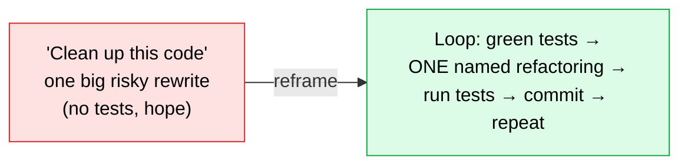
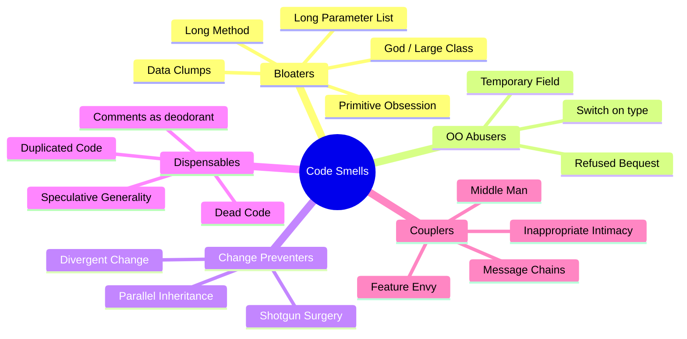
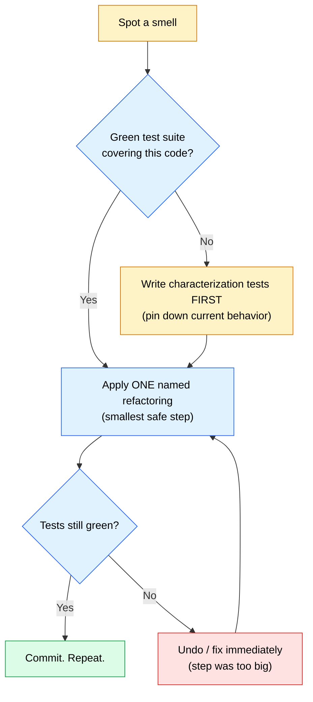
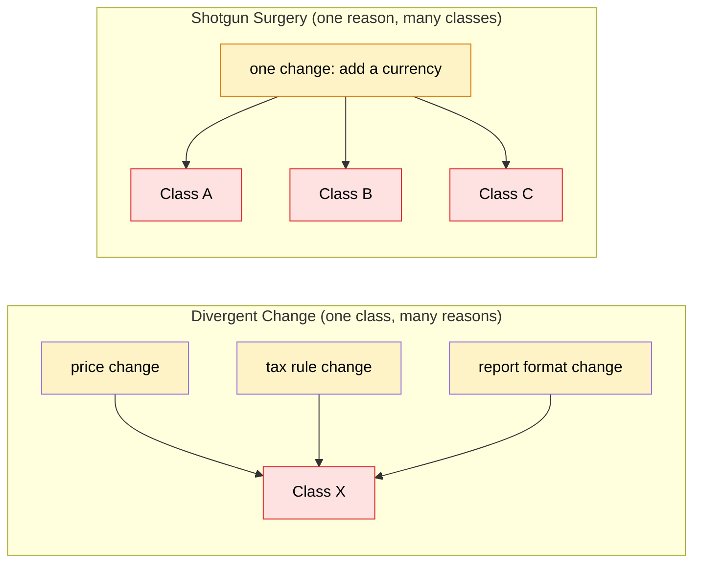
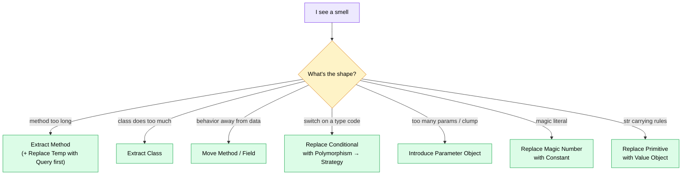
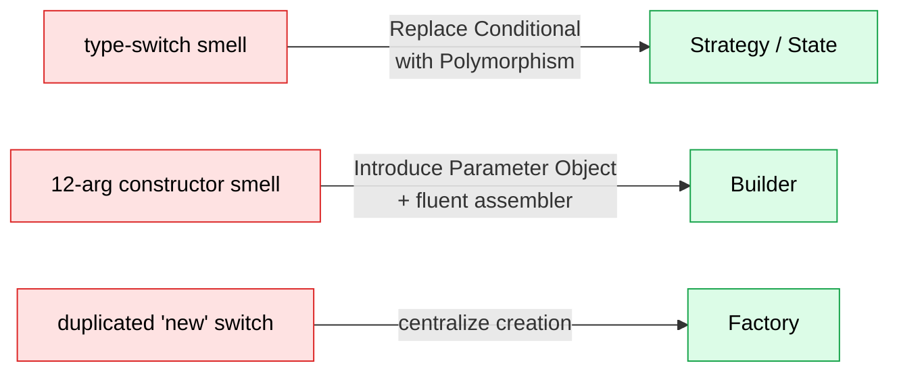
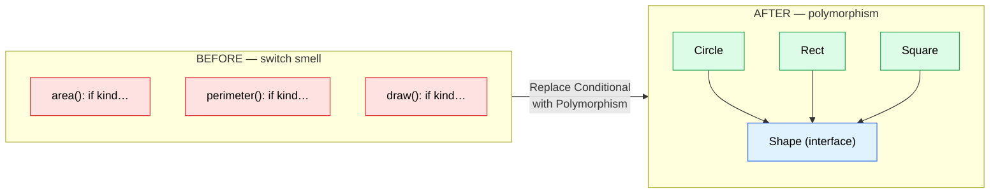
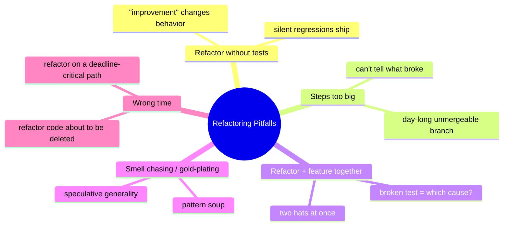

# Code Smells & Refactoring

> **One line:** A code smell is a surface symptom that hints at a deeper design disease, and a refactoring is the disciplined, behavior-preserving move that cures it — the whole loop being *smell → named refactoring → measurable improvement*, always performed under a green test suite.

---

## Table of Contents
1. [Why You Must Master This](#1-why-you-must-master-this)
2. [The Mental Model](#2-the-mental-model)
3. [What Refactoring Actually Is (and Isn't)](#3-what-refactoring-actually-is-and-isnt)
4. [Bloaters — Things That Grew Too Big](#4-bloaters--things-that-grew-too-big)
5. [Object-Orientation Abusers](#5-object-orientation-abusers)
6. [Change Preventers](#6-change-preventers)
7. [Dispensables — Things That Should Not Exist](#7-dispensables--things-that-should-not-exist)
8. [Couplers — Classes That Know Too Much of Each Other](#8-couplers--classes-that-know-too-much-of-each-other)
9. [The Core Refactoring Moves](#9-the-core-refactoring-moves)
10. [Refactoring TO Patterns](#10-refactoring-to-patterns)
11. [Worked Example — Type-Switch → Strategy](#11-worked-example--type-switch--strategy)
12. [Real-Life Use Cases](#12-real-life-use-cases)
13. [Failure Modes](#13-failure-modes)
14. [🏋️ Practice Drills](#-practice-drills)
15. [🎤 Interview Q&A Bank](#-interview-qa-bank)
16. [🎯 Staff+ Nuances](#-staff-nuances)
17. [Cheat Sheet](#17-cheat-sheet)
18. [Connections & Further Reading](#18-connections--further-reading)

---

## 1. Why You Must Master This

Nearly every LLD/OOD interview opens with the same warm-up: *"here's some working code — improve it."* It looks trivial and it is the highest-signal question in the round, because it silently grades whether you can **see** design problems and **name** the surgical move that fixes each one, without breaking behavior.

- **It is the fastest signal of seniority.** A junior rewrites the whole function from vibes; a senior says "that's Feature Envy — I'd Move Method to the class that owns the data" and touches three lines. Naming the smell *and* the refactoring separates "I have opinions about code" from "I have a repeatable engineering process."
- **It is your daily job, not a party trick.** The famous cost curve: a smell left in place doesn't stay constant — it compounds. A [God Class](#4-bloaters--things-that-grew-too-big) that everyone edits becomes a merge-conflict magnet and the single riskiest file in the repo. Real outages trace back to "nobody understood that 800-line method well enough to change it safely."
- **It is refactoring's whole safety story.** Martin Fowler's definition is load-bearing: refactoring changes *structure* while **preserving observable behavior**. That is only true if a test suite proves behavior didn't move. "Refactoring without tests" is not refactoring — it is rewriting and praying.
- **It connects everything else you know.** Smells are [SOLID](./SOLID_Principles.md) violations you can see with your eyes, refactorings are the mechanical route back to SOLID, and the destination is often a [design pattern](./Design_Patterns_Overview.md). This file is the connective tissue between principles and patterns.

> **The core problem it solves:** how to keep a codebase *cheap to change* as it grows — by continuously trading small, safe, test-guarded structural improvements for the compounding interest of accumulated design debt.

**Prerequisites:** [SOLID_Principles.md](./SOLID_Principles.md) (smells are visible SOLID violations) and [Class_Design.md](./Class_Design.md) (cohesion, coupling, and the Law of Demeter — the vocabulary for *why* a smell hurts).

---

## 2. The Mental Model

Think like a doctor, not a demolition crew. A **smell** is a symptom (a fever), not the disease itself and not a bug — the code *works*. The smell tells you *where to look* and *what class of problem* is likely. The **refactoring** is the treatment: a named, rehearsed procedure with a known outcome. You never improvise surgery, and you never operate without vitals — the **test suite is the heart monitor** that must stay green through every step.

The naive view treats "clean up the code" as one big scary rewrite. The right view is a tight, boring loop of tiny reversible steps:



The five smell families (Fowler's taxonomy) map to *what went wrong*, which points at *the family of cures*:



> **Hold onto this:** a smell is a *hint*, not a *rule*. Its job is to make you look. The refactoring is the *move*. The green test suite is the *permission* to make the move. Smell → refactoring → run tests → commit, in the smallest step that keeps the bar green.

---

## 3. What Refactoring Actually Is (and Isn't)

**Refactoring** (Fowler): *a change to the internal structure of software to make it easier to understand and cheaper to modify **without changing its observable behavior**.* Two words carry all the weight:

- **Observable behavior** — same inputs produce same outputs, same side effects, same public API. If the outside world can tell you changed something, it wasn't a refactoring; it was a behavior change (a feature or a bug).
- **Structure** — names, boundaries, duplication, coupling, cohesion. The stuff the compiler doesn't care about but the next engineer does.

This is why the discipline is inseparable from tests. The loop:



**What refactoring is NOT:** adding features, fixing bugs, optimizing performance, or "the big rewrite." The **Two Hats** rule (Kent Beck): at any moment you are *either* adding behavior *or* refactoring — never both in the same commit, because if a test breaks you must instantly know which hat caused it. Small steps are not timidity; they are how you keep the "which change broke it?" search space at exactly one change.

> The discipline in one sentence: **refactor on green, in the smallest step, with one hat on, committing after each successful step.**

---

## 4. Bloaters — Things That Grew Too Big

Bloaters accrete over time — nobody writes a 900-line class on Monday; it arrives one "just add this here" at a time. The unifying disease is **low cohesion**: a unit does too many unrelated things.

| Smell | Symptom you can see | Why it hurts | Named refactoring(s) |
|-------|---------------------|--------------|----------------------|
| **God / Large Class** | One class with 20+ fields, dozens of methods, "Manager"/"Util" in the name | Violates [SRP](./SOLID_Principles.md); merge-conflict magnet; nobody understands it whole | **Extract Class**, **Extract Subclass**, **Extract Interface** |
| **Long Method** | Scroll to read one method; comments section it into "chapters" | Can't reuse pieces; can't test branches in isolation; high cyclomatic complexity | **Extract Method**, **Replace Temp with Query**, **Decompose Conditional** |
| **Long Parameter List** | `f(a, b, c, d, e, f, g)`; callers pass values they had to look up | Hard to call correctly; order bugs; signals a missing concept | **Introduce Parameter Object**, **Preserve Whole Object** |
| **Primitive Obsession** | `str` for money/email/phone; validation scattered at every use site | No home for rules; same validation duplicated; illegal states representable | **Replace Primitive with Value Object**, **Replace Type Code with Class** |
| **Data Clumps** | The same 3–4 fields travel together everywhere (`x, y` / `start, end` / `street, city, zip`) | They *are* a hidden concept; changing the group means touching every site | **Extract Class** / **Introduce Parameter Object** |

**Long Method** is the most common and the gateway drug. The fix is almost always **Extract Method**: pull a coherent block into a well-named method so the original reads like a table of contents.

```python
# SMELL: Long Method — one method doing parse + validate + total + format
def print_invoice(order: dict) -> str:
    total = 0.0
    for line in order["lines"]:                 # ── chapter 1: compute total
        total += line["qty"] * line["unit_price"]
    if order["customer"]["tier"] == "gold":     # ── chapter 2: discount
        total *= 0.9
    header = f"Invoice for {order['customer']['name']}"   # ── chapter 3: format
    return f"{header}\nTOTAL: ${total:.2f}"

# CURE: Extract Method — each "chapter" becomes a named, testable step
def print_invoice(order: dict) -> str:
    total = _apply_discount(_line_total(order), order["customer"]["tier"])
    return _format(order["customer"]["name"], total)

def _line_total(order: dict) -> float:
    return sum(l["qty"] * l["unit_price"] for l in order["lines"])

def _apply_discount(total: float, tier: str) -> float:
    return total * 0.9 if tier == "gold" else total   # WHY: isolate the rule

def _format(name: str, total: float) -> str:
    return f"Invoice for {name}\nTOTAL: ${total:.2f}"
```

**Primitive Obsession** and **Data Clumps** are the same insight from two angles: when primitives always travel together or a bare `str` carries hidden rules, there is a **missing type**. Give it a home (a Value Object), and validation stops being copy-pasted at every call site.

```python
from dataclasses import dataclass

# SMELL: Primitive Obsession — email is a str; every caller re-validates
def register(email: str) -> None:
    if "@" not in email:            # this check is duplicated in 6 places
        raise ValueError("bad email")
    ...

# CURE: Replace Primitive with Value Object — validation lives in ONE place
@dataclass(frozen=True)             # frozen → immutable, safe to share
class Email:
    value: str
    def __post_init__(self) -> None:
        if "@" not in self.value:   # illegal Email is now UNREPRESENTABLE
            raise ValueError(f"bad email: {self.value}")

def register(email: Email) -> None: # type system now guarantees validity
    ...
```

> Bloater rule of thumb: if you need a **comment to explain a *section*** of a method or class, that section wants to be its own named method or class. The comment is naming a boundary — make the boundary real.

---

## 5. Object-Orientation Abusers

These smells arise when OO features are half-used or misused — the shape is object-oriented but the substance fights it.

| Smell | Symptom | Why it hurts | Named refactoring |
|-------|---------|--------------|-------------------|
| **Switch Statements** (type switch) | `if type == "A" … elif type == "B" …` repeated on the *same* type code in many places | Every new type edits every switch (violates OCP); switches drift out of sync | **Replace Conditional with Polymorphism** (→ Strategy/State) |
| **Refused Bequest** | Subclass inherits methods/fields it doesn't want and overrides them to throw/no-op | Inheritance implies "is-a"; refusal means it isn't → LSP violation | **Replace Inheritance with Delegation** (favor [composition](./Composition_vs_Inheritance.md)) |
| **Temporary Field** | A field set only during one operation, `None`/empty the rest of the time | Confuses readers; hidden state coupling; NPE landmines | **Extract Class** (a Method Object holding the transient state) |

**Switch on a type code** is *the* smell interviewers love, because the cure is [Replace Conditional with Polymorphism](#11-worked-example--type-switch--strategy) — see the full worked example in §11. The tell isn't a single `switch`; it's the *same* type discrimination appearing in `area()`, then `perimeter()`, then `draw()`. Each concrete type should own its behavior in its own class.

**Refused Bequest** is the inheritance version of a lie. If `Penguin(Bird)` has to override `fly()` to raise, the hierarchy modeled the wrong axis. This is a direct Liskov Substitution violation — see [SOLID_Principles.md](./SOLID_Principles.md) — and the cure is usually to stop inheriting and instead *delegate* to (or compose) the capability. See [Composition_vs_Inheritance.md](./Composition_vs_Inheritance.md) on when inheritance is the wrong tool.

> These smells share a root: they use conditionals or inheritance where **polymorphism or composition** was the right tool. The cure moves behavior *into the objects that own the data.*

---

## 6. Change Preventers

The most expensive family, because they attack the one property that matters most: how cheaply the code absorbs change. The diagnostic is the *shape of your diff* when you make a change.



| Smell | Symptom | Root cause | Named refactoring |
|-------|---------|-----------|-------------------|
| **Divergent Change** | *One* class is edited for *many* unrelated reasons | Too many responsibilities crammed together (low cohesion, SRP) | **Extract Class** — split along the reasons-to-change axis |
| **Shotgun Surgery** | *One* logical change forces edits across *many* classes | A single responsibility is smeared across the codebase | **Move Method / Move Field** to gather it, then **Inline Class** |
| **Parallel Inheritance Hierarchies** | Every new subclass of A forces a matching new subclass of B | Two hierarchies encode the same variation twice | **Move Method/Field** to merge, collapse one hierarchy |

Divergent Change and Shotgun Surgery are **duals**: one is "too much crammed in one place," the other is "one thing scattered across many places." The unifying goal is the SRP heuristic *"things that change together should live together; things that change for different reasons should be split apart."* Fix them by moving code so that each *reason to change* maps to exactly one place. See cohesion in [Class_Design.md](./Class_Design.md).

> Diagnostic habit: after making a change, **look at your diff**. Many files touched for one feature → Shotgun Surgery. The same file touched for the third unrelated feature this month → Divergent Change.

---

## 7. Dispensables — Things That Should Not Exist

Pure subtraction. The cure is almost always **delete** — the most underrated refactoring, and the only one that makes the codebase strictly smaller.

| Smell | Symptom | Why it hurts | Named refactoring |
|-------|---------|--------------|-------------------|
| **Duplicated Code** | Same/similar logic in 2+ places | Fix a bug once, it survives in the copies; changes must be synchronized | **Extract Method** / **Extract Class** / **Pull Up Method** |
| **Dead Code** | Unreachable branches, unused methods, commented-out blocks | Cognitive load; readers assume it matters; hides real code | **Delete it** (git remembers) |
| **Speculative Generality** | Abstractions/hooks/params "for the future" with one implementation | You pay indirection cost now for flexibility that never arrives (YAGNI) | **Collapse Hierarchy**, **Inline Class**, **Remove Parameter** |
| **Comments (as deodorant)** | Comments explaining *what* confusing code does | The comment masks a bad name/structure instead of fixing it | **Extract Method** with an intention-revealing name; **Rename** |

**Duplicated Code** is the smell the whole discipline was built to kill — DRY ("Don't Repeat Yourself"). But note the nuance staff engineers hold: duplication is only a smell when the copies represent the *same decision* and must change together. Two lines that look alike but change for different reasons are **coincidental duplication** — merging them creates a Change Preventer. See §16.

**Comments as deodorant** is the subtle one. A comment that explains *what* the code does is a confession that the code doesn't say it itself:

```python
# SMELL: comment compensating for an opaque expression
# check if user is eligible for the loyalty discount
if u.orders > 10 and u.since_days > 365 and not u.flagged:
    ...

# CURE: Extract Method — the name replaces the comment, and is reusable + testable
if _is_loyalty_eligible(u):
    ...

def _is_loyalty_eligible(u: User) -> bool:      # the name IS the documentation
    return u.orders > 10 and u.since_days > 365 and not u.flagged
```

Comments that explain **why** (a non-obvious business rule, a link to a ticket, a warning) are valuable and should stay. Comments that explain **what** are a smell.

> Speculative Generality is the anti-smell to keep in tension with everything else: the cure for most smells is *more* structure, but sometimes the code already has too much structure built for a future that never came. **Delete the unused abstraction** — YAGNI.

---

## 8. Couplers — Classes That Know Too Much of Each Other

Couplers are excessive coupling made visible. The governing principle is the **Law of Demeter** ("only talk to your immediate friends") — see [Class_Design.md](./Class_Design.md).

| Smell | Symptom | Why it hurts | Named refactoring |
|-------|---------|--------------|-------------------|
| **Feature Envy** | A method uses another object's data more than its own | Behavior lives away from its data; low cohesion | **Move Method** (to the class it envies) |
| **Inappropriate Intimacy** | Two classes reach into each other's privates / internals | Can't change one without the other; they're secretly one class | **Move Method/Field**, **Extract Class**, **Change Bidirectional to Unidirectional** |
| **Message Chains** | `a.getB().getC().getD().doThing()` | Caller coupled to the whole navigation path; breaks if any link changes | **Hide Delegate** (Law of Demeter), **Extract Method** |
| **Middle Man** | A class that only forwards calls to another | Pointless indirection; the delegate should be exposed | **Remove Middle Man** (inline the forwarding) |

**Feature Envy** and **Message Chains** are the two you'll be asked to name most.

```python
# SMELL: Feature Envy — Order reaches deep into Customer.address to do Customer's job
class Order:
    def shipping_label(self) -> str:
        c = self.customer
        return f"{c.address.street}, {c.address.city}, {c.address.zip}"  # envy!

# CURE: Move Method — the behavior belongs with the data it uses
class Address:
    def formatted(self) -> str:                 # behavior now sits on its data
        return f"{self.street}, {self.city}, {self.zip}"

class Order:
    def shipping_label(self) -> str:
        return self.customer.address.formatted()   # ask, don't reach
```

**Message Chains** (`a.getB().getC().getD()`) violate the Law of Demeter: the caller is welded to a navigation path through objects it shouldn't know about. The cure is **Hide Delegate** — the immediate friend exposes a method that does the walking internally, so callers depend only on their neighbor.

Note the built-in tension: over-applying Hide Delegate creates **Middle Man** (a class that does nothing but forward). Couplers come in opposing pairs, and the skill is finding the balance — enough delegation to hide navigation, not so much that classes become empty forwarders.

> Coupler heuristic: **"Tell, Don't Ask."** Don't pull data out of an object to act on it; tell the object to act. If a method is more interested in another class's data than its own, move it there.

---

## 9. The Core Refactoring Moves

You don't need all ~70 of Fowler's refactorings. A handful covers the vast majority of interview and real-world situations. Each is a mechanical, reversible move with a named outcome.

| Refactoring | What it does | The smell it cures | Result |
|-------------|--------------|--------------------|--------|
| **Extract Method** | Pull a code block into a named method | Long Method, Duplicated Code, Comments | Readable, reusable, testable unit |
| **Extract Class** | Split responsibilities into a new class | God Class, Divergent Change, Data Clumps | Higher cohesion, SRP restored |
| **Move Method / Move Field** | Relocate to the class that uses it most | Feature Envy, Shotgun Surgery | Behavior sits with its data |
| **Replace Conditional with Polymorphism** | Type-switch → subclass/strategy per type | Switch Statements | OCP: new type = new class |
| **Replace Temp with Query** | Replace a local temp with a method call | Long Method (enables Extract Method) | No shared mutable temp; composable |
| **Introduce Parameter Object** | Group parameters into one object | Long Parameter List, Data Clumps | Named concept; fewer args |
| **Replace Magic Number with Symbolic Constant** | `0.9` → `GOLD_DISCOUNT` | Mysterious literals | Self-documenting; single source |
| **Replace Primitive with Value Object** | Wrap a primitive in a typed class | Primitive Obsession | Validation & behavior get a home |

**Extract Method** is the workhorse — most other refactorings use it as a sub-step. Its enabler is **Replace Temp with Query**: local temporaries block extraction because the extracted method can't see them, so you first turn the temp into a query method, then extraction is trivial.

**Replace Magic Number with Symbolic Constant** is the cheapest, highest-ratio move:

```python
# SMELL: magic numbers — what is 0.9? what is 86400?
price = base * 0.9
if elapsed > 86400: expire()

# CURE: names explain intent AND become the single point of change
GOLD_DISCOUNT_RATE = 0.9          # WHY: business rule, changes as one edit
SECONDS_PER_DAY = 86_400
price = base * GOLD_DISCOUNT_RATE
if elapsed > SECONDS_PER_DAY: expire()
```

**Introduce Parameter Object** kills Long Parameter List *and* Data Clumps at once — when the same cluster of arguments keeps traveling together, they're a concept in disguise:

```python
from dataclasses import dataclass

# SMELL: Long Parameter List + Data Clump (start/end always together)
def book(room: str, start_year: int, start_month: int, start_day: int,
         end_year: int, end_month: int, end_day: int) -> None: ...

# CURE: Introduce Parameter Object — the clump was a DateRange all along
@dataclass(frozen=True)
class DateRange:
    start: date
    end: date
    def nights(self) -> int:              # bonus: behavior now has a home
        return (self.end - self.start).days

def book(room: str, stay: DateRange) -> None: ...   # 7 args → 2
```

The decision of *which* move to reach for follows the smell:



> The moves compose: **Replace Temp with Query** unblocks **Extract Method**, which unblocks **Extract Class**, which restores SRP. Big refactorings are just long chains of tiny ones, each run under green tests.

---

## 10. Refactoring TO Patterns

Refactorings have destinations. Applied repeatedly, they converge on the [design patterns](./Design_Patterns_Overview.md) — Joshua Kerievsky's insight in *Refactoring to Patterns*: **evolve toward a pattern when the pain justifies it, don't install it speculatively.** Two canonical journeys:

| Starting smell | Refactoring sequence | Destination pattern |
|----------------|----------------------|---------------------|
| **Switch on a type code**, repeated across methods | Extract Method per branch → Replace Conditional with Polymorphism | **Strategy** / **State** (see [Behavioral_Design_Patterns.md](./Behavioral_Design_Patterns.md)) |
| **Growing constructor** / telescoping args / Long Parameter List | Introduce Parameter Object → extract a fluent assembler | **Builder** (see [Creational_Design_Patterns.md](./Creational_Design_Patterns.md)) |
| **Duplicated conditional creation** (`if kind == …: new X`) | Extract Method → centralize the `new` | **Factory** |
| **A class that only forwards + adds behavior** | Extract Interface → wrap | **Decorator** |



The critical discipline: patterns are the *destination*, not the *starting point*. Installing a Strategy hierarchy when there's exactly one algorithm is [Speculative Generality](#7-dispensables--things-that-should-not-exist) — you paid the pattern's indirection tax for flexibility you don't have. Refactor *to* the pattern when the second and third variants actually arrive and the switch-statement pain is real.

> Rule: **let the smell pull you toward the pattern.** A second type in the switch is a whisper; a third is a shout — *now* Replace Conditional with Polymorphism, landing on Strategy.

---

## 11. Worked Example — Type-Switch → Strategy

The archetypal "improve this code" answer. We start with a type-switch smell (an [OO Abuser](#5-object-orientation-abusers)) and end at the Strategy/polymorphism pattern via **Replace Conditional with Polymorphism** — each step under green tests.

**Step 0 — pin behavior with a test (permission to refactor):**

```python
def test_area():                              # characterization test FIRST
    assert abs(area({"kind": "circle", "r": 2}) - 12.566) < 0.01
    assert area({"kind": "rect", "w": 3, "h": 4}) == 12
    assert area({"kind": "square", "s": 5}) == 25
```

**Before — the smell.** Note the *same* `kind` switch will reappear in `perimeter()`, `draw()`, `describe()`… every new shape edits every function (OCP violation, switches drift):

```python
def area(shape: dict) -> float:
    if shape["kind"] == "circle":                 # ── switch on a type code
        return 3.14159 * shape["r"] ** 2
    elif shape["kind"] == "rect":
        return shape["w"] * shape["h"]
    elif shape["kind"] == "square":
        return shape["s"] ** 2
    raise ValueError(f"unknown shape: {shape['kind']}")
```

**After — Replace Conditional with Polymorphism.** Each branch becomes a class that owns its own behavior. Adding a shape is now *one new class*; no existing code changes (Open/Closed):

```python
from abc import ABC, abstractmethod
from dataclasses import dataclass
import math

class Shape(ABC):                          # the seam where variation lives
    @abstractmethod
    def area(self) -> float: ...
    @abstractmethod
    def perimeter(self) -> float: ...      # future behavior: no new switch needed

@dataclass(frozen=True)
class Circle(Shape):
    r: float
    def area(self) -> float:      return math.pi * self.r ** 2
    def perimeter(self) -> float: return 2 * math.pi * self.r

@dataclass(frozen=True)
class Rect(Shape):
    w: float; h: float
    def area(self) -> float:      return self.w * self.h
    def perimeter(self) -> float: return 2 * (self.w + self.h)

@dataclass(frozen=True)
class Square(Shape):
    s: float
    def area(self) -> float:      return self.s ** 2
    def perimeter(self) -> float: return 4 * self.s

# The former switch survives ONLY at the boundary, as a Factory (one place).
def make_shape(data: dict) -> Shape:
    match data["kind"]:                    # the last remaining conditional
        case "circle": return Circle(data["r"])
        case "rect":   return Rect(data["w"], data["h"])
        case "square": return Square(data["s"])
        case _:        raise ValueError(f"unknown shape: {data['kind']}")

# Callers are now polymorphic — zero branching:
shapes = [Circle(2), Rect(3, 4), Square(5)]
print(sum(s.area() for s in shapes))       # each shape knows its own area
```

**Concept → consequence.** The scattered `if kind == …` collapses into polymorphic dispatch. Where before adding a `Triangle` meant editing `area()`, `perimeter()`, and every other switch (and risking one drifting out of sync), it now means writing **one `Triangle(Shape)` class** — the whole point of Strategy/polymorphism and the [Open/Closed Principle](./SOLID_Principles.md). The one surviving `match` lives at the construction boundary (a Factory), which is where translating external data into objects legitimately belongs. See [Design_Patterns_Overview.md](./Design_Patterns_Overview.md) for the Strategy/State treatment this lands on.



---

## 12. Real-Life Use Cases

| Situation | The smell in play | The decision it forces |
|-----------|-------------------|------------------------|
| A `UserService` grew to 1,200 lines and every PR touches it (constant merge conflicts) | **God Class + Divergent Change** | Extract Class along reasons-to-change (auth, profile, billing) — split the merge hotspot |
| Adding a new currency means editing 14 files | **Shotgun Surgery** | Move the currency logic into one Money value object; one change, one place |
| A bug fixed in the mobile checkout reappears on web checkout | **Duplicated Code** | Extract the shared logic to one module; the copies were drifting |
| `if payment_type == …` appears in `charge()`, `refund()`, `receipt()` | **Switch Statements** | Replace Conditional with Polymorphism → Strategy per payment type |
| `order.getCustomer().getAddress().getZip()` sprinkled everywhere | **Message Chains** | Hide Delegate; add `order.shipping_zip()` — respect Law of Demeter |
| A constructor grew to 11 parameters, half optional, callers pass `None, None, True` | **Long Parameter List** | Introduce Parameter Object, then refactor toward a Builder |
| A `LegacyReportManager` class nobody dares touch, 40% unreachable branches | **Dead Code + God Class** | Write characterization tests, delete dead branches, then Extract Class |

> Real-world habit: adopt the **Boy Scout Rule** — *leave the code a little cleaner than you found it.* You don't need a "refactoring sprint"; you need every PR to fix one smell it touches. Debt paid continuously never compounds into a rewrite.

---

## 13. Failure Modes



- **Refactoring without a safety net** — *symptom:* the "clean-up" PR introduces a subtle behavior change that ships as a bug. *Root cause:* no tests pinned the old behavior, so "preserve behavior" was unverifiable. *Fix:* write characterization tests first (they document *current* behavior, right or wrong); refactor only on green.
- **Steps too big** — *symptom:* you've been "refactoring" for a day, tests are red, and you can't tell which of 30 changes broke them. *Root cause:* abandoning the tiny-step discipline. *Fix:* revert to the last green commit; redo in steps small enough that a red bar points at one change.
- **Wearing two hats** — *symptom:* a test fails and you can't tell if your new *feature* or your *refactoring* caused it. *Root cause:* mixing behavior change and structure change in one commit. *Fix:* separate commits — refactor first (green→green), then add the feature.
- **Smell-chasing / gold-plating** — *symptom:* the "cleaned-up" code has five interfaces and a Strategy hierarchy for one algorithm; reviewers find it *harder* to read. *Root cause:* treating smells as rules instead of hints, refactoring to patterns speculatively. *Fix:* only refactor to absorb *real, existing* variation or pain; prefer the simplest design. See [Speculative Generality](#7-dispensables--things-that-should-not-exist).
- **Refactoring at the wrong time** — *symptom:* you polish code that's being deleted next sprint, or destabilize a critical path the night before launch. *Root cause:* no cost/benefit judgment. *Fix:* refactor code you're *about to change anyway* (the "make the change easy, then make the easy change" rule); freeze structure near a risky deadline.

---

## 🏋️ Practice Drills

> *Cover the solutions and attempt first — active recall is the point. For each snippet: **name the smell, then name the refactoring.***

**Drill 1 — Name the smell and the refactoring.**
```python
def total(o):
    return o.customer.wallet.card.balance() - o.customer.wallet.card.fees()
```

<details><summary>Solution</summary>

**Smell:** Message Chains (`o.customer.wallet.card…`) — a Law of Demeter violation; `total` is welded to the full navigation path and breaks if any link changes. There's also a whiff of Feature Envy (it operates entirely on `card`'s data).
**Refactoring:** **Hide Delegate** — expose `o.customer.available_credit()` (or push the calc down to `Card`), so callers depend only on their immediate neighbor. Result: changing the wallet/card structure no longer ripples to every caller. See [Class_Design.md](./Class_Design.md).
</details>

**Drill 2 — Name the smell and the refactoring.**
```python
def make_line(product_id, name, price, qty, discount, tax_rate, currency, warehouse):
    ...
def ship_line(product_id, name, price, qty, discount, tax_rate, currency, warehouse):
    ...
```

<details><summary>Solution</summary>

**Smell:** Long Parameter List *and* Data Clumps — the same 8 fields travel together to multiple functions, which means they're a concept with no name (a `LineItem`).
**Refactoring:** **Introduce Parameter Object** (→ extract a `LineItem` / **Extract Class**). Signatures become `make_line(item)` / `ship_line(item)`, and behavior like `item.subtotal()` finally has a home. If construction gets complex, this pulls naturally toward a **Builder** (see [Creational_Design_Patterns.md](./Creational_Design_Patterns.md)).
</details>

**Drill 3 — Name the smell, then refactor it in code.**
```python
def price(kind: str, base: float) -> float:
    if kind == "regular":  return base
    elif kind == "member": return base * 0.9
    elif kind == "vip":    return base * 0.8
    raise ValueError(kind)
```

<details><summary>Solution</summary>

**Smell:** Switch Statements on a type code (`kind`) — and if this same `kind` switch also appears in `shipping()` or `perks()`, that confirms it. Also **Magic Numbers** (`0.9`, `0.8`).
**Refactoring:** **Replace Conditional with Polymorphism** (landing on **Strategy**), plus **Replace Magic Number with Constant**:
```python
from abc import ABC, abstractmethod

class PricingTier(ABC):
    @abstractmethod
    def price(self, base: float) -> float: ...

class Regular(PricingTier):
    def price(self, base): return base
class Member(PricingTier):
    RATE = 0.9                          # named, single source
    def price(self, base): return base * self.RATE
class Vip(PricingTier):
    RATE = 0.8
    def price(self, base): return base * self.RATE
```
Adding a "student" tier is now one class; `price()` never changes (Open/Closed). If there truly are only ever these three and no other `kind` switch exists, a dict `{ "member": 0.9, ... }` may be the *simpler* fix — don't gold-plate.
</details>

**Drill 4 — Design a small thing.** You inherit a 400-line `OrderProcessor.process()` method with sections commented `# validate`, `# calculate totals`, `# apply promotions`, `# persist`, `# send email`. There are no tests. Outline your refactoring plan in order.

<details><summary>Solution</summary>

1. **Characterization tests first** — capture current outputs/side effects (mock the email + DB) so you have a green bar; you can't refactor safely without it.
2. **Extract Method** per comment section → `_validate`, `_calc_totals`, `_apply_promotions`, `_persist`, `_notify`. The comments become method names (kills Comments-as-deodorant). Run tests after *each* extraction.
3. Notice the method now reads as a 5-line table of contents — a **Long Method** cured.
4. If those methods cluster by responsibility (e.g. totals + promotions are pure pricing), **Extract Class** (`Pricing`) — addressing the latent **God Class / Divergent Change**.
5. Commit after every green step; one hat (refactor only — no behavior change).

The order matters: tests → small extractions → observe emergent structure → larger extraction. Never start by designing the "ideal" class diagram and rewriting.
</details>

---

## 🎤 Interview Q&A Bank

**Q1. What is a code smell, and how is it different from a bug?**
> A smell is a *surface indicator* of a likely deeper design problem — the code works correctly, so it's not a bug; it's a hint that the code will be *expensive to change or understand*. Smells guide where to look and suggest which family of refactoring applies. The value is that they're a shared, nameable vocabulary for "this feels wrong." *(signal: knows smells ≠ bugs; correctness vs. maintainability)*

**Q2. Define refactoring precisely. Why is the test suite non-negotiable?**
> Refactoring is changing internal structure to make code easier to change *without altering observable behavior*. Tests are the only thing that proves behavior didn't move — without them you're rewriting and hoping. The loop is: green tests → one small structural change → run tests → commit. *(signal: cites behavior-preservation; treats tests as the enabling precondition, not optional)*

**Q3. Walk me through curing a type-switch smell.**
> The switch on a type code violates Open/Closed — every new type edits every switch, and they drift. I apply Replace Conditional with Polymorphism: make each branch a subclass that owns its behavior behind a common interface, and push the one surviving switch to a Factory at the construction boundary. Now a new type is one new class, zero edits to callers. That lands on Strategy or State. *(signal: names the refactoring AND its pattern destination)*

**Q4. Divergent Change vs. Shotgun Surgery — distinguish them.**
> They're duals. Divergent Change: *one* class changes for *many* unrelated reasons — too many responsibilities, fix with Extract Class. Shotgun Surgery: *one* change forces edits across *many* classes — a responsibility smeared everywhere, fix by Move Method/Field to gather it. Diagnostic: look at the shape of your diff — one file for many reasons, or many files for one reason. *(signal: crisp SRP framing, the diff-shape heuristic)*

**Q5. Are comments a code smell?**
> Comments that explain *what* the code does are a smell — they're deodorant masking an unclear name or structure; the fix is Extract Method with an intention-revealing name so the code says it itself. Comments that explain *why* — a business rule, a warning, a ticket link — are valuable and should stay. So: what-comments smell, why-comments don't. *(signal: nuance, not dogma)*

**Q6. When should you NOT refactor?**
> When there's no payoff. Don't refactor code that's about to be deleted, don't destabilize a critical path right before a deadline, and don't refactor to patterns speculatively — one algorithm doesn't need a Strategy hierarchy, that's Speculative Generality. The best time is right before you change code anyway: make the change easy, then make the easy change. *(signal: cost/benefit judgment, YAGNI, not a zealot)*

**Q7. Is duplicated code always bad?**
> No — that's the staff-level nuance. Duplication is a smell only when the copies encode the *same decision* and must change together; then DRY it up. Two blocks that merely *look* alike but change for different reasons are coincidental duplication, and merging them couples independent things (you'd create a Change Preventer). Prefer the "rule of three" before extracting. *(signal: knows DRY has a failure mode; WET/coincidental duplication)*

**Q8. How do you refactor a huge legacy method with no tests?**
> First write characterization tests to pin current behavior — even if that behavior is weird, they give me a green bar and thus permission to refactor. Then Extract Method in tiny steps (often the comment sections become method names), running tests after each, committing on green. Structure emerges; if responsibilities cluster, Extract Class. One hat at a time — no behavior changes mixed in. *(signal: characterization tests, Michael Feathers' legacy-code discipline)*

---

## 🎯 Staff+ Nuances

- **Frame it as technical debt, in the language of interest, not virtue.** "Clean code" doesn't get prioritized; "this module's change-failure rate is 3x the repo average and it's on the critical path for Q3" does. Staff engineers translate smells into *risk and velocity* — refactoring is paying down principal so future features stop paying interest. Sometimes the right call is to *service the interest* (isolate the mess behind an interface) rather than pay it off.
- **The "make the change easy, then make the easy change" sequencing.** (Kent Beck.) Refactoring is most valuable *just before* a feature that the current structure makes hard. This targets effort at code you're touching anyway and gives the refactoring an immediate, concrete payoff — versus abstract "cleanup" that reviewers and PMs rightly distrust.
- **The Boy Scout Rule beats the refactoring sprint.** Continuous small improvement (every PR leaves its files cleaner) compounds favorably and never needs sign-off; the big "refactoring sprint" is a red flag — it means debt was ignored until it demanded a dedicated, risky, business-value-free project. Prefer the opportunistic, always-green trickle.
- **Duplication vs. the wrong abstraction.** Sandi Metz: "duplication is far cheaper than the wrong abstraction." Juniors DRY reflexively and weld independent things together; the un-inlining of a bad abstraction is often *harder* than tolerating the duplication would have been. When requirements diverge, be willing to *re-inline* an abstraction back into duplication. Smells cut both ways.
- **Rewrite vs. refactor is a portfolio decision, not a taste one.** The full rewrite (Netscape's cautionary tale) discards accumulated bug-fix knowledge and stalls feature delivery for months. Prefer the **Strangler Fig**: incrementally route functionality to new code behind a facade while the old system runs, refactoring/replacing piece by piece. Rewrite only when the platform itself is a dead end (unsupported runtime, unhirable skillset), and even then, incrementally.
- **Smells are heuristics, and over-indexing on them is its own smell.** A linter screaming "method too long" on a genuinely-linear 30-line pipeline, or a complexity metric forcing you to fragment cohesive logic into pinball indirection, is the tail wagging the dog. The metric is a conversation-starter, not a verdict; the real question is always "is this cheaper to change now?"
- **Characterization tests are the key that unlocks legacy code.** (Michael Feathers, *Working Effectively with Legacy Code*: "legacy code = code without tests.") You can't refactor what you can't verify. The move is to find a *seam* — a place to sense behavior without editing the code — write tests that document whatever it currently does (bugs included), and only *then* start the smell-to-refactoring loop. This is how untouchable code becomes touchable.

---

## 17. Cheat Sheet

```
CODE SMELL = surface symptom of a design disease. Code WORKS (not a bug); it's costly to CHANGE.
REFACTORING = change STRUCTURE, preserve OBSERVABLE BEHAVIOR. Only valid under GREEN TESTS.
THE LOOP: green tests → ONE named refactoring (smallest step) → run tests → commit → repeat.
TWO HATS: add behavior XOR refactor — never both in one commit.

SMELL  →  REFACTORING  →  RESULT ─────────────────────────────────────────────────
BLOATERS (too big; low cohesion)
  Long Method          → Extract Method (+ Replace Temp w/ Query)   readable, testable
  God / Large Class    → Extract Class / Interface                  SRP restored
  Long Parameter List  → Introduce Parameter Object                 named concept
  Primitive Obsession  → Replace Primitive w/ Value Object          validation has a home
  Data Clumps          → Extract Class / Parameter Object           hidden concept named

OO ABUSERS
  Switch on type       → Replace Conditional w/ Polymorphism        → Strategy/State, OCP
  Refused Bequest      → Replace Inheritance w/ Delegation          honest "is-a"
  Temporary Field      → Extract Class (method object)              no phantom state

CHANGE PREVENTERS (diagnostic = shape of your diff)
  Divergent Change     → Extract Class      (1 class, MANY reasons)
  Shotgun Surgery      → Move Method/Field  (1 reason, MANY classes)
  Parallel Inheritance → Move Method/Field, collapse one hierarchy

DISPENSABLES (cure = DELETE)
  Duplicated Code      → Extract Method/Class (but beware coincidental dup!)
  Dead Code            → Delete it (git remembers)
  Speculative General. → Inline / Collapse Hierarchy (YAGNI)
  Comments (what)      → Extract Method w/ intention-revealing name  (why-comments stay)

COUPLERS (Law of Demeter; "Tell, Don't Ask")
  Feature Envy         → Move Method (to the data it envies)
  Inappropriate Intim. → Move Method/Field, Extract Class
  Message Chains       → Hide Delegate       a.b().c().d() → a.doIt()
  Middle Man           → Remove Middle Man (inline pointless forwarding)

REFACTOR-TO-PATTERN:  type-switch → Strategy · 12-arg ctor → Builder · dup 'new' → Factory
WHEN NOT TO: code about to be deleted · deadline-critical path · speculative (one variant)
RULES: Boy Scout (leave it cleaner) · make change easy then make easy change ·
       characterization tests unlock legacy · duplication < wrong abstraction · Strangler Fig > rewrite
```

---

## 18. Connections & Further Reading

**Prerequisites (learn first):**
- [SOLID_Principles.md](./SOLID_Principles.md) — smells are SOLID violations you can *see*; refactorings are the route back (SRP↔Extract Class, OCP↔Replace Conditional with Polymorphism, LSP↔Refused Bequest).
- [Class_Design.md](./Class_Design.md) — cohesion, coupling, and the Law of Demeter: the vocabulary for *why* Bloaters and Couplers hurt.

**Builds toward / pairs with:**
- [Design_Patterns_Overview.md](./Design_Patterns_Overview.md) — the destination refactorings converge on; type-switch → Strategy, growing constructor → Builder, duplicated `new` → Factory.
- [Behavioral_Design_Patterns.md](./Behavioral_Design_Patterns.md) — the deep home for refactor-to-Strategy (Replace Conditional with Polymorphism's destination).
- [Creational_Design_Patterns.md](./Creational_Design_Patterns.md) — the deep home for refactor-to-Builder / refactor-to-Factory.
- [Composition_vs_Inheritance.md](./Composition_vs_Inheritance.md) — curing Refused Bequest via Replace Inheritance with Delegation.
- [Designing_for_Testability.md](./Designing_for_Testability.md) — the seams and characterization tests that make refactoring untouchable code safe.
- [Object_Oriented_Design.md](./Object_Oriented_Design.md) — composition over inheritance, the foundation for curing Refused Bequest via delegation.
- [Interface_Design.md](./Interface_Design.md) — the clean seams Extract Interface and Hide Delegate create.

**External classics:**
- *Refactoring: Improving the Design of Existing Code* (Martin Fowler) — the canonical catalog of smells and mechanical refactorings.
- *Refactoring to Patterns* (Joshua Kerievsky) — how repeated refactorings evolve toward (and away from) design patterns.
- *Working Effectively with Legacy Code* (Michael Feathers) — seams and characterization tests for refactoring code that has no tests.
- [Refactoring.Guru — Smells & Refactorings](https://refactoring.guru/refactoring) — the best visual catalog on the web.

---

## TL;DR
A **code smell** is a visible symptom (Long Method, God Class, Switch-on-type, Feature Envy, Duplicated Code…) that hints at a deeper design problem, and a **refactoring** is the named, behavior-preserving move that cures it — the loop being *smell → named refactoring → improvement*, run in **small steps under a green test suite** with only one hat on (refactor XOR add behavior). Learn the five families (Bloaters, OO Abusers, Change Preventers, Dispensables, Couplers) and the handful of moves that cover most cases — **Extract Method/Class, Move Method, Replace Conditional with Polymorphism, Introduce Parameter Object, Replace Magic Number/Primitive** — plus the fact that refactorings have destinations (type-switch → Strategy, fat constructor → Builder). But hold the judgment above the mechanics: **refactor only to absorb real, existing pain, never speculatively**, prefer the continuous Boy Scout trickle over the risky big rewrite, and remember that **without tests you're not refactoring — you're rewriting and hoping.**
