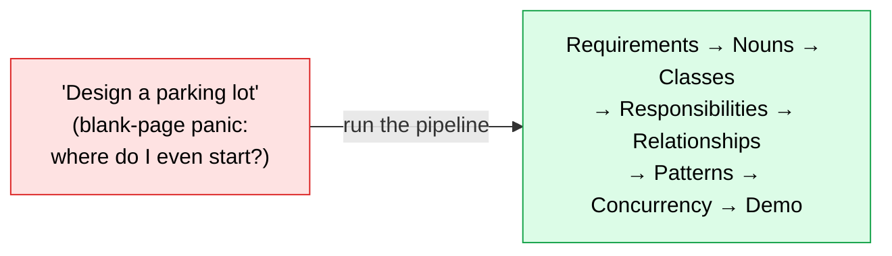
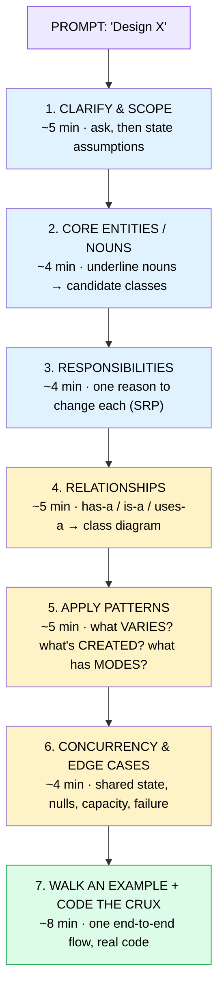
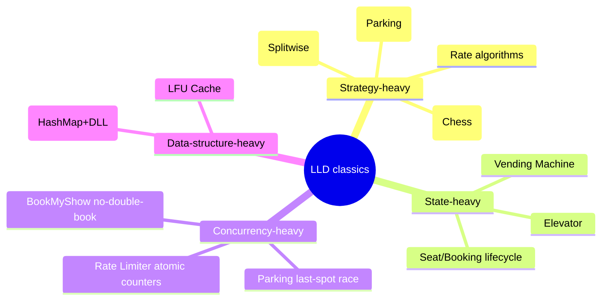
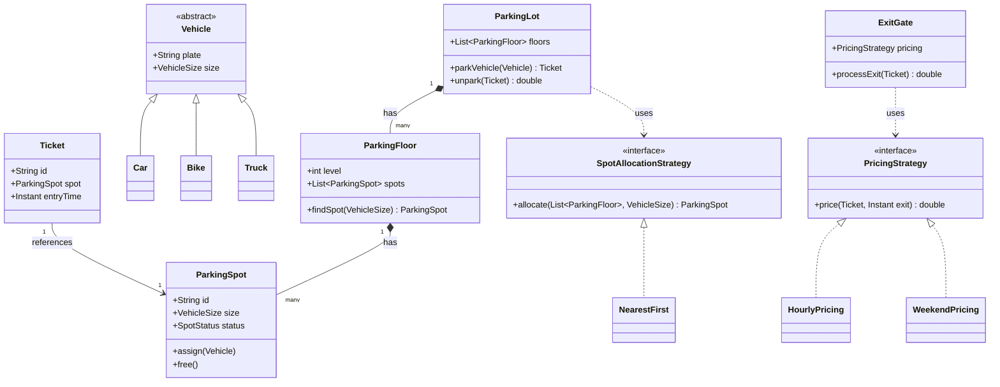
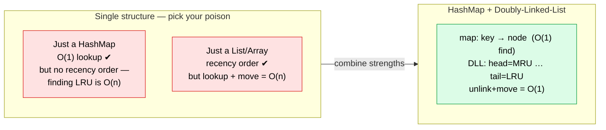
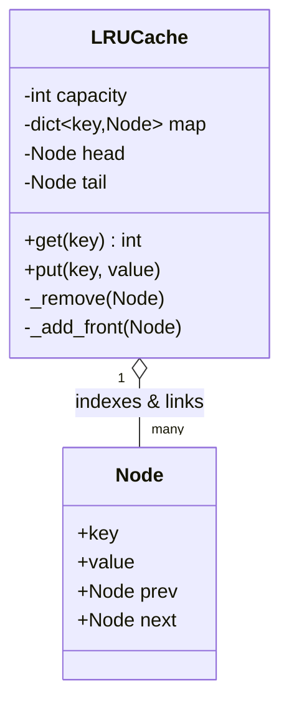
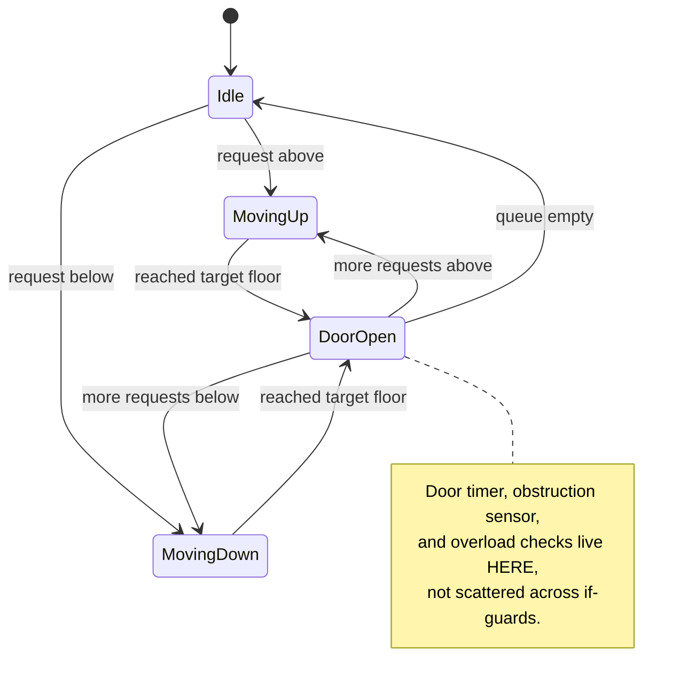
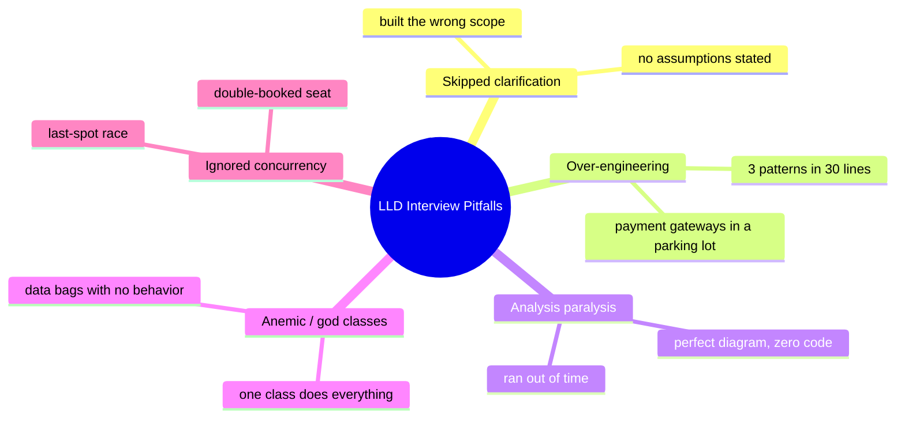

# Common LLD Interview Problems

> **One line:** The classic low-level-design prompts — Parking Lot, Elevator, LRU Cache, Splitwise, BookMyShow — are not ten unrelated puzzles but ten rehearsals of ONE repeatable method: turn requirements into entities, entities into responsibilities, responsibilities into relationships, and relationships into patterns — under a 35-minute clock.

---

## Table of Contents
1. [Why You Must Master This](#1-why-you-must-master-this)
2. [The Mental Model](#2-the-mental-model)
3. [The 7-Step LLD Playbook (Your Reusable Method)](#3-the-7-step-lld-playbook-your-reusable-method)
4. [The Problem → Entities → Patterns Map](#4-the-problem--entities--patterns-map)
5. [Worked Problem A — Parking Lot (in full)](#5-worked-problem-a--parking-lot-in-full)
6. [Worked Problem B — LRU Cache (in full)](#6-worked-problem-b--lru-cache-in-full)
7. [Worked Problem C — Elevator System (in full)](#7-worked-problem-c--elevator-system-in-full)
8. [Real-Life Use Cases](#8-real-life-use-cases)
9. [Failure Modes](#9-failure-modes)
10. [🏋️ Practice Drills](#-practice-drills)
11. [🎤 Interview Q&A Bank](#-interview-qa-bank)
12. [🎯 Staff+ Nuances](#-staff-nuances)
13. [Cheat Sheet](#13-cheat-sheet)
14. [Connections & Further Reading](#14-connections--further-reading)

> **Note on scope:** Parking Lot and Elevator have appeared elsewhere in this folder only as *analogies* (to explain State, Strategy, and concurrency). **This file is their home** — here they are worked as full, gradeable interview problems, not illustrations.

---

## 1. Why You Must Master This

The LLD (also called "object-oriented design" or "machine coding") round is where offers are won and lost for SDE-2 through Staff. Unlike the HLD round, it has a **right answer shape** the interviewer can grade against, and it exposes whether you can *actually structure code* rather than just name-drop patterns.

- **It is the single most common on-site round for backend/full-stack roles.** Parking Lot alone shows up in a plurality of LLD interviews at Amazon, Uber, Flipkart, Atlassian, and nearly every Indian product company. Walking in without a repeatable method means re-deriving structure live, badly, while the clock runs.
- **It grades your [SOLID](./SOLID_Principles.md) and [pattern](./Design_Patterns_Overview.md) fluency *implicitly*.** Nobody asks "please use Strategy." They watch whether your pricing logic is a swappable object or a metastasizing `if/elif`. A good class design *is* a pattern even when unnamed.
- **It is where time management is itself a skill under test.** 35–45 minutes for requirements + entities + a class diagram + one flow + code for the crux. Candidates who over-scope (modeling payment gateways in a parking lot) run out of time before showing a single working method.
- **The failure is almost never "wrong answer" — it's "no method."** Weak candidates freeze at "where do I start?" This file's spine is the method that removes that freeze.

> **The core problem it solves:** how to convert a vague one-line prompt ("design a parking lot") into a defensible class design in ~35 minutes, without over-engineering, without freezing, and while surfacing exactly the SOLID/pattern signals interviewers grade on.

**Prerequisites:** comfort with [Object_Oriented_Design.md](./Object_Oriented_Design.md) (encapsulation, composition), [SOLID_Principles.md](./SOLID_Principles.md), and [Design_Patterns_Overview.md](./Design_Patterns_Overview.md). This file *applies* those; it does not re-teach them.

---

## 2. The Mental Model

Beginners treat each LLD prompt as a fresh, terrifying blank page. Experts see the same assembly line every time: **the prompt is raw ore; the method is the smelter.** You are never inventing structure — you are running a fixed pipeline that turns nouns into classes and "what varies" into patterns.



The deep insight: **the ten "different" problems are the same five or six patterns wearing costumes.** Parking Lot = Strategy + Factory + State. Vending Machine = State + Strategy. BookMyShow = concurrency + State + Factory. Once you see the costume, you already know the skeleton. Your job in the room is to *recognize which classic this is* and instantiate the method — not to be creative.

> **Hold onto this:** LLD is not creativity, it is **recognition + a checklist**. Find the nouns (→ classes), find what varies (→ Strategy/State), find what's created conditionally (→ Factory), find the shared mutable resource (→ concurrency). Everything else is detail.

---

## 3. The 7-Step LLD Playbook (Your Reusable Method)

This is the spine of the entire file. Run these seven steps *in order*, out loud, on any LLD prompt. The times are a 35-minute budget; stretch proportionally for 45–60.



**Step 1 — Clarify & scope (~5 min).** Never start coding. Ask 3–5 sharp questions, *then explicitly state the scope you'll build* so the interviewer can redirect early. For a parking lot: *Multiple floors? Multiple vehicle sizes? Do we handle payment, or stop at ticketing? Is this in-memory or backed by a DB? Single instance or distributed?* The move that scores: **"I'll assume a single multi-floor lot, three vehicle sizes, ticket-based entry/exit, and pricing by duration. I'll treat payment as a pluggable interface but not implement gateways. Sound right?"** This one sentence prevents the #1 failure (building the wrong thing) and signals seniority.

**Step 2 — Core entities / nouns (~4 min).** Read the requirements and **underline the nouns**. Nouns are candidate classes; verbs are candidate methods. Parking lot → *lot, floor, spot, vehicle, ticket, gate, payment, rate*. Prune synonyms and non-domain nouns. This is the fastest reliable way to seed a class list; see [Object_Oriented_Design.md](./Object_Oriented_Design.md).

**Step 3 — Assign responsibilities (~4 min).** For each class, write one sentence: *"A `Ticket` records which spot, entry time, and vehicle."* If the sentence needs an "and… and…", the class is doing too much — split it (Single Responsibility). This is where [SOLID_Principles.md](./SOLID_Principles.md) is graded silently.

**Step 4 — Relationships (~5 min).** Decide, for each pair, whether it's **has-a (composition)**, **is-a (inheritance)**, or **uses-a (dependency)**. `Lot` *has* `Floor`s; `Floor` *has* `Spot`s; `Car` *is-a* `Vehicle`; `ExitGate` *uses* a `PricingStrategy`. Draw the [UML class diagram](./UML_Diagrams.md) now — this is the artifact the interviewer stares at. **Prefer composition over inheritance** (a `Spot` *has* a size, it isn't a subclass per size).

**Step 5 — Apply patterns (~5 min).** Ask three diagnostic questions:
- *What behavior VARIES?* → [Strategy](./Behavioral_Design_Patterns.md) (pricing, spot-allocation policy, eviction policy).
- *What object is CREATED conditionally by type?* → [Factory](./Creational_Design_Patterns.md) (build the right `Vehicle`/`Spot`).
- *What object has MODES that change its behavior?* → [State](./State_Machines.md) (spot `Free`/`Occupied`, order `Pending`/`Paid`).
Do **not** force patterns where nothing varies — that's the over-engineering trap graders punish.

**Step 6 — Concurrency & edge cases (~4 min).** Name the **shared mutable resource** and how you protect it: two cars racing for the last spot, two users booking seat A1. Reach for locking granularity (per-spot vs per-lot), atomic compare-and-set, or a queue; see [Concurrency_Patterns_Thread_Safety.md](./Concurrency_Patterns_Thread_Safety.md). Then edge cases: lot full, invalid ticket, vehicle too big, double-exit.

**Step 7 — Walk an example + code the crux (~8 min).** Trace ONE end-to-end flow ("car enters → gets ticket → parks → exits → pays") against your diagram, then write real, compiling code for the *hardest single piece* (LRU's O(1) structure, the spot-allocation loop). **Depth on one method beats stubs on ten.**

> **The meta-rule:** narrate every step aloud. The interviewer is grading your *process*, not just the artifact. A candidate who says "now, what varies here? Pricing — so I'll put it behind a Strategy interface" scores higher than one who silently writes the same code.

---

## 4. The Problem → Entities → Patterns Map

The ten classics, decoded. Read this as: *"When I hear prompt X, I expect entities Y and patterns Z, and I should review repo file W."* Recognizing the row is 60% of the battle.

| Problem | Core entities (nouns) | Patterns / principles it tests | Concurrency? | Review file |
|---------|----------------------|-------------------------------|--------------|-------------|
| **Parking Lot** ⭐ | Lot, Floor, Spot, Vehicle, Ticket, Gate, Rate | **Strategy** (pricing) · **Factory** (spot/vehicle) · **State** (spot status) · SRP/OCP | Yes — last spot race | [Behavioral](./Behavioral_Design_Patterns.md), [Creational](./Creational_Design_Patterns.md), [State_Machines](./State_Machines.md) |
| **Elevator / Lift** | ElevatorSystem, Elevator, Request, Button, Door, Direction | **State** (moving/idle/door-open) · **Strategy** (scheduling: SCAN/LOOK) · Command (requests) | Yes — request queue | [State_Machines](./State_Machines.md), [Behavioral](./Behavioral_Design_Patterns.md) |
| **Vending Machine** | Machine, Product, Slot, Coin/Note, Inventory | **State** (idle/hasMoney/dispensing) · Strategy (payment) | Rare (single user) | [State_Machines](./State_Machines.md) |
| **LRU Cache** ⭐ | Cache, Node, HashMap, DoublyLinkedList | **Data-structure design** (HashMap + DLL) · O(1) invariants · optionally Strategy (eviction policy) | Yes if thread-safe | [Class_Design](./Class_Design.md), [Concurrency](./Concurrency_Patterns_Thread_Safety.md) |
| **Splitwise** | User, Group, Expense, Split (Equal/Exact/%), Balance | **Strategy** (split types) · **Factory** (split creation) · graph/settle-up algorithm | Concurrent expense adds | [Behavioral](./Behavioral_Design_Patterns.md), [Creational](./Creational_Design_Patterns.md) |
| **BookMyShow** (movie tickets) | Movie, Show, Screen, Seat, Booking, Payment, Theatre | **State** (seat/booking lifecycle) · **Factory** · **concurrency** (no double-book) | **Yes — the crux** | [Concurrency](./Concurrency_Patterns_Thread_Safety.md), [State_Machines](./State_Machines.md) |
| **Chess / Tic-Tac-Toe** | Board, Cell, Piece, Player, Move, Game, Rules | **Strategy** (per-piece move rules) · **State** (game status) · **Factory** (pieces) · Observer (turn) | No | [Behavioral](./Behavioral_Design_Patterns.md), [Creational](./Creational_Design_Patterns.md) |
| **Rate Limiter** | Limiter, Rule, Bucket/Window, Client | **Strategy** (token-bucket / sliding-window / leaky-bucket) · Factory | **Yes — atomic counters** | [Behavioral](./Behavioral_Design_Patterns.md), [Concurrency](./Concurrency_Patterns_Thread_Safety.md) |
| **Logging framework** | Logger, LogLevel, Appender/Sink, Formatter, Message | **Chain of Responsibility** (level → sinks) · **Strategy** (formatter) · **Singleton** (root logger) · Observer | Yes — shared sink | [Behavioral](./Behavioral_Design_Patterns.md), [Creational](./Creational_Design_Patterns.md) |
| **Notification service** | Notification, Channel (Email/SMS/Push), User, Template | **Strategy/Factory** (channel) · **Decorator** (retry) · Observer (fan-out) | Yes — async queue | [Design_Patterns_Overview](./Design_Patterns_Overview.md), [Structural](./Structural_Design_Patterns.md) |
| **Snake & Ladder / Card games** | Board, Player, Dice, Snake, Ladder, Game | Factory · Strategy (dice) · simple state | No | [Creational](./Creational_Design_Patterns.md) |

> **Pattern-frequency truth:** across all ten, **Strategy, Factory, and State recur constantly** — master those three from [Design_Patterns_Overview.md](./Design_Patterns_Overview.md) and you're armed for ~80% of LLD prompts. Concurrency is the *differentiator* that separates SDE-2 from senior on BookMyShow, Parking Lot, and Rate Limiter.



---

## 5. Worked Problem A — Parking Lot (in full)

The most-asked LLD problem, worked end-to-end through the 7-step playbook so you can see the method produce an actual design.

### 5.1 Requirements & scope (Step 1)

**Questions I'd ask, and the scope I'd lock:**

| I ask | I assume (and say so) |
|-------|----------------------|
| Multiple floors? | Yes — a `Lot` has many `Floor`s. |
| Vehicle sizes? | Three: motorcycle, car, truck → matching spot sizes. |
| Do we charge? | Yes, **priced by duration**, but the *pricing formula must be swappable* (weekday vs weekend vs flat). |
| Payment gateways? | Out of scope — `Payment` is an interface; I won't build Stripe. |
| In-memory or distributed? | Single in-memory instance; I'll note where a DB/lock service would go. |
| Assignment policy? | Nearest free spot of the right size; policy should be pluggable. |

> Stating this in 60 seconds is the highest-ROI move in the whole interview.

### 5.2 Entities & responsibilities (Steps 2–3)

Nouns → classes, each with one responsibility:

- **`ParkingLot`** — top-level facade; owns floors, entry/exit gates.
- **`ParkingFloor`** — owns a collection of spots on one level.
- **`ParkingSpot`** — one physical spot; knows its size and free/occupied status.
- **`Vehicle`** (+ `Car`, `Bike`, `Truck`) — the thing being parked; carries a size.
- **`Ticket`** — issued on entry; records spot, entry time, vehicle.
- **`EntryGate` / `ExitGate`** — issue tickets / compute fee and free the spot.
- **`PricingStrategy`** — computes fee from duration (the varying part).
- **`SpotAllocationStrategy`** — picks *which* free spot (the other varying part).

### 5.3 Class diagram (Step 4)



> **Takeaway:** the two dashed "uses" arrows (to `PricingStrategy` and `SpotAllocationStrategy`) are where the design earns its OCP marks — new pricing or allocation policies are *new classes*, never edits to `ParkingLot`.

### 5.4 The three patterns, and why each (Step 5)

| Where it varies / branches | Pattern | Why not just an `if/elif`? |
|---------------------------|---------|----------------------------|
| **Pricing** (hourly vs weekend vs flat vs surge) | **Strategy** | Pricing changes far more often than the lot structure; isolating it means a new tariff is one class, and you can unit-test pricing without a lot. |
| **Which spot to give** (nearest / random / EV-priority) | **Strategy** (`SpotAllocationStrategy`) | Ops will want to change allocation policy per site; keep it swappable. |
| **Building the right `Vehicle`/`Spot` by type** | **Factory** | Centralizes the `type == "car"` switch so it lives in *one* place, not scattered at every gate. |
| **A spot's status** (Free → Occupied → Free) | **State** | The transition rules (can't occupy an occupied spot) live in the state, not in scattered guards. |

### 5.5 Concurrency & edge cases (Step 6)

**The race:** two cars arrive at the last compact spot simultaneously; both `findSpot()` calls return `spot #42`; both `assign()`. Now one car is "parked" on top of another.

**Fixes, cheapest first:**
- **Per-spot atomic claim** — `assign()` does a compare-and-set on status (`Free → Occupied`); the loser retries the search. Fine-grained, high throughput.
- **Per-floor lock** — simpler, but serializes all parking on a floor.
- **Distributed** — the CAS becomes a Redis `SETNX spot:42` or a DB row `UPDATE ... WHERE status='FREE'` returning affected-rows; see [Concurrency_Patterns_Thread_Safety.md](./Concurrency_Patterns_Thread_Safety.md).

**Edge cases to name:** lot full (return null/queue), truck in a compact spot (size check), invalid/lost ticket, double-exit (idempotent unpark), clock skew on duration.

### 5.6 Code the crux — Strategy pricing + atomic allocation (Step 7)

```python
from __future__ import annotations
from abc import ABC, abstractmethod
from dataclasses import dataclass, field
from datetime import datetime, timezone
from enum import Enum, auto
from threading import Lock
from typing import Optional

class VehicleSize(Enum):
    BIKE = auto(); CAR = auto(); TRUCK = auto()

class SpotStatus(Enum):
    FREE = auto(); OCCUPIED = auto()

@dataclass
class Vehicle:
    plate: str
    size: VehicleSize

# ---- Strategy #1: pricing varies independently of the lot ----
class PricingStrategy(ABC):
    @abstractmethod
    def price(self, entry: datetime, exit: datetime) -> float: ...

class HourlyPricing(PricingStrategy):
    def __init__(self, rate: float = 20.0) -> None:
        self.rate = rate
    def price(self, entry: datetime, exit: datetime) -> float:
        hours = max(1, (exit - entry).seconds // 3600 + 1)  # bill partial hour as full
        return hours * self.rate

class ParkingSpot:
    def __init__(self, spot_id: str, size: VehicleSize) -> None:
        self.id = spot_id
        self.size = size
        self.status = SpotStatus.FREE
        self._lock = Lock()               # per-spot lock → fine-grained, no lot-wide bottleneck

    def try_claim(self, vehicle: Vehicle) -> bool:
        # Atomic FREE->OCCUPIED. Two racing cars: only one wins the CAS, other retries.
        if vehicle.size.value > self.size.value:      # truck can't fit a bike spot
            return False
        with self._lock:
            if self.status is SpotStatus.FREE:
                self.status = SpotStatus.OCCUPIED     # the compare-and-set moment
                return True
            return False                              # lost the race

    def free(self) -> None:
        with self._lock:
            self.status = SpotStatus.FREE

# ---- Strategy #2: allocation policy varies (nearest / EV-first / random) ----
class SpotAllocationStrategy(ABC):
    @abstractmethod
    def allocate(self, floors: list["ParkingFloor"], v: Vehicle) -> Optional[ParkingSpot]: ...

class NearestFirst(SpotAllocationStrategy):
    def allocate(self, floors, v):
        for floor in floors:                          # floors already ordered nearest-first
            for spot in floor.spots:
                if spot.size.value >= v.size.value and spot.try_claim(v):
                    return spot                       # claim succeeded → done
        return None                                   # lot full for this size

@dataclass
class ParkingFloor:
    level: int
    spots: list[ParkingSpot] = field(default_factory=list)

@dataclass
class Ticket:
    id: str
    spot: ParkingSpot
    entry: datetime

class ParkingLot:
    def __init__(self, floors: list[ParkingFloor],
                 allocator: SpotAllocationStrategy,
                 pricing: PricingStrategy) -> None:
        self.floors = floors
        self._allocator = allocator                   # injected → swap policy freely
        self._pricing = pricing
        self._seq = 0

    def park(self, v: Vehicle) -> Optional[Ticket]:
        spot = self._allocator.allocate(self.floors, v)
        if spot is None:
            return None                               # edge case: full
        self._seq += 1
        return Ticket(f"T{self._seq}", spot, datetime.now(timezone.utc))

    def unpark(self, t: Ticket) -> float:
        fee = self._pricing.price(t.entry, datetime.now(timezone.utc))
        t.spot.free()                                 # idempotent-ish; real code guards double-exit
        return fee
```

Concept → consequence: because pricing and allocation are **injected strategies** and the claim is a **per-spot CAS**, adding weekend surge pricing is one new `PricingStrategy` class, switching to EV-priority allocation is one new `SpotAllocationStrategy`, and the last-spot race resolves correctly without a lot-wide lock. Three patterns, each earning a concrete OCP/concurrency payoff.

---

## 6. Worked Problem B — LRU Cache (in full)

The most-asked *data-structure-design* LLD problem. The whole game is achieving **O(1) `get` and `put`** — which forces a specific two-structure design that candidates who've never seen it almost never reinvent live.

### 6.1 Requirements

Fixed capacity `C`. `get(key)` returns the value and marks it most-recently-used. `put(key, value)` inserts/updates and marks MRU; if over capacity, **evict the least-recently-used** entry. Both must be **O(1)**.

### 6.2 Why one structure isn't enough (the key insight)



> **Takeaway:** the HashMap gives O(1) *find*, the doubly-linked list gives O(1) *reorder and evict*. Neither alone can do both — the design **is** the combination. That realization is what the interviewer is checking for.

Why a **doubly**-linked list? Because on a `get` you must unlink a node from the *middle* in O(1), which needs the node's `prev` pointer. A singly-linked list would force an O(n) scan to find the predecessor. Sentinel `head`/`tail` dummy nodes remove all the null-edge-case branching.

### 6.3 Structure diagram



### 6.4 Code — the O(1) crux

```python
from typing import Optional

class Node:
    __slots__ = ("key", "value", "prev", "next")   # __slots__ trims per-node memory at scale
    def __init__(self, key: int = 0, value: int = 0) -> None:
        self.key, self.value = key, value
        self.prev: Optional["Node"] = None
        self.next: Optional["Node"] = None

class LRUCache:
    def __init__(self, capacity: int) -> None:
        self.cap = capacity
        self.map: dict[int, Node] = {}
        # Sentinel head/tail: head.next = MRU, tail.prev = LRU. Dummies kill null checks.
        self.head, self.tail = Node(), Node()
        self.head.next, self.tail.prev = self.tail, self.head

    def _remove(self, n: Node) -> None:              # unlink a node — O(1) thanks to prev ptr
        n.prev.next, n.next.prev = n.next, n.prev

    def _add_front(self, n: Node) -> None:           # splice in as most-recently-used — O(1)
        n.prev, n.next = self.head, self.head.next
        self.head.next.prev = n
        self.head.next = n

    def get(self, key: int) -> int:
        if key not in self.map:
            return -1
        n = self.map[key]
        self._remove(n); self._add_front(n)          # touch → move to MRU
        return n.value

    def put(self, key: int, value: int) -> None:
        if key in self.map:
            self._remove(self.map[key])              # remove stale node before re-adding
        n = Node(key, value)
        self.map[key] = n
        self._add_front(n)
        if len(self.map) > self.cap:                 # over capacity → evict LRU (tail.prev)
            lru = self.tail.prev
            self._remove(lru)
            del self.map[lru.key]                    # must delete from BOTH structures
```

The two invariants a strong candidate states aloud: **(1)** every key in `map` has exactly one node in the list, and **(2)** `head.next` is always MRU, `tail.prev` always LRU. Every method preserves both. The classic bug — evicting from the list but forgetting `del self.map[lru.key]` — leaks memory and corrupts invariant (1).

### 6.5 Extensions the interviewer will probe

- **Thread-safety:** wrap `get`/`put` in a single lock (simple) or a striped lock for throughput; note that even `get` mutates (it reorders), so read-locks don't suffice. See [Concurrency_Patterns_Thread_Safety.md](./Concurrency_Patterns_Thread_Safety.md).
- **LRU → LFU:** now you need frequency buckets; O(1) LFU keeps a map of freq → DLL plus a `min_freq` pointer. A common "level-up" follow-up.
- **TTL / expiry:** add a timestamp per node and lazily evict on access, or a background sweeper.
- **Make eviction pluggable:** hide the policy behind an `EvictionPolicy` [Strategy](./Behavioral_Design_Patterns.md) so LRU/LFU/FIFO swap without touching the cache shell.

---

## 7. Worked Problem C — Elevator System (in full)

Worked to design depth (diagram + decisions); left slightly lighter on code than A and B by design, because Elevator's real signal is **State + scheduling Strategy**, not a single tricky data structure.

### 7.1 Scope

Single building, `N` elevators, `F` floors. Users press an **external** call button (up/down at a floor) and, once inside, an **internal** destination button. Goal: dispatch elevators to minimize wait, honoring direction. Lock scope: *I'll model dispatch + a single elevator's state machine; I'll make the scheduling algorithm pluggable and implement one (LOOK/SCAN).*

### 7.2 Entities

`ElevatorSystem` (dispatcher) · `Elevator` (car) · `Request` (source floor + direction, or destination) · `Button` (internal/external) · `Door` · `Direction {UP, DOWN, IDLE}` · `SchedulingStrategy`.

### 7.3 The elevator as a state machine (the crux)



> **Takeaway:** modeling the car as an explicit [state machine](./State_Machines.md) means "can't open doors while moving" is enforced by the *absence of that transition*, not by a defensive `if` in five methods.

### 7.4 Design decisions

| Decision | Choice | Why |
|----------|--------|-----|
| Where does routing logic live? | **`SchedulingStrategy`** (Strategy) | LOOK vs SCAN vs nearest-car are swappable; testable in isolation. |
| How does a car track stops? | Two sorted sets: `up_stops`, `down_stops` | Serving all up-requests before reversing = the LOOK algorithm, O(log n) inserts. |
| External vs internal buttons? | Both produce a `Request` | Uniform queue; dispatcher assigns external ones to a car, car owns internal ones. |
| Concurrency | Thread-safe request queue per car | Many callers press buttons concurrently; enqueue must be atomic. |

### 7.5 Dispatch sketch

```python
from enum import Enum, auto

class Direction(Enum):
    UP = auto(); DOWN = auto(); IDLE = auto()

class SchedulingStrategy:                            # Strategy seam for dispatch policy
    def pick_elevator(self, elevators: list["Elevator"], req: "Request") -> "Elevator":
        raise NotImplementedError

class NearestCar(SchedulingStrategy):
    def pick_elevator(self, elevators, req):
        # Prefer a car already moving toward the request in the same direction; else nearest idle.
        candidates = [e for e in elevators
                      if e.direction == Direction.IDLE or e.moving_toward(req)]
        pool = candidates or elevators
        return min(pool, key=lambda e: abs(e.current_floor - req.floor))
```

The dispatcher applies the strategy; each `Elevator` runs its own state machine to service the stops it's assigned. Adding a "rush-hour" algorithm is a new `SchedulingStrategy` — the dispatcher and cars don't change.

---

## 8. Real-Life Use Cases

The method and these problems aren't interview-only — they mirror production systems.

| Situation | How the LLD method applies | The decision it forces |
|-----------|----------------------------|------------------------|
| Building a **feature-flag / pricing engine** | "What varies?" → pricing rules behind a Strategy, exactly like Parking Lot | New promo = new class, not a deploy-risky `if` edit |
| Designing an **in-memory cache layer** (Guava, Caffeine, Redis client) | LRU/LFU with HashMap+DLL is the literal implementation | Choosing eviction policy as a pluggable Strategy |
| **Seat/inventory reservation** (airline, ticketing, e-commerce checkout) | BookMyShow's no-double-book concurrency is the real problem | Optimistic vs pessimistic locking, hold-then-confirm |
| **Job scheduler / thread pool dispatch** | Elevator's request-queue + scheduling Strategy maps directly | Which scheduling algorithm, and its fairness trade-off |
| **API gateway throttling** | Rate Limiter's token-bucket Strategy is production code | Per-user atomic counters, distributed via Redis |

> **Real-world habit:** when a code review shows a growing `if type == …` or a class whose description needs "and… and…", run Steps 3 and 5 of the playbook in your head — you've found an SRP or Strategy seam before it metastasizes.

---

## 9. Failure Modes



- **Skipped clarification.** *Symptom:* you build a single-floor lot, interviewer wanted distributed multi-site. *Root cause:* started coding to look fast. *Fix:* spend the first 5 minutes on Step 1 and *state your scope out loud* — it's the highest-signal move, not wasted time.
- **Over-engineering.** *Symptom:* Abstract Factory + Visitor + Observer in a tic-tac-toe. *Root cause:* pattern-matching "senior = many patterns." *Fix:* apply a pattern only where variation *exists* (Step 5's diagnostic questions); graders punish speculative complexity — see [Design_Patterns_Overview.md](./Design_Patterns_Overview.md).
- **Analysis paralysis.** *Symptom:* a beautiful class diagram at minute 40 and no running code. *Root cause:* no time budget. *Fix:* the 7-step clock; **always** leave 8 minutes for Step 7. One working method > ten stubs.
- **Anemic or god classes.** *Symptom:* `ParkingLotManager` with 20 methods, or `Ticket` that's a pure data bag with logic elsewhere. *Root cause:* skipped Step 3. *Fix:* one-sentence responsibility per class; behavior lives with the data it owns; see [Class_Design.md](./Class_Design.md).
- **Ignored concurrency.** *Symptom:* two threads book seat A1; both succeed. *Root cause:* never named the shared mutable resource. *Fix:* Step 6 — always identify the contested resource and its atomic-claim mechanism, even if you only *describe* it; see [Concurrency_Patterns_Thread_Safety.md](./Concurrency_Patterns_Thread_Safety.md).

---

## 🏋️ Practice Drills

> *Cover the solutions and attempt first — run the 7-step playbook aloud before peeking. Active recall is the point.*

**Drill 1 — Design a Vending Machine.** Coins in, product out, change returned, states matter. Sketch entities, name the driving pattern, and describe the states.

<details><summary>Solution</summary>

**Driving pattern: State.** Entities: `VendingMachine`, `Product`, `Slot`, `Inventory`, `Coin`, and a `State` hierarchy. States: `Idle → HasMoney → Dispensing → (back to Idle)`, plus `SoldOut`. The machine holds a `current_state`; each button/coin event is delegated to the state, which decides the next state and legal actions (you can't dispense from `Idle`, can't insert more once `Dispensing`). Payment method (coins vs card) is a small **Strategy**. Change calculation is a greedy-coin sub-problem. The signal: transitions enforced by the state graph, not scattered `if machine.status ==` guards — mirrors [State_Machines.md](./State_Machines.md). Concurrency is minimal (one user), which you should *say* rather than over-build.
</details>

**Drill 2 — Design Splitwise.** Users add shared expenses split equally, by exact amount, or by percentage; the app tracks who owes whom and can "settle up."

<details><summary>Solution</summary>

**Driving patterns: Strategy + Factory.** Entities: `User`, `Group`, `Expense`, `Split` (abstract) with `EqualSplit`/`ExactSplit`/`PercentSplit` concretes, and a `BalanceSheet` (map of `(from,to) → amount`). A `SplitFactory` builds the right `Split` from input. Adding an expense updates pairwise balances. **Settle-up** is a graph problem: minimize transactions by netting balances (a greedy heap of max-creditor vs max-debtor). Concurrency: two users adding expenses to the same group need atomic balance updates. Cross-links: [Behavioral](./Behavioral_Design_Patterns.md) (Strategy for split types), [Creational](./Creational_Design_Patterns.md) (Factory). The graded insight is separating *split calculation* (Strategy) from *balance bookkeeping* (SRP).
</details>

**Drill 3 — Design BookMyShow's seat booking, focusing on concurrency.** 500 users refresh the same sold-out show; two click seat A1 at the same millisecond. No double-booking, no permanently-locked seats.

<details><summary>Solution</summary>

**Driving concern: concurrency + State.** Entities: `Movie`, `Show`, `Screen`, `Seat`, `Booking`, `Payment`. Seat lifecycle (State): `Available → Held(ttl) → Booked`, or `Held → Available` on timeout/abandon. The crux is the **hold-then-confirm** pattern: on select, atomically CAS the seat `Available → Held` with a short TTL (Redis `SETNX seat:A1 userX EX 120` or a DB `UPDATE … WHERE status='AVAILABLE'` checking affected-rows). Only the winner proceeds to payment; on success `Held → Booked`, on timeout it auto-releases so seats aren't stuck. This is **optimistic locking** at the row level — pessimistic table locks would kill throughput at 500 concurrent users. Cross-link: [Concurrency_Patterns_Thread_Safety.md](./Concurrency_Patterns_Thread_Safety.md). Signal: candidate names the TTL-release to avoid the "abandoned cart locks the seat forever" bug.
</details>

**Drill 4 — Design a Rate Limiter (token bucket) and make the algorithm swappable.** Allow `R` requests/sec per client; support burst; be thread-safe.

<details><summary>Solution</summary>

**Driving pattern: Strategy + atomic state.** `RateLimiter` holds a `RateLimitStrategy`; concretes: `TokenBucket`, `SlidingWindowLog`, `LeakyBucket`. Token bucket: per client store `(tokens, last_refill_ts)`; on request, refill `tokens += elapsed * rate` (capped at burst), then if `tokens >= 1` decrement and allow, else reject. The **atomicity** is the crux — the check-and-decrement must be a single atomic op (a lock, or Redis Lua script / `INCR` with expiry) or two threads both see the last token. Swapping to sliding-window is a new Strategy class. Cross-links: [Behavioral](./Behavioral_Design_Patterns.md), [Concurrency_Patterns_Thread_Safety.md](./Concurrency_Patterns_Thread_Safety.md). Signal: distinguishing the algorithms' trade-offs (token bucket allows bursts; sliding-window log is precise but memory-heavy).
</details>

---

## 🎤 Interview Q&A Bank

**Q1. You're handed "design a parking lot." What are your first 60 seconds?**
> I don't code — I clarify and scope. Floors? Vehicle sizes? Do we handle payment or stop at ticketing? In-memory or distributed? Then I *state my assumptions back*: "single multi-floor lot, three sizes, duration pricing that's swappable, payment as an interface I won't implement." That one sentence prevents building the wrong thing and shows I scope before I build. *(signal: senior candidates lead with scoping; juniors start typing)*

**Q2. How do you decide which design pattern a problem needs?**
> Three diagnostic questions. What behavior *varies*? → Strategy. What object is *created conditionally by type*? → Factory. What object has *modes* that change its behavior? → State. If nothing varies, I use no pattern — forcing one is the over-engineering trap graders punish. I let the requirement pull the pattern in, never the reverse. *(signal: judgment over pattern-name recall)*

**Q3. Why does LRU need both a HashMap and a doubly-linked list?**
> Each alone fails one operation. A HashMap gives O(1) lookup but no recency order, so finding the LRU is O(n). A list keeps order but lookup/move is O(n). Combine them: the map gives O(1) find, the DLL gives O(1) reorder and evict. Doubly-linked specifically, because on a `get` I unlink a middle node in O(1) — which needs the `prev` pointer. The design *is* the combination. *(signal: understands the invariant, not just memorized code)*

**Q4. In the parking lot, two cars race for the last spot. How do you prevent a double-assign?**
> I make the claim atomic: `assign()` does a compare-and-set on the spot's status, `Free → Occupied`, under a per-spot lock. Only one car wins; the loser retries the search. Per-spot rather than per-lot so I don't serialize the whole garage. Distributed, that CAS becomes a Redis `SETNX` or a conditional DB update returning affected-rows. *(signal: names granularity trade-off, not just "add a lock")*

**Q5. Strategy shows up in Parking Lot pricing, Splitwise splits, and Rate Limiter algorithms. Why so ubiquitous in LLD?**
> Because most LLD prompts have exactly one axis of frequent change — the tariff, the split rule, the limiting algorithm — surrounded by stable structure. Strategy isolates that axis behind an interface so a new variant is one class and the rest is closed to modification. It's the Open/Closed Principle made concrete, and LLD problems are practically designed to reward it. *(signal: connects pattern to OCP and to change frequency)*

**Q6. How do you avoid running out of time in a 40-minute LLD round?**
> A fixed budget: ~5 min clarify, ~13 min entities + responsibilities + class diagram, ~5 min patterns, ~4 min concurrency, and I *protect* the last ~8 minutes for one end-to-end flow plus real code on the hardest piece. Depth on one method beats stubs on ten. The failure mode is a gorgeous diagram at minute 40 with nothing running. *(signal: time management is itself graded)*

**Q7. Elevator or Vending Machine — why is State the right pattern there?**
> Both have an object whose legal actions depend on its current mode: an elevator can't open doors while moving; a vending machine can't dispense before payment. Modeling explicit states makes the illegal transitions simply *not exist* in the graph, instead of being caught by defensive `if`s scattered across methods. Adding a state is one class, and the state machine doubles as documentation. *(signal: State vs a status-enum-with-guards)*

**Q8. When would you deliberately NOT use a pattern in an LLD round?**
> When there's no variation to absorb. If a tic-tac-toe has fixed 3x3 rules, I don't wrap move-validation in a Strategy hierarchy — I write the direct method. A pattern trades simplicity now for flexibility later; if the flexibility never arrives, I've paid indirection cost for nothing. Interviewers grade restraint as much as knowledge. *(signal: maturity — the mark of Staff+)*

---

## 🎯 Staff+ Nuances

- **Interviewers grade the *process*, not the artifact.** Two candidates can draw the same class diagram; the one who *narrated* "what varies here? pricing — so, Strategy" scores higher because it proves the design was reasoned, not memorized. Always externalize the 7 steps aloud. This is why a rehearsed method beats raw cleverness.
- **The scoping trap cuts both ways.** Under-scoping (single-floor when they meant distributed) fails you; but *over*-scoping (modeling payment gateways, EV charging, and license-plate OCR in a parking lot) burns your clock and reads as poor prioritization. The skill is negotiating scope *with* the interviewer — "I'll stub payment behind an interface, is that fair?" — treating scope as collaborative, not assumed.
- **Concurrency is the SDE-2 → Senior discriminator.** Most candidates get the class structure. Far fewer proactively say "here's the shared mutable resource and here's my atomic-claim mechanism." On BookMyShow, Parking Lot, and Rate Limiter, *volunteering* the race condition and its fix (optimistic locking, TTL holds, atomic counters) is often the single biggest signal — see [Concurrency_Patterns_Thread_Safety.md](./Concurrency_Patterns_Thread_Safety.md).
- **"Make it extensible" has a precise meaning: name the seam.** When asked "how would you add feature X?", the strong answer isn't "I'd refactor" — it's "X is a new `PricingStrategy`/`SchedulingStrategy` class; nothing else changes." If you *can't* answer that crisply, your seams are in the wrong place. Extensibility questions are seam-location tests.
- **Composition over inheritance is a live grading axis.** Candidates who model `CompactCarSpot`, `TruckSpot`, `BikeSpot` as subclasses hit a combinatorial wall (electric? handicapped? covered?). A `Spot` that *has* a size and *has* attributes composes cleanly. A looming subclass explosion is the tell to refactor to composition; see [Object_Oriented_Design.md](./Object_Oriented_Design.md).
- **The same problem scales into HLD.** Parking-lot allocation → distributed lock service; LRU → a sharded Redis cluster with eviction; Elevator dispatch → a job scheduler; Rate Limiter → a distributed token store. Staff+ candidates land the LLD *and* gesture at the distributed version ("this CAS becomes a Redis Lua script across nodes"), showing they see both zoom levels.
- **Know the canonical follow-ups so they don't surprise you.** LRU → LFU (O(1) frequency buckets) → TTL. Parking Lot → multiple entry gates → pricing tiers → find-my-car. BookMyShow → seat holds → payment failure rollback → seat recommendation. The follow-up is where depth is separated from breadth; pre-load the second move for each classic.

---

## 13. Cheat Sheet

```
════════════ THE 7-STEP LLD PLAYBOOK (≈35 min budget) ════════════
 1. CLARIFY & SCOPE      ~5m  ask 3-5 Qs, STATE assumptions back  ← highest ROI move
 2. ENTITIES / NOUNS     ~4m  underline nouns→classes, verbs→methods
 3. RESPONSIBILITIES     ~4m  one sentence each; "and…and" = split (SRP)
 4. RELATIONSHIPS        ~5m  has-a / is-a / uses-a → CLASS DIAGRAM (prefer composition)
 5. APPLY PATTERNS       ~5m  what VARIES→Strategy · CREATED by type→Factory · has MODES→State
 6. CONCURRENCY + EDGES  ~4m  name shared mutable resource + atomic claim; full/null/dupe
 7. WALK EXAMPLE + CODE  ~8m  ONE end-to-end flow + real code on the crux  ← protect this time
 RULE: narrate every step aloud. Process is graded, not just the diagram.

════════════ PROBLEM → PATTERN MAP ════════════
 Parking Lot ⭐   Strategy(pricing)+Factory(spot)+State(status)   + last-spot race
 Elevator         State(car)+Strategy(scheduling: LOOK/SCAN)      + request queue
 Vending Machine  State(idle/money/dispense)+Strategy(payment)
 LRU Cache ⭐      HashMap(O1 find)+DoublyLinkedList(O1 reorder/evict)   invariant discipline
 Splitwise        Strategy(split)+Factory  + settle-up graph
 BookMyShow       State(seat)+concurrency(hold→confirm, TTL, optimistic lock) ← the crux
 Chess/TicTacToe  Strategy(move rules)+State(game)+Factory(pieces)
 Rate Limiter     Strategy(token-bucket/sliding-window)+atomic counters
 Logging          Chain-of-Responsibility+Strategy(format)+Singleton(root)
 Notification     Strategy/Factory(channel)+Decorator(retry)+Observer

════════════ THE 3 WORKHORSE PATTERNS (≈80% of prompts) ════════════
 STRATEGY  behavior VARIES at runtime, client picks     (pricing, splits, rate algo)
 FACTORY   choose concrete class by type in ONE place   (build Vehicle/Spot/Split)
 STATE     behavior varies by MODE, self-transitions    (spot/seat/elevator/machine)

════════════ CONCURRENCY CRIB (the senior differentiator) ════════════
 Name the SHARED MUTABLE resource → protect with:
   per-item CAS/lock (fine-grained) > table lock (coarse)
   hold-then-confirm + TTL      (seats, carts — avoids stuck locks)
   atomic INCR / Redis Lua      (rate-limit counters, distributed)
 DON'T: forget del from the SECOND structure (LRU map leak) · lot-wide lock for one spot

 TOP FAILURES: skip clarify · over-engineer · analysis paralysis (no code) ·
               god/anemic class · ignore concurrency
```

---

## 14. Connections & Further Reading

**Prerequisites (learn first):**
- [Object_Oriented_Design.md](./Object_Oriented_Design.md) — encapsulation and composition-over-inheritance; the noun-extraction habit in Step 2 lives here.
- [SOLID_Principles.md](./SOLID_Principles.md) — what Step 3 (responsibilities) and Step 5 (patterns) are silently graded against.
- [Design_Patterns_Overview.md](./Design_Patterns_Overview.md) — Strategy, Factory, and State are the three workhorses every worked problem here leans on.

**Builds toward / pairs with:**
- [Creational_Design_Patterns.md](./Creational_Design_Patterns.md) — Factory for spot/vehicle/split/piece construction.
- [Structural_Design_Patterns.md](./Structural_Design_Patterns.md) — Decorator (retry) and Facade in the notification and logging drills.
- [Behavioral_Design_Patterns.md](./Behavioral_Design_Patterns.md) — Strategy (pricing, splits, scheduling, rate algos), Chain of Responsibility (logging), Observer.
- [State_Machines.md](./State_Machines.md) — the State pattern behind Vending Machine, Elevator, and seat/spot lifecycles.
- [Concurrency_Patterns_Thread_Safety.md](./Concurrency_Patterns_Thread_Safety.md) — the last-spot race, seat double-booking, and atomic rate counters — the senior-level differentiator.
- [Class_Design.md](./Class_Design.md) & [Interface_Design.md](./Interface_Design.md) — avoiding god/anemic classes; designing the strategy seams.
- [UML_Diagrams.md](./UML_Diagrams.md) — the class-diagram notation you produce in Step 4.

**Gaps this topic exposes (candidates for the section's Gap Analysis):**
- A dedicated **Concurrency in LLD** deep-dive (optimistic vs pessimistic locking, hold-then-confirm, distributed CAS) — currently spread across [Concurrency_Patterns_Thread_Safety.md](./Concurrency_Patterns_Thread_Safety.md); the LLD-specific framing (seat/spot races) deserves its own worked treatment.
- A **Machine Coding / live-coding execution** note (how to structure files, when to write tests, IDE hygiene) distinct from the design method here.

**External classics:**
- *Head First Design Patterns* (Freeman & Robson) — the pattern intuitions these problems exercise.
- [Grokking the Low Level Design Interview / Object-Oriented Design](https://www.designgurus.io/) — the canonical catalog of these exact prompts with reference designs.
- *Refactoring* (Martin Fowler) — the SRP/composition instincts that keep classes from turning into god objects mid-interview.

---

## TL;DR
The classic LLD prompts are not ten puzzles but **one repeatable method run ten times**: clarify & scope → extract noun-entities → assign one responsibility each → wire relationships into a class diagram → apply patterns *only where behavior varies* → protect the shared mutable resource → walk one flow and code the crux — all on a ~35-minute clock. **Strategy, Factory, and State cover ~80% of prompts**; recognize which classic you're handed and you already know the skeleton (Parking Lot = Strategy-pricing + Factory-spot + State-status; LRU = HashMap for O(1) find + doubly-linked list for O(1) reorder/evict). The two behaviors that separate a hire from a no-hire are **stating your scope out loud in the first 60 seconds** and **proactively naming the concurrency race and its atomic fix** — because interviewers grade your *process*, not just your diagram. **Rehearse the 7 steps until they're reflex, and never start coding before you've scoped.**
