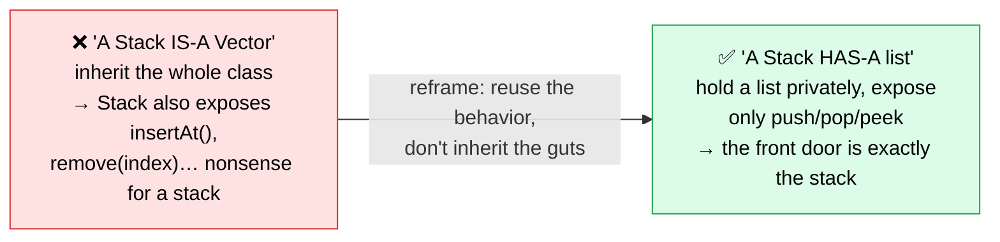
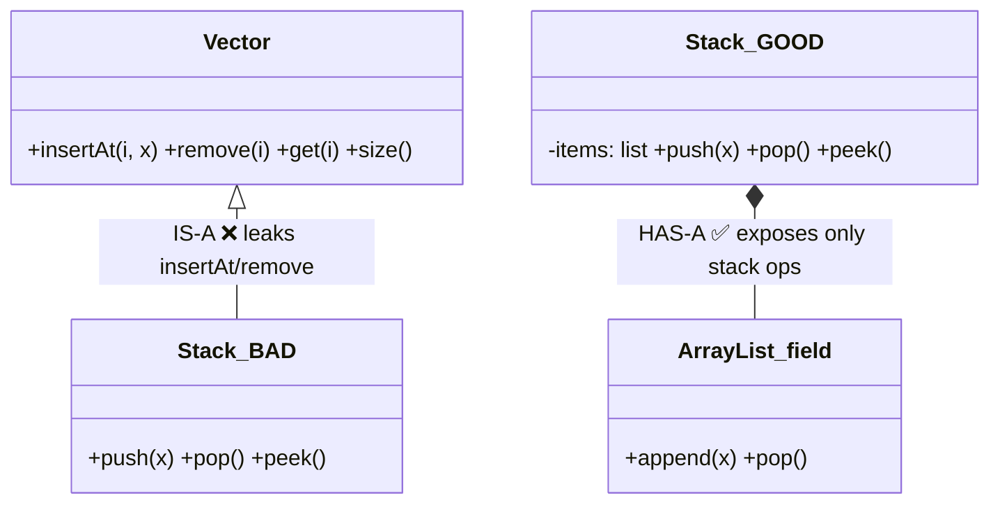
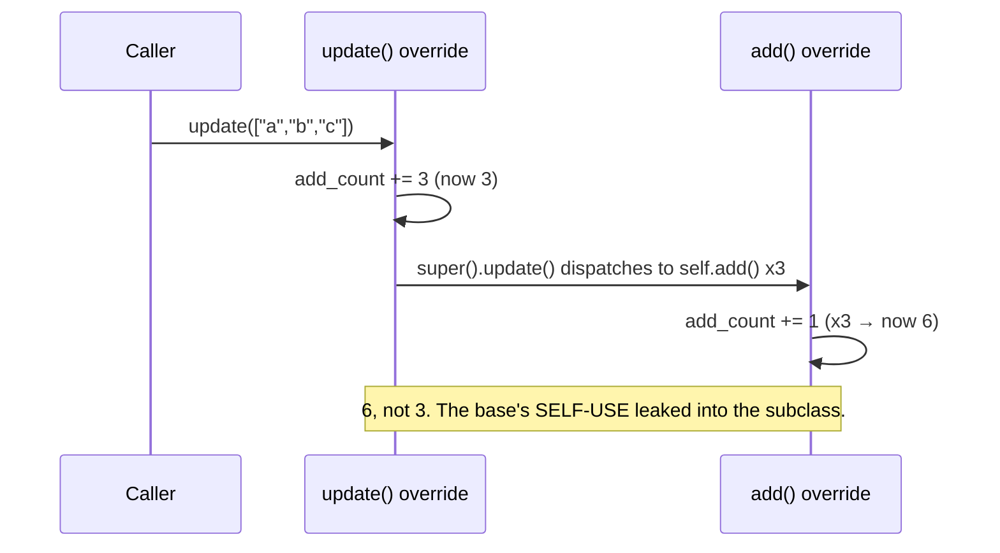
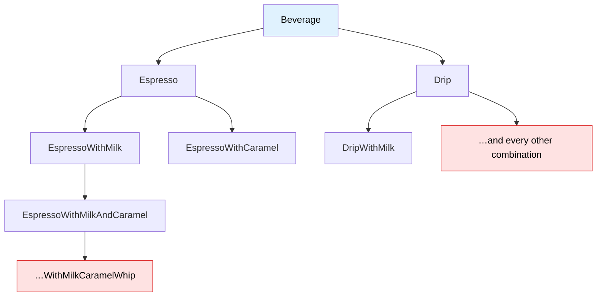
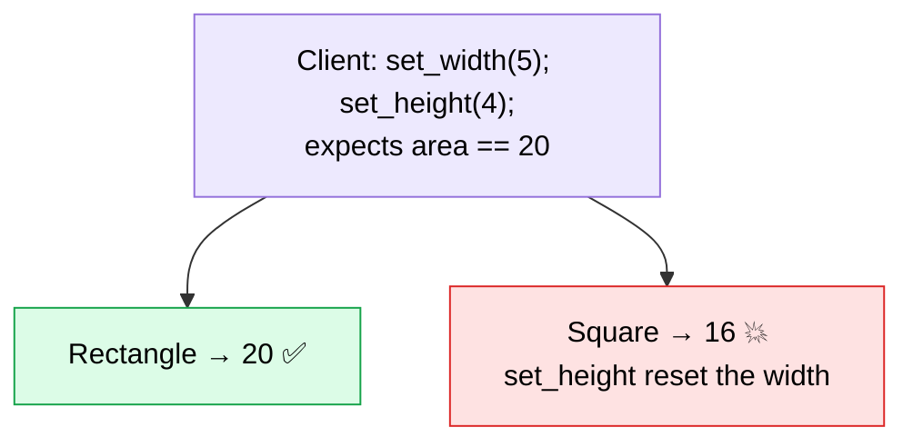
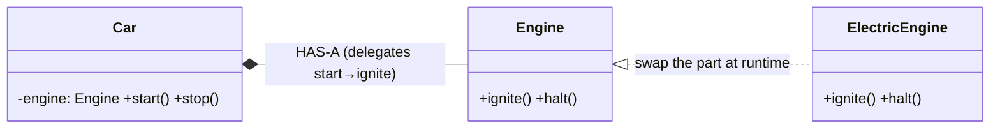
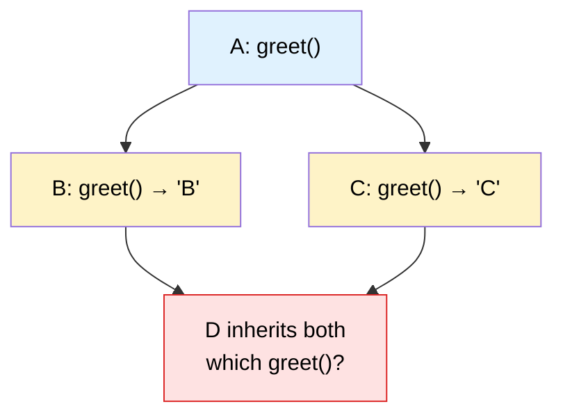
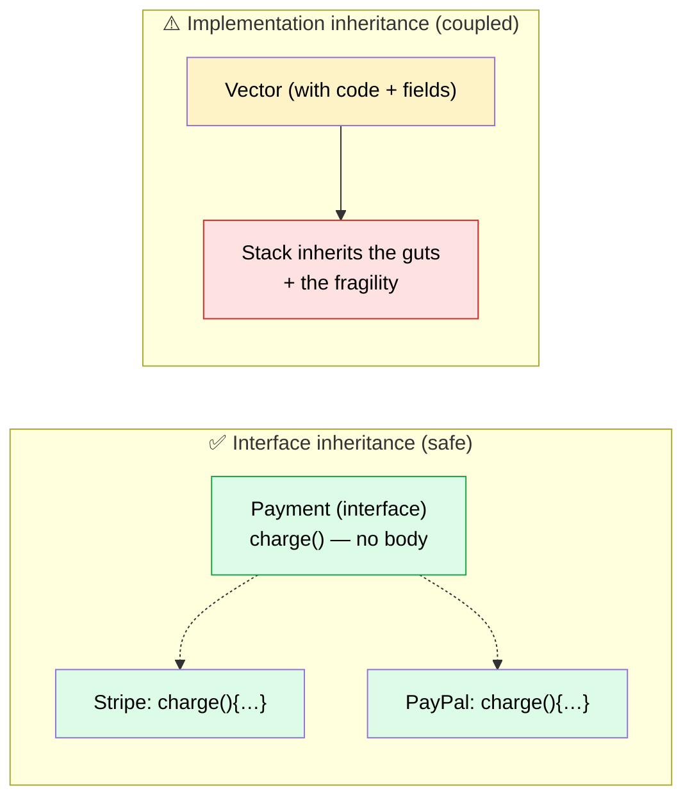
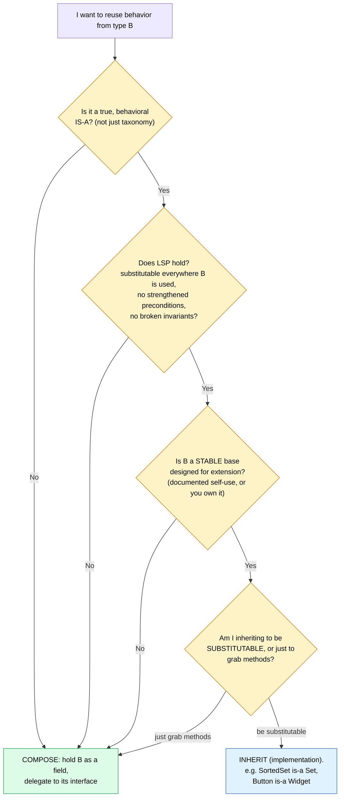
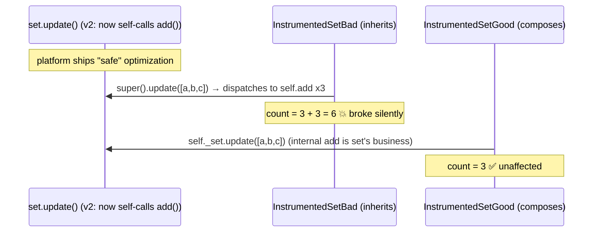

# Composition vs Inheritance

> **One line:** Inheritance says "I *am* a kind of you and I inherit your guts"; composition says "I *have* one of you and I only use your front door" — and the second is almost always the safer bet, because sharing guts is how a change over there silently breaks you over here.

---

## Table of Contents
1. [Why You Must Master This](#1-why-you-must-master-this)
2. [The Mental Model](#2-the-mental-model)
3. [The Fragile Base Class Problem](#3-the-fragile-base-class-problem)
4. [The Subclass Combinatorial Explosion](#4-the-subclass-combinatorial-explosion)
5. [The Liskov Substitution Principle — the Test for Legitimate Inheritance](#5-the-liskov-substitution-principle--the-test-for-legitimate-inheritance)
6. [Composition & Delegation — Has-A Done Right](#6-composition--delegation--has-a-done-right)
7. [Mixins, Traits & the Diamond Problem](#7-mixins-traits--the-diamond-problem)
8. [Interface Inheritance vs Implementation Inheritance](#8-interface-inheritance-vs-implementation-inheritance)
9. [The Decision Rule — When Inheritance Actually Wins](#9-the-decision-rule--when-inheritance-actually-wins)
10. [Worked Example — An Instrumented Collection](#10-worked-example--an-instrumented-collection)
11. [Real-Life Use Cases](#11-real-life-use-cases)
12. [Failure Modes](#12-failure-modes)
13. [🏋️ Practice Drills](#-practice-drills)
14. [🎤 Interview Q&A Bank](#-interview-qa-bank)
15. [🎯 Staff+ Nuances](#-staff-nuances)
16. [Cheat Sheet](#16-cheat-sheet)
17. [Connections & Further Reading](#17-connections--further-reading)

---

## 1. Why You Must Master This

This is the single most common way a class hierarchy rots, and the single most common maturity signal an interviewer is grading for. [Object_Oriented_Design.md](./Object_Oriented_Design.md) introduces "favor composition over inheritance" in one section; this file is the *why* and the *when*, at depth — read that section first, then come here to actually be able to defend the rule.

- **A superclass change silently breaks subclasses you never touched.** This is the *fragile base class problem*, and it is not hypothetical: adding one line to a base method can flip the behavior of a subclass in a different module, with no compile error — the failure shows up at runtime, in production, far from the edit.
- **Inheritance is the tightest coupling in all of OOP.** A subclass depends on its parent's *implementation*, not just its interface. That is strictly more coupling than a caller has — and coupling is the thing that makes change expensive.
- **The famous mistakes are inheritance mistakes.** `java.util.Stack extends Vector` (a stack that leaks list-insertion methods), `java.util.Properties extends Hashtable` (a string-to-string map that accepts any object) — these ship in the standard library and can never be fixed, precisely because inheritance welded the wrong two things together.
- **It's the LSP question in disguise.** "Is-a or has-a?" is really "does the Liskov Substitution Principle hold?" Interviewers use the Rectangle/Square and Penguin/Bird classics to see whether you test substitutability *behaviorally* or just wave at a taxonomy.

> **The core problem it solves:** how to *reuse* behavior without *inheriting fragility* — getting the shared code you want (has-a delegation) instead of the shared coupling you don't (is-a subclassing).

**Prerequisites:** [Object_Oriented_Design.md](./Object_Oriented_Design.md) (the four pillars, especially inheritance/polymorphism) and [SOLID_Principles.md](./SOLID_Principles.md) (Liskov `L` and Open/Closed `O`).

---

## 2. The Mental Model

Inheritance is **adopting your parent's entire body** — organs, reflexes, and all. When the surgeon changes something about the parent's liver, *your* liver changes too, whether or not you were consulted. Composition is **hiring a specialist**: you keep your own body and call the specialist through the front desk. If the specialist reorganizes their back office, you never notice — you only ever used the front desk (the interface).

The reframe: stop asking *"what is this thing a kind of?"* (taxonomy — cheap and seductive) and start asking *"what can this thing do, and whose behavior does it reuse to do it?"* (capability — the honest question).



> **Hold onto this:** inherit only when a caller should be able to treat your object *as* the base type everywhere the base type is expected (substitutability). If you're subclassing merely to grab some methods, you want a **field**, not a **base class**.



> A stack that *is-a* vector must expose every vector method — including `insertAt(3, x)`, which makes no sense on a stack. A stack that *has-a* list exposes exactly `push/pop/peek`. Same reuse, no leak.

---

## 3. The Fragile Base Class Problem

**What it is.** A subclass can break — silently, at runtime — when its superclass changes, *even though the subclass source did not change and the superclass change was "safe" in isolation*. The base class is "fragile" because its authors cannot evolve it without risking every subclass, and subclass authors cannot protect themselves because they depend on undocumented *implementation* details (which method calls which).

**Why it happens.** Inheritance exposes the superclass's *self-calls* to the subclass. When a subclass overrides a method, it also overrides every internal call the base makes to that method. The base class's private choice — "`addAll` happens to loop and call `add`" — becomes part of the contract the subclass unknowingly depends on. This is called **self-use**, and it is almost never documented.

**The canonical break (Josh Bloch, *Effective Java*, Item 18).** We want a `HashSet` that counts how many elements were ever *added*. Inheritance looks perfect:

```python
class InstrumentedSetBad(set):
    """❌ Count every element ever added — by subclassing set."""
    def __init__(self, *args) -> None:
        super().__init__(*args)
        self.add_count = 0

    def add(self, item) -> None:
        self.add_count += 1          # count one
        super().add(item)

    def update(self, items) -> None: # 'update' = addAll
        self.add_count += len(list(items))   # count the batch
        super().update(items)

s = InstrumentedSetBad()
s.update(["a", "b", "c"])
print(s.add_count)   # expected 3 …
```

If `set.update` is implemented by looping and calling `self.add` internally, then `update(["a","b","c"])` counts 3 (in `update`) **plus** 3 more (in the three self-dispatched `add` calls) = **6**. The subclass double-counts. Nothing in `set`'s public docs promised whether `update` calls `add` — that's an *implementation* detail, and we inherited a dependency on it.



> The bug is invisible in review: both overrides look correct, and the base class looks correct. The break lives in the *interaction* — a detail neither author owns.

**The composition fix.** Hold the set as a private field and forward (delegate). Now we control exactly which of our own methods get counted; the wrapped set's internal self-calls are *its* business and never touch our counter.

```python
from typing import Iterable

class InstrumentedSetGood:
    """✅ HAS-A set. Forward the interface; own the counting."""
    def __init__(self) -> None:
        self._set: set = set()       # private — callers never see it
        self.add_count = 0

    def add(self, item) -> None:
        self.add_count += 1
        self._set.add(item)

    def update(self, items: Iterable) -> None:
        items = list(items)
        self.add_count += len(items)
        self._set.update(items)      # the set's internal self-use is invisible to us

    def __contains__(self, item) -> bool:
        return item in self._set     # forward the rest of the interface as needed

s = InstrumentedSetGood()
s.update(["a", "b", "c"])
print(s.add_count)   # 3 — correct, and immune to how set.update is implemented
```

**The trade-off.** Composition costs boilerplate: you must forward the methods you want to expose (`__contains__`, `__len__`, `__iter__`, …). Inheritance gives you all of them free. That "free" is exactly the trap — you also inherit the ones that don't fit and a dependency on internals. Delegation is more typing today for the freedom to change the base tomorrow.

> **Real number:** the JDK shipped `Stack extends Vector` in 1.0 (1996) and still cannot remove `Stack.insertElementAt` thirty years later — binary compatibility froze the mistake permanently. Fragility isn't just a bug; it's a bug you can never take back.

---

## 4. The Subclass Combinatorial Explosion

**What it is.** When you model *independent capabilities* as inheritance, every combination of capabilities needs its own class. `N` orthogonal features force up to `2^N` subclasses. This is *why* the Gang of Four wrote "favor object composition over class inheritance."

**Why it happens.** Inheritance gives you exactly **one** axis of classification — the single parent chain. Reality has many axes. A coffee drink varies by *base* (espresso, drip), *milk* (none, whole, oat), and *extras* (caramel, whipped). Three axes, and inheritance can only encode one, so the rest smear into the class name:



> Add "oat milk" and you must add a parallel subclass for *every* existing combination. The tree grows multiplicatively; adding one option doubles the leaves.

**The composition fix — assemble, don't enumerate.** Model each axis as a part you attach at runtime. Adding "oat milk" is one new small class, combinable with everything, touching nothing:

```python
from dataclasses import dataclass, field

@dataclass
class Beverage:
    base: str
    milk: str = "none"
    extras: list[str] = field(default_factory=list)   # HAS-A set of options

    def describe(self) -> str:
        parts = [self.base]
        if self.milk != "none":
            parts.append(f"{self.milk} milk")
        parts += self.extras
        return " + ".join(parts)

# every combination is data, not a class — no explosion
print(Beverage("espresso", milk="oat", extras=["caramel", "whip"]).describe())
```

This is precisely the mechanism behind **Decorator** and **Strategy** (see [Design_Patterns_Overview.md](./Design_Patterns_Overview.md)): stack orthogonal behaviors as composed objects rather than pre-baking every combination into a subclass. `Logging(RateLimited(RealService))` at runtime replaces `LoggingRateLimitedService` in the type tree.

| | Inheritance for N axes | Composition for N axes |
|---|---|---|
| **Classes needed** | up to `2^N` (combinatorial) | `N` parts + 1 container (linear) |
| **Add one new option** | add a subclass per existing combo | add one part class |
| **Combine at runtime?** | no — fixed at compile time | yes — assemble on demand |
| **Where it shows up** | `LoggedRetryingCachedService` | `Logged(Retrying(Cached(svc)))` |

> **The tell:** a class name with "And" in it (`EmailAndSmsAndPushNotifier`) or a hierarchy where sibling branches repeat the same suffixes — that's an explosion begging to be composed.

---

## 5. The Liskov Substitution Principle — the Test for Legitimate Inheritance

**What it is.** Barbara Liskov's principle (1987): *if `S` is a subtype of `T`, then objects of type `T` may be replaced with objects of type `S` without altering the correctness of the program.* In plain terms: **a subclass must be usable anywhere its base is expected, honoring the base's behavioral contract — not just its method signatures.** LSP is the `L` in [SOLID_Principles.md](./SOLID_Principles.md), and it is the *definitive test* for whether inheritance is legitimate.

**Why it matters.** "Is-a" as taxonomy is a trap. A square *is a* rectangle in geometry class, and a penguin *is a* bird in biology class — yet both make terrible subclasses, because inheritance is about *substitutable behavior*, not dictionary definitions. LSP is the check that catches the difference.

### The Rectangle/Square violation

```python
class Rectangle:
    def __init__(self, w: int, h: int) -> None:
        self._w, self._h = w, h
    def set_width(self, w: int) -> None:  self._w = w
    def set_height(self, h: int) -> None: self._h = h
    def area(self) -> int:                return self._w * self._h

class Square(Rectangle):          # ❌ "a square IS-A rectangle" — taxonomically true
    def set_width(self, w: int) -> None:
        self._w = self._h = w     # a square must keep sides equal → side effect!
    def set_height(self, h: int) -> None:
        self._w = self._h = h

def stretch_and_check(r: Rectangle) -> None:
    r.set_width(5)
    r.set_height(4)
    assert r.area() == 20, f"expected 20, got {r.area()}"   # a caller's reasonable belief

stretch_and_check(Rectangle(1, 1))   # ok → 20
stretch_and_check(Square(1, 1))      # 💥 AssertionError: got 16 (set_height reset width!)
```

The client wrote code that is *correct for every Rectangle*: set width and height independently, expect `w*h`. `Square` breaks that contract because `set_height` secretly mutates width. The subclass is signature-compatible but *behavior-incompatible* — that is an LSP violation, and the runtime cost is a broken assertion in code that never mentioned `Square`.



> **Fix:** don't make `Square` a subtype of the *mutable* `Rectangle`. If rectangles are **immutable** (no setters, `with_width` returns a new object), the contradiction vanishes — there's no setter to violate. Otherwise, make `Shape` the common abstraction and let `Square` and `Rectangle` be siblings, not parent/child.

### The Penguin/Bird violation

```python
class Bird:
    def fly(self) -> None: ...          # the contract says: all birds fly

class Penguin(Bird):                    # ❌ a penguin IS-A bird, but cannot fly
    def fly(self) -> None:
        raise NotImplementedError("penguins can't fly")   # breaks every caller of bird.fly()
```

Any function written against `Bird` that calls `fly()` now throws for penguins. The mistake was modeling a *capability* (flight) as part of the base contract when only *some* subtypes have it. **Fix with composition / interface segregation:** give birds a `movement` behavior, or split `Flyable` into its own interface that only flying birds implement — see [Interface_Design.md](./Interface_Design.md).

```python
from typing import Protocol

class Bird:                             # ✅ base contract = what ALL birds do
    def eat(self) -> None: ...
    def lay_egg(self) -> None: ...

class Flyable(Protocol):                # capability, not a base class
    def fly(self) -> None: ...

class Sparrow(Bird):                    # is-a Bird AND satisfies Flyable
    def fly(self) -> None: ...
class Penguin(Bird):                    # is-a Bird, simply not Flyable — no lie told
    def swim(self) -> None: ...
```

**The LSP rulebook** (what a subclass may and may not do to stay substitutable):

| Rule | Subclass may… | Subclass may NOT… |
|------|---------------|-------------------|
| **Preconditions** | *weaken* them (accept more) | *strengthen* them (demand more than base did) |
| **Postconditions** | *strengthen* them (promise more) | *weaken* them (deliver less than base promised) |
| **Invariants** | preserve or add | break the base's invariants |
| **Exceptions** | throw base's declared types | throw new, unexpected checked exceptions |
| **History** | — | allow state changes the base forbade (e.g. mutating a value the base treats as fixed) |

> **The behavioral test, stated once:** write down what a *caller of the base* is allowed to assume. If your subclass can be dropped into that caller and every assumption still holds, inheritance is legitimate. If the caller must know "oh, but if it's actually a `Square`/`Penguin`, be careful" — you have `has-a`/`Shape-sibling`, not `is-a`.

---

## 6. Composition & Delegation — Has-A Done Right

**What it is.** *Composition* means an object holds other objects as fields (`has-a`). *Delegation* means it forwards work to a held object rather than doing it itself or inheriting it. Together they are the reuse mechanism you reach for by default.

**Why it's looser coupling.** A composing object depends only on the held object's *public interface* — the same narrow surface any caller sees. A subclass depends on its parent's *interface plus every internal self-call and protected member* — a much wider surface. Narrower dependency = more freedom for both sides to change.



> `Car` delegates `start()` to whatever `Engine` it holds; swapping a petrol engine for an electric one is a constructor argument, not a new `ElectricCar` subclass. Composition makes the varying part a *pluggable field*.

```python
class Engine:
    def start(self) -> str: return "vroom"

class ElectricEngine:
    def start(self) -> str: return "hum"

class Car:
    def __init__(self, engine: Engine) -> None:
        self._engine = engine          # HAS-A — injected, swappable
    def start(self) -> str:
        return self._engine.start()    # DELEGATE — forward to the part

Car(Engine()).start()          # "vroom"
Car(ElectricEngine()).start()  # "hum" — no CarElectric subclass needed
```

**The trade-off honestly.** Delegation's cost is *forwarding boilerplate* — you write pass-through methods for the interface you expose. Languages soften this: Kotlin has `by` (`class C : I by delegate`), C# has explicit delegation helpers, Python can forward via `__getattr__`. But even hand-written forwarding is worth it: it's the price of the *stable front door* that immunizes you from the base class's internal churn.

> **The two-word litmus (from [Object_Oriented_Design.md](./Object_Oriented_Design.md), sharpened):** say the relationship out loud. "A `Stack` **is a** `List`" — false (a stack forbids random insertion). "A `Stack` **has a** `List`" — true. If "has-a" reads more naturally, compose. This is the engine behind **Strategy**, **Decorator**, **Adapter**, and **Bridge** in [Design_Patterns_Overview.md](./Design_Patterns_Overview.md).

---

## 7. Mixins, Traits & the Diamond Problem

**What they are.** A *mixin* (Python) or *trait* (Scala/Rust/PHP) is a small class that bundles reusable behavior meant to be *mixed into* other classes via multiple inheritance — a middle path between "inherit everything from one parent" and "compose a field." You use them for cross-cutting capabilities: `SerializableMixin`, `ComparableMixin`, `LoggingMixin`.

**Why they're tempting and where they bite.** Mixins give combinatorial capability without the `2^N` subclass explosion — mix `Serializable` + `Comparable` freely. But multiple inheritance opens the **diamond problem**: if `D` inherits from both `B` and `C`, which both inherit from `A`, and `B` and `C` both override `A.method()`, *which one does `D` get?*



> The diamond: `D` sees two paths to `A.greet()`. Ambiguous resolution is the classic multiple-inheritance hazard C++ struggled with (virtual inheritance) and Java banned outright (single class inheritance + interfaces only).

**How Python resolves it — the MRO (C3 linearization).** Python doesn't guess; it computes a deterministic **Method Resolution Order** — a single linear chain honoring "children before parents, and left before right." `super()` walks *that* chain, not "the parent":

```python
class A:
    def greet(self) -> str: return "A"
class B(A):
    def greet(self) -> str: return "B->" + super().greet()
class C(A):
    def greet(self) -> str: return "C->" + super().greet()
class D(B, C):                          # diamond: D → B → C → A
    def greet(self) -> str: return "D->" + super().greet()

print(D().greet())            # "D->B->C->A"  — MRO, not two copies of A
print([c.__name__ for c in D.__mro__])   # ['D', 'B', 'C', 'A', 'object']
```

The catch: `super()` in `B` does **not** mean "call `A`" — it means "call the next class in `D`'s MRO," which is `C`. Cooperative multiple inheritance only works if every class calls `super()` and has compatible signatures; break that discipline and you get skipped methods or `TypeError`s that are brutal to debug.

**When to use which:**

| | Mixin / trait | Composition (has-a field) |
|---|---|---|
| **Good for** | stateless cross-cutting behavior (`ComparableMixin`) | anything with state or that you'd swap at runtime |
| **Coupling** | still inheritance — shares namespace & `self` | loose — separate object, own state |
| **Diamond risk** | yes (needs disciplined `super()`) | none |
| **Runtime swap** | no (fixed at class definition) | yes |

> **Staff take:** mixins are *inheritance wearing a composition costume* — they still share `self`, name-collide, and impose MRO discipline. Prefer them only for genuinely stateless, orthogonal behavior with no field to hold. Rust's traits and Scala's traits are safer than Python/C++ multiple inheritance because they lean on interface-style contracts and explicit resolution — closer to §8's interface inheritance than to implementation inheritance.

---

## 8. Interface Inheritance vs Implementation Inheritance

The most important distinction in this whole topic, and the one that dissolves most of the debate: **there are two completely different things both spelled with the word "inherit."**

- **Interface inheritance** — inheriting a *contract*: a promise of *what* methods exist, with **no** implementation shared. Java `implements`, Python `Protocol`/ABC-with-only-abstract-methods, Go interfaces, C++ pure virtual. This is **safe and cheap** — no fragile base class, because there's no base *implementation* to be fragile.
- **Implementation inheritance** — inheriting *code*: the parent's method *bodies* and fields. `class Stack extends Vector`. This is the **coupled, fragile** kind — the source of §3 and §4.



> "Favor composition over inheritance" is really "favor composition over **implementation** inheritance." **Interface** inheritance + composition is the pairing behind every clean design: depend on an interface (interface inheritance), inject the implementation (composition). Almost nobody warns you against interface inheritance — it has none of the downsides.

```python
from typing import Protocol

class Storage(Protocol):                 # interface inheritance: pure contract
    def read(self, key: str) -> bytes: ...
    def write(self, key: str, val: bytes) -> None: ...

class S3Storage:                         # satisfies Storage — NO code inherited
    def read(self, key): ...
    def write(self, key, val): ...

class Cache:
    def __init__(self, backend: Storage) -> None:
        self._backend = backend          # composition: depend on interface, inject impl
```

This is the reconciliation the interview wants: *"I inherit interfaces freely; I inherit implementations rarely, and only when Liskov holds against a stable base."* See [Interface_Design.md](./Interface_Design.md) for designing the contracts and [Dependency_Injection.md](./Dependency_Injection.md) for injecting the implementations.

---

## 9. The Decision Rule — When Inheritance Actually Wins

Inheritance is not banned — it's a sharp tool with a narrow legitimate use. Use **implementation inheritance** only when **all three** conditions hold; otherwise compose.



**The three gates for legitimate (implementation) inheritance:**

1. **True behavioral is-a** — not "a `Manager` is-an `Employee` so I'll subclass to reuse `calculatePay`," but "callers should treat a `Manager` *as* an `Employee` everywhere." If the relationship is really "has-a role" or "has-a capability," compose.
2. **LSP holds** — the subclass honors every assumption a caller of the base may make (§5). No strengthened preconditions, no broken invariants, no surprise exceptions.
3. **Stable base designed for extension** — either you own the base and can freeze/document its self-use, or the library explicitly designed for subclassing (documented "override this, don't override that"). Subclassing a base whose internals churn is signing up for §3.

> Josh Bloch's compression of gates 2–3: *"Design and document for inheritance, or else prohibit it."* Languages agree — Kotlin classes are `final` by default (you must write `open`), C# has `sealed`, Java has `final` — all nudging you to *opt in* to being a base, because the default assumption is that a class is **not** safe to inherit from.

---

## 10. Worked Example — An Instrumented Collection

Let's close the loop with numbers, extending §3's break into a full before/after and quantifying the blast radius.

**Scenario.** A metrics team needs a `Set` that reports total adds to a dashboard. Two engineers implement it — one inherits, one composes. Then the platform team ships an *optimization* to the base: `update()` is rewritten to call `add()` in a loop for better resize behavior (a change that is *correct and invisible* to the base's public contract).



**Concept → consequence, with a number.** Say the metric feeds billing at \$0.001 per "add." The inheritance version now **double-bills**: a customer doing 1,000,000 adds/day is charged for 2,000,000 — a **100% overcharge** that no test caught (the unit test added a handful of items and "6 vs 3" looked like a fixture quirk, or the optimization landed after the tests were written). The composition version is provably immune, because it never depended on whether `update` self-calls `add` — that coupling *does not exist* across a delegation boundary.

The architectural decision this forces: **at any boundary where a dependency can evolve independently of you (a library, another team's base class), delegate across the boundary — don't inherit across it.** Inheritance is only safe *within* a unit you fully control and version together.

```python
# The measurable difference, as an assertion the two designs make about the base:
# InstrumentedSetBad  asserts: "set.update() will NEVER internally call self.add()"  ← undocumented, fragile
# InstrumentedSetGood asserts: nothing about set's internals                          ← robust
```

---

## 11. Real-Life Use Cases

| Situation | Inheritance or composition? | The decision it forces |
|-----------|-----------------------------|------------------------|
| **`java.util.Stack extends Vector`** | ❌ inheritance mistake | Stack leaks `insertElementAt`/`remove(i)` — can never be fixed (binary compat). Should have *had-a* Vector. |
| **`java.util.Properties extends Hashtable`** | ❌ inheritance mistake | A string→string map that accepts any object via inherited `put()`; violates its own invariant. |
| **`SortedSet is-a Set`, `ArrayList is-a List`** | ✅ inheritance (interface) | Genuine substitutable is-a — any `Set` code works on a `SortedSet`. LSP holds. |
| **UI `Button is-a Widget`** | ✅ inheritance | A button truly is a widget everywhere a widget is rendered/laid-out. Stable, framework-owned base. |
| **UI `Button has-a ClickHandler`** | ✅ composition | Behavior varies per button → inject it; don't subclass `SaveButton`, `CancelButton`. |
| **Game entities (`Player`, `Enemy`, `Boss`)** | ✅ composition (ECS) | Compose `Position`+`Health`+`Renderable` components; a `Boss` tree explodes, components don't. |
| **HTTP middleware (`Logging`, `Auth`, `RateLimit`)** | ✅ composition (Decorator) | Stack `Logging(Auth(RateLimit(app)))`; a `LoggingAuthRateLimitApp` subclass would explode (§4). |
| **Django `class Meta` / class-based views** | ⚠️ mixin inheritance | Powerful but MRO-fragile; deep view hierarchies are a known Django pain point. |

> **Real-world habit:** whenever you're about to type `class Foo(Bar)` where `Bar` is code you don't own, stop and ask "am I being substitutable, or just borrowing methods?" If borrowing, make `Bar` a field.

---

## 12. Failure Modes

```mermaid
mindmap
  root((Inheritance Pitfalls))
    Fragile base class
      base change breaks subclass silently
      subclass depends on undocumented self-use
      double-counting InstrumentedSet
    Subclass explosion
      2^N classes for N axes
      "And" in the class name
      add one option, double the leaves
    LSP violation
      Rectangle/Square setter side-effect
      Penguin.fly() throws
      strengthened precondition
    Yo-yo problem
      jump up/down a 6-level tree
      to understand one method call
    Inheriting to reuse
      subclass just to grab methods
      no substitutability intended
    Diamond ambiguity
      multiple inheritance MRO surprises
      super() skips or double-calls
```

- **Fragile base class** — *symptom:* a subclass in module X breaks after a "safe" edit to a base in module Y, with no compile error and a test that passes in isolation. *Root cause:* the subclass depended on the base's internal self-use (which method calls which), an undocumented detail. *Fix:* replace inheritance with composition/delegation across that boundary; if you must inherit, document self-use and freeze it.
- **Subclass combinatorial explosion** — *symptom:* class names with "And"/multiple adjectives, sibling branches repeating suffixes, `2^N` growth. *Root cause:* modeling `N` independent capabilities on inheritance's single axis. *Fix:* make each axis a composed part (Strategy/Decorator); combine at runtime.
- **LSP violation** — *symptom:* a caller of the base must special-case "if it's actually a `Square`/`Penguin`…", or an override throws/no-ops where the base worked. *Root cause:* signature-compatible but behavior-incompatible subtype (strengthened precondition, broken invariant, weakened postcondition). *Fix:* make the types siblings under a common abstraction, or model the capability as an interface only some implement.
- **Yo-yo problem** — *symptom:* to understand one method you scroll up and down a 5–6 level hierarchy. *Root cause:* behavior smeared across a deep tree via overrides and `super()` calls. *Fix:* flatten; prefer shallow hierarchies (1–2 levels) and composition for the rest.
- **Inheriting for reuse, not subtyping** — *symptom:* `class ReportGenerator(list)` because you wanted list methods. *Root cause:* using a base class as a code-borrowing shortcut. *Fix:* hold the list as a field; expose only what a report generator should.
- **Diamond ambiguity** — *symptom:* a mixin method runs twice, or is skipped, or `super()` raises `TypeError`. *Root cause:* non-cooperative multiple inheritance — a class in the MRO didn't call `super()` or had an incompatible signature. *Fix:* keep mixins stateless and cooperative, or drop to composition.

---

## 🏋️ Practice Drills

> *Cover the solutions and attempt first — active recall is the point.*

**Drill 1 — Spot the fragile base.** You subclass a third-party `HttpClient` and override `get()` to add a request-ID header. Six months later the library ships v2 where `get()` internally calls `request("GET", …)`, and `post()` also calls `request(...)`. Your header now appears on GETs but not POSTs — inconsistently. Diagnose and fix.

<details><summary>Solution</summary>

**Fragile base class.** Your override depended on the undocumented fact that every verb went through its own public method; v2 refactored the self-use to funnel through `request()`, and your override no longer sits on the real code path. The class was never *designed for extension* (gate 3 of §9 fails). **Fix:** compose — wrap the client (`self._client = HttpClient()`), expose your own `get`/`post` that inject the header and then delegate to `self._client.request(...)`. Now you depend only on the public `request` contract, not on which method calls which. This is the Decorator/Adapter shape from [Design_Patterns_Overview.md](./Design_Patterns_Overview.md).
</details>

**Drill 2 — LSP audit.** A `ReadOnlyList(list)` subclass overrides `append`, `__setitem__`, and `pop` to raise `NotImplementedError`. Is this a valid subtype? Why or why not, and what's the right design?

<details><summary>Solution</summary>

**LSP violation.** Any function written against `list` may reasonably call `append`; `ReadOnlyList` *strengthens the precondition* ("only if you never mutate") and throws where the base succeeds — so it is **not** substitutable for a `list`. A caller doing `def add_all(lst, xs): for x in xs: lst.append(x)` breaks. **Right design:** don't inherit from the mutable type. Define a read-only *interface* (`Sequence`/a `Protocol` with only `__getitem__`, `__len__`, `__iter__`) and have both `list` and your read-only view satisfy it — interface inheritance (§8), not implementation inheritance. Immutability is a *narrower* contract, so it must be a supertype/sibling, never a subtype of the mutable one.
</details>

**Drill 3 — Kill the explosion.** A pizza-ordering system has `Pizza`, `CheesePizza`, `VeggiePizza`, `CheeseVeggiePizza`, `PepperoniCheesePizza`, … 14 classes and counting. Adding "olives" would require ~8 new classes. Redesign.

<details><summary>Solution</summary>

**Subclass combinatorial explosion** — toppings are independent axes forced onto one inheritance chain. **Fix:** `Pizza` *has-a* list of `Topping`s (composition), or use the **Decorator** pattern (`Olives(Cheese(PlainPizza()))`) so each topping wraps and adds cost/description. Adding "olives" becomes **one** class combinable with everything; the 14 classes collapse to `Pizza` + one class per topping. Price and description compose additively. This is exactly why [Design_Patterns_Overview.md](./Design_Patterns_Overview.md) presents Decorator as the answer to subclass explosion.
</details>

**Drill 4 — Design the seam.** You're designing a `Logger` that some teams want to write to files, some to stdout, some to a network service, and some want *two* of those at once. Sketch the design and justify inheritance vs composition at each point.

<details><summary>Solution</summary>

Two seams, two answers. (1) *Where to write* is an axis with multiple implementations → **interface inheritance**: a `LogSink` protocol (`write(record)`) with `FileSink`, `StdoutSink`, `NetworkSink`. (2) *Wanting two at once* is combination → **composition**: a `MultiSink` that *has-a* list of sinks and fans out (or a Decorator chain). The `Logger` *has-a* `LogSink` (injected — [Dependency_Injection.md](./Dependency_Injection.md)), never `class NetworkLogger(Logger)`. Zero implementation inheritance; adding "syslog" is one new `LogSink`, and "file + network" is `MultiSink([FileSink(), NetworkSink()])`. Substitutability (LSP) holds trivially because every sink honors the same `write` contract.
</details>

---

## 🎤 Interview Q&A Bank

**Q1. Why "favor composition over inheritance"?**
> Implementation inheritance is the tightest coupling in OOP — a subclass depends on the parent's *internals* (which method calls which), so a safe-looking base change breaks subclasses silently: the fragile base class problem. It also forces one classification axis, so independent capabilities explode into `2^N` subclasses. Composition depends only on a public interface, swaps at runtime, and combines freely. Inherit to be *substitutable*; compose to *reuse*. *(signal: names both fragile-base AND explosion, not just "coupling")*

**Q2. What's the fragile base class problem — give a concrete break?**
> A subclass breaks when the superclass changes, with no source change to the subclass. Classic: an `InstrumentedSet` subclasses `HashSet` and overrides both `add` and `addAll` to count. If `addAll` internally loops and calls `add`, the count double-fires — 3 items report as 6. The subclass depended on the base's undocumented self-use. Fix: compose — hold the set as a field and delegate, so the base's internals can't leak in. *(signal: can produce the double-counting example)*

**Q3. What is the Liskov Substitution Principle, and how is it the test for inheritance?**
> A subtype must be usable anywhere its base is expected without breaking correctness — behaviorally, not just by signature. It's the test because "is-a" as taxonomy lies: a `Square` is-a `Rectangle` and a `Penguin` is-a `Bird` in the dictionary, but `Square.setHeight` also mutates width (breaking a caller who set them independently) and `Penguin.fly()` must throw. If a caller of the base must special-case your subtype, LSP fails and you want composition or sibling types. *(signal: uses behavioral not taxonomic test)*

**Q4. Rectangle/Square — walk me through why it violates LSP and how you'd fix it.**
> A client sets width 5, height 4, expects area 20 — true for any Rectangle. `Square` overrides the setters to keep sides equal, so `setHeight(4)` resets width to 4 and area is 16. The subclass broke a contract the client legitimately relied on. Fix: make rectangles **immutable** (no setters → no violation), or make `Square` and `Rectangle` siblings under a `Shape` abstraction rather than parent/child. The mutable setters are what create the contradiction. *(signal: offers immutability as the real fix, not just "don't do it")*

**Q5. Interface inheritance vs implementation inheritance — does "favor composition" apply to both?**
> No — and that's the key nuance. Interface inheritance inherits only a contract (no code), so there's no base implementation to be fragile — it's safe and cheap; Java `implements`, Python `Protocol`. Implementation inheritance inherits code and fields — that's the coupled, fragile kind the maxim warns against. The clean pattern is *both*: inherit the interface, compose the implementation. So "favor composition over inheritance" really means "over *implementation* inheritance." *(signal: draws the distinction most people miss)*

**Q6. When IS inheritance the right choice?**
> Three gates, all required: it's a true behavioral is-a (callers treat the child *as* the base, not just borrowing methods); LSP holds (no strengthened preconditions, no broken invariants); and the base is stable and designed for extension — you own it or the library documented it. `SortedSet is-a Set`, `Button is-a Widget`. Bloch's rule: design and document for inheritance, or prohibit it — which is why modern languages make classes `final`/`sealed` by default. *(signal: gives affirmative criteria, not just "avoid it")*

**Q7. What's the diamond problem and how does Python handle it?**
> With multiple inheritance, if D inherits from B and C which both inherit from A and override a method, it's ambiguous which D gets. Java bans it (single class inheritance + interfaces); C++ needs virtual inheritance. Python computes a deterministic Method Resolution Order via C3 linearization — a single chain, children-before-parents, left-before-right — and `super()` walks *that*, so `super()` in B may actually call C, not A. It only works if every class cooperates by calling `super()`. *(signal: knows super() follows MRO, not "the parent")*

**Q8. A colleague subclasses `list` to build a `TaskQueue` "to get all the list methods for free." Your review comment?**
> That's inheriting for reuse, not subtyping — the giveaway is "to get the methods." A `TaskQueue` is-not-a `list`: it shouldn't expose `insert(i, x)`, `sort()`, slicing, or `[5] = x`, which let callers corrupt queue ordering. Better: `TaskQueue` *has-a* list privately and exposes only `enqueue`/`dequeue`/`peek`. Same reuse, but the front door is exactly the queue's contract, and we're immune to how `list` evolves. It mirrors the `Stack extends Vector` mistake in the JDK. *(signal: distinguishes reuse from subtyping instantly)*

---

## 🎯 Staff+ Nuances

- **"Favor composition" is not "never inherit" — it's "inherit interfaces freely, implementations rarely."** The maxim gets flattened into dogma. Interface inheritance (§8) has none of the downsides; a `SortedSet is-a Set` is exactly right. The failure is *implementation* inheritance for *code reuse* rather than *subtyping*. Say which kind you mean in a review, or the argument goes in circles. See [Object_Oriented_Design.md](./Object_Oriented_Design.md).
- **Immutability dissolves most LSP violations.** Rectangle/Square only conflicts because rectangles are *mutable* — the setters are what a square can't honor. Make the base immutable (`with_width()` returns a new object) and there's no setter to violate; a square can even *be* a rectangle honestly. Value objects are LSP-safe by construction — see [Domain_Driven_Design.md](./Domain_Driven_Design.md).
- **Languages now encode the default as "don't inherit."** Kotlin classes are `final` unless `open`; C# has `sealed`; Effective Java says make classes final or document for inheritance. This is Bloch's rule as a language feature — the industry decided the safe default is *not extensible*, and you must opt in. Treat any non-final base you're subclassing as a liability to be justified.
- **Deep hierarchies are a coupling *and* a comprehension cost (the yo-yo problem).** Beyond fragility, a 6-level tree means understanding one method requires reading six files up and down the chain. Ousterhout's "deep modules" argument cuts the other way for hierarchies: prefer *shallow* inheritance (1–2 levels) and push variation into composed parts. See [Class_Design.md](./Class_Design.md).
- **Mixins are inheritance in composition's clothing — audit them as inheritance.** They share `self`, collide on names, and impose MRO discipline. Rust/Scala traits are safer because they lean on interface-style resolution and explicit conflict handling; Python/C++ multiple inheritance is not. Reserve mixins for genuinely stateless, orthogonal, cooperative behavior — anything stateful or swappable wants a field.
- **The cost of composition is real: forwarding boilerplate and the "self problem."** Delegation can't override the wrapped object's internal self-calls the way subclassing can — if you *need* the base to call *your* overridden method (Template Method pattern), that's the rare case implementation inheritance is genuinely the tool. Know that Template Method exists as the legitimate is-a use, and that Kotlin `by`/language delegation exists to kill the boilerplate. See [Design_Patterns_Overview.md](./Design_Patterns_Overview.md).
- **The same is-a/has-a judgment scales to services.** "Should this be a subclass or a field?" is the miniature of "should this be one service or two, coupled or via a contract?" A team that inherits another team's *internals* (shared database, shared library internals) has built a distributed fragile base class — the microservices version of §3. Depend on published contracts (interface inheritance), not internals.
- **Prefer sibling abstraction to forced parent/child.** When two types share behavior but neither is truly the other's subtype (Square/Rectangle, Circle/Square), the fix is almost always a common *abstract* supertype (`Shape`) with both as leaves — interface inheritance again. "Extract a common interface" beats "make one a subclass of the other" nearly every time.

---

## 16. Cheat Sheet

```
COMPOSITION vs INHERITANCE — inherit to be SUBSTITUTABLE, compose to REUSE.

TWO KINDS OF "INHERIT" (the whole debate hinges on this):
  INTERFACE inheritance   inherit a CONTRACT, no code   → SAFE, cheap (implements / Protocol)
  IMPLEMENTATION inherit  inherit CODE + fields         → COUPLED, fragile ("favor composition" = avoid THIS)
  Clean design = inherit the interface + COMPOSE the implementation.

THE THREE FAILURES OF IMPLEMENTATION INHERITANCE:
  Fragile base class   base change breaks subclass silently (subclass depends on undocumented self-use)
                       └ InstrumentedSet: override add+addAll → addAll self-calls add → counts 6 not 3
  Subclass explosion   N independent axes → up to 2^N subclasses ("…And…" in the name)
                       └ fix: compose parts / Decorator — add 1 option = 1 class, not double the tree
  LSP violation        subtype not usable where base is → Rectangle/Square (setter side-effect),
                       Penguin/Bird (fly() throws). Behavioral test, not taxonomy.

LSP RULEBOOK (subclass must stay substitutable):
  preconditions  may WEAKEN, never strengthen | postconditions may STRENGTHEN, never weaken
  invariants preserved | no new exceptions | no forbidden state changes

DECISION — inherit (implementation) ONLY if ALL 3:
  (1) true behavioral IS-A (not "grab methods")  (2) LSP holds  (3) stable base designed for extension
  else → COMPOSE: hold as a private field, delegate through its public interface.

TESTS:  say it aloud — "is-a" vs "has-a".  "to get the methods" = you want a FIELD, not a base.
FAMOUS MISTAKES:  Stack extends Vector · Properties extends Hashtable (can never be un-shipped)
DIAMOND:  multiple inheritance → Python C3 MRO; super() walks the MRO, not "the parent"
LANG DEFAULTS:  Kotlin final · C# sealed · "design & document for inheritance, or prohibit it" (Bloch)
POWERS:  Strategy / Decorator / Adapter / Bridge = composition wins.  Template Method = the rare is-a.
```

---

## 17. Connections & Further Reading

**Prerequisites (learn first):**
- [Object_Oriented_Design.md](./Object_Oriented_Design.md) — the four pillars and the one-section intro to "compose over inherit" that this file deepens; read §5–§6 there first.
- [SOLID_Principles.md](./SOLID_Principles.md) — Liskov (`L`) is the test in §5; Open/Closed (`O`) is why composition wins the explosion.

**Builds toward / pairs with:**
- [Structural_Design_Patterns.md](./Structural_Design_Patterns.md) — Decorator, Adapter, and Bridge are the composition-heavy patterns made into named recipes; the deep home for "wrap and delegate."
- [Behavioral_Design_Patterns.md](./Behavioral_Design_Patterns.md) — Strategy is composition's poster child; Template Method is the rare legitimate implementation-inheritance pattern, compared head-to-head there.
- [Design_Patterns_Overview.md](./Design_Patterns_Overview.md) — the map of all three pattern families and how they actualize composition.
- [Interface_Design.md](./Interface_Design.md) — interface inheritance and interface segregation (the Penguin/Bird fix lives here).
- [Class_Design.md](./Class_Design.md) — shallow hierarchies, final-by-default, and delegation boilerplate at the single-class level.
- [Dependency_Injection.md](./Dependency_Injection.md) — how composed parts get supplied (inject the implementation you don't inherit).
- [Domain_Driven_Design.md](./Domain_Driven_Design.md) — immutable value objects that make LSP violations impossible by construction.

**External classics:**
- *Effective Java* (Joshua Bloch) — Item 18 "Favor composition over inheritance" (the InstrumentedSet break) and Item 19 "Design and document for inheritance, or else prohibit it."
- *Design Patterns* (Gang of Four) — coined "favor object composition over class inheritance" as a core principle.
- *A Philosophy of Software Design* (John Ousterhout) — deep vs shallow modules; why deep inheritance hierarchies hurt comprehension.
- Barbara Liskov & Jeannette Wing, *A Behavioral Notion of Subtyping* (1994) — the formal LSP.

---

## TL;DR
**Inherit only to be substitutable; compose to reuse — and be precise that "favor composition over inheritance" means over *implementation* inheritance, not interface inheritance.** Implementation inheritance is OOP's tightest coupling and fails three ways: the **fragile base class problem** (a safe-looking superclass change silently breaks subclasses that depended on its undocumented self-use — the `InstrumentedSet` that counts 6 instead of 3), the **subclass combinatorial explosion** (`N` independent capabilities forced onto one axis need `2^N` classes), and **LSP violations** (Rectangle/Square, Penguin/Bird — "is-a" by taxonomy but not by behavior). The test for legitimate inheritance is behavioral **Liskov substitutability**: a subclass must work everywhere the base does, without a caller ever special-casing it. Use implementation inheritance only when a true behavioral is-a holds, LSP holds, *and* the base is stable and designed for extension; otherwise hold the other object as a private field and delegate through its interface. **When in doubt, make it a field, not a base class.**
