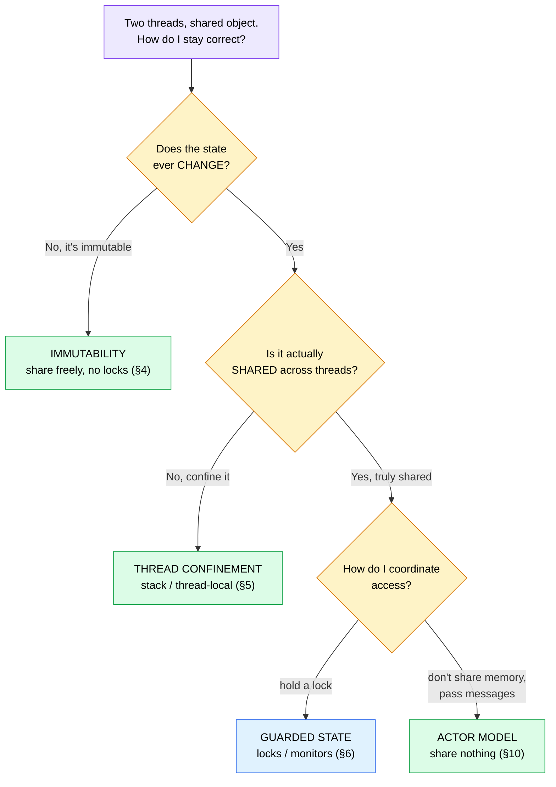
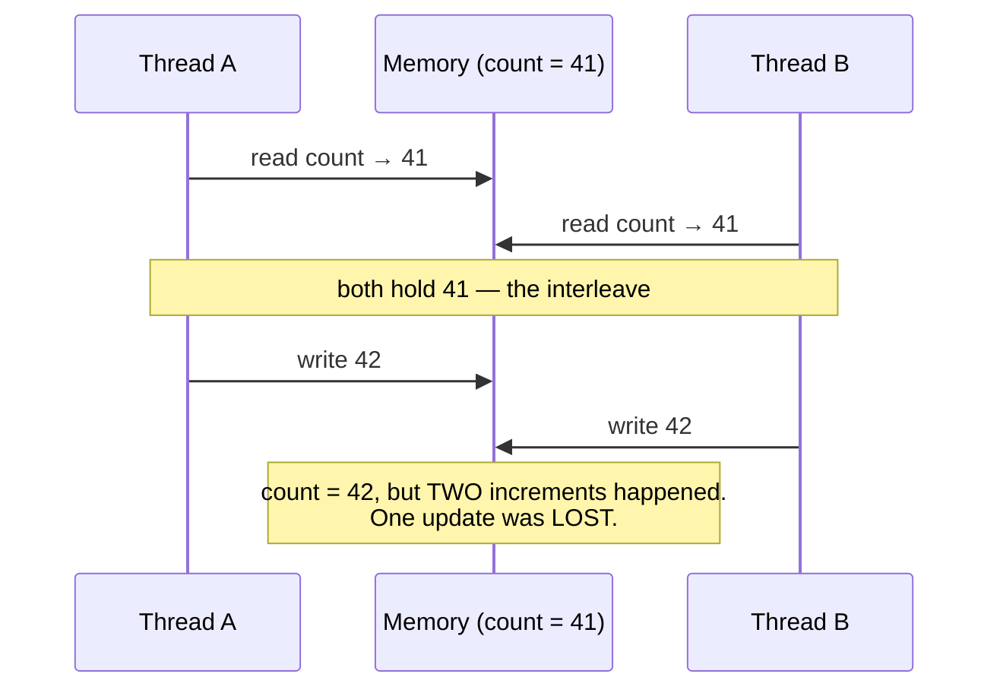
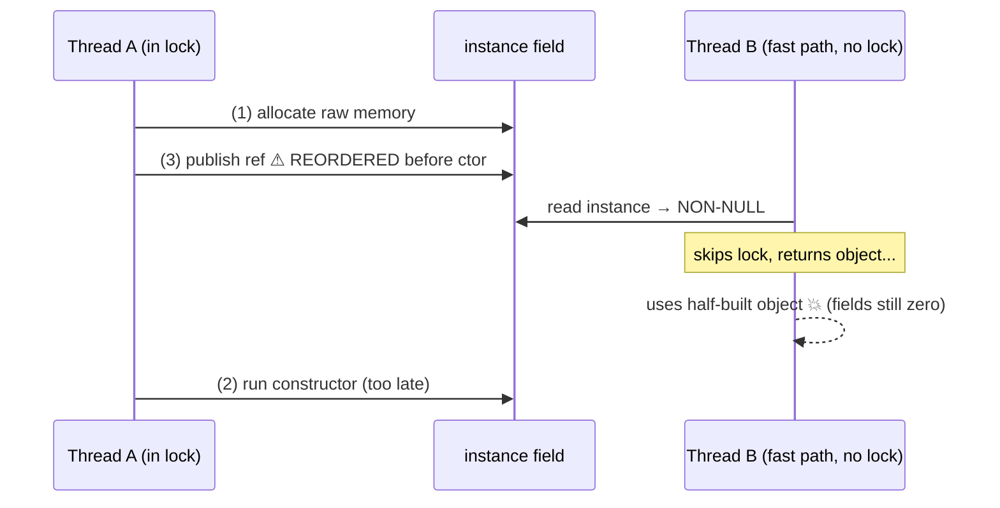
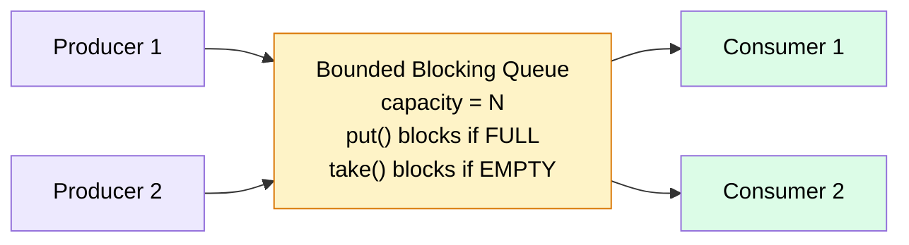
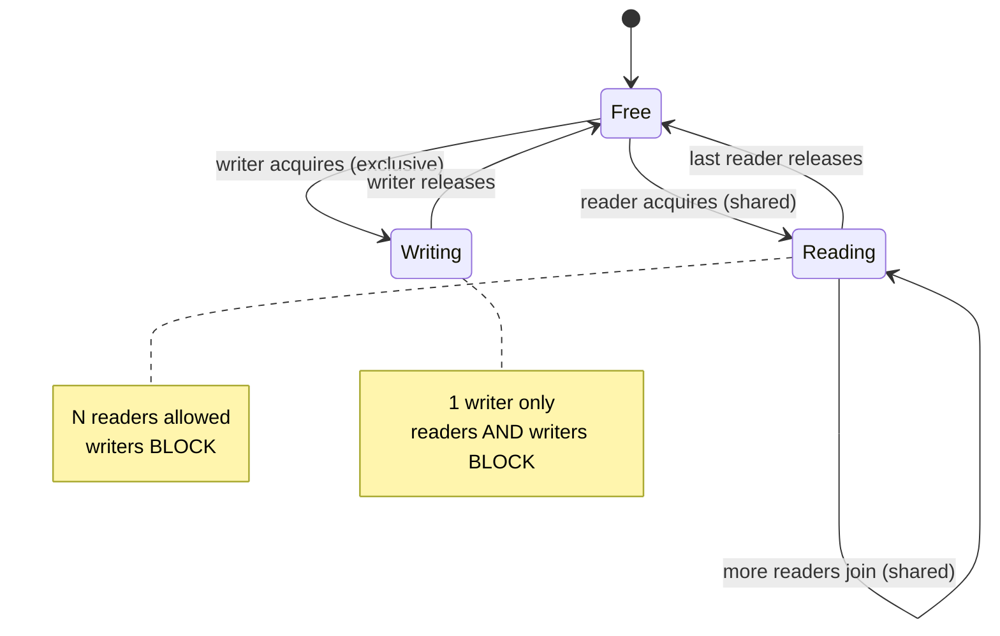
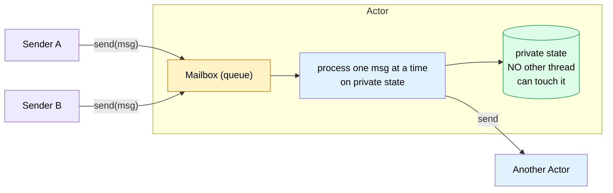
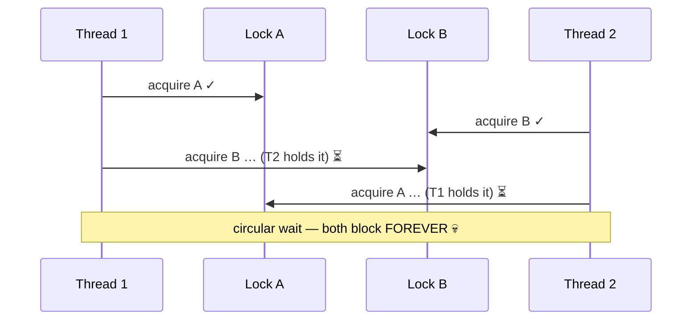
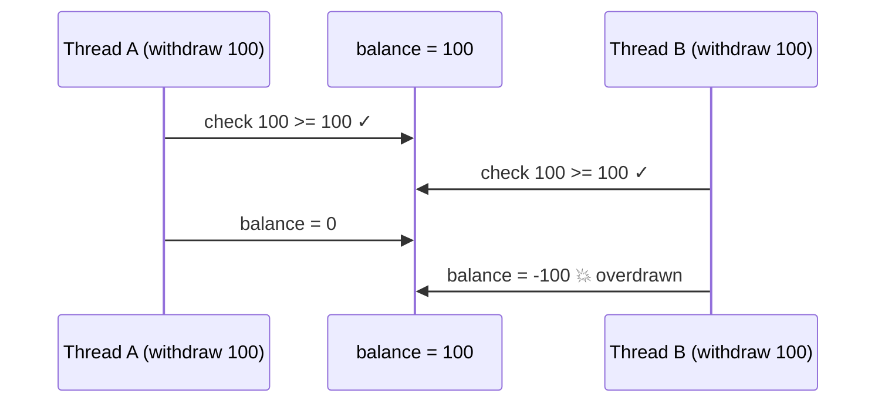
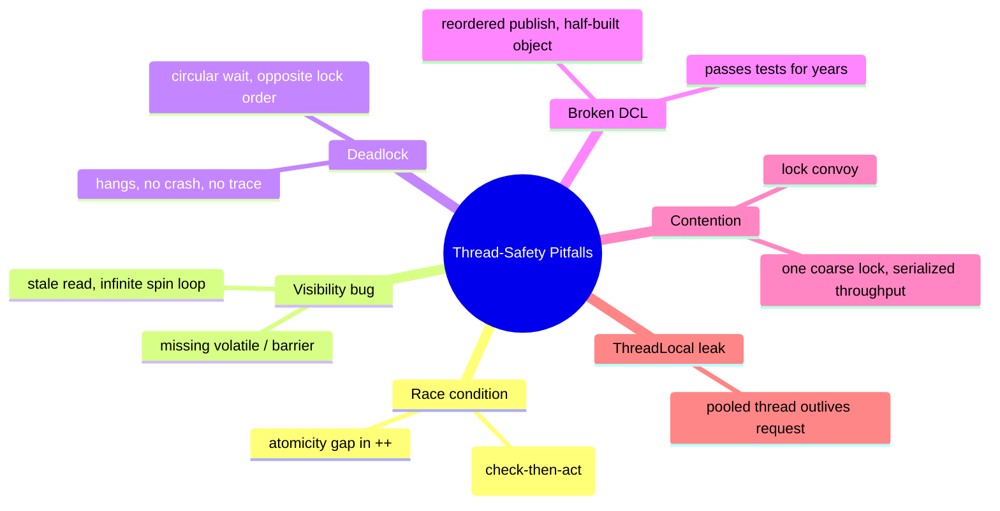

# Concurrency Patterns & Thread Safety

> **One line:** "Make this class thread-safe" means: when two threads touch the same object at the same time, the object still obeys its own rules — and there are only a handful of proven recipes (don't share, confine, guard, or message-pass) that guarantee it.

---

## Table of Contents
1. [Why You Must Master This](#1-why-you-must-master-this)
2. [The Mental Model](#2-the-mental-model)
3. [Race Conditions: Atomicity vs Visibility vs Ordering](#3-race-conditions-atomicity-vs-visibility-vs-ordering)
4. [Immutability — The Simplest Safety](#4-immutability--the-simplest-safety)
5. [Thread Confinement — Don't Share At All](#5-thread-confinement--dont-share-at-all)
6. [Guarded State — Locks, Monitors & the Synchronized Invariant](#6-guarded-state--locks-monitors--the-synchronized-invariant)
7. [Double-Checked Locking — The Classic Broken Idiom](#7-double-checked-locking--the-classic-broken-idiom)
8. [Producer–Consumer & the Bounded Blocking Queue](#8-producerconsumer--the-bounded-blocking-queue)
9. [Readers–Writer Locks](#9-readerswriter-locks)
10. [The Actor Model — Share Nothing, Message-Pass](#10-the-actor-model--share-nothing-message-pass)
11. [Deadlock — The Four Coffman Conditions & the Lock-Ordering Fix](#11-deadlock--the-four-coffman-conditions--the-lock-ordering-fix)
12. [Worked Example — Making a `BankAccount` / `Counter` Thread-Safe](#12-worked-example--making-a-bankaccount--counter-thread-safe)
13. [Real-Life Use Cases](#13-real-life-use-cases)
14. [Failure Modes](#14-failure-modes)
15. [🏋️ Practice Drills](#-practice-drills)
16. [🎤 Interview Q&A Bank](#-interview-qa-bank)
17. [🎯 Staff+ Nuances](#-staff-nuances)
18. [Cheat Sheet](#18-cheat-sheet)
19. [Connections & Further Reading](#19-connections--further-reading)

---

## 1. Why You Must Master This

Thread safety is the LLD-round question that separates people who *say* "add a lock" from people who know **where**, **why**, and **what a lock actually buys you**. It is also where the scariest production bugs live: the ones that pass every test, survive months in prod, and then corrupt data once under peak load.

- **"Make this class thread-safe" is a staple prompt.** Counter, cache, connection pool, rate limiter, singleton, LRU — every one of these becomes a threading question the moment the interviewer says "now ten threads call it." A wrong answer isn't just imperfect; it's *silently wrong*.
- **The failures are non-deterministic and non-local.** A race condition manifests as a lost update once every 10 million requests, on one machine, at 3 a.m. — the [heisenbug](https://en.wikipedia.org/wiki/Heisenbug) that vanishes when you attach a debugger because the timing changed. You cannot test your way to confidence; you have to *reason* your way there.
- **Real incidents.** The 2003 US Northeast blackout (55 million people) was worsened by a [race condition in GE's XA/21 alarm software](https://en.wikipedia.org/wiki/Northeast_blackout_of_2003#Alarm_system_failure) — two threads wrote a shared structure without proper locking. Java's original `Vector`/`Hashtable` were "thread-safe" but so lock-heavy they became the reason people learned about lock contention.
- **It's where memory models bite.** The classic broken double-checked-locking singleton "worked" for years because most CPUs happened not to reorder the offending writes — until one did. Understanding *why* is the difference between senior and staff.

> **The core problem it solves:** an object's methods enforce **invariants** ("balance never goes negative," "size equals the number of elements"). One thread's execution can interleave with another's *between any two machine instructions*, and a plain object gives zero protection — so invariants that hold single-threaded silently break. Thread safety is the discipline of keeping invariants true under arbitrary interleaving.

**Prerequisites:** [Object_Oriented_Design.md](./Object_Oriented_Design.md) (encapsulation — you can only protect state you've encapsulated) and [Class_Design.md](./Class_Design.md) (invariants and cohesion). The *systems*-level view of concurrency lives elsewhere — see the boundary note in §2.

---

## 2. The Mental Model

**The naive view:** "My method runs top to bottom, so it's a unit." **The truth:** the scheduler can pause your thread *between any two instructions* and run another thread that touches the same memory. Your one-line `count += 1` is really *read → add → write* — three steps another thread can slice into.

The whole field reduces to one decision tree. If two threads never touch the same mutable state at the same time, you have **no problem to solve**. So every technique is a way to arrange exactly that:



The techniques are ordered by *how much you'll regret them*: immutability and confinement remove the problem, locking manages it (and adds deadlock/contention risk), actors sidestep shared memory entirely. **Reach left before right.**

> **Hold onto this:** *shared* + *mutable* + *concurrent* is the toxic triad. Remove **any one** — make it immutable, confine it, or serialize access — and the class is safe. Thread safety is the art of removing at least one leg of that triad.

**Scope boundary (read this so you don't duplicate mentally):** this file is the **object/class-level** view — how to make *one class* correct under threads. The **systems-level** view lives in [../14_Performance_Optimization_Scalability/](../14_Performance_Optimization_Scalability/): the difference between concurrency and true parallelism is in [Parallelism_vs_Concurrency.md](../14_Performance_Optimization_Scalability/Parallelism_vs_Concurrency.md), and choosing between locking and versioned/compare-and-swap strategies at the *data-store* level is in [Optimistic_vs_Pessimistic_Locking.md](../14_Performance_Optimization_Scalability/Optimistic_vs_Pessimistic_Locking.md). When your interviewer asks "how would a database handle this instead," that's the cross-link to reach for.

---

## 3. Race Conditions: Atomicity vs Visibility vs Ordering

A **race condition** is when the correctness of the result depends on the *timing* (interleaving) of threads. There are three distinct hazards, and confusing them is the #1 reason people "add a lock" in the wrong place.

**(a) Atomicity — the lost update.** A read-modify-write that *looks* atomic isn't. `count += 1` compiles to roughly `LOAD count → INC → STORE count`. Two threads can both LOAD `41`, both INC to `42`, both STORE `42` — two increments, one counted. This is the classic **lost update**.



**(b) Visibility — the stale read.** Even with no interleaving, one thread may never *see* another's write. Each CPU core has its own registers and caches; a write by thread A can sit in A's store buffer or L1 cache and never reach thread B. B keeps reading a stale value from *its* cache — potentially forever. A `while (!stopFlag)` loop can spin infinitely because the running thread never re-reads `stopFlag` from main memory.

**(c) Ordering — reordering.** Compilers and CPUs reorder instructions for speed, as long as a *single* thread can't tell. But another thread *can* tell: it might see a write to field `B` before the write to field `A` that "logically" came first. This is the root of the broken double-checked lock (§7).

| Hazard | What breaks | The fix primitive |
|--------|-------------|-------------------|
| **Atomicity** | Interleaved read-modify-write → lost update | Lock, or an atomic CAS op (`AtomicInteger`) |
| **Visibility** | Write never propagates to another core's cache | `volatile` (Java) / memory barrier; locks also publish |
| **Ordering** | Reordered writes seen out of order by another thread | `volatile`/`final` (Java), release/acquire barriers |

The load-bearing insight: **a lock does three jobs at once** — it provides mutual exclusion (atomicity), *and* a memory barrier on acquire/release (visibility), *and* prevents reordering across its boundary (ordering). That's why "just use a lock" is a complete answer while "just use a flag" often isn't. In Java the [Java Memory Model (JSR-133)](https://docs.oracle.com/javase/specs/jls/se17/html/jls-17.html) formalizes this as the *happens-before* relation: an `unlock` happens-before the next `lock`, so everything A did before releasing is visible to B after acquiring.

> A race condition is not "two threads run at once" — it's "the answer depends on *which order* they ran." If any interleaving gives a wrong answer, you have a bug even if it fires one time in a billion.

---

## 4. Immutability — The Simplest Safety

**What:** an object whose observable state never changes after construction. **Why it's first:** the toxic triad needs *mutable* — remove it and the other two legs (shared, concurrent) are harmless. An immutable object can be shared across any number of threads with **zero locks and zero visibility concerns**, because there's no write to race on. This is why functional-leaning concurrency scales so well.

**How, precisely — an object is immutable when:**
1. All fields are `final` / assigned once (Java `final`, Python convention + `@dataclass(frozen=True)`).
2. No method mutates state (no setters; "changes" return a *new* object).
3. `this` doesn't escape during construction (no leaking a half-built object to another thread).
4. Any mutable *component* it holds is defensively copied in and never handed out by reference (a `List` field must be copied on the way in and wrapped unmodifiable / copied on the way out).

```java
// Java: correctly immutable — safe to share across all threads, no lock needed
public final class Money {                 // final class: no subclass can add mutable state
    private final long cents;              // final: assigned once, publishes safely via JMM
    private final String currency;
    public Money(long cents, String currency) {
        this.cents = cents; this.currency = currency;
    }
    public Money plus(Money other) {       // "mutation" returns a NEW object
        return new Money(this.cents + other.cents, currency);
    }
    public long cents() { return cents; }
}
```

```python
from dataclasses import dataclass

@dataclass(frozen=True)          # frozen=True → __setattr__ raises; fields read-only
class Money:
    cents: int
    currency: str
    def plus(self, other: "Money") -> "Money":
        return Money(self.cents + other.cents, self.currency)  # new object, never mutate
```

**Trade-off / when the other choice wins:** every "change" allocates a new object. For a value object updated occasionally (a `Money`, a config snapshot, an event) that's free. For a hot data structure churning millions of updates/sec, allocation pressure and GC dominate — you'll want a mutable structure with guarded state (§6) or a specialized concurrent collection. **Real systems:** Java's `String`, `Integer`, `LocalDateTime` are immutable by design; [Clojure's](https://clojure.org/reference/data_structures) and Scala's persistent collections make immutability cheap via structural sharing (a "modified" copy reuses most of the old tree). Guava's `ImmutableList` exists precisely so you can pass a collection across threads without defensive-copy paranoia.

> The cheapest thread-safe class is one with no mutable state. Before you reach for a lock, ask: *does this actually need to change after construction?*

---

## 5. Thread Confinement — Don't Share At All

**What:** keep the mutable object reachable by exactly one thread, so "shared" is never true. If only one thread can see it, no synchronization is needed even though it's mutable. Three flavors, weakest guarantee to strongest:

| Flavor | Mechanism | Guarantee | Example |
|--------|-----------|-----------|---------|
| **Stack confinement** | Local variables live on the thread's own stack | Airtight — locals are physically per-thread | A `StringBuilder` created and used inside one method, never returned |
| **Thread-local** | `ThreadLocal<T>` / Python `threading.local()` — one slot per thread | Airtight per thread | A per-request `SimpleDateFormat`, a DB `Connection` per worker |
| **Ad-hoc / ownership** | Discipline: "only the UI thread touches the widget tree" | Only as strong as the discipline | Swing/Android UI = single-threaded model |

**Why it works under the hood:** a value that never escapes a method's stack frame cannot, by construction, be reached by another thread — there's no reference to leak. `ThreadLocal` goes one level up: it's a map keyed internally by the current thread, so each thread transparently gets its own instance of an otherwise-shared-looking variable.

```java
// The classic use of ThreadLocal: SimpleDateFormat is NOT thread-safe (mutable Calendar
// inside). Instead of locking it, give each thread its own copy — confinement, not guarding.
private static final ThreadLocal<SimpleDateFormat> FMT =
    ThreadLocal.withInitial(() -> new SimpleDateFormat("yyyy-MM-dd"));
String today = FMT.get().format(new Date());   // each thread → its own formatter, no lock
```

**Trade-off / when the other wins:** confinement fails the instant the object must be *shared* (a cache every thread reads, a queue producers and consumers both touch) — then you're back to guarding (§6) or actors (§10). And `ThreadLocal` on a **pooled** thread (a web server's request threads) is a classic **memory leak**: the thread outlives the request, so anything you stashed lingers until you explicitly `remove()` it — and in servlet containers it can pin classloaders. **Real systems:** connection pools hand each worker its own `Connection` (confinement) rather than sharing one; Netty confines a channel's state to its single event-loop thread; Android/Swing enforce single-threaded UI access.

> Confinement is the "don't cross the streams" strategy: the object is mutable, but only one thread ever holds the wand. Cheapest safe way to use a mutable object.

---

## 6. Guarded State — Locks, Monitors & the Synchronized Invariant

When state is **genuinely shared and mutable**, you serialize access: a thread must **hold the lock** to touch the guarded state, so only one is inside the critical section at a time. This restores atomicity (only one interleaving is possible), visibility (lock release/acquire is a memory barrier), and ordering.

**The mechanism (a monitor).** A lock/mutex is a token exactly one thread can hold. `acquire()` blocks until free; `release()` frees it and wakes a waiter. A **monitor** is the OO packaging of "one lock guarding one object's state" — Java's `synchronized` makes *every object* an implicit monitor (`synchronized(obj)` acquires `obj`'s intrinsic lock). Java's `synchronized` and `ReentrantLock` are **reentrant**: the holding thread can re-acquire the same lock (so a synchronized method can call another synchronized method on `this` without self-deadlock).

**The synchronization policy is an invariant you must state and keep:** *"every access — read AND write — to fields X, Y is done while holding lock L."* Two silent killers:
- **Guarding writes but not reads** → readers see torn/stale state. Reads need the lock (or `volatile`) too, for *visibility*.
- **Compound actions.** `if not present: put(...)` ("check-then-act") is two atomic ops with a gap. Even if each op is individually safe (e.g. a `ConcurrentHashMap`), the *pair* races. You must hold the lock across the whole invariant-preserving action, or use an atomic compound primitive (`putIfAbsent`, `computeIfAbsent`).

```python
import threading

class Counter:
    def __init__(self) -> None:
        self._lock = threading.Lock()      # the lock guards _count
        self._count = 0
    def increment(self) -> None:
        with self._lock:                   # acquire → critical section → release
            self._count += 1               # now atomic: no interleaving possible
    def value(self) -> int:
        with self._lock:                   # READ needs the lock too (visibility!)
            return self._count
```

> **⚠️ The Python GIL caveat.** CPython has a Global Interpreter Lock: only one thread executes Python bytecode at a time. This does **not** make you thread-safe. `count += 1` is still multiple bytecodes and the interpreter can switch threads *between* them → lost updates still happen. The GIL only means you get no CPU *parallelism* for pure-Python code; you still need `Lock` for correctness. (Free-threaded CPython — PEP 703, 3.13+ experimental — removes the GIL and makes this even more essential.) For CPU-bound parallelism in Python you reach for `multiprocessing` (separate processes = share-nothing, cf. §10) — see [../14_Performance_Optimization_Scalability/Parallelism_vs_Concurrency.md](../14_Performance_Optimization_Scalability/Parallelism_vs_Concurrency.md).

**Atomic variables — locking without a lock.** For a single variable, a full lock is overkill. Hardware offers **compare-and-swap (CAS)**: "set to `new` only if it's still `expected`, atomically." Java's `AtomicInteger.incrementAndGet()` loops on CAS — read, compute, try to swap; if another thread beat you, retry. This is **lock-free** (no blocking, no deadlock) and faster under moderate contention, though it can livelock-spin under extreme contention.

```java
AtomicInteger n = new AtomicInteger(0);
n.incrementAndGet();   // CAS-loop under the hood: atomic, lock-free, no deadlock risk
```

**Trade-off:** locks are simple and general but cost context switches when contended, and open the door to deadlock (§11), priority inversion, and convoying. The narrower the critical section, the less contention — but too narrow and you split one invariant across two locks. **Real systems:** Java `ConcurrentHashMap` uses fine-grained CAS + per-bin locking instead of one big lock (its ancestor `Hashtable` locked the whole map and became a scalability bottleneck); the JVM's biased/lightweight locking optimizes the uncontended case to nearly free.

---

## 7. Double-Checked Locking — The Classic Broken Idiom

This is *the* memory-model interview question. You want a lazily-initialized singleton, but locking on every call is slow, so you "check, lock, check again":

```java
// ❌ BROKEN before Java 5 / without volatile — the textbook concurrency bug
class Singleton {
    private static Singleton instance;          // NOT volatile → the bug
    static Singleton getInstance() {
        if (instance == null) {                  // 1st check (no lock, fast path)
            synchronized (Singleton.class) {
                if (instance == null) {          // 2nd check (under lock)
                    instance = new Singleton();  // ⚠ NOT atomic — see below
                }
            }
        }
        return instance;
    }
}
```

**Why it's broken — the reordering.** `instance = new Singleton()` is three steps: **(1)** allocate memory, **(2)** run the constructor, **(3)** publish the reference into `instance`. The JMM lets the compiler/CPU reorder this to **1 → 3 → 2**: publish the reference *before* the constructor finishes. Now Thread B hits the first `if (instance == null)`, sees a **non-null but half-constructed** object (fields still default/zero), skips the lock, and returns a broken object. No exception — just corrupt state, intermittently.



**The fix:** declare `private static volatile Singleton instance;`. `volatile` (since Java 5's fixed memory model) inserts a memory barrier that forbids the 1→3→2 reordering and guarantees the constructed state is visible before the reference publishes (happens-before). Now the fast path is safe.

**Better fixes (prefer these):**
- **Java:** the **initialization-on-demand holder** idiom — a `private static class Holder { static final Singleton INSTANCE = new Singleton(); }`. The JVM guarantees class-init is thread-safe and lazy (the class loads only when first referenced). No `volatile`, no explicit lock, no reordering hole. Or just an `enum` singleton (Effective Java's recommendation).
- **Python:** you rarely need this — module-level objects are initialized once at import, and imports are internally locked by the interpreter, giving you a thread-safe lazy singleton for free. If you must lazy-init inside a function, wrap it in a `threading.Lock` with the same double-check, or use `functools.lru_cache`.

> Double-checked locking is a trap because it *works in testing* — reordering is rare and hardware-dependent, so the bug hides for years. The lesson generalizes: **without a memory barrier (`volatile`/lock), a write in one thread is not guaranteed visible or ordered to another.** When in doubt, use the holder idiom and skip the cleverness.

---

## 8. Producer–Consumer & the Bounded Blocking Queue

**The pattern:** decouple threads that *produce* work from threads that *consume* it via a shared queue. Producers `put`; consumers `take`; the queue is the only shared state, and it's the single thread-safe component. This is the backbone of thread pools, log pipelines, and ingestion systems.

**Why bounded matters — backpressure.** An *unbounded* queue is a memory bomb: if producers outrun consumers, the queue grows until OOM. A **bounded** queue applies **backpressure** — when full, `put` *blocks* the producer until a consumer frees a slot. That naturally throttles the fast side to the slow side's rate instead of crashing.



**How it works under the hood — condition variables.** A blocking queue is a monitor with **two wait conditions**: `notFull` and `notEmpty`. `put` waits on `notFull` while size == capacity, then adds and signals `notEmpty`. `take` waits on `notEmpty` while empty, then removes and signals `notFull`. The critical subtlety: **always wait in a `while` loop, never an `if`** — a thread can wake spuriously, or another thread can grab the slot before the woken thread runs (the "wake-up→recheck" gap). Re-test the predicate after waking.

```python
import threading
from collections import deque

class BoundedQueue:
    def __init__(self, capacity: int) -> None:
        self._cap = capacity
        self._q: deque = deque()
        self._lock = threading.Lock()
        self._not_full = threading.Condition(self._lock)
        self._not_empty = threading.Condition(self._lock)

    def put(self, item) -> None:
        with self._not_full:
            while len(self._q) >= self._cap:     # WHILE, not if — guard spurious wakeups
                self._not_full.wait()            # releases lock, sleeps, re-acquires on wake
            self._q.append(item)
            self._not_empty.notify()             # wake one waiting consumer

    def take(self):
        with self._not_empty:
            while not self._q:                   # WHILE, not if
                self._not_empty.wait()
            item = self._q.popleft()
            self._not_full.notify()              # wake one waiting producer
            return item
```

**Trade-off:** bounded → backpressure but producers can stall (you must decide: block, drop, or reject when full — a rejection policy). Unbounded → never blocks producers but risks OOM. **Real systems / primitives:** you'd almost never hand-roll this — use Java's `ArrayBlockingQueue` / `LinkedBlockingQueue` (the queue behind `ThreadPoolExecutor`), Python's `queue.Queue(maxsize=N)`, or **Go channels** (`ch := make(chan T, N)` — a buffered channel *is* a bounded blocking queue, and `<-ch` / `ch<-` are the take/put). Go's slogan — *"don't communicate by sharing memory; share memory by communicating"* — is this pattern elevated to a language philosophy, and it bridges directly into the actor model (§10).

> Bounded blocking queue = the shock absorber between mismatched speeds. Unbounded queues don't remove backpressure; they just relocate the failure to an OOM crash.

---

## 9. Readers–Writer Locks

A plain lock serializes *everything*, but **concurrent reads don't conflict** — two threads reading immutable-during-the-read data can't corrupt anything. A **readers–writer lock** exploits this: **many readers OR one writer**, never both. For read-heavy state (a config, a route table, a cache read 10,000× per write), this dramatically raises throughput versus a mutex that blocks readers on each other pointlessly.



**How it works:** the lock tracks a reader count and a writer flag. A reader acquires if no writer holds/waits (incrementing the count); a writer acquires only when the reader count is zero and no other writer holds.

**The trade-offs are real and often bite:**
- **Writer starvation.** If readers keep arriving, a naive RW lock never lets the writer in. Fair implementations block *new* readers once a writer is waiting (Java's `ReentrantReadWriteLock` offers a fair mode) — at the cost of some read throughput.
- **Break-even.** RW locks have *more* bookkeeping than a plain mutex. If writes are frequent or critical sections are tiny, a plain lock (or `ConcurrentHashMap`-style striping, or a copy-on-write structure) is faster. RW locks win only when reads genuinely dominate *and* critical sections are non-trivial.
- **Upgrade deadlock.** You cannot atomically upgrade a read lock to a write lock — two readers both trying to upgrade deadlock. Release the read lock, acquire the write lock, and re-check state.

**Real primitives:** Java `ReentrantReadWriteLock` and the more modern `StampedLock` (which adds a **lock-free optimistic read** — read a version stamp, do the read, then validate the stamp didn't change; retry if it did — this is optimistic concurrency at the object level, sibling to [../14_Performance_Optimization_Scalability/Optimistic_vs_Pessimistic_Locking.md](../14_Performance_Optimization_Scalability/Optimistic_vs_Pessimistic_Locking.md)). Go's `sync.RWMutex`, Python's read-write lock via `readerwriterlock` (the stdlib only ships a plain `Lock`/`RLock`). A frequent *alternative* to RW locks for read-mostly data is **copy-on-write** (`CopyOnWriteArrayList`): reads are lock-free on an immutable snapshot; a write copies the whole array. Perfect for a rarely-changing listener list, terrible for a frequently-mutated one.

> Reach for an RW lock only when you can say "reads outnumber writes by a large factor and the critical section is more than a couple of instructions." Otherwise a plain mutex is simpler and often faster.

---

## 10. The Actor Model — Share Nothing, Message-Pass

**The idea:** eliminate shared mutable state entirely. An **actor** is an object that owns its private state, which **no other thread can touch**. You don't call its methods; you send it an **immutable message**, which lands in the actor's **mailbox** (a queue). The actor processes messages **one at a time**, single-threaded, from its own mailbox. Because only the actor ever touches its state, and it processes serially, **there are no locks, no races, and no deadlocks from lock ordering** — the sequential processing *is* the mutual exclusion.



**Why this is powerful:** you replace the hard problem (reasoning about arbitrary interleavings of shared memory) with a simpler one (reasoning about message *ordering* between independent single-threaded units). It maps naturally onto distributed systems — an actor doesn't care if the message came from the same process or across the network, which is why it underpins massively concurrent systems.

**How it works under the hood:** a runtime multiplexes millions of lightweight actors onto a small pool of OS threads. When an actor has a message, the scheduler runs its handler on some thread to completion, then moves on. State is safe because the runtime guarantees an actor is never run on two threads at once.

**Trade-offs:** messages are **asynchronous** — no return value; you get a reply as another message, which complicates request/response flows and error handling. Mailboxes are effectively unbounded queues → the OOM/backpressure problem from §8 returns. And you lose strong consistency across actors (each is its own island), so cross-actor invariants need explicit protocols (sagas, two-phase patterns). Debugging becomes tracing message flows, not stepping a stack.

**Real systems:** **Erlang/OTP** (actors = processes; telecom switches with [nine 9s of availability](https://en.wikipedia.org/wiki/Erlang_(programming_language)) — famously ran the AXD301 switch), **Akka** (JVM, powers Lightbend/Play apps), **Microsoft Orleans** ("virtual actors" behind Halo's matchmaking), **Elixir/Phoenix**. **Go channels** are the same *philosophy* at a lower level — goroutines communicating over channels rather than sharing memory — though Go also permits shared memory + mutexes. This is the object-level realization of the microservices "each service owns its data" principle.

> The actor model's bet: it's easier to get concurrency right by *forbidding* shared mutable state than by *guarding* it. You trade lock complexity for message-protocol complexity — and for share-nothing workloads, that's a great trade.

---

## 11. Deadlock — The Four Coffman Conditions & the Lock-Ordering Fix

**What:** two or more threads each hold a lock the other needs, so all wait forever. The program doesn't crash — it *hangs*, which is often worse (no stack trace, no error, just a frozen service).

The canonical case: thread 1 locks A then wants B; thread 2 locks B then wants A.



Deadlock requires **all four [Coffman conditions](https://en.wikipedia.org/wiki/Deadlock#Necessary_conditions) simultaneously**. Break *any one* and deadlock is impossible:

| # | Condition | What it means | How to break it |
|---|-----------|---------------|-----------------|
| 1 | **Mutual exclusion** | Resource held exclusively | Use lock-free/CAS or immutable data (§4, §6) |
| 2 | **Hold and wait** | Hold one lock while requesting another | Acquire *all* locks at once, or hold none while waiting |
| 3 | **No preemption** | Can't force-take a lock from a holder | `tryLock` with timeout → back off and retry |
| 4 | **Circular wait** | A cycle in the "waits-for" graph | **Global lock ordering** — the standard fix |

**The go-to fix: global lock ordering.** Impose a total order on all locks (e.g. by a unique id) and require every thread to acquire them in that order. Then no cycle can form — the classic bank-transfer bug:

```python
def transfer(src, dst, amount):
    # ❌ WRONG: transfer(X,Y) locks X→Y while transfer(Y,X) locks Y→X → deadlock
    # ✅ FIX: always lock the lower-id account first (global ordering breaks circular wait)
    first, second = (src, dst) if src.id < dst.id else (dst, src)
    with first.lock:
        with second.lock:
            src.balance -= amount
            dst.balance += amount
```

**Other tools:** `tryLock(timeout)` (break "no preemption" — if you can't get the second lock in N ms, release the first and retry, adding jitter to avoid livelock); coarsen to a single lock (no second lock to wait on — trades throughput for safety); or copy state out, release the lock, then compute (shrink the critical section). **Detection in prod:** a JVM thread dump (`jstack`) explicitly prints "Found one Java-level deadlock" with the cycle; Go's runtime detects and panics on *all-goroutine* deadlock.

> **Livelock vs deadlock:** deadlock = stuck waiting; livelock = both threads *keep reacting* to each other (each releases and retries in lockstep) so they run but make no progress — two people stepping side-to-side in a hallway. Fix livelock with randomized backoff. **Starvation** = a thread never gets the resource because others keep winning (see writer starvation, §9).

---

## 12. Worked Example — Making a `BankAccount` / `Counter` Thread-Safe

The interviewer says: *"Here's a `BankAccount`. Ten threads call `withdraw` concurrently. Make it thread-safe."* Walk the reasoning out loud — that's what's being graded.

**Step 0 — the naive class and the bug.** The invariant is *balance never goes negative*.

```python
class BankAccount:
    def __init__(self, balance): self.balance = balance
    def withdraw(self, amt):
        if self.balance >= amt:        # CHECK  ── gap here! ──
            self.balance -= amt        # ACT    another thread can slip between
            return True
        return False
```

`check-then-act` is a compound action. Two threads with balance=100 both withdraw 100: both read `100 >= 100` as true, both subtract → balance = **-100**. Invariant violated. Show the interleave:



**Step 1 — guard the compound action (§6).** The lock must span *both* the check and the act, not just each line:

```python
import threading
class BankAccount:
    def __init__(self, balance):
        self._lock = threading.Lock()
        self._balance = balance
    def withdraw(self, amt):
        with self._lock:                 # lock spans check AND act → atomic invariant
            if self._balance >= amt:
                self._balance -= amt
                return True
            return False
    def balance(self):
        with self._lock:                 # read holds the lock too → visibility
            return self._balance
```

**Step 2 — name the trade-offs, unprompted.** This is the staff-level signal:
- *Contention:* one lock per account, not one global lock — so different accounts don't block each other. Good.
- *Transfers introduce deadlock (§11):* `transfer(A→B)` and `transfer(B→A)` acquiring two locks in opposite order will deadlock → apply **global lock ordering** (lock lower account id first).
- *Alternative — no lock at all:* for a pure counter, `AtomicInteger`/CAS beats a lock. But `withdraw` has a *guard condition* (balance >= amt), which CAS can't express in one op — you'd need a CAS-retry loop reading balance, checking, and swapping. State that you know the option and why the lock is cleaner here.
- *The database-level view:* in a real system the balance lives in a DB row, and you'd use a `SELECT ... FOR UPDATE` (pessimistic) or a version column (optimistic) instead of an in-process lock. Cross-link: [../14_Performance_Optimization_Scalability/Optimistic_vs_Pessimistic_Locking.md](../14_Performance_Optimization_Scalability/Optimistic_vs_Pessimistic_Locking.md).

**Concept → consequence:** the fix wasn't "add a lock" — it was "identify the invariant (`balance ≥ 0`), find the compound action that can violate it under interleaving, and make that *whole* action atomic." A lock around only `self._balance -= amt` would still be wrong, because the check-act gap remains. **Where the atomic boundary goes is the entire answer.**

---

## 13. Real-Life Use Cases

| Situation | Pattern that applies | The decision it forces |
|-----------|----------------------|------------------------|
| Config object read by every request thread, reloaded rarely | **Immutability** (swap the whole immutable snapshot) or copy-on-write | Never mutate in place; publish a new immutable object and flip an atomic reference |
| Per-request user/trace context in a web server | **Thread confinement** (`ThreadLocal`) | Must `remove()` after the request or leak on pooled threads |
| Thread pool feeding worker threads | **Bounded blocking queue** (producer-consumer) | Pick a bound + rejection policy (block / drop / reject) for backpressure |
| Route table / feature flags read 10⁴× per write | **Readers-writer lock** or copy-on-write | Reads dominate → RW lock; churny → plain mutex or COW |
| Shopping-cart / game-entity actor handling many requests | **Actor model** | Give up synchronous returns; design a message protocol |
| Global request counter / metrics | **Atomic (CAS)** | `AtomicLong` over a lock — lock-free, no deadlock |
| Money transfer between two accounts | **Guarded state + lock ordering** | Order locks by account id to kill circular wait |
| Lazy singleton (registry, pool) | **Holder idiom** (not double-checked locking) | Skip the `volatile` DCL cleverness; let the classloader guarantee it |

> Real-world habit: whenever you write a field that another thread will read, **immediately ask "what publishes this safely?"** — immutability, a lock, `volatile`, or an atomic. A write with no publication mechanism is a latent visibility bug.

---

## 14. Failure Modes



- **Race condition (lost update).** *Symptom:* counter/balance occasionally off; "impossible" totals under load. *Root cause:* compound read-modify-write interleaved between threads. *Fix:* make the *whole* compound action atomic (lock spanning check+act, or an atomic CAS op) — not just the individual writes.
- **Visibility bug (stale read).** *Symptom:* a worker thread ignores a `stop` flag and spins forever, or reads a value another thread clearly wrote. *Root cause:* the write sits in one core's cache, never published; the reader sees its own stale copy. *Fix:* `volatile` on the flag (Java), or read/write under a lock — both insert the memory barrier.
- **Deadlock.** *Symptom:* the service *hangs* under load — threads alive but idle, no CPU, no progress, no exception. *Root cause:* circular wait — threads acquire the same locks in different orders. *Fix:* global lock ordering; or `tryLock` with timeout + backoff; confirm via thread dump (`jstack` names the cycle).
- **Broken double-checked locking.** *Symptom:* rare NPE or object with default-zero fields, only in prod, only sometimes. *Root cause:* constructor reordered after reference publish → other thread sees half-built object. *Fix:* `volatile` on the field, or (better) the holder idiom / `enum` singleton.
- **Lock contention / convoy.** *Symptom:* adding threads *lowers* throughput; CPU idle while requests queue. *Root cause:* one coarse lock serializes everything; threads convoy behind the holder. *Fix:* shrink critical sections, shard/stripe locks (`ConcurrentHashMap` style), or go lock-free.
- **ThreadLocal leak.** *Symptom:* slow memory growth / `OutOfMemoryError` on a long-running server; classloader can't unload. *Root cause:* value stashed on a *pooled* thread that outlives the request. *Fix:* `remove()` in a `finally`; treat `ThreadLocal` as needing explicit cleanup.

---

## 🏋️ Practice Drills

> *Cover the solutions and attempt first — active recall is the point.*

**Drill 1 — Spot the bug.** This "thread-safe" cache uses a concurrent map. Why can it still double-compute an expensive value?

```python
def get(self, key):
    if key not in self._map:            # check
        self._map[key] = expensive(key) # act
    return self._map[key]
```

<details><summary>Solution</summary>

**Check-then-act race.** Even if `self._map` is itself thread-safe, the `not in` check and the `put` are two separate operations with a gap. Two threads can both see the key absent and both call `expensive(key)` — double work, and if `expensive` has side effects, double side effects. *Fix:* an atomic compound op — Python `dict.setdefault` won't help (it still evaluates `expensive` eagerly); use a lock around the whole check-compute-put, or Java's `map.computeIfAbsent(key, k -> expensive(k))` which does it atomically. The general lesson: **individually-safe operations do not compose into a safe compound action.**
</details>

**Drill 2 — Fix the deadlock.** `transfer(a, b, amt)` locks `a` then `b`. Under load the service hangs. Diagnose and fix without removing per-account locks.

<details><summary>Solution</summary>

**Circular wait (Coffman #4).** `transfer(A, B)` on one thread locks A→B; `transfer(B, A)` on another locks B→A; each holds one and waits for the other → deadlock. *Fix:* **global lock ordering** — before locking, sort the two accounts by a stable unique id and always acquire the lower id first. No cycle can form, so deadlock is impossible. (Alternative: `tryLock` both with a timeout, release and retry with backoff if you can't get both — breaks "no preemption" instead.)
</details>

**Drill 3 — Design a small thing.** Design a thread-safe, bounded in-memory rate limiter: `allow(user_id) -> bool` that permits at most N requests per user per second, called from many request threads.

<details><summary>Solution</summary>

Use **per-key guarded state** to minimize contention. Keep a `ConcurrentHashMap<userId, TokenBucket>` (or a lock-striped map). Each `TokenBucket` holds `tokens` and `last_refill_time`, guarded by its **own** lock so different users never contend. `allow()`: lock that user's bucket, refill tokens based on elapsed time (`tokens = min(N, tokens + rate*elapsed)`), then if `tokens >= 1` decrement and return true else false. Key design calls: **(1)** one lock *per user*, not one global lock — else the limiter itself becomes the bottleneck; **(2)** the refill-check-decrement must be one atomic critical section (compound action); **(3)** use `computeIfAbsent` to create buckets atomically; **(4)** evict idle buckets (or use an expiring map) to bound memory. For extreme scale, an `AtomicLong` token count with a CAS loop avoids the lock entirely.
</details>

**Drill 4 — Recall.** A colleague's lazy singleton uses double-checked locking but the field isn't `volatile`. "It's passed every test for a year." Explain the latent bug and give the fix you'd actually ship.

<details><summary>Solution</summary>

The bug is **instruction reordering** in `instance = new Singleton()`: allocate(1) → construct(2) → publish-reference(3) can be reordered to 1→3→2, so another thread on the lock-free fast path can read a **non-null but half-constructed** object (fields at defaults) and use it. It passes tests because reordering is hardware/JIT-dependent and rare. *Minimal fix:* declare the field `volatile` (inserts a barrier forbidding the reorder and guaranteeing safe publication). *Better fix I'd actually ship:* the **initialization-on-demand holder** idiom — put the instance in a `static final` field of a private static nested class; the JVM guarantees thread-safe, lazy class initialization with no `volatile`, no lock, no reordering hole. In Python, a module-level instance sidesteps the whole issue.
</details>

---

## 🎤 Interview Q&A Bank

**Q1. What does "thread-safe" actually mean?**
> A class is thread-safe if it behaves correctly — keeps its invariants — when accessed from multiple threads concurrently, regardless of how the runtime interleaves them, with no extra synchronization required from the caller. The key phrase is "regardless of interleaving": if any interleaving produces a wrong answer, it's not thread-safe, even if that interleaving is rare. *(signal: interleaving-awareness, not "I added a lock")*

**Q2. Walk me through the strategies for thread safety, cheapest first.**
> Immutability — no mutable state, so nothing to race on, share freely with no locks. Then confinement — keep the mutable object on one thread's stack or in a thread-local so it's never shared. Then guarded state — a lock or atomic serializes access to genuinely-shared mutable state. Then the actor model — forbid shared memory entirely and pass messages. You reach left before right, because immutability and confinement *remove* the problem while locking *manages* it and adds deadlock risk. *(signal: has a mental hierarchy, not just "locks")*

**Q3. Atomicity vs visibility — what's the difference and why does one lock fix both?**
> Atomicity is about *interleaving*: `count++` is read-modify-write, and two threads can interleave and lose an update. Visibility is about *propagation*: a write on one core can sit in its cache and never reach another core, so a reader sees a stale value forever. A lock fixes both because acquiring/releasing it is also a memory barrier — it publishes writes to other threads on release and forbids reordering across its boundary. That's why "just use a flag" is often wrong for visibility but "use a lock" is complete. *(signal: knows a lock does three jobs, not one)*

**Q4. Why is double-checked locking broken without `volatile`?**
> `instance = new Singleton()` is three steps: allocate, construct, publish the reference. The memory model permits reordering publish before construct, so a second thread on the lock-free fast path can see a non-null but half-built object and use it — intermittent, prod-only corruption. `volatile` inserts a barrier that forbids the reorder and guarantees safe publication. But I'd rather use the holder idiom or an enum singleton and avoid the cleverness entirely. *(signal: understands memory-model reordering, the deepest concurrency signal)*

**Q5. Explain deadlock and how you'd prevent it.**
> Deadlock is threads each holding a lock the other needs, waiting forever — the service hangs, no crash. It needs all four Coffman conditions: mutual exclusion, hold-and-wait, no preemption, and circular wait. Break any one and it's impossible. The standard fix is breaking circular wait with global lock ordering — always acquire multiple locks in the same total order, e.g. by object id. If ordering isn't feasible, use tryLock with a timeout and back off. *(signal: names Coffman + the practical lock-ordering fix, not just "avoid it")*

**Q6. Python has the GIL — do I still need locks?**
> Yes. The GIL only guarantees one thread runs bytecode at a time; it does not make multi-bytecode operations atomic. `count += 1` is several bytecodes and the interpreter can switch threads between them, so lost updates still happen — you still need a `Lock`. What the GIL actually costs you is CPU *parallelism*: pure-Python threads can't use multiple cores, so for CPU-bound work you use `multiprocessing` instead. Correctness needs locks; parallelism needs processes. *(signal: doesn't fall for the "GIL = thread-safe" myth)*

**Q7. When would you use a readers-writer lock over a plain mutex, and what's the catch?**
> When reads vastly outnumber writes and the critical section is non-trivial — a plain mutex needlessly serializes readers that don't conflict, while an RW lock lets many readers proceed concurrently and only excludes for the rare write. The catches: writer starvation if readers keep arriving (need a fair mode), more bookkeeping overhead so it loses to a plain mutex for tiny or write-heavy sections, and no atomic read-to-write upgrade. For read-mostly data I'd also consider copy-on-write or an immutable snapshot swapped atomically. *(signal: knows the break-even and the starvation trap)*

**Q8. Compare guarded state with the actor model.**
> Guarded state keeps shared mutable memory and protects it with locks — flexible and low-latency but you own the hard problem of correct locking, with deadlock and contention risk. The actor model forbids shared memory: each actor owns private state and processes messages one at a time from a mailbox, so serial processing *is* the mutual exclusion — no locks, no deadlock. You trade lock complexity for asynchronous message-protocol complexity and lose synchronous returns. Locks suit fine-grained low-latency shared state; actors suit high-concurrency share-nothing workloads that often want to scale across machines anyway — Erlang, Akka, Orleans. *(signal: sees it as a trade, names real systems)*

---

## 🎯 Staff+ Nuances

- **"Thread-safe" is not a boolean — it's a documented policy.** A `ConcurrentHashMap` is thread-safe for single operations but not for compound ones (`get`-then-`put` still races). The staff move is to *state the synchronization policy in the class* ("all access to X guarded by lock L", "X is effectively immutable after publication") so callers know exactly what's guaranteed and what's their responsibility. Java's `@GuardedBy("lock")` annotation exists precisely to document this. See [Class_Design.md](./Class_Design.md).
- **Safe publication is a distinct concept from immutability.** Even a well-built object can be seen half-initialized by another thread if the *reference* is published via a data race (the DCL bug §7). The four safe-publication idioms: static initializer, `volatile`/`AtomicReference` field, `final` field (in a properly-constructed object), or a value stored into a thread-safe collection. Publication is *how the reference travels*; immutability is *whether the target changes*. Both matter.
- **Lock granularity is a throughput-vs-simplicity dial, and both extremes hurt.** One coarse lock is trivially correct but serializes everything (the old `Hashtable`/`Vector` mistake). Fine-grained lock striping (`ConcurrentHashMap`'s per-bin locks) scales but multiplies deadlock surface and is far harder to reason about. Start coarse, measure contention, and shard *only* the hot lock — see [../14_Performance_Optimization_Scalability/Parallelism_vs_Concurrency.md](../14_Performance_Optimization_Scalability/Parallelism_vs_Concurrency.md).
- **Composing thread-safe components does not yield a thread-safe whole.** Two thread-safe collections combined with a "move item from A to B" operation need their *own* lock spanning both — the individual guarantees don't compose across an invariant that straddles them. This is the check-then-act trap at the object-graph level, and it's where "I used concurrent collections everywhere" designs quietly break.
- **The object-level lock and the systems-level lock are the same idea at different zoom.** An in-process `ReentrantLock` and a distributed lock (Redis Redlock, ZooKeeper, `SELECT FOR UPDATE`) both serialize access to shared mutable state; the difference is failure modes — a process holding an in-memory lock can't "crash and leave it held forever without notice" the way a distributed holder can, which is why distributed locks need leases/fencing tokens. Pessimistic vs optimistic is the same debate at both levels — [../14_Performance_Optimization_Scalability/Optimistic_vs_Pessimistic_Locking.md](../14_Performance_Optimization_Scalability/Optimistic_vs_Pessimistic_Locking.md).
- **Prefer immutability + atomic reference swap over locking for read-mostly config.** Instead of an RW lock around a mutable config, hold an `AtomicReference<ImmutableConfig>`; readers do a lock-free `.get()`, and a reload builds a whole new immutable config and does one atomic `.set()`. Readers never block, never see a partial update, and there's no lock to deadlock on. This "copy-on-write via reference swap" is how many high-throughput systems handle hot-reloadable config.
- **The hardest concurrency bugs are non-reproducible by construction — so design them out, don't test them out.** Races, visibility bugs, and reordering depend on timing, core count, JIT state, and load, so they hide from CI and appear at scale. This inverts normal engineering: you can't rely on tests for confidence, so you rely on *structure* — immutability and confinement make whole bug classes impossible, which is why senior engineers reach for them first. Tools help (ThreadSanitizer, Java's `jcstress`, Go's `-race` detector, static `@GuardedBy` checkers) but they find, not prove.

---

## 18. Cheat Sheet

```
THREAD-SAFE = invariants hold under ANY interleaving, no caller synchronization needed.
TOXIC TRIAD:  shared + mutable + concurrent.  Remove ANY ONE → safe.

STRATEGY LADDER (cheapest/safest first — reach LEFT before RIGHT):
  1 IMMUTABILITY   no mutable state → share freely, no locks     (String, Money, Clojure colls)
  2 CONFINEMENT    one thread only: stack / ThreadLocal          (SimpleDateFormat per thread)
  3 GUARDED STATE  lock/monitor/atomic serializes access         (synchronized, ReentrantLock, CAS)
  4 ACTOR MODEL    share nothing, message-pass, mailbox           (Erlang, Akka, Orleans, Go chans)

THREE HAZARDS (know which you're fixing):
  ATOMICITY  interleaved read-mod-write → lost update   → lock OR atomic CAS
  VISIBILITY write stuck in cache → stale read forever   → volatile / lock (memory barrier)
  ORDERING   reordered writes seen out of order          → volatile / final / barrier
  ►► A LOCK DOES ALL THREE: mutual exclusion + barrier + no-reorder. A flag does not.

COMPOUND ACTION = the #1 bug.  check-then-act / read-mod-write / put-if-absent.
  Individually-safe ops DON'T compose. Lock must span the WHOLE invariant action.

DOUBLE-CHECKED LOCKING: broken w/o volatile — publish-ref reordered before ctor →
  half-built object on fast path.  FIX: volatile field, or (better) holder idiom / enum.

DEADLOCK = 4 Coffman conditions (break ANY one):
  mutual-exclusion · hold-and-wait · no-preemption · circular-wait
  ►► STANDARD FIX = global LOCK ORDERING (acquire by stable id).  Or tryLock+timeout+backoff.
  deadlock=stuck-waiting · livelock=busy-but-no-progress(backoff) · starvation=never-scheduled

PRODUCER-CONSUMER: bounded blocking queue = backpressure. put blocks if full, take if empty.
  wait in WHILE not if (spurious wakeups). BlockingQueue / queue.Queue / buffered Go channel.
RW LOCK: many readers OR one writer. Use only if reads >> writes & section non-trivial.
  Watch: writer starvation, no read→write upgrade. Else plain mutex or copy-on-write.

PYTHON GIL: 1 thread runs bytecode at a time — does NOT make you thread-safe (++ still races).
  Need Lock for correctness; multiprocessing for CPU parallelism.
SCOPE: this file = OBJECT level. Systems level → ../14 (Parallelism_vs_Concurrency,
  Optimistic_vs_Pessimistic_Locking).
```

---

## 19. Connections & Further Reading

**Prerequisites (learn first):**
- [Object_Oriented_Design.md](./Object_Oriented_Design.md) — encapsulation; you can only guard state you've encapsulated behind methods.
- [Class_Design.md](./Class_Design.md) — invariants, cohesion, and documenting a class's synchronization policy.

**Builds toward / pairs with:**
- [Design_Patterns_Overview.md](./Design_Patterns_Overview.md) — the Singleton (double-checked locking lives here), Producer-Consumer, and Monitor are concurrency-flavored patterns; composition-over-inheritance underpins immutable value objects.
- [SOLID_Principles.md](./SOLID_Principles.md) — dependency injection lets you swap a thread-safe implementation without callers knowing.
- [State_Machines.md](./State_Machines.md) — an actor's message-driven behavior and a blocking queue's states are state machines.
- [../14_Performance_Optimization_Scalability/Parallelism_vs_Concurrency.md](../14_Performance_Optimization_Scalability/Parallelism_vs_Concurrency.md) — the **systems-level** view: concurrency (structure) vs true parallelism (cores), and where the GIL fits. *This file is the object-level companion.*
- [../14_Performance_Optimization_Scalability/Optimistic_vs_Pessimistic_Locking.md](../14_Performance_Optimization_Scalability/Optimistic_vs_Pessimistic_Locking.md) — the **data-store-level** view: versioned/CAS (optimistic) vs `SELECT FOR UPDATE` (pessimistic). The object-level `StampedLock` optimistic read is the same idea in-process.

**Gaps this topic exposes (candidates for the section's Gap Analysis):**
- A dedicated note on **distributed locking** (Redlock, ZooKeeper, fencing tokens) — the cross-machine cousin of §6, currently only implied.
- **Lock-free / wait-free data structures** (CAS-based stacks/queues, the ABA problem) deserve their own deep dive.

**External classics:**
- *Java Concurrency in Practice* (Brian Goetz) — the definitive book; safe publication, `@GuardedBy`, and this file's whole taxonomy come from it.
- *The Art of Multiprocessor Programming* (Herlihy & Shavit) — the theory: linearizability, lock-free structures, the memory model.
- *Programming Erlang* (Joe Armstrong) — the actor model and "let it crash" from the source.
- [JSR-133: Java Memory Model FAQ](https://www.cs.umd.edu/~pugh/java/memoryModel/jsr-133-faq.html) — why double-checked locking was broken and how `volatile` fixes it.

---

## TL;DR
**Thread safety = keeping a class's invariants true under *any* interleaving of threads, and the whole field is one decision: remove at least one leg of the toxic triad (shared + mutable + concurrent).** Reach for the cheapest safe option first: **immutability** (no mutable state to race on), then **confinement** (only one thread ever touches it), then **guarded state** (a lock or atomic CAS serializes access — remember a lock buys atomicity *and* visibility *and* ordering, which a bare flag does not), and finally the **actor model** (share nothing, message-pass — serial mailbox processing *is* the mutual exclusion). The recurring bug is the **compound action** (check-then-act like `if balance >= amt: balance -= amt`) — individually-safe operations don't compose, so the lock must span the *whole* invariant-preserving action. Know the two deep cuts cold: **double-checked locking is broken without `volatile`** because the constructor can be reordered after the reference publishes (prefer the holder idiom), and **deadlock needs all four Coffman conditions** — break circular wait with **global lock ordering**. In Python, the **GIL gives you no thread safety** (`+=` still races) and no CPU parallelism — use locks for correctness and processes for parallelism. **The bugs are timing-dependent and won't show in tests, so design them out with immutability and confinement rather than trying to test them away.**
