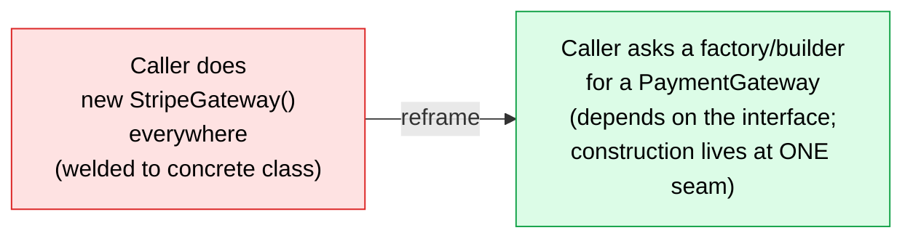
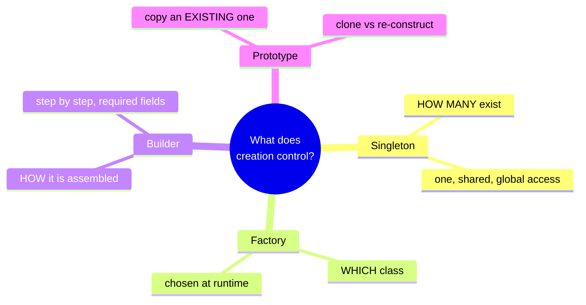
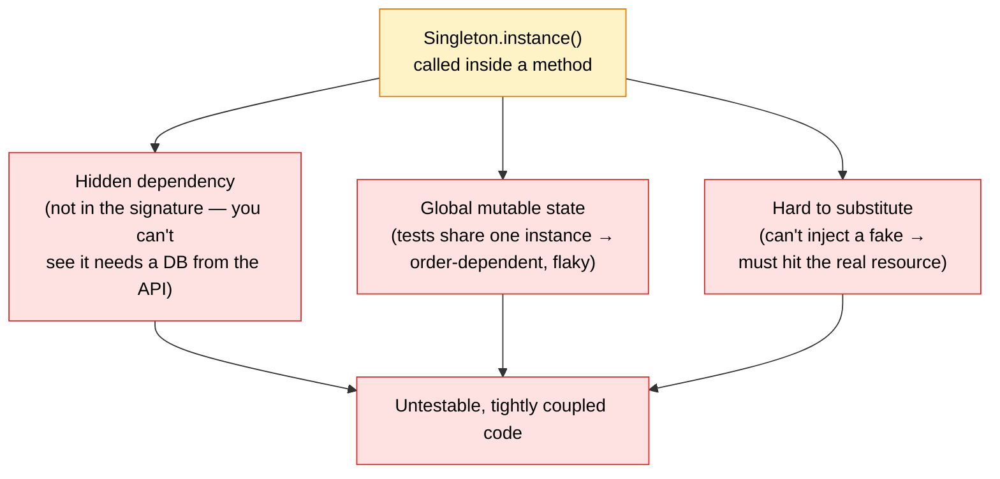
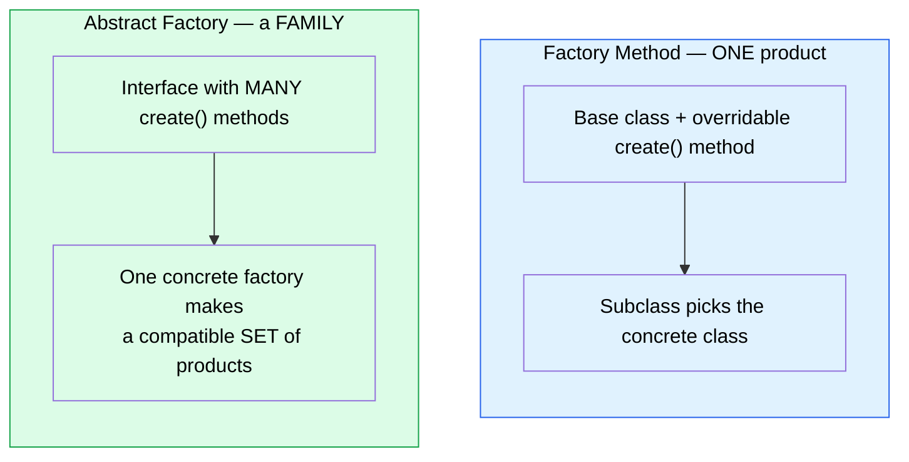
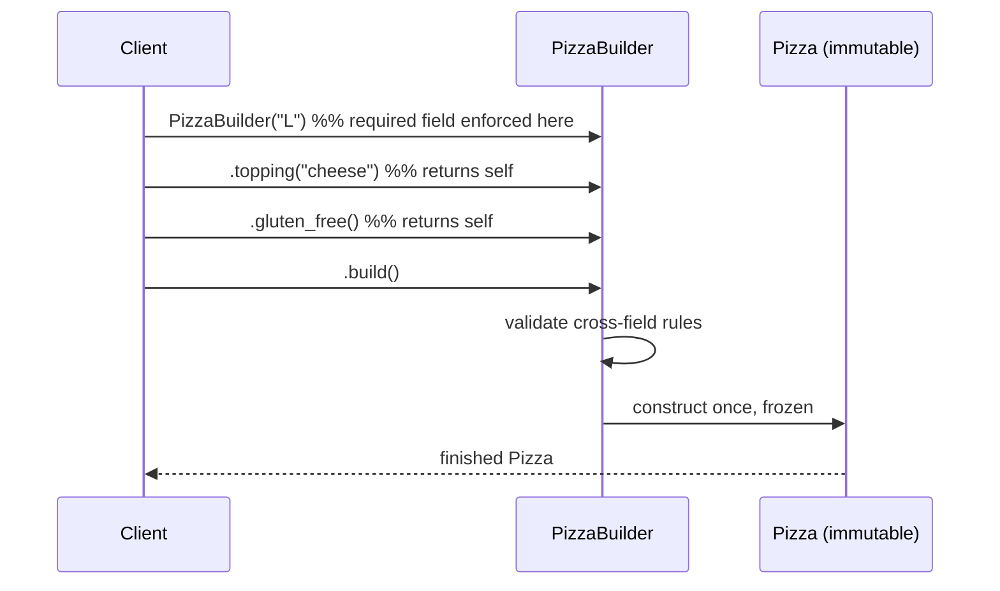
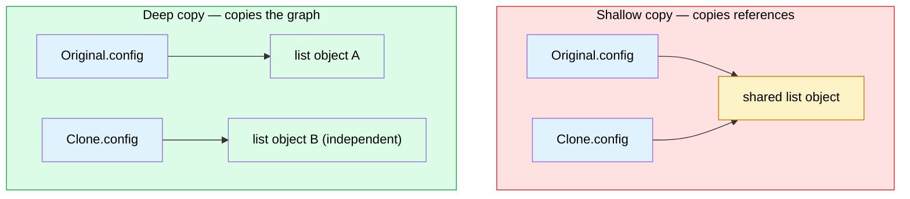
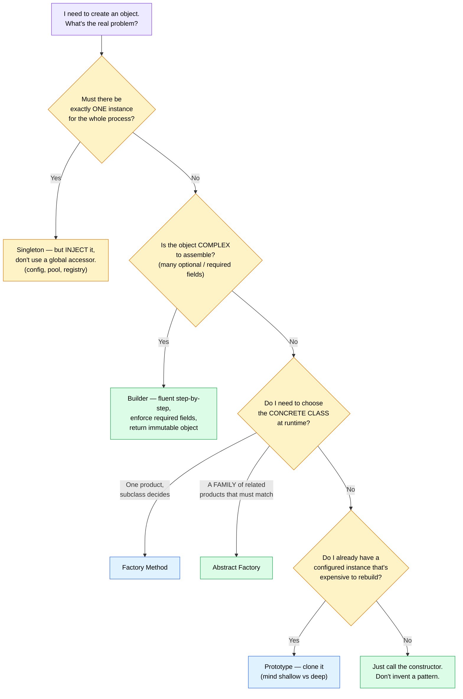
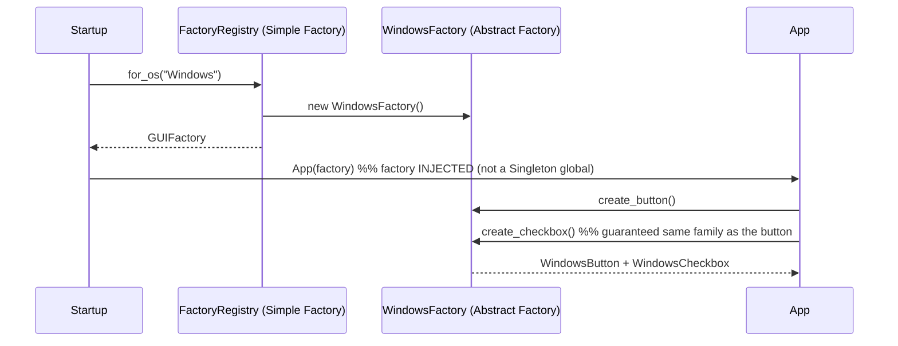
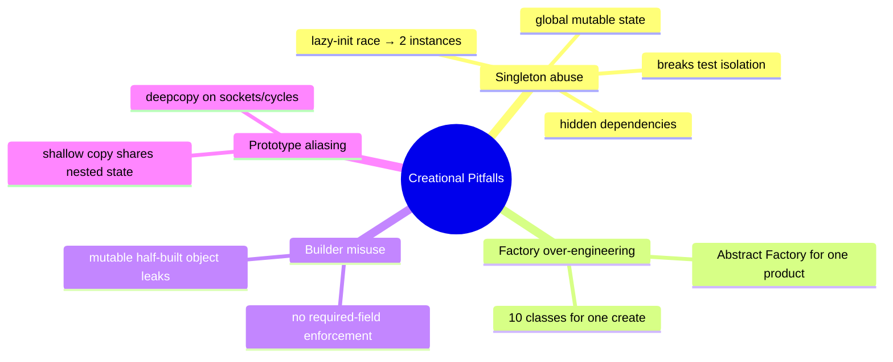

# Creational Design Patterns

> **One line:** Creational patterns answer a single question — *"who decides which object gets built, and how?"* — by moving the messy `new` decision out of your business code and into a place you can name, swap, and test.

---

## Table of Contents
1. [Why You Must Master This](#1-why-you-must-master-this)
2. [The Mental Model](#2-the-mental-model)
3. [Singleton — One Instance, and Why It's an Anti-Pattern](#3-singleton--one-instance-and-why-its-an-anti-pattern)
4. [Factory Method vs Abstract Factory — The Classic Trap](#4-factory-method-vs-abstract-factory--the-classic-trap)
5. [Builder — Killing the Telescoping Constructor](#5-builder--killing-the-telescoping-constructor)
6. [Prototype — Clone Instead of Construct](#6-prototype--clone-instead-of-construct)
7. [When To Use Which — The Decision Tree](#7-when-to-use-which--the-decision-tree)
8. [Worked Example — A Cross-Platform UI Toolkit](#8-worked-example--a-cross-platform-ui-toolkit)
9. [Real-Life Use Cases](#9-real-life-use-cases)
10. [Failure Modes](#10-failure-modes)
11. [🏋️ Practice Drills](#-practice-drills)
12. [🎤 Interview Q&A Bank](#-interview-qa-bank)
13. [🎯 Staff+ Nuances](#-staff-nuances)
14. [Cheat Sheet](#14-cheat-sheet)
15. [Connections & Further Reading](#15-connections--further-reading)

---

## 1. Why You Must Master This

Object creation looks trivial — you call `new` and move on. But *where* and *how* you call it silently decides how testable, flexible, and thread-safe your whole system is. Creational patterns are the family that turns "hard-coded `new StripeGateway()` scattered across 40 files" into "one seam you can swap."

- **They decide testability.** A `new Clock()` or a `Database.instance()` buried inside a method is a hidden dependency you cannot fake in a unit test. Creational patterns pull that decision to a seam you control — the difference between a 5 ms unit test and a flaky one that needs a real database. See [Dependency_Injection.md](./Dependency_Injection.md) and [Designing_for_Testability.md](./Designing_for_Testability.md).
- **Singleton is the most abused pattern in the catalog.** Whole categories of "tests pass alone but fail together" bugs, and race conditions in lazy initialization, trace back to a naive Singleton. Knowing *why* it's dangerous — not just how to write one — is a Staff-level signal.
- **Factory Method vs Abstract Factory is a classic interview trap.** Candidates conflate them constantly. Getting the distinction crisp (one method vs a *family* of related products) instantly separates "read a blog once" from "actually designed with these."
- **Builder solves a real, everyday pain.** The telescoping constructor — `Pizza(12, true, false, true, null, 3, ...)` — is unreadable and unsafe. Builders are how JSON serializers, HTTP clients, and query DSLs stay usable.

> **The core problem it solves:** how to decouple *what* object a client uses from *how, when, and which concrete class* is instantiated — so construction logic changes in one named place instead of rippling through every caller.

**Prerequisites:** [Object_Oriented_Design.md](./Object_Oriented_Design.md) (composition, polymorphism), [SOLID_Principles.md](./SOLID_Principles.md) (especially Dependency Inversion and Open/Closed), and the family survey in [Design_Patterns_Overview.md](./Design_Patterns_Overview.md) §3.

---

## 2. The Mental Model

Naively, every class that needs a `Widget` writes `new Widget()` itself. That hard-wires the caller to a *concrete class* — the one thing most likely to change (a new vendor, a test double, a different config). Creational patterns invert this: the caller says *what it wants*, and a dedicated builder/factory decides *how to produce it*.

Think of a restaurant. You (the client) don't walk into the kitchen and cook — you tell the waiter "a medium-rare steak," and the kitchen decides the pan, the grill, the plating. **The menu is the interface; the kitchen is the factory.** You can swap the entire kitchen (new chef, new supplier) without changing a word on the menu.



> **Hold onto this:** creational patterns move the word `new` out of your business logic and behind a seam. Everything else — Singleton's lifetime control, Factory's class selection, Builder's step-by-step assembly, Prototype's copy — is a variation on *who owns construction*.

The four patterns divide the space by *what* about creation they control:



---

## 3. Singleton — One Instance, and Why It's an Anti-Pattern

**What it is.** A Singleton guarantees a class has *exactly one* instance for the lifetime of the process and provides a global point of access to it (`Logger.instance()`). The class privatizes its constructor and hands out the one cached object.

**Why it exists.** Some resources genuinely should exist once: a connection pool, an in-process metrics registry, a hardware device handle. Creating two connection pools would double your DB connections and defeat the purpose. Singleton enforces "one" at the type level so no caller can accidentally make a second.

**How it works under the hood.** The class holds a private static reference to itself, a private constructor, and a static accessor that returns (creating on first call, i.e. *lazy*) the cached instance.

```python
import threading

# --- Naive lazy Singleton: LOOKS fine, is BROKEN under concurrency ---
class Logger:
    _instance = None                      # class-level cache

    @classmethod
    def instance(cls) -> "Logger":
        if cls._instance is None:         # ← check
            cls._instance = cls()         # ← create  (RACE window between check & create)
        return cls._instance
```

**The thread-safety problem (the part interviewers probe).** Two threads can both pass the `if _instance is None` check *before* either assigns — the classic check-then-act race. You end up with two instances, and any state one thread wrote is invisible to the other. The fixes, in ascending order of goodness:

| Fix | Mechanism | Cost |
|-----|-----------|------|
| **Eager init** | Build the instance at class-load time, no lazy check | Pays construction cost even if never used |
| **Lock every access** | `with _lock:` around the whole accessor | Every call takes a lock — contention |
| **Double-checked locking** | Check → lock → check again → create | Correct, but subtle; needs a memory barrier in some languages |
| **Module-level / eager-in-metaclass** | Let the language runtime guarantee single init | Cleanest; Python modules are imported once |

```python
# --- Correct: double-checked locking ---
class Logger:
    _instance = None
    _lock = threading.Lock()

    @classmethod
    def instance(cls) -> "Logger":
        if cls._instance is None:             # 1st check: cheap, no lock (fast path)
            with cls._lock:                   # only contend when maybe-uninitialized
                if cls._instance is None:     # 2nd check: another thread may have won
                    cls._instance = cls()
        return cls._instance
```

> In Python the idiomatic Singleton is often *just a module* — `import config` gives every caller the same module object, and the import system guarantees single initialization. Reaching for a class-based Singleton where a module suffices is a smell.

**Why it's an anti-pattern (the trade-off).** A Singleton is a **global variable wearing an encapsulation costume**. That causes three concrete harms:



- **Hidden dependencies.** `def charge(self, amt): db = Database.instance(); ...` — the method's signature lies. It claims to need only an amount, but secretly needs a live database. Callers and tests can't tell.
- **Global mutable state breaks test isolation.** If `Config.instance()` is mutated by test A, test B sees the mutation. This is the root cause of "passes alone, fails in the suite" — the single most common Singleton bug.
- **You can't swap it for a fake.** Because the accessor is hard-coded, you cannot inject an in-memory test double without global monkey-patching.

**The real number / real system.** Python's `logging` module and most DB connection-pool libraries are process-Singletons — legitimately, because they wrap a genuinely single resource. The failure mode shows up at scale: a well-known class of microservice outages comes from a lazily-initialized Singleton connection pool being constructed concurrently on cold start, opening 2× the intended connections and tripping the database's connection limit.

> **The mature rule:** if you truly need one instance, create it *once* at the composition root and **inject** it as a dependency — you keep "exactly one" *and* keep testability. Reserve the global accessor for the rare case where injection is genuinely impractical. See [Dependency_Injection.md](./Dependency_Injection.md).

---

## 4. Factory Method vs Abstract Factory — The Classic Trap

These two get conflated in nearly every interview. The distinction is worth memorizing precisely: **Factory Method creates ONE product via a method you override; Abstract Factory creates a FAMILY of related products via an object you inject.**

### 4a. The Simple Factory (not a GoF pattern, but the baseline)

Before the two GoF patterns, the everyday "simple factory" is just a function/method with a switch that returns the right concrete class:

```python
# --- Simple Factory: one place owns the `new` switch ---
def make_gateway(kind: str) -> "PaymentGateway":
    match kind:
        case "stripe": return StripeGateway()
        case "paypal": return PaypalGateway()
        case _: raise ValueError(f"unknown gateway {kind}")
```

This already wins: the `if kind == ...` switch lives in *one* file, so adding a provider touches one place. But it's not extensible without editing that switch, and it makes only one product.

### 4b. Factory Method — subclasses decide the concrete class

**What it is.** Define a creation *method* in a base class, but let *subclasses* override it to decide which concrete product to instantiate. The base class's algorithm calls the factory method without knowing the concrete type.

**How it works.** The base class contains the workflow (`process()`), and defers the one varying step — *which object to make* — to an abstract `create_X()` method. Each subclass supplies its own product.

```python
from abc import ABC, abstractmethod

class Dialog(ABC):                        # base owns the WORKFLOW
    def render(self) -> str:
        button = self.create_button()     # ← the factory method (varying step)
        return f"Dialog with {button.render()}"

    @abstractmethod
    def create_button(self) -> "Button":  # subclasses decide the concrete class
        ...

class WindowsDialog(Dialog):
    def create_button(self) -> "Button":
        return WindowsButton()            # this subclass makes Windows products

class WebDialog(Dialog):
    def create_button(self) -> "Button":
        return HtmlButton()
```

The `Dialog.render()` logic is written *once* and works for every platform; new platforms add a subclass. This is the **Open/Closed Principle** applied to construction.

### 4c. Abstract Factory — one object makes a whole family

**What it is.** An interface with *several* creation methods, each producing a different product, where all products from one concrete factory are guaranteed to be *compatible* (same "family"). You inject the factory object; the client calls its methods.

**How it works.** A `GUIFactory` exposes `create_button()` *and* `create_checkbox()`. A `WindowsFactory` returns Windows-flavored versions of *both*; a `MacFactory` returns Mac versions of *both*. The client gets one factory and can't accidentally mix a Windows button with a Mac checkbox.

```python
from abc import ABC, abstractmethod

class GUIFactory(ABC):                    # a FAMILY of related products
    @abstractmethod
    def create_button(self) -> "Button": ...
    @abstractmethod
    def create_checkbox(self) -> "Checkbox": ...

class WindowsFactory(GUIFactory):         # all Windows-family products together
    def create_button(self) -> "Button":     return WindowsButton()
    def create_checkbox(self) -> "Checkbox": return WindowsCheckbox()

class MacFactory(GUIFactory):
    def create_button(self) -> "Button":     return MacButton()
    def create_checkbox(self) -> "Checkbox": return MacCheckbox()

# Client depends on the ABSTRACT factory — inject the concrete one once
class App:
    def __init__(self, factory: GUIFactory) -> None:
        self._factory = factory           # injected → whole family is consistent

    def build(self) -> None:
        btn = self._factory.create_button()
        chk = self._factory.create_checkbox()   # guaranteed same platform as btn
```

### The distinction, made unmissable



| Axis | Factory Method | Abstract Factory |
|------|----------------|------------------|
| **How many products?** | One | A family (several related types) |
| **Mechanism** | Inheritance — override a method | Composition — inject a factory object |
| **Varies by** | Subclassing the creator | Swapping the whole factory instance |
| **Guarantee** | Right concrete class | Whole set is mutually *compatible* |
| **Grows when** | You add a new subclass | You add a new factory (family) |
| **Tell-tale** | `create_thing()` deferred to subclass | `create_A()` + `create_B()` on one interface |

> **The trap answer:** "Factory Method uses *inheritance* to pick one product; Abstract Factory uses *composition* to produce a *family* of products that are guaranteed to go together." When the OTHER wins: if you only ever make one kind of thing, Abstract Factory is over-engineering — use a simple factory or Factory Method. **Real system:** Java's `DocumentBuilderFactory` and Python's cross-platform GUI toolkits are Abstract Factories; the `Collection.iterator()` method (each collection returns its own iterator type) is a textbook Factory Method.

---

## 5. Builder — Killing the Telescoping Constructor

**What it is.** Builder separates the *construction* of a complex object from its representation, assembling it step by step through a fluent API and producing the finished object with a final `build()` call.

**Why it exists — the telescoping constructor problem.** When an object has many fields (some optional), constructors metastasize:

```python
# --- The telescoping constructor anti-pattern ---
class Pizza:
    def __init__(self, size, cheese=False, pepperoni=False, mushroom=False,
                 olives=False, gluten_free=False, extra_sauce=False): ...

# Call site — unreadable, positional-argument roulette:
p = Pizza("L", True, False, True, False, True, False)
#              ^^^^ which flag is which?  what does the 4th True mean?
```

Three problems: (1) unreadable call sites (`True, False, True` — which is which?), (2) you can't tell required from optional, (3) you can construct *invalid* objects (a pizza with no size). The alternative — a no-arg constructor plus setters — leaves the object in a half-built, mutable, invalid state between calls.

**How it works.** A separate Builder object accumulates configuration via chained methods (each returns `self`), validates required fields, and only then produces an immutable finished object in `build()`.

```python
from dataclasses import dataclass

@dataclass(frozen=True)                   # the PRODUCT is immutable once built
class Pizza:
    size: str
    toppings: tuple[str, ...]
    gluten_free: bool

class PizzaBuilder:
    def __init__(self, size: str) -> None:  # required field → in the constructor
        if size not in ("S", "M", "L"):
            raise ValueError("size is required and must be S/M/L")
        self._size = size
        self._toppings: list[str] = []
        self._gluten_free = False

    def topping(self, name: str) -> "PizzaBuilder":
        self._toppings.append(name)
        return self                        # return self → fluent chaining

    def gluten_free(self, on: bool = True) -> "PizzaBuilder":
        self._gluten_free = on
        return self

    def build(self) -> Pizza:              # single validated construction point
        if self._gluten_free and "regular_crust" in self._toppings:
            raise ValueError("gluten-free pizza can't have regular crust")
        return Pizza(self._size, tuple(self._toppings), self._gluten_free)

# Call site — self-documenting, order-independent, required field enforced:
pizza = (PizzaBuilder("L")
         .topping("cheese").topping("pepperoni")
         .gluten_free()
         .build())
```

**How required-field enforcement works.** Put required fields as constructor arguments of the *builder* (you literally cannot start building without them); put optional fields as chainable methods; do cross-field validation in `build()`. The object is never observable in a half-built state, and it can be immutable once returned.



**Trade-off / when the OTHER wins.** A Builder is more code (a whole extra class) and one more indirection. For an object with ≤3 mostly-required fields, a plain constructor or a dataclass with keyword arguments is clearer — **Python's keyword-only arguments (`def __init__(self, *, size, cheese=False)`) already solve the readability half of the problem**, so reach for a Builder mainly when you *also* need step-by-step assembly, validation, or immutability. **Real systems:** `StringBuilder`, HTTP client request builders, SQL/query DSLs (SQLAlchemy's chained query), and protobuf's generated builders all use this — anywhere an object has many optional knobs.

> A telling smell (echoed in [Design_Patterns_Overview.md](./Design_Patterns_Overview.md)): a constructor with more than ~4 parameters — *especially optional ones* — is a Builder waiting to happen.

---

## 6. Prototype — Clone Instead of Construct

**What it is.** Prototype creates new objects by *copying* an existing instance (the prototype) rather than constructing from scratch. The object knows how to clone itself.

**Why it exists.** Sometimes constructing an object is expensive (loads from a DB, parses a large config, does heavy computation) or the exact concrete class isn't known — but you already have a fully-configured instance. Cloning it is cheaper and doesn't require knowing its class. It also lets you snapshot a configured object as a template ("copy this pre-filled form").

**How it works.** The object exposes a `clone()` method that returns a copy of itself. The crux — and the interview probe — is **shallow vs deep copy**:



- **Shallow copy** duplicates the top-level object but *shares* the nested objects it references. Mutating the clone's nested list also mutates the original's — a subtle, dangerous aliasing bug.
- **Deep copy** recursively duplicates the entire object graph, so the clone is fully independent. Costlier, but safe.

```python
import copy
from dataclasses import dataclass, field

@dataclass
class Document:
    title: str
    tags: list[str] = field(default_factory=list)   # a MUTABLE nested object

    def clone_shallow(self) -> "Document":
        return copy.copy(self)     # nested `tags` list is SHARED — aliasing risk

    def clone_deep(self) -> "Document":
        return copy.deepcopy(self) # nested `tags` fully duplicated — independent

original = Document("Report", ["draft"])
shallow = original.clone_shallow()
shallow.tags.append("urgent")      # BUG: also mutates original.tags!
# original.tags == ["draft", "urgent"]  ← the aliasing trap

deep = original.clone_deep()
deep.tags.append("final")          # safe: original.tags unaffected
```

**Trade-off / when it wins.** Prototype shines when object creation is expensive relative to copying, when you need many near-identical objects (game entities, document templates), or when you want to avoid a parallel factory hierarchy. It loses when objects are cheap to build (just use a constructor) or when the object graph has cycles/non-copyable resources (open sockets, file handles) that `deepcopy` will choke on or duplicate incorrectly.

**Real systems.** JavaScript's entire object model is prototype-based. Python's `copy.deepcopy` and the `__copy__`/`__deepcopy__` protocol *are* the Prototype pattern. Game engines clone a configured "enemy" prototype thousands of times per level rather than reconstructing each from config.

> **The load-bearing question an interviewer will ask:** "Shallow or deep?" The right answer names the aliasing risk: shallow copies share nested mutable state, so a clone can silently corrupt its original. Default to deep copy unless you can prove the nested objects are immutable or intentionally shared.

---

## 7. When To Use Which — The Decision Tree

The patterns aren't rivals; they answer different questions. This tree is the "which do I reach for" map.



| If the pain is… | Reach for | Because |
|-----------------|-----------|---------|
| "There must be only one X" | **Singleton** (injected) | Enforces single instance at the type level |
| "This constructor has 8 arguments" | **Builder** | Readable assembly + required-field enforcement |
| "`if type == ...: new X()` is spreading" | **Factory Method / Simple Factory** | Centralizes the concrete-class decision |
| "I need matching sets (Win vs Mac widgets)" | **Abstract Factory** | Guarantees a compatible product family |
| "Rebuilding this is expensive; I have one already" | **Prototype** | Copy beats re-construction |
| "None of the above" | **Plain constructor** | Patterns cost indirection — don't pre-pay |

---

## 8. Worked Example — A Cross-Platform UI Toolkit

Scenario: a desktop app must render native-looking widgets on **Windows** and **macOS**. A window needs a button *and* a checkbox that visually match. The theme is chosen once at startup from the OS. This is the canonical **Abstract Factory** problem, and it lets us show creational patterns collaborating.

The forcing function: a button and a checkbox from *different* platforms must never mix (a Windows button next to a Mac checkbox looks broken). We need a *family* guarantee, not just per-widget selection.



```python
from abc import ABC, abstractmethod

# --- Products (two families: Windows, Mac) ---
class Button(ABC):
    @abstractmethod
    def render(self) -> str: ...
class Checkbox(ABC):
    @abstractmethod
    def render(self) -> str: ...

class WindowsButton(Button):
    def render(self) -> str: return "[Windows Button]"
class WindowsCheckbox(Checkbox):
    def render(self) -> str: return "[Windows Checkbox]"
class MacButton(Button):
    def render(self) -> str: return "(Mac Button)"
class MacCheckbox(Checkbox):
    def render(self) -> str: return "(Mac Checkbox)"

# --- Abstract Factory: one factory = one consistent family ---
class GUIFactory(ABC):
    @abstractmethod
    def create_button(self) -> Button: ...
    @abstractmethod
    def create_checkbox(self) -> Checkbox: ...

class WindowsFactory(GUIFactory):
    def create_button(self) -> Button:     return WindowsButton()
    def create_checkbox(self) -> Checkbox: return WindowsCheckbox()
class MacFactory(GUIFactory):
    def create_button(self) -> Button:     return MacButton()
    def create_checkbox(self) -> Checkbox: return MacCheckbox()

# --- Simple Factory: pick the family ONCE from the OS ---
def factory_for_os(os_name: str) -> GUIFactory:
    return {"Windows": WindowsFactory, "Mac": MacFactory}[os_name]()

# --- Client depends only on the abstract factory (injected) ---
class App:
    def __init__(self, factory: GUIFactory) -> None:
        self._factory = factory

    def render_window(self) -> str:
        btn = self._factory.create_button()
        chk = self._factory.create_checkbox()      # SAME family, guaranteed
        return f"{btn.render()} {chk.render()}"

app = App(factory_for_os("Windows"))
print(app.render_window())    # [Windows Button] [Windows Checkbox]
```

**Concept → consequence.** Because `App` depends on the *abstract* `GUIFactory` and the concrete family is injected once, **adding Linux support is one new factory + two product classes — `App` never changes**, and it's impossible to render a mismatched widget pair. Note the collaboration: a **Simple Factory** (`factory_for_os`) selects the **Abstract Factory**, which is **injected** (not fetched from a Singleton global) so the whole thing stays unit-testable with a `FakeGUIFactory`.

---

## 9. Real-Life Use Cases

| Situation | How creational patterns apply | The decision it forces |
|-----------|-------------------------------|------------------------|
| **DB connection pool / logger** | Singleton (one genuinely-single resource per process) | Enforce single instance — but inject it, don't globalize |
| **Cross-platform UI (Qt, AWT), theming** | Abstract Factory (a matching family of widgets) | Swap the whole family by swapping one factory |
| **`Collection.iterator()`** | Factory Method (each collection returns its own iterator) | New collection = new subclass, same interface |
| **HTTP client / SQL query DSL** | Builder (fluent, many optional knobs) | Readable assembly + required-field validation |
| **Protobuf / immutable message builders** | Builder → immutable product | Never observe a half-built message |
| **Game engine spawning enemies** | Prototype (clone a configured template) | Copy beats re-loading config per spawn |
| **`copy.deepcopy` / JS objects** | Prototype (language-level) | Choose shallow vs deep to avoid aliasing bugs |
| **Payment gateway selection** | Simple/Factory Method + Strategy | New provider = one class, no caller changes |
| **Serializer / parser families (XML vs JSON)** | Abstract Factory (matching reader+writer) | Reader and writer always agree on format |

> Real-world habit: **when you see `new ConcreteClass()` inside business logic, pause.** That hard-wire is the seam a creational pattern is meant to own. If a test would need to fake that object, the `new` belongs behind a factory and the result injected.

---

## 10. Failure Modes



- **Singleton lazy-init race.** *Symptom:* under load on cold start you see two connection pools / doubled resource usage, or intermittent corrupted shared state. *Root cause:* check-then-act race in `if _instance is None: _instance = new()`. *Fix:* eager init, or double-checked locking, or a language-guaranteed single init (Python module import).
- **Singleton breaks tests.** *Symptom:* tests pass alone, fail in the suite, or are order-dependent. *Root cause:* global mutable state leaks between tests. *Fix:* inject the single instance from a composition root; reset/rebuild per test; reserve true globals for stateless infrastructure.
- **Factory over-engineering.** *Symptom:* five interfaces and an Abstract Factory to produce one kind of object in a small app. *Root cause:* pattern applied speculatively for variation that doesn't exist. *Fix:* collapse to a simple factory function, or a plain constructor, until a second family actually appears.
- **Builder without enforcement.** *Symptom:* `build()` returns objects missing required fields, or callers mutate the object mid-build. *Root cause:* required fields treated as optional setters; product left mutable. *Fix:* put required fields in the builder's constructor; validate in `build()`; return an immutable (`frozen`) product.
- **Prototype shallow-copy aliasing.** *Symptom:* mutating a clone silently changes the original (or vice versa). *Root cause:* shallow copy shared nested mutable objects. *Fix:* deep-copy the mutable graph, or make nested objects immutable so sharing is safe; never `deepcopy` open resources (sockets/handles) — implement `__deepcopy__` to re-acquire them.

---

## 🏋️ Practice Drills

> *Cover the solutions and attempt first — active recall is the point.*

**Drill 1 — Spot the Singleton bug.** This lazy Singleton passes every single-threaded test but occasionally opens two database pools in production. Find the bug and give two fixes.

```python
class Pool:
    _inst = None
    @classmethod
    def get(cls):
        if cls._inst is None:
            cls._inst = cls()   # opens DB connections
        return cls._inst
```

<details><summary>Solution</summary>

**Check-then-act race:** two threads both evaluate `_inst is None` as true before either assigns, so both call `cls()` and open a pool. The second assignment wins the reference, but the first pool's connections leak. Fixes: (1) **eager initialization** — assign `_inst = Pool()` at class definition so it's built once at import; (2) **double-checked locking** — wrap the create in `with cls._lock:` and re-check inside. Best of all: build the pool once at the composition root and **inject** it, avoiding the global accessor entirely.
</details>

**Drill 2 — Factory Method or Abstract Factory?** You're building a report exporter. Version A: you need to produce a single `Report` object whose concrete type (PDF vs HTML) is decided by a subclass of `ReportJob`. Version B: exporting a themed report needs a matching `Header`, `Body`, and `Footer` that must all share the same visual theme. Which pattern for each, and why?

<details><summary>Solution</summary>

**Version A → Factory Method.** One product (`Report`), and the concrete class is chosen by subclassing `ReportJob` and overriding `create_report()`. Inheritance decides one type. **Version B → Abstract Factory.** Three related products (`Header`/`Body`/`Footer`) that must form a *consistent family* (same theme). A `ThemeFactory` with `create_header()`, `create_body()`, `create_footer()`; injecting a `DarkThemeFactory` guarantees all three match. The tell: *one product, subclass decides* = Factory Method; *a matching family* = Abstract Factory.
</details>

**Drill 3 — Design a Builder.** Design a builder for an `HttpRequest` with required `url` and `method`, optional `headers` (many), optional `body`, and a rule that a `GET` must not have a body. Show how required fields and the cross-field rule are enforced.

<details><summary>Solution</summary>

```python
class HttpRequestBuilder:
    def __init__(self, url: str, method: str):   # required → constructor args
        self._url, self._method = url, method    # can't start without them
        self._headers: dict[str, str] = {}
        self._body: str | None = None
    def header(self, k: str, v: str):
        self._headers[k] = v; return self        # fluent, optional, repeatable
    def body(self, b: str):
        self._body = b; return self
    def build(self):
        if self._method == "GET" and self._body is not None:   # cross-field rule
            raise ValueError("GET request cannot have a body")
        return HttpRequest(self._url, self._method,
                           dict(self._headers), self._body)     # immutable copy
```
Required fields live in the builder's constructor (impossible to omit); optional/repeatable fields are chainable methods; the GET-body invariant is checked once in `build()`, and the product is constructed in a single validated step.
</details>

**Drill 4 — Prototype aliasing.** A team clones a configured `Simulation` object (holding a nested `list[Particle]`) with `copy.copy()` to run parallel scenarios. Scenarios start interfering with each other's particle state. Diagnose and fix, and note the one case where their shallow copy would have been fine.

<details><summary>Solution</summary>

`copy.copy()` is a **shallow copy**: every clone shares the *same* `list[Particle]` object, so one scenario mutating a particle mutates it for all. Fix: `copy.deepcopy()` so each clone gets an independent particle graph. The shallow copy would have been fine *only* if `Particle` (and the list) were **immutable** — then sharing is safe because nothing can be mutated. So the real rule: shallow is safe over immutable nested state; deep is required over mutable nested state.
</details>

---

## 🎤 Interview Q&A Bank

**Q1. Why is Singleton considered an anti-pattern?**
> It's a global variable with encapsulation lipstick. It creates hidden dependencies (methods secretly reach for it, so signatures lie), shared mutable state that breaks test isolation (pass-alone-fail-together bugs), and it can't be swapped for a fake. Justified only for genuinely-single resources — and even then, inject the instance rather than expose a global accessor. *(signal: knows the trade-off, not just the mechanism)*

**Q2. Factory Method vs Abstract Factory — what's the difference?**
> Factory Method makes *one* product and uses *inheritance* — a subclass overrides `create()` to pick the concrete class. Abstract Factory makes a *family* of related products and uses *composition* — you inject a factory object whose several `create_X()` methods return a mutually-compatible set. One product via subclassing vs a matching family via an injected object. *(signal: the classic conflation; strong answers say "inheritance vs composition" and "family")*

**Q3. What problem does the Builder pattern solve?**
> The telescoping constructor: many-argument constructors are unreadable (`True, False, True`), can't distinguish required from optional, and let you build invalid objects. Builder assembles step by step with a fluent API, enforces required fields (as builder-constructor args), validates cross-field rules in `build()`, and can return an immutable product. Trade-off: an extra class, so skip it for objects with ≤3 mostly-required fields — keyword arguments already suffice. *(signal: names the telescoping problem)*

**Q4. How do you make a Singleton thread-safe, and what's the catch?**
> Options: eager init (build at load time — simple, but pays cost even if unused), locking every access (correct but contended), or double-checked locking (check, lock, re-check — fast path avoids the lock). The catch is the lazy check-then-act race: two threads both see `null` and both construct. In Python, a module is the cleanest thread-safe Singleton because import runs once. *(signal: knows the race exists and the fast-path fix)*

**Q5. Shallow vs deep copy in Prototype — why does it matter?**
> A shallow copy duplicates the top object but *shares* its nested references, so mutating the clone's nested list corrupts the original — a silent aliasing bug. Deep copy recursively duplicates the whole graph for full independence, at higher cost. Default to deep unless the nested state is provably immutable (then sharing is safe) — and never deep-copy live resources like sockets. *(signal: names aliasing risk)*

**Q6. When would you NOT use a creational pattern?**
> When there's no real variation or complexity to absorb. A plain constructor is the right answer for a simple object with a few required fields. Abstract Factory for one product, or a Builder for a 2-field object, is over-engineering — you pay indirection cost forever for flexibility you never use. Add the pattern when a second variant or a real assembly pain actually arrives. *(signal: judgment/restraint)*

**Q7. You need exactly one config object app-wide. Singleton or DI?**
> Prefer DI: construct the one config at the composition root and inject it everywhere. You still get "exactly one" instance, but without the global accessor — so tests can inject a fake config, and dependencies are explicit in signatures. Reserve a true Singleton for cases where injection is genuinely impractical, like a logging facility called from everywhere. *(signal: reaches for injection, keeps the "one" guarantee)*

**Q8. How does Factory relate to Strategy?**
> They pair constantly: the Factory *builds* the object; the Strategy *is* the swappable behavior the factory hands you. A `PaymentFactory.create("stripe")` returns a `StripeStrategy` implementing a common `charge()` interface. Factory owns the "which concrete class" decision; Strategy owns the "which algorithm runs" decision. Creational selects; behavioral varies. See [Behavioral_Design_Patterns.md](./Behavioral_Design_Patterns.md). *(signal: sees how patterns collaborate)*

---

## 🎯 Staff+ Nuances

- **The composition root is where creation belongs.** Push every `new` to a single startup location (the "composition root") and inject the results downward. This is what makes Singleton-vs-DI a non-debate: you build genuinely-single objects *once* there and inject them, getting uniqueness *and* testability. Scattered `new` and global accessors are the real anti-pattern; Singleton is just its most common form. See [Dependency_Injection.md](./Dependency_Injection.md).
- **Most creational patterns are workarounds for missing language features.** With first-class functions, a "factory" is often just a function reference; Python's keyword-only arguments and dataclasses subsume much of Builder; module imports subsume Singleton. Reach for the language facility before the class hierarchy — GoF was written for a language (C++) without these. See [Design_Patterns_Overview.md](./Design_Patterns_Overview.md).
- **Singleton scope is subtler than "one."** "One per process" is only one choice — you may want one *per thread* (thread-local), one *per request* (web scoping), or one *per tenant* in a multi-tenant system. A naive process-Singleton in a multi-tenant service leaks one tenant's state into another's — a security bug, not just a test smell. Ask "one per *what*?" before writing the pattern.
- **Registration-based factories beat switch statements at scale.** A `match kind:` factory violates Open/Closed — every new type edits it. A *registry* (`factories[name] = cls`) lets plugins self-register without touching the factory, which is how extensible systems (Django apps, pytest plugins, driver registries) load providers they've never heard of.
- **Builder + immutability is a concurrency win, not just readability.** Returning a `frozen` product from `build()` means the object is safely shareable across threads with no locking — the reason immutable-message builders dominate in concurrent and distributed systems (protobuf, Kafka records). The Builder holds the mutability; the product never does.
- **Prototype and serialization are the same idea.** Cloning an object graph and serializing/deserializing it both traverse-and-copy the graph; a common cheap-but-dangerous "deep clone" is round-tripping through JSON, which silently drops methods, type identity, and cyclic references. Know that shortcut's failure modes before using it.
- **`__new__` vs `__init__` is the Python creational seam.** `__init__` initializes an already-created instance; `__new__` *creates* it — and is where Python Singletons, object pools, and interning (like small-int caching) actually hook in. Overriding `__new__` to return a cached instance is the real mechanism behind a class-based Singleton; knowing this distinguishes surface knowledge from depth.

---

## 14. Cheat Sheet

```
CREATIONAL PATTERNS = who owns the `new`?  Move construction behind a seam.

SINGLETON  — HOW MANY (exactly one, shared)
  use: genuinely-single resource (pool, logger, registry)
  ⚠ anti-pattern: global mutable state · hidden deps · breaks test isolation
  ⚠ lazy race: check-then-act → 2 instances.  fix: eager | double-checked lock | module
  RULE: need one? build once at composition root and INJECT it. don't globalize.

FACTORY METHOD  — WHICH class (ONE product, via INHERITANCE)
  base owns workflow; subclass overrides create() to pick concrete class
  e.g. Collection.iterator()

ABSTRACT FACTORY — WHICH class (a FAMILY, via COMPOSITION/injection)
  one factory → matching set of products (create_A()+create_B())
  e.g. Windows vs Mac widget family.  guarantee: products go together
  TRAP: FactoryMethod = inheritance/one · AbstractFactory = composition/family

BUILDER  — HOW assembled (step-by-step, fluent)
  kills telescoping ctor (True,False,True). required → builder ctor args;
  optional → chained .method()->self; validate + freeze in build()
  skip if <=4 mostly-required fields (kwargs already suffice)

PROTOTYPE — COPY an existing one
  clone() instead of re-construct (expensive/unknown class)
  ⚠ SHALLOW shares nested refs (aliasing bug) · DEEP copies graph (safe, costly)
  default deep unless nested state is immutable. never deepcopy sockets.

DECISION:  one instance? → Singleton(inject)   complex assembly? → Builder
  pick concrete class? → Factory(Method=one, Abstract=family)
  have a costly-to-rebuild instance? → Prototype   else → plain constructor

Factory BUILDS the object · Strategy IS the behavior it hands back (they pair).
Patterns cost indirection forever — only pay for variation that EXISTS.
```

---

## 15. Connections & Further Reading

**Prerequisites (learn first):**
- [Object_Oriented_Design.md](./Object_Oriented_Design.md) — composition, polymorphism, and interfaces these patterns lean on.
- [SOLID_Principles.md](./SOLID_Principles.md) — Dependency Inversion and Open/Closed are *why* factories exist.
- [Design_Patterns_Overview.md](./Design_Patterns_Overview.md) — the three-family survey this file drills into (§3 Creational).

**Builds toward / pairs with:**
- [Dependency_Injection.md](./Dependency_Injection.md) — the antidote to Singleton abuse and the delivery mechanism for injected factories.
- [Designing_for_Testability.md](./Designing_for_Testability.md) — why hidden `new` and global Singletons wreck tests, and how injection fixes it.
- [Structural_Design_Patterns.md](./Structural_Design_Patterns.md) — how the created objects then *compose* (Adapter, Decorator, Facade).
- [Behavioral_Design_Patterns.md](./Behavioral_Design_Patterns.md) — Factory routinely builds a Strategy; creational selects, behavioral varies.

**Gaps this topic exposes (candidates for the section's Gap Analysis):**
- **Object pools & flyweight** — reusing/sharing expensive instances, a creational concern that borders on structural.
- **Composition root / IoC containers** — the practical home for all construction in a real app.
- **Dependency Injection frameworks** — how creation is wired at scale (constructor injection, scopes: singleton/request/transient).

**External classics:**
- *Design Patterns: Elements of Reusable Object-Oriented Software* (Gang of Four) — the original catalog; the Creational chapter defines all four.
- *Effective Java* (Joshua Bloch) — Item 2 (Builder for many constructor parameters) and Item 3 (Singleton via enum) are the definitive practitioner takes.
- [Refactoring.Guru — Creational Patterns](https://refactoring.guru/design-patterns/creational-patterns) — the best visual walkthrough on the web.

---

## TL;DR
Creational patterns move the word `new` out of your business logic and behind a controllable seam, and they divide by *what about creation* they own: **Singleton** controls *how many* (exactly one — but treat it as an anti-pattern of global mutable state and **inject** the single instance from a composition root instead of using a global accessor, and beware the lazy-init race that spawns two). **Factory Method** picks *which class* for one product via *inheritance*, while **Abstract Factory** produces a matching *family* via *composition/injection* — that inheritance-vs-family distinction is the classic interview trap. **Builder** owns *how a complex object is assembled*, killing the telescoping constructor with a fluent API that enforces required fields and returns an immutable product. **Prototype** *copies* an existing instance, where the load-bearing choice is shallow (shares nested state — aliasing bugs) vs deep (independent, costly). **The imperative: reach for a creational pattern only when real variation or assembly pain exists — otherwise a plain constructor wins, because every pattern charges indirection forever.**
