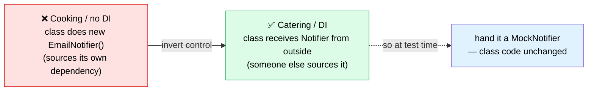
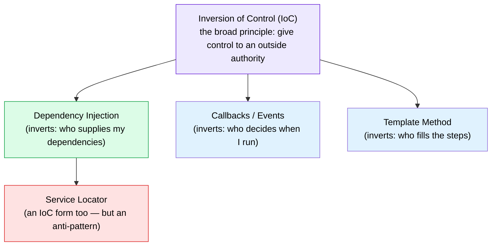
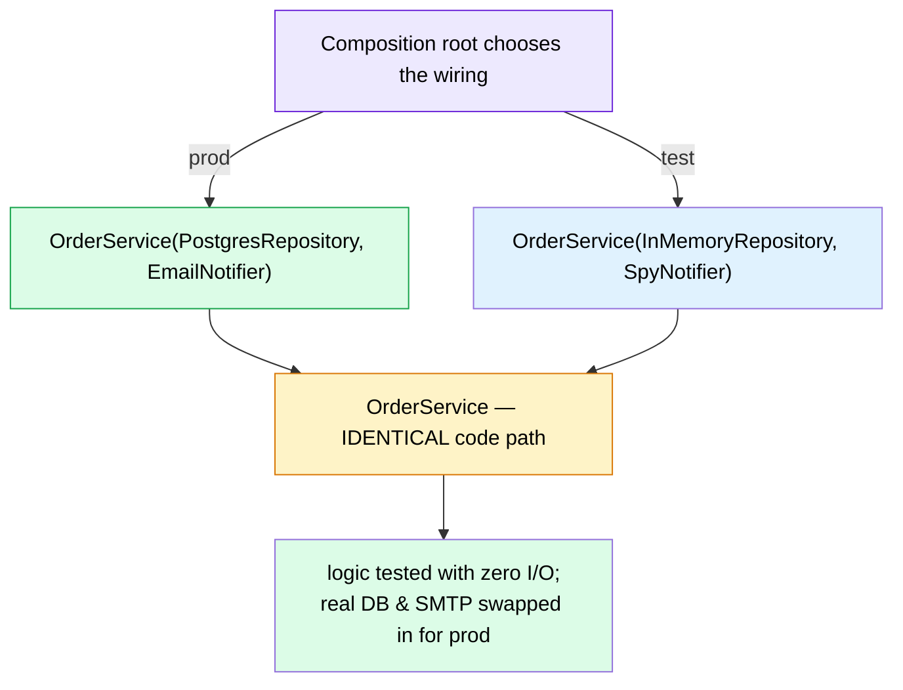
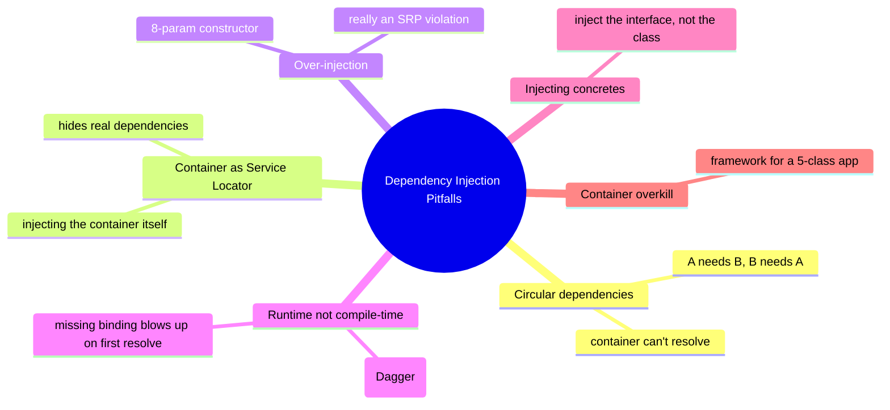

# Dependency Injection &amp; Inversion of Control

> **One line:** Stop letting a class build its own tools — hand them to it from the outside, so you can swap a real database for a mock in a test without touching a single line of the class.

---

## Table of Contents
1. [Why You Must Master This](#1-why-you-must-master-this)
2. [The Mental Model](#2-the-mental-model)
3. [DI vs IoC — the Hollywood Principle](#3-di-vs-ioc--the-hollywood-principle)
4. [The Three Injection Types](#4-the-three-injection-types)
5. [DI Containers vs Manual Wiring](#5-di-containers-vs-manual-wiring)
6. [How DI Enables Testing &amp; Mocking](#6-how-di-enables-testing--mocking)
7. [The Service Locator Anti-Pattern](#7-the-service-locator-anti-pattern)
8. [Worked Example — Wiring an OrderService](#8-worked-example--wiring-an-orderservice)
9. [Real-Life Use Cases](#9-real-life-use-cases)
10. [Failure Modes](#10-failure-modes)
11. [🏋️ Practice Drills](#-practice-drills)
12. [🎤 Interview Q&A Bank](#-interview-qa-bank)
13. [🎯 Staff+ Nuances](#-staff-nuances)
14. [Cheat Sheet](#14-cheat-sheet)
15. [Connections & Further Reading](#15-connections--further-reading)

---

## 1. Why You Must Master This

Dependency Injection is the most practical technique for making object-oriented code testable and changeable. It is *how* you actually achieve the "D" in SOLID (Dependency Inversion) — the theory says "depend on abstractions"; DI is the runtime mechanic that makes it happen.

- **Testability is the headline win.** If `OrderService` does `self.db = PostgresClient()`, you can't unit-test it without a live Postgres. Inject it and a test passes a fake — no network, milliseconds instead of seconds.
- **Swappability without edits.** Change `EmailNotifier` to `SmsNotifier`, or Postgres to DynamoDB, by editing *one wiring line* — not by hunting every `new` scattered through the logic.
- **Boundaries stay honest.** A class that receives `Notifier` in its constructor *declares its dependencies in its signature*. One that reaches out to grab them hides what it needs — and hidden dependencies are how codebases rot.
- **It scales.** In a system of 1,000 classes, tracking who constructs whom by hand is impossible; DI centralizes wiring into one composition layer.

> **The core problem it solves:** *tight coupling to concrete implementations.* The naive `self.notifier = EmailNotifier()` welds a class to one specific collaborator forever. DI severs that weld — the class states *what abstraction* it needs and someone else decides *which concrete* to supply.

---

## 2. The Mental Model

Think **catering vs cooking.** Cooking (no DI): the class shops, buys ingredients, and cooks — it must know *how to source everything*, and a gluten-free version means rewriting the recipe. Catering (DI): the class says "I need something satisfying the `Meal` interface" and someone else prepares it and hands it over — it doesn't know or care where the bread came from. To test it, hand it a *plastic prop meal*; it can't tell the difference.





---

## 3. DI vs IoC — the Hollywood Principle

These two terms get conflated constantly. Get the hierarchy right and you'll sound senior instantly.

- **Inversion of Control (IoC)** is the *broad principle*: a class gives up control over part of its own behavior to an outside authority — "don't call us, we'll call you," the **Hollywood Principle**. Framework hooks, event callbacks, template methods, and DI are *all* IoC.
- **Dependency Injection (DI)** is one *specific kind* of IoC: the inverted control is **who supplies my dependencies**. Instead of the class constructing its collaborators, they're handed in.

| | Normal control flow | Inverted control (IoC) |
|---|---|---|
| **Who decides which concrete class is used?** | The class itself (`new EmailNotifier()`) | An outside authority (injector/container) |
| **Who calls whom?** | Your code calls the library | The framework calls your code |
| **Dependencies are** | Constructed internally, hidden | Supplied externally, declared |
| **Examples** | A plain `main()` that builds everything inline | DI, callbacks, framework hooks, template method |



> **The one-liner:** *IoC is the principle; DI is the pattern that applies it to dependencies.* All DI is IoC; not all IoC is DI.

---

## 4. The Three Injection Types

There are three mechanical ways to get a dependency into an object. They are not equal — **constructor injection is the default; the other two are for narrow cases.**

| Type | How | Use when | Danger |
|------|-----|----------|--------|
| **Constructor** | Pass deps as `__init__` arguments | Almost always (required deps) | Long param lists signal too many deps |
| **Setter / property** | Expose a method to set the dep after construction | Genuinely optional deps; reconfiguration | Object can exist in a half-wired, invalid state |
| **Interface** | Client implements an interface whose method the injector calls to push the dep in | Framework-mandated (e.g. Servlet); rare in app code | Ceremony; couples client to the injector's interface |

```python
from abc import ABC, abstractmethod

class Notifier(ABC):
    @abstractmethod
    def notify(self, msg: str) -> None: ...

# 1. CONSTRUCTOR INJECTION (preferred) — dependency is required and immutable
class OrderService:
    def __init__(self, notifier: Notifier):   # declared in the signature — honest
        self._notifier = notifier             # fully valid the instant it exists

# 2. SETTER INJECTION — dependency is optional / replaceable
class ReportService:
    def __init__(self):
        self._notifier: Notifier | None = None    # valid without it...
    def set_notifier(self, notifier: Notifier):   # ...but can be given one later
        self._notifier = notifier

# 3. INTERFACE INJECTION — the client exposes a hook the injector calls (rare)
class NotifierAware(ABC):
    @abstractmethod
    def inject_notifier(self, notifier: Notifier) -> None: ...

class AuditService(NotifierAware):
    def inject_notifier(self, notifier: Notifier) -> None:
        self._notifier = notifier
```

**Why constructor injection wins:** the dependency is *visible* in the signature (you can't miss what the class needs), *guaranteed* (never a half-built object with a `None` collaborator waiting to crash at runtime), and *immutable* (store it in a field, it can't be swapped mid-life). Setter injection sacrifices all three for reconfigurability — pay that only when you truly need optional or swappable deps.

> A constructor with **eight** injected parameters is not a DI problem — it's an SRP problem. The pain is telling you the class does too much. See [SOLID_Principles.md](./SOLID_Principles.md) and [Class_Design.md](./Class_Design.md).

---

## 5. DI Containers vs Manual Wiring

DI is a *pattern*, not a *framework* — a plain constructor call is DI. A **DI container** (a.k.a. IoC container) is an optional tool that automates wiring: you register what implements what, and it builds the whole object graph, resolving dependencies transitively and managing lifetimes (singleton vs per-request).

```python
# MANUAL WIRING — the "composition root": one place that knows all the concretes
def main():
    db       = PostgresClient(dsn=CONFIG.dsn)
    repo     = OrderRepository(db)
    notifier = EmailNotifier(smtp=CONFIG.smtp)
    service  = OrderService(repo, notifier)   # wire the graph by hand
    App(service).run()

# CONTAINER WIRING (python-dependency-injector style) — register, then resolve
class Container(containers.DeclarativeContainer):
    db       = providers.Singleton(PostgresClient, dsn=CONFIG.dsn)
    repo     = providers.Factory(OrderRepository, db=db)
    notifier = providers.Singleton(EmailNotifier, smtp=CONFIG.smtp)
    service  = providers.Factory(OrderService, repo=repo, notifier=notifier)

c = Container()
c.service()   # container builds the entire graph transitively
```

| | Manual wiring | DI container |
|---|---|---|
| **Setup cost** | Zero — it's just constructors | Learn the framework, annotations, config |
| **Traceability** | Follow the code — obvious where objects come from | "Magic" — resolution happens by convention/reflection |
| **Lifetime mgmt** | You manage singletons/scopes by hand | Container handles singleton/scoped/transient |
| **Failure timing** | Compile/import time if a dep is missing | Often *runtime* — a missing binding blows up on first resolve |
| **Best for** | Small-to-mid apps; the composition root pattern | Large apps, many transitive deps, request scopes |

> **The honest rule:** start with **manual wiring in a composition root** — a single `main()`/`bootstrap` module that constructs the graph. Reach for a container only when the transitive graph is large enough that hand-wiring is genuinely painful. A DI framework for a 5-class app is 2 hours of setup to save 5 minutes of typing.

---

## 6. How DI Enables Testing &amp; Mocking

This is the payoff that justifies the pattern. A dependency injected through the constructor is one you can *replace* in a test — with a mock, stub, fake, or spy — without the class ever knowing.

```python
# WITHOUT DI — untestable: the real emailer is welded in
class OrderService:
    def __init__(self):
        self._notifier = EmailNotifier(smtp=PROD_SMTP)   # ❌ hardcoded
    def place(self, order):
        self._notifier.notify(f"Order {order.id} placed")
# A unit test would send a REAL email to PROD_SMTP. There is no seam to intercept.

# WITH DI — trivially testable: inject a spy
class OrderService:
    def __init__(self, notifier: Notifier):   # ✅ seam
        self._notifier = notifier
    def place(self, order):
        self._notifier.notify(f"Order {order.id} placed")

class SpyNotifier(Notifier):
    def __init__(self):
        self.messages: list[str] = []
    def notify(self, msg: str) -> None:
        self.messages.append(msg)             # records instead of sending

def test_place_notifies_once():
    spy = SpyNotifier()
    OrderService(spy).place(Order(id=42))
    assert spy.messages == ["Order 42 placed"]   # fast, deterministic, no I/O
```

The injected constructor parameter *is the test seam* — which is why "is this class testable?" and "are its dependencies injected?" are nearly the same question. Inject against an **interface** (see [Interface_Design.md](./Interface_Design.md)) and the mock only has to satisfy the interface, not the sprawling real implementation.

---

## 7. The Service Locator Anti-Pattern

The Service Locator *looks* like DI — a central registry hands out dependencies — but reverses the direction in a way that undoes most of DI's benefits. Instead of dependencies being *pushed in*, the class *reaches out and pulls* them from a global registry.

```python
# SERVICE LOCATOR (anti-pattern) — the class ASKS for its dependency
class OrderService:
    def __init__(self):
        self._notifier = ServiceLocator.get("notifier")   # ❌ hidden dependency
    # Nothing in the signature says this class needs a Notifier.
    # To test it you must configure a GLOBAL registry first.

# DEPENDENCY INJECTION — the dependency is HANDED to the class
class OrderService:
    def __init__(self, notifier: Notifier):   # ✅ dependency is explicit
        self._notifier = notifier
```

| Dimension | Dependency Injection | Service Locator |
|-----------|---------------------|-----------------|
| **Dependency direction** | Pushed in from outside | Pulled from a global registry |
| **Are deps visible?** | Yes — in the constructor signature | No — hidden inside method bodies |
| **Testability** | Pass a mock directly | Must configure a global before every test |
| **Coupling** | To the abstraction only | To the locator *and* the abstraction |
| **Failure mode** | Missing dep = obvious at wiring | Missing key = runtime `KeyError`, deep in a call |

> **Why it's an anti-pattern:** it re-hides the very dependencies DI made explicit. A `ServiceLocator.get(...)` buried in a method turns a declared dependency into a lookup that only shows up when that line runs. The worst variant — **passing the DI container itself into a class** — is a Service Locator in disguise: the class can now grab *anything*, so its real dependencies become unknowable. Inject the specific things a class needs; never inject the container.

---

## 8. Worked Example — Wiring an OrderService

`OrderService` needs two collaborators: a `Repository` to persist orders and a `Notifier` to announce them. We depend on *interfaces* for both, then wire different concretes in production vs test — with the service code identical across both.

```python
from abc import ABC, abstractmethod

class Repository(ABC):
    @abstractmethod
    def save(self, order) -> None: ...

class Notifier(ABC):
    @abstractmethod
    def notify(self, msg: str) -> None: ...

class OrderService:                                  # depends ONLY on abstractions
    def __init__(self, repo: Repository, notifier: Notifier):
        self._repo = repo
        self._notifier = notifier
    def place(self, order) -> None:
        self._repo.save(order)
        self._notifier.notify(f"Order {order.id} placed")

# --- PROD WIRING (composition root) ---
prod = OrderService(PostgresRepository(dsn=CONFIG.dsn),
                    EmailNotifier(smtp=CONFIG.smtp))

# --- TEST WIRING (same class, fake collaborators) ---
class InMemoryRepository(Repository):
    def __init__(self): self.saved = []
    def save(self, order): self.saved.append(order)

class SpyNotifier(Notifier):
    def __init__(self): self.msgs = []
    def notify(self, msg): self.msgs.append(msg)

def test_place_persists_and_notifies():
    repo, spy = InMemoryRepository(), SpyNotifier()
    OrderService(repo, spy).place(Order(id=7))
    assert repo.saved[0].id == 7          # persisted
    assert spy.msgs == ["Order 7 placed"] # announced — no DB, no SMTP, no network
```



**Concept → consequence:** because dependencies enter through the constructor as *interfaces*, choosing prod vs test is a one-line decision at the edge. The consequence: `OrderService`'s entire business logic is verified in a test that runs in **microseconds with no external systems** — and swapping Postgres for DynamoDB later touches *only* the composition root, never the service.

---

## 9. Real-Life Use Cases

| Situation | How DI applies |
|-----------|----------------|
| **Spring (Java)** | `@Autowired` / `@Component` — the container scans, constructs, and injects the whole graph; the canonical enterprise DI framework. |
| **NestJS (Node/TS)** | `@Injectable()` providers resolved by a built-in IoC container per module; constructor injection by default. |
| **Dagger / Hilt (Android)** | *Compile-time* DI — generates wiring code, so a missing binding fails the **build**, not production. |
| **ASP.NET Core** | First-class `IServiceCollection` container with singleton/scoped/transient lifetimes baked into the framework. |
| **Swapping a data store** | Depend on `Repository`; move Postgres → Dynamo by changing one binding in the composition root. |
| **Feature flags / A-B** | Inject a different strategy implementation per cohort without branching business logic. |
| **Unit tests everywhere** | Every mock/stub/fake in your test suite exists *because* the code accepted its dependency instead of building it. |

> Real-world habit: **when you catch yourself typing `new`/`SomeClass()` inside business logic, stop and ask "should this be a constructor parameter?"** The answer is almost always yes for anything with I/O, state, or a plausible alternate implementation.

---

## 10. Failure Modes



- **Circular dependencies** — A's constructor needs B and B's needs A; the container can't decide who to build first and errors (or infinite-loops). *Symptom:* `CircularDependency`/stack overflow at startup. *Fix:* break the cycle — extract a third collaborator both depend on, introduce an interface/event, or lazy-inject one side.
- **Container-as-Service-Locator** — passing the container into a class so it can `get()` anything. *Symptom:* a class's real dependencies are invisible; tests need the whole container. *Fix:* inject the specific collaborators, never the container.
- **Over-injection** — a constructor with 8+ parameters. *Symptom:* painful wiring, painful test setup. *Fix:* it's an SRP smell — split the class, or group cohesive deps into a parameter object/facade.
- **Runtime-not-compile-time failure** — reflection-based containers only discover a missing binding when they try to resolve it. *Symptom:* app boots, then crashes on the first request that needs the missing service. *Fix:* validate the graph at startup, or use compile-time DI (Dagger/Hilt) so it fails the build.
- **Injecting concretes instead of interfaces** — `def __init__(self, n: EmailNotifier)` re-welds the coupling. *Symptom:* can't substitute a mock. *Fix:* depend on the abstraction (`Notifier`).

---

## 🏋️ Practice Drills

> *Cover the solutions and attempt first — active recall is the point.*

**Drill 1 — Make it testable.** This class can't be unit-tested. Fix it with DI, then write the test seam.
```python
class InvoiceService:
    def __init__(self):
        self.gateway = StripeGateway(api_key=PROD_KEY)
    def charge(self, amount): return self.gateway.charge(amount)
```

<details><summary>Solution</summary>

Inject the gateway against an interface so a fake can replace it:
```python
class PaymentGateway(ABC):
    @abstractmethod
    def charge(self, amount) -> bool: ...

class InvoiceService:
    def __init__(self, gateway: PaymentGateway):   # injected seam
        self.gateway = gateway
    def charge(self, amount): return self.gateway.charge(amount)

class FakeGateway(PaymentGateway):
    def __init__(self): self.charged = []
    def charge(self, amount): self.charged.append(amount); return True

def test_charge():
    fake = FakeGateway()
    assert InvoiceService(fake).charge(100) is True
    assert fake.charged == [100]   # no real Stripe call
```
The hardcoded `StripeGateway(PROD_KEY)` was the untestable weld; the constructor parameter is the seam.
</details>

**Drill 2 — DI or Service Locator?** Classify each and say why.
```python
# (a)
class A:
    def __init__(self, repo: Repo): self.repo = repo
# (b)
class B:
    def run(self): self.repo = Registry.get("repo")
# (c)
class C:
    def __init__(self, container): self.container = container
```

<details><summary>Solution</summary>

(a) is **DI** — the dependency is pushed in and visible in the signature. (b) is the **Service Locator anti-pattern** — the class pulls from a global registry, hiding the dependency. (c) is the **worst case**: injecting the container is Service Locator in disguise — `C` can now fetch anything, so its true dependencies are unknowable. Only (a) is testable by simply passing a mock.
</details>

**Drill 3 — Break the cycle.** `UserService` needs `NotificationService`, and `NotificationService` needs `UserService` (to look up emails). The container throws a circular-dependency error. Give two fixes.

<details><summary>Solution</summary>

(1) **Extract a third collaborator** both depend on — e.g. a `UserLookup`/`EmailResolver` that `NotificationService` uses instead of the whole `UserService`, removing the back-edge. (2) **Invert with an event/callback** — `UserService` publishes a domain event and `NotificationService` subscribes, so neither holds a direct reference. (A weaker third option is lazy/setter injection of one side, but that treats the symptom; a genuine cycle usually signals a missing abstraction or a misplaced responsibility — see [SOLID_Principles.md](./SOLID_Principles.md).)
</details>

**Drill 4 — Container or manual?** A CLI tool has 6 classes and one obvious wiring path. A colleague wants to add a full DI container "to be professional." Argue the call.

<details><summary>Solution</summary>

Manual wiring in a composition root wins here. With 6 classes and a single wiring path, a container adds a framework dependency, learning curve, and runtime "magic" to save a handful of constructor calls. Keep a single `main()`/`bootstrap()` that builds the graph explicitly — it's traceable and fails at import if something's missing. Reach for a container only when the transitive graph and lifetime/scoping needs make hand-wiring genuinely painful.
</details>

---

## 🎤 Interview Q&A Bank

**Q1. What is Dependency Injection, and what problem does it solve?**
> A pattern where a class receives its collaborators from the outside (typically via its constructor) instead of constructing them itself. It solves tight coupling to concrete implementations: the class depends on an abstraction and someone else supplies the concrete, which makes the code testable (swap in a mock) and swappable (change the wiring, not the logic).

**Q2. What's the difference between DI and IoC?** *(signal: do they know the hierarchy?)*
> IoC — Inversion of Control — is the broad principle of handing control to an outside authority ("don't call us, we'll call you"). DI is one specific application of IoC where the inverted control is *who supplies my dependencies*. Callbacks, framework hooks, and template methods are also IoC. So all DI is IoC, but not all IoC is DI.

**Q3. Constructor vs setter injection — which and why?** *(signal: defaults to constructor)*
> Constructor by default: the dependency is visible in the signature, guaranteed present (no half-built object), and immutable. Setter injection only for genuinely optional or reconfigurable dependencies — it sacrifices those guarantees because the object can exist before the dependency is set, risking a null/None at runtime.

**Q4. Why is the Service Locator considered an anti-pattern?**
> It re-hides dependencies that DI made explicit. Instead of receiving deps in its constructor, the class pulls them from a global registry, so nothing in its signature reveals what it needs and tests must configure a global first. The worst form is injecting the DI container itself, which lets a class grab anything and makes its real dependencies unknowable.

**Q5. Do you need a DI framework to do DI?**
> No. DI is a pattern — a plain constructor call is DI. A container just automates wiring for large graphs. Start with manual wiring in a composition root; adopt a container only when the transitive graph and lifetime management become painful to do by hand.

**Q6. How does DI make code testable?**
> The injected constructor parameter *is* a test seam. Because the class accepts an interface rather than building a concrete, a test can pass a mock/stub/fake/spy that satisfies the interface — verifying logic with no database, network, or real I/O, deterministically and fast.

**Q7. How does DI relate to the SOLID principles?** *(signal: connects to DIP)*
> DI is *how you achieve* the Dependency Inversion Principle: DIP says high-level modules and low-level modules should both depend on abstractions; DI is the runtime mechanic that supplies the concrete implementation of that abstraction from outside. It also supports the Open/Closed Principle — you extend behavior by injecting a new implementation, not by editing the class.

**Q8. What are common DI failure modes and how do you handle them?**
> Circular dependencies (break by extracting a shared abstraction or using events); over-injection / 8-param constructors (really an SRP violation — split the class); runtime-only failures from reflection containers (validate the graph at startup or use compile-time DI like Dagger); and injecting concretes instead of interfaces (depend on the abstraction so mocks substitute cleanly).

---

## 🎯 Staff+ Nuances

- **DI is the *how*; DIP is the *what*.** The Dependency Inversion Principle is the architectural rule ("depend on abstractions, and let low-level details depend inward"); DI is the runtime technique that satisfies it. Interviewers who conflate them are testing whether you separate principle from mechanism — see [SOLID_Principles.md](./SOLID_Principles.md).
- **Prefer compile-time DI where the ecosystem allows it.** Reflection-based containers (Spring's default, python-dependency-injector) defer "is the graph valid?" to runtime, so a missing binding surfaces on the first request that needs it. Compile-time DI (Dagger, Hilt) generates the wiring and turns a missing binding into a *build* failure — strictly better feedback timing.
- **Constructor over-injection is a design signal, not a wiring problem.** An eight-parameter constructor tempts you to add a container to "manage" it — but that treats the symptom. The real message is an SRP violation: split the class or introduce a cohesive facade/parameter object. See [Class_Design.md](./Class_Design.md) and [Object_Oriented_Design.md](./Object_Oriented_Design.md).
- **The composition root is an architectural place, not just a function.** All construction (`new`) should concentrate in one layer at the entry point (`main`, bootstrap module, container config); everywhere else code receives what it needs. Scattered `new` in business logic is the disease — DI quarantines it to the edge.
- **Inject interfaces, not concretes.** Injecting a concrete class re-welds the coupling DI meant to break. The value only materializes when you inject against an abstraction (see [Interface_Design.md](./Interface_Design.md)) — that's what lets both the mock and the alternate production implementation slot in. DI without interfaces is mostly ceremony.
- **DI is the substrate under the Strategy pattern (and much of GoF).** "Inject a different implementation to change behavior" *is* Strategy; DI is how the strategy gets in. Decorator, Adapter, and Observer lean on the same injected-collaborator mechanic. See [Design_Patterns_Overview.md](./Design_Patterns_Overview.md).
- **Beware "magic" as a team-scaling cost.** A heavy container makes "where did this object come from?" unanswerable without knowing the framework's conventions — a real onboarding and debugging tax on large teams. Debate the trade (less boilerplate for more implicitness) explicitly rather than adopting by default.

---

## 14. Cheat Sheet

```
DEPENDENCY INJECTION = hand a class its collaborators from outside; don't let it `new` them.
  WHY: testability (swap in a mock) · swappability (change wiring, not logic) · honest deps

DI vs IoC
  IoC = broad principle ("don't call us, we'll call you" / Hollywood).
  DI  = the IoC form for DEPENDENCIES.   All DI is IoC; not all IoC is DI.
  DIP = the SOLID rule DI implements ("depend on abstractions").

THREE INJECTION TYPES
  constructor  ← DEFAULT: visible, guaranteed, immutable
  setter       ← optional/reconfigurable deps only (risks half-built object)
  interface    ← framework-mandated; rare

CONTAINER vs MANUAL
  manual (composition root)  ← start here; traceable; fails at import
  container (Spring/NestJS/Dagger/ASP.NET) ← large graphs, lifetimes, scopes
  Dagger/Hilt = COMPILE-TIME DI → missing binding fails the BUILD (best)

TESTING: the injected constructor param IS the test seam → pass mock/stub/fake/spy, zero I/O.

ANTI-PATTERN — SERVICE LOCATOR: class PULLS deps from a global registry (hidden deps).
  WORST: injecting the container itself. Inject specific interfaces, never the container.

TRAPS: circular deps · container-as-locator · 8-param ctor (=SRP smell) ·
       runtime-not-compile-time failure · injecting concretes instead of interfaces
RULE OF THUMB: see `new` in business logic → make it a constructor param (interface-typed).
```

---

## 15. Connections & Further Reading

**Within this repo:**
- [SOLID_Principles.md](./SOLID_Principles.md) — DI is *how you achieve* the Dependency Inversion Principle (the "D"); also serves Open/Closed.
- [Interface_Design.md](./Interface_Design.md) — inject against interfaces, not concretes — that's what makes mocks and alternates slot in.
- [Design_Patterns_Overview.md](./Design_Patterns_Overview.md) — DI is the substrate under Strategy, Decorator, Adapter, Observer.
- [Object_Oriented_Design.md](./Object_Oriented_Design.md) · [Class_Design.md](./Class_Design.md) — over-injection is really an SRP/class-responsibility signal.
- [03 · High-Level Design](../03_High_Level_Design/) — the same "depend on boundaries" idea at system scale.

**External classics:**
- [Inversion of Control Containers and the Dependency Injection pattern](https://martinfowler.com/articles/injection.html) (Martin Fowler) — the definitive article; also his [Service Locator vs DI](https://martinfowler.com/articles/injection.html#UsingAServiceLocator) comparison.
- *Dependency Injection Principles, Practices, and Patterns* (Seemann &amp; van Deursen) — the composition root and DI done right.
- [Dagger](https://dagger.dev/) (compile-time DI) · [Spring DI](https://docs.spring.io/spring-framework/reference/core/beans.html) · [NestJS Providers](https://docs.nestjs.com/providers#dependency-injection).

---

## TL;DR
**Dependency Injection means a class declares what it needs and receives it from outside, instead of constructing its own collaborators** — the difference between saying "I need this" and "I am making this." It's the runtime mechanic behind the SOLID Dependency Inversion Principle, and its payoff is testability (the injected constructor parameter is a test seam you fill with a mock) and swappability (change one wiring line, not the logic). **Default to constructor injection against interfaces, concentrate all construction in a composition root, and start with manual wiring** — add a DI container only when the object graph is genuinely large. Avoid the Service Locator anti-pattern (never inject the container itself), and read an 8-parameter constructor as an SRP warning, not a wiring problem.
