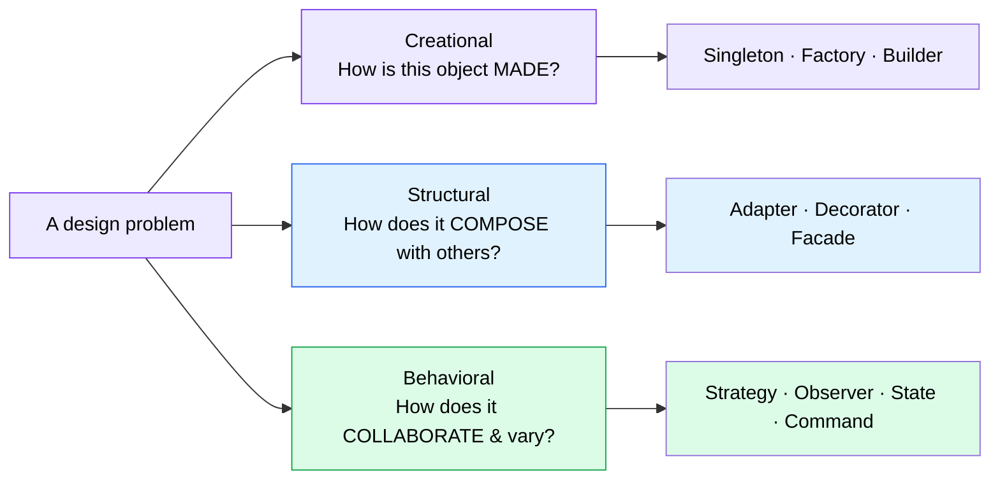
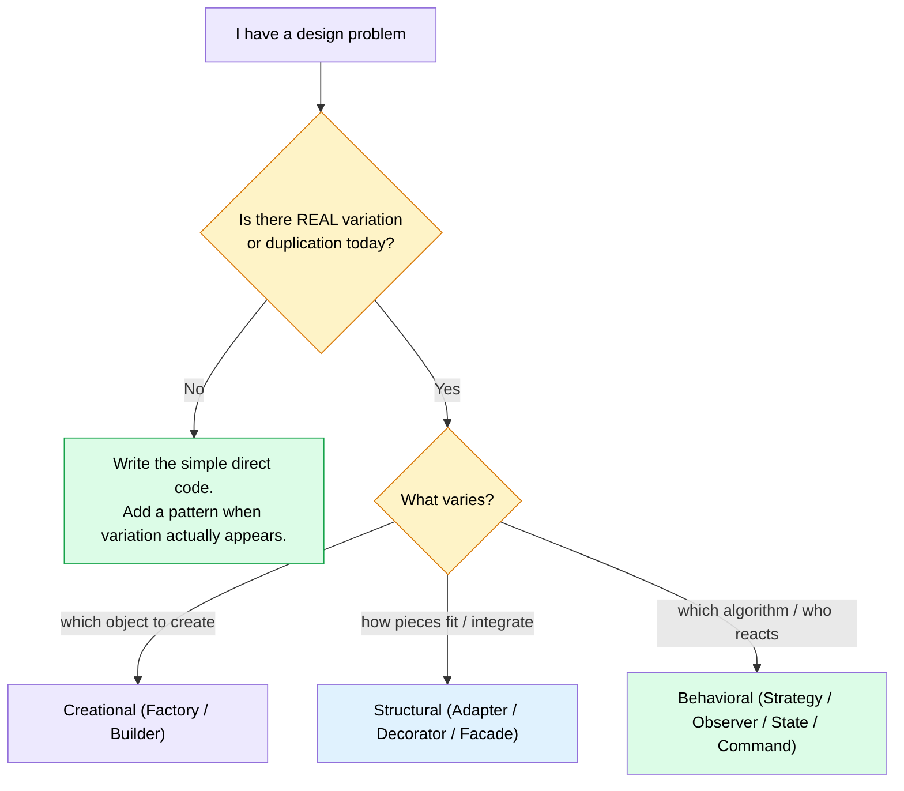
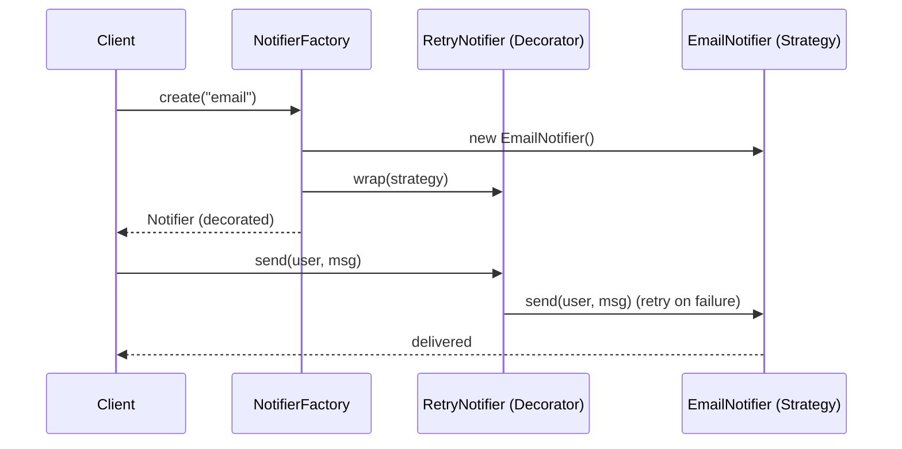
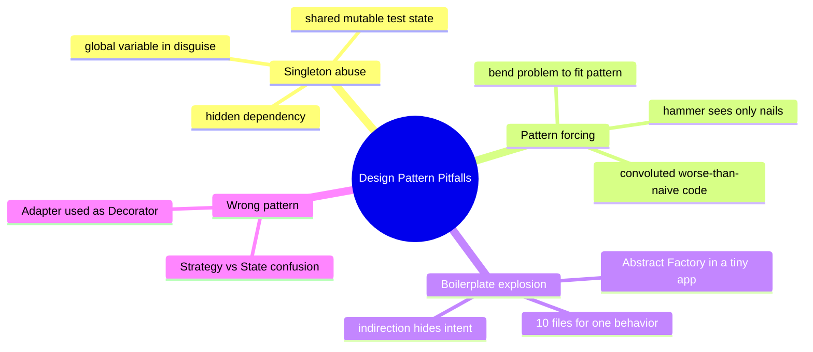

# Design Patterns Overview

> **One line:** Design patterns are the tried-and-tested "recipes" for recurring object-oriented problems — a shared vocabulary that lets you say "use a Strategy here" and have every engineer in the room instantly picture the same design.

---

## Table of Contents
1. [Why You Must Master This](#1-why-you-must-master-this)
2. [The Mental Model](#2-the-mental-model)
3. [Creational Patterns — How Objects Are Made](#3-creational-patterns--how-objects-are-made)
4. [Structural Patterns — How Objects Compose](#4-structural-patterns--how-objects-compose)
5. [Behavioral Patterns — How Objects Collaborate](#5-behavioral-patterns--how-objects-collaborate)
6. [Pattern Selection & Anti-Patterns](#6-pattern-selection--anti-patterns)
7. [Worked Example — A Notification System](#7-worked-example--a-notification-system)
8. [Real-Life Use Cases](#8-real-life-use-cases)
9. [Failure Modes](#9-failure-modes)
10. [🏋️ Practice Drills](#-practice-drills)
11. [🎤 Interview Q&A Bank](#-interview-qa-bank)
12. [🎯 Staff+ Nuances](#-staff-nuances)
13. [Cheat Sheet](#13-cheat-sheet)
14. [Connections & Further Reading](#14-connections--further-reading)

---

## 1. Why You Must Master This

Most software problems are not new — "swap this algorithm at runtime," "make this old API fit my new code" — and the good solutions have been catalogued for decades. Patterns let you inherit that experience instead of re-deriving it (badly) under deadline.

- **The shared vocabulary** — "wrap it in a Decorator" communicates an entire design in three words, compressing review, whiteboarding, and onboarding.
- **Flexibility where you need it** — patterns isolate the part that changes (payment method, export format, channel) so a new variant doesn't ripple through untouched code. The Open/Closed Principle made concrete.
- **They actualize SOLID** — Strategy *is* dependency inversion; Decorator *is* open/closed; Facade *is* interface segregation. See [SOLID_Principles.md](./SOLID_Principles.md).
- **Interview table stakes** — you'll be asked to name a pattern per category and justify a choice; LLD rounds silently grade whether your class design *is* a known pattern even when nobody names it.

> **The core problem it solves:** how to structure changing code so variation is absorbed at a *single, named seam* instead of leaking into every caller — turning "big ball of mud" refactors into "add one new class."

---

## 2. The Mental Model

Design patterns are **blueprints and recipes**, not finished code. A blueprint for a spiral staircase tells you the shape of the solution; you still cut the wood for *your* house. Likewise a Strategy pattern tells you "put the varying algorithm behind an interface and inject it" — you supply the actual algorithms. You never copy-paste a pattern; you *recognize* the situation and apply the recipe.

Crucially, the three GoF families answer three different questions about an object's life:





The rest of this note walks the three families, then the discipline that matters more than any single pattern: **knowing when *not* to reach for one.**

---

## 3. Creational Patterns — How Objects Are Made

Creational patterns decouple *what* you get from *how* it's constructed. The caller asks for an object; the pattern hides which concrete class, how many, and with what setup.

| Pattern | Problem it solves | One-line example |
|---------|-------------------|------------------|
| **Singleton** | Exactly one shared instance, globally reachable | App config, a connection pool, a logger |
| **Factory Method** | Choose the concrete class at runtime without `if/elif` at every call site | `PaymentGateway.create("stripe")` returns a `StripeGateway` |
| **Builder** | Construct a complex object step by step; avoid a 12-argument constructor | `Pizza.builder().cheese().pepperoni().build()` |

**Singleton** guarantees one instance and a global access point. It is the most abused pattern — a Singleton is a global variable in a nice suit, and globals wreck testability. Use it only for genuinely-single resources (a metrics registry), and prefer *injecting* that single instance over reaching for a global accessor.

**Factory** centralizes the `new` decision. Instead of every call site doing `if type == "stripe": StripeGateway() elif ...`, one factory owns that switch. Add a new gateway → change one file. This is the pattern that most often pairs with Strategy (the factory *builds* the strategy).

**Builder** replaces telescoping constructors and half-built objects with a fluent, readable assembly, and can enforce required fields before `build()`.

```python
# --- Builder: assemble a complex object step by step, readably ---
class RequestBuilder:
    def __init__(self, url: str) -> None:
        self._req = {"url": url, "method": "GET", "headers": {}, "body": None}

    def method(self, m: str) -> "RequestBuilder":
        self._req["method"] = m
        return self                          # return self → fluent chaining

    def header(self, k: str, v: str) -> "RequestBuilder":
        self._req["headers"][k] = v
        return self

    def json(self, payload: str) -> "RequestBuilder":
        self._req["body"] = payload
        self._req["headers"]["Content-Type"] = "application/json"
        return self

    def build(self) -> dict:
        return self._req

req = (RequestBuilder("https://api.example.com/pay")
       .method("POST").header("Authorization", "Bearer xyz")
       .json('{"amount": 4200}').build())
```

> A telling smell: if your class has a constructor with more than ~4 parameters (especially optional ones), reach for a Builder. If your code has the same `if type == ...: new X()` switch in three places, reach for a Factory.

---

## 4. Structural Patterns — How Objects Compose

Structural patterns are about *composition*: assembling objects and classes into larger structures while keeping them flexible. They answer "how do I make these pieces fit together without welding them?"

| Pattern | Problem it solves | One-line example |
|---------|-------------------|------------------|
| **Adapter** | Make an incompatible interface usable without changing either side | Wrap a legacy `XmlParser` so it satisfies your `JsonParser` interface |
| **Decorator** | Add responsibilities to an object dynamically, without subclass explosion | `Compressed(Encrypted(FileStream))` — stack behaviors |
| **Facade** | Provide one simple entry point over a complex subsystem | `VideoConverter.convert(f, "mp4")` hides codecs, audio, muxing |

**Adapter** is the "power plug converter": your code expects interface A, a third-party library speaks interface B, and the adapter translates so neither changes. It's how you integrate legacy or vendor code behind a clean seam — see [Interface_Design.md](./Interface_Design.md).

**Decorator** wraps an object in another of the same interface, adding behavior. Because each wrapper *is* the interface, you can stack them (`Logging(RateLimited(RealService))`) in any order — dodging the combinatorial subclass explosion. Python's `@decorator` syntax is a language-level cousin.

**Facade** offers a convenient front door for the common case while leaving the subsystem reachable. A `payments.charge(card, amount)` facade hides fraud checks, currency conversion, and gateway selection behind one call.

```python
from typing import Protocol

# --- Adapter: make a vendor SDK satisfy OUR interface ---
class Notifier(Protocol):                 # the interface OUR code depends on
    def send(self, to: str, msg: str) -> None: ...

class TwilioSDK:                          # third-party — we cannot change it
    def send_sms(self, number: str, text: str, sender: str) -> None:
        print(f"[twilio] {sender} -> {number}: {text}")

class TwilioAdapter:                      # translates OUR interface -> theirs
    def __init__(self, sdk: TwilioSDK, sender: str) -> None:
        self._sdk, self._sender = sdk, sender

    def send(self, to: str, msg: str) -> None:
        self._sdk.send_sms(to, msg, self._sender)   # adapt the call shape

# --- Decorator: add retry behavior around ANY Notifier, transparently ---
class RetryNotifier:
    def __init__(self, inner: Notifier, attempts: int = 3) -> None:
        self._inner, self._attempts = inner, attempts

    def send(self, to: str, msg: str) -> None:
        for i in range(self._attempts):
            try:
                return self._inner.send(to, msg)
            except Exception:
                if i == self._attempts - 1:
                    raise

notifier: Notifier = RetryNotifier(TwilioAdapter(TwilioSDK(), sender="ACME"))
notifier.send("+15551234", "Your order shipped")   # retry wraps adapter wraps SDK
```

> Rule of thumb: **Adapter** changes an interface, **Decorator** adds behavior to the *same* interface, **Facade** simplifies an interface. All three are "wrap something," but for different reasons.

---

## 5. Behavioral Patterns — How Objects Collaborate

Behavioral patterns govern communication and responsibility between objects — who does what, and how the "what" can vary. This is the richest, most interview-relevant family.

| Pattern | Problem it solves | One-line example |
|---------|-------------------|------------------|
| **Strategy** | Swap one algorithm for another at runtime | Pick a discount / routing / compression algorithm |
| **Observer** | Notify many dependents automatically when one thing changes | Followers get notified when someone posts |
| **State** | Change an object's behavior when its internal state changes | An order behaves differently when `Paid` vs `Shipped` |
| **Command** | Wrap a request as an object (to queue, log, undo, redo) | Editor undo stack; job queue tasks |

**Observer** is publish/subscribe at the object level: a *Subject* keeps a list of *Observers* and calls them on change, never needing to know who is listening. When you "follow" someone, you register as an observer; their post notifies all of you. It decouples the emitter from the reactors.

**State** puts each state's behavior in its own class and delegates to the current one. Instead of a giant `if self.status == "shipped"` in every method, an `Order` holds a `state` object and forwards to it — adding a state means adding a class. It's the OO twin of a [State_Machines.md](./State_Machines.md) diagram.

**Command** turns "do X" into a first-class object with `execute()` (and often `undo()`). Because the request is an object, you can queue, log, schedule, or reverse it — the backbone of undo stacks, task queues, and transactional replay.

### Worked in full — Strategy

Strategy is the canonical behavioral pattern: pull the varying algorithm behind an interface, inject the concrete one, and the context stays closed to modification while open to new strategies.

```python
from abc import ABC, abstractmethod

# 1. The strategy interface — the ONE seam where behavior varies
class ShippingStrategy(ABC):
    @abstractmethod
    def cost(self, weight_kg: float) -> float: ...

# 2. Interchangeable concrete strategies — each self-contained
class StandardShipping(ShippingStrategy):
    def cost(self, weight_kg: float) -> float:
        return 5.0 + 1.5 * weight_kg

class ExpressShipping(ShippingStrategy):
    def cost(self, weight_kg: float) -> float:
        return 12.0 + 3.0 * weight_kg

class FreeShipping(ShippingStrategy):
    def cost(self, weight_kg: float) -> float:
        return 0.0

# 3. The context depends on the INTERFACE, never the concrete class
class Order:
    def __init__(self, weight_kg: float, shipping: ShippingStrategy) -> None:
        self.weight_kg = weight_kg
        self._shipping = shipping        # injected → dependency inversion

    def set_shipping(self, shipping: ShippingStrategy) -> None:
        self._shipping = shipping        # swap the algorithm at RUNTIME

    def total(self, subtotal: float) -> float:
        return subtotal + self._shipping.cost(self.weight_kg)

order = Order(weight_kg=2.0, shipping=StandardShipping())
print(order.total(100))                  # 108.0
order.set_shipping(ExpressShipping())    # promoted to express mid-checkout
print(order.total(100))                  # 118.0
order.set_shipping(FreeShipping())       # loyalty perk applied
print(order.total(100))                  # 100.0
```

The payoff: adding "same-day shipping" means writing *one new class* — `Order` never changes. Every `if shipping_type == ...` conditional that would otherwise spread across the codebase collapses into a single injected object. That is the Open/Closed Principle, delivered.

> Strategy vs State: they share a skeleton (delegate to a swappable object), but intent differs — Strategy is chosen *by the client* and the alternatives are independent; State *transitions itself* and the states know about each other.

---

## 6. Pattern Selection & Anti-Patterns

The hard skill isn't memorizing patterns — it's resisting them. A pattern is justified only when it absorbs *real, existing variation*. Applied speculatively, it's pure cost: indirection to read, files to navigate, ceremony to maintain.



The three deadly anti-patterns of pattern *use*:

- **Over-engineering** — the "if all you have is a hammer" trap. Three patterns in a 10-line script add layers of indirection that hide, not clarify, intent. The cost of a pattern is paid up front and forever; only spend it for variation that exists.
- **Singleton abuse** — reaching for a Singleton to avoid passing a reference. You've created a hidden global dependency that makes unit tests share mutable state and run order-dependent. Prefer dependency injection ([Dependency_Injection.md](./Dependency_Injection.md)).
- **Pattern forcing / blindness** — bending a problem to fit a pattern it doesn't match (or seeing every problem as the one pattern you just learned). The result is convoluted code that's *harder* to follow than the naive version.

> The mature move is often to *not* use a pattern — or to use the language's built-in facility (Python decorators, first-class functions as strategies, context managers) instead of a full class hierarchy.

---

## 7. Worked Example — A Notification System

Scenario: send notifications over several channels (email, SMS, push), pick the channel at runtime from user preferences, and layer retry on transparently. This combines **Factory** (pick the channel) + **Strategy** (the channel *is* the algorithm) + **Decorator** (retry) — the everyday reality that patterns collaborate.



```python
# Notifier = Strategy interface; EmailNotifier/SmsNotifier = concrete strategies
# RetryNotifier = Decorator (see §4); NotifierFactory selects + decorates

class NotifierFactory:                          # Factory picks the Strategy
    _registry = {"email": EmailNotifier, "sms": SmsNotifier}

    @classmethod
    def create(cls, channel: str) -> Notifier:
        strategy = cls._registry[channel]()     # choose concrete strategy
        return RetryNotifier(strategy)          # wrap with retry (Decorator)

notifier = NotifierFactory.create("email")      # runtime choice from prefs
notifier.send("ada@example.com", "Welcome!")
```

Concept → consequence: because the channel lives behind the `Notifier` interface, **adding a Slack channel is one class plus one registry line** — the factory, the retry decorator, and every caller are untouched. The variation (which channel) is absorbed at exactly one named seam.

---

## 8. Real-Life Use Cases

| Real system | Pattern in play |
|-------------|-----------------|
| **Python `logging`, DB connection pools** | Singleton (one shared logger/pool per process) |
| **`java.util.Collections.sort(list, comparator)`** | Strategy (the comparator is the injected algorithm) |
| **Twitter / Instagram "follow"** | Observer (followers notified on new posts) |
| **Java I/O `new BufferedReader(new FileReader(f))`** | Decorator (buffering wraps the raw reader) |
| **Stripe / AWS SDK client objects** | Facade (one client hides dozens of HTTP endpoints) |
| **React `useReducer`, Redux** | Command (actions are request objects); State (reducer transitions) |
| **ORM `Session`/`EntityManager`** | Facade over the persistence subsystem |
| **Payment gateway abstraction** | Factory (`create(provider)`) + Strategy (per-provider charge logic) |
| **A vending machine / TCP connection** | State (behavior differs by `Idle`/`Connected`/`Closed`) |

> Real-world habit: **when you feel a growing `if/elif` on a "type" or "mode," that's a pattern knocking** — usually Strategy or Factory. Name the seam before the conditional metastasizes across the codebase.

---

## 9. Failure Modes



- **Singleton abuse** — *symptom:* tests pass alone but fail together, or need careful ordering. *Fix:* inject the single instance as a dependency; reserve true Singletons for genuinely-single resources.
- **Pattern forcing / blindness** — *symptom:* the "pattern" version is harder to read than the naive one; reviewers can't follow the indirection. *Fix:* delete the pattern; write the direct code; add a seam only when a second variant actually arrives.
- **Boilerplate explosion** — *symptom:* five interfaces and factories to deliver one behavior in a small program. *Fix:* collapse to a function or the language's built-in facility (first-class functions, `@decorator`, context managers) until scale justifies the ceremony.
- **Wrong pattern chosen** — *symptom:* Strategy where the object should transition itself (that's State), or a Decorator used to convert an interface (that's Adapter). *Fix:* match intent, not shape — the skeletons rhyme but the purposes differ.

---

## 🏋️ Practice Drills

> *Cover the solutions and attempt first — active recall is the point.*

**Drill 1 — Which pattern?** Your checkout code has grown a `if payment == "card": ... elif payment == "paypal": ... elif payment == "crypto": ...` block that's now duplicated in three methods. Which pattern, and what's the payoff?

<details><summary>Solution</summary>

**Strategy** (often paired with a **Factory** to pick it). Pull each payment method behind a `PaymentMethod` interface with a `charge()` method; inject the chosen one. The triplicated conditional collapses to a single injected object, and adding "Apple Pay" becomes one new class — the checkout code never changes (Open/Closed).
</details>

**Drill 2 — Which pattern?** You must integrate a third-party analytics SDK whose method is `track(eventName, propsJson)`, but your whole app already calls an internal `Analytics.log(event, props: dict)` interface. You can't modify the SDK. Which pattern?

<details><summary>Solution</summary>

**Adapter.** Write an `SdkAnalyticsAdapter` that implements your `Analytics` interface and, inside `log()`, serializes `props` to JSON and calls the SDK's `track()`. Your app keeps depending on its own interface; only the adapter knows the vendor's shape. Swapping vendors later means swapping one adapter.
</details>

**Drill 3 — Spot the anti-pattern.** A junior makes the app's `Config` a Singleton, then the `Cache`, then the `UserSession`, "so we don't have to pass them around." Integration tests start failing intermittently. Diagnose and fix.

<details><summary>Solution</summary>

**Singleton abuse** — three global mutable objects shared across tests, so one test's writes leak into another (order-dependent, intermittent failures). `UserSession` as a global is especially wrong (it's per-request state). Fix: use **dependency injection** — construct these and pass them in; keep at most genuinely-single infrastructure (a connection pool) as a Singleton, and even then inject it.
</details>

**Drill 4 — Which pattern?** An order object must behave differently depending on whether it's `Pending`, `Paid`, `Shipped`, or `Cancelled` — e.g., `cancel()` is allowed in `Pending`/`Paid` but not `Shipped`. Right now every method is a big `if self.status == ...`. Which pattern?

<details><summary>Solution</summary>

**State.** Give `Order` a `state` object (`PendingState`, `PaidState`, …) and delegate methods to it; each state class enforces its own allowed transitions and raises otherwise. Adding a `Returned` state becomes one new class instead of a new branch in every method. It mirrors the [State_Machines.md](./State_Machines.md) diagram directly. (If the algorithm were chosen by the client rather than self-transitioning, it'd be Strategy instead.)
</details>

---

## 🎤 Interview Q&A Bank

**Q1. What are the three categories of GoF patterns?**
> Creational (how objects are made — Singleton, Factory, Builder), Structural (how they compose — Adapter, Decorator, Facade), Behavioral (how they collaborate and vary — Strategy, Observer, State, Command). The split maps to three questions: made, composed, collaborating. *(signal: taxonomy fluency)*

**Q2. Explain the Strategy pattern and when you'd use it.**
> Put a varying algorithm behind an interface and inject the concrete one, so the context is closed to modification but open to new algorithms. Use it for any runtime "which algorithm" choice — shipping cost, compression, sort, discount — especially when a `type`-based conditional is spreading. *(signal: Open/Closed in practice)*

**Q3. Strategy vs State — what's the difference?**
> Same skeleton (delegate to a swappable object), different intent. Strategy's alternatives are independent and chosen by the client; State's objects know each other and *transition themselves*. Object flips its own behavior over its lifecycle → State; caller picks the algorithm → Strategy. *(signal: intent over shape)*

**Q4. Why is Singleton controversial?**
> It's a global variable with encapsulation lipstick: hidden dependencies, shared mutable state that breaks test isolation, hard-to-mock coupling. Justified only for genuinely-single resources — and even then, inject the instance rather than reach for a global accessor. *(signal: knows the trade-off)*

**Q5. Adapter vs Decorator vs Facade — all wrap something. Distinguish them.**
> Adapter *changes* an interface (make B look like A); Decorator *adds* behavior on the *same* interface (so wrappers stack); Facade *simplifies* — one entry point over a complex subsystem. One mechanism, three intents. *(signal: precision under a common mechanism)*

**Q6. How do patterns relate to SOLID?**
> Patterns are SOLID actualized. Strategy/Factory realize Dependency Inversion and Open/Closed; Decorator is Open/Closed; Facade/Adapter support Interface Segregation. SOLID is the "why," patterns the "how." See [SOLID_Principles.md](./SOLID_Principles.md). *(signal: principles → practice)*

**Q7. When should you NOT use a design pattern?**
> When there's no real variation to absorb. A pattern trades simplicity now for flexibility later; if the flexibility never materializes, you paid indirection cost for nothing. Ten-line scripts and speculative "we might need it" cases stay direct — over-engineering is the most common pattern mistake. *(signal: judgment)*

**Q8. Tell me about a pattern you used and why.**
> Name the *forcing function*: "Payment logic branched on provider in three places, so I introduced a `PaymentStrategy` interface with a factory — adding a provider went from touching five files to writing one class." Concrete problem → pattern → measurable payoff. *(signal: real experience)*

---

## 🎯 Staff+ Nuances

- **Patterns are a vocabulary, not a checklist.** Their highest value is *communication* — compressing a design into a shared word. Chasing "how many patterns can I use" inverts the point; aim for the simplest design that names its seams clearly. See [Object_Oriented_Design.md](./Object_Oriented_Design.md).
- **Most GoF patterns are workarounds for missing language features.** With first-class functions, "Strategy" is just passing a function and "Command" is a closure; Python's `@decorator` and context managers subsume the class-based Decorator. Reach for the language facility before the class hierarchy.
- **Prefer composition over inheritance — it's why Strategy/Decorator win.** Inheritance bakes variation in at compile time and explodes combinatorially (`LoggedRetryingCachedService`); composition assembles behavior at runtime, orthogonally. A looming subclass explosion is the signal to compose instead.
- **Dependency Injection is the delivery mechanism for behavioral patterns.** Strategy, Observer, and State all *inject* the collaborator rather than construct it — which is exactly what makes them testable (swap in a fake). See [Dependency_Injection.md](./Dependency_Injection.md).
- **Patterns scale up into architecture.** Observer becomes an event bus / Kafka; Strategy becomes plugins and feature flags; Facade becomes the API Gateway; Adapter becomes the ports-and-adapters (hexagonal) boundary. The intents are identical at both zoom levels.
- **The State pattern and a formal state machine are the same idea, two notations.** A State-pattern hierarchy *is* an executable state diagram; keeping them in sync prevents drift where the diagram allows what the code forbids. See [State_Machines.md](./State_Machines.md).
- **Name anti-patterns as explicitly as patterns.** God Object, Singleton-as-global, anemic model, and "pattern soup" are recurring negative recipes; naming them in review gives the team a shared way to push back on complexity. See [Domain_Driven_Design.md](./Domain_Driven_Design.md).

---

## 13. Cheat Sheet

```
GoF PATTERNS = named recipes for recurring OO problems. A shared vocabulary.
Three families answer three questions about an object:

CREATIONAL — how is it MADE?
  Singleton  one shared instance          (config, pool, logger)  ⚠ most abused = global
  Factory    pick concrete class at runtime (create("stripe"))    kills type-conditionals
  Builder    step-by-step assembly          (fluent .build())      >4 ctor args? use this

STRUCTURAL — how does it COMPOSE?
  Adapter    CHANGE an interface (make B fit A)     legacy/vendor integration
  Decorator  ADD behavior, SAME interface (stackable)  Retry(Cache(RealService))
  Facade     SIMPLIFY — one front door over a subsystem  (SDK clients)

BEHAVIORAL — how does it COLLABORATE / vary?
  Strategy   swap ALGORITHM at runtime (client picks)   ← do this one in full
  Observer   notify subscribers on change              pub/sub, "follow"
  State      behavior varies by state (self-transitions)  order lifecycle
  Command    request-as-object (queue/log/undo/redo)   undo stacks, job queues

DECISION: real variation TODAY? no → write direct code.  yes → what varies?
  which object to create → Creational · how pieces fit → Structural · which algo/who reacts → Behavioral

STRATEGY vs STATE:  client picks & independent = Strategy · self-transitions & aware = State
ADAPTER vs DECORATOR vs FACADE:  change · add(same iface) · simplify

ANTI-PATTERNS  singleton-as-global · pattern forcing (hammer/nail) · boilerplate explosion
RULE: a pattern trades simplicity NOW for flexibility LATER — only pay it for variation that EXISTS.
PATTERNS ACTUALIZE SOLID.  Prefer composition > inheritance.  Prefer language facility > class hierarchy.
```

---

## 14. Connections & Further Reading

**Within this repo:**
- [SOLID_Principles.md](./SOLID_Principles.md) — the principles patterns actualize (Strategy = DIP/OCP).
- [Interface_Design.md](./Interface_Design.md) — the clean seams Strategy and Adapter depend on.
- [State_Machines.md](./State_Machines.md) — the State pattern is an executable state diagram.
- [Dependency_Injection.md](./Dependency_Injection.md) — how behavioral patterns get their collaborators (and stay testable).
- [Object_Oriented_Design.md](./Object_Oriented_Design.md) — composition over inheritance, the foundation most patterns rest on.
- [Domain_Driven_Design.md](./Domain_Driven_Design.md) — where patterns meet domain modeling and where anti-patterns (anemic model) live.

**External classics:**
- *Design Patterns: Elements of Reusable Object-Oriented Software* (Gamma, Helm, Johnson, Vlissides — the "Gang of Four").
- *Head First Design Patterns* (Freeman &amp; Robson) — the approachable, example-driven introduction.
- [Refactoring.Guru — Design Patterns](https://refactoring.guru/design-patterns) — the best visual catalog on the web · [SourceMaking](https://sourcemaking.com/design_patterns).

---

## TL;DR
Design patterns are **named, reusable recipes** for recurring object-oriented problems, split into three families by the question they answer: **Creational** (how objects are made — Singleton, Factory, Builder), **Structural** (how they compose — Adapter, Decorator, Facade), and **Behavioral** (how they collaborate and vary — Strategy, Observer, State, Command). Master **Strategy** as the archetype — pull varying behavior behind an interface and inject it, so new variants are one new class. But the load-bearing skill is **restraint**: a pattern trades simplicity now for flexibility later, so **only reach for one when real variation already exists** — over-engineering, Singleton-as-global, and pattern-forcing are the failures that hurt more than the naive code ever would.
