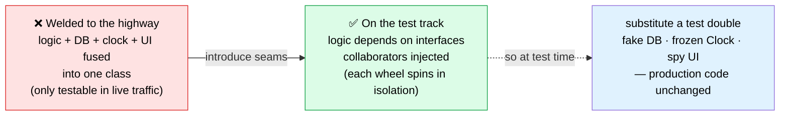
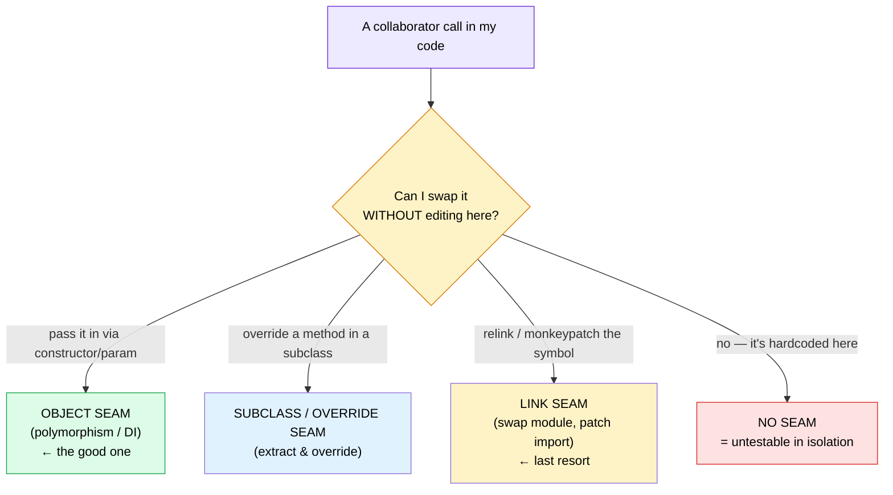
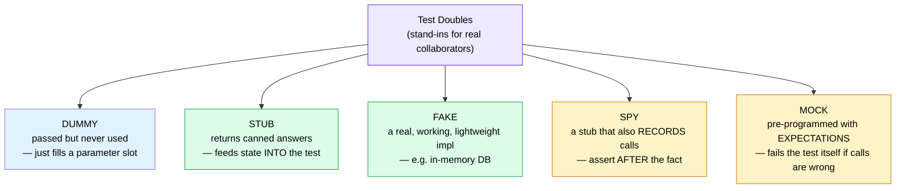
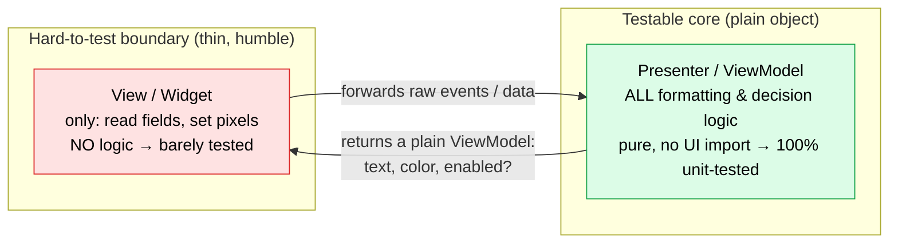
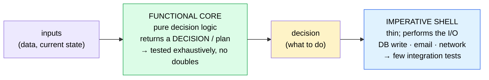
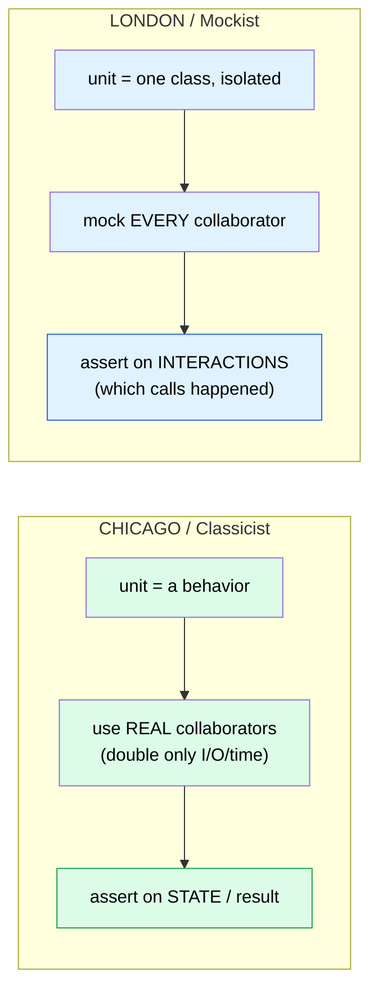
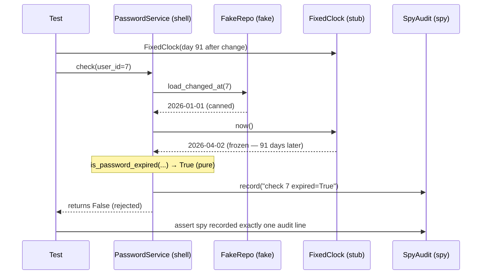

# Designing for Testability

> **One line:** Code that is hard to test is not "hard to test" — it is *badly designed*, and testability is just the fast, honest feedback signal that tells you so before your users do.

---

## Table of Contents
1. [Why You Must Master This](#1-why-you-must-master-this)
2. [The Mental Model](#2-the-mental-model)
3. [Seams — Where You Can Change Behavior Without Editing Code](#3-seams--where-you-can-change-behavior-without-editing-code)
4. [The Test-Double Taxonomy — Dummy, Stub, Fake, Spy, Mock](#4-the-test-double-taxonomy--dummy-stub-fake-spy-mock)
5. [Dependency Injection — The Enabler of Substitution](#5-dependency-injection--the-enabler-of-substitution)
6. [The Humble Object Pattern — Drain Logic Out of Untestable Boundaries](#6-the-humble-object-pattern--drain-logic-out-of-untestable-boundaries)
7. [Pure Functions & Isolating Side Effects](#7-pure-functions--isolating-side-effects)
8. [Untestable Constructs — Statics, Singletons, `new`, Time & Random](#8-untestable-constructs--statics-singletons-new-time--random)
9. [London vs Chicago — Mockist vs Classicist TDD](#9-london-vs-chicago--mockist-vs-classicist-tdd)
10. [Worked Example — Making a Time-Dependent Password-Expiry Service Testable](#10-worked-example--making-a-time-dependent-password-expiry-service-testable)
11. [Real-Life Use Cases](#11-real-life-use-cases)
12. [Failure Modes](#12-failure-modes)
13. [🏋️ Practice Drills](#-practice-drills)
14. [🎤 Interview Q&A Bank](#-interview-qa-bank)
15. [🎯 Staff+ Nuances](#-staff-nuances)
16. [Cheat Sheet](#16-cheat-sheet)
17. [Connections & Further Reading](#17-connections--further-reading)

---

## 1. Why You Must Master This

Testability is the cheapest, most brutally honest design review you will ever get. Long before an architect can articulate *why* a class is badly coupled, the difficulty of writing a unit test for it screams the answer. Learning to *design for* testability means learning to hear that scream at the keyboard instead of in a post-mortem.

- **"Hard to test" is a design diagnosis, not a testing problem.** When you must spin up Postgres, a message broker, and wait for `Thread.sleep(2000)` just to assert one branch, the code is telling you its logic is welded to its I/O. The fix is never "write a cleverer test" — it is *change the design*. Michael Feathers built an entire book (*Working Effectively with Legacy Code*) on this single insight.
- **Untestable code is a compounding tax.** A class you cannot unit-test only gets exercised in slow, flaky integration or end-to-end tests. Those tests are expensive to run, break for unrelated reasons, and get disabled under deadline — so the branch silently rots until it fails in production. The classic incident-class: a leap-year / timezone bug in date logic that *could not* be unit-tested because the code called `datetime.now()` directly.
- **It is the mechanical reason DI, interfaces, and SOLID exist.** Every technique in this file — seams, injection, Humble Object, pure functions — is really "make the behavior substitutable so a test can observe it." Testability is where the abstract principles in [SOLID_Principles.md](./SOLID_Principles.md) cash out into something you can *feel*.
- **Interviewers use "how would you test this?" as an X-ray.** It instantly reveals whether a candidate's design has seams or is a monolith of hidden dependencies. The test-double taxonomy (dummy/stub/fake/spy/mock) is a perennial "do they actually know the vocabulary?" question.

> **The core problem it solves:** *hidden, non-substitutable dependencies.* A class that reaches out and grabs the clock, the database, or a global singleton has no place to stand a test double — so its logic can only be run one way, in one environment, with real side effects. Designing for testability means building in the *seam* up front.

**Prerequisites:** [Dependency_Injection.md](./Dependency_Injection.md) (the delivery mechanism for substitution) and [Interface_Design.md](./Interface_Design.md) (the contract a double satisfies). This file consolidates the testability threads scattered as side-notes across both and goes deeper.

---

## 2. The Mental Model

Think of your code as a **car on a test track versus a car welded to the highway.** A car designed for testing has *jack points* — deliberate, engineered places where a mechanic can lift a wheel off the ground and spin it in isolation without driving on a real road. A car with its wheels welded to the asphalt can only be "tested" by driving it in live traffic: slow, dangerous, and you can never reproduce the exact conditions that caused the skid.

Those jack points are **seams**. Designing for testability is the discipline of building the jack points *into the chassis* — so you can lift any component off its real, slow, side-effecting collaborators (database, network, clock, UI) and spin it against a controlled stand-in.



> **Hold onto this:** you do not "add tests" to code; you *design code that has somewhere to put a test double.* If there is nowhere to stand the double, that absence **is** the design flaw — the test difficulty is a symptom pointing straight at coupling.

---

## 3. Seams — Where You Can Change Behavior Without Editing Code

**What it is.** A **seam** is Michael Feathers' precise term (from *Working Effectively with Legacy Code*): *a place where you can alter behavior in your program without editing in that place.* Every seam has an **enabling point** — the place where you *choose* which behavior is active. The definition is deliberately mechanical: if there is no way to swap behavior without opening up and editing the code itself, there is no seam, and the code is untestable at that point.

**Why it exists / what breaks without it.** A unit test must do two things: put the object in a known state, and *observe* what it does. Both require the ability to substitute the object's collaborators — feed it a canned input, capture its output. Without a seam, the collaborator is hardcoded (`self.db = PostgresClient()`), so the only "input" is a real database and the only "output" is a real side effect. You cannot isolate the unit; you can only run the whole system.

**How it works — the kinds of seam.** A seam is any indirection you can redirect from the outside:



| Seam type | Enabling point | How you substitute | When you're stuck using it |
|-----------|----------------|--------------------|-----------------------------|
| **Object seam** | Constructor / method parameter | Pass a different object implementing the interface | The default — design for this |
| **Subclass seam** | Which subclass is instantiated | Subclass and override the method | Legacy code you can't restructure yet |
| **Link seam** | Build config, import path, monkeypatch | Swap the module/symbol at load time | Third-party statics you can't inject |

**The trade-off.** Object seams (via [Dependency_Injection.md](./Dependency_Injection.md)) are the cleanest: explicit, type-checked, visible in the signature. Link seams (Python's `unittest.mock.patch`, classpath swaps) require *no design change* — which is exactly why they're seductive and dangerous. Patching `datetime.now` works, but it's brittle (breaks when you refactor the import), it hides the dependency (nothing in the signature says "I need a clock"), and heavy reliance on it is a smell that you're papering over missing object seams. **Prefer building object seams in; reach for link seams only to get untestable legacy under test long enough to refactor it.**

**Real example.** Feathers' entire technique for legacy code is "find or create a seam, then sense behavior through it." The `patch()` decorator that pervades Python test suites is a link seam; the reason mature codebases have fewer `patch()` calls over time is that they migrate to object seams (inject the collaborator) as they clean up.

> Every seam is a decision you deferred to the caller. No seam means the decision is frozen into the code — and a frozen decision is one a test can never change.

---

## 4. The Test-Double Taxonomy — Dummy, Stub, Fake, Spy, Mock

**What it is.** "Test double" (Gerard Meszaros' umbrella term, by analogy with a stunt double) is *any* object that stands in for a real collaborator in a test. The classic interview trap is that people say "mock" for all five, but they are genuinely different tools with different jobs. The distinctions turn on **two axes**: does it provide *canned answers* (state) and does it *record and verify interactions* (behavior)?



**Why the distinction matters.** State verification (stub/fake) asks *"what is the result?"* Behavior verification (spy/mock) asks *"was the right call made?"* Choosing wrong couples your test to implementation detail (over-mocking) or fails to verify a side effect that produces no observable state (an email that was — or wasn't — sent). Knowing which double you need is knowing what you are actually asserting.

### The comparison table (memorize this one)

| Double | Provides canned answers? | Records / verifies calls? | Has real logic? | Purpose — what you're asserting | Canonical example |
|--------|:---:|:---:|:---:|---------------------------------|-------------------|
| **Dummy** | No | No | No | Nothing — just satisfies a required parameter | A `None`/placeholder `Logger` passed to a constructor that won't log in this test |
| **Stub** | **Yes** | No | No | *State*: "given this input, does my code produce the right result?" | `StubGateway.charge()` always returns `True` so you can test the happy path |
| **Fake** | Yes (computed) | No | **Yes (simplified)** | *State*, but with realistic behavior across many calls | `InMemoryRepository` backed by a `dict` instead of Postgres |
| **Spy** | Yes | **Yes (record, assert later)** | Sometimes | *Behavior*, loosely: "record what happened, I'll check afterward" | `SpyNotifier` that appends every message to a list you assert on |
| **Mock** | Yes | **Yes (expectations set up front)** | No | *Behavior*, strictly: "these exact calls must happen" — the mock **fails the test** | `mock.assert_called_once_with(42)`; unexpected call → test fails |

The crisp one-liners that win the interview:

- **Dummy** — *passed around but never actually used.* It only exists to fill a parameter list.
- **Stub** — *provides canned answers* to calls made during the test; it does not react to anything outside what's programmed in. Feeds *indirect input* to the code under test.
- **Fake** — *a working implementation*, but a shortcut unsuitable for production (an in-memory DB, an SQLite stand-in for Postgres). It has real behavior, just cheaper.
- **Spy** — *a stub that also records* how it was called, so you can assert on those records *after* the exercise phase. Verification is retrospective and lenient.
- **Mock** — *pre-loaded with expectations* about which calls it should receive; verification is built in and *up front*, so a wrong or missing call makes the mock itself fail the test.

```python
from abc import ABC, abstractmethod

class Gateway(ABC):
    @abstractmethod
    def charge(self, cents: int) -> bool: ...

# DUMMY — never called; just fills the slot so the object can be constructed
dummy_logger = object()          # code path under test won't touch it

# STUB — canned answer, feeds state into the test, records nothing
class StubGateway(Gateway):
    def charge(self, cents: int) -> bool:
        return True               # always "approved" → exercises the happy path

# FAKE — real (simplified) behavior: an in-memory store that actually works
class FakeAccountGateway(Gateway):
    def __init__(self, balance: int) -> None:
        self._balance = balance
    def charge(self, cents: int) -> bool:
        if cents > self._balance: # genuine logic, just not production-grade
            return False
        self._balance -= cents
        return True

# SPY — a stub that ALSO records calls; you assert on the log afterward
class SpyGateway(Gateway):
    def __init__(self) -> None:
        self.charges: list[int] = []
    def charge(self, cents: int) -> bool:
        self.charges.append(cents)     # record for later inspection
        return True

def test_with_spy() -> None:
    spy = SpyGateway()
    Checkout(spy).pay(4200)
    assert spy.charges == [4200]       # verify AFTER the fact (lenient)

# MOCK — expectations set UP FRONT; the mock fails the test if they're violated
from unittest.mock import create_autospec
def test_with_mock() -> None:
    mock = create_autospec(Gateway)
    mock.charge.return_value = True
    Checkout(mock).pay(4200)
    mock.charge.assert_called_once_with(4200)   # the MOCK enforces the contract
```

> The exam-grade summary: **dummy fills, stub answers, fake works, spy records, mock demands.** Stub/fake verify *state*; spy/mock verify *behavior*; and the mock is the only one that contains its own assertion.

---

## 5. Dependency Injection — The Enabler of Substitution

**What it is.** Every test double in §4 is useless unless you can get it *into* the object under test in place of the real collaborator. Dependency Injection is that delivery mechanism: the class receives its collaborators from outside (ideally through its constructor) instead of constructing them itself, so a test can hand it a double and production can hand it the real thing. This file treats DI only as *the testability enabler*; the full treatment lives in [Dependency_Injection.md](./Dependency_Injection.md).

**Why it exists / what breaks without it.** The injected constructor parameter *is the object seam* from §3. Without it, the collaborator is welded in and there is no seam to substitute:

```python
# ❌ NO SEAM — the real emailer is welded in; a unit test sends a REAL email
class OrderService:
    def __init__(self) -> None:
        self._mailer = SmtpMailer(host=PROD_SMTP)   # hardcoded → untestable
    def place(self, order) -> None:
        self._mailer.send(f"Order {order.id} placed")

# ✅ SEAM — the collaborator is injected; a test substitutes a double
class OrderService:
    def __init__(self, mailer: Mailer) -> None:      # object seam in the signature
        self._mailer = mailer
    def place(self, order) -> None:
        self._mailer.send(f"Order {order.id} placed")

def test_place_sends_confirmation() -> None:
    spy = SpyMailer()                # substitute the double through the seam
    OrderService(spy).place(Order(id=7))
    assert spy.sent == ["Order 7 placed"]   # fast, deterministic, no network
```

**The trade-off, and the deeper truth.** People frame DI as "extra boilerplate for testing." The reframe that matters at Staff+ level: *the boilerplate is the point.* A constructor that has to declare every collaborator makes hidden coupling *visible* — an eight-parameter constructor is a class doing too much (an SRP smell, see [Class_Design.md](./Class_Design.md)), and you learned that from the test setup being painful. **Test pain is a design smell detector.** When mocking a class requires ten lines of setup, the class is over-coupled; the fix is to split it, not to write a mocking-framework macro to hide the pain.

> The equation to internalize: **"is this testable?" ≈ "are its dependencies injected against interfaces?"** They are nearly the same question, which is why DI and testability are inseparable — see [Dependency_Injection.md](./Dependency_Injection.md) §6.

---

## 6. The Humble Object Pattern — Drain Logic Out of Untestable Boundaries

**What it is.** Some code lives at a boundary that is *inherently* hard to unit-test: a UI widget, a database gateway, a message-queue consumer, a thread's `run()` method, a hardware driver. The **Humble Object** pattern (Meszaros; central to Robert Martin's *Clean Architecture*) says: make that boundary object as *humble* — as dumb — as possible. Push every scrap of interesting logic out into a separate plain object that has *no* dependency on the boundary, and unit-test that plain object exhaustively. The humble object is left with so little behavior that it's "too simple to break," so you barely test it (or cover it with a few integration tests).

**Why it exists / what breaks without it.** You cannot easily unit-test "did the button turn red and the label update?" without a running GUI toolkit, an event loop, and screen-scraping. But you *can* trivially test "given account balance -5, does the presenter compute a red color and the string `-$5.00`?" if that decision lives in a plain `Presenter` object rather than inside the widget's paint handler. The pattern splits the *hard-to-test* (rendering) from the *worth-testing* (the logic that decides what to render).



**How it works — the mechanism.** The boundary object holds a reference to the humble-partner (the logic object) and does nothing but *translate*: it converts framework events into plain method calls, and converts the plain object's plain return values back into framework calls. All conditionals, calculations, and formatting live in the plain object.

```python
from dataclasses import dataclass

# --- The TESTABLE core: a plain object, zero UI/DB/thread dependencies ---
@dataclass(frozen=True)
class BalanceViewModel:      # a plain data result — trivially assertable
    text: str
    color: str
    warn: bool

class BalancePresenter:      # ALL the logic lives here — 100% unit-testable
    def present(self, cents: int) -> BalanceViewModel:
        dollars = cents / 100
        return BalanceViewModel(
            text=f"${dollars:,.2f}",
            color="red" if cents < 0 else "black",   # the decision worth testing
            warn=cents < 0,
        )

# --- The HUMBLE boundary: dumb translation only, hard to unit-test, but trivial ---
class BalanceWidget:                       # depends on a real GUI toolkit
    def __init__(self, presenter: BalancePresenter, toolkit) -> None:
        self._presenter, self._ui = presenter, toolkit
    def refresh(self, cents: int) -> None:
        vm = self._presenter.present(cents)          # delegate the thinking
        self._ui.set_label(vm.text)                  # ...then just push pixels
        self._ui.set_color(vm.color)

# The whole point: this test needs NO GUI, NO event loop, runs in microseconds
def test_negative_balance_is_red_and_warns() -> None:
    vm = BalancePresenter().present(-500)
    assert vm == BalanceViewModel(text="-$5.00", color="red", warn=True)
```

**The trade-off.** You pay one extra object and one layer of indirection. In exchange the *risk-bearing* logic becomes fast-testable and the untestable surface shrinks to near-zero. The pattern is only worth it when there *is* logic at the boundary; a genuinely logic-free view needs no presenter. **The whole family of MV* patterns — MVC, MVP, MVVM — is Humble Object applied to UI:** the View is humble, the Controller/Presenter/ViewModel is the tested core. The same move drains logic out of DB access objects (test the query-building/result-mapping as pure functions), thread bodies (put the work in a `Runnable`-like plain object, keep threading dumb), and hardware drivers.

> The habit: whenever logic sits inside something you can only test by *running the whole framework*, ask "what plain object could hold this decision instead?" — then leave the framework object humble.

---

## 7. Pure Functions & Isolating Side Effects

**What it is.** A **pure function** returns the same output for the same inputs and has *no side effects* (no I/O, no mutation of shared state, no reading the clock). Pure functions are the gold standard of testability: to test one you just call it and assert on the return value — no setup, no doubles, no teardown, no flakiness. The design goal is to **push side effects to the edges** and keep a large, pure core — the "functional core, imperative shell" architecture (Gary Bernhardt).

**Why it exists / what breaks without it.** Side effects are what make code hard to test: they require the world to be in a particular state and they change the world in ways you must then inspect and undo. A function that both *decides* (business logic) and *acts* (writes to the DB) forces every test of the decision to also confront the action. Separate them and the decision becomes a pure function you test a hundred ways in a millisecond, while the thin acting layer is covered by a few integration tests.



**How it works.** Instead of a method that computes *and* performs the action, split it: a pure method returns a *description* of what should happen, and a separate thin method carries it out.

```python
# ❌ MIXED — decision and side effect fused; testing the discount needs a real DB write
class Cart:
    def checkout(self, user_id: int) -> None:
        items = db.load_cart(user_id)                # side effect (read)
        total = sum(i.price for i in items)
        if total > 100_00:
            total = int(total * 0.9)                 # the LOGIC, buried in I/O
        db.save_invoice(user_id, total)              # side effect (write)
        email.send(user_id, f"You paid {total}")     # side effect (network)

# ✅ SEPARATED — a pure core you can test with plain values, no doubles at all
def compute_total(prices: list[int]) -> int:         # PURE: input → output, no I/O
    total = sum(prices)
    return int(total * 0.9) if total > 100_00 else total

def test_bulk_discount() -> None:                    # no DB, no mail, no mocks
    assert compute_total([60_00, 60_00]) == 108_00   # 120 → 10% off → 108
    assert compute_total([40_00]) == 40_00           # under threshold → unchanged

class CheckoutService:                               # thin imperative shell
    def __init__(self, db, email) -> None:
        self._db, self._email = db, email
    def checkout(self, user_id: int) -> None:
        prices = [i.price for i in self._db.load_cart(user_id)]
        total = compute_total(prices)                # delegate the thinking (pure)
        self._db.save_invoice(user_id, total)        # side effects isolated here
        self._email.send(user_id, f"You paid {total}")
```

**The trade-off.** Not everything can be pure — a program that never touches the outside world does nothing useful. The skill is *ratio*: maximize the pure core, minimize and isolate the impure shell. Over-purifying tiny scripts adds ceremony; under-purifying a rich domain leaves the valuable logic trapped behind I/O. **Real number:** a pure function test runs in microseconds and never flakes; an equivalent test that hits a real database is typically 100–1000× slower and orders of magnitude more likely to fail for reasons unrelated to your logic.

> The rule of thumb: **decisions should be pure; actions should be dumb.** If a function both decides and acts, that's the split point.

---

## 8. Untestable Constructs — Statics, Singletons, `new`, Time & Random

Certain constructs are testability poison precisely because they *destroy seams*. Learn to spot them; each has a specific antidote.

```mermaid
mindmap
  root((Untestable Constructs))
    Global / static state
      shared mutable state across tests
      order-dependent flaky failures
      antidote: inject an instance
    Singletons
      global variable in a suit
      hidden dependency, no seam
      antidote: DI the single instance
    new in the middle of logic
      welds a concrete collaborator
      no place for a double
      antidote: inject it (composition root)
    Hidden time
      now() / today() buried in logic
      cannot test expiry, timeouts, leap year
      antidote: inject a Clock
    Hidden randomness
      random() / uuid4() inline
      non-deterministic assertions
      antidote: inject a RandomSource / seed
```

**Static & global mutable state.** *Symptom:* tests pass alone but fail when run together, or depend on execution order. *Root cause:* a global that one test mutates leaks into the next — there is no per-test isolation because the state isn't owned by anyone. *Fix:* make the state an injected instance so each test gets a fresh one.

**Singletons.** *Symptom:* you can't substitute the collaborator; every test uses the one real instance. *Root cause:* a Singleton is a global variable in a nice suit — a hidden dependency reached via a global accessor, so there's no seam. *Fix:* keep at most genuinely-single *infrastructure* (a connection pool) and **inject that single instance** rather than reaching for `Logger.getInstance()`. See the Singleton-abuse discussion in [Design_Patterns_Overview.md](./Design_Patterns_Overview.md).

**`new` in the middle of logic.** *Symptom:* a business method contains `x = ConcreteThing()`; you can't replace `ConcreteThing` with a double. *Root cause:* construction is fused into logic, welding the class to that concrete. *Fix:* move construction to the composition root and inject the collaborator ([Dependency_Injection.md](./Dependency_Injection.md)). `new` belongs at the edges, not in the algorithm.

**Hidden time — inject a Clock.** *Symptom:* you cannot test "password expires after 90 days," "session times out," or the notorious leap-year / DST branch, because the code calls `datetime.now()` directly and you can't make "now" be any particular instant. *Root cause:* time is an *ambient* dependency pulled from a global, not injected. *Fix:* introduce a `Clock` interface, inject it, and in tests pass a `FixedClock`:

```python
from datetime import datetime, timedelta
from typing import Protocol

class Clock(Protocol):
    def now(self) -> datetime: ...

class SystemClock:                       # production: reads the real wall clock
    def now(self) -> datetime:
        return datetime.utcnow()

class FixedClock:                        # test double: time stands still where you set it
    def __init__(self, t: datetime) -> None:
        self._t = t
    def now(self) -> datetime:
        return self._t

class Session:
    def __init__(self, started: datetime, clock: Clock) -> None:
        self._started, self._clock = started, clock
    def is_expired(self, ttl: timedelta) -> bool:
        return self._clock.now() - self._started > ttl   # 'now' is injectable

def test_session_expiry_boundary() -> None:
    start = datetime(2026, 1, 1, 12, 0, 0)
    s = Session(start, clock=FixedClock(start + timedelta(minutes=30)))
    assert s.is_expired(ttl=timedelta(minutes=29)) is True    # deterministic!
    assert s.is_expired(ttl=timedelta(minutes=31)) is False   # no sleep(), no flake
```

**Hidden randomness.** *Symptom:* a test asserting on generated IDs or shuffled output is non-deterministic. *Root cause:* `random()` / `uuid4()` called inline. *Fix:* inject a `RandomSource` (or a seed) so the test can supply a deterministic sequence — the exact same seam pattern as the Clock.

> The unifying insight: **time, randomness, the database, and the current user are all just *dependencies* — and ambient dependencies (grabbed from a global) are the ones that can't be tested.** Every antidote above is the same move: turn an ambient dependency into an injected one so a seam appears.

---

## 9. London vs Chicago — Mockist vs Classicist TDD

**What it is.** Two schools of test-driven development that disagree on *how much to use mocks* and *what a "unit" is.* Naming them and stating the trade-off is a reliable Staff+ signal.

- **Chicago / Classicist / "Detroit" school** (Kent Beck, *TDD by Example*): a "unit" is a *behavior*, and a test exercises the object *together with its real collaborators*, using doubles only for awkward dependencies (I/O, network, time). Verification is **state-based**: call the code, assert on the resulting state or return value.
- **London / Mockist school** (*Growing Object-Oriented Software, Guided by Tests* — Freeman & Pryce): a "unit" is a *single class in total isolation*; every collaborator is replaced with a mock. Verification is **interaction-based**: assert that the object *called its collaborators correctly*. TDD becomes a *design* activity — mocking a not-yet-existing collaborator forces you to discover its interface ("need-driven design").



| Dimension | Chicago (Classicist) | London (Mockist) |
|-----------|----------------------|-------------------|
| **A "unit" is** | A behavior (object + real collaborators) | A single class in isolation |
| **Doubles used** | Sparingly — only for I/O / awkward deps | Everywhere — all collaborators mocked |
| **Verifies** | State / return value | Interactions (which calls were made) |
| **Refactor-resilience** | High — internal restructure keeps tests green | Lower — tests know call structure, break on refactor |
| **Design feedback** | Indirect | Direct — drives interfaces need-first |
| **Main risk** | Big tangled tests; slow if collaborators heavy | **Over-mocking** — tests coupled to implementation, green tests over broken integration |

**The trade-off — this is the whole point.** Mockist tests give sharp *design* pressure (you discover interfaces by mocking them) and pinpoint failure localization, but they **couple the test to the implementation's call structure**: refactor how the object collaborates and the tests break even though behavior is unchanged. Worse, all-mocked units can be individually green while the *integration* is broken, because every test asserts against your *assumption* of how the collaborator behaves, not the real thing. Classicist tests are refactor-resilient and catch integration bugs, but a failure points at "somewhere in this cluster" and heavy real collaborators slow things down.

**The pragmatic synthesis most senior engineers land on:** default to **state-based tests with real collaborators** (Chicago) for domain logic — they're refactor-proof and closest to "does it actually work." Reach for **mocks/spies (London)** specifically at *architectural boundaries* — the places where you legitimately need to verify *an interaction that produces no observable state* (an email was sent, an event was published, a payment gateway was called). Don't mock types you don't own; wrap them in your own interface and mock that.

> The one-liner: **Chicago tests what the code produces; London tests how the code collaborates.** Over-index on London and your tests calcify around implementation detail; the mature move is to verify state by default and interactions only at true boundaries.

---

## 10. Worked Example — Making a Time-Dependent Password-Expiry Service Testable

**Scenario.** A `PasswordService` must reject a login if the password is older than 90 days and log an audit event on every attempt. The first version is a textbook bundle of untestable constructs: hidden time, a hardcoded database, a singleton logger, and mixed decision-plus-side-effect. We'll walk it to fully testable.

```python
# ❌ VERSION 0 — untestable: every anti-pattern from §8 at once
class PasswordService:
    def check(self, user_id: int) -> bool:
        pw = Database.instance().load_password(user_id)     # singleton + I/O
        age = datetime.now() - pw.changed_at                # HIDDEN TIME
        expired = age > timedelta(days=90)                  # logic welded to I/O
        Logger.instance().audit(f"check {user_id} {expired}")  # singleton side effect
        return not expired
# To test the 90-day boundary you'd need a real DB row, and you can NEVER
# pin "now" to 89 vs 91 days after changed_at → the branch is untestable.
```

The three moves: **(1)** extract the decision into a pure function (§7); **(2)** inject the ambient dependencies — clock, repo, audit (§5, §8); **(3)** leave a thin shell that just wires I/O to the pure core (Humble Object, §6).

```python
from dataclasses import dataclass
from datetime import datetime, timedelta

# (1) PURE CORE — the decision, testable with plain values, zero doubles
def is_password_expired(changed_at: datetime, now: datetime,
                        max_age: timedelta = timedelta(days=90)) -> bool:
    return now - changed_at > max_age

# (2) SEAMS — interfaces for the ambient dependencies
class Clock(Protocol):
    def now(self) -> datetime: ...
class PasswordRepo(Protocol):
    def load_changed_at(self, user_id: int) -> datetime: ...
class Audit(Protocol):
    def record(self, msg: str) -> None: ...

# (3) HUMBLE SHELL — injected deps, delegates the decision, isolates side effects
class PasswordService:
    def __init__(self, repo: PasswordRepo, clock: Clock, audit: Audit) -> None:
        self._repo, self._clock, self._audit = repo, clock, audit
    def check(self, user_id: int) -> bool:
        changed_at = self._repo.load_changed_at(user_id)     # I/O at the edge
        expired = is_password_expired(changed_at, self._clock.now())  # pure decision
        self._audit.record(f"check {user_id} expired={expired}")      # side effect
        return not expired
```



```python
# The payoff: pin time to either side of the boundary, no DB, no clock, no flake
def test_expiry_boundary() -> None:
    changed = datetime(2026, 1, 1)
    # Pure function tested directly — the highest-value assertions, instant:
    assert is_password_expired(changed, changed + timedelta(days=91)) is True
    assert is_password_expired(changed, changed + timedelta(days=89)) is False

    # Shell tested with doubles: fake repo, frozen clock, spy audit
    repo, clock, audit = FakeRepo(changed), FixedClock(changed + timedelta(days=91)), SpyAudit()
    svc = PasswordService(repo, clock, audit)
    assert svc.check(user_id=7) is False              # expired → rejected
    assert audit.recorded == ["check 7 expired=True"] # side effect verified (spy)
```

**Concept → consequence.** By injecting the clock, the untestable *"90-day boundary"* becomes two one-line assertions at day 89 and day 91 — the exact edge case that, left as `datetime.now()`, ships the leap-year bug to production. The specific number that forced the redesign: **a test must be able to make "now" equal any instant**, and the only way to get that is a `Clock` seam. Everything else (fake repo, spy audit) follows from the same rule — turn every ambient dependency into an injected one.

---

## 11. Real-Life Use Cases

| Situation | How designing-for-testability applies | The decision it forces |
|-----------|----------------------------------------|------------------------|
| **Time-dependent logic** (expiry, TTL, rate limits, cron) | Inject a `Clock`; tests use a `FixedClock` | Never call `now()`/`today()` inside logic |
| **UI / mobile screens** | Humble View + tested Presenter/ViewModel (MVP/MVVM) | Put zero logic in the widget |
| **Payment / email / SMS** (side effect, no state) | Interface + spy/mock to verify the call happened | Wrap the vendor SDK behind your own interface |
| **Database-heavy service** | Repository interface + in-memory **fake**; pure query/mapping logic | Depend on `Repository`, not the driver ([Interface_Design.md](./Interface_Design.md)) |
| **Randomized behavior** (IDs, shuffling, sampling) | Inject a seeded `RandomSource` | No inline `random()`/`uuid4()` |
| **Background jobs / threads** | Put the work in a plain object; keep the thread body humble | Logic must not live inside `run()` |
| **Feature flags / A-B** | Inject the strategy per cohort | Branch by injected object, not `if flag` in logic |
| **Legacy code with no seams** | Find/create a seam (subclass or link) to get it under test, then refactor to object seams | Characterization tests before you change anything |

> Real-world habit: **before writing a class, ask "what's the first unit test I'd write for it?"** If the answer requires a database, the network, a real clock, or a GUI, you've found the seam you need to design in *now* — not after the code calcifies.

---

## 12. Failure Modes

```mermaid
mindmap
  root((Testability Pitfalls))
    Over-mocking
      tests mirror implementation
      green units, broken integration
      brittle to refactor
    Testing through the boundary
      spin up real DB/UI to test logic
      slow, flaky, disabled under deadline
    Mocking types you don't own
      lock in your ASSUMPTION of the SDK
      breaks silently when vendor changes
    Ambient dependencies
      now() random() singleton in logic
      no seam, non-deterministic
    Logic in the humble object
      decisions inside the widget/DAO
      the untestable surface grows
    Test-induced damage
      public setters/getters only for tests
      design warped to please the mock
```

- **Over-mocking (mockist gone wrong)** — *symptom:* every test passes but a release still breaks; tests fail on any refactor even when behavior is unchanged. *Root cause:* tests assert on *interactions* and mirror the implementation's call structure, and all-mocked units never exercise the real integration. *Fix:* verify **state with real collaborators** by default (Chicago); reserve mocks/spies for genuine boundaries (§9).
- **Testing logic *through* the boundary** — *symptom:* a suite that needs Postgres and a browser to test a discount calculation; slow and flaky, so it gets skipped. *Root cause:* the logic was never extracted from the I/O. *Fix:* pull the decision into a **pure function / plain object** (§6, §7) and test it directly.
- **Mocking types you don't own** — *symptom:* unit tests are green but the vendor SDK behaves differently in prod. *Root cause:* your mock encodes *your assumption* of the third-party API, which drifts from reality. *Fix:* wrap the SDK in your *own* interface (an Adapter), mock that, and cover the real SDK with a thin integration test.
- **Ambient dependencies** — *symptom:* non-deterministic or order-dependent test failures. *Root cause:* `now()`, `random()`, or a singleton reached inside logic — no seam. *Fix:* inject a `Clock` / `RandomSource` / instance (§8).
- **Logic leaking into the humble object** — *symptom:* the "humble" view/DAO grows conditionals and your untestable surface creeps back up. *Root cause:* discipline slipped; a decision was added at the boundary. *Fix:* move it back into the presenter/plain object; keep the boundary translation-only (§6).
- **Test-induced design damage** — *symptom:* public setters/getters or `@VisibleForTesting` hooks that exist *only* so a test can reach in. *Root cause:* forcing a bad design to be testable instead of fixing the design. *Fix:* if a test needs internal access, the responsibilities are wrong — split the class (see [Class_Design.md](./Class_Design.md)); good testability comes from good seams, not from prying holes.

---

## 🏋️ Practice Drills

> *Cover the solutions and attempt first — active recall is the point.*

**Drill 1 — Name the double.** For each, name which of the five test doubles it is: (a) an `InMemoryUserRepo` backed by a `dict`; (b) a `charge()` that always returns `True`; (c) an object recording every `send()` into a list you assert on afterward; (d) `mock.assert_called_once_with(42)`; (e) a `Logger` passed to a constructor but never invoked in this test.

<details><summary>Solution</summary>

(a) **Fake** — a real, simplified working implementation. (b) **Stub** — canned answer, feeds state, records nothing. (c) **Spy** — a stub that records calls for *after-the-fact* assertion. (d) **Mock** — expectation set up front; the double itself fails the test if the call is wrong. (e) **Dummy** — passed only to fill the parameter slot, never used. Mnemonic: *dummy fills, stub answers, fake works, spy records, mock demands.*
</details>

**Drill 2 — Make time testable.** This method is untestable at the boundary. Fix it so a test can assert both the 89-day and 91-day cases without `sleep()` or patching.
```python
class Trial:
    def __init__(self, started: datetime): self.started = started
    def is_active(self) -> bool:
        return datetime.now() - self.started < timedelta(days=90)
```

<details><summary>Solution</summary>

Inject a `Clock` so "now" becomes substitutable — the object seam that `datetime.now()` destroyed:
```python
class Trial:
    def __init__(self, started: datetime, clock: Clock):
        self.started, self._clock = started, clock
    def is_active(self) -> bool:
        return self._clock.now() - self.started < timedelta(days=90)

def test_trial_boundary():
    start = datetime(2026, 1, 1)
    assert Trial(start, FixedClock(start + timedelta(days=89))).is_active() is True
    assert Trial(start, FixedClock(start + timedelta(days=91))).is_active() is False
```
Patching `datetime.now` would also "work," but it's a brittle link seam that hides the dependency; the injected `Clock` is an honest object seam that also documents that this class depends on time.
</details>

**Drill 3 — Apply Humble Object.** A `PriceLabel` GUI widget computes a discounted price, formats it as currency, colors it red when discounted, and paints itself — all inside its `on_data()` handler. You can only test it by launching the GUI. Redesign for testability.

<details><summary>Solution</summary>

Split into a **humble view** (paints only) and a **tested presenter** (all logic). Move the discount math, currency formatting, and color decision into a plain `PriceLabelPresenter.present(raw) -> PriceViewModel(text, color)` that has no GUI import. The widget's `on_data()` becomes: `vm = presenter.present(raw); self.set_text(vm.text); self.set_color(vm.color)`. Now the entire pricing/formatting/color logic is unit-tested with plain-value assertions and zero GUI; the widget is "too simple to break" and needs at most a smoke test. This is exactly MVP/MVVM.
</details>

**Drill 4 — Diagnose the school.** A colleague's service tests mock the repository, the mailer, the clock, *and* another domain object `PricingEngine` they wrote themselves. The tests are green, but a bug shipped where `PricingEngine` returned the wrong total. Which TDD school is this, what's the failure, and what's your fix?

<details><summary>Solution</summary>

This is **London / mockist** taken too far — mocking a collaborator you *own* (`PricingEngine`). The failure: the service's test asserted against the *mocked* pricing behavior (your assumption), so it stayed green while the real `PricingEngine` was broken — classic "green units, broken integration." Fix: use the **real** `PricingEngine` in the service test (Chicago-style state verification), and unit-test `PricingEngine` separately as a pure function. Reserve mocks for true boundaries you *don't* own (the mailer, external gateways) or interactions with no observable state. See §9.
</details>

---

## 🎤 Interview Q&A Bank

**Q1. What's a "seam" and why does it matter for testing?**
> Michael Feathers' definition: a place where you can change behavior without editing the code at that place. It matters because a unit test has to substitute the object's collaborators to isolate it — feed canned input, capture output. No seam means the collaborator is hardcoded, so you can only run the whole system, not the unit. The best seam is an object seam: an injected constructor parameter. *(signal: knows the precise term, not just "loose coupling")*

**Q2. Walk me through the five kinds of test double.**
> Dummy: passed to fill a parameter, never used. Stub: returns canned answers, feeds state into the test. Fake: a real but simplified working implementation, like an in-memory DB. Spy: a stub that also records calls so you can assert afterward. Mock: pre-loaded with expectations up front, and it fails the test itself if the calls are wrong. Stub and fake verify state; spy and mock verify behavior; the mock is the only one carrying its own assertion. *(signal: the canonical taxonomy question — precision separates strong from weak)*

**Q3. Stub vs mock — what's the real difference?**
> A stub provides canned answers and you assert on the *resulting state* — it can't fail the test on its own. A mock is programmed with *expectations* about which calls it should receive and verifies them itself, so an unexpected or missing interaction fails the test. Stub is state verification; mock is interaction verification. Reach for a mock only when the thing you care about is the *interaction* — an email sent, an event published — that leaves no state to assert on. *(signal: state vs behavior verification)*

**Q4. My code calls `datetime.now()` and I can't test the expiry branch. Fix it.**
> Time is an ambient dependency pulled from a global — there's no seam. Introduce a `Clock` interface with `now()`, inject it, use a `SystemClock` in production and a `FixedClock` in tests so "now" can be any instant. Then the 89-day-vs-91-day boundary becomes two one-line assertions with no `sleep` and no flakiness. Same move for `random()` — inject a seeded source. The trade-off is one extra constructor parameter, which is cheap versus an untestable leap-year bug. *(signal: recognizes ambient dependency, reaches for injection not patching)*

**Q5. What is the Humble Object pattern?**
> When logic lives at a hard-to-test boundary — UI, DB gateway, thread, hardware — you make that boundary object humble: it only translates, holding no logic. All the interesting decisions move into a separate plain object with no dependency on the boundary, and you unit-test that exhaustively. MVC/MVP/MVVM are Humble Object for UIs: the View is humble, the Presenter/ViewModel is the tested core. The trade-off is one extra object and indirection, worth it whenever there's real logic at the boundary. *(signal: connects the pattern to MV*)*

**Q6. London vs Chicago TDD — which do you use?**
> Chicago (classicist) tests a behavior with real collaborators and verifies state; London (mockist) isolates one class, mocks every collaborator, and verifies interactions. London gives sharper design feedback and pinpoints failures but couples tests to the call structure, so they break on refactor and can be green while integration is broken. I default to Chicago-style state verification for domain logic because it's refactor-proof, and use mocks only at real boundaries or for interactions with no observable state. Never mock types I don't own. *(signal: names the trade-off, lands on a pragmatic synthesis)*

**Q7. Why is "hard to test" a design problem, not a testing problem?**
> Because test difficulty is a symptom of coupling. If I need a live database, a real clock, and a GUI to test one branch, the code has welded its logic to its I/O and has no seams. The fix is always to change the design — inject dependencies, extract a pure function, apply Humble Object — never to write a cleverer test. A ten-line mock setup is the class telling you it does too much, which is an SRP smell. Testability is the fastest honest design review you get. *(signal: the thesis of the whole topic)*

**Q8. What's over-mocking and how do you avoid it?**
> Over-mocking is replacing collaborators with mocks so aggressively that tests assert on the implementation's call structure rather than its behavior. The result is brittle tests that break on any refactor, and units that pass individually while the real integration is broken — because each test verifies your *assumption* of the collaborator, not the collaborator. Avoid it by verifying state with real collaborators by default, mocking only at boundaries and things you don't own (wrapped behind your own interface). *(signal: distinguishes behavior coupling from behavior verification)*

---

## 🎯 Staff+ Nuances

- **Testability and good design are the same axis, observed from two angles.** Every rule here — inject dependencies, keep functions pure, humble the boundary, avoid globals — is a *design* rule you'd want anyway; testability is just the fast feedback loop that tells you whether you followed it. This is why "write the test first" (TDD) is really a *design* technique: it forces you to consume your own interface before it exists. See [Object_Oriented_Design.md](./Object_Oriented_Design.md).
- **Don't mock what you don't own.** Mocking a third-party SDK bakes *your mental model* of that SDK into your tests; when the vendor changes behavior your green tests lie. Wrap the dependency in your own thin interface (an Adapter, see [Design_Patterns_Overview.md](./Design_Patterns_Overview.md)), mock *that*, and pin the real SDK with one integration test. This is a frequent senior review comment.
- **Beware test-induced design damage.** DHH's coinage: warping production code purely to satisfy a testing style — exposing internals with public setters, adding `@VisibleForTesting` back doors, splitting a cohesive class only so each shard can be mocked. If achieving testability *worsens* the design, you're using the wrong test strategy (usually over-mocking); good seams don't require prying holes.
- **The test pyramid is a testability consequence, not a preference.** You can have thousands of fast unit tests *only if* your logic lives in pure functions and injected-seam classes; if it's trapped behind I/O you're forced up into slow, flaky integration/E2E tests — an inverted "ice-cream cone." So the shape of your test suite is a direct readout of how testable your design is.
- **Contract tests bridge the mockist gap.** The mockist's blind spot is that a mock and the real collaborator can disagree. A *contract test* runs the same behavioral test suite against both the fake and the real implementation, guaranteeing the double stays faithful — the disciplined answer to "but your fake might drift from reality."
- **Determinism is a testability property in its own right.** Concurrency, wall-clock time, randomness, and iteration order over hash maps all inject non-determinism that makes tests flaky. Designing for testability increasingly means designing for *determinism* — injectable clocks/random, single-threaded cores with concurrency pushed to the shell, explicit ordering. Flaky tests are a design smell, not an infrastructure nuisance.
- **Legacy code is defined by the absence of seams.** Feathers *defines* legacy code as "code without tests," and the reason it lacks tests is it lacks seams. The senior skill is finding the *minimum* seam (often a subclass or link seam) to pin current behavior with a characterization test, *then* refactoring toward clean object seams — never changing untested code first. See [Class_Design.md](./Class_Design.md).
- **Purity has a cost ceiling.** "Functional core, imperative shell" is powerful but a domain that is *inherently* stateful and interactive (a trading engine, a device controller) can't be mostly pure. The nuance is knowing the achievable ratio for *this* domain and not forcing purity where it adds ceremony without payoff — the same judgment as "don't over-apply patterns."

---

## 16. Cheat Sheet

```
DESIGN FOR TESTABILITY = build in a place to stand a test double.
  Hard to test  ⇒  badly coupled.  Test pain is a DESIGN SMELL, not a test problem.

SEAM (Feathers) = a place to change behavior WITHOUT editing there. Needs an enabling point.
  object seam   ← inject via constructor/param (BEST — explicit, typed)
  subclass seam ← extract & override (legacy)
  link seam     ← monkeypatch / relink (last resort; brittle, hides the dep)
  NO seam       = untestable in isolation.

TEST DOUBLES:  dummy fills · stub answers · fake works · spy records · mock demands
  state verification  → STUB, FAKE   ("what's the result?")
  behavior verification → SPY, MOCK  ("was the right call made?")
  MOCK = expectations set UP FRONT, fails the test itself.  SPY = record, assert AFTER.
  FAKE = real but simplified (in-memory DB).  DUMMY = never used, fills a slot.

DI = the delivery mechanism: injected ctor param IS the object seam. (see Dependency_Injection.md)
  "testable?" ≈ "deps injected against interfaces?"  8-param ctor = SRP smell.

HUMBLE OBJECT: drain logic OUT of hard-to-test boundary (UI/DB/thread/HW) into a plain object.
  View humble (paints only) · Presenter/ViewModel tested (all logic).  = MVC/MVP/MVVM.

PURE FUNCTIONS: same input→same output, no side effects → test by calling, no doubles.
  "functional core, imperative shell": decisions PURE, actions DUMB. Push I/O to the edges.

UNTESTABLE CONSTRUCTS → ANTIDOTE
  static/global mutable state → inject an instance   (fixes order-dependent flakes)
  singleton                   → inject the single instance (no global accessor)
  new in the middle of logic  → move to composition root, inject
  hidden time  now()/today()  → inject a Clock  → FixedClock in tests (leap-year bug!)
  hidden random random()/uuid → inject seeded RandomSource

LONDON (mockist)  isolate one class · mock ALL collaborators · verify INTERACTIONS
                  + sharp design feedback  − brittle, over-mocking, green-units/broken-integration
CHICAGO (classicist) unit=behavior · REAL collaborators · verify STATE
                  + refactor-proof, catches integration  − failure localization, slow if heavy
  SYNTHESIS: state by default; mock only at boundaries / no-observable-state / types you own.

TRAPS: over-mocking · test-through-boundary · mock what you don't own · ambient deps ·
       logic creeping into the humble object · test-induced design damage (setters for tests)
```

---

## 17. Connections & Further Reading

**Prerequisites (learn first):**
- [Dependency_Injection.md](./Dependency_Injection.md) — the delivery mechanism for substitution; the injected constructor parameter *is* the object seam.
- [Interface_Design.md](./Interface_Design.md) — the contract a test double satisfies; mocking is a design-smell detector (§7 there consolidates here).

**Builds toward / pairs with:**
- [SOLID_Principles.md](./SOLID_Principles.md) — testability is where DIP, OCP, and SRP cash out into something you can feel; hard-to-test = SRP/coupling violation.
- [Design_Patterns_Overview.md](./Design_Patterns_Overview.md) — Humble Object underlies MVC/MVP/MVVM; wrap-what-you-don't-own is the Adapter; Strategy/DI supply the double.
- [Class_Design.md](./Class_Design.md) — over-injection and "internals exposed for tests" are class-responsibility signals.
- [Object_Oriented_Design.md](./Object_Oriented_Design.md) — "how would I test this?" is a fast proxy for "are my boundaries right?"

**Gaps this topic exposes (candidates for the section's Gap Analysis):**
- A dedicated *Test-Driven Development (TDD) & the Testing Pyramid* file — the red-green-refactor cycle, test sizing, and contract testing deserve their own home rather than living as §9 here.
- A *Refactoring Legacy Code* file — Feathers' full catalog of seam-finding and characterization-test techniques.

**External classics:**
- *Working Effectively with Legacy Code* (Michael Feathers) — the origin of "seam" and the definitive guide to getting untestable code under test.
- *Growing Object-Oriented Software, Guided by Tests* (Freeman & Pryce) — the London/mockist school and need-driven design.
- *Test Driven Development: By Example* (Kent Beck) — the Chicago/classicist canon.
- *xUnit Test Patterns* (Gerard Meszaros) — the precise test-double taxonomy and the Humble Object pattern.
- [Mocks Aren't Stubs](https://martinfowler.com/articles/mocksArentStubs.html) (Martin Fowler) — the definitive essay on the taxonomy and the London/Chicago split.

---

## TL;DR
**Code that is hard to test is badly designed — testability is the fastest, most honest signal of coupling you will ever get, so design the seam in up front rather than fighting to test after the fact.** A *seam* (Feathers) is a place to change behavior without editing there; the best kind is an *object seam* — a dependency injected through the constructor — because it gives a test somewhere to stand a *test double*. Know the five doubles cold: **dummy fills, stub answers, fake works, spy records, mock demands** (stub/fake verify state; spy/mock verify behavior). Make logic testable by **injecting ambient dependencies** (a `Clock` for time, a seeded source for randomness, instances instead of singletons), **extracting pure functions** (decisions pure, actions dumb — functional core, imperative shell), and applying **Humble Object** to drain logic out of untestable boundaries like the UI, DB, and threads. Default to **Chicago-style state verification with real collaborators** (refactor-proof) and reserve **London-style mocking** for true boundaries and interactions with no observable state — over-mocking gives you brittle, green-but-broken tests. When a test needs a database, a real clock, or a GUI to check one branch, **that difficulty is the design flaw talking.**
