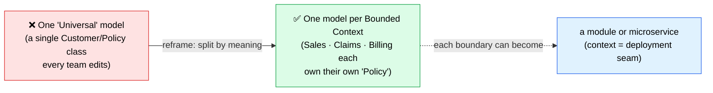
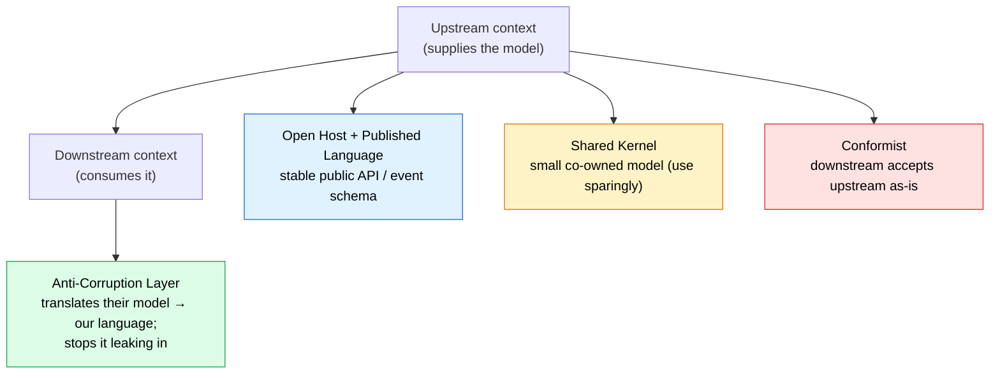
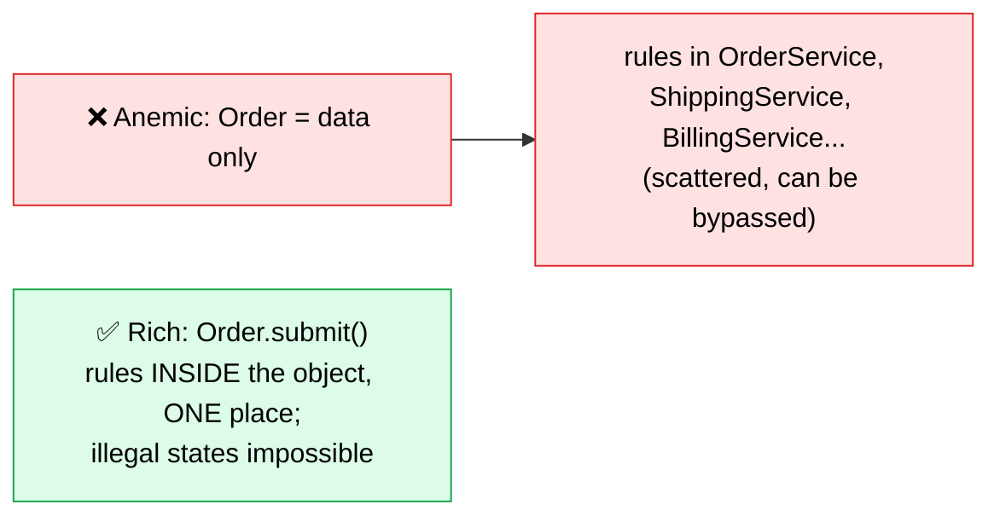
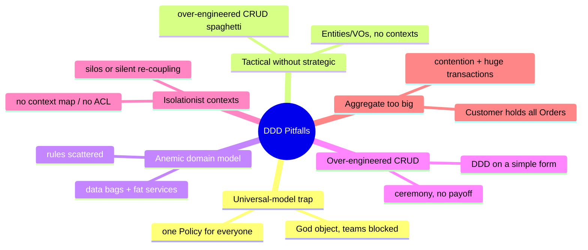

# Domain-Driven Design (DDD)

> **One line:** Make the code speak the business's language — carve the system into **bounded contexts** where each word has exactly one meaning, and model each with rich objects that protect their own rules, instead of one "Universal Model" every team fights over.

---

## Table of Contents
1. [Why You Must Master This](#1-why-you-must-master-this)
2. [The Mental Model](#2-the-mental-model)
3. [Strategic — Ubiquitous Language](#3-strategic--ubiquitous-language)
4. [Strategic — Bounded Contexts](#4-strategic--bounded-contexts)
5. [Strategic — Context Mapping](#5-strategic--context-mapping)
6. [Tactical — Entities vs Value Objects](#6-tactical--entities-vs-value-objects)
7. [Tactical — Aggregates & the Aggregate Root](#7-tactical--aggregates--the-aggregate-root)
8. [Tactical — Repositories & Domain Events](#8-tactical--repositories--domain-events)
9. [Rich vs Anemic Domain Model](#9-rich-vs-anemic-domain-model)
10. [Worked Example — the "Policy" that means three things](#10-worked-example--the-policy-that-means-three-things)
11. [Real-Life Use Cases](#11-real-life-use-cases)
12. [Failure Modes](#12-failure-modes)
13. [🏋️ Practice Drills](#-practice-drills)
14. [🎤 Interview Q&A Bank](#-interview-qa-bank)
15. [🎯 Staff+ Nuances](#-staff-nuances)
16. [Cheat Sheet](#16-cheat-sheet)
17. [Connections & Further Reading](#17-connections--further-reading)

---

## 1. Why You Must Master This

DDD turns "the code is a mess and nobody agrees what a `Customer` is" into a system whose structure mirrors the business — and it's the engine behind every "where do I draw my microservice boundaries?" answer.

- **It kills the God object.** Without boundaries, the shared `User`/`Order`/`Policy` class grows to 5,000 lines because every team bolts fields on. DDD gives you a principled place to say "that field belongs to a *different* context."
- **It aligns code with the business.** When experts say "Policy Endorsement" and the code says `user_update_v2`, every conversation needs a translator and bugs hide in the gap. A **ubiquitous language** removes the translator.
- **It's where service boundaries come from.** "Split by bounded context" is the correct microservice decomposition — a business-meaning boundary, not a technical-layer one. See [System_Decomposition.md](../03_High_Level_Design/System_Decomposition.md).
- **It protects invariants.** Rich models with **aggregates** make illegal states unrepresentable instead of hoping every service remembers to check.

> **The core problem it solves:** *the ambiguous, ever-growing shared model.* When "Customer" is a sales lead to Marketing, a delivery address to Shipping, and a balance to Billing, one shared `Customer` class couples all three teams forever. DDD lets each context own its own model of the same word.

---

## 2. The Mental Model

DDD is **building a themed amusement park.** You don't run one "Universal Costume Department." You have Pirate Land, Space Land, and Medieval Land — each with its own rules and vocabulary. A "sword" in Pirate Land (a cutlass) is a different object from a "sword" in Medieval Land (a broadsword). Each land is a **bounded context**: inside it, every word has one crisp meaning; between lands, you translate at the gate.



DDD has two halves and **the order matters**: get **Strategic** design right first (language + boundaries), *then* apply **Tactical** patterns (entities, value objects, aggregates) inside each boundary. Tactical without strategic is the classic trap ([§12](#12-failure-modes)).

---

## 3. Strategic — Ubiquitous Language

The **ubiquitous language** is a shared, rigorous vocabulary — built *with* domain experts — that appears identically in speech, docs, and code. If the business says a policy is *endorsed*, you write `policy.endorse(...)`, not `policy.updateV2(...)`.

- Every translation between "business speak" and "code speak" is where bugs hide. One language, no translation layer.
- It forces precision: pinning down "does 'ship' mean 'label printed' or 'left the warehouse'?" surfaces real disagreements before they become incidents.
- It's the seed of the boundary: **the language is only valid inside a context.** When "ship" means two things to two teams, you've found a boundary.

```python
# ❌ Language gap: code invents its own vocabulary, experts can't read it
def do_update(o, flag):
    o.status = 2 if flag else 3          # magic numbers, no meaning

# ✅ Ubiquitous language: the code reads like the business talks
class Order:
    def submit(self): ...
    def cancel(self, reason: str): ...
    def mark_shipped(self, tracking: "TrackingNumber"): ...
```

> The tell: a domain expert can read your class and method names aloud and *agree that's how the business works*.

---

## 4. Strategic — Bounded Contexts

A **bounded context** is an explicit boundary within which one domain model — and its ubiquitous language — is consistent. Outside it, the same word may mean something else, and that's *fine*. This is the single most important idea in DDD. **How to find it:** watch for a word whose *meaning* changes between parts of the business — that change *is* the boundary.

| Term | Sales context | Claims context | Billing context |
|------|--------------|----------------|-----------------|
| **Policy** | premium, sales rep, commission, pipeline stage | coverage limit, deductible, exclusions, claim history | billing schedule, amount due, payment method, dunning |
| **Customer** | a lead with a pipeline stage | a claimant with a loss history | an account with a balance |

Forcing one `Policy` to serve all three yields a 5,000-line God object nobody can change safely. Three small, cohesive models let Sales, Claims, and Billing evolve independently. **This is exactly why bounded contexts map onto [modular-monolith modules](../03_High_Level_Design/Modular_Monolith.md) and [microservices](../10_Microservices_Distributed_Systems/): the context boundary is the module/service boundary.**



A context = **its own model + its own language + its own data.** Data ownership makes the boundary real (the load-bearing rule from [Modular_Monolith.md](../03_High_Level_Design/Modular_Monolith.md)); a shared writable table silently fuses two contexts back into one.

---

## 5. Strategic — Context Mapping

Contexts must still cooperate — a claim references the policy that was sold. **Context mapping** documents how they integrate and the *power relationship* between teams.



- **Anti-Corruption Layer (ACL)** — a translation shim that converts another context's model into *your* language. The most valuable pattern: it stops a legacy/external model from corrupting your clean one.
- **Open Host Service / Published Language** — upstream exposes a stable, versioned API or event schema so many downstreams integrate the same way.
- **Shared Kernel** — two teams co-own a small overlapping model. Powerful but coupling; use only for genuinely shared, slow-changing concepts.
- **Conformist** — downstream just adopts upstream's model (no ACL). Cheap, but you inherit every upstream change.

> Skipping the ACL is how a "clean" decomposition silently re-couples — the exact failure in [System_Decomposition.md](../03_High_Level_Design/System_Decomposition.md).

---

## 6. Tactical — Entities vs Value Objects

Inside one context, the first tactical distinction is identity vs value — the interview classic.

- **Entity** — defined by a **continuous identity** that persists as attributes change. You are an entity: name and address change, but you're still *you*, tracked by an ID.
- **Value Object** — defined **entirely by its attributes**, no identity. `Money(10,"USD")` is a value: any two ten-dollar amounts are interchangeable, like two $10 bills. Should be **immutable** and compared by value.

| | Entity | Value Object |
|---|--------|--------------|
| **Identity** | has one (an ID) | none — *is* its attributes |
| **Equality** | same ID ⇒ equal | same attributes ⇒ equal |
| **Mutability** | mutable | immutable (replace, don't edit) |
| **Examples** | `Customer`, `Order`, `Policy` | `Money`, `Address`, `DateRange`, `Email` |

```python
from dataclasses import dataclass
from decimal import Decimal

@dataclass(frozen=True)                # VALUE OBJECT: immutable, equal by value
class Money:
    amount: Decimal
    currency: str
    def __post_init__(self):
        if self.amount < 0:
            raise ValueError("Money cannot be negative")   # invariant at construction

class Customer:                        # ENTITY: equal by identity, state may change
    def __init__(self, customer_id: str, name: str):
        self.id = customer_id          # identity, set once
        self.name = name
    def rename(self, new_name): self.name = new_name        # still the same customer
    def __eq__(self, other):
        return isinstance(other, Customer) and self.id == other.id
    def __hash__(self): return hash(self.id)

assert Money(Decimal("10"),"USD") == Money(Decimal("10"),"USD")   # value equality
c = Customer("c-1","Ada"); c.rename("Ada Lovelace")
assert c == Customer("c-1","x")        # identity equality — same ID, still equal
```

**Rule of thumb:** ask "*which one* is it?" → entity; "*what* is it?" → value object. Prefer value objects — immutability kills a whole bug class. See sibling [Class_Design.md](./Class_Design.md).

---

## 7. Tactical — Aggregates & the Aggregate Root

An **aggregate** is a cluster of entities and value objects treated as a **single unit for changes**, with one entity as the **aggregate root** — classically an `Order` (root) with its `OrderLine` children. It exists to protect **invariants**.

1. **The root is the only entry point.** Outsiders load/reference the aggregate through its root, never a child.
2. **The root guards every invariant** ("can't add lines to a shipped order") — enforced in one place.
3. **The aggregate is the transaction boundary** — load, save, and lock the *whole* aggregate atomically; one aggregate per transaction. It's the natural [consistency boundary](../10_Microservices_Distributed_Systems/) in distributed systems.
4. **Reference other aggregates by ID**, not object — an `Order` holds `customer_id`, not a `Customer`.

```python
class Order:                                   # AGGREGATE ROOT
    MAX_LINES = 50
    def __init__(self, order_id, customer_id):
        self.id = order_id
        self.customer_id = customer_id         # reference other aggregate by ID
        self._lines: list[OrderLine] = []      # children are PRIVATE
        self._submitted = False

    def add_line(self, sku, qty, price):       # INVARIANTS live in the root, nowhere else
        if self._submitted:      raise ValueError("cannot modify a submitted order")
        if qty <= 0:             raise ValueError("quantity must be positive")
        if len(self._lines) >= self.MAX_LINES: raise ValueError("too many lines")
        self._lines.append(OrderLine(sku, qty, price))

    def submit(self):
        if not self._lines: raise ValueError("cannot submit an empty order")
        self._submitted = True

@dataclass(frozen=True)
class OrderLine:                                # child, only reachable via the root
    sku: str; qty: int; price: Money
```

> **Keep aggregates small.** A too-large aggregate (`Customer` holding every `Order` ever) becomes a contention hotspot and a giant transaction — the tactical mirror of over-broad service boundaries.

---

## 8. Tactical — Repositories & Domain Events

**Repositories** give the *illusion of an in-memory collection of aggregates*, hiding persistence. Two rules: **one repository per aggregate root** (never per child), and the interface lives in the **domain** while the implementation (SQL, Mongo) lives in **infrastructure** — so the domain never depends on the database. This is [dependency inversion](./SOLID_Principles.md) applied to persistence, wired by [Dependency_Injection.md](./Dependency_Injection.md).

```python
from abc import ABC, abstractmethod

class OrderRepository(ABC):            # interface in the DOMAIN layer
    @abstractmethod
    def get(self, order_id) -> "Order": ...
    @abstractmethod
    def save(self, order) -> None: ...            # persists the WHOLE aggregate atomically

class PostgresOrderRepository(OrderRepository):   # impl in INFRASTRUCTURE
    def get(self, order_id): ...        # rebuilds root + lines from tables
    def save(self, order):  ...         # writes root + lines in one transaction
```

**Domain events** capture *something that happened the domain cares about* — past-tense, in the ubiquitous language: `OrderSubmitted`, `PolicyIssued`, `PaymentReceived`. They let one aggregate or context notify others *without* a hard dependency.

```python
@dataclass(frozen=True)
class OrderSubmitted:                   # immutable fact, past tense
    order_id: str
    customer_id: str
    total: Money
```

Events are the connective tissue between contexts: Sales publishes `PolicyIssued`; Claims and Billing subscribe — integrating **by event, not shared table**. In a modular monolith they flow over an in-process bus; extracting a context to a service is then a *transport swap* to Kafka/SQS, not a redesign (see [Modular_Monolith.md](../03_High_Level_Design/Modular_Monolith.md), [Orchestration_vs_Choreography.md](../10_Microservices_Distributed_Systems/Orchestration_vs_Choreography.md)).

---

## 9. Rich vs Anemic Domain Model

The **anemic domain model** is the anti-pattern DDD cures: objects that are pure data bags (getters/setters, no behavior) with all logic in fat "service" classes. It looks OO but is procedural code in a class costume, scattering each rule across every service that touches the data. A **rich domain model** puts behavior *with* its data — the object guards its own invariants; you cannot mutate it into an illegal state.



```python
# ❌ ANEMIC — data bag + external logic; the "empty" rule can be forgotten anywhere
class Order: 
    def __init__(self): self.lines = []; self.status = "new"
class OrderService:
    def submit(self, order):
        if not order.lines: raise ValueError("empty")     # some caller may skip this
        order.status = "submitted"

# ✅ RICH — behavior with data; the invariant cannot be bypassed
class Order:
    def submit(self):
        if not self._lines: raise ValueError("cannot submit an empty order")
        self._status = "submitted"
```

> **Nuance, not dogma:** anemic is fine for simple CRUD. The anti-pattern is anemic models for a *complex* domain, where scattered rules become unmaintainable. Rich models are the tactical expression of [encapsulation](./Object_Oriented_Design.md) and the [SRP](./SOLID_Principles.md).

---

## 10. Worked Example — the "Policy" that means three things

A mid-size insurer starts with one `Policy` class for every team. Six months in it's 4,000 lines: Sales added `commissionRate`, Claims added `exclusions[]`, Billing added `dunningState` — and every change forces a full regression across all three teams because they import the same class.

```mermaid
flowchart TD
    G["One shared Policy class<br/>(4,000 lines, 3 teams blocked)"] -->|find where 'Policy'<br/>means something different| SPLIT{"3 contexts"}
    SPLIT --> S["SALES Policy<br/>premium · commission · pipeline"]
    SPLIT --> C["CLAIMS Policy<br/>coverage · deductible · exclusions"]
    SPLIT --> B["BILLING Policy<br/>schedule · amountDue · dunning"]
    S -->|publishes PolicyIssued(policyId)| BUS(("Domain events<br/>+ shared policyId"))
    BUS --> C
    BUS --> B
    style G fill:#fee2e2,stroke:#dc2626,color:#000
    style S fill:#dcfce7,stroke:#16a34a,color:#000
    style C fill:#e0f2fe,stroke:#2563eb,color:#000
    style B fill:#ede9fe,stroke:#7c3aed,color:#000
    style BUS fill:#fef3c7,stroke:#d97706,color:#000
```

Closing the loop — **concept → consequence:**

| DDD concept | Decision here | Consequence |
|-------------|---------------|-------------|
| Bounded context | 3 separate `Policy` models | small, cohesive classes; changes stop cascading |
| Ubiquitous language | "endorse", "issue", "dunning" per context | experts read the code; fewer translation bugs |
| Context mapping | Claims/Billing subscribe to `PolicyIssued` | integration by **event + shared policyId**, not a shared table |
| Anti-corruption layer | Billing translates Sales's model | Sales can refactor freely without breaking Billing |
| Aggregate | `Policy` root guards "coverage ≤ limit" | invariant enforced in one place, per context |
| Data ownership | each context owns its `policy_*` tables | each context is cleanly extractable to a [microservice](../10_Microservices_Distributed_Systems/) |

The endgame: three contexts that begin as modules in a [modular monolith](../03_High_Level_Design/Modular_Monolith.md) and each graduate to a microservice when they earn it — the hard boundary work already done.

---

## 11. Real-Life Use Cases

| Situation | How DDD applies |
|-----------|-----------------|
| **Drawing microservice boundaries** | Bounded contexts *are* the service boundaries — split where a term's meaning changes, not by layer. |
| **Insurance / banking / logistics** | Rule-heavy domains where "Policy"/"Account"/"Shipment" differ per department — the canonical sweet spot. |
| **Taming a God object** | The 5,000-line `User`/`Order` class signals hidden context boundaries inside it. |
| **Team scaling** | One team per bounded context (Conway's Law); the ubiquitous language keeps each model coherent. |
| **Replatforming legacy** | Wrap the legacy model in an **anti-corruption layer** so the new context stays clean; strangle context by context. |
| **Event-driven integration** | Publish domain events (`OrderShipped`) as the published language between contexts. |

> Real-world habit: **whenever a noun (Customer, Order, Policy) appears in two teams' conversations, ask "does it mean the same thing on both sides?" — if not, you've found a bounded context that deserves its own model.**

---

## 12. Failure Modes



- **Universal-model trap** — *symptom:* one shared `Policy`/`Customer` class every team edits; each change triggers cross-team regression. *Fix:* split into bounded contexts where the term's meaning diverges.
- **Tactical without strategic** — *symptom:* Entities/Value Objects/Repositories everywhere but no defined contexts; just heavier CRUD. *Fix:* do strategic design (language + boundaries) *first*.
- **Anemic domain model** — *symptom:* getter/setter bags, all logic in `XxxService`; rules duplicated and drifting. *Fix:* move behavior onto the aggregate root.
- **Over-engineered CRUD** — *symptom:* full DDD machinery on a simple form app. *Fix:* use plain CRUD for simple domains — a legitimate choice.
- **Isolationist contexts** — *symptom:* contexts can't cooperate, so teams copy data or share a table and silently re-couple. *Fix:* an explicit context map with an ACL or published events.

---

## 🏋️ Practice Drills

> *Cover the solutions and attempt first — active recall is the point.*

**Drill 1 — Entity or Value Object?** Classify and justify: (a) a bank `Account`, (b) `Color(#FF0000)`, (c) `PhoneNumber`, (d) `Employee`, (e) `DateRange(start, end)`.

<details><summary>Solution</summary>

- **Account — Entity.** Continuous identity (account number); balance changes, same account.
- **Color — Value Object.** Defined by RGB; any two `#FF0000`s are interchangeable, immutable.
- **PhoneNumber — Value Object.** No identity; equal by digits — you *replace* it, not mutate it.
- **Employee — Entity.** Identity (employee ID) persists through name/role/salary changes.
- **DateRange — Value Object.** Defined by start+end; immutable, compared by value.

Heuristic: "*which one* is it?" → entity; "*what* is it?" → value object.
</details>

**Drill 2 — Where's the context boundary?** One `Product` class: Merchandising cares about title/images/category; Pricing about cost/margin/discounts; Warehouse about weight/dimensions/shelf. Draw the boundaries.

<details><summary>Solution</summary>

Three bounded contexts — **Catalog**, **Pricing**, **Fulfillment** — each with its own `Product` model. "Product" means something different to each, which is the tell. They integrate by shared `productId` plus events (Pricing publishes `PriceChanged`). One shared `Product` couples all three; splitting lets each evolve and become a module/service (mirror of [System_Decomposition.md](../03_High_Level_Design/System_Decomposition.md)'s Price/Discount example).
</details>

**Drill 3 — Fix the aggregate.** `OrderService.add_item()` loads an `Order`, appends directly to `order.lines`, and saves; `qty` is validated in the UI. What's wrong, and how does an aggregate fix it?

<details><summary>Solution</summary>

The invariant (`qty > 0`, "no items on a shipped order") lives *outside* the object, so any caller can create an illegal order. Make `Order` the aggregate root: `lines` becomes private, and the only way in is `order.add_line(...)`, which enforces every rule. Illegal states become unrepresentable regardless of caller, and the whole aggregate saves atomically through one repository.
</details>

**Drill 4 — Rich or anemic?** `Order` has only getters/setters, alongside `OrderCalculator`, `OrderValidator`, and `OrderStateManager`. Anti-pattern or fine?

<details><summary>Solution</summary>

Anemic — behavior is split across three service classes while `Order` is a data bag, so rules can be bypassed and drift. Fix by folding calculation, validation, and state transitions into `Order` methods (`total()`, `submit()`). *Caveat:* if it's a genuinely simple CRUD screen, anemic is acceptable — the anti-pattern is anemic for a *complex* domain.
</details>

---

## 🎤 Interview Q&A Bank

**Q1. What is a bounded context, and how do you find one?** *(signal: strategic DDD)*
> A boundary within which a domain model and its ubiquitous language have one consistent meaning. You find it by watching for a word — Customer, Policy, Product — whose *meaning changes* between parts of the business; that change is the boundary. Inside, one model rules; outside, you translate.

**Q2. How do you decide where to draw microservice boundaries?** *(signal: the #1 DDD question)*
> Along bounded contexts, not technical layers. Identify business capabilities and terms whose meaning changes between them; each context (owning its own model *and* data) becomes a candidate service. Verify the term means the same thing throughout, and that the context can own its tables. Extract incrementally — ideally proving the boundary in-process (modular monolith) before distributing.

**Q3. Entity vs Value Object?** *(signal: tactical fundamentals)*
> An entity has continuous identity (an ID); attributes change, equality is by ID (`Customer`, `Order`). A value object has no identity, is defined entirely by its attributes, is immutable, and is compared by value (`Money`, `Address`). "Which one is it?" → entity; "what is it?" → value object. Prefer value objects — immutability removes bugs.

**Q4. What is an aggregate and an aggregate root?**
> A cluster of objects treated as one consistency unit, with one entity as the root — the only entry point. Outsiders modify the aggregate only through the root, which enforces all invariants; the whole aggregate is loaded and saved atomically (one per transaction). Reference other aggregates by ID, and keep them small to avoid contention.

**Q5. What is the ubiquitous language and why does it matter?**
> A shared, rigorous vocabulary built with domain experts, appearing identically in speech, docs, and code. It matters because every translation between business and code is where bugs hide; one language removes the translation layer and forces the domain to be pinned down precisely.

**Q6. Rich vs anemic domain model?**
> A rich model puts behavior with data — objects guard their own invariants (`order.submit()`), so illegal states are impossible. An anemic model is data bags plus fat services holding all logic; it's procedural code in disguise and scatters each rule. Anemic is fine for simple CRUD but an anti-pattern for complex domains.

**Q7. How do bounded contexts integrate — context map and ACL?** *(signal: senior integration)*
> A context map documents relationships and team power dynamics — Open Host/Published Language, Shared Kernel, Conformist, Anti-Corruption Layer. The ACL is a translation shim that converts another context's (often legacy/external) model into your language so it never leaks in. Domain events are the common integration mechanism.

**Q8. When should you NOT use DDD?**
> When the domain is simple — form-over-data CRUD, ETL/pipelines, or a small app where the logic is trivial. DDD's overhead (expert collaboration, aggregates, contexts) only pays off when domain complexity dominates. Full DDD on simple CRUD is ceremony with no payoff.

---

## 🎯 Staff+ Nuances

- **Strategic before tactical, always.** The common expensive mistake is memorizing "Entity/Value Object/Repository" and sprinkling them everywhere without defining a bounded context — all ceremony, no benefit. Boundaries first; patterns fill a boundary in, they don't substitute for one. Ties to [System_Decomposition.md](../03_High_Level_Design/System_Decomposition.md).
- **The aggregate is the consistency boundary — where distributed systems bite.** One aggregate = one transaction. Anything spanning multiple aggregates or contexts must be **eventually consistent** via domain events and often a [Saga](../10_Microservices_Distributed_Systems/Orchestration_vs_Choreography.md). Too-large aggregates create contention; too-small push consistency you need into fragile cross-aggregate coordination. Sizing them is the real art of tactical DDD.
- **Data ownership is load-bearing, as in the modular monolith.** A context isn't real until it owns its data; two contexts writing one table are one context — the same rule as [Modular_Monolith.md](../03_High_Level_Design/Modular_Monolith.md) and the reason contexts extract cleanly.
- **The ACL is where clean decompositions live or die.** Teams draw beautiful boundaries then integrate by importing the other context's model directly — silently re-coupling. An ACL or published-language events keep the boundary real; skipping it is the quiet failure.
- **CQRS complements DDD.** Rich aggregates are great for the *write* side but poor read models — loading a whole aggregate to render a list is wasteful. Mature systems split command (aggregate) from query (denormalized read) models; don't force every read through the aggregate.
- **Boundaries follow the *language*, not the org chart — but Conway's Law drags them toward it.** The correct boundary is where meaning changes; the *stable* one also aligns with a single team. When they disagree, the model erodes toward org structure — use the Inverse Conway Maneuver to align teams to the contexts you want (see [System_Decomposition.md](../03_High_Level_Design/System_Decomposition.md)).
- **Value objects are underused leverage.** Replacing primitives (`str email`, `int cents`) with value objects (`Email`, `Money`) that validate at construction eliminates whole bug classes — the easiest tactical DDD win to adopt incrementally.

---

## 16. Cheat Sheet

```
DDD = make the code speak the business; split by MEANING, not technical layer.
  Do STRATEGIC first (language + boundaries), THEN tactical (patterns inside a boundary).

STRATEGIC
  Ubiquitous Language  one vocabulary in speech, docs & code (no translation layer)
  Bounded Context      boundary where a term has ONE meaning; owns model + LANGUAGE + DATA
                       tell: same word means something different to two teams
                       context = module/service boundary (drives microservice decomposition)
  Context Mapping      ACL (translate, don't leak) · Open Host/Published Language ·
                       Shared Kernel (sparingly) · Conformist (accept upstream as-is)

TACTICAL (inside one context)
  Entity        identity (ID); mutable; equal by ID          (Customer, Order, Policy)
  Value Object  no identity; immutable; equal by value        (Money, Address, DateRange)
                "which one?"=entity   "what?"=value object     prefer value objects
  Aggregate     cluster with ONE root = only entry point; root guards invariants;
                = TRANSACTION boundary (1/txn); reference others by ID; keep SMALL
  Repository    in-memory-collection illusion; ONE per aggregate root;
                interface in domain, impl in infrastructure (dependency inversion)
  Domain Event  past-tense fact (OrderSubmitted); integrate by EVENT, not shared table

MODELS  Rich = behavior WITH data, invariants inside (✅ complex)
        Anemic = data bags + fat services (✅ simple CRUD / ❌ complex)

TRAPS: universal-model God object · tactical-without-strategic · anemic on complex domain ·
       DDD on simple CRUD · isolationist contexts (no ACL) · huge aggregate
```

---

## 17. Connections & Further Reading

**Within this repo:**
- [System_Decomposition.md](../03_High_Level_Design/System_Decomposition.md) — bounded contexts *are* the service/module boundaries; the strategic side applied to splitting systems.
- [Modular_Monolith.md](../03_High_Level_Design/Modular_Monolith.md) — implement each context as a module first; data-ownership is the shared load-bearing rule.
- [10 · Microservices & Distributed Systems](../10_Microservices_Distributed_Systems/) — context → service; aggregates as consistency boundaries; [Orchestration_vs_Choreography.md](../10_Microservices_Distributed_Systems/Orchestration_vs_Choreography.md) for event integration and Sagas.
- [Class_Design.md](./Class_Design.md) — OO mechanics of Value Objects vs Entities; [Object_Oriented_Design.md](./Object_Oriented_Design.md) — encapsulation behind rich models.
- [SOLID_Principles.md](./SOLID_Principles.md) — SRP/DIP underpin rich models and repositories; [Dependency_Injection.md](./Dependency_Injection.md) — wiring repository impls to domain interfaces.

**External classics:**
- *Domain-Driven Design* (Eric Evans) — the "Blue Book," origin of the terms.
- *Implementing Domain-Driven Design* (Vaughn Vernon) — the "Red Book," the practical how-to.
- [Martin Fowler — BoundedContext](https://martinfowler.com/bliki/BoundedContext.html) · [AnemicDomainModel](https://martinfowler.com/bliki/AnemicDomainModel.html) · [DDD Reference](https://domainlanguage.com/ddd/reference/).

---

## TL;DR
DDD aligns software structure and vocabulary with the business, and **the order is everything: get strategic design right first — a ubiquitous language and bounded contexts (where each word has exactly one meaning) — then apply tactical patterns inside each context.** The killer move is refusing the universal model: let Sales, Claims, and Billing each own their own `Policy`, integrating by shared ID and domain events rather than one God class. Inside a context, model with **entities** (identity), **value objects** (immutable, equal by value), and **aggregates** whose root guards every invariant and forms the transaction boundary, persisted through one **repository** per root. Prefer **rich models** over anemic data-bags for complex domains — and remember that **bounded contexts are exactly where your module and microservice boundaries come from.**
