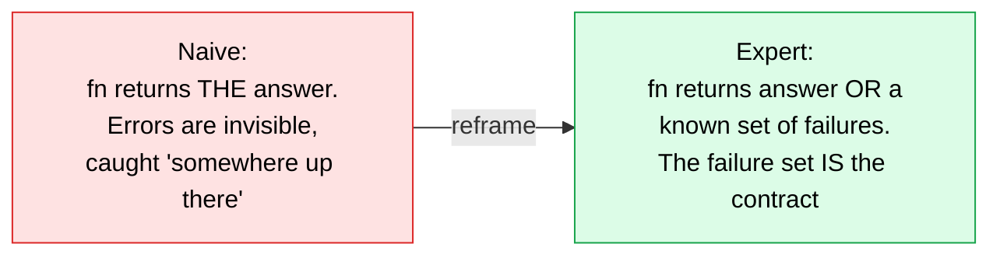
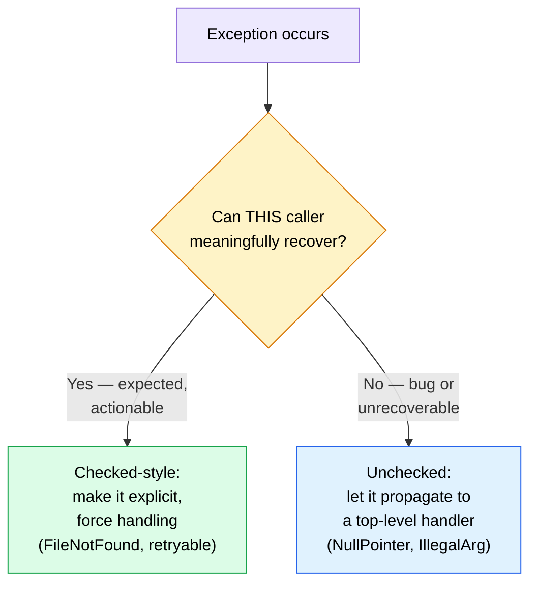
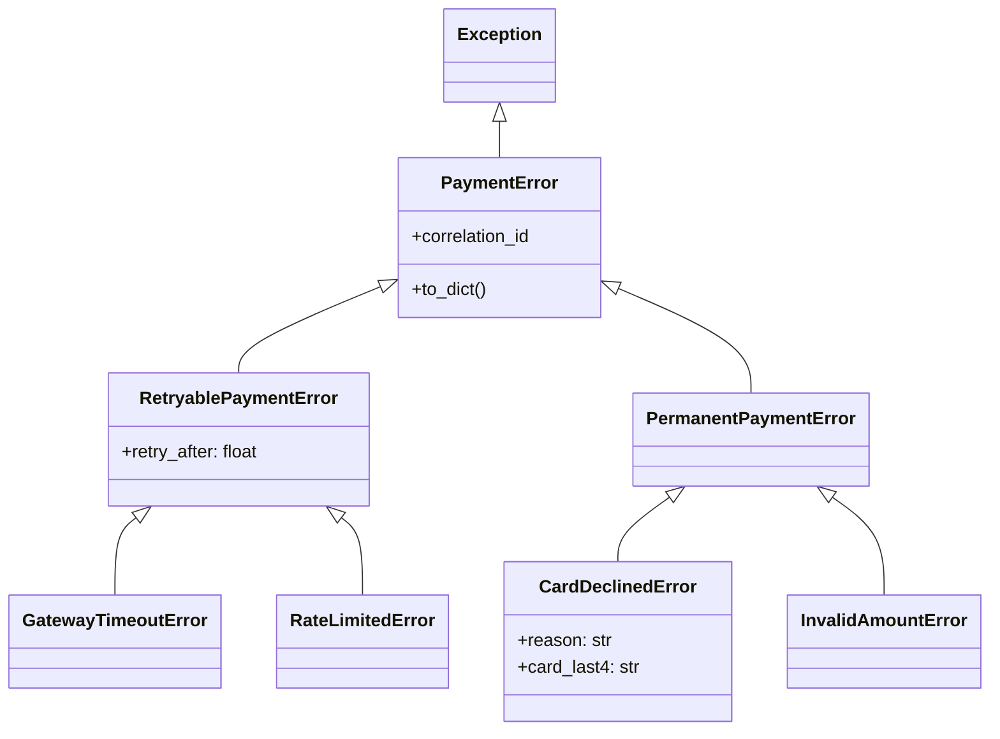
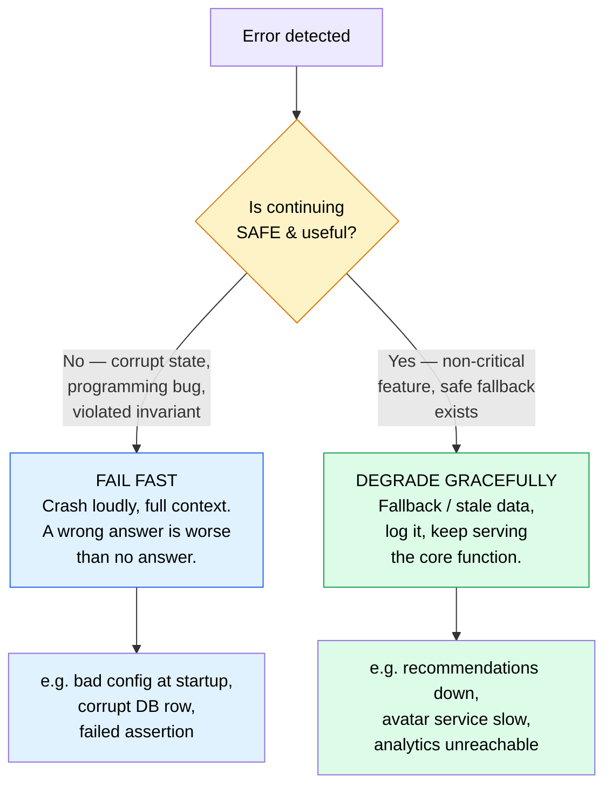
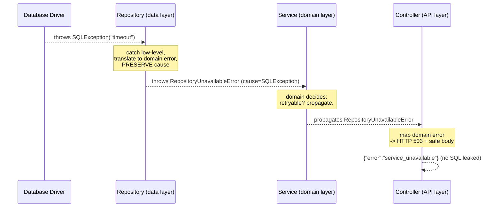
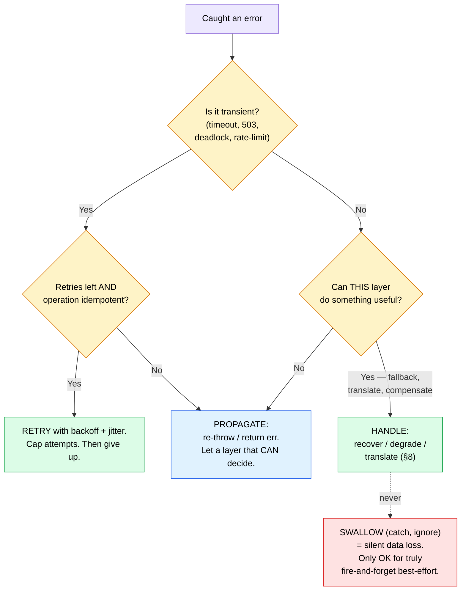
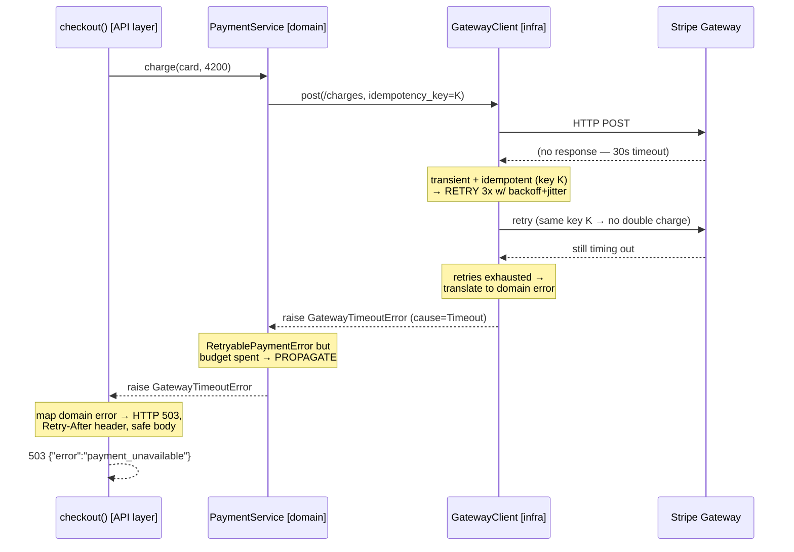

# Error Handling & Exception Design

> **One line:** An error is a *return value*, not an afterthought — so the way a function can fail is part of its contract, and designing that contract well is the difference between a bug that surfaces at the right layer with the right message and one that leaks a raw `SQLException` onto a user's screen.

---

## Table of Contents
1. [Why You Must Master This](#1-why-you-must-master-this)
2. [The Mental Model](#2-the-mental-model)
3. [Errors Are Part of the Contract](#3-errors-are-part-of-the-contract)
4. [Checked vs Unchecked Exceptions](#4-checked-vs-unchecked-exceptions)
5. [Designing an Exception Hierarchy](#5-designing-an-exception-hierarchy)
6. [Result / Either / Optional — Errors as Values](#6-result--either--optional--errors-as-values)
7. [Fail-Fast vs Graceful Degradation](#7-fail-fast-vs-graceful-degradation)
8. [Wrapping & Translating Across Layer Boundaries](#8-wrapping--translating-across-layer-boundaries)
9. [Retry vs Propagate vs Swallow](#9-retry-vs-propagate-vs-swallow)
10. [Anti-Patterns](#10-anti-patterns)
11. [Worked Example — A Payment Service Error Contract](#11-worked-example--a-payment-service-error-contract)
12. [Real-Life Use Cases](#12-real-life-use-cases)
13. [Failure Modes](#13-failure-modes)
14. [🏋️ Practice Drills](#-practice-drills)
15. [🎤 Interview Q&A Bank](#-interview-qa-bank)
16. [🎯 Staff+ Nuances](#-staff-nuances)
17. [Cheat Sheet](#17-cheat-sheet)
18. [Connections & Further Reading](#18-connections--further-reading)

---

## 1. Why You Must Master This

Most engineers spend 90% of their design energy on the happy path and treat errors as noise to be caught and logged. But in production, **the error path *is* the product** — it decides whether an outage is a 200ms retry nobody notices or a cascading failure that pages you at 3am. How your classes and interfaces express failure is a first-class design decision, not glue code.

- **A bad error contract leaks abstractions.** When a UI catches a `psycopg2.OperationalError`, your database has become part of the UI's public API — you can never change persistence without breaking callers. This is the single most common way layered architectures rot.
- **Swallowed errors are silent data corruption.** `try: … except: pass` turns a loud, debuggable failure into a quiet wrong answer that surfaces days later as a support ticket with no stack trace. The empty catch block has caused more 3am incidents than any algorithm bug.
- **Errors-as-control-flow is a performance and readability tax.** Using exceptions for expected outcomes (end-of-iteration, "user not found") couples your logic to `try/except` and, in some runtimes, costs real cycles building stack traces for events that aren't exceptional.
- **Interview table stakes.** LLD and API rounds silently grade whether your method signatures tell the caller what can go wrong, whether your hierarchy lets callers catch at the right granularity, and whether you know when Rust's `Result` beats Java's `throws`.

> **The core problem it solves:** how to make failure *visible, typed, and handled at the right layer* — so every caller knows what can go wrong, can react precisely, and never has to reverse-engineer failure modes from a stack trace.

**Prerequisites:** [Interface_Design.md](./Interface_Design.md) (a method's failure modes are part of its interface) and [SOLID_Principles.md](./SOLID_Principles.md) (Liskov and interface segregation both constrain how subtypes may fail). This is the object/class-contract view; network- and HTTP-level error *responses* live in [../02_API_Interface_Design/API_Error_Handling_Design.md](../02_API_Interface_Design/API_Error_Handling_Design.md) — cross-linked, not duplicated.

---

## 2. The Mental Model

The naive view: *"The function returns the answer; if something goes wrong it throws, and somewhere up the stack a `catch` deals with it."* Errors are treated as an out-of-band escape hatch — invisible in the signature, handled by whoever happens to catch first.

The right view: **an error is one of the values a function returns.** A `charge(card, amount)` doesn't return "a receipt"; it returns "a receipt *or* one of {card declined, gateway timeout, invalid amount}." That full set is the contract. Whether you express it with a thrown exception, a `Result<Receipt, ChargeError>`, or a Go `(Receipt, error)` tuple is a *language mechanism* choice — but the *set of failures* is a design decision you make deliberately.



> **Hold onto this:** if a caller has to read your *implementation* to learn how you fail, your error design has already failed. The signature — or the hierarchy the signature throws — should tell the whole story.

---

## 3. Errors Are Part of the Contract

**What it is.** A method's contract is not just "inputs → output." It is "inputs → output *or* this enumerable set of failures, under these conditions." A well-designed API makes that failure set discoverable *without reading the body* — via the return type, the declared exceptions, or at minimum precise docstrings.

**Why it exists / what breaks without it.** When failures are undocumented, every caller either (a) wraps everything in a bare `catch` and hopes, or (b) discovers failure modes in production. Both are how you get the classic bug: a method that *sometimes* returns `None`, *sometimes* throws `KeyError`, and *sometimes* throws a wrapped `TimeoutError`, with no way to know which without spelunking. Callers can't write correct code against a contract they can't see.

**How it works — the three ways to encode the failure set:**

| Encoding | Mechanism | Visible in signature? | Example |
|----------|-----------|----------------------|---------|
| **Thrown exception** | Non-local jump up the call stack until caught | Only if the language declares them (Java `throws`) | `IOException` on `Files.readAllBytes` |
| **Error as value** | Failure is part of the returned data | Yes — it's in the return type | Rust `Result<T, E>`, Go `(T, error)` |
| **Sentinel / Optional** | A special in-band value means "absent/failed" | Partially — `Optional<T>` says "maybe missing" but not *why* | `dict.get(k)` → `None`, `Optional<User>` |

**The trade-off.** Exceptions keep the happy path clean (no error-checking noise between the meaningful lines) but hide the failure set unless the language forces declaration. Errors-as-values make failure impossible to ignore (the compiler won't let you) but add ceremony to every call. Choose per *how exceptional the failure is*: truly rare and unrecoverable → exception; expected and part of normal flow → value.

**Real system.** Go made this a language philosophy: `if err != nil { return err }` appears billions of times because Go decided the failure set should be *impossible to accidentally ignore*. Rust went further — a `Result<T, E>` you don't use triggers a `#[must_use]` compiler warning. Java tried with checked exceptions (`throws IOException`) but the ecosystem largely revolted (see §4).

> The signature `def transfer(src, dst, amount) -> None` tells you *nothing* about failure. `def transfer(...) -> Result[Receipt, TransferError]` tells you everything.

---

## 4. Checked vs Unchecked Exceptions

**What it is.** *Checked* exceptions are part of the method signature and the compiler forces every caller to either handle or re-declare them (Java's `throws IOException`). *Unchecked* exceptions (runtime exceptions) can propagate freely with no compile-time obligation. C#, Python, JavaScript, Kotlin, and Ruby have **only unchecked** exceptions — the checked/unchecked debate is essentially a Java-specific argument that the rest of the industry resolved by not having the feature at all.

**Why the distinction exists.** Java's designers wanted the failure set to be *part of the type system* — `throws SQLException` documents and enforces the contract. The intent (§3, errors-as-contract) is genuinely good. The execution created two chronic problems.



**The two failures of checked exceptions:**

1. **`throws` pollution up the stack.** A low-level `IOException` forces every intermediate method to declare `throws IOException`, coupling unrelated layers to a detail they can't handle. The signature accretes a growing list of exceptions.
2. **The swallow reflex.** Because handling is *mandatory*, tired engineers write `try { … } catch (IOException e) { }` — an empty block just to make the compiler stop complaining. Checked exceptions thus *cause* the exact swallowing anti-pattern they were meant to prevent.

**The trade-off / when checked wins.** Checked exceptions genuinely win for *recoverable, expected, cross-boundary* failures where you *want* the compiler to force a decision — e.g., a file-parsing library where "malformed input" is a normal outcome the caller must handle. They lose for *pervasive* failures (I/O, which can happen anywhere) and *programmer-error* failures (null, index-out-of-bounds) that no caller can sensibly recover from.

**Real system / the modern consensus.** Kotlin — a JVM language, fully Java-interoperable — deliberately dropped checked exceptions entirely, citing exactly the pollution and swallowing problems. The Spring framework wraps checked `SQLException` into unchecked `DataAccessException` for the same reason. Effective Java's rule of thumb: **use exceptions only for exceptional conditions; if checked, only when the caller can genuinely recover.** In practice most modern Java codebases lean heavily on unchecked exceptions and use checked ones sparingly.

| | Checked (Java only) | Unchecked (everyone) |
|---|---|---|
| Compiler enforces handling | Yes | No |
| In the signature | Yes (`throws X`) | No |
| Good for | Recoverable, expected, boundary failures | Bugs, unrecoverable, pervasive failures |
| Failure mode | `throws` pollution, swallow-to-compile | Undocumented — caller must read docs |
| Verdict | Use sparingly, only where recovery is real | Default in C#/Python/Kotlin/JS |

---

## 5. Designing an Exception Hierarchy

**What it is.** A coherent exception hierarchy is a tree of domain-specific exception classes, all descending from a single application base, arranged so callers can `catch` at exactly the granularity they need — one specific failure, a whole category, or everything from your module.

**Why it exists / what breaks without it.** Without a hierarchy you get two bad extremes: (1) everything is a bare `Exception`/`RuntimeError`, so callers can only `catch Exception` and lose all ability to react differently to "card declined" vs "database down"; or (2) a flat pile of unrelated exception classes with no common ancestor, so a caller who wants to catch "any error from the payments module" must enumerate all fifteen by hand and will miss the one added next week.

**How it works — the design rules:**

1. **One base per module/domain.** `PaymentError(Exception)` at the root lets a caller `except PaymentError` to catch *anything* the payment layer throws, present or future.
2. **Categories as intermediate nodes.** Group by *how the caller reacts*, not by internal cause. `RetryablePaymentError` vs `PermanentPaymentError` is more useful than `NetworkError` vs `ParseError`, because the caller's decision (retry or not) is the axis that matters.
3. **Leaves carry context.** `CardDeclinedError(reason="insufficient_funds", card_last4="4242")` — structured fields, not just a string, so upstream code and logs can branch on the reason without regex-parsing a message.
4. **Never `catch (Exception)` in domain code.** Catching the root of *everything* swallows `KeyboardInterrupt`, `OutOfMemoryError`, and the `NullPointerException` that's actually a bug you need to see. Catch the narrowest type you can actually handle.



> The hierarchy above lets a caller choose granularity: `except GatewayTimeoutError` (this one thing), `except RetryablePaymentError` (whole retry-worthy category), or `except PaymentError` (anything from payments). One tree, three levels of precision.

```python
# --- A coherent domain exception hierarchy ---
class PaymentError(Exception):
    """Base for EVERYTHING the payment module can raise.
    Callers catch this to isolate payment failures from the rest of the app."""
    def __init__(self, message: str, correlation_id: str | None = None) -> None:
        super().__init__(message)
        self.correlation_id = correlation_id       # structured context, not just a string

class RetryablePaymentError(PaymentError):
    """Category node: the AXIS the caller cares about is 'should I retry?'"""
    def __init__(self, message: str, retry_after: float = 1.0, **kw) -> None:
        super().__init__(message, **kw)
        self.retry_after = retry_after              # tells the caller HOW to retry

class PermanentPaymentError(PaymentError):
    """Category node: retrying will never help — propagate or surface to user."""

class GatewayTimeoutError(RetryablePaymentError):   # leaf: a specific retryable cause
    pass

class CardDeclinedError(PermanentPaymentError):     # leaf: carries actionable detail
    def __init__(self, reason: str, card_last4: str, **kw) -> None:
        super().__init__(f"Card ending {card_last4} declined: {reason}", **kw)
        self.reason = reason
        self.card_last4 = card_last4

# Caller picks its granularity — react to the category, not 15 leaf types:
try:
    charge(card, 4200)
except RetryablePaymentError as e:                  # whole retry-worthy category
    schedule_retry(after=e.retry_after)
except CardDeclinedError as e:                      # one specific, actionable leaf
    ask_user_for_new_card(e.reason)
# Note: we deliberately do NOT `except PaymentError` here — an unhandled
# PermanentPaymentError we didn't anticipate SHOULD propagate loudly, not be swallowed.
```

**Trade-off.** A deep hierarchy is more expressive but more to maintain; too many leaf types and callers stop distinguishing them. Rule: **add a new exception type only when a caller would branch on it.** If no caller reacts differently to `CardExpiredError` vs `CardDeclinedError`, they're the same type with a `reason` field.

**Real system.** Python's standard library models this well: `OSError` is a base with `FileNotFoundError`, `PermissionError`, `TimeoutError` as leaves — so you can `except OSError` broadly or `except FileNotFoundError` precisely. Python 3.3 even *retrofitted* the old flat `IOError`/`OSError`/`WindowsError` mess into this clean hierarchy because the flat version was unusable.

---

## 6. Result / Either / Optional — Errors as Values

**What it is.** Instead of throwing, a function *returns* a value that is either a success wrapping the answer or a failure wrapping the error. Rust's `Result<T, E>` (`Ok(v)` / `Err(e)`), Haskell/Scala's `Either<E, T>` (`Left`/`Right`), and Go's `(T, error)` tuple are the archetypes. `Optional<T>` is the degenerate case: success-or-*nothing*, with no room to say *why*.

**Why it exists.** Exceptions are invisible control flow — they can originate anywhere and land anywhere, and (outside Java's checked ones) the type system says nothing. Errors-as-values put failure *in the type*, so the compiler forces you to acknowledge it. You literally cannot get the `T` out of a `Result<T, E>` without confronting the `E`.

**How it works — Rust's `Result` and the `?` operator.** This is the crux: errors-as-values are ergonomic *only* with syntax sugar for propagation, or every function drowns in match statements.

```rust
// Rust: the failure set is IN the return type. The compiler won't let you ignore it.
fn read_config(path: &str) -> Result<Config, ConfigError> {
    let text = std::fs::read_to_string(path)?;   // ? = "if Err, return it now; else unwrap"
    let cfg: Config = toml::from_str(&text)?;     // ? auto-converts io::Error -> ConfigError
    Ok(cfg)                                        // explicit success
}
// Caller MUST handle both arms — no silent success-that-was-actually-a-failure:
match read_config("app.toml") {
    Ok(cfg)  => run(cfg),
    Err(e)   => eprintln!("config failed: {e}"),
}
```

The `?` operator is what makes this pleasant: it collapses "check for error, return early if present, unwrap if not" into one character — giving you exception-like brevity *with* type-checked failures. Without `?`, Result code is unbearable; with it, it reads almost like the happy path.

```go
// Go: the tuple convention. Explicit, verbose, impossible to ignore by accident
// (though you CAN ignore with `_`, which linters flag).
func ReadConfig(path string) (*Config, error) {
    data, err := os.ReadFile(path)
    if err != nil {
        return nil, fmt.Errorf("read config %s: %w", path, err)  // %w wraps, preserving chain
    }
    var cfg Config
    if err := toml.Unmarshal(data, &cfg); err != nil {
        return nil, fmt.Errorf("parse config: %w", err)
    }
    return &cfg, nil
}
```

```python
# Python has no native Result, but the pattern is easy to model and increasingly popular
# (libraries: `returns`, `result`). Useful for EXPECTED failures in hot paths / pipelines.
from dataclasses import dataclass
from typing import Generic, TypeVar, Union

T = TypeVar("T"); E = TypeVar("E")

@dataclass(frozen=True)
class Ok(Generic[T]):    value: T
@dataclass(frozen=True)
class Err(Generic[E]):   error: E

Result = Union[Ok[T], Err[E]]

def parse_amount(s: str) -> Result[int, str]:
    if not s.isdigit():
        return Err(f"not a number: {s!r}")     # failure is a RETURN, not a throw
    return Ok(int(s))

match parse_amount("4200"):                     # caller confronts both arms
    case Ok(v):   charge(v)
    case Err(msg): show_form_error(msg)
```

**The trade-off — when exceptions win, when values win:**

| | Exceptions | Result / Either |
|---|---|---|
| Happy path readability | Clean (no error noise) | Noisier (unless `?`-style sugar) |
| Can you forget to handle? | Yes (silently propagates) | No (compiler/type forces it) |
| Best for | *Rare, unrecoverable* failures | *Expected, recoverable* failures |
| Failure set visible in type | Only if checked | Always |
| Stack trace cost | Paid on every throw | None (it's just a value) |
| Composes in pipelines | Poorly (try/except breaks flow) | Well (`map`, `and_then`, `?`) |

The mature rule: **use values for expected failures that are part of normal flow ("user not found," "invalid input," "cache miss"); use exceptions for the truly exceptional and unrecoverable ("disk full," "out of memory," "programming bug").** A parser returning `Result` for malformed input is right; throwing `OutOfMemoryError` is right. Mixing them up — `Optional` for "the database is on fire" or an exception for "the search returned no rows" — is the smell.

**Optional is not error handling.** `Optional<T>` / `None` says *something is absent* but discards *why*. `find_user(id) -> Optional[User]` can't distinguish "no such user" from "database timed out" — and conflating those is a real bug (you show "user not found" during an outage). Use `Optional` only when absence has exactly one, obvious meaning.

---

## 7. Fail-Fast vs Graceful Degradation

**What it is.** Two opposite responses to a detected error. **Fail-fast** stops immediately and loudly the moment something is wrong (validate arguments at the boundary, `assert` invariants, crash on corrupt state). **Graceful degradation** absorbs the failure and continues with reduced functionality (serve a stale cache, hide the recommendations widget, fall back to a default).

**Why both exist.** They optimize for different things. Fail-fast optimizes for *correctness and debuggability* — a bug caught at its source with a full stack trace is trivial to fix; the same bug that silently corrupts state and surfaces three modules later is a nightmare. Graceful degradation optimizes for *availability* — a recommendations service being down shouldn't take the whole checkout page with it.

**How to choose — it depends on the blast radius and recoverability:**



**The trade-off.** Fail-fast at the *wrong* layer is a self-inflicted outage — a payment service crashing because an *optional* fraud-score enrichment timed out has failed fast on something it should have degraded past. Graceful degradation of the *wrong* thing is silent corruption — "the balance service was down so we defaulted the balance to 0 and let the withdrawal through" is a graceful path straight to bankruptcy. **Fail fast on correctness-critical and unrecoverable errors; degrade on availability-critical but non-essential features.**

**Real numbers / real systems.** Netflix's architecture is built on graceful degradation: if the personalization service is unhealthy, the UI falls back to non-personalized popular titles rather than showing an error — the [Circuit Breaker](../10_Microservices_Distributed_Systems/) trips and the fallback serves. Conversely, most databases fail-fast on startup: Postgres refuses to start with a corrupt config rather than run with guessed defaults, because running wrong is worse than not running. The startup path fails fast; the request path degrades.

> Rule of thumb: **fail fast during startup and on invariant violations; degrade gracefully at request time on non-critical dependencies.** The earlier and more central the error, the more you fail fast.

---

## 8. Wrapping & Translating Across Layer Boundaries

**What it is.** When an exception crosses an architectural boundary (persistence → domain → API), you *catch the low-level exception and re-throw a higher-level one*, preserving the original as the cause. A `SQLException` caught in the repository becomes a `UserNotFoundError` or `RepositoryUnavailableError` thrown to the service layer — the domain never sees SQL.

**Why it exists / what breaks without it.** This is [Interface_Design.md](./Interface_Design.md) and abstraction leakage made concrete. If a `SQLException` propagates untranslated to the web controller, then:
1. The controller now *depends on* the persistence technology — swap Postgres for DynamoDB and every catch block breaks.
2. You leak internals to users: a raw `ORA-00942: table or view does not exist` in an HTTP 500 body is an information disclosure vulnerability *and* useless to the user.
3. Callers catch the wrong abstraction — a UI catching `SQLException` is catching a concept it has no business knowing.

**How it works — catch low, throw high, chain the cause:**



```python
# --- Layer boundary: catch the low-level cause, throw a domain error, CHAIN it ---
class RepositoryError(Exception): ...
class UserNotFoundError(RepositoryError): ...
class RepositoryUnavailableError(RetryablePaymentError): ...  # reuse the retry axis

def get_user(user_id: str) -> User:
    try:
        row = db.execute("SELECT ... WHERE id=%s", user_id).one()
    except NoResultFound as e:
        # Absence is a DOMAIN concept — translate driver-speak to domain-speak
        raise UserNotFoundError(f"no user {user_id}") from e      # `from e` preserves the chain
    except OperationalError as e:
        # Infra failure — translate, mark retryable, but DON'T leak the SQL details upward
        raise RepositoryUnavailableError("user store unavailable") from e
    return User.from_row(row)
```

**The critical detail — preserve the cause.** Python's `raise NewError() from original` (exception chaining, PEP 3134) keeps the original traceback attached, so the *log* shows the full `SQLException → RepositoryUnavailableError` chain for debugging, while the *caller* only sees and depends on the clean domain type. Go's `fmt.Errorf("...: %w", err)` and `errors.Unwrap`/`errors.Is` do the same. **Translate the type the caller sees; never destroy the cause the operator needs.** Wrapping *without* chaining (`raise NewError()` with no `from`) is the anti-pattern — you've thrown away the stack trace that would have told you what actually broke.

**Trade-off.** Translation costs boilerplate at every boundary and can over-abstract (five wrapper types for one underlying failure). Don't translate *within* a layer — only at the *seams* where the abstraction actually changes. Over-wrapping produces `ServiceError caused by RepositoryError caused by DriverError caused by SQLException` onion peels that help no one.

**Real system.** Spring's `@Repository` beans automatically translate vendor-specific `SQLException`s (Oracle, MySQL, Postgres each throw different codes) into Spring's unified, unchecked `DataAccessException` hierarchy — so the service layer catches `DuplicateKeyException` regardless of database. This is exception translation as a framework feature, precisely to stop persistence details leaking into business logic.

---

## 9. Retry vs Propagate vs Swallow

**What it is.** Once you catch an error, you have exactly three honest options: **retry** (try again — the failure may be transient), **propagate** (re-throw or return it up — this layer can't handle it), or **handle/recover** (do something meaningful — fallback, compensate, translate). A fourth, **swallow** (catch and do nothing), is almost always a bug.

**How to choose:**



**Retry — only when two conditions hold.** (1) The failure is *transient* (network blip, timeout, HTTP 503, lock contention) — retrying a `400 Bad Request` or a `CardDeclinedError` is pointless and wasteful. (2) The operation is *idempotent* or you have an [Idempotency](../02_API_Interface_Design/Idempotency.md) key — retrying a non-idempotent `charge()` can double-bill. Always use **exponential backoff with jitter** and a **cap** on attempts; naive tight-loop retries turn one slow dependency into a self-inflicted DDoS (a retry storm). This is why retry logic belongs with [circuit breakers](../10_Microservices_Distributed_Systems/) at the systems level.

**Propagate — the default.** If this layer can't *meaningfully* act on the error, let it rise to one that can. Propagation is not laziness; it's honesty about where the decision belongs. The repository can't decide whether a timeout should retry or show the user an error — the caller can. Propagate (translating at boundaries per §8) and let the right layer decide.

**Swallow — almost always wrong.** `except Exception: pass` is the single most dangerous line in software: it converts a loud failure into a silent wrong result. The *only* defensible swallow is genuinely fire-and-forget best-effort work where the failure is truly irrelevant *and you log it* — e.g., a metrics-emit that fails shouldn't break the request, but it must still be logged. "Swallow silently" is never right; "log and continue" occasionally is.

| Choice | When | Danger if misused |
|--------|------|-------------------|
| **Retry** | Transient + idempotent | Retry storms; double-charges on non-idempotent ops |
| **Handle** | This layer has a real recovery/fallback | Masking a bug as a "handled" default |
| **Propagate** | This layer can't decide | (Safe default — rarely wrong) |
| **Swallow** | ~Never; only logged best-effort | Silent data loss, undebuggable incidents |

> **Real number.** AWS and Google both recommend exponential backoff *with jitter* precisely because synchronized retries without jitter cause thundering-herd spikes. Google's SRE book documents retry budgets (cap retries at ~10% of request traffic) so a downstream outage can't be amplified into a full-system meltdown by well-meaning retry logic.

---

## 10. Anti-Patterns

The recurring negative recipes — name them in review the way you name patterns.

- **Exceptions for control flow.** Using `try/except StopIteration` to end a loop, or throwing to return a value from deep recursion. Exceptions are *expensive* (stack-trace capture) and *obscure* (non-local jumps). If the "error" is an expected, normal outcome, it's a return value, not an exception. (Python's own iterator protocol *does* use `StopIteration` internally — but that's a language convention hidden behind `for`, not app logic you should imitate.)
- **`catch (Exception)` / bare `except:`.** Catching the root swallows bugs (`NullPointerException`, `KeyError`), system signals (`KeyboardInterrupt`), and errors you never anticipated. Catch the narrowest type you can actually handle; let the rest propagate.
- **Swallowing (`except: pass`).** Covered in §9 — the empty catch block turns failures into silent wrong answers.
- **Log-and-rethrow.** Catching, logging the *same* exception, then re-throwing it — so it gets logged again at every layer. One error, five identical stack traces in the log. Log at the boundary where you *handle* it, or once at the top; propagate silently in between.
- **Wrapping without chaining.** `raise NewError()` (no `from e`) or Go `errors.New(err.Error())` (loses the wrapped error) discards the original stack trace — you translated the type but destroyed the debugging evidence.
- **Returning error codes in languages with exceptions.** Mixing `return -1` sentinels into exception-based code means every caller must remember to check *and* the compiler helps with neither. Pick one mechanism per layer.
- **Overly broad domain base + `except PaymentError` everywhere.** The mirror image of no hierarchy: catching your *own* root type indiscriminately re-introduces the swallow problem within your domain. Catch the category or leaf you actually handle.

---

## 11. Worked Example — A Payment Service Error Contract

**Scenario.** A `checkout()` endpoint calls a `PaymentService.charge()` which calls a `GatewayClient`. We'll design the error contract end-to-end and show how one concrete failure — a *gateway timeout* — drives the architectural decision at each layer.



```python
# INFRA layer: retry transient+idempotent, then TRANSLATE (§8, §9)
def charge_via_gateway(card, amount_cents, idem_key) -> Receipt:
    for attempt in range(3):                                  # cap attempts (§9)
        try:
            return gateway.post("/charges", card=card, amount=amount_cents,
                                 idempotency_key=idem_key)     # key → safe to retry (§9)
        except gateway.Timeout as e:
            if attempt == 2:
                raise GatewayTimeoutError("gateway timed out") from e   # translate + chain (§8)
            time.sleep((2 ** attempt) + random.random())      # exp backoff + jitter
        except gateway.CardRejected as e:
            raise CardDeclinedError(e.reason, card.last4) from e        # permanent → no retry

# DOMAIN layer: no infra types here; decide based on the CATEGORY, then propagate
def charge(card, amount_cents) -> Receipt:
    if amount_cents <= 0:
        raise InvalidAmountError(f"amount must be > 0, got {amount_cents}")  # fail fast (§7)
    return charge_via_gateway(card, amount_cents, idem_key=new_key())
    # GatewayTimeoutError propagates untouched — the domain can't do better than the API layer

# API layer: map the DOMAIN error set → HTTP. This is the seam to ../02_API_Interface_Design.
def checkout(request) -> HttpResponse:
    try:
        receipt = payment_service.charge(request.card, request.amount_cents)
        return HttpResponse(200, receipt.to_dict())
    except CardDeclinedError as e:                            # actionable → 402, tell the user why
        return HttpResponse(402, {"error": "card_declined", "reason": e.reason})
    except InvalidAmountError as e:                           # client's fault → 400
        return HttpResponse(400, {"error": "invalid_amount"})
    except RetryablePaymentError as e:                        # transient → 503 + Retry-After
        return HttpResponse(503, {"error": "payment_unavailable"},
                            headers={"Retry-After": str(int(e.retry_after))})
    # No `except PaymentError` / `except Exception`: an UNANTICIPATED error must hit the
    # top-level 500 handler LOUDLY (fail fast) — not be quietly mapped to a friendly message.
```

**Concept → consequence.** Follow the timeout: the *infra* layer sees a transient, idempotent failure and **retries** (the idempotency key makes this safe — without it, retry would double-charge). Retries exhausted, it **translates** the raw `Timeout` into a domain `GatewayTimeoutError` (so the domain never imports the gateway SDK). The *domain* recognizes the retry budget is spent and **propagates** (it has no better move than the API layer). The *API* layer maps the domain error set to HTTP: `CardDeclined → 402`, `InvalidAmount → 400`, retryable → `503 + Retry-After`. **The single number "30s timeout" flows through three distinct decisions — retry, translate, map — because each layer's error contract told it exactly which failures it owned.** That HTTP mapping is where this object-level design hands off to [../02_API_Interface_Design/API_Error_Handling_Design.md](../02_API_Interface_Design/API_Error_Handling_Design.md).

---

## 12. Real-Life Use Cases

| Situation | How error design applies | The decision it forces |
|-----------|--------------------------|------------------------|
| **Repository hits a DB timeout** | Translate `SQLException` → domain `RepositoryUnavailableError`, chained | Persistence tech stays out of the service/UI contract (§8) |
| **Third-party payment gateway 503** | Transient + idempotent-key → retry w/ backoff, then propagate | Retry only what's safe; cap attempts to avoid retry storms (§9) |
| **User submits a malformed form field** | Expected failure → return `Result`/validation error, not an exception | Don't use exceptions for normal, expected outcomes (§6, §10) |
| **Recommendations service is down on a product page** | Non-critical → degrade gracefully to popular items | Availability > completeness for non-essential features (§7) |
| **Corrupt config at service startup** | Unrecoverable → fail fast, refuse to boot | A wrong-config server is worse than a down server (§7) |
| **Rust CLI parsing a file** | `Result<Config, ConfigError>` + `?` propagation | Failure set is in the type; compiler forces handling (§6) |
| **Building an SDK for external devs** | Coherent public exception hierarchy with one base | Callers catch by category; you can add leaves without breaking them (§5) — see [SDK_Client_Design.md](../02_API_Interface_Design/SDK_Client_Design.md) |

> Real-world habit: **when you write a method, write its failure set before its body.** Decide what it can throw/return-as-error, whether each is retryable, and at which layer it gets translated — *then* implement. The contract comes first.

---

## 13. Failure Modes

```mermaid
mindmap
  root((Error-Handling Pitfalls))
    Silent swallow
      except: pass
      catch(Exception){}
      wrong answer, no trace
    Leaked abstraction
      SQLException in the UI
      vendor codes in domain
      can't swap persistence
    Retry storms
      no backoff / jitter
      no attempt cap
      one slow dep DDoSes itself
    Control-flow abuse
      throw to break a loop
      exception = expected outcome
      stack-trace cost + obscurity
    Lost cause
      wrap without `from e`
      errors.New(err.Error())
      translated type, no trace
```

- **Silent swallow** — *symptom:* a feature "sometimes doesn't work" but nothing appears in logs; wrong data with no error. *root cause:* `except: pass` / empty catch block turned a failure into a no-op. *fix:* delete the bare catch; catch the narrowest handleable type; if truly best-effort, **log and continue**, never silently ignore (§9).
- **Leaked abstraction** — *symptom:* changing the database or upgrading a driver breaks the web layer's catch blocks; users see raw SQL error strings. *root cause:* low-level exceptions propagate untranslated across layers. *fix:* catch-low/throw-high at each boundary, chaining the cause (§8).
- **Retry storm / thundering herd** — *symptom:* a downstream hiccup turns into a full outage; traffic to the sick service *spikes* instead of backing off. *root cause:* naive retries with no backoff, no jitter, no cap — every client hammers in sync. *fix:* exponential backoff + jitter + attempt cap + retry budget; add a [circuit breaker](../10_Microservices_Distributed_Systems/) (§9).
- **Control-flow abuse** — *symptom:* hot-path code is slow and littered with `try/except` for normal cases; profiler shows time in exception construction. *root cause:* exceptions used for expected outcomes. *fix:* return a value/`Result`/`Optional` for expected results; reserve exceptions for the exceptional (§6, §10).
- **Lost cause (broken chain)** — *symptom:* production error logs show `RepositoryUnavailableError` with a traceback that starts *at the translation site* — no clue what the underlying failure was. *root cause:* re-raised without `from e` / wrapped the message not the error. *fix:* always chain (`raise X from e`, `fmt.Errorf("...: %w", err)`) (§8).

---

## 🏋️ Practice Drills

> *Cover the solutions and attempt first — active recall is the point.*

**Drill 1 — Design the failure set.** You're writing `book_seat(flight_id, seat, passenger) -> Booking`. List its failure set, classify each as retryable/permanent, and decide exception vs value for each.

<details><summary>Solution</summary>

Failure set and classification:
- `FlightNotFoundError` — permanent, caller error → exception (or `Result::Err`); a bad ID won't fix itself.
- `SeatUnavailableError` (already taken) — permanent, but an *expected* outcome of a normal race → strong candidate for a **value/Result**, since "seat taken" is normal business flow, not exceptional.
- `InvalidSeatError` (seat doesn't exist on this aircraft) — permanent, caller error → exception (fail fast on bad input).
- `InventoryUnavailableError` (seat-map DB timeout) — **retryable** (transient infra) → exception, marked retryable, translated at the repo boundary.
- `PaymentRequiredError` / hold-expired — permanent business rule → value or domain exception.

Design notes: put them under one `BookingError` base with `RetryableBookingError`/`PermanentBookingError` category nodes (§5). "Seat unavailable" as a `Result` is defensible because it's expected and the caller always branches on it; the infra timeout stays an exception because it's genuinely exceptional. The signature/docstring must enumerate this set — that's the contract (§3).
</details>

**Drill 2 — Spot the anti-patterns.** Review this code and name every error-handling sin:
```python
def get_balance(user_id):
    try:
        return db.query("SELECT balance FROM accounts WHERE id=%s" % user_id)
    except Exception as e:
        logging.error(e)
        return 0
```

<details><summary>Solution</summary>

Four sins: **(1) `except Exception`** — catches everything including bugs and `KeyboardInterrupt` (§10). **(2) Swallow-with-default** — returning `0` on *any* failure is catastrophic for a balance: an infra outage now silently reports every user as broke, and downstream logic may permit withdrawals against a fake-zero balance (this is graceful degradation of the *wrong* thing, §7). **(3) Lost cause** — logs `e` then discards it; the caller can't tell success-with-0 from failure-defaulted-to-0. **(4) SQL injection** via `%` string formatting (bonus, not error-handling but fatal). Fix: parameterize the query; catch the *specific* `OperationalError` and translate to a chained `RepositoryUnavailableError` (retryable); on genuine absence raise `AccountNotFoundError`; **never** default a balance — propagate and let the API layer return 503.
</details>

**Drill 3 — Retry or not?** For each, decide retry / propagate / handle, and why: (a) HTTP 429 from a rate-limited API, (b) HTTP 400 validation error, (c) `CardDeclinedError`, (d) a `deadlock detected` from Postgres on a transfer, (e) a metrics-push failure.

<details><summary>Solution</summary>

(a) **429 → retry**, but respect the `Retry-After` header with backoff — it's explicitly transient. (b) **400 → propagate** (translate to a user-facing validation error); retrying identical bad input is pointless. (c) **CardDeclined → propagate/handle** by asking the user for another card; permanent, never retry. (d) **Deadlock → retry** — Postgres deadlocks are transient and the standard remedy is to retry the whole transaction (it was rolled back), *provided* the transaction is idempotent/re-runnable. (e) **Metrics push → swallow-but-log** — the one defensible "swallow": best-effort, failure irrelevant to the request, but still log it (§9).
</details>

**Drill 4 — Design a boundary translation.** A `UserRepository` uses an ORM that throws `ObjectDeletedError`, `StaleDataError`, and `OperationalError`. The service layer above should never import the ORM. Sketch the translation.

<details><summary>Solution</summary>

```python
def find(self, user_id) -> User:
    try:
        return self._session.get_one(UserRow, user_id)
    except ObjectDeletedError as e:
        raise UserNotFoundError(user_id) from e          # absence → domain concept
    except StaleDataError as e:
        raise ConcurrentModificationError(user_id) from e # optimistic-lock clash, maybe retryable
    except OperationalError as e:
        raise RepositoryUnavailableError() from e         # infra → retryable, chained
```
Every ORM exception maps to a domain type under a `RepositoryError` base; every translation uses `from e` to keep the trace (§8). The service layer now catches `RepositoryError` and its subtypes and has *no* `import sqlalchemy`. Adding a new ORM = rewriting only this file.
</details>

---

## 🎤 Interview Q&A Bank

**Q1. Are exceptions part of a method's interface?**
> Yes — the set of ways a method can fail is as much a part of its contract as its parameters and return type. A caller can't write correct code without knowing what can go wrong. Whether you express it via `throws`, a `Result` type, or documented unchecked exceptions is a mechanism choice, but the failure set itself is a deliberate design decision. If a caller has to read your implementation to learn how you fail, the design failed. *(signal: sees errors as contract, not glue)*

**Q2. Checked vs unchecked exceptions — where do you land?**
> Checked exceptions had a good goal — put the failure set in the type system — but two failure modes killed them: `throws` pollution up the stack, and the "swallow to satisfy the compiler" reflex. Most languages (C#, Python, Kotlin) have only unchecked. My rule: unchecked by default; make a failure explicit and forced *only* when the caller can genuinely recover and it's a boundary concern. Kotlin dropping checked exceptions despite full Java interop is the industry's verdict. *(signal: knows it's a Java-specific debate with a settled consensus)*

**Q3. When would you use a `Result`/`Either` type instead of exceptions?**
> For *expected, recoverable* failures that are part of normal flow — "user not found," "invalid input," "cache miss." Errors-as-values put failure in the type so the compiler forces handling, and they compose in pipelines. Exceptions win for the *truly exceptional and unrecoverable* — out of memory, corrupt state, programming bugs — where you want a clean happy path and a non-local jump to a top-level handler. Rust's `?` operator is what makes `Result` ergonomic; without propagation sugar it's unbearable. *(signal: expected-vs-exceptional as the deciding axis)*

**Q4. How do you design an exception hierarchy?**
> One base per module so callers can isolate my failures (`except PaymentError`). Category nodes grouped by *how the caller reacts* — retryable vs permanent is usually more useful than by-cause. Leaves carry structured context, not just a message. And the golden rule: add a new exception type only when some caller would branch on it — otherwise it's a field on an existing one. Never `catch(Exception)` in domain code; catch the narrowest type you can actually handle. *(signal: hierarchy organized by caller reaction, not internal cause)*

**Q5. A `SQLException` shows up in your web controller. What's wrong and how do you fix it?**
> The persistence layer has leaked into the API layer — now I can't change databases without breaking controllers, and I risk leaking raw SQL to users, which is both useless and an information-disclosure issue. Fix: catch it at the repository boundary and translate to a domain type (`RepositoryUnavailableError`), preserving the cause with `raise ... from e` so the log keeps the full chain. Translate the *type* the caller sees; never destroy the *cause* the operator needs. Spring does this automatically with `DataAccessException`. *(signal: abstraction boundaries + cause preservation)*

**Q6. When do you retry, and what makes retries dangerous?**
> Retry only when the failure is transient *and* the operation is idempotent — retrying a `400` or a card decline is pointless, and retrying a non-idempotent charge double-bills. Dangerous when naive: no backoff, no jitter, no cap turns one slow dependency into a retry storm that DDoSes it. Always use exponential backoff with jitter, cap attempts, and ideally a retry budget plus a circuit breaker at the systems level. *(signal: transient+idempotent gate, retry-storm awareness)*

**Q7. Fail-fast or graceful degradation — how do you choose?**
> Depends on blast radius and recoverability. Fail fast on correctness-critical and unrecoverable errors — bad startup config, corrupt state, violated invariants — because a wrong answer is worse than no answer, and a bug caught at its source is trivial versus one that surfaces three modules later. Degrade gracefully on availability-critical but non-essential features — recommendations down shouldn't kill checkout. The classic mistake is degrading the wrong thing: "balance service was down so we defaulted to 0" is a graceful path to bankruptcy. *(signal: names the wrong-way failure for each)*

**Q8. Why is `except: pass` considered so dangerous?**
> It converts a loud, debuggable failure into a silent wrong answer — data loss with no stack trace, surfacing days later as a support ticket. It also swallows bugs and system signals you never meant to catch. The only defensible version is genuinely fire-and-forget best-effort work, and even then you *log and continue* — never silently ignore. "Swallow silently" is essentially never correct. *(signal: silent corruption is worse than a crash)*

---

## 🎯 Staff+ Nuances

- **Errors-as-values and exceptions are converging, not competing.** Modern languages borrow both: Rust has `panic!` (exception-like, for unrecoverable) *and* `Result` (values, for recoverable); Swift has `throws` but it's checked-lite and value-flavored; C++ debates `std::expected` vs exceptions. The staff-level insight is that the axis isn't "language X vs Y" but "*recoverable vs unrecoverable*" — and a good codebase uses values for the former and exceptions/panics for the latter *within the same language*.
- **The retry decision belongs to whoever owns idempotency, and that's usually not the layer that first catches.** A repository catching a timeout *can't* know if the operation is safe to retry — that depends on whether the caller supplied an [idempotency key](../02_API_Interface_Design/Idempotency.md). Push retry to the layer that owns the idempotency guarantee, or the "retry" becomes a "double-charge." This is why blind library-level retries are dangerous.
- **Exception hierarchies are part of your public API's compatibility contract.** Adding a *leaf* under an existing category is backward-compatible (callers catching the category still catch it); adding a *new top-level* type or *re-parenting* an existing one can break `catch` blocks. Version your exception hierarchy as carefully as your method signatures — this bites SDK authors hardest. See [SDK_Client_Design.md](../02_API_Interface_Design/SDK_Client_Design.md).
- **"Log and rethrow" is duplicate logging, and duplicate logging is an incident-analysis tax.** The same exception logged at five layers produces five stack traces that look like five errors. Establish one rule: log where you *handle* (the layer that stops propagation), propagate silently below that, and have exactly one top-level catch-all that logs unhandled errors with full context. Correlation IDs on the exception (§5) tie the layers together without re-logging.
- **Failing fast is a distributed-systems liability if done at the wrong layer.** A single node fail-fasting is fine; a *fleet* fail-fasting in unison on a shared dependency's blip is a correlated outage. This is where object-level fail-fast must be tempered by systems-level [circuit breakers and bulkheads](../10_Microservices_Distributed_Systems/) — the local instinct (crash on bad state) and the global instinct (isolate and degrade) must be reconciled explicitly.
- **The Liskov Substitution Principle constrains what subtypes may throw.** A subtype override may throw *fewer or narrower* exceptions than the base method's contract, never *broader or new* ones — otherwise callers written against the base break. This makes the exception set part of the [SOLID](./SOLID_Principles.md) substitutability guarantee, not just documentation. Java's checked exceptions actually *enforce* this at compile time (an override can't add checked exceptions); unchecked languages leave it to discipline.
- **`Optional`/nullable is the most under-designed "error" type.** Teams reach for `Optional<T>`/`None` reflexively and lose the *reason* for absence, then paper over it with a comment. When absence has more than one cause a caller must distinguish, `Optional` is the wrong type — use a `Result` or a small enum. The bug it hides ("user not found" shown during a DB outage) is subtle and common.
- **Error messages are a UX and a security surface.** The message the *operator* needs (full SQL, IDs, stack) and the message the *user* sees (safe, actionable, no internals) are different audiences with opposite requirements — leaking the former to the latter is both a bad experience and an information-disclosure vulnerability. The layer boundary that translates the type (§8) is also where you split these two messages.

---

## 17. Cheat Sheet

```
ERROR = a RETURN VALUE, not an afterthought. The failure set IS the contract.
If a caller must read your body to learn how you fail — the design failed.

MECHANISMS ────────────────────────────────────────────────────────────────
  Exception   non-local jump; clean happy path; hidden set (unless checked)
  Result/Either  Rust Result<T,E>, Go (T,err), Scala Either — set IS in the type
  Optional/None  absence only, NO reason — use only when absence has ONE meaning

CHECKED vs UNCHECKED (Java-only debate; C#/Python/Kotlin = unchecked only)
  checked   compiler forces handling → throws-pollution + swallow-to-compile
  unchecked default everywhere; use "explicit+forced" only if caller can RECOVER
  Kotlin dropped checked despite Java interop = the verdict.

HIERARCHY  one BASE per module · categories by CALLER REACTION (retryable vs
  permanent) · leaves carry structured context · add a type only if a caller
  BRANCHES on it · NEVER catch(Exception)/bare except in domain code.

RESULT vs EXCEPTION      expected/recoverable → VALUE · exceptional/unrecoverable → EXCEPTION
FAIL-FAST vs DEGRADE     correctness+unrecoverable → FAIL FAST (startup, bad state)
                         availability+non-essential → DEGRADE (recs down ≠ checkout down)
                         wrong-way sins: crash on optional dep · default a balance to 0

LAYER BOUNDARIES  catch LOW, throw HIGH, CHAIN the cause.
  Python: raise DomainErr() from e   Go: fmt.Errorf("...: %w", err)
  Translate the TYPE the caller sees; never destroy the CAUSE the operator needs.
  Don't leak SQLException to the UI.  (Spring → DataAccessException does this.)

RETRY / PROPAGATE / SWALLOW
  RETRY     only if TRANSIENT + IDEMPOTENT · exp backoff + JITTER + cap + budget
  PROPAGATE default when this layer can't decide (honest, not lazy)
  HANDLE    only with a real fallback/recovery
  SWALLOW   ~never; only logged best-effort (metrics). except:pass = silent data loss.

ANTI-PATTERNS  exceptions-for-control-flow · catch(Exception) · except:pass ·
  log-and-rethrow (dup logs) · wrap-without-`from e` (lost trace) · mixing codes+exceptions

REAL: Go `if err!=nil` · Rust `?` + #[must_use] · Python `raise X from e` (PEP 3134) ·
  Java IOException · Spring DataAccessException · Netflix graceful-degrade + circuit breaker
```

---

## 18. Connections & Further Reading

**Prerequisites (learn first):**
- [Interface_Design.md](./Interface_Design.md) — a method's failure modes are part of its interface; error translation is abstraction-boundary discipline.
- [SOLID_Principles.md](./SOLID_Principles.md) — Liskov constrains what subtypes may throw; interface segregation shapes error contracts.

**Builds toward / pairs with:**
- [Class_Design.md](./Class_Design.md) — where exception classes and their invariants live; fail-fast validation belongs in constructors.
- [Design_Patterns_Overview.md](./Design_Patterns_Overview.md) — the Decorator wraps retry logic; translation is Adapter-flavored; State enforces valid transitions instead of throwing.
- [../02_API_Interface_Design/API_Error_Handling_Design.md](../02_API_Interface_Design/API_Error_Handling_Design.md) — the *network* side: how these object-level errors map to HTTP status codes, problem+json, and error response bodies. This file stops at the object boundary; that one takes over at the wire.
- [../02_API_Interface_Design/Idempotency.md](../02_API_Interface_Design/Idempotency.md) — the guarantee that makes retry safe; retry decisions depend on it.
- [../02_API_Interface_Design/SDK_Client_Design.md](../02_API_Interface_Design/SDK_Client_Design.md) — exposing a coherent exception hierarchy as part of an SDK's public contract.
- [../10_Microservices_Distributed_Systems](../10_Microservices_Distributed_Systems/) — retries, backoff+jitter, retry budgets, circuit breakers, and bulkheads: error handling scaled from object to fleet.

**Gaps this topic exposes (candidates for the section's Gap Analysis):**
- A dedicated note on **defensive programming, invariants, and assertions** (fail-fast at the object level) would pair naturally with this and with [Class_Design.md](./Class_Design.md).
- **Structured logging & observability of errors** (correlation IDs, error taxonomies in logs) is referenced here but has no home yet.

**External classics:**
- *Effective Java* (Joshua Bloch), Item 69–77 — the definitive treatment of exceptions in a checked-exception language ("use exceptions only for exceptional conditions," "favor unchecked for programming errors").
- *The Error Model* (Joe Duffy, Midori essay) — the deepest single essay on exceptions vs error values, from the language that tried to fix both.
- [Rust Book — Error Handling](https://doc.rust-lang.org/book/ch09-00-error-handling.html) · [Go Blog — Error handling and Go](https://go.dev/blog/error-handling-and-go) · [Python `raise ... from`](https://docs.python.org/3/tutorial/errors.html#exception-chaining) — the three archetypes, from the source.

---

## TL;DR
**Treat an error as a return value, not an afterthought — the set of ways a function can fail is part of its contract, so design it before you write the body.** Encode that failure set with the right mechanism: exceptions for the *truly exceptional and unrecoverable*, `Result`/`Either`/value-returns (Rust's `Result<T,E>` + `?`, Go's `(T, error)`) for *expected, recoverable* outcomes, and reserve `Optional`/null only for single-meaning absence. Organize your own failures into a coherent hierarchy with one base and categories grouped by *how the caller reacts* (retryable vs permanent), never `catch(Exception)`. At every layer boundary, **catch low and throw high while chaining the cause** (`raise X from e`) so you translate the type without destroying the trace — don't leak `SQLException` to the UI. When you catch, you have three honest moves — **retry** (only transient + idempotent, with backoff, jitter, and a cap), **propagate** (the default when this layer can't decide), or **handle** — and one near-always-wrong one: **swallow**. Fail fast on correctness-critical and unrecoverable errors; degrade gracefully on non-essential ones. The whole discipline is one idea made concrete everywhere: **make failure visible, typed, and handled at the layer that can actually do something about it.**
</content>
</invoke>
