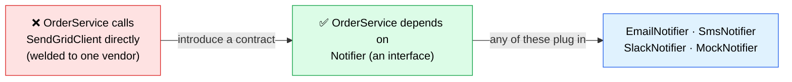
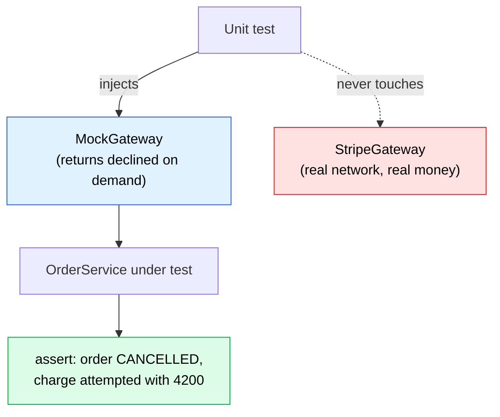
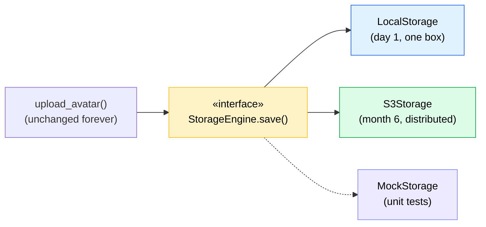

# Interface Design

> **One line:** An interface is a *contract* — a promise about **what** a thing can do, with the **how** left blank — so your high-level code can name the promise and stay blissfully ignorant of which concrete class is actually keeping it.

---

## Table of Contents
1. [Why You Must Master This](#1-why-you-must-master-this)
2. [The Mental Model](#2-the-mental-model)
3. [The Contract / Implementation / Substitution Model](#3-the-contract--implementation--substitution-model)
4. [Interface Segregation — Keep Contracts Small](#4-interface-segregation--keep-contracts-small)
5. [Explicit vs Structural (Duck) Typing](#5-explicit-vs-structural-duck-typing)
6. [Abstract Class vs Interface](#6-abstract-class-vs-interface)
7. [Mocking — Interfaces Are What Make Code Testable](#7-mocking--interfaces-are-what-make-code-testable)
8. [Worked Example — Swapping the StorageEngine](#8-worked-example--swapping-the-storageengine)
9. [Real-Life Use Cases](#9-real-life-use-cases)
10. [Failure Modes](#10-failure-modes)
11. [🏋️ Practice Drills](#-practice-drills)
12. [🎤 Interview Q&A Bank](#-interview-qa-bank)
13. [🎯 Staff+ Nuances](#-staff-nuances)
14. [Cheat Sheet](#14-cheat-sheet)
15. [Connections & Further Reading](#15-connections--further-reading)

---

## 1. Why You Must Master This

"Program to an interface, not an implementation" is the most reused sentence in object-oriented design — because almost every other good property of a codebase falls out of it.

- **Decoupling is the whole game.** An interface lets you swap `MySQLUserRepo` for `PostgresUserRepo` — or local disk for S3 — without touching one line of business logic. High-level policy names a *contract*; the low-level detail merely fulfils it.
- **Testability is not optional at scale.** You cannot charge a real card in a unit test. Behind a `PaymentGateway` interface you inject a `MockPaymentGateway` that returns "declined" on demand, testing the failure path deterministically, in milliseconds, offline.
- **It unlocks parallel teams.** Define the interface first and the backend can build the real implementation while the frontend codes against a mock — the contract is the coordination point; neither side blocks the other.
- **It is the mechanical basis of the SOLID payoff.** The "D" (Dependency Inversion) and "I" (Interface Segregation) in [SOLID_Principles.md](./SOLID_Principles.md) are both *about* interfaces; [Dependency_Injection.md](./Dependency_Injection.md) supplies the chosen implementation; Strategy and Adapter in [Design_Patterns_Overview.md](./Design_Patterns_Overview.md) are interfaces wearing hats.

> **The core problem it solves:** rigid dependencies. Without an interface, `NotificationService` calls `SendGridClient` directly — so the day SendGrid gets expensive or goes down, you rewrite `NotificationService`. With a `Notifier` interface, you write one new class and change one wiring line.

---

## 2. The Mental Model

An interface is a **wall outlet.** It defines a *shape* (the prongs) and a *contract* (120V, 60Hz), and does not care whether you plug in a lamp, a charger, or a toaster — any device that fits the socket gets power. The grid and the device are **decoupled** by a standardized contract, so either side changes independently.

Your `OrderService` is the grid. `Notifier` is the socket. `EmailNotifier`, `SmsNotifier`, `SlackNotifier`, and `MockNotifier` are the appliances. Business code plugs into the socket, never into a specific appliance.





---

## 3. The Contract / Implementation / Substitution Model

Three moving parts, and the whole idea lives in the relationship between them:

| Part | What it is | Example |
|------|-----------|---------|
| **The contract** | Method signatures (names, params, return types) — the *what*, no logic | `Notifier.send(msg) -> bool` |
| **The implementation** | Concrete code that fulfils the contract — the *how* | `EmailNotifier`, `SlackNotifier` |
| **Substitution** | Passing *any* implementation where the interface is expected | `OrderService(notifier=SlackNotifier())` |

The magic word is **substitution**. Because `OrderService` is typed against `Notifier`, every implementation is a legal argument — and the choice moves out of business logic up to the *wiring layer* (a factory, a config switch, a DI container).

```python
from abc import ABC, abstractmethod

class Notifier(ABC):                      # THE CONTRACT — what, not how
    @abstractmethod
    def send(self, msg: str) -> bool: ...

class EmailNotifier(Notifier):            # AN IMPLEMENTATION
    def send(self, msg: str) -> bool:
        return sendgrid.deliver(msg)

class SlackNotifier(Notifier):            # ANOTHER IMPLEMENTATION
    def send(self, msg: str) -> bool:
        return slack.post(channel="#ops", text=msg)

class OrderService:                       # HIGH-LEVEL POLICY
    def __init__(self, notifier: Notifier):   # depends on the CONTRACT only
        self._notifier = notifier

    def place(self, order):
        save(order)
        self._notifier.send(f"Order {order.id} confirmed")  # doesn't care HOW

# SUBSTITUTION happens at the wiring layer — business logic never changes:
service = OrderService(SlackNotifier())   # swap to EmailNotifier() with one edit
```

The load-bearing rule: **dependency arrows point at the abstraction.** Both high-level `OrderService` and low-level `SlackNotifier` depend on `Notifier`; neither depends on the other. That inversion is exactly the "D" of SOLID — see [SOLID_Principles.md](./SOLID_Principles.md).

---

## 4. Interface Segregation — Keep Contracts Small

**No client should be forced to depend on methods it does not use.** A fat interface couples everyone to everything; a small interface couples only what genuinely belongs together. This is the "I" in SOLID, and it is the discipline that keeps contracts honest.

Consider a bloated `Worker` interface:

```python
class Worker(ABC):            # ❌ FAT — assumes every worker is human
    @abstractmethod
    def work(self): ...
    @abstractmethod
    def eat(self): ...        # a RobotWorker has no business eating
```

A `RobotWorker` is now forced to implement `eat()` — probably by `raise NotImplementedError`, which is a runtime landmine and a Liskov violation. Segregate:

```python
class Workable(ABC):
    @abstractmethod
    def work(self): ...

class Feedable(ABC):
    @abstractmethod
    def eat(self): ...

class Human(Workable, Feedable): ...   # implements both
class Robot(Workable): ...             # implements only what it can honour
```

| Symptom of a bloated interface | What it forces | The segregated fix |
|--------------------------------|----------------|--------------------|
| Implementers stubbing methods with `NotImplementedError` | Lying about the contract | Split into role interfaces |
| One tiny change ripples to 20 unrelated classes | Recompile / retest the world | Narrow, cohesive contracts |
| "God" service interface with 30 methods | Impossible to mock, impossible to reason about | Client-specific interfaces |

> Rule of thumb: **prefer several small, role-named interfaces (`Readable`, `Closeable`, `Notifier`) over one `EverythingService`.** The best interface in the wild — Go's `io.Reader` — has exactly one method.

---

## 5. Explicit vs Structural (Duck) Typing

How does a type get *bound* to an interface? Languages disagree, and the difference matters.

| Model | Language | How binding happens | Trade-off |
|-------|----------|---------------------|-----------|
| **Explicit / nominal** | Java, C#, TypeScript (`implements`) | You declare `class X implements Y` | Discoverable, compiler-checked; but coupling is stated up front |
| **Structural** | Go, TypeScript (shape check) | If the type *has the methods*, it satisfies the interface — no keyword | Zero coupling; you can satisfy an interface defined *after* your type |
| **Duck typing** | Python, Ruby | Checked at *runtime*: "if it quacks, it's a duck" | Maximum flexibility; failures surface at call time, not compile time |

**Go's `io.Reader`** is the canonical structural interface — one method, and thousands of types satisfy it without ever naming it:

```go
type Reader interface {
    Read(p []byte) (n int, err error)
}
// *os.File, *bytes.Buffer, net.Conn, gzip.Reader all satisfy Reader
// WITHOUT writing "implements Reader" anywhere. So io.Copy(dst, src)
// works over files, sockets, and in-memory buffers with identical code.
```

**JDBC** is the canonical *explicit* interface. `java.sql.Connection`, `Statement`, and `ResultSet` are JDK interfaces; Oracle, MySQL, and Postgres each ship a *driver* that explicitly implements them. Your code writes SQL against the JDBC contract and the driver is chosen at connection time — the same payoff, arrived at nominally.

**Python** sits in the middle: duck typing works out of the box, `abc.ABC` + `@abstractmethod` lets you *opt into* enforced contracts, and `typing.Protocol` gives *structural* typing for static checkers — the best of both worlds.

```python
from typing import Protocol

class SupportsClose(Protocol):     # structural — no inheritance needed
    def close(self) -> None: ...

def shutdown(resource: SupportsClose):   # any object with close() fits
    resource.close()
```

---

## 6. Abstract Class vs Interface

The classic interview question. Both define a contract; the difference is what *else* they may carry.

| Dimension | Interface | Abstract Class |
|-----------|-----------|----------------|
| **State (fields)** | No instance state (traditionally) | Can hold fields / state |
| **Implemented methods** | Contract only (Java 8+ allows `default` methods) | Can provide concrete, shared method bodies |
| **Multiple inheritance** | A class can implement **many** interfaces | Usually only **one** base class |
| **Relationship it models** | **"CAN-DO"** capability (`Comparable`, `Serializable`) | **"IS-A"** identity with shared machinery |
| **Constructor** | None | Yes |

Rule of thumb: **use an interface to declare a capability that unrelated types can share; use an abstract class when implementations are genuinely a family that shares real code.** A `Bird` and an `Airplane` are unrelated but both `Flyable` (interface). A `Circle` and a `Square` are both a `Shape` that shares an `area()`-based `describe()` (abstract class).

```python
from abc import ABC, abstractmethod

class Shape(ABC):                    # ABSTRACT CLASS — shares real code
    @abstractmethod
    def area(self) -> float: ...
    def describe(self) -> str:       # concrete, inherited by all shapes
        return f"A shape of area {self.area():.1f}"

class Serializable(ABC):            # INTERFACE-STYLE — pure capability
    @abstractmethod
    def to_json(self) -> str: ...

class Circle(Shape, Serializable):  # IS-A Shape, CAN-DO Serializable
    def __init__(self, r): self.r = r
    def area(self): return 3.14159 * self.r ** 2
    def to_json(self): return f'{{"r": {self.r}}}'
```

> Signal an interviewer listens for: *"Interface = can-do capability, many per class; abstract class = is-a identity plus shared implementation, one per class. Prefer interfaces for flexibility; reach for an abstract class only when there's real shared code to inherit."*

---

## 7. Mocking — Interfaces Are What Make Code Testable

If `OrderService` `new`-ed up a `StripeGateway` internally, a unit test would hit the real Stripe API — slow, flaky, and impossible to force into the "card declined" branch. Depend on a `PaymentGateway` *interface* and you inject a fake that returns exactly the outcome you want.

```python
class PaymentGateway(ABC):
    @abstractmethod
    def charge(self, cents: int) -> bool: ...

class StripeGateway(PaymentGateway):        # production
    def charge(self, cents): return stripe.charge(cents)

class MockGateway(PaymentGateway):          # test double — deterministic
    def __init__(self, succeeds: bool):
        self.succeeds, self.calls = succeeds, []
    def charge(self, cents):
        self.calls.append(cents)            # record for assertions
        return self.succeeds

def test_declined_payment_cancels_order():
    gw = MockGateway(succeeds=False)
    svc = OrderService(payment=gw)          # inject the fake
    result = svc.checkout(cart_total=4200)
    assert result.status == "CANCELLED"     # tested the failure path offline
    assert gw.calls == [4200]               # and verified the interaction
```



The seam is the interface plus injection: the test *chooses* the implementation. No interface, no seam, and untestable code results. See [Dependency_Injection.md](./Dependency_Injection.md) for how the fake gets wired in.

---

## 8. Worked Example — Swapping the StorageEngine

A photo app stores user avatars. Day one it runs on one box, so files go to local disk. Six months later it needs S3. If the upload logic named `open()` and `write()` directly, this is a rewrite. Behind a `StorageEngine` contract, it is a one-line wiring change.

```python
class StorageEngine(ABC):
    @abstractmethod
    def save(self, key: str, data: bytes) -> None: ...

class LocalStorage(StorageEngine):
    def save(self, key, data):
        with open(key, "wb") as f: f.write(data)

class S3Storage(StorageEngine):
    def save(self, key, data):
        s3_client.put_object(Bucket="avatars", Key=key, Body=data)

def upload_avatar(storage: StorageEngine, user_id: str, data: bytes):
    storage.save(f"{user_id}.jpg", data)   # depends ONLY on the contract
```



Concept → consequence:

- **Concept:** `upload_avatar` names `StorageEngine`, never a file handle or S3 client. → **Consequence:** the disk-to-S3 migration changes *one* line and business logic ships untouched.
- **Concept:** `MockStorage` satisfies the same contract. → **Consequence:** the upload flow is unit-tested with zero I/O and no AWS credentials.
- **Concept:** the contract exposes `save(key, data)`, nothing transport-specific. → **Consequence:** no caller learns it is "on S3," so tomorrow's swap to GCS or HDFS is equally cheap. (A leaky `get_s3_bucket()` would weld every caller to AWS — see [Failure Modes](#10-failure-modes).)

This is the same contract-first move that lets an API boundary evolve its backend without breaking clients — see [../02_API_Interface_Design/API_Design_Fundamentals.md](../02_API_Interface_Design/API_Design_Fundamentals.md).

---

## 9. Real-Life Use Cases

| Situation | How interface design decides the outcome |
|-----------|------------------------------------------|
| **Vendor swap (SendGrid → SES)** | Business logic depends on `Notifier`; write one new class, flip one wiring line — zero churn in callers. |
| **Local dev vs production** | `LocalStorage` for laptops, `S3Storage` in prod — chosen by config, same code path. |
| **Unit testing external systems** | Inject `MockPaymentGateway` / `MockStorage` to test failure branches deterministically, offline. |
| **Parallel team development** | Backend defines the interface; frontend codes against a mock while the real impl is built. |
| **Feature flags / A/B of algorithms** | `RankingStrategy` interface with `V1Ranker` and `V2Ranker` chosen per-request (Strategy pattern). |
| **Cross-cutting standard libs** | Go `io.Reader`, Java JDBC, Python file-like objects — one contract, thousands of implementations. |

> Real-world habit: **the moment your code says `new SomeVendorClient()` inside business logic, stop — name the capability as an interface and inject the vendor at the edge.** Your future self, mid-migration and mid-outage, will thank you.

---

## 10. Failure Modes

```mermaid
mindmap
  root((Interface Pitfalls))
    Leaky abstraction
      method like getSmtpConnection()
      caller now welded to the vendor
    Interface bloat
      30-method God interface
      violates ISP, impossible to mock
    Breaking the contract
      change a signature
      50 implementations must change at once
    Interface-itis
      an interface for every single class
      abstraction with zero second implementer
```

- **Leaky abstraction** — the contract exposes a detail of one implementation (`get_mysql_connection()`, `to_s3_url()`). Every caller now silently depends on that vendor, defeating the whole point. *Fix:* keep the contract in the vocabulary of the *capability*, never the *technology*.
- **Interface bloat** — piling methods on until only one giant class can implement it. It becomes impossible to mock and violates ISP. *Fix:* segregate into small, role-named interfaces (§4).
- **Breaking the contract** — changing a method signature forces a lockstep edit across every implementation and caller. *Fix:* treat a published interface as frozen; add a *new* method or a *new* interface (`Notifier2`) rather than mutating the old one — the same versioning discipline as [../02_API_Interface_Design/API_Versioning.md](../02_API_Interface_Design/API_Versioning.md).
- **Interface-itis** — reflexively creating an interface (and a factory) for every class, including ones with exactly one implementer that will never have a second. *Fix:* introduce the abstraction when the *second* implementation (or the test double) actually arrives, not speculatively. YAGNI applies to seams too.

---

## 🏋️ Practice Drills

> *Cover the solutions and attempt first — active recall is the point.*

**Drill 1 — Spot the leak.** A teammate proposes `interface Cache { getRedisClient(): RedisClient }`. What's wrong, and what should the contract be?

<details><summary>Solution</summary>

`getRedisClient()` leaks the implementation through the abstraction — every caller is coupled to Redis, so you can never swap to Memcached or an in-memory map. The contract should speak the *capability*: `interface Cache { get(key); set(key, value, ttl) }`. That it's backed by Redis stays private to the implementation.
</details>

**Drill 2 — Segregate the fat interface.** `interface Machine { print(); scan(); fax(); staple() }`. A simple `Printer` can only print. Why is this bad, and how do you fix it?

<details><summary>Solution</summary>

`Printer` is forced to implement `scan/fax/staple`, almost certainly by throwing `NotImplementedError` — a lie about the contract and an ISP violation. Split into role interfaces `Printable`, `Scannable`, `Faxable`, `Stapleable`. A basic printer implements `Printable`; an all-in-one implements all four. Clients depend only on the narrow interface they use.
</details>

**Drill 3 — Make it testable.** `class Report { run(): rows = Database.connect().query("..."); return summarize(rows) }`. Why can't you unit-test `summarize` in isolation, and how does an interface fix it?

<details><summary>Solution</summary>

`Report` reaches out to a real `Database` singleton, so any test hits the live DB. Introduce `interface DataSource { query(sql) }`, inject it via the constructor (`Report(source: DataSource)`), and pass a `MockDataSource` returning canned rows in the test. Now `summarize` is tested deterministically with no I/O.
</details>

**Drill 4 — Abstract class or interface?** `Circle`, `Square`, `Triangle` all need `area()` and a shared `describe()` that prints the area. All should also be `Drawable`, alongside unrelated types like `Sprite` and `Button`. What goes where?

<details><summary>Solution</summary>

`Shape` is an **abstract class**: `area()` abstract, `describe()` concrete shared code (IS-A + shared machinery). `Drawable` is an **interface**: a capability shared by unrelated types (`Shape`, `Sprite`, `Button`) with no common implementation. So `class Circle(Shape, Drawable)`. Interface for cross-cutting capability, abstract class for a real family with shared code.
</details>

---

## 🎤 Interview Q&A Bank

**Q1. What does "program to an interface, not an implementation" mean?**
> Type high-level code against an abstraction (the contract), not a concrete class, so the concrete choice swaps without changing that code. The dependency arrow points at the interface from both sides — policy and detail both depend on the abstraction, neither on each other. (signal: Dependency Inversion.)

**Q2. Difference between an abstract class and an interface?**
> An interface is a pure contract modelling a *can-do* capability, and a class can implement many. An abstract class models an *is-a* identity, can carry state and concrete shared methods, but a class extends only one. Interface for capabilities shared by unrelated types; abstract class for a real family with code to share. (signal: the most common LLD question — answer crisply.)

**Q3. How do interfaces enable unit testing?**
> They create a *seam*: because code depends on an interface, a test injects a mock instead of the real thing, letting you test failure paths (payment declined, disk full) deterministically and offline — impossible if the class instantiated its dependency directly. (signal: Dependency Injection.)

**Q4. What is the Interface Segregation Principle?**
> No client should be forced to depend on methods it doesn't use. Prefer many small, role-specific interfaces over one fat one, so implementers don't stub methods and changes don't ripple. Go's one-method `io.Reader` is the ideal. (signal: the "I" in SOLID.)

**Q5. Explicit vs structural typing?**
> Explicit/nominal: you declare `implements` (Java, C#) — discoverable, compiler-checked. Structural: any type with the right methods satisfies it automatically (Go, TS shapes) — zero coupling. Duck typing (Python, Ruby) is the runtime version: if it quacks, it's a duck. (signal: language-design breadth.)

**Q6. A real-world standard interface, and why it matters?**
> Go's `io.Reader` — one `Read` method — is satisfied by files, sockets, buffers, and gzip streams, so `io.Copy` works over all with identical code. Or JDBC: one interface set, one driver per database. Both prove the payoff: thousands of implementations, one contract. (signal: knows the canon.)

**Q7. When should you NOT introduce an interface?**
> When there's one implementation, no realistic second, and no test double needed — a speculative interface is just indirection (interface-itis). Add the seam when impl #2 or the mock actually arrives. (signal: pragmatism, not dogma.)

**Q8. What's a leaky abstraction and how do you avoid it?**
> An interface exposing an implementation detail — `Cache.getRedisClient()` — coupling callers to that tech so it can't be swapped. Avoid it by phrasing the contract in the vocabulary of the capability (`get`/`set`), never the vendor. (signal: senses coupling.)

---

## 🎯 Staff+ Nuances

- **The interface belongs to the client, not the implementation.** In clean architecture the *consumer* defines the interface it needs and the provider implements it, inverting the dependency so stable policy doesn't depend on volatile details. Dependency Inversion done properly — see [SOLID_Principles.md](./SOLID_Principles.md) and [Dependency_Injection.md](./Dependency_Injection.md).
- **Small interfaces compose; large ones calcify.** A one-method `io.Reader` can be adapted, decorated, and combined endlessly. Every method you add is one every future implementer and mock must honour — cost compounds. Minimalism here is load-bearing, not aesthetics.
- **Structural typing decouples across ownership boundaries.** In Go you can define an interface a *third-party* type already satisfies without touching their code. Nominal typing can't — a reason to accept the widest interface you can even in Java (`Iterable`, not `ArrayList`).
- **A published interface is a versioning contract, not just a type.** Once others implement or consume it, changing a signature is a breaking change with API-break blast radius — add methods or new interfaces instead of mutating. Same discipline as [../02_API_Interface_Design/API_Versioning.md](../02_API_Interface_Design/API_Versioning.md), and it connects to Liskov: a subtype must honour the *behavioural* contract, not just the syntactic one.
- **Interfaces are the substrate of the GoF patterns.** Strategy swaps the algorithm behind an interface, Adapter makes an incompatible class satisfy one, Observer is a `Listener` interface. Mastering interfaces is mastering their vocabulary — see [Design_Patterns_Overview.md](./Design_Patterns_Overview.md).
- **Mocking is a design-smell detector.** If a class is hard to mock, it usually reaches for its dependencies instead of receiving them, or its interface is too fat. "How would I test this?" is a fast proxy for "are my boundaries right?" — see [Object_Oriented_Design.md](./Object_Oriented_Design.md) and [Class_Design.md](./Class_Design.md).
- **Use default methods sparingly.** Java 8 `default` methods and Python mixins let interfaces carry behaviour, blurring the line with abstract classes. Handy to *evolve* a published interface without breaking implementers — but overused they smuggle state and diamond-inheritance back in. Evolve, don't design, with them.

---

## 14. Cheat Sheet

```
PROGRAM TO AN INTERFACE, NOT AN IMPLEMENTATION.
  contract (WHAT)  →  implementation (HOW)  →  substitution (pick at the wiring layer)
  dependency arrows point AT the abstraction from BOTH sides (Dependency Inversion).

WHY IT PAYS
  ✓ decoupling (swap MySQL→Postgres, Local→S3, SendGrid→SES) with one wiring edit
  ✓ testability (inject a mock; test failure paths offline & deterministically)
  ✓ parallel teams (define interface first; frontend mocks while backend builds)
  ✓ extension (add an impl without touching callers — Open/Closed)

INTERFACE SEGREGATION (the "I")
  many small role interfaces > one God interface.  io.Reader = 1 method, ideal.
  smell: implementers throwing NotImplementedError.

TYPING MODELS
  explicit/nominal  Java, C#, TS `implements`     — declared, compiler-checked
  structural        Go, TS shapes, py Protocol    — has methods ⇒ satisfies, zero coupling
  duck              Python, Ruby                   — checked at runtime ("quacks ⇒ duck")

INTERFACE vs ABSTRACT CLASS
  interface       = CAN-DO capability · many per class · no state (mostly)
  abstract class  = IS-A family · one per class · shared code + state · constructor

FAILURE MODES → FIX
  leaky abstraction  getRedisClient()      → speak the capability, not the vendor
  interface bloat    30-method God iface    → segregate into role interfaces
  breaking contract  change a signature     → freeze it; add new method/interface
  interface-itis     an iface per class     → add the seam when impl #2 / a mock arrives

CANON  Go io.Reader · Java JDBC · file-like objects.   Patterns: Strategy · Adapter · Observer.
```

---

## 15. Connections & Further Reading

**Within this repo:**
- [SOLID_Principles.md](./SOLID_Principles.md) — the "I" (Interface Segregation) and "D" (Dependency Inversion) are *about* interfaces.
- [Dependency_Injection.md](./Dependency_Injection.md) — how the chosen implementation gets supplied at the wiring layer.
- [Design_Patterns_Overview.md](./Design_Patterns_Overview.md) — Strategy and Adapter are interfaces in disguise.
- [Object_Oriented_Design.md](./Object_Oriented_Design.md) · [Class_Design.md](./Class_Design.md) — where interfaces sit in overall OO and class structure.
- [../02_API_Interface_Design/API_Design_Fundamentals.md](../02_API_Interface_Design/API_Design_Fundamentals.md) — the same contract-first thinking at the network/API boundary.

**External classics:**
- *Effective Java* (Joshua Bloch) — the definitive treatment of interface design (favour composition, prefer interfaces to abstract classes).
- *Design Patterns* (Gamma, Helm, Johnson, Vlissides) — origin of "program to an interface."
- [Go by Example: Interfaces](https://gobyexample.com/interfaces) · [Interfaces in C# (Microsoft)](https://learn.microsoft.com/en-us/dotnet/csharp/fundamentals/types/interfaces) · [TypeScript: Interfaces](https://www.typescriptlang.org/docs/handbook/2/everyday-types.html#interfaces).

---

## TL;DR
An interface is a **contract — the *what* with the *how* left blank** — and the master rule is **program to the interface, not the implementation**, so your high-level code names a capability while any concrete class fulfils it. That one move buys **decoupling** (swap vendors or backends with a single wiring edit), **testability** (inject a mock to drive failure paths offline), and **extensibility** (add an implementation without touching callers). Keep contracts **small and segregated** (`io.Reader` is the ideal), know that **interface = can-do capability while abstract class = is-a family with shared code**, and **guard against leaky abstractions, bloat, contract breaks, and interface-itis**. When business logic reaches for `new SomeVendorClient()`, stop — **name the capability, depend on the abstraction, inject the detail at the edge.**
