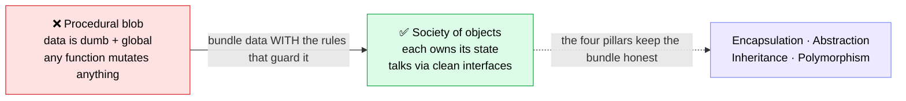
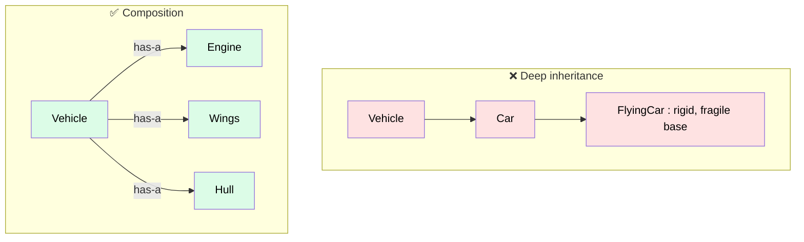
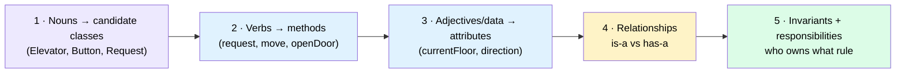
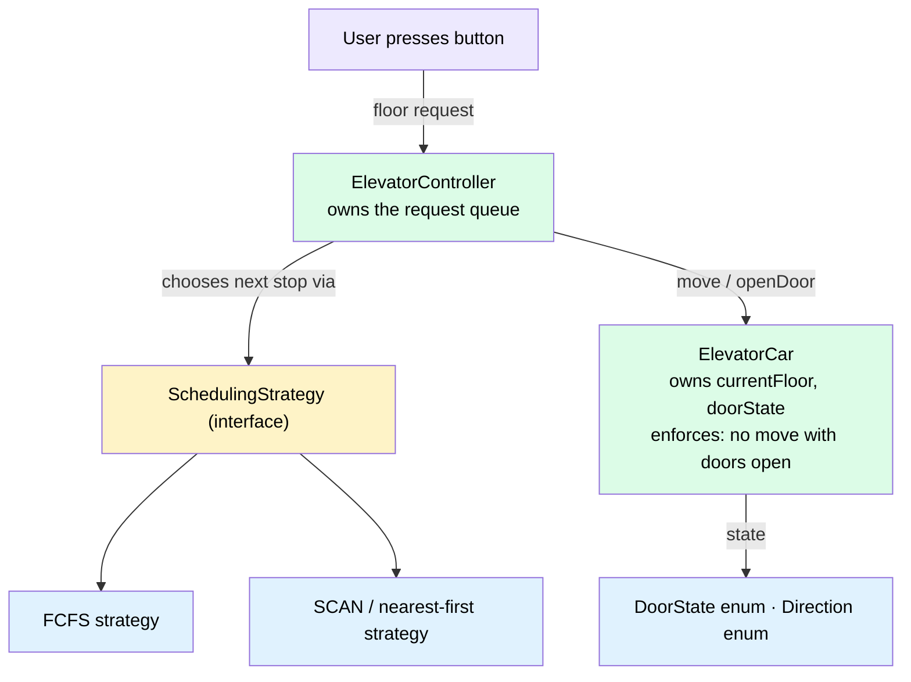
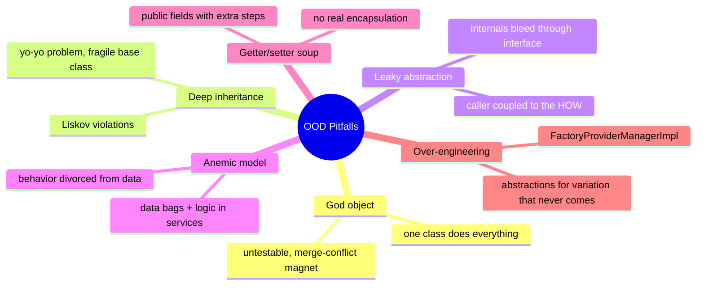

# Object-Oriented Design

> **One line:** Model a system as a society of small, self-governing objects — each owning its own data and behavior and talking through clean interfaces — so that complexity stays local and change stays cheap.

---

## Table of Contents
1. [Why You Must Master This](#1-why-you-must-master-this)
2. [The Mental Model](#2-the-mental-model)
3. [Encapsulation — Guard Your State](#3-encapsulation--guard-your-state)
4. [Abstraction — Expose What, Hide How](#4-abstraction--expose-what-hide-how)
5. [Inheritance & Polymorphism — Share Type, Vary Behavior](#5-inheritance--polymorphism--share-type-vary-behavior)
6. [Composition over Inheritance](#6-composition-over-inheritance)
7. [Mapping a Domain to Objects](#7-mapping-a-domain-to-objects)
8. [Worked Example — Designing an Elevator System](#8-worked-example--designing-an-elevator-system)
9. [Real-Life Use Cases](#9-real-life-use-cases)
10. [Failure Modes](#10-failure-modes)
11. [🏋️ Practice Drills](#-practice-drills)
12. [🎤 Interview Q&A Bank](#-interview-qa-bank)
13. [🎯 Staff+ Nuances](#-staff-nuances)
14. [Cheat Sheet](#14-cheat-sheet)
15. [Connections & Further Reading](#15-connections--further-reading)

---

## 1. Why You Must Master This

Object-Oriented Design is the vocabulary the entire low-level-design interview is spoken in — and the discipline that keeps large codebases from collapsing under their own weight. Get it wrong and every other pattern you layer on top inherits the rot.

- **It's the language of every LLD round.** "Design a parking lot / elevator / vending machine" is really "show me you can turn a messy real-world domain into cohesive objects with clean responsibilities." You can't fake this with syntax; it's modeling judgment.
- **It localizes complexity.** By making each object own its own data and the rules that protect it, a bug in tax calculation lives in one place — not smeared across 200 files of procedural code touching a shared global.
- **It's the foundation the rest of LLD stands on.** [SOLID_Principles.md](./SOLID_Principles.md), [Design_Patterns_Overview.md](./Design_Patterns_Overview.md), and [Domain_Driven_Design.md](./Domain_Driven_Design.md) are all *refinements* of the four pillars. Weak OOD makes them incoherent.
- **Knowing when NOT to use it is the senior signal.** The junior applies inheritance everywhere; the senior reaches for composition, keeps objects small, and knows a stateless transform doesn't need a `FactoryProviderManager`.

> **The core problem it solves:** the "everything affects everything" tangle of procedural code, where data is a dumb shared blob and any function can corrupt any state. OOD replaces that with **smart actors that protect their own invariants** and communicate through narrow, stable contracts.

---

## 2. The Mental Model

Think of a **corporation**, not a spreadsheet. In a spreadsheet (procedural code), the data just sits in cells and any macro can overwrite any cell — one bad formula corrupts the whole sheet. In a corporation (OOD), you don't reach into the Finance department's filing cabinet and change a number; you *send Finance a request* ("record this payment"), and Finance enforces its own rules before touching its own records. Each department (object) owns its data, guards its invariants, and exposes a small set of things you're allowed to ask it to do.





The four pillars aren't trivia to recite — they're four *different guarantees* an object gives its neighbors, covered one at a time below.

---

## 3. Encapsulation — Guard Your State

**Encapsulation** means an object hides its internal state and forces all interaction through methods that enforce its rules (invariants). The data is *private*; the behavior is *public*. This is the pillar that prevents the "impossible to reproduce" class of bug, because there's exactly one code path that can change a given piece of state.

The test: *can any outside code put this object into an invalid state?* If yes, it isn't encapsulated. With `balance` public, any caller can write `account.balance = -9999`; the fix is to hide the field and force every change through a guarded method.

```python
class BankAccount:                # ✅ the object guards its own invariant
    def __init__(self):
        self.__balance = 0        # private (name-mangled): no direct writes

    def deposit(self, amount: float) -> None:
        if amount <= 0: raise ValueError("deposit must be positive")
        self.__balance += amount

    def withdraw(self, amount: float) -> None:
        if amount > self.__balance:
            raise ValueError("insufficient funds")   # invariant enforced HERE, once
        self.__balance -= amount

    @property
    def balance(self) -> float:   # read-only view; no setter exposed
        return self.__balance
```

| Aspect | Exposed state (bad) | Encapsulated (good) |
|--------|---------------------|---------------------|
| **Who can break the invariant** | anyone with a reference | only the class's own methods |
| **Where to look when balance is wrong** | everywhere | inside `deposit`/`withdraw` |
| **Changing the internal representation** | breaks every caller | invisible to callers |
| **Concurrency safety** | callers must remember to lock | the class can lock internally |

> Encapsulation is not "add getters and setters to every field." A setter for every private field is just a public field with extra steps. Expose *behavior* (`withdraw`), not *state* (`setBalance`). See [Class_Design.md](./Class_Design.md).

---

## 4. Abstraction — Expose What, Hide How

**Abstraction** is designing the *interface* — deciding what an object promises to do, independent of how it does it. Encapsulation hides *data*; abstraction hides *implementation and complexity*. You call `camera.take_photo()` without knowing about sensor exposure, autofocus, or JPEG encoding.

The two are complementary: abstraction defines the clean contract; encapsulation enforces that nobody bypasses it.

```python
class PaymentGateway(ABC):          # the ABSTRACTION: the contract, no implementation
    @abstractmethod
    def charge(self, amount_cents: int, token: str) -> str: ...

class StripeGateway(PaymentGateway):     # one hidden HOW
    def charge(self, amount_cents, token):
        return self._stripe_sdk.charges.create(amount_cents, token).id

class PayPalGateway(PaymentGateway):     # a different hidden HOW
    def charge(self, amount_cents, token):
        return self._paypal_client.execute(amount_cents, token)["txn"]

def checkout(gateway: PaymentGateway, total_cents: int, token: str) -> str:
    return gateway.charge(total_cents, token)   # depends on the interface, not a class
```

Because `checkout` depends on the *interface* rather than a concrete class, you can swap Stripe for PayPal, or inject a `FakeGateway` in tests, without touching a line of it. That "depend on the abstraction, not the concretion" move is the Dependency-Inversion idea — see [Dependency_Injection.md](./Dependency_Injection.md) and [Interface_Design.md](./Interface_Design.md).

> A **leaky abstraction** is one whose implementation details bleed through the interface (e.g., a `Repository` that returns raw SQL rows, or throws `psycopg2.OperationalError`). The rule: the interface should let a caller do their job *without ever needing to know what's behind it*.

---

## 5. Inheritance & Polymorphism — Share Type, Vary Behavior

These two travel together. **Inheritance** models an *is-a* relationship — a `SavingsAccount` **is a** `BankAccount` — and lets a subtype reuse and specialize a base type. **Polymorphism** is the payoff: code written against the base type automatically invokes the *right* subtype's behavior at runtime, so one call site handles many concrete types.

```python
class Shape(ABC):
    @abstractmethod
    def area(self) -> float: ...

class Circle(Shape):
    def __init__(self, r): self.r = r
    def area(self): return 3.14159 * self.r ** 2

class Rectangle(Shape):
    def __init__(self, w, h): self.w, self.h = w, h
    def area(self): return self.w * self.h

# POLYMORPHISM: this loop never mentions Circle or Rectangle.
# Adding a Triangle later requires ZERO changes here.
def total_area(shapes: list[Shape]) -> float:
    return sum(s.area() for s in shapes)   # each shape runs its own area()
```

The strategic value of polymorphism is **eliminating conditionals on type**. It replaces the anti-pattern where a function branches on `shape.kind == "circle" / "rect" / ...` and must be edited for every new shape (violating Open/Closed) with a single call site that never changes.

| Term | Meaning | Example |
|------|---------|---------|
| **Subtype polymorphism** | one interface, many runtime types | `total_area([Circle(), Rectangle()])` |
| **Overriding** | subtype replaces base behavior | `Circle.area` overrides `Shape.area` |
| **Overloading** | same name, different signatures (compile-time) | `add(int,int)` vs `add(str,str)` (not in Python) |
| **Liskov substitution** | a subtype must be usable *anywhere* the base is | a `Square` that breaks `setWidth` violates it |

> The trap: inheritance is the *most tightly coupled* relationship in OOP — a subclass depends on its parent's internals and breaks when the parent changes (the "fragile base class" problem). Use it only for genuine *is-a* substitutability that honors Liskov. For everything else, reach for the next section. See [SOLID_Principles.md](./SOLID_Principles.md) for Liskov (L) and Open/Closed (O).

---

## 6. Composition over Inheritance

The single most important maturity signal in OOD: **prefer composition (has-a) to inheritance (is-a)**. Instead of building tall class trees, build objects by *assembling smaller objects*. Inheritance locks behavior in at compile time and couples you to a parent forever; composition lets you swap parts at runtime and combine capabilities freely.

The classic failure is the rigid tree: `Vehicle → Car → FlyingCar`. What about a `FlyingBoat`? A `Submarine`? Inheritance forces a single classification axis; reality has many.

```python
# ❌ Inheritance explosion — one axis of classification can't model many capabilities
class Vehicle: ...
class Car(Vehicle): ...
class FlyingCar(Car): ...          # now where does a FlyingBoat go?

# ✅ Composition — assemble capabilities from small, swappable parts
class Engine:      ...
class Wings:       ...
class Hull:        ...

class Vehicle:
    def __init__(self, propulsion, movers):
        self.propulsion = propulsion   # HAS-A engine
        self.movers = movers           # HAS-A wheels / wings / hull

flying_car = Vehicle(Engine(), [Wings()])
flying_boat = Vehicle(Engine(), [Wings(), Hull()])   # trivially combined
```



| | Inheritance (is-a) | Composition (has-a) |
|---|---|---|
| **Coupling** | tightest — subclass sees parent internals | loose — depends only on part's interface |
| **When behavior can change** | compile time, fixed | runtime, swappable |
| **Combining capabilities** | single axis; explodes combinatorially | mix parts freely |
| **Reuse mechanism** | "borrow" a parent's implementation | delegate to a held object |
| **Right when** | true, stable *is-a* + Liskov holds | almost everywhere else |

> The rule of thumb: **inherit only to be substitutable; compose to reuse.** If you're subclassing merely to grab some methods (not because callers should treat the child *as* the parent), you want a field, not a base class. This is the engine behind the Strategy, Decorator, and Adapter patterns in [Design_Patterns_Overview.md](./Design_Patterns_Overview.md).

---

## 7. Mapping a Domain to Objects

Turning a word problem into objects is the actual skill an LLD interview tests. A reliable procedure:



1. **Nouns become candidate classes.** From "a user requests an elevator to a floor" you get `User`, `Elevator`, `Request`, `Floor`. Prune the ones that are really just data or duplicates.
2. **Verbs become methods.** "requests", "moves", "opens the door" → `request()`, `move()`, `open_door()`. Put each verb on the object that *owns the data it acts on*.
3. **Adjectives / state become attributes.** `current_floor`, `direction`, `door_state`.
4. **Decide relationships.** A `Building` *has-a* set of `Elevator`s (composition). An `ExpressElevator` *is-a* `Elevator` only if it's genuinely substitutable — otherwise compose a scheduling strategy instead.
5. **Assign invariants and single responsibilities.** Each class guards its own rules ("an elevator can't move with doors open") and has *one reason to change* — the [SOLID_Principles.md](./SOLID_Principles.md) SRP, the same principle as [../03_High_Level_Design/Component_Responsibilities.md](../03_High_Level_Design/Component_Responsibilities.md) one zoom level down.

> Watch for the two smells: a **God object** that soaks up every verb (`SystemManager.doEverything()`), and **anemic objects** that are pure data bags with the behavior stranded in a separate "service." Behavior belongs *with* the data it guards. Formalize this modeling with [Domain_Driven_Design.md](./Domain_Driven_Design.md) (entities, value objects, aggregates) and draw it with [UML_Diagrams.md](./UML_Diagrams.md).

---

## 8. Worked Example — Designing an Elevator System

The canonical LLD prompt. Watch the four pillars and composition do real work.

**Domain mapping.** Nouns → `ElevatorCar`, `Request`, `Button`, `ElevatorController`, `Direction`, `DoorState`. Verbs → `request_floor`, `move`, `open_door`. The scheduling *policy* (how we pick the next stop) is deliberately pulled out as a swappable strategy — because that's the part most likely to change.



```python
class DoorState(Enum): OPEN = 1; CLOSED = 2

class SchedulingStrategy(ABC):            # ABSTRACTION: the policy contract
    @abstractmethod
    def next_stop(self, current: int, pending: set[int]) -> int | None: ...

class ScanStrategy(SchedulingStrategy):   # one interchangeable HOW (nearest-first)
    def next_stop(self, current, pending):
        return min(pending, key=lambda f: abs(f - current)) if pending else None

class ElevatorCar:                         # ENCAPSULATION: guards its own invariants
    def __init__(self):
        self.__floor, self.__door = 0, DoorState.CLOSED

    def move_to(self, floor: int) -> None:
        if self.__door is DoorState.OPEN:                 # invariant enforced HERE, once
            raise RuntimeError("cannot move with doors open")
        self.__floor = floor

    @property
    def floor(self) -> int: return self.__floor

class ElevatorController:                   # COMPOSITION: has-a car, has-a strategy
    def __init__(self, car: ElevatorCar, strategy: SchedulingStrategy):
        self._car, self._strategy = car, strategy   # swap FCFS ↔ SCAN, no controller change
        self._pending: set[int] = set()

    def request_floor(self, floor: int) -> None:
        self._pending.add(floor)

    def step(self) -> None:
        target = self._strategy.next_stop(self._car.floor, self._pending)
        if target is None: return
        self._car.move_to(target)              # car refuses if doors open
        self._pending.discard(target)
```

**Close the loop — concept → consequence:**
- **Encapsulation** put the "no move with doors open" safety rule in *one* place (`ElevatorCar.move_to`) — no controller, strategy, or test can bypass it.
- **Abstraction + polymorphism** made scheduling a `SchedulingStrategy`, so swapping FCFS for SCAN (or A/B-testing a new algorithm) touches *zero* controller code — Open/Closed in action.
- **Composition** means the controller *has-a* car and *has-a* strategy rather than inheriting either; a `FreightElevatorController` reuses the car with a different strategy — no fragile base class.
- The door/direction state is a tiny **state machine**; formalize larger ones with [State_Machines.md](./State_Machines.md).

---

## 9. Real-Life Use Cases

| Situation | How OOD decides the outcome |
|-----------|------------------------------|
| **Java/Python Collections** | `List` is an abstraction; `ArrayList`/`LinkedList` are hidden implementations — swap without changing calling code (abstraction + polymorphism). |
| **Payment processing** | A `PaymentGateway` interface with Stripe/PayPal/Adyen implementations — add a provider without touching checkout. |
| **Game entities** | Composition of `Position`, `Health`, `Renderable` components beats a `Player → Enemy → Boss` tree (entity-component systems). |
| **UI toolkits** | A `Button` *is-a* `Widget` (legit is-a) but *has-a* `ClickHandler` (composition for behavior). |
| **Plugin architectures** | Depend on a plugin *interface*; third parties supply implementations you never compiled against. |
| **Test doubles** | Program to interfaces → inject a `FakeRepository` in unit tests without a real database. |

> Real-world habit: **before writing a class, ask "what does this object *own*, and what's the one rule it must never let anyone break?"** Then expose behavior for that rule and hide the data behind it. If a second unrelated rule shows up, that's a second object.

---

## 10. Failure Modes



- **God object** — one class (`SystemManager`, `Utils`) absorbs every responsibility. *Symptom:* can't name it without "and"; every feature edits it. *Fix:* split by responsibility (SRP); give behavior to the object that owns the data.
- **Deep inheritance / fragile base class** — a 6-level tree where changing a grandparent breaks distant descendants (the "yo-yo problem"). *Symptom:* you jump up and down the hierarchy to understand one method. *Fix:* flatten to composition; inherit only for substitutable *is-a*.
- **Leaky abstraction** — the interface exposes implementation (`repo.get()` returns ORM rows or throws DB-specific errors). *Symptom:* callers import database libraries. *Fix:* return DTOs/value objects; translate errors at the boundary.
- **Anemic domain model** — objects are pure data with all logic in a separate "service" layer. *Symptom:* `account.balance = x` scattered everywhere. *Fix:* move the invariant-guarding behavior onto the object.
- **Getter/setter soup** — a setter for every field. *Symptom:* no invariant is actually protected. *Fix:* expose behavior (`withdraw`), not raw state (`setBalance`).
- **Over-engineering** — speculative abstraction for flexibility no one needs. *Symptom:* `AbstractSingletonProxyFactoryBean`. *Fix:* add abstraction only for variation that *actually exists* (YAGNI).

---

## 🏋️ Practice Drills

> *Cover the solutions and attempt first — active recall is the point.*

**Drill 1 — Spot the broken encapsulation.** A `ShoppingCart` exposes `public items: list` and elsewhere the code does `cart.items.append(x)` and `cart.total += x.price`. What invariant is at risk, and how do you seal it?

<details><summary>Solution</summary>

The invariant "`total` equals the sum of item prices" is unprotected — any caller can add an item without updating the total, or corrupt `total` directly. Make both private and expose behavior: `add_item(product)` appends *and* updates the total in one guarded step; `total` becomes a read-only property (or is derived on read). Now exactly one code path can change cart state, so the invariant can't drift.
</details>

**Drill 2 — Inheritance or composition?** You have a `Bird` base class with `fly()`. Now you need to add `Penguin` and `Ostrich`, which can't fly. What's wrong, and what's the fix?

<details><summary>Solution</summary>

A Liskov violation waiting to happen — a `Penguin` *is-a* `Bird` but can't satisfy `fly()`, so `bird.fly()` breaks for penguins. The bug is modeling a *capability* as inheritance. Fix with composition: give birds a `MovementBehavior`, or expose a `Flyable` interface only flying birds implement. Capabilities that only *some* subtypes have signal composition, not inheritance.
</details>

**Drill 3 — Kill the type switch.** A reporting module has `if user.type == "free": ... elif user.type == "pro": ... elif user.type == "enterprise": ...` repeated in five functions. Redesign it.

<details><summary>Solution</summary>

Replace the type field + conditionals with polymorphism. Define an `AccountTier` interface with the varying methods (`monthly_price()`, `feature_limit()`, `support_channel()`) and `Free`/`Pro`/`Enterprise` implementations. Each `if/elif` chain collapses to one polymorphic call, and adding a `TeamTier` means one new class, not edits to five functions — the Open/Closed Principle, and the whole point of polymorphism.
</details>

**Drill 4 — Model it.** In two minutes, sketch the classes for a *vending machine*: nouns, verbs, relationships, and the one hardest invariant.

<details><summary>Solution</summary>

Nouns → `VendingMachine`, `Product`, `Inventory`, `Payment`, `Dispenser`. Verbs → `insert_money()`, `select_product()`, `dispense()`, `return_change()`. Relationships → machine *has-a* inventory and *has-a* payment handler (composition); its states (idle / collecting / dispensing) form a **state machine**. Hardest invariant: **never dispense unless paid-in ≥ price AND correct change is available** — encapsulated inside `dispense()`, not spread across the UI. Bonus: make money-handling a swappable strategy so cash vs card is polymorphic.
</details>

---

## 🎤 Interview Q&A Bank

**Q1. What are the four pillars of OOP, in one sentence each?**
> Encapsulation — bundle state with the methods that guard it and hide the state. Abstraction — expose *what* an object does through a clean interface, hide *how*. Inheritance — model *is-a* to reuse and specialize a base type. Polymorphism — one interface, many runtime behaviors, so one call site handles many types. *(signal: can you separate encapsulation "hide data" from abstraction "hide complexity" — most people conflate them.)*

**Q2. Encapsulation vs abstraction — aren't they the same?**
> No. Encapsulation hides *data/state* and enforces invariants (implementation detail *protection*); abstraction hides *complexity/implementation* behind an interface (design of the contract). Abstraction decides the shape of the door; encapsulation makes sure nobody climbs through the window. *(signal: distinguishing these cleanly is a strong senior tell.)*

**Q3. Why "composition over inheritance"?**
> Inheritance is the tightest coupling in OOP — a subclass depends on its parent's internals (fragile base class) and forces a single classification axis that explodes combinatorially. Composition assembles behavior from small, swappable parts, is loosely coupled to interfaces, and can change at runtime. Inherit only for genuine substitutable *is-a*; compose to reuse.

**Q4. What is polymorphism actually *for*?**
> Eliminating conditionals on type. Instead of `if shape.kind == ...` branches you edit forever, code depends on a base type and each subtype supplies its own behavior — so adding a new type requires *zero* changes at the call site. It's the mechanism behind the Open/Closed Principle. *(signal: connecting polymorphism to OCP shows you understand the "why," not just the "what.")*

**Q5. What's the Liskov Substitution Principle and how does it constrain inheritance?**
> A subtype must be usable anywhere its base type is expected, without breaking correctness. The classic violation: `Square extends Rectangle`, where `setWidth` also changes height, breaking code that assumed independent width/height. If a subclass can't honor the parent's contract, it isn't a true *is-a* — model it with composition instead.

**Q6. How do you turn a vague problem like "design a parking lot" into classes?**
> Extract nouns → candidate classes (`ParkingLot`, `Spot`, `Vehicle`, `Ticket`), verbs → methods (`park`, `unpark`, `find_spot`), adjectives/state → attributes. Decide relationships (lot *has-a* set of spots; a `Motorcycle` *is-a* `Vehicle`). Assign each class one responsibility and the invariants it guards. Pull the likely-to-change policy (pricing, spot-assignment) into a swappable strategy.

**Q7. What's a leaky abstraction and why does it matter?**
> An interface whose implementation details bleed through — a `Repository` returning ORM entities or throwing DB-specific exceptions couples every caller to the database. It defeats the purpose of the abstraction (you can no longer swap the implementation) and spreads infrastructure knowledge everywhere. Fix: return DTOs, translate errors at the boundary.

**Q8. When should you NOT use OOD?**
> Stateless transform pipelines (input → pure function → output) are cleaner in a functional style; tiny scripts don't need class hierarchies; and cache/CPU-bound hot paths (games, numerics) sometimes favor data-oriented design over object abstraction. OOD's cost is upfront modeling — worth it for stateful domains with evolving rules, overkill for a five-line script. *(signal: knowing the limits is a maturity marker.)*

---

## 🎯 Staff+ Nuances

- **Encapsulation is about invariants, not the `private` keyword.** The real question is "can any code path put this object in an illegal state?" A field can be `private` and still leak if you hand out a mutable reference to it (returning the internal list). Return copies or immutable views; guard the *invariant*, not just the field. This is why value objects (immutable-by-construction) are so powerful — see [Domain_Driven_Design.md](./Domain_Driven_Design.md).
- **"Favor composition" is not "never inherit."** Inheritance is the right tool for *stable, substitutable is-a* — a `SortedSet` is-a `Set`, a UI `Button` is-a `Widget`. The failure is using inheritance for *code reuse* ("I want these methods") rather than *subtyping* ("callers should treat this as the base"). The litmus test is Liskov substitutability, covered in [SOLID_Principles.md](./SOLID_Principles.md).
- **Prefer interfaces to abstract base classes for contracts.** An abstract class ties you to single inheritance and often smuggles in shared state. Program to an interface (Python `Protocol`/ABC, Java `interface`) and inject implementations — this keeps the Dependency-Inversion path open. See [Interface_Design.md](./Interface_Design.md) and [Dependency_Injection.md](./Dependency_Injection.md).
- **The four pillars are the *substrate* for the GoF patterns.** Strategy = composition + polymorphism; Decorator = composition to add behavior; Template Method = inheritance + polymorphism; Adapter = composition to bridge interfaces. If the pillars are shaky, patterns become cargo-culting. See [Design_Patterns_Overview.md](./Design_Patterns_Overview.md).
- **Anemic vs rich domain models is a genuine debate, not a settled rule.** Fowler calls anemic models (data + logic split) an anti-pattern; many high-scale architectures deliberately keep data dumb and logic in stateless services (easier to distribute and cache). Rich models for invariant-heavy domains, thinner models where the "domain" is mostly CRUD + orchestration.
- **OOD boundaries scale up to service boundaries.** The same cohesion/coupling judgment that draws a class boundary draws a module boundary ([../03_High_Level_Design/Component_Responsibilities.md](../03_High_Level_Design/Component_Responsibilities.md)) and a service boundary ([../03_High_Level_Design/System_Decomposition.md](../03_High_Level_Design/System_Decomposition.md)). A well-encapsulated object with a clean public API *is* a microservice in miniature — which is why good OOD makes a later extraction to [../10_Microservices_Distributed_Systems/](../10_Microservices_Distributed_Systems/) cheap.
- **Beware the abstraction that pays for variation that never arrives.** Every interface is a tax on reading the code. Ousterhout's deep-vs-shallow lens: a good abstraction hides *substantial* complexity behind a *simple* interface. An interface with one implementation, added "for flexibility," is usually pure cost — introduce it when the second implementation actually shows up.

---

## 14. Cheat Sheet

```
OOD = model the system as small objects that OWN their state + behavior and talk via clean interfaces.

THE FOUR PILLARS
  Encapsulation  hide STATE, guard invariants; expose behavior not fields   (setter soup ≠ encapsulation)
  Abstraction    hide COMPLEXITY behind an interface; expose WHAT not HOW    (no leaky abstractions)
  Inheritance    is-a; reuse + specialize a base type   → use ONLY for substitutable is-a (Liskov)
  Polymorphism   one interface, many runtime behaviors  → kills type-switch conditionals (= Open/Closed)

COMPOSITION > INHERITANCE
  inherit to be SUBSTITUTABLE · compose to REUSE
  has-a (field, swappable, loose)  beats  is-a (deep tree, fragile base, one axis)

DOMAIN → OBJECTS
  nouns → classes · verbs → methods · adjectives → attributes
  relationships (is-a vs has-a) · one responsibility + guarded invariant per class

SMELLS: God object · deep inheritance (yo-yo/fragile base) · leaky abstraction ·
        anemic model · getter/setter soup · over-engineering (FactoryProviderManagerImpl)

WHEN NOT TO: stateless transforms (FP) · tiny scripts · cache/CPU hot paths (data-oriented)
```

---

## 15. Connections & Further Reading

**Within this repo:**
- [SOLID_Principles.md](./SOLID_Principles.md) — the five laws that make OOD *good*; [Class_Design.md](./Class_Design.md) — designing individual classes well.
- [Interface_Design.md](./Interface_Design.md) & [Dependency_Injection.md](./Dependency_Injection.md) — abstraction and dependency inversion in practice.
- [Design_Patterns_Overview.md](./Design_Patterns_Overview.md) — reusable solutions built from the four pillars; [Domain_Driven_Design.md](./Domain_Driven_Design.md) — modeling domains as entities/value objects/aggregates.
- [UML_Diagrams.md](./UML_Diagrams.md) & [State_Machines.md](./State_Machines.md) — drawing objects and their states.
- [../03_High_Level_Design/Component_Responsibilities.md](../03_High_Level_Design/Component_Responsibilities.md) & [../03_High_Level_Design/System_Decomposition.md](../03_High_Level_Design/System_Decomposition.md) — the same cohesion/coupling judgment at the module and service level; [../10_Microservices_Distributed_Systems/](../10_Microservices_Distributed_Systems/) — where clean objects become clean services.

**External classics:**
- *Design Patterns* (Gamma, Helm, Johnson, Vlissides — "Gang of Four") — coined "favor composition over inheritance."
- *Head First Design Patterns* (Freeman & Robson) — the most approachable intro to OOD thinking.
- *A Philosophy of Software Design* (John Ousterhout) — deep vs shallow modules; the cost of abstraction.
- *Clean Code* / *Clean Architecture* (Robert C. Martin) — SRP, dependency direction, and Liskov.

---

## TL;DR
Object-Oriented Design models a system as a **society of small objects that own their own state and behavior and communicate through clean interfaces**. Master the four pillars as four distinct guarantees — **encapsulation** (hide state, guard invariants), **abstraction** (hide complexity behind a contract), **inheritance** (substitutable *is-a* only), and **polymorphism** (one interface, many behaviors — the death of type-switching). Above all, **favor composition over inheritance**: inherit only to be substitutable, compose to reuse. When you map a domain, turn nouns into classes and verbs into methods, give each class *one responsibility and one invariant it never lets anyone break*, and add abstraction only for variation that actually exists.
