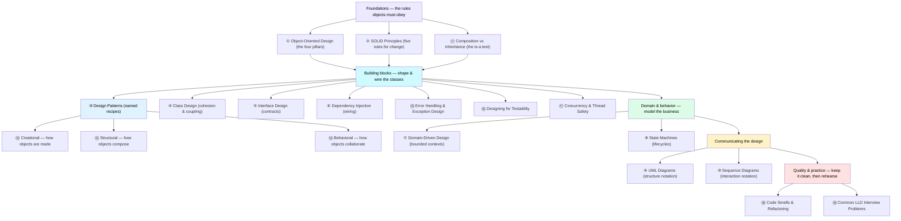
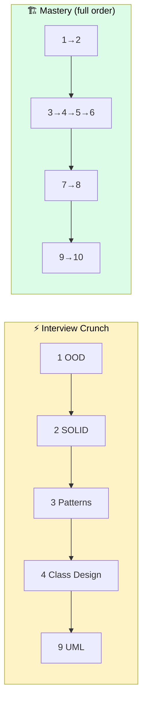

# 04 · Low-Level Design 🧩

> **Where the shape becomes code.** HLD decided how many services there are and how they talk; LLD is where that decision turns into classes, contracts, and objects that a team can actually build, test, and change for years. Get the objects, boundaries, and contracts right here and a new requirement is a new class behind a stable interface; get them wrong and the cleanest architecture diagram still ships a ball of mud.

---

## 🎯 What You'll Be Able To Do

- **Model any domain as cohesive, encapsulated objects** instead of a procedural blob of shared mutable state.
- **Defend a class boundary using SOLID** — name the violation, name the fix, not just "this feels cleaner."
- **Choose and justify a design pattern** (creational, structural, behavioral) for a recurring problem, and know when *not* to reach for one.
- **Design classes and interfaces with high cohesion, low coupling, and lean contracts** that are small enough to mock and test in isolation.
- **Wire dependencies through injection** so any concrete implementation — including a test double — swaps in without touching business logic.
- **Model business rules as bounded contexts and finite state machines**, then whiteboard the result with UML and sequence diagrams so a team agrees before anyone writes code.

---

## 🗺️ How the 19 Topics Interlock



> **The spine:** *master the four pillars, five rules, and the compose-vs-inherit test → use them to shape classes, interfaces, patterns (③, deep-dived across the three GoF families ⑫⑬⑭), and the wiring, error contracts, testability, and thread-safety of those classes → apply that toolkit to model the domain's language and lifecycles → draw and whiteboard the result → keep it clean with refactoring and rehearse on the classic LLD prompts.* Patterns (③) are SOLID (②) made concrete; DI (⑥) is dependency inversion made runnable and the enabler of testability (⑯); UML (⑨) and sequence diagrams (⑩) are how everything above gets communicated; and Common LLD Problems (⑲) is where the whole toolkit gets exercised under interview conditions.

---

## 📚 The Complete File Index

| # | Topic | One-line | Key takeaway |
|---|-------|----------|--------------|
| 1 | [Object-Oriented Design](./Object_Oriented_Design.md) | A corporation, not a spreadsheet | Encapsulate state behind guarded methods; compose over inherit; the four pillars are guarantees, not trivia |
| 2 | [SOLID Principles](./SOLID_Principles.md) | Five rules, one job each | Depend on abstractions, not concretions; one reason to change per class |
| 3 | [Design Patterns Overview](./Design_Patterns_Overview.md) | Recipes, not copy-paste code | Patterns are SOLID made concrete; isolate the seam that varies; don't force one where none fits |
| 4 | [Class Design](./Class_Design.md) | A watch: clean face, sealed gears | High cohesion + low coupling; Law of Demeter — don't talk to strangers |
| 5 | [Interface Design](./Interface_Design.md) | The wall outlet, not the appliance | Program to the contract, not the implementation; small interfaces beat fat ones; contracts are what make mocking possible |
| 6 | [Dependency Injection](./Dependency_Injection.md) | Catering, not cooking | Hand a class its tools from outside; swap real for mock by changing one wiring line |
| 7 | [Domain-Driven Design](./Domain_Driven_Design.md) | A themed amusement park, not one costume department | Split by bounded context, not a universal model; ubiquitous language kills the translator |
| 8 | [State Machines](./State_Machines.md) | A subway turnstile — one state, drawn arrows only | Make illegal states unrepresentable; every transition is a loggable, auditable event |
| 9 | [UML Diagrams](./UML_Diagrams.md) | The architect's floor plan | A filled diamond vs a hollow triangle settles ownership vs inheritance in one glyph; sketch, don't paint |
| 10 | [Sequence Diagrams](./Sequence_Diagrams.md) | A music score for a request | Time flows down; the diagram shows the order, waiting, and fan-out that code hides |
| 11 | [Composition vs Inheritance](./Composition_vs_Inheritance.md) | Lego bricks, not a family tree | Inheritance only when is-a holds behaviorally (LSP); otherwise compose — dodge the fragile base class and subclass explosion |
| 12 | [Creational Design Patterns](./Creational_Design_Patterns.md) | Who builds the object, and how | Singleton (the abused global), Factory Method vs Abstract Factory, Builder, Prototype — decouple *what* you get from *how* it's made |
| 13 | [Structural Design Patterns](./Structural_Design_Patterns.md) | Fitting pieces without welding | Adapter *changes* · Decorator *adds* · Proxy *controls* · Facade *simplifies* · Composite · Bridge · Flyweight |
| 14 | [Behavioral Design Patterns](./Behavioral_Design_Patterns.md) | Who does what, and how it varies | Strategy, Observer, Command, Template Method, Chain of Responsibility, Mediator, Visitor, Iterator; intent over shape |
| 15 | [Error Handling & Exception Design](./Error_Handling_Exception_Design.md) | Failure is part of the contract | Checked vs unchecked, coherent exception hierarchies, Result/Either types, translate at boundaries — the signature should say what can go wrong |
| 16 | [Designing for Testability](./Designing_for_Testability.md) | If it's hard to test, it's badly coupled | Seams + test doubles (dummy/stub/fake/spy/mock); inject the Clock; push logic out of humble objects — DI is the enabler |
| 17 | [Concurrency Patterns & Thread Safety](./Concurrency_Patterns_Thread_Safety.md) | Make this class safe under threads | Immutability, confinement, guarded state, double-checked locking, producer-consumer, readers-writer, actors; races & the four deadlock conditions |
| 18 | [Code Smells & Refactoring](./Code_Smells_Refactoring.md) | The nose knows before the tests fail | Smell catalog (God class, feature envy, shotgun surgery) → named refactorings → refactor-to-patterns, under a green suite |
| 19 | [Common LLD Interview Problems](./Common_LLD_Interview_Problems.md) | The parking lot and its cousins | A repeatable 35-minute method + parking lot / elevator / LRU cache worked in full, each mapped to the patterns it exercises |

> **Reading order:** 1–10 are the original core (foundations → building blocks → domain → communication). 11–19 go deeper: 11 splits out compose-vs-inherit; 12–14 are the per-family pattern deep-dives that hang off ③; 15–17 round out class-level concerns (errors, testability, threads); 18–19 are quality and interview practice.

---

## 🧭 Suggested Study Paths



| Goal | Path | Why |
|------|------|-----|
| **⚡ Interview in 48h** | 1 → 2 → 3 → 4 → 9 → 19 | Pillars + rules + patterns + class shape + how to draw it + one worked LLD problem = the most-asked 80% |
| **🏗️ Deep mastery** | 1→2→11 → 3→12→13→14 → 4→5→6→15→16→17 → 7→8 → 9→10 → 18→19 | Rules → pattern deep-dives → building blocks & class concerns → domain → communication → quality & practice, in dependency order |
| **🧩 "Design the classes"** | 1 → 11 → 4 → 5 → 6 → 16 | The OOD mental model, compose-vs-inherit, then the shape/wiring of classes and how to keep them testable |
| **🎨 Pattern deep-dive** | 3 → 12 → 13 → 14 (+ 18 refactor-to-patterns) | The overview, then each GoF family in full, then how refactoring converges on them |
| **🅿️ LLD problem prep** | 19 → back-fill 3/12/13/14 + 8 + 17 as each problem demands | Learn the 35-min method first, then deepen the exact patterns each prompt exercises |
| **🏢 Domain-modeling focus** | 2 → 7 → 8 (+ [03 · System Decomposition](../03_High_Level_Design/System_Decomposition.md)) | SOLID discipline → bounded contexts → lifecycle correctness |

> **Study each file by** attempting the 🏋️ **Practice Drills before the solutions**, rehearsing the 🎤 **Interview Q&A out loud**, and reading 🎯 **Staff+ Nuances** for senior-level depth.

---

## 🔑 The Decision Card (whole-section cheat sheet)

```
OOD       encapsulate state behind guarded methods · compose over inherit · four pillars = guarantees to neighbors, not trivia
SOLID     S=one reason to change · O=extend, don't edit · L=subtype honors the base contract · I=lean interfaces · D=depend on abstractions
PATTERNS  creational (HOW made) · structural (HOW compose) · behavioral (HOW collaborate/vary) · patterns ARE SOLID made concrete · don't force one
CLASS     high cohesion + low coupling · Law of Demeter (talk to friends, not strangers) · seal the gears, keep the face thin
INTERFACE program to the contract, not the implementation · keep it small (ISP) · this is what makes mocking possible
DI        hand in the dependency, don't build it inside · swap real→mock with one wiring-line change · avoid the Service Locator anti-pattern
DDD       ubiquitous language kills the translator · split by BOUNDED CONTEXT, not a universal model · aggregates make illegal states unrepresentable
STATE     one named state at a time · only drawn arrows are legal transitions · every transition = an auditable event
UML       shared symbol set (hollow triangle=is-a, filled diamond=owns lifecycle) · sketch to agree, don't paint for art
SEQUENCE  time flows down · shows ORDER + WAITING + FAN-OUT that code hides · design the interaction before you code it
COMP/INH  inherit ONLY when is-a holds behaviorally (LSP) · else compose/delegate · fragile base class + subclass explosion are the tax on inheritance
CREATIONAL who builds it: Singleton (⚠ global-in-disguise) · Factory Method vs Abstract Factory · Builder (>4 args) · Prototype (clone)
STRUCTURAL Adapter=CHANGE iface · Decorator=ADD (same iface, stackable) · Proxy=CONTROL access · Facade=SIMPLIFY · Composite · Bridge · Flyweight
BEHAVIORAL Strategy(client picks) vs Template Method(inheritance hook) · Observer vs pub/sub · Command · Chain of Responsibility · Mediator · Visitor
ERRORS    error contract IS the interface · exception hierarchy, don't catch(Exception) · Result/Either · translate at boundaries · fail fast
TESTABILITY hard-to-test = badly coupled · seams + doubles (dummy/stub/fake/spy/mock) · inject the Clock · humble object · DI is the enabler
CONCURRENCY immutability > confinement > guarded state · atomicity vs visibility · DCL needs volatile · avoid deadlock via lock ordering
SMELLS    God class · feature envy · shotgun surgery · duplicated code → named refactoring → refactor-to-pattern, always under a green suite
LLD DRILL clarify → nouns=entities → responsibilities → relationships → patterns → concurrency/edge cases → walk an example (parking lot is the classic)
RECURRING every layer here is the SAME idea at a different zoom: hide the how, expose a stable contract, let the pieces vary independently
```

---

## 🎨 Conventions & Authoring

- Every file follows the root [TEMPLATE.md](../TEMPLATE.md). Animated SVGs live in [/assets](../assets/).
- Each file ends with the three mastery sections: 🏋️ Practice Drills, 🎤 Interview Q&A Bank, 🎯 Staff+ Nuances.

---

## ➡️ Where This Connects

- ⬅️ [02 · API & Interface Design](../02_API_Interface_Design/) — the external contracts these internal classes and interfaces sit behind.
- ⬅️ [03 · High-Level Design](../03_High_Level_Design/) — the service boundaries and component responsibilities this section turns into code.
- ➡️ [05 · Databases & Storage](../05_Databases_Storage/) — repositories and aggregates here decide what gets persisted and how.
- ➡️ [09 · Message Queues & Event Streaming](../09_Message_Queues_Event_Streaming/) — domain events from DDD become the messages on the wire.
- ➡️ [10 · Microservices & Distributed Systems](../10_Microservices_Distributed_Systems/) — bounded contexts here are the seams services get cut along.

---
*Part of the [System Design & Architecture Master Repository](../README.md). The shape of the system was decided upstream; this is where it becomes classes and contracts that survive change.*
