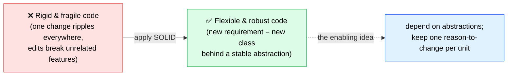
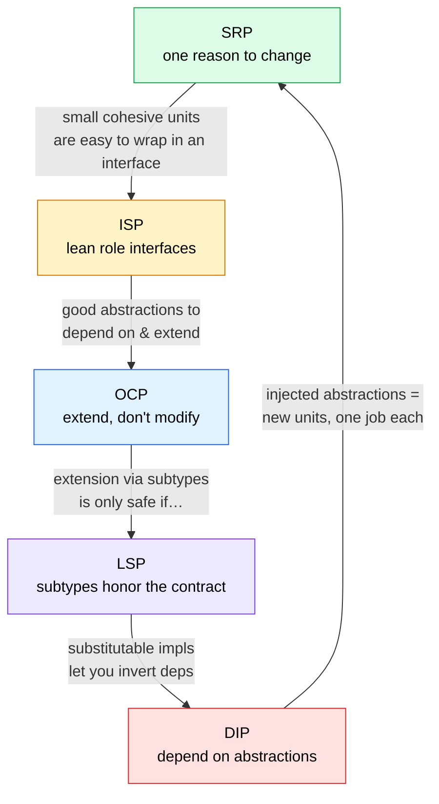
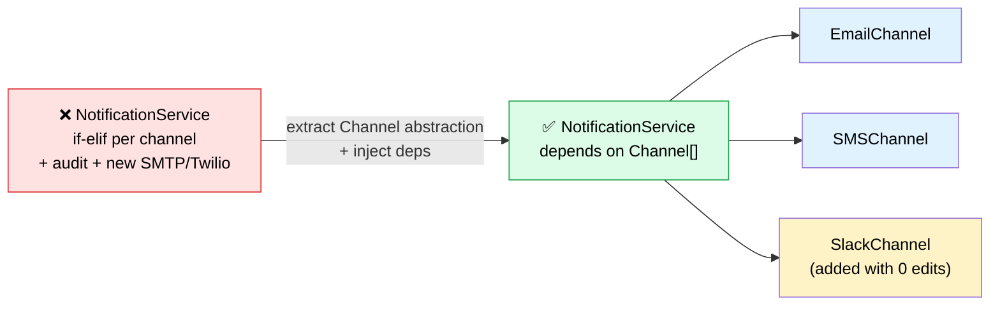
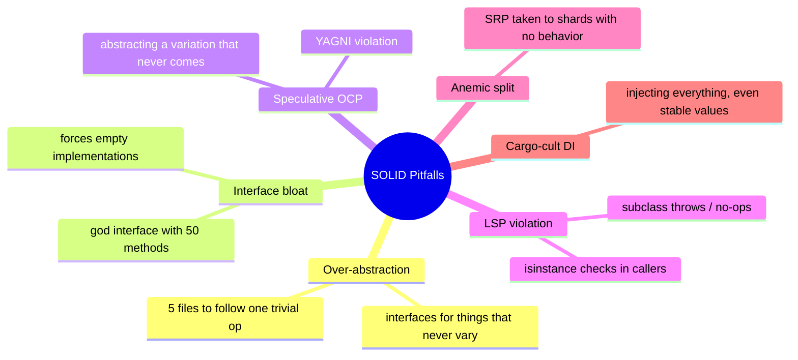

# SOLID Principles

> **One line:** Five design rules that keep object-oriented code *easy to change and hard to break* by managing where responsibilities live and which way dependencies point — so a new requirement means *adding* code, not surgically editing code that already works.

---

## Table of Contents
1. [Why You Must Master This](#1-why-you-must-master-this)
2. [The Mental Model](#2-the-mental-model)
3. [The Five Principles at a Glance](#3-the-five-principles-at-a-glance)
4. [S & O — Responsibility and Extension](#4-s--o--responsibility-and-extension)
5. [L & I — Substitution and Segregation](#5-l--i--substitution-and-segregation)
6. [D — Dependency Inversion](#6-d--dependency-inversion)
7. [How They Interlock](#7-how-they-interlock)
8. [Worked Example — Refactoring a Notification Service](#8-worked-example--refactoring-a-notification-service)
9. [Real-Life Use Cases](#9-real-life-use-cases)
10. [Failure Modes](#10-failure-modes)
11. [🏋️ Practice Drills](#-practice-drills)
12. [🎤 Interview Q&A Bank](#-interview-qa-bank)
13. [🎯 Staff+ Nuances](#-staff-nuances)
14. [Cheat Sheet](#14-cheat-sheet)
15. [Connections & Further Reading](#15-connections--further-reading)

---

## 1. Why You Must Master This

SOLID is the vocabulary senior engineers use to *justify* a class boundary. "This feels cleaner" loses the argument; "that violates OCP — every new payment method forces us to edit the switch statement" wins it.

- **Change is the whole job.** 80% of software cost is the maintenance phase. SOLID optimizes for the thing you'll do a thousand times — *change working code* — not the one time you wrote it.
- **It bounds the blast radius.** Every principle is a rule about *containment*: keep a reason-to-change in one place (SRP), add behavior without touching the old (OCP), swap implementations safely (LSP/DIP).
- **It's the theory under the patterns.** Strategy, Observer, Decorator, and Adapter are SOLID made concrete; learn it and [Design Patterns](./Design_Patterns_Overview.md) become a handful of moves, not 23 things to memorize.
- **It's the highest-frequency LLD interview topic.** Interviewers want you to name each letter, show a violation, and write the fix. Definitions alone are a red flag.

> **The core problem it solves:** *rigidity and fragility.* Code that's rigid (a small change forces edits everywhere) and fragile (a change in one place breaks something unrelated) becomes unshippable. SOLID makes new requirements land as new code sitting behind stable abstractions, so the parts that work keep working.

---

## 2. The Mental Model

SOLID is a **high-quality tool system**, not five unrelated tips:

- A **single-purpose wrench** (SRP) does one job — changing it affects nothing else.
- A **locking toolcase** (OCP) lets you drop in a new bit without re-machining the old ones.
- A **standardized socket set** (LSP) — any 10mm socket fits any 10mm bolt, no "strips the head" surprises.
- **Small labelled kits** (ISP) — carry the screwdriver set, not the 50-lb chest, to fix a hinge.
- A **universal drive shank** (DIP) — the *handle* defines the fitting, so any bit plugs in; the tool depends on the shape, not a specific bit.





---

## 3. The Five Principles at a Glance

Each principle is best learned as a **violation → fix** pair — the smell you'll actually see in a PR, and the move that removes it.

| Letter | Principle | The violation smell | The fix |
|--------|-----------|---------------------|---------|
| **S** | Single Responsibility | One class changes for unrelated reasons (formatting *and* persistence *and* email) | Split by *reason to change* — one actor per class |
| **O** | Open/Closed | A `switch`/`if-elif` you must edit for every new case | Program to an abstraction; add a new subclass, don't edit the old |
| **L** | Liskov Substitution | A subclass throws, no-ops, or tightens preconditions where the base didn't | Fix the hierarchy — a subtype must honor the base's contract |
| **I** | Interface Segregation | Clients forced to implement methods they don't use (empty/`raise NotImplemented`) | Split the fat interface into role-specific ones |
| **D** | Dependency Inversion | High-level policy `import`s and `new`s a concrete low-level class | Both depend on an abstraction; inject the concrete one |

A memory hook for the *point* of each: **S** = cohesion, **O** = extensibility, **L** = correct subtyping, **I** = lean contracts, **D** = decoupling. Four of the five (O, L, I, D) are ultimately about the same thing — **depending on stable abstractions instead of volatile concretions** — which is why they interlock so tightly (see [§7](#7-how-they-interlock)).

---

## 4. S & O — Responsibility and Extension

### S — Single Responsibility Principle

> *A class should have one, and only one, reason to change* — where "reason" means **one actor/stakeholder**, not literally "one method."

The classic violation fuses unrelated jobs: an `Invoice` that calculates money *and* renders HTML *and* saves to a DB — three teams (finance, frontend, infra) can each force an edit:

```python
# BAD: three reasons to change live in one class
class Invoice:
    def total(self):        ...   # changes when finance rules change
    def to_html(self):      ...   # changes when the UI/format changes
    def save(self, db):     ...   # changes when persistence changes
```

The fix splits by actor. The domain object owns the money math; presentation and persistence become their own collaborators:

```python
# GOOD: one reason to change each
class Invoice:                    # finance rules only
    def total(self): ...
class InvoiceRenderer:            # formatting only
    def to_html(self, inv): ...
class InvoiceRepository:          # persistence only
    def save(self, inv): ...
```

This is the class-level twin of [Component_Responsibilities.md](../03_High_Level_Design/Component_Responsibilities.md), and pairs with DRY: a single responsibility usually has a single, non-duplicated home.

### O — Open/Closed Principle

> *Software entities should be open for extension but closed for modification* — add behavior by adding code, not by editing tested code.

The tell-tale smell is a type switch that grows forever, forcing you to reopen and re-risk `AreaCalculator` for every new shape:

```python
# BAD: violates OCP — a new shape means EDITING this method
class AreaCalculator:
    def area(self, shape):
        if isinstance(shape, Rectangle):
            return shape.w * shape.h
        elif isinstance(shape, Circle):
            return 3.14159 * shape.r ** 2
        # ...another elif for every future shape, forever
```

The fix inverts control: the abstraction declares `area()`, and each shape supplies its own. Adding a `Triangle` is a *new file* — `AreaCalculator` never changes again:

```python
from abc import ABC, abstractmethod

# GOOD: follows OCP — extend by adding a subclass, never editing the calculator
class Shape(ABC):
    @abstractmethod
    def area(self) -> float: ...

class Rectangle(Shape):
    def __init__(self, w, h): self.w, self.h = w, h
    def area(self): return self.w * self.h

class Circle(Shape):
    def __init__(self, r): self.r = r
    def area(self): return 3.14159 * self.r ** 2

class Triangle(Shape):                       # NEW behavior, ZERO edits above
    def __init__(self, b, h): self.b, self.h = b, h
    def area(self): return 0.5 * self.b * self.h

class AreaCalculator:
    def total(self, shapes: list[Shape]) -> float:
        return sum(s.area() for s in shapes)  # closed to modification
```

OCP is polymorphism used as a design tool — the [Strategy pattern](./Design_Patterns_Overview.md), plugin registries, or Template Method all turn an `if-elif` into a lookup over subclasses. The warning: don't apply it speculatively (see [Failure Modes](#10-failure-modes)); make code open *along the axis that actually varies*.

---

## 5. L & I — Substitution and Segregation

### L — Liskov Substitution Principle

> *Subtypes must be substitutable for their base types without breaking the program* — code written against `T` must keep working when handed a subtype `S`.

LSP makes OCP *safe*: OCP lets you swap subclasses, LSP guarantees the swap doesn't blow up. The canonical violation is the "refused bequest" — a subclass that can't honor the parent's contract:

```python
# BAD: Penguin breaks any code that expects a Bird to fly()
class Bird:
    def fly(self): ...
class Penguin(Bird):
    def fly(self): raise NotImplementedError  # LSP violation!
```

Any function that loops over birds and calls `fly()` now crashes on a penguin. Same trap: `Square(Rectangle)` where setting width also mutates height breaks a test written against `Rectangle`. The fix is to **model the real contract**, splitting the hierarchy so each type only promises what it can keep:

```python
# GOOD: separate the capability from the category
class Bird: ...
class FlyingBird(Bird):
    def fly(self): ...
class Penguin(Bird):          # is a Bird, is NOT a FlyingBird — no false promise
    def swim(self): ...
```

LSP smells: an override that `raise`s, no-ops, returns `None` where the base returns a value, *tightens* a precondition ("base accepts any int, subclass demands positive"), or *weakens* a postcondition. If callers need `if isinstance(x, Penguin)`, the abstraction has already failed.

### I — Interface Segregation Principle

> *Clients should not be forced to depend on methods they do not use* — prefer many small, role-specific interfaces over one fat "god interface."

The violation forces implementers to stub methods they can't support — often an LSP violation in disguise:

```python
# BAD: a fat interface forces empty/raising implementations
class Worker(ABC):
    @abstractmethod
    def work(self): ...
    @abstractmethod
    def eat(self): ...       # a Robot can work but does not eat

class Robot(Worker):
    def work(self): ...
    def eat(self): raise NotImplementedError   # forced dependency on unused method
```

Segregate the interface into cohesive roles so each client depends only on what it uses:

```python
# GOOD: small role interfaces — implement only what applies
class Workable(ABC):
    @abstractmethod
    def work(self): ...
class Feedable(ABC):
    @abstractmethod
    def eat(self): ...

class Human(Workable, Feedable):
    def work(self): ...
    def eat(self): ...
class Robot(Workable):        # depends on nothing it can't honor
    def work(self): ...
```

ISP is the interface-design side of SRP: a fat interface is a class with too many responsibilities seen from outside. It's the heart of good [Interface_Design.md](./Interface_Design.md) — keep contracts lean so a change to one role never ripples to unrelated clients.

---

## 6. D — Dependency Inversion Principle

> *(a) High-level modules should not depend on low-level modules; both should depend on abstractions. (b) Abstractions should not depend on details; details should depend on abstractions.*

DIP is the keystone. The naive design has business logic reach *down* and hard-wire a concrete tool — an `OrderService` that constructs and calls MySQL directly:

```python
# BAD: high-level policy depends on a low-level detail (concrete DB)
class MySQLDatabase:
    def save(self, order): ...

class OrderService:
    def __init__(self):
        self.db = MySQLDatabase()    # welded to MySQL — untestable, unswappable
    def place(self, order):
        self.db.save(order)
```

You can't unit-test `OrderService` without a real MySQL, and moving to Postgres means editing the service. Invert it: define the abstraction *in terms the high-level module wants*, and **inject** the concrete implementation from outside (see [Dependency_Injection.md](./Dependency_Injection.md)):

```python
from abc import ABC, abstractmethod

# GOOD: both sides depend on an abstraction the POLICY owns
class OrderRepository(ABC):
    @abstractmethod
    def save(self, order): ...

class MySQLOrderRepository(OrderRepository):     # detail depends on abstraction
    def save(self, order): ...
class PostgresOrderRepository(OrderRepository):  # swap in with zero service edits
    def save(self, order): ...

class OrderService:                              # high-level policy
    def __init__(self, repo: OrderRepository):   # injected, not constructed
        self.repo = repo
    def place(self, order):
        self.repo.save(order)

# wiring happens at the edge (composition root)
service = OrderService(PostgresOrderRepository())
# tests just pass a fake:
service = OrderService(InMemoryOrderRepository())
```

The load-bearing detail: **the abstraction belongs to the high-level module.** `OrderRepository` is defined by what `OrderService` needs, and the database code conforms to it — *that's* the inversion. The old flow was policy → detail; now both point at an abstraction owned by policy. This is what makes [Dependency_Injection.md](./Dependency_Injection.md) work, and why DIP + OCP together give you plug-in architectures.

---

## 7. How They Interlock

SOLID isn't five separate rules — it's one idea (**depend on stable abstractions, isolate reasons to change**) viewed from five angles. They reinforce each other:



- **OCP needs LSP.** OCP says "swap in new subclasses"; LSP is the guarantee that a swap won't break callers. Extensibility without substitutability is a trap.
- **DIP needs good interfaces (ISP) which need SRP.** You can only depend on a clean abstraction if one exists — and clean abstractions come from small, single-responsibility units. A god class has no lean interface to invert against.
- **DIP + OCP = plug-in architecture.** Inject an abstraction (DIP) and add new implementations behind it (OCP) and you get systems extensible without recompiling the core — the shape of every plugin/driver system.

> The practical read: chase **SRP first** (get cohesion right), and ISP, OCP, LSP, and DIP become natural moves rather than forced ones.

---

## 8. Worked Example — Refactoring a Notification Service

**Start:** a single `NotificationService` that violates four principles at once — a real "before" you'll recognize.

```python
# BAD: SRP (does everything) + OCP (elif per channel) + DIP (news concretes)
class NotificationService:
    def send(self, kind, user, msg):
        if kind == "email":
            SMTPClient().send(user.email, msg)      # constructs a concrete tool
        elif kind == "sms":
            TwilioClient().text(user.phone, msg)    # add a channel → EDIT here
        elif kind == "push":
            FCMClient().push(user.device, msg)
        AuditLog().write(f"sent {kind} to {user}")   # extra responsibility
```

Adding Slack means editing tested code (OCP), the class has several reasons to change (SRP), and it's welded to SMTP/Twilio/FCM so it's untestable (DIP).

**Refactor** — one `Channel` abstraction, one implementation per channel (OCP+LSP), the service depending only on the abstraction (DIP), audit extracted (SRP):

```python
class Channel(ABC):                       # the abstraction the policy owns
    @abstractmethod
    def deliver(self, user, msg): ...

class EmailChannel(Channel):
    def deliver(self, user, msg): SMTPClient().send(user.email, msg)
class SMSChannel(Channel):
    def deliver(self, user, msg): TwilioClient().text(user.phone, msg)
class SlackChannel(Channel):              # NEW channel = new class, zero edits
    def deliver(self, user, msg): SlackClient().post(user.slack_id, msg)

class NotificationService:
    def __init__(self, channels: list[Channel], audit: AuditLog):
        self.channels, self.audit = channels, audit   # injected (DIP)
    def send(self, user, msg):
        for ch in self.channels:          # OCP: loops over abstractions
            ch.deliver(user, msg)
            self.audit.write(user, msg)
```



**The loop closed:** the `elif` chain (a smell) became a list of injected abstractions (an architectural property) — a new channel is now additive, the service is testable with a `FakeChannel`, and no working code is touched to grow the system. One refactor, four principles satisfied.

---

## 9. Real-Life Use Cases

| Situation | How SOLID applies |
|-----------|-------------------|
| **Payment methods keep being added** | Card, PayPal, Apple Pay behind a `PaymentMethod` interface (OCP+DIP) — a new one is a new class, not an edit to checkout. |
| **Swapping a database** | Repository interface (DIP) lets you move MySQL → Postgres → Dynamo without touching business logic. |
| **"Everything is a file" (Unix)** | Disk, socket, and device all implement `open/read/write/close` (LSP+ISP) — `cat` works on any of them. |
| **Unit testing** | DIP lets you inject fakes/mocks; SRP keeps the unit small enough to test one behavior. |
| **Parallel team development** | Team A builds `S3Store`, team B builds `GCSStore` against a shared interface (DIP) — no collisions. |
| **Plugin / driver ecosystems** | DIP + OCP: the core depends on an abstraction; third parties add implementations without recompiling it. |

> Real-world habit: **when you catch yourself about to edit a working class to add a case, stop and ask "can this be a new class behind an existing abstraction?"** That single reflex is OCP + DIP in action.

---

## 10. Failure Modes



- **Over-abstraction (the abstraction trap).** Adding interfaces for things that will never change buys indirection and zero flexibility. *Symptom:* one implementation per interface, forever; five files to read one operation. *Fix:* apply OCP/DIP *along axes that actually vary* — YAGNI beats speculative abstraction.
- **Interface bloat.** A "SuperInterface" with 50 methods forces every client to stub the ones it doesn't need. *Symptom:* `raise NotImplementedError` bodies. *Fix:* segregate into role interfaces (ISP).
- **LSP violations hidden as subclassing.** Reusing a base for convenience when the subtype can't honor the contract. *Symptom:* overrides that throw/no-op, `isinstance` in callers. *Fix:* prefer composition or split the hierarchy.
- **Anemic over-splitting.** SRP taken to the point of pass-through classes with no behavior. *Symptom:* classes named `XManagerHelperImpl` that just forward. *Fix:* one *meaningful* responsibility, not the maximum number of files.
- **Cargo-cult dependency injection.** Injecting stable, never-changing values just because "DI good." *Symptom:* a constructor with 12 params. *Fix:* inject *volatile* collaborators (DB, clock, network), not constants.

---

## 🏋️ Practice Drills

> *Cover the solutions and attempt first — active recall is the point.*

**Drill 1 — Name the violation.** A `Report` class has `generate()`, `format_as_pdf()`, and `email_to(recipient)`. Which principle is violated and how do you fix it?

<details><summary>Solution</summary>

**SRP.** Three reasons to change live in one class: report logic, PDF formatting, and delivery. Split into `Report` (data/logic), `PdfFormatter` (presentation), and `ReportMailer` (delivery). Each now changes for exactly one reason, and each is independently testable.
</details>

**Drill 2 — Kill the switch.** A `DiscountCalculator` has `if customer_type == "regular": ... elif "premium": ... elif "vip": ...`, and marketing keeps adding tiers. Refactor it.

<details><summary>Solution</summary>

**OCP violation.** Define a `DiscountPolicy` abstraction with `apply(amount)`, and one subclass per tier (`RegularDiscount`, `PremiumDiscount`, `VipDiscount`). The calculator takes a `DiscountPolicy` (DIP) and calls `policy.apply(amount)`. A new tier is a new class — the calculator never changes. Optionally register policies in a dict keyed by customer type.
</details>

**Drill 3 — Spot the broken subtype.** A `Rectangle` has `set_width`/`set_height`; `Square` extends it and overrides both setters to keep sides equal. A test does `r.set_width(5); r.set_height(4); assert r.area() == 20`. What breaks and why?

<details><summary>Solution</summary>

**LSP violation.** With a `Square`, `set_height(4)` also changes width to 4, so `area()` is 16, not 20 — code correct for `Rectangle` breaks when handed a `Square`. A square is not a behavioral subtype of a mutable rectangle. Fix: don't inherit; make `Shape` the abstraction with `area()`, and let `Square` and `Rectangle` be independent implementations (immutable value objects sidestep it entirely).
</details>

**Drill 4 — Slim the interface.** A `Machine` interface declares `print()`, `scan()`, `fax()`. A simple `OldPrinter` can only print. What's wrong and what's the fix?

<details><summary>Solution</summary>

**ISP violation** (and a latent LSP one). `OldPrinter` is forced to implement `scan()`/`fax()` with empty or throwing bodies. Segregate into `Printer`, `Scanner`, `Fax` role interfaces; `OldPrinter` implements only `Printer`, while a `MultiFunctionPrinter` implements all three. Clients depend only on the role they use.
</details>

---

## 🎤 Interview Q&A Bank

**Q1. What does SOLID stand for, in one line each?**
> SRP (one reason to change), OCP (open to extension, closed to modification), LSP (subtypes substitutable for base types), ISP (no fat interfaces — depend only on what you use), DIP (depend on abstractions, not concretions). *(signal: can you go beyond acronyms to the point of each?)*

**Q2. SRP is often stated as "a class does one thing." What's the sharper definition?**
> "One *reason to change*" — one actor or stakeholder. A class the billing team and the compliance team both edit for different reasons has two responsibilities even if it looks cohesive, because it changes on two schedules for two masters.

**Q3. How do you achieve OCP concretely?**
> Program to an abstraction and use polymorphism: replace an `if-elif`/`switch` over types with a call through an interface, then add new subclasses for new behavior. Strategy pattern, plugin registries, and Template Method are the usual vehicles. *(signal: do they connect it to patterns?)*

**Q4. How are LSP and OCP related?**
> OCP lets you extend by substituting new subclasses; LSP is the guarantee that a substitution won't break callers. OCP without LSP is unsafe — you can plug in a subtype that violates the base contract and silently break code that was closed for modification.

**Q5. Give a concrete LSP violation.**
> `Penguin(Bird)` where `fly()` throws, or `Square(Rectangle)` where setting width mutates height. Any code correct for the base type breaks on the subtype. Tells: overrides that throw/no-op, tightened preconditions, or `isinstance` checks in callers.

**Q6. What exactly gets "inverted" in Dependency Inversion?**
> The *direction* of the source-code dependency and the *ownership* of the abstraction. Normally high-level policy depends on low-level detail; with DIP both depend on an abstraction, and crucially that abstraction is defined by the high-level module's needs — the detail conforms to it. *(signal: do they mention ownership, not just "use interfaces"?)*

**Q7. DIP vs Dependency Injection — same thing?**
> No. DIP is the *principle* (depend on abstractions). DI is a *technique* (pass dependencies in from outside — constructor/setter/framework) that's the most common way to satisfy DIP. You can follow DIP without a DI framework, and you can misuse DI without achieving inversion. See [Dependency_Injection.md](./Dependency_Injection.md).

**Q8. When should you NOT apply SOLID?**
> Throwaway code (POCs, one-off scripts), and hot loops where virtual dispatch cost matters (game engines, HFT). More broadly: don't add abstractions speculatively — YAGNI. Apply OCP/DIP along axes that *actually* vary; premature abstraction is a cost with no payoff.

---

## 🎯 Staff+ Nuances

- **DIP is the load-bearing one; the abstraction must be owned by the client.** The common mistake is extracting a "header interface" that just mirrors the concrete class. True inversion shapes the abstraction around what the *high-level* module needs, so the detail conforms to policy — the basis of Clean/Hexagonal architecture. See [Dependency_Injection.md](./Dependency_Injection.md).
- **ISP and LSP are often the same bug.** A fat interface forces implementations to stub methods with throws/no-ops — itself an LSP violation. Fix the segregation and the substitutability problem usually vanishes with it. Both trace back to [Interface_Design.md](./Interface_Design.md).
- **"Reason to change" is a social property, not a code metric.** SRP can't be computed from the AST — it depends on *who requests changes*. Methods that always change together for one stakeholder belong together; similar-looking ones serving different actors belong apart. Same judgment as bounded contexts in [Domain_Driven_Design.md](./Domain_Driven_Design.md).
- **Prefer composition over inheritance to dodge LSP landmines.** Most LSP violations come from inheriting for code *reuse* absent a true behavioral "is-a." Composition (has-a) plus small interfaces (ISP) sidesteps fragile hierarchies — inheritance is for genuine substitutability, not code sharing.
- **SOLID has real costs — indirection and the "abstraction trap."** Every interface is a tax on readers and a bet a variation will appear. Ousterhout's lens: deep modules (simple interface, rich behavior) earn abstraction; shallow ones are pure cost. Absorb *actual* variation, guided by YAGNI/KISS.
- **The patterns are SOLID crystallized.** Strategy/Command = OCP+DIP; Observer = OCP+DIP for events; Decorator = OCP+LSP; Adapter = ISP+DIP. Understand SOLID and [Design_Patterns_Overview.md](./Design_Patterns_Overview.md) becomes recognition, not memorization.
- **SOLID scales up.** SRP → component responsibility → bounded context → microservice; DIP → DI → ports & adapters → API contracts. The class-level rules here are the same discipline that draws service boundaries in [Modular_Monolith.md](../03_High_Level_Design/Modular_Monolith.md).

---

## 14. Cheat Sheet

```
SOLID = code that is EASY TO CHANGE, HARD TO BREAK (manage responsibilities + dependencies)

S  Single Responsibility  one REASON to change (one actor). Split money-math / format / persist.
O  Open/Closed            add a subclass, don't edit the switch. Polymorphism > if-elif.
L  Liskov Substitution    a subtype must work anywhere the base does. No throw/no-op overrides.
I  Interface Segregation  many small role interfaces > one fat one. No forced empty methods.
D  Dependency Inversion   depend on an abstraction the POLICY owns; INJECT the concrete detail.

VIOLATION SMELLS
  S: class changes for unrelated reasons        O: isinstance/switch you must edit per case
  L: override raises / isinstance in callers     I: raise NotImplementedError bodies
  D: high-level module `new`s a concrete class

HOW THEY LOCK:  SRP → clean units → ISP → good abstractions → OCP → (safe via) LSP → DIP → SRP
  OCP needs LSP (safe swaps) · DIP needs ISP+SRP (a lean abstraction to invert) · DIP+OCP = plugins

DIP ≠ DI:  DIP = the principle (depend on abstractions). DI = a technique to satisfy it (inject deps).

DON'T:  abstract what never varies (YAGNI) · fat interfaces · inherit for reuse (use composition)
        · anemic over-splitting · inject stable constants. Deep modules > shallow ones.
```

---

## 15. Connections & Further Reading

**Within this repo:**
- [Object_Oriented_Design.md](./Object_Oriented_Design.md) — the OO foundations (encapsulation, polymorphism) SOLID builds on; [Class_Design.md](./Class_Design.md) — applying SRP/OCP at the class level.
- [Dependency_Injection.md](./Dependency_Injection.md) — the primary technique for satisfying DIP; [Interface_Design.md](./Interface_Design.md) — lean contracts (ISP).
- [Design_Patterns_Overview.md](./Design_Patterns_Overview.md) — patterns are SOLID made concrete (Strategy, Observer, Decorator, Adapter); [Domain_Driven_Design.md](./Domain_Driven_Design.md) — "reason to change" as a bounded-context boundary.
- [Component_Responsibilities.md](../03_High_Level_Design/Component_Responsibilities.md) & [Modular_Monolith.md](../03_High_Level_Design/Modular_Monolith.md) — the same discipline one zoom level up.

**External classics:**
- *Agile Software Development, Principles, Patterns, and Practices* & *Clean Architecture* (Robert C. Martin) — the origin and definitive treatment of SOLID.
- *A Philosophy of Software Design* (John Ousterhout) — deep vs shallow modules; when abstraction pays.
- [Refactoring.Guru — SOLID](https://refactoring.guru/design-patterns/solid) · [DigitalOcean — S.O.L.I.D.](https://www.digitalocean.com/community/conceptual-articles/s-o-l-i-d-the-first-five-principles-of-object-oriented-design).

---

## TL;DR
SOLID makes object-oriented code **easy to change and hard to break** by controlling *responsibilities* and *dependency direction*. **SRP** (one reason to change) gives you cohesive units; **ISP** (lean role interfaces) and **SRP** produce the clean abstractions that **OCP** (extend, don't modify) and **DIP** (depend on abstractions the policy owns, inject the details) rely on; **LSP** (substitutable subtypes) is what makes that extension *safe*. They're one idea from five angles — **depend on stable abstractions, isolate reasons to change** — so **when a new requirement arrives, reach for a new class behind an existing abstraction instead of editing code that already works** — but apply it only along axes that genuinely vary (YAGNI), because every abstraction is a cost as well as an option.
