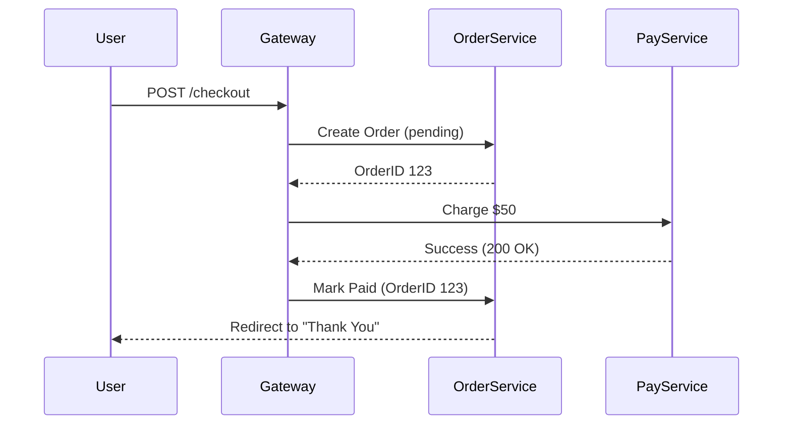

# Sequence Diagrams

## 1. Why Should I Care About This?
- **Timeline Visualization**: Sequence diagrams show *when* things happen. They are the best tool for understanding the lifecycle of a complex request (e.g., "What happens when I click Buy Now?").
- **Exposing Latency**: By drawing every hop (Browser -> Gateway -> Auth -> DB), you immediately see where the performance bottlenecks and "Chatty API" problems are.
- **Synchronization**: Essential for understanding multi-threaded or distributed systems where the order of operations matters.

## 2. What Problem Does This Solve?
- **Flow Confusion**: Prevents developers from getting lost in a sea of async callbacks and microservice hops.
- **Logic Gaps**: Helps you spot where you forgot to handle an error or send an acknowledgment.
- **Naive Approach**: Thinking that one request is just one operation. In reality, a "Login" might trigger 5 hidden sub-systems.

## 3. Core Idea (Intuition First)
A sequence diagram is like a **Music Score**. 
- The **Actors** (Users, Services) are at the top. 
- Time flows **downward**. 
- Horizontal arrows show "Notes" (Messages) being passed back and forth. 
- You can see exactly which service is "active" during each part of the song.

## 4. How It Actually Works
- **Lifelines**: Vertical dashed lines representing an object or service's existence over time.
- **Activation Boxes**: Thick boxes on the lifeline showing when a service is busy processing a request.
- **Synchronous Messages**: Solid horizontal line with a solid arrow. (Waiting for a response).
- **Asynchronous Messages**: Lined arrow. (Fire and forget).
- **Return Messages**: Dashed horizontal line.

## 5. Real-World Example
**OAuth2.0 Authentication Flow**:
- This is notoriously difficult to understand in code. A sequence diagram makes it clear: 1. User clicks login. 2. App redirects to Google. 3. Google returns a Code. 4. App exchanges Code for Token. 5. App gets User profile. Each hop is a clear horizontal arrow on the diagram.

## 6. Code Example
Modeling a simple Checkout flow using Mermaid syntax (Sequence):

## 7. Design Variations & Alternatives
- **Collaboration Diagrams**: Similar information but organized by object clusters rather than a timeline.
- **Communication Diagrams**: Focuses on the *links* between objects rather than the *order* of messages.
- **Loom/Tracing**: Modern observability tools (like Jaeger or Honeycomb) generate "Live" sequence diagrams from your production traffic.

## 8. Pros and Cons
### Pros
- **Clarity on Timing**: Unmatched for understanding request lifecycles.
- **Interface Validation**: Helps you realize that Service A needs a method that doesn't exist yet.

### Cons
- **Complexity**: Getting the exact arrow types correct can be tedious.
- **Space Constraints**: Trying to fit 10 microservices on one screen makes the diagram unreadable. (Break them into smaller sub-flows).

## 9. Failure Scenarios & What Can Go Wrong
- **The "Looming Cliff"**: A diagram that gets so wide it's impossible to follow.
- **Infinite Loops**: Failing to show logic loops or retries, leading to a "Happy Path Only" diagram that doesn't reflect reality.
- **Level Mixing**: Trying to show high-level business actors and low-level class methods on the same diagram. Pick a "Level" and stick to it.

## 10. Impact on Scalability, Reliability & Cost
- **Reliability**: Helps discover "Race Conditions" or places where a timeout would cause a system failure.
- **Scalability**: Visualizes "Fan-out" (one call triggering 50 sub-calls), which is a major scalability killer.

## 11. When NOT to Use This
- **Basic CRUD**: "Insert into DB" doesn't need a sequence diagram.
- **Single-service internal logic**: Use a flowchart or state diagram instead.

## 12. Interview Perspective
- **What interviewers expect**: The ability to draw the flow of a **Distributed Transaction** or **Auth flow**. Clear distinction between sync and async calls.
- **Common question**: "Draw the sequence of events when a user searches for a ride on Uber."

## 13. Connections to Other Topics
- **Microservices**: Sequence diagrams are the primary way to design inter-service communication.
- **Event-Driven Architecture**: Used to show how events ripple through a system.

## 14. Visual Aids
- **Key Symbols Legend**: Lifelines, Messages, and Loops (alt/opt boxes).
- **Before/After Optimization**: Showing a "Slow" sequence vs a "Parallelized" fast one.

## 15. Summary (TL;DR)
**Sequence diagrams are the ultimate tool for visualizing the flow of messages and time in a system, ensuring logic and performance are sound before writing code.**

## 16. Further Reading & Resources
- [WebSequenceDiagrams.com](https://www.websequencediagrams.com/) - Quick online tool.
- [Mermaid Live Editor](https://mermaid.live/) - Best for "Diagram as Code."
- [Visual Paradigm: Sequence Diagram Tutorial](https://www.visual-paradigm.com/guide/uml/what-is-sequence-diagram/)
- *Designing Data-Intensive Applications* - Uses sequence-style logic to explain distributed systems.
