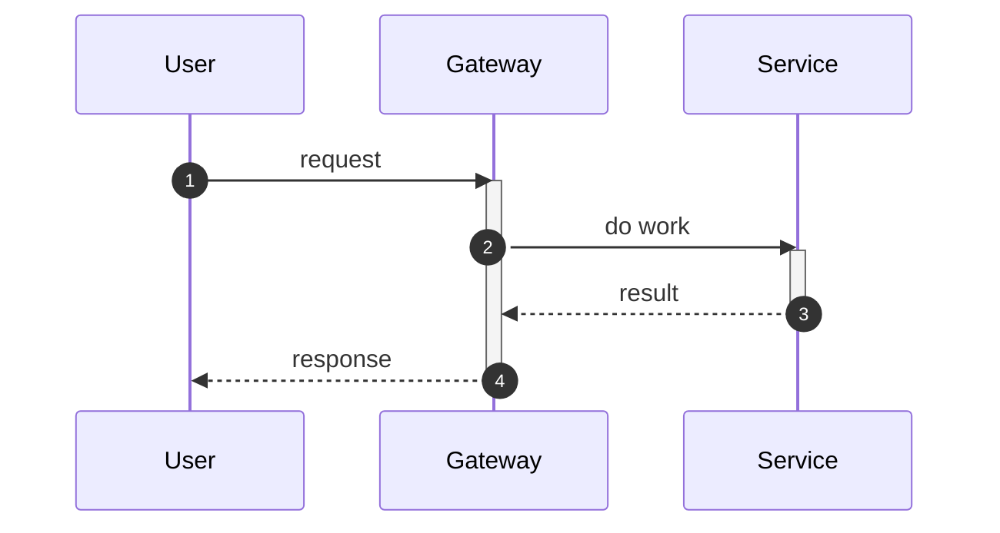
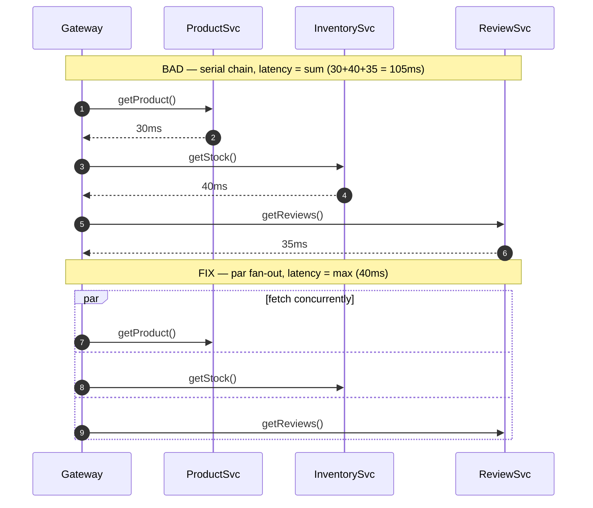
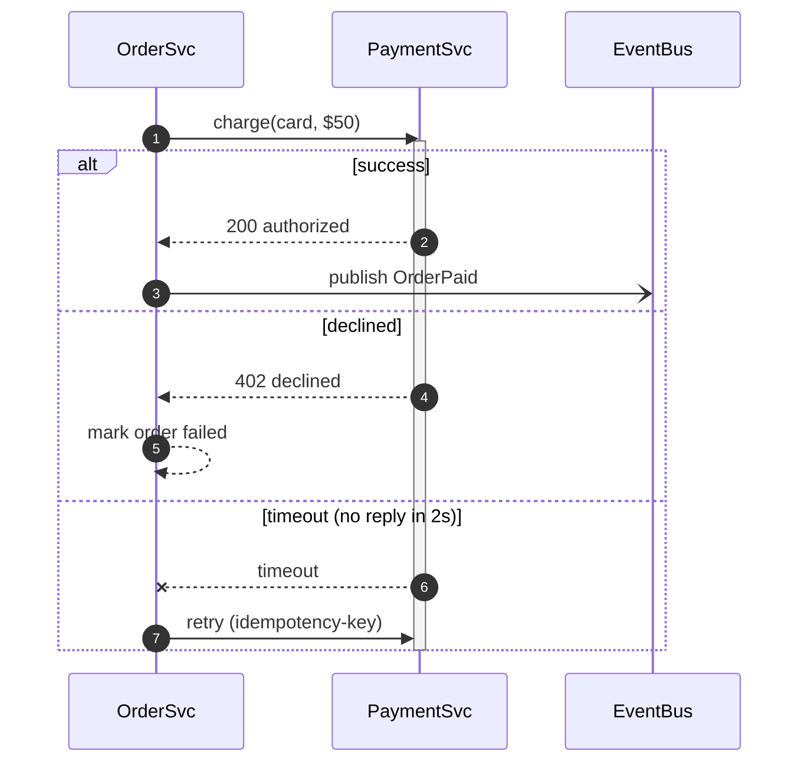
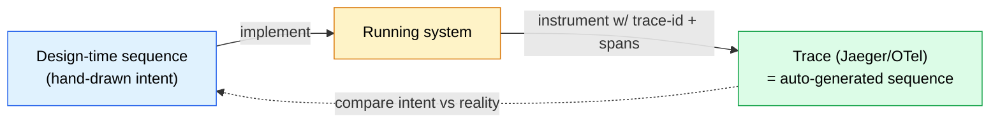
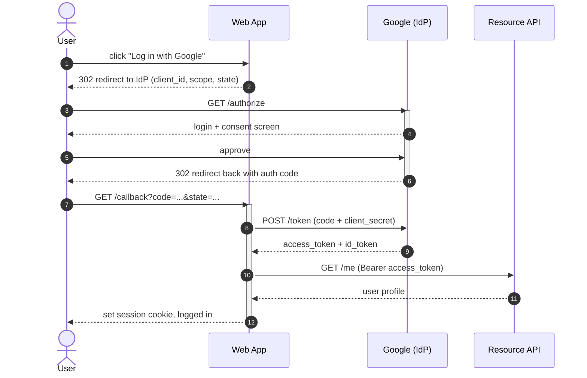
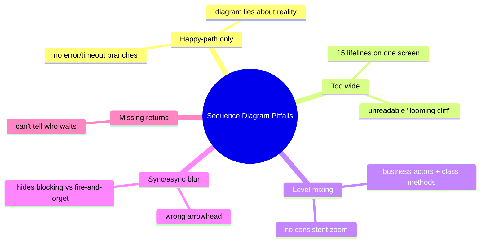

# Sequence Diagrams

> **One line:** A music score for software — participants sit across the top, time flows straight down, and every message is a note, so you can *see* the exact order, the waiting, and the fan-out of a request instead of guessing at it from code.

---

## Table of Contents
1. [Why You Must Master This](#1-why-you-must-master-this)
2. [The Mental Model](#2-the-mental-model)
3. [The Anatomy — Lifelines, Activation, Messages](#3-the-anatomy--lifelines-activation-messages)
4. [Combined Fragments — alt / opt / loop / par](#4-combined-fragments--alt--opt--loop--par)
5. [Reading Latency & Fan-out From the Shape](#5-reading-latency--fan-out-from-the-shape)
6. [Sync vs Async, Errors & Timeouts](#6-sync-vs-async-errors--timeouts)
7. [Traces as Auto-Generated Sequences](#7-traces-as-auto-generated-sequences)
8. [Worked Example — OAuth2 Login](#8-worked-example--oauth2-login)
9. [Real-Life Use Cases](#9-real-life-use-cases)
10. [Failure Modes](#10-failure-modes)
11. [🏋️ Practice Drills](#-practice-drills)
12. [🎤 Interview Q&A Bank](#-interview-qa-bank)
13. [🎯 Staff+ Nuances](#-staff-nuances)
14. [Cheat Sheet](#14-cheat-sheet)
15. [Connections & Further Reading](#15-connections--further-reading)

---

## 1. Why You Must Master This

A sequence diagram is the one picture that makes a *distributed request* legible. When a "Buy Now" click quietly touches eight services, prose and flowcharts hide the two things that matter most — **order** and **waiting** — and a sequence diagram puts both on the page.

- **It designs an interaction, not just documents it.** Drawing the arrows *before* coding surfaces the method Service A needs from B that doesn't exist yet, and the acknowledgement you forgot to send back.
- **It exposes latency and fan-out visually.** Every hop is a horizontal arrow; a request that looks simple in code reveals itself as a 12-arrow chatty conversation the moment you draw it.
- **It's the default interview whiteboard artifact.** "Draw the sequence for an Uber ride request" is a standard prompt, and a clean lifeline/activation/fragment diagram separates a senior answer from hand-waving.

> **The core problem it solves:** *invisible time and hidden hops.* Code tells you *what* calls happen but scatters them across files and callbacks; a sequence diagram collapses the whole lifecycle onto one vertical timeline, so a bottleneck, a serial chain, or a missing error path becomes something you can literally point at.

---

## 2. The Mental Model

Think of a **music score**. The **participants** (User, Gateway, services, DB) are the instruments listed down the left edge. **Time flows downward** — the top of the page is t=0, the bottom is "done." Each **message** is a note played from one instrument to another. Read top-to-bottom and you're reading the performance in order; a tall gap on one lifeline is an instrument holding a long note (a slow call) while everyone waits.

The single mental shift: **a sequence diagram is about time and interaction, not structure.** A class diagram answers "how is it built?"; a sequence diagram answers "what happens, in what order, and who waits for whom?"



---

## 3. The Anatomy — Lifelines, Activation, Messages

Four primitives carry almost every diagram; get these right and the rest is composition.

- **Participant + Lifeline** — a box at the top (actor, service, or object) with a dashed vertical line dropping from it, representing that participant's existence over time. Everything about it is read down that line.
- **Activation bar** — a thin rectangle *on* a lifeline marking when the participant is busy (holding a stack frame / thread). Nested bars show re-entrant calls. Its *height* is time spent busy — where latency hides.
- **Synchronous message** — **solid line, filled arrowhead**. The caller *blocks* for a reply (a normal function call or blocking HTTP/gRPC request).
- **Asynchronous message** — **solid line, open arrowhead**. Fire-and-forget; the caller does *not* wait (publish to a queue, emit an event).
- **Return message** — **dashed line, open arrowhead** carrying the reply back, ending an activation. Optional visually, but drawing it makes the wait explicit.

| Notation | Meaning | Mermaid syntax |
|----------|---------|----------------|
| Solid line, **filled** arrowhead | Synchronous call (caller blocks) | `A->>B: msg` |
| Solid line, **open** arrowhead | Asynchronous / fire-and-forget | `A-)B: event` |
| **Dashed** line, open arrowhead | Return / reply | `B-->>A: result` |
| Thin rectangle on a lifeline | Activation (participant is busy) | `activate B` / `deactivate B` |
| `X` at the bottom of a lifeline | Object destroyed / connection closed | `destroy B` |
| Line to self, looping arrow | Self-call (internal work) | `A->>A: validate` |



---

## 4. Combined Fragments — alt / opt / loop / par

Real flows branch, repeat, and run in parallel. **Combined fragments** are labelled boxes drawn around a slice of the diagram that encode that control flow, so one diagram covers reality instead of only the happy path.

| Fragment | Means | Use it for |
|----------|-------|-----------|
| `alt` | mutually exclusive branches (if/else) | success vs failure, cache hit vs miss |
| `opt` | a branch that may not run (if, no else) | "send receipt email if opted in" |
| `loop` | repeat while a condition holds | retries, paging, "for each item" |
| `par` | branches run concurrently | fan-out to independent services |
| `critical` / `break` | atomic region / early exit | locked section, error short-circuit |

```mermaid
sequenceDiagram
    autonumber
    participant C as Client
    participant API as API
    participant Cache as Cache
    participant DB as Database
    C->>API: GET /product/42
    activate API
    alt cache hit
        API->>Cache: get(42)
        Cache-->>API: product
    else cache miss
        API->>DB: SELECT * WHERE id=42
        DB-->>API: row
        opt cache the result
            API->>Cache: set(42, product)
        end
    end
    loop each related item
        API->>DB: fetch related
        DB-->>API: item
    end
    API-->>C: 200 product + related
    deactivate API
```



> Nest fragments sparingly. Two levels deep is readable; four levels is a maze — split it into a sub-flow diagram instead (see [Failure Modes](#10-failure-modes)).

---

## 5. Reading Latency & Fan-out From the Shape

Once the arrows are on the page, the *geometry* diagnoses performance without a profiler.

- **A staircase of arrows going down-right = a serial chain.** Each hop waits for the last, so latency is the *sum* of every hop — the visual signature of a **chatty API** (N+1 drawn out).
- **Many arrows leaving one lifeline at the same height = fan-out.** One request triggering N downstream calls; under `par` they overlap (latency = *max*), serially they don't (*sum*) — the diagram tells you which.
- **A tall activation bar = a slow participant** holding everyone above it hostage.



> The refactor the diagram *forces you to see*: three independent reads done serially cost 105ms; the same three under a `par` fragment cost 40ms. You didn't add capacity — you removed waiting. Sequence diagrams are where you catch that before it ships.

---

## 6. Sync vs Async, Errors & Timeouts

The arrowhead is a design decision, not decoration. **Solid filled = "I will wait"; open = "I won't."** That choice determines whether a slow downstream service degrades *this* request.

- **Synchronous** couples the caller's latency and availability to the callee's — simpler to reason about, but a slow dependency blocks the caller and everyone above it.
- **Asynchronous** (queue/event) decouples them: the caller returns immediately, work happens later. You trade tail-latency isolation for eventual consistency and out-of-band reply handling.

A diagram that shows only the happy path is a lie. Model the **error and timeout paths** with `alt`, because that's where systems actually fail:



Note the `-x` (message lost / timeout) and the async publish `-)` to the bus — the diagram makes the retry, the idempotency key, and the fire-and-forget event all explicit.

---

## 7. Traces as Auto-Generated Sequences

The diagrams above are the *design-time* view; a **distributed trace** is the same picture generated automatically from *production traffic*. [Jaeger](../10_Microservices_Distributed_Systems/Distributed_Tracing_Jaeger.md) or OpenTelemetry propagates a trace-id across every hop and records each **span** (one unit of work, with start time and duration) — which is exactly an activation bar on a lifeline.

- A **span** ≈ an activation bar; its **duration** ≈ the bar's height; **parent/child spans** ≈ nested calls.
- A trace's waterfall view *is* a sequence diagram of one real request — so the latency/fan-out reading from [§5](#5-reading-latency--fan-out-from-the-shape) transfers straight to production traces.
- The workflow: **draw the intended sequence during design; compare it against the trace in production.** Divergence (an extra hop, a span far taller than planned) is your bug.



See [Distributed Tracing (OpenTelemetry)](../12_Monitoring_Logging_Observability/Distributed_Tracing_OpenTelemetry.md) for how spans are collected and correlated.

---

## 8. Worked Example — OAuth2 Login

OAuth2 Authorization Code flow is notoriously hard to follow in prose but trivial as a sequence — every redirect and token swap is one arrow. Note the two distinct round-trips through the browser (front-channel redirects) versus the direct back-channel token exchange.



**Concept → consequence.** The one *synchronous, blocking* hop that gates the whole login is `App->>IdP: POST /token` — the back-channel token exchange. If the IdP's token endpoint is slow, *every* login stalls there on the critical path and the user sees a spinner, not a page. The diagram makes that bottleneck obvious: the arrow with the tallest activation bar off the IdP is the one you'd wrap in a timeout + circuit breaker. You can't parallelize it (the profile call needs the token first), so the design lever is caching the session and keeping that endpoint fast — a conclusion the picture hands you for free.

---

## 9. Real-Life Use Cases

| Situation | How sequence diagrams apply |
|-----------|------------------------------|
| **Designing a distributed transaction / Saga** | Draw each service call + compensating action to see ordering and failure rollback before coding. |
| **Auth flows (OAuth2, SAML, SSO)** | The canonical use — redirects and token swaps are far clearer as arrows than as prose. |
| **Debugging a slow endpoint** | Overlay the intended sequence on a Jaeger trace; the extra hop or fat span is the culprit. |
| **API / interface design review** | Reveals that Service A needs a method on B that doesn't exist, or a missing acknowledgement. |
| **Onboarding to a request lifecycle** | New engineers grasp "what happens on checkout" from one diagram, not ten files. |
| **Incident postmortems** | Reconstruct the exact order of events (and the race) that caused the outage. |

> Real-world habit: **before writing the code for any multi-hop flow, draw the sequence — and always draw the error/timeout branches, not just the happy path.** The five minutes on the whiteboard catches the chatty chain and the missing rollback that would cost you a production incident.

---

## 10. Failure Modes



- **Happy-path only** — *symptom:* no `alt`/`opt` for failures, so the diagram never shows the timeout or the decline. *Fix:* model at least the primary error and timeout branch; that's where systems break.
- **Too wide ("the looming cliff")** — *symptom:* 12+ lifelines crammed edge-to-edge, unreadable. *Fix:* decompose into sub-flow diagrams (one per bounded interaction) and reference them.
- **Level mixing** — *symptom:* high-level business actors sharing a page with low-level private class methods. *Fix:* pick one altitude (business flow *or* class interaction) and hold it for the whole diagram.
- **Sync/async blur** — *symptom:* every arrow is a solid filled head, so you can't tell blocking calls from fire-and-forget. *Fix:* use open arrowheads (`-)`) for async and dashed for returns, deliberately.
- **Missing return messages** — *symptom:* you can't tell whether the caller waits. *Fix:* draw returns (or activation bars) so blocking is explicit.

---

## 🏋️ Practice Drills

> *Cover the solutions and attempt first — active recall is the point.*

**Drill 1 — Draw the sequence for an Uber ride request.** Rider opens the app and requests a ride; the system must locate nearby drivers, price the trip, and dispatch. Sketch the participants and messages, marking sync vs async.

<details><summary>Solution</summary>

Participants: Rider App, Gateway, LocationSvc, PricingSvc, MatchSvc, Driver App. `Rider->>Gateway: requestRide` (sync); Gateway fans out in a `par` to `LocationSvc: nearbyDrivers()` and `PricingSvc: estimate()` (concurrent → latency = max, not sum); then `Gateway->>MatchSvc: assign`; `MatchSvc-)Driver App: push offer` (**async** — rider isn't blocked on the driver accepting); `Driver App-)MatchSvc: accept`; `MatchSvc-->>Rider App: driver on the way`. Key marks: the two lookups belong in a `par`; driver dispatch is asynchronous push.
</details>

**Drill 2 — Turn a chatty chain into a fast one.** A dashboard endpoint calls UserSvc, then OrderSvc, then RecommendationSvc, each 40ms, strictly serially. Draw both the current and improved sequence and state the latency of each.

<details><summary>Solution</summary>

Current: three arrows in a down-right staircase, each waiting for the last → latency ≈ 40+40+40 = **120ms**. If the three calls are independent (none needs another's output), wrap them in a `par` fragment so they leave the Gateway lifeline at the same height → latency ≈ **max(40) = 40ms**. If RecommendationSvc *needs* the user id from UserSvc, only OrderSvc and Recommendation can overlap after UserSvc returns → ~80ms. The diagram shows exactly which calls are parallelizable.
</details>

**Drill 3 — Add the failure branches.** Given a happy-path checkout (`OrderSvc->>PaymentSvc: charge` → success), extend it to cover a decline and a timeout.

<details><summary>Solution</summary>

Wrap the charge in an `alt`: **success** → `PaymentSvc-->>OrderSvc: 200` then `OrderSvc-)EventBus: OrderPaid` (async); **else declined** → `PaymentSvc-->>OrderSvc: 402`, mark order failed, notify user; **else timeout** → `PaymentSvc--xOrderSvc: timeout`, then `OrderSvc->>PaymentSvc: retry with idempotency-key`. The idempotency key is essential because a timeout doesn't tell you whether the charge actually went through.
</details>

**Drill 4 — Read the trace.** A Jaeger waterfall for `GET /feed` shows the parent span at 900ms, with one child span (`renderSvc`) at 850ms and 30 sibling `db.query` spans of ~25ms each stacked serially inside it. Diagnose.

<details><summary>Solution</summary>

Classic N+1 / chatty fan-out: `renderSvc` issues 30 serial DB queries (30 × 25ms ≈ 750ms) — the tall child span and the stack of sibling spans are the activation-bar staircase from §5. Fix: batch the 30 queries into one (`WHERE id IN (...)`) or run them concurrently; either collapses ~750ms of serial DB time.
</details>

---

## 🎤 Interview Q&A Bank

**Q1. What is a sequence diagram and when do you reach for one?**
> A UML interaction diagram showing participants across the top and messages exchanged over time flowing downward. I reach for it to design or explain any *multi-hop, time-ordered* interaction — auth flows, distributed transactions, request lifecycles — where order and waiting matter. (signal: knows it's about *time/interaction*, not structure.)

**Q2. Sync vs async message — how are they drawn and what's the trade-off?**
> Synchronous is a solid line with a *filled* arrowhead and the caller blocks; asynchronous is a solid line with an *open* arrowhead, fire-and-forget. Sync couples the caller's latency/availability to the callee; async decouples them at the cost of eventual consistency and out-of-band reply handling. (signal: connects notation to a real design trade-off.)

**Q3. What's an activation bar and why does it matter?**
> The thin rectangle on a lifeline showing when a participant is actively doing work. Its *height* is time spent busy, so a tall bar is exactly where latency lives — it's the visual equivalent of a slow span in a trace.

**Q4. How do you show branching, retries, and parallelism?**
> Combined fragments: `alt` for if/else (success vs failure), `opt` for an optional block, `loop` for retries/paging, and `par` for concurrent branches. They let one diagram cover reality instead of only the happy path.

**Q5. How do you spot a latency or fan-out problem from a diagram?**
> A down-right staircase of sync calls is a serial chain whose latency is the *sum* of hops — the chatty-API signature. Many arrows leaving one lifeline at the same height is fan-out; under `par` its cost is the *max*, serially it's the *sum*. The geometry tells you what to parallelize. (signal: reads performance from shape.)

**Q6. How do sequence diagrams relate to distributed tracing?**
> A trace is an auto-generated sequence diagram of one real request: each span is an activation bar, span duration is bar height, parent/child spans are nested calls. You draw the intended sequence at design time and compare it to the Jaeger/OTel trace in production — divergence is a bug.

**Q7. What's the most common mistake people make with these diagrams?**
> Drawing only the happy path. Real systems fail on the error and timeout branches, so a diagram without `alt`/timeout paths gives false confidence. The second most common is making it too wide — 15 lifelines nobody can read — which should be split into sub-flows.

**Q8. Sequence vs flowchart vs state machine — when each?**
> Sequence diagram for *interactions between multiple participants over time*; flowchart for *decision logic within one process*; state machine for *how one entity transitions between states*. If the question is "who calls whom and in what order," it's a sequence diagram. (signal: picks the right tool.)

---

## 🎯 Staff+ Nuances

- **The arrowhead is an architecture decision.** Open (async) vs filled (sync) isn't cosmetic — it decides whether a slow dependency degrades the caller. Staff engineers use the diagram to *argue* for making a hop async onto a bus. See [Event-Driven Architecture](../03_High_Level_Design/Event_Driven_Architecture.md) and [Message Queues](../09_Message_Queues_Event_Streaming/Event_Sourcing_Pattern.md).
- **They're the design tool for Sagas and choreography.** For a distributed transaction you draw both the forward path *and* the compensating actions; the diagram is where you notice a missing rollback. Companion to [Domain-Driven Design](./Domain_Driven_Design.md) aggregates and [Orchestration vs Choreography](../10_Microservices_Distributed_Systems/Orchestration_vs_Choreography.md).
- **A `par` fragment is a promise you must keep in code.** Diagramming calls as parallel claims they're independent; if one secretly needs another's output, the diagram is wrong and the code will race. It forces you to verify independence before claiming the latency win.
- **Traces close the loop between intent and reality.** Treat the design-time sequence as a *testable hypothesis* against the production trace ([Jaeger](../10_Microservices_Distributed_Systems/Distributed_Tracing_Jaeger.md) / [OpenTelemetry](../12_Monitoring_Logging_Observability/Distributed_Tracing_OpenTelemetry.md)): an extra span nobody drew is an unplanned coupling; a span far taller than intended is a regression.
- **Pick an altitude and never mix.** The subtlest failure is a diagram that starts at business level (User, Checkout) and drifts to class methods (`OrderMapper.toDto()`) — useless for both review and onboarding. One zoom level per diagram; link to a finer one for detail.
- **A self-message models internal async, not just recursion.** A lifeline calling itself (`A->>A`) shows a participant kicking off internal work or a callback — often the seam where you'd later extract that work to a queue. Pairs naturally with a [state machine](./State_Machines.md) for the entity.
- **It's one member of the UML family — know the boundary.** Sequence diagrams excel at inter-participant timing and are weak at structure and lifecycle; that's why they pair with class diagrams and state machines. See [UML Diagrams](./UML_Diagrams.md).

---

## 14. Cheat Sheet

```
SEQUENCE DIAGRAM = participants across the top, TIME FLOWS DOWN, messages = arrows.
  Answers: WHAT happens, in WHAT ORDER, and WHO WAITS for whom.   (not structure — that's class diagrams)

NOTATION
  A->>B   solid line, FILLED head   = synchronous (caller BLOCKS)
  A-)B    solid line, OPEN head     = asynchronous / fire-and-forget
  B-->>A  DASHED line, open head    = return / reply
  A--xB   dashed w/ x               = message lost / timeout
  activate/deactivate B             = activation bar (B is busy; HEIGHT = latency)
  A->>A                             = self-call (internal work)

FRAGMENTS   alt (if/else) · opt (if, no else) · loop (retry/paging) · par (concurrent) · break (early exit)

READING PERFORMANCE
  down-right staircase of sync calls = SERIAL CHAIN → latency = SUM of hops (chatty API / N+1)
  many arrows from one lifeline same height = FAN-OUT → par: latency = MAX ; serial: SUM
  tall activation bar = slow participant (the bottleneck to wrap in timeout + circuit breaker)

TRACES  span ≈ activation bar · duration ≈ bar height · parent/child ≈ nested calls
        design the sequence → compare to Jaeger/OTel trace → divergence = bug

TRAPS  happy-path only (no error/timeout) · too wide (>~8 lifelines, split it) ·
       level mixing (actors + class methods) · wrong arrowhead (sync/async blur) · missing returns
```

---

## 15. Connections & Further Reading

**Within this repo:**
- [UML_Diagrams.md](./UML_Diagrams.md) — the sequence diagram is one UML interaction type; this is its home family.
- [State_Machines.md](./State_Machines.md) — model *one entity's* lifecycle; complements the inter-participant view. [Domain_Driven_Design.md](./Domain_Driven_Design.md) — aggregates and sagas the sequences coordinate.
- [Distributed Tracing — Jaeger](../10_Microservices_Distributed_Systems/Distributed_Tracing_Jaeger.md) and [OpenTelemetry](../12_Monitoring_Logging_Observability/Distributed_Tracing_OpenTelemetry.md) — traces as auto-generated sequences.
- [Event-Driven Architecture](../03_High_Level_Design/Event_Driven_Architecture.md) and [09 · Message Queues & Event Streaming](../09_Message_Queues_Event_Streaming/) — where async arrows go; [10 · Microservices](../10_Microservices_Distributed_Systems/) — the flows sequences design.

**External classics:**
- *UML Distilled* (Martin Fowler) — the crisp, practical reference for sequence-diagram notation.
- [Mermaid Live Editor](https://mermaid.live/) — diagram-as-code; [WebSequenceDiagrams](https://www.websequencediagrams.com/) — quick text-to-diagram.
- *Designing Data-Intensive Applications* (Kleppmann) — uses sequence-style reasoning for distributed consistency and failure.

---

## TL;DR
A sequence diagram is a **music score for a request**: participants across the top, **time flowing down**, and messages as arrows — so you can *see* order, waiting, and fan-out that code hides. Master the four primitives (**lifeline, activation bar, sync filled-arrow vs async open-arrow, dashed return**) and the fragments (**alt/opt/loop/par**), then read performance straight off the geometry — a **serial staircase costs the sum of hops, a `par` fan-out the max**. **Always draw the error and timeout branches, never the happy path alone**, keep one altitude per diagram, and treat your design-time sequence as a hypothesis to check against the production **trace** (Jaeger/OpenTelemetry), where a span is just an activation bar generated from real traffic.
