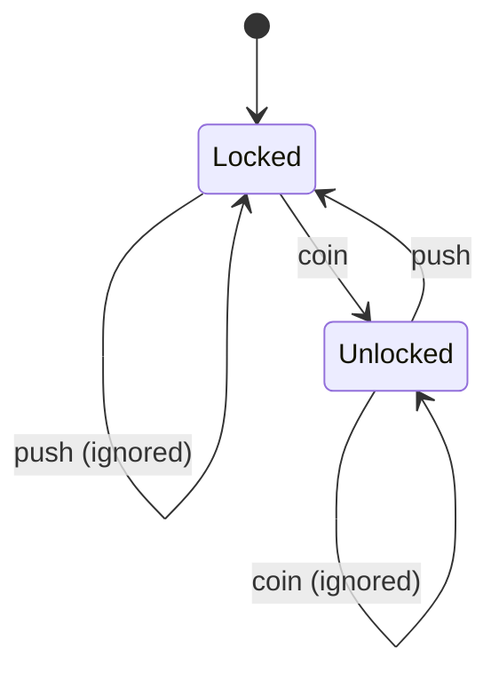
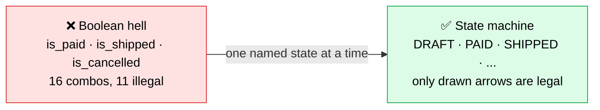
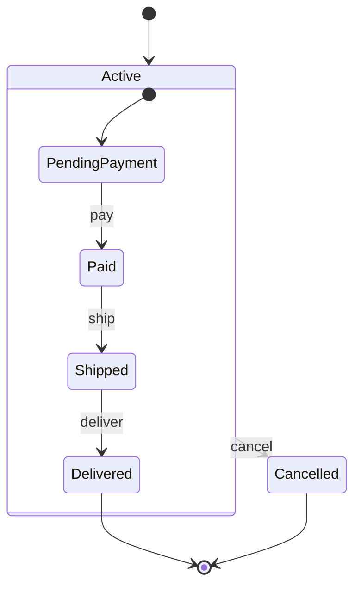
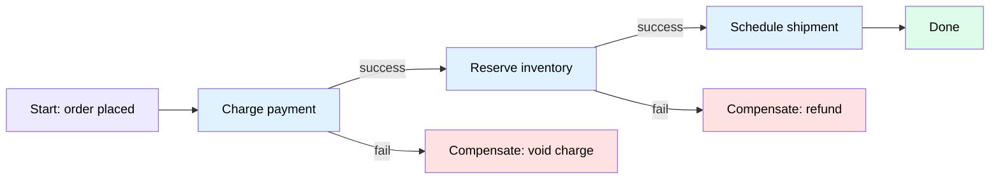
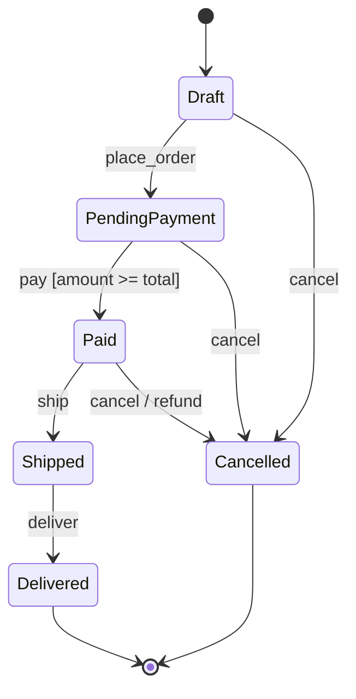
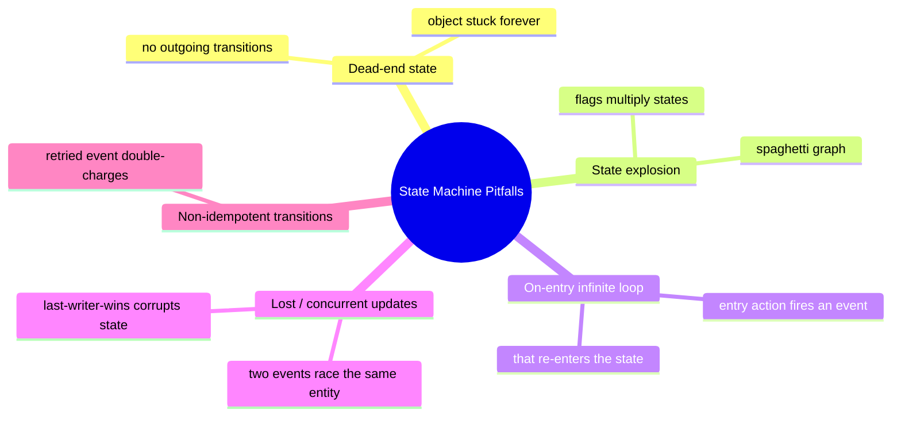

# State Machines

> **One line:** Instead of a dozen boolean flags that can lie to each other, an object holds *exactly one* named state at a time and can only follow the arrows you explicitly drew — so "impossible states" become literally impossible.

---

## Table of Contents
1. [Why You Must Master This](#1-why-you-must-master-this)
2. [The Mental Model](#2-the-mental-model)
3. [The Five Elements](#3-the-five-elements)
4. [Implementation A — The State Pattern](#4-implementation-a--the-state-pattern)
5. [Implementation B — The Transition Table](#5-implementation-b--the-transition-table)
6. [Hierarchical (Nested) State Machines](#6-hierarchical-nested-state-machines)
7. [Workflow Engines for Long-Running Processes](#7-workflow-engines-for-long-running-processes)
8. [Worked Example — Order Lifecycle](#8-worked-example--order-lifecycle)
9. [Real-Life Use Cases](#9-real-life-use-cases)
10. [Failure Modes](#10-failure-modes)
11. [🏋️ Practice Drills](#-practice-drills)
12. [🎤 Interview Q&A Bank](#-interview-qa-bank)
13. [🎯 Staff+ Nuances](#-staff-nuances)
14. [Cheat Sheet](#14-cheat-sheet)
15. [Connections & Further Reading](#15-connections--further-reading)

---

## 1. Why You Must Master This

A state machine is the difference between a lifecycle you can *prove* correct and one you *hope* is correct. Most lifecycle bugs are not typos — they are illegal state combinations no one thought to guard against.

- **It kills "boolean hell."** A class with `is_paid`, `is_shipped`, `is_cancelled`, `is_refunded` has 2⁴ = 16 flag combinations, but only ~5 are *real* states. The other 11 are landmines — `is_paid=True` **and** `is_cancelled=True`, `is_shipped=True` while `is_paid=False`. A single `status` enum makes those combinations unrepresentable.
- **It makes impossible states impossible.** The whole point: don't validate against bad states after the fact — make them *inexpressible*. If the only way to reach `SHIPPED` is the `ship` transition out of `PAID`, then "shipped but unpaid" cannot occur.
- **It centralizes the rules.** "You can't refund an order that hasn't been delivered" stops being a rule copied into six methods and becomes *one arrow that doesn't exist* on the graph. New engineers read the machine, not the folklore.
- **It gives you an audit trail for free.** Every transition is a discrete, loggable event — indispensable for payments, compliance, and debugging ("how did this order get here?").

> **The core problem it solves:** *illegal and impossible states.* It replaces a scatter of boolean flags and `if/else` guards — where bad combinations are merely *unlikely* — with a model where the only reachable states are the ones you drew, and the only moves are the arrows you declared.

---

## 2. The Mental Model

A state machine is a **subway turnstile.** It sits in **Locked**; the only move that does anything is *insert coin* → **Unlocked**. From **Unlocked**, *push* walks you through and snaps it back to **Locked**. Push while **Locked**, or insert a second coin while **Unlocked**? Ignored — the machine simply refuses. There is no "half unlocked" or "locked but open": it is always in exactly one state, and each state accepts only its own moves.

That is the entire idea: **a finite set of states, and for each state a finite set of allowed transitions — everything not drawn is rejected.**



Contrast the two models:





---

## 3. The Five Elements

Every finite state machine (FSM) is built from exactly five ingredients. Name them precisely — interviewers listen for this vocabulary.

| Element | What it is | Order-lifecycle example |
|---------|-----------|--------------------------|
| **State** | A named condition the object is *in*; exactly one is active at a time. | `PENDING_PAYMENT` |
| **Event / Trigger** | An external signal asking the machine to do something. Events are *attempts*, not guarantees. | `PAYMENT_RECEIVED` |
| **Transition** | The declared move from one state to another *for a given event*. Undeclared (state, event) pairs are rejected. | `PENDING_PAYMENT --pay--> PAID` |
| **Guard** | A boolean condition that must hold for a transition to fire. Same event can succeed or be blocked depending on the guard. | `amount_paid >= total` |
| **Action / side-effect** | Code that runs *because* a transition fired (or on entry/exit of a state). This is where the outside world changes. | on entering `SHIPPED`: send tracking email, decrement inventory |

Two refinements worth knowing:

- **Guards make transitions conditional, not just present/absent.** `PENDING_PAYMENT` + `pay` goes to `PAID` *only if* the guard `amount >= total` passes; a partial payment stays put (or routes to `PARTIALLY_PAID`). The event fired; the guard decided the destination.
- **Actions belong to the transition, not scattered in callers.** Entry actions (`on_entry`), exit actions (`on_exit`), and transition actions are the sanctioned place for side-effects. Keeping them here — not in the code that *sends* the event — is what makes the machine the single source of truth.

> A transition is really the tuple **(current state, event, [guard]) → (next state, [action])**. Model your lifecycle as a list of those tuples and you have already designed the machine.

---

## 4. Implementation A — The State Pattern

The **State pattern** (see [Design_Patterns_Overview.md](./Design_Patterns_Overview.md)) makes each state its own class. The context object delegates every event to its current-state object, which decides what to do — including refusing. Behavior lives *with* the state, so there are no giant `if status == ...` ladders.

```python
from abc import ABC, abstractmethod


class IllegalTransition(Exception): ...


class OrderState(ABC):
    name: str
    # Default: every event is illegal unless a subclass overrides it.
    def pay(self, o):    raise IllegalTransition(f"can't pay in {self.name}")
    def ship(self, o):   raise IllegalTransition(f"can't ship in {self.name}")
    def cancel(self, o): raise IllegalTransition(f"can't cancel in {self.name}")
    def on_entry(self, o): ...


class Draft(OrderState):
    name = "DRAFT"
    def pay(self, o):
        if o.amount_paid < o.total:            # guard at the edge of the transition
            raise IllegalTransition("insufficient funds")
        o.transition_to(Paid())
    def cancel(self, o): o.transition_to(Cancelled())


class Paid(OrderState):
    name = "PAID"
    def on_entry(self, o): o.emit("payment.captured")   # side-effect on entry
    def ship(self, o):   o.transition_to(Shipped())
    def cancel(self, o):                                  # cancelling PAID refunds
        o.refund(); o.transition_to(Cancelled())


class Shipped(OrderState):
    name = "SHIPPED"
    def on_entry(self, o): o.emit("tracking.email.sent")


class Cancelled(OrderState):                    # terminal: inherits all-illegal defaults
    name = "CANCELLED"


class Order:
    def __init__(self, total):
        self.total, self.amount_paid, self._state = total, 0, Draft()

    @property
    def state(self): return self._state.name

    def transition_to(self, new_state):
        self._state = new_state
        new_state.on_entry(self)               # entry action runs here, centrally

    # Public API just forwards each event to the current-state object.
    def pay(self):    self._state.pay(self)
    def ship(self):   self._state.ship(self)
    def cancel(self): self._state.cancel(self)
    def refund(self): print("refund issued")
    def emit(self, ev): print(f"event: {ev}")
```

**When to reach for it:** states have genuinely different *behavior* (each responds to events differently, with meaningful methods), and you want the compiler/type system to help. The cost is one class per state — verbose for simple graphs.

---

## 5. Implementation B — The Transition Table

The **transition table** (or matrix) encodes the machine as *data*, not classes. One dictionary maps `(state, event) → (next_state, guard, action)`. A single generic engine walks it. This is compact, trivially serializable, and — crucially — the whole lifecycle is visible on one screen.

```python
from dataclasses import dataclass, field
from typing import Callable, Optional


@dataclass
class Rule:
    to: str
    guard: Optional[Callable] = None
    action: Optional[Callable] = None


# The ENTIRE machine, as data. Reads like the diagram.
TRANSITIONS = {
    ("DRAFT",           "pay"):    Rule(to="PAID",
                                        guard=lambda o: o["paid"] >= o["total"]),
    ("DRAFT",           "cancel"): Rule(to="CANCELLED"),
    ("PAID",            "ship"):   Rule(to="SHIPPED",
                                        action=lambda o: print("email tracking #")),
    ("PAID",            "cancel"): Rule(to="CANCELLED",
                                        action=lambda o: print("refund issued")),
    ("SHIPPED",         "deliver"): Rule(to="DELIVERED"),
}
TERMINAL = {"DELIVERED", "CANCELLED"}


class Machine:
    def __init__(self, order): self.o = order

    def fire(self, event):
        state = self.o["state"]
        rule = TRANSITIONS.get((state, event))
        if rule is None:                                   # undeclared = rejected
            raise ValueError(f"illegal: {event} in {state}")
        if rule.guard and not rule.guard(self.o):          # guard blocks it
            raise ValueError(f"guard failed for {event} in {state}")
        if rule.action:
            rule.action(self.o)                            # side-effect
        self.o["state"] = rule.to
        return rule.to


order = {"state": "DRAFT", "total": 100, "paid": 100}
m = Machine(order)
print(m.fire("pay"))       # -> PAID
print(m.fire("ship"))      # -> SHIPPED  (+ "email tracking #")
```

**State pattern vs transition table — which and when:**

| | State pattern | Transition table |
|---|---------------|------------------|
| **Encoding** | Behavior in one class per state | Whole machine in one data structure |
| **Best when** | States have rich, differing behavior | Graph is large, mostly bookkeeping |
| **Add a state** | New class | New rows |
| **Serialize / config-drive** | Awkward | Trivial (it's just data → JSON/DB) |
| **Visualize / audit** | Read many files | Read one table; auto-diagram it |
| **Type safety** | Strong (classes, methods) | Weaker (strings/enums) |

> Rule of thumb: **rich behavior per state → State pattern; many states, thin behavior, or config-driven → transition table.** Libraries like `transitions` (Python) and XState (JS) are polished transition tables with a nicer API.

---

## 6. Hierarchical (Nested) State Machines

Flat machines suffer **state explosion**: every cross-cutting concern multiplies your states. If an order can be `PAID` or `SHIPPED` and *also* `NORMAL` or `FRAUD_HOLD`, a flat design needs `PAID_NORMAL`, `PAID_HOLD`, `SHIPPED_NORMAL`, `SHIPPED_HOLD`… — a combinatorial mess.

**Hierarchical state machines (HSMs)**, from Harel statecharts, fix this by *nesting* states. A superstate `ACTIVE` contains substates `PAID`/`SHIPPED`; a `cancel` transition drawn on the *parent* applies to *all* children — write it once. Substates inherit the parent's transitions and can override them.



The single `Active --> Cancelled: cancel` arrow means "from any substate of Active, `cancel` is legal" — no need to draw `cancel` from each of PendingPayment, Paid, and Shipped. That is the payoff: **shared transitions collapse to one arrow**, taming the explosion. This is the same abstraction move as bounded contexts in [Domain_Driven_Design.md](./Domain_Driven_Design.md) — group related states so invariants are written once.

---

## 7. Workflow Engines for Long-Running Processes

An in-memory FSM is perfect for a request that lives milliseconds. But some lifecycles run for **days or weeks** and span **multiple services** — an order that waits for a warehouse, a loan awaiting manual review, a saga coordinating payment + inventory + shipping. Here you need the state to be **durable, distributed, and resumable across crashes**. That is a **workflow engine**: a state machine whose current state and history are *persisted* and whose transitions can survive process restarts.

| Engine | Model | Sweet spot |
|--------|-------|-----------|
| **AWS Step Functions** | Amazon States Language (JSON states + transitions) | Serverless orchestration of Lambdas / AWS services |
| **Temporal / Cadence** | Durable code (workflow = replayable function) | Long-running, code-first sagas with retries |
| **Camunda / Zeebe** | BPMN (business-process diagrams) | Human-in-the-loop, business-owned processes |
| **Netflix Conductor / Airflow** | DAG of tasks | Data pipelines, task orchestration |

The key shift from an in-memory FSM: **the engine owns durability, timers, retries, and idempotency.** A transition like "wait 3 days, then send a reminder" is a first-class feature, not something you bolt onto a cron job. In a microservices world this is how you run a **saga** — a distributed transaction expressed as a state machine, where each step has a compensating action if a later step fails. See [../10_Microservices_Distributed_Systems/](../10_Microservices_Distributed_Systems/) for sagas and [../09_Message_Queues_Event_Streaming/](../09_Message_Queues_Event_Streaming/) for the event backbone that drives these transitions.



> An in-memory FSM asks "what can happen next?" A workflow engine also answers "…and how do we survive a crash, a 3-day wait, and a failed step halfway through?"

---

## 8. Worked Example — Order Lifecycle

The canonical interview machine. States: `DRAFT → PENDING_PAYMENT → PAID → SHIPPED → DELIVERED`, with `CANCELLED` reachable early. `DELIVERED` and `CANCELLED` are terminal.



Walk the happy path and one **rejected illegal transition**:

```python
order = {"state": "DRAFT", "total": 100, "paid": 0}
m = Machine(order)   # (engine from section 5, extended with place_order/deliver rows)

m.fire("place_order")             # DRAFT -> PENDING_PAYMENT
order["paid"] = 100
m.fire("pay")                     # PENDING_PAYMENT -> PAID   (guard passes)
m.fire("ship")                    # PAID -> SHIPPED
m.fire("deliver")                 # SHIPPED -> DELIVERED

# --- the rejected illegal transition ---
order2 = {"state": "DRAFT", "total": 100, "paid": 0}
m2 = Machine(order2)
try:
    m2.fire("ship")              # there is NO (DRAFT, ship) rule
except ValueError as e:
    print(e)                    # -> "illegal: ship in DRAFT"
```

**Concept → consequence.** Because `(DRAFT, ship)` was never declared, "ship a draft order" is *impossible*, not merely unlikely — and the rejection happens in **one place** (the engine), so there's no `if status != 'DRAFT'` check to forget in the shipping service. Because the guard `amount >= total` gates `pay`, an unpaid order can never slip into `PAID`, so "shipped but unpaid" is unreachable two steps downstream. One diagram eliminated a whole family of bugs.

Note the two *kinds* of refusal: `pay` in `PENDING_PAYMENT` with `paid < total` is a **guarded** refusal ("not yet" — the arrow exists but the condition failed), whereas `ship` in `DRAFT` is **illegal** ("never" — the arrow doesn't exist at all).

---

## 9. Real-Life Use Cases

| Situation | How the state machine decides the outcome |
|-----------|--------------------------------------------|
| **E-commerce order status** | `DRAFT → PAID → SHIPPED → DELIVERED`; refunds only from `DELIVERED`, cancels only before `SHIPPED`. The graph *is* the policy. |
| **CI/CD pipeline** | `queued → running → (passed \| failed) → deployed`; a job can't deploy from `failed`. Each stage gate is a guarded transition. |
| **TCP connection** | The textbook FSM: `CLOSED → SYN_SENT → ESTABLISHED → FIN_WAIT → TIME_WAIT → CLOSED`. The protocol is literally specified as a state machine. |
| **Payments / PSP** | `authorized → captured → settled`, or `→ refunded / disputed`. Idempotent transitions and audit trails are legally required. |
| **Document / content** | `draft → in_review → approved → published → archived`; only editors can push `in_review → approved` (guard on role). |
| **Feature / subscription** | `trialing → active → past_due → canceled`; dunning logic is timed transitions in a workflow engine. |

> Real-world habit: **when you catch yourself adding a second boolean flag to an entity, stop and ask "is this really a lifecycle?"** If the flags interact (some combinations are nonsense), replace them with a single `status` enum and a transition table *before* the impossible states arrive.

---

## 10. Failure Modes



- **Dead-end (trap) state** — *symptom:* an object reaches a state with no outgoing transitions and is stuck forever (e.g., `ERROR` with no `retry`/`reset`). *Fix:* every non-terminal state needs at least one exit; audit the graph for sinks that shouldn't be terminal.
- **State explosion** — *symptom:* dozens of `X_AND_Y` states, an unreadable graph, every new flag doubling the count. *Fix:* hierarchical/nested states (§6) to factor out cross-cutting concerns; or split into orthogonal (parallel) regions.
- **On-entry infinite loop** — *symptom:* the `on_entry` action of state A fires an event that transitions back into A (or a cycle A→B→A) with no progress; stack overflow or a spinning process. *Fix:* keep entry actions side-effecting but *not* self-triggering; if an entry must fire an event, guard it so the cycle terminates.
- **Concurrent transitions / lost updates** — *symptom:* two events hit the same entity at once; both read `PAID`, both transition, one clobbers the other. *Fix:* optimistic locking (version column) or serialize per-entity (single-writer, actor model). See [Object_Oriented_Design.md](./Object_Oriented_Design.md) for invariants and [Domain_Driven_Design.md](./Domain_Driven_Design.md) for aggregate boundaries as the concurrency unit.
- **Non-idempotent transitions** — *symptom:* a retried `pay` event charges the card twice. *Fix:* make transitions idempotent (dedupe by event id; a transition already applied is a no-op).

---

## 🏋️ Practice Drills

> *Cover the solutions and attempt first — active recall is the point.*

**Drill 1 — Design a Vending Machine FSM.** List the states, events, guards, and actions for a machine that takes coins, dispenses a drink, and gives change.

<details><summary>Solution</summary>

**States:** `IDLE`, `COLLECTING` (coins inserted, not enough yet), `DISPENSING`, `RETURNING_CHANGE`. **Events:** `insert_coin`, `select_item`, `cancel`, `dispense_done`. **Guards:** `select_item` transitions `COLLECTING → DISPENSING` only if `balance >= price` (else stays in `COLLECTING`). **Actions:** on entering `DISPENSING`, drop the drink and decrement stock; on entering `RETURNING_CHANGE`, refund `balance - price`; `cancel` from `COLLECTING` returns all coins → `IDLE`. Terminal-ish: after `dispense_done`, return to `IDLE`. Note the guard: `select_item` is always a *legal event* while collecting, but the guard decides whether it dispenses or is ignored.
</details>

**Drill 2 — Spot the impossible state.** An entity has `is_submitted`, `is_approved`, `is_rejected`. A row shows `is_submitted=False, is_approved=True`. What's wrong, and how do you make it unrepresentable?

<details><summary>Solution</summary>

You can't be *approved* without being *submitted* — the flags encode an impossible state, and nothing structurally prevents it. Three booleans give 8 combinations but only ~4 are legal. Replace them with one `status ∈ {DRAFT, SUBMITTED, APPROVED, REJECTED}` and a transition table where `APPROVED`/`REJECTED` are only reachable *from* `SUBMITTED`. Now "approved but not submitted" cannot be written at all.
</details>

**Drill 3 — Flat vs hierarchical.** An order is `PAID` or `SHIPPED`, and independently `FLAGGED_FRAUD` or `CLEAR`. A flat machine needs `PAID_CLEAR`, `PAID_FRAUD`, `SHIPPED_CLEAR`, `SHIPPED_FRAUD`. How do you avoid the explosion?

<details><summary>Solution</summary>

Use two **orthogonal regions** (parallel states) or nest the fraud flag as a separate concern: keep the fulfillment machine (`PAID → SHIPPED → DELIVERED`) and a parallel fraud machine (`CLEAR ↔ FLAGGED`) that run concurrently. A `flag_fraud` event drawn once on the parent applies regardless of fulfillment state. The two axes stay independent instead of multiplying — N + M states instead of N × M.
</details>

**Drill 4 — Make a transition idempotent.** A payment webhook can be delivered twice; both deliveries fire `pay` on a `PENDING_PAYMENT` order. How do you prevent a double charge and a broken state?

<details><summary>Solution</summary>

Dedupe on the event/idempotency key: record the processed `event_id`; if `pay` arrives with an already-seen id, treat it as a no-op and return the current state. Combine with a guard `state == PENDING_PAYMENT` so a `pay` arriving after the order is already `PAID` is simply ignored, not re-applied. The transition becomes safe to retry — essential in any at-least-once delivery system.
</details>

---

## 🎤 Interview Q&A Bank

**Q1. What is a finite state machine, in one breath?** *(signal: crisp vocabulary)*
> A model where an object is always in exactly one of a finite set of **states**, and moves between them only via declared **transitions** fired by **events**, optionally gated by **guards** and running **actions** as side-effects. Anything not declared is illegal.

**Q2. What problem does it actually solve?** *(signal: sees past the mechanism)*
> Illegal and impossible states. It replaces a pile of boolean flags — where bad combinations like "paid AND cancelled" are merely unlikely — with a single named state and explicit arrows, so the illegal combinations become unrepresentable and the rules live in one place.

**Q3. Boolean flags vs a status enum — when does it matter?** *(signal: judgment, not dogma)*
> The moment the flags *interact* — when some combinations are nonsense. Independent flags (`is_admin`, `email_verified`) are fine as booleans. But `is_paid`/`is_shipped`/`is_cancelled` constrain each other, so N booleans imply 2^N combos with most illegal; collapse them into one lifecycle enum.

**Q4. State pattern or transition table?** *(signal: knows both, picks by context)*
> State pattern when states have rich, differing behavior and you want type safety — one class per state, context delegates. Transition table when the graph is large but mostly bookkeeping, or must be config-driven/serializable — the whole machine is data you can store, diff, and auto-diagram. Same FSM, different encoding.

**Q5. How do you handle a lifecycle that runs for days across services?** *(signal: distributed maturity)*
> A workflow engine — Step Functions, Temporal, Camunda — where state is durable, transitions survive crashes, timers and retries are built in. For a distributed transaction you model it as a saga: a state machine where each step has a compensating action if a later step fails.

**Q6. What's a guard, and how does it differ from an illegal transition?** *(signal: precision)*
> A guard is a condition on an *existing* transition — the event is legal here, but the guard decides whether it fires (e.g., `pay` needs `amount >= total`). An illegal transition is one that was never declared at all (`ship` in `DRAFT`). Guarded failure = "not yet"; illegal = "never."

**Q7. How do you persist and recover a state machine?** *(signal: production thinking)*
> Store the current state (and optionally an event log) in the database as the source of truth; rebuild the in-memory machine from it on load. With event sourcing, persist the *transitions* (events) and replay them to derive state — giving you a full audit trail and time-travel debugging for free.

**Q8. How do you prevent two concurrent events from corrupting state?** *(signal: concurrency awareness)*
> Make the entity's aggregate the concurrency unit and guard writes with optimistic locking (a version column) or serialize per-entity (single-writer / actor). Combined with idempotent transitions, a retried or racing event is safely rejected or no-ops rather than clobbering state.

---

## 🎯 Staff+ Nuances

- **Persistence turns the FSM into a distributed-systems problem.** An in-memory machine is trivial; the moment state lives in a database and events arrive over a queue, you inherit concurrency, ordering, and exactly-once concerns. Treat the persisted state as the source of truth, rebuild the machine on load, and make the aggregate boundary ([Domain_Driven_Design.md](./Domain_Driven_Design.md)) the unit of consistency.
- **Event sourcing and state machines are natural partners.** Instead of storing the current state, store the ordered *transitions* and fold them to derive state. You get a complete audit log, time-travel debugging, and the ability to rebuild projections — at the cost of replay complexity and schema-evolution discipline. The FSM defines which events are even valid to append.
- **Idempotent transitions are non-negotiable at scale.** In any at-least-once delivery system, every event can arrive twice. Design each transition so re-applying it is a no-op (dedupe by event id; guard on current state). "Charge succeeded" delivered twice must not charge twice — this is a property of the transition, not an afterthought.
- **Model the machine explicitly, don't let it emerge.** The worst FSMs are *implicit* — a lifecycle smeared across boolean flags and scattered `if` checks that no one ever drew. Even if you implement with a table, keep the diagram ([UML_Diagrams.md](./UML_Diagrams.md) state diagrams, [Sequence_Diagrams.md](./Sequence_Diagrams.md) for the event flow) as the reviewed artifact; code and diagram should be provably in sync (ideally generated from one another).
- **The State pattern is the OO answer to a `switch` on type.** It trades a central `switch(state)` for polymorphic dispatch — behavior moves *to* the states. That's cleaner when behavior differs richly per state, but it scatters the machine across classes; when you want the whole graph visible and diffable, prefer the table. Know both and articulate the trade ([Design_Patterns_Overview.md](./Design_Patterns_Overview.md)).
- **Guards encode business policy; keep them pure and testable.** A guard like "refund only within 30 days of delivery" is a business rule. Push it into a named, side-effect-free predicate so it can be unit-tested and changed without touching the transition wiring — the same separation-of-concerns discipline as keeping business logic out of the IO layer.
- **Sagas are just state machines that admit failure.** A distributed workflow is an FSM where every forward step has a compensating backward transition. The hard part isn't the happy path — it's designing the compensations and making the whole thing resumable. Let a workflow engine own durability, timers, and retries rather than reinventing them; see [../10_Microservices_Distributed_Systems/](../10_Microservices_Distributed_Systems/).

---

## 14. Cheat Sheet

```
STATE MACHINE = one named state at a time + only the arrows you drew are legal.
  Kills BOOLEAN HELL: N flags → 2^N combos (most illegal) → collapse to ONE status enum.
  Goal: make impossible states UNREPRESENTABLE, not merely validated-against.

THE 5 ELEMENTS
  State       the named condition it's IN (exactly one active)
  Event       an ATTEMPT to do something (fired externally)
  Transition  (state, event, [guard]) -> (next_state, [action])   ← the core tuple
  Guard       boolean that must hold for the transition to fire   (legal-but-blocked)
  Action      side-effect on transition / on_entry / on_exit

REJECTION KINDS
  illegal   (state,event) not declared     -> "never"   (ship in DRAFT)
  guarded   declared but guard fails        -> "not yet" (pay with amount < total)

IMPLEMENTATIONS
  State pattern   one class per state, context delegates   → rich behavior, type-safe, verbose
  Transition table  one dict (state,event)->rule, 1 engine → data-driven, serializable, visible
  pick: rich per-state behavior → pattern | many states / config-driven → table

SCALE UP
  Hierarchical (HSM)   nest states; draw shared transition on parent ONCE (tames explosion)
  Workflow engine      durable + distributed + resumable: Step Functions / Temporal / Camunda
  Saga                 distributed txn as FSM; each step has a COMPENSATING transition

TRAPS: dead-end state · state explosion · on-entry infinite loop · concurrent/lost updates ·
       non-idempotent transition (retry double-charges) → dedupe by event id + optimistic lock
```

---

## 15. Connections & Further Reading

**Within this repo:**
- [Design_Patterns_Overview.md](./Design_Patterns_Overview.md) — the **State pattern**, the OO implementation of §4.
- [UML_Diagrams.md](./UML_Diagrams.md) — **state diagrams** are the standard notation for these machines; [Sequence_Diagrams.md](./Sequence_Diagrams.md) — how events flow between objects during a transition.
- [Object_Oriented_Design.md](./Object_Oriented_Design.md) — invariants a machine enforces; [Domain_Driven_Design.md](./Domain_Driven_Design.md) — aggregates as the boundary that enforces state invariants and the unit of concurrency.
- [09 · Message Queues & Event Streaming](../09_Message_Queues_Event_Streaming/) — the event backbone that drives transitions; [10 · Microservices & Distributed Systems](../10_Microservices_Distributed_Systems/) — **sagas** as distributed state machines.

**External classics:**
- *Statecharts: A Visual Formalism for Complex Systems* (David Harel) — the origin of hierarchical/parallel states.
- [XState documentation](https://xstate.js.org/docs/) — statecharts in JS; [Amazon States Language](https://states-language.net/spec.html) — Step Functions' machine spec.
- [The State Pattern — Refactoring.Guru](https://refactoring.guru/design-patterns/state) · *Make Illegal States Unrepresentable* (Yaron Minsky) — the type-driven version of this idea.

---

## TL;DR
A state machine gives an object **exactly one named state at a time** and lets it follow **only the transitions you explicitly declared** — which is how you *kill boolean hell* and make **impossible states unrepresentable** instead of merely validated-against. Learn the **five elements** (state, event, transition, guard, action) and both implementations — the **State pattern** (a class per state, for rich behavior) and the **transition table** (the machine as data, for large or config-driven graphs) — reaching for **hierarchical states** when the graph explodes and a **workflow engine** (Step Functions/Temporal/Camunda) when the lifecycle is long-running or distributed as a saga. **When you're about to add a second interacting boolean flag, model a lifecycle instead** — and make every transition idempotent so a retried event never corrupts state.
