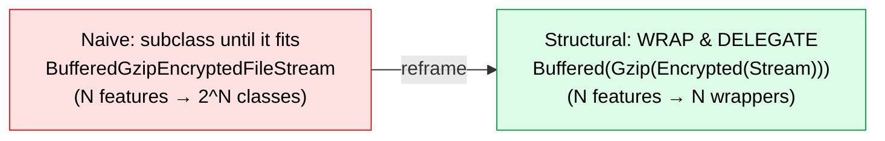
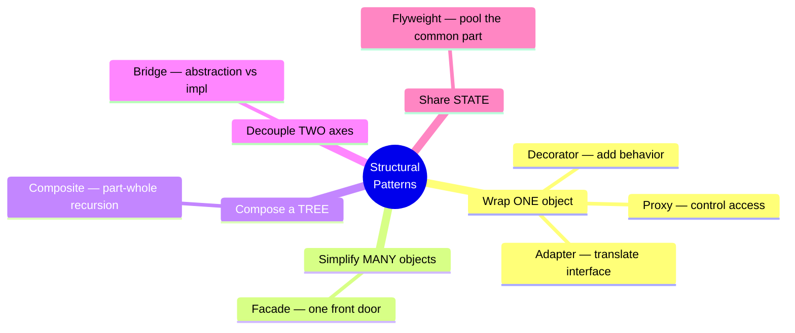
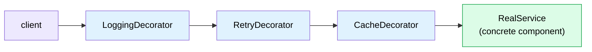
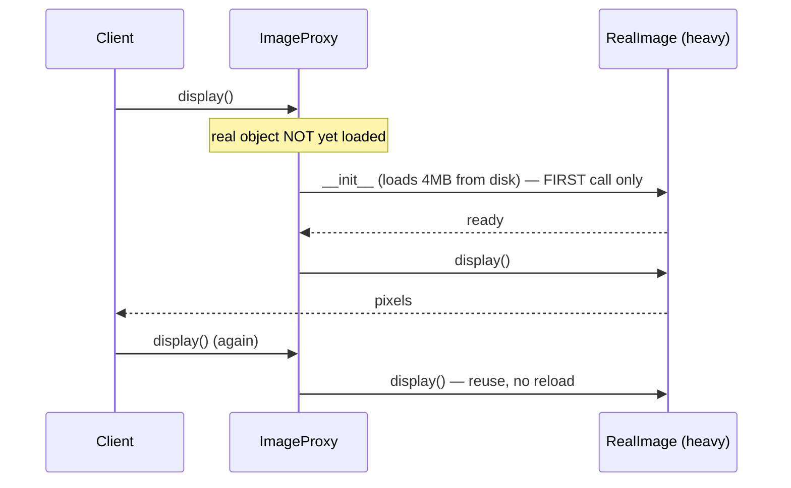
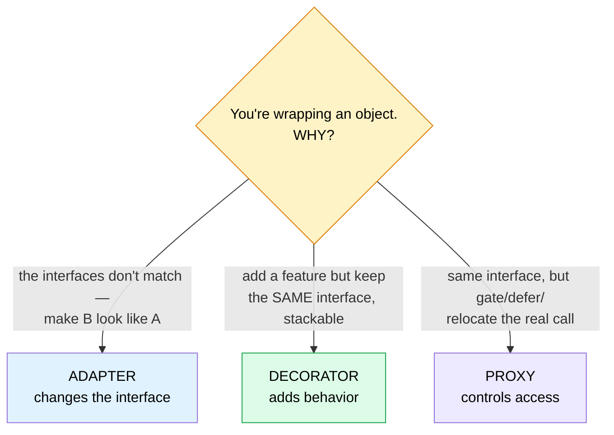
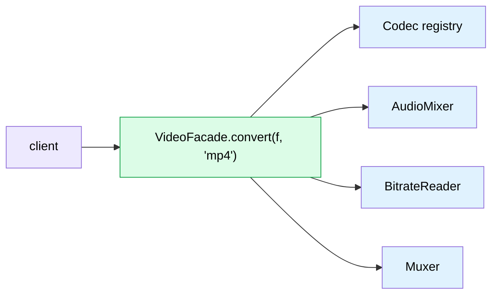
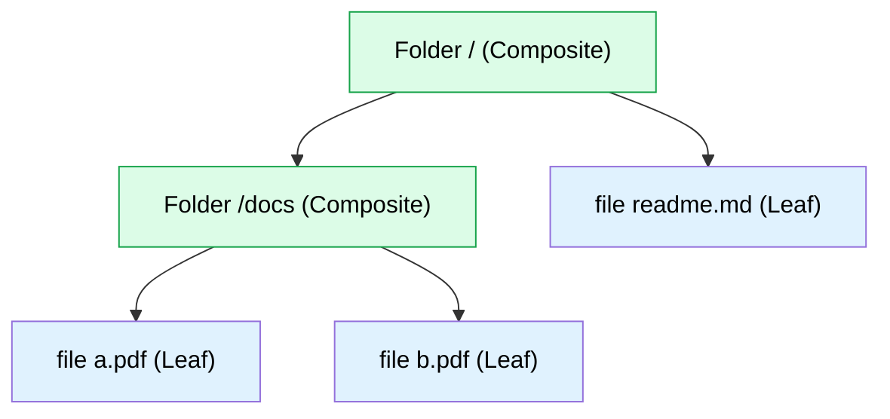
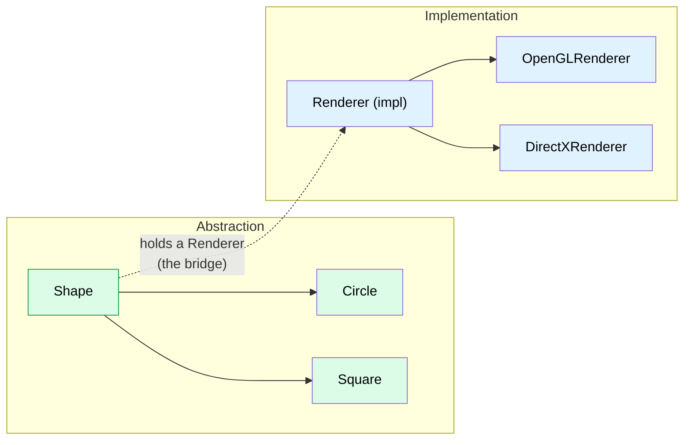
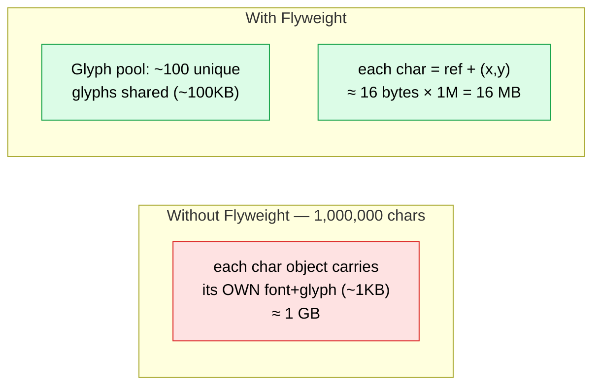
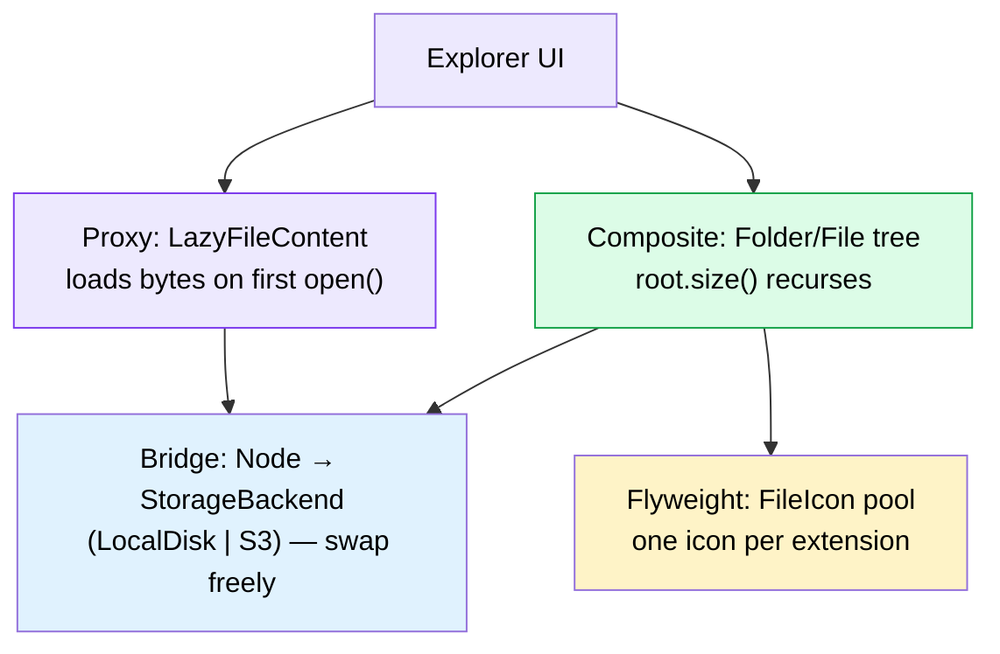

# Structural Design Patterns

> **One line:** Structural patterns are the seven GoF recipes for *composing* objects into bigger structures — wrapping, bridging, and tree-ing — so the pieces fit together without being welded, and so you can change one seam without rippling through the rest.

---

## Table of Contents
1. [Why You Must Master This](#1-why-you-must-master-this)
2. [The Mental Model](#2-the-mental-model)
3. [Adapter — Make the Plug Fit the Socket](#3-adapter--make-the-plug-fit-the-socket)
4. [Decorator — Stack Behavior at Runtime](#4-decorator--stack-behavior-at-runtime)
5. [Proxy — A Stand-In That Controls Access](#5-proxy--a-stand-in-that-controls-access)
6. [The Big Trap — Adapter vs Decorator vs Proxy](#6-the-big-trap--adapter-vs-decorator-vs-proxy)
7. [Facade — One Front Door Over a Subsystem](#7-facade--one-front-door-over-a-subsystem)
8. [Composite — Treat One and Many Alike](#8-composite--treat-one-and-many-alike)
9. [Bridge — Split Abstraction From Implementation](#9-bridge--split-abstraction-from-implementation)
10. [Flyweight — Share the Repeated Part](#10-flyweight--share-the-repeated-part)
11. [Worked Example — A Cloud File Explorer](#11-worked-example--a-cloud-file-explorer)
12. [Real-Life Use Cases](#12-real-life-use-cases)
13. [Failure Modes](#13-failure-modes)
14. [🏋️ Practice Drills](#-practice-drills)
15. [🎤 Interview Q&A Bank](#-interview-qa-bank)
16. [🎯 Staff+ Nuances](#-staff-nuances)
17. [Cheat Sheet](#17-cheat-sheet)
18. [Connections & Further Reading](#18-connections--further-reading)

---

## 1. Why You Must Master This

The structural family is where "clean architecture" stops being a slogan and becomes concrete class diagrams. Almost every boundary in a real system — the vendor SDK, the ORM, the API gateway, the plugin host — is a structural pattern whether the author named it or not.

- **They are the seams your system flexes at.** Adapter is the hexagonal-architecture port; Facade is the API gateway; Bridge is the JDBC driver interface. Get the seam wrong and a vendor swap or a new platform becomes a six-month rewrite instead of one new class.
- **The Decorator/Proxy/Adapter confusion is a top interview filter.** All three "wrap an object," so juniors slur them together. A Staff+ answer names the *intent* — change vs add vs control — in one sentence. Section 6 exists entirely to make you that person.
- **They decide real cost and latency, not just tidiness.** Flyweight is why a text editor renders a million glyphs in a few MB instead of a few GB; Proxy (lazy load) is why your ORM doesn't `SELECT *` the whole object graph on every fetch. These are memory-and-round-trip numbers, not aesthetics.
- **They actualize composition-over-inheritance.** Decorator and Bridge exist specifically to kill the combinatorial subclass explosion (`BufferedCompressedEncryptedStream`). If you feel a class hierarchy multiplying, a structural pattern is the escape hatch.

> **The core problem it solves:** how to assemble objects into larger structures so that *one* concern — an incompatible interface, an extra responsibility, a platform, a shared state — lives behind a *single named boundary* instead of being copy-pasted or inherited into everything that touches it.

**Prerequisites:** you should already hold the pattern taxonomy from [Design_Patterns_Overview.md](./Design_Patterns_Overview.md) and the composition-over-inheritance instinct from [Object_Oriented_Design.md](./Object_Oriented_Design.md).

---

## 2. The Mental Model

Think of structural patterns as the **carpentry joints** of software. You have finished parts (objects); the pattern is *how you join them*. A dovetail, a mortise-and-tenon, and a bracket all connect two pieces of wood, but each is chosen for a different stress. Likewise Adapter, Decorator, and Proxy all "wrap," but each absorbs a different stress: a shape mismatch, a missing feature, an access rule.

The naive instinct is to solve every "these don't fit" problem with **inheritance** — subclass until it fits. That explodes combinatorially and bakes the decision in at compile time. Structural patterns reframe the problem to **composition**: hold a reference to the other object and delegate, so the joint is assembled at runtime and stays orthogonal.



> **Hold onto this:** every structural pattern is "hold a reference to another object and forward calls to it." What differs is *why* you forward: to translate (Adapter), to add (Decorator), to guard (Proxy), to simplify (Facade), to recurse (Composite), to vary two axes independently (Bridge), or to share (Flyweight).

The seven split cleanly by what they compose:



---

## 3. Adapter — Make the Plug Fit the Socket

**What it is.** An Adapter converts the interface a class *offers* into the interface a client *expects*, without changing either. Your code depends on interface `A`; a third-party class speaks interface `B`; the adapter implements `A` and forwards to `B`, translating the call shape in between.

**Why it exists / what breaks without it.** Without it you either (a) rewrite the vendor library (impossible — you don't own it), or (b) sprinkle `if vendor == "twilio"` translation logic across every call site. Both are wrong. The adapter localizes the translation to *one* class so the rest of the app depends only on its own clean interface — the essence of [Interface_Design.md](./Interface_Design.md) and the ports-and-adapters (hexagonal) boundary.

**How it works under the hood.** Two flavors:

```mermaid
classDiagram
    class Target { <<interface>> +request() }
    class Adaptee { +specificRequest() }
    class ObjectAdapter { -adaptee +request() }
    Target <|.. ObjectAdapter : implements
    ObjectAdapter --> Adaptee : holds &amp; delegates
```

- **Object adapter (preferred)** — the adapter *holds a reference* to the adaptee and delegates. Composition, so it works in any language and can adapt subclasses too.
- **Class adapter** — the adapter *multiply-inherits* from both target and adaptee. Needs multiple inheritance (C++, or Python), rigid, rarely worth it.

```python
from typing import Protocol

class PaymentGateway(Protocol):           # the interface OUR app depends on
    def charge(self, cents: int, token: str) -> str: ...

class StripeSDK:                          # vendor — cannot modify
    def create_charge(self, amount_usd: float, source: str) -> dict:
        return {"id": "ch_1", "paid": True}

class StripeAdapter:                      # implements OUR interface, calls THEIRS
    def __init__(self, sdk: StripeSDK) -> None:
        self._sdk = sdk

    def charge(self, cents: int, token: str) -> str:
        # translate the call shape: cents->dollars, token->source, dict->id
        resp = self._sdk.create_charge(amount_usd=cents / 100, source=token)
        return resp["id"]                 # adapt the RETURN shape too

gateway: PaymentGateway = StripeAdapter(StripeSDK())
gateway.charge(4200, "tok_visa")          # app speaks its OWN language
```

**Trade-off / when the other choice wins.** Adapter adds a layer of indirection and a translation you must keep correct as the vendor evolves. If you *own both sides*, don't adapt — just fix the interface. If you need to *add behavior* rather than translate, that's Decorator; if you're *simplifying many classes*, that's Facade.

**Real system.** `java.util.Arrays.asList()` adapts a raw array to the `List` interface. Spring's `HandlerAdapter` lets one dispatcher invoke controllers with wildly different signatures. Every "driver" that makes a device speak a standard OS API is an adapter.

> Adapter changes *shape*, not *substance* — same operation, different vocabulary on each side.

---

## 4. Decorator — Stack Behavior at Runtime

**What it is.** A Decorator wraps an object in another object that implements *the same interface*, adds behavior before/after delegating, and returns. Because the wrapper *is* the interface, wrappers stack in any order and the client can't tell how deep the stack goes.

**Why it exists / what breaks without it.** The alternative is a subclass per combination of features. Three optional features → up to 2³ = 8 subclasses; each new feature *doubles* the count. Decorator turns that `2^N` explosion into `N` independent wrappers you compose at runtime — the textbook composition-over-inheritance win and the Open/Closed Principle made physical (see [SOLID_Principles.md](./SOLID_Principles.md)).



> Each layer sees the *same interface* and calls the next — the client holds `Logging(Retry(Cache(Real)))` but only ever calls `.get()`.

**How it works under the hood.** Every decorator holds a reference to the *next* component (same type as itself), does its extra work, then calls through. The call threads down the chain and results thread back up. Order matters: `Retry(Cache(x))` retries cache-misses; `Cache(Retry(x))` caches after retrying — different semantics from the same parts.

```python
from typing import Protocol

class DataSource(Protocol):
    def read(self) -> str: ...
    def write(self, data: str) -> None: ...

class FileDataSource:                      # the concrete component
    def __init__(self) -> None:
        self._buf = ""
    def read(self) -> str: return self._buf
    def write(self, data: str) -> None: self._buf = data

class EncryptionDecorator:                 # SAME interface, adds a step
    def __init__(self, wrap: DataSource) -> None:
        self._wrap = wrap                  # holds the next component
    def read(self) -> str:
        return self._wrap.read()[::-1]     # "decrypt" (toy: reverse)
    def write(self, data: str) -> None:
        self._wrap.write(data[::-1])       # "encrypt" then delegate

class CompressionDecorator:
    def __init__(self, wrap: DataSource) -> None:
        self._wrap = wrap
    def read(self) -> str:
        return self._wrap.read().replace("_", "")   # "decompress"
    def write(self, data: str) -> None:
        self._wrap.write(data.replace(" ", "_"))     # "compress" then delegate

# stack them — order is a real decision, not cosmetic
src: DataSource = CompressionDecorator(EncryptionDecorator(FileDataSource()))
src.write("hello world")
print(src.read())                          # decompress ∘ decrypt ∘ read
```

**Trade-off / when the other choice wins.** Debugging a deep stack is painful — a stack trace shows ten near-identical `read` frames, and identity checks (`x is real`) fail because `x` is a wrapper. Too many tiny decorators is its own smell. If you want to add behavior to *every* instance permanently, a subclass or mixin may be simpler. If the wrapper *restricts* rather than *adds*, that's a Proxy.

**Real system.** **Java I/O is the canonical Decorator:** `new BufferedReader(new InputStreamReader(new FileInputStream(f)))` — each layer adds buffering, char-decoding, byte-reading. Python's `@decorator` syntax and `functools.lru_cache` are the language-level cousins; `io.BufferedWriter` wrapping `io.FileIO` is the same idea.

---

## 5. Proxy — A Stand-In That Controls Access

**What it is.** A Proxy implements the *same interface* as the real object and stands in front of it, controlling access — deciding *whether*, *when*, and *with what side effects* the real call happens. The client thinks it's talking to the real thing.

**Why it exists / what breaks without it.** Sometimes you can't (or shouldn't) let the client touch the real object directly: it's expensive to create (virtual proxy → lazy-load), it's on another machine (remote proxy → RPC stub), it needs an access check (protection proxy), or its results should be memoized/logged (caching/smart proxy). Without a proxy, that policy leaks into every caller.



> The proxy defers the 4 MB disk load until the first `display()`, then reuses the loaded object — the client never changes.

**How it works under the hood.** The four classic proxy types, one mechanism (same interface, guarded delegation):

| Proxy type | What it controls | Real example |
|------------|------------------|--------------|
| **Virtual** | *When* the real object is created (lazy) | ORM lazy-loading a `user.orders` collection |
| **Remote** | *Where* it lives — marshals across a network | gRPC/RMI client stub, Java RMI |
| **Protection** | *Who* may call it — auth/ACL check | Guarding an admin service by role |
| **Caching / Smart** | *Side effects* — memoize, ref-count, log | Memoizing an expensive query |

```python
from typing import Protocol, Optional

class Image(Protocol):
    def display(self) -> None: ...

class RealImage:                           # heavy: loads on construction
    def __init__(self, path: str) -> None:
        self._path = path
        self._pixels = self._load(path)    # EXPENSIVE — 4MB read
    def _load(self, path: str) -> bytes:
        print(f"loading {path} from disk...")
        return b"\x00" * 4_000_000
    def display(self) -> None:
        print(f"showing {self._path}")

class LazyImageProxy:                       # SAME interface, defers creation
    def __init__(self, path: str) -> None:
        self._path = path
        self._real: Optional[RealImage] = None   # nothing loaded yet
    def display(self) -> None:
        if self._real is None:              # create on FIRST use only
            self._real = RealImage(self._path)
        self._real.display()               # then delegate

img: Image = LazyImageProxy("photo.png")    # constructing this is FREE
# ... 4MB is not read until the line below, and only once:
img.display()                               # loads, then shows
img.display()                               # reuses — no second load
```

**Trade-off / when the other choice wins.** A proxy adds a layer and can hide surprising latency/failure — a "field access" that secretly triggers a SQL query or a network round-trip is the infamous ORM **N+1** trap and lazy-load-in-a-closed-session bug. If you're *adding* behavior everyone should want (retry, metrics), that reads more like a Decorator; if you're *translating*, it's an Adapter. Proxy's distinguishing intent is **access control**, not enrichment.

**Real system.** Hibernate/JPA generate a runtime **virtual proxy** subclass so `order.getCustomer()` fires the SQL only when you touch it. gRPC's generated client is a **remote proxy**. Nginx as a **reverse proxy** is the same intent at the network tier.

---

## 6. The Big Trap — Adapter vs Decorator vs Proxy

All three hold a reference to another object and forward calls. Interviewers lean on this precisely because the *mechanism* is identical — the only real difference is **intent**, and intent is what a strong engineer names first.



| Dimension | **Adapter** | **Decorator** | **Proxy** |
|-----------|-------------|---------------|-----------|
| **Intent** | *Change* an interface | *Add* responsibilities | *Control* access |
| **Interface vs wrapped** | **Different** (that's the point) | **Same** | **Same** |
| **Who chooses the wrapped object** | Client picks the vendor to adapt | Client stacks the features | Proxy usually owns/creates the real one |
| **Typically stackable?** | No | **Yes** (define recursion) | Rarely |
| **Knows the concrete class?** | Yes — it's vendor-specific | No — any component | Yes — it manages a specific real subject |
| **Canonical example** | `Arrays.asList`, driver | Java I/O streams | ORM lazy-load, RPC stub |

The tells that resolve the trap fast:

- **Different interface on each side?** → Adapter. It exists *because* the shapes differ.
- **Same interface, and you can nest N of them?** → Decorator. Stackability is designed in.
- **Same interface, but the wrapper decides *if/when/where* the real call runs?** → Proxy. It guards, defers, or relocates.

> One-liner to say out loud: **"Adapter makes it fit, Decorator makes it more, Proxy makes it wait/guard."** Same skeleton, three intents.

---

## 7. Facade — One Front Door Over a Subsystem

**What it is.** A Facade is a single, simplified interface over a complex subsystem of many classes. It offers the *common* workflow as one call while leaving the subsystem's classes reachable for the rare advanced case.

**Why it exists / what breaks without it.** A rich subsystem (codecs, muxers, bitrate calculators) forces every client to learn the whole thing and couples them to its internals — change an internal class and every caller breaks. The facade absorbs that orchestration, so clients depend on one stable surface. This is Interface Segregation and the Law of Demeter at the module scale.



```python
class VideoFacade:                          # hides the 4-class dance
    def convert(self, filename: str, fmt: str) -> str:
        codec = _CodecRegistry.get(fmt)     # step 1: pick codec
        audio = _AudioMixer().extract(filename)   # step 2
        stream = _BitrateReader().read(filename, codec)  # step 3
        return _Muxer().mux(stream, audio, fmt)   # step 4: one clean result

result = VideoFacade().convert("clip.avi", "mp4")   # client sees ONE call
```

**Trade-off / when the other choice wins.** A facade can grow into a **god object** if it accretes every workflow; keep it thin (orchestration only, no business logic). Unlike Adapter it does *not* aim for a specific target interface — it invents a *convenient* one. Unlike Proxy it doesn't control access to a single object; it fronts *many*.

**Real system.** SDK clients (`stripe.Charge.create(...)`, the AWS SDK) are facades over dozens of HTTP endpoints. An ORM `Session`/`EntityManager` is a facade over the persistence subsystem. An **API Gateway** is the Facade pattern at the service-architecture scale.

---

## 8. Composite — Treat One and Many Alike

**What it is.** Composite lets you compose objects into **tree structures** and then treat individual objects (leaves) and compositions (branches) *uniformly* through one shared interface. A folder and a file both answer `size()`; a folder's answer recurses into its children.

**Why it exists / what breaks without it.** Without it, client code is riddled with `if isinstance(node, Folder): sum children else: node.size` — the type check spreads everywhere and every new operation must re-branch. Composite pushes the recursion *into* the objects, so the client calls `size()` on the root and the tree computes itself.



> `root.size()` recurses: the branch sums its children, each leaf returns its own — the client never distinguishes the two.

```python
from typing import Protocol

class Node(Protocol):                       # the UNIFORM interface
    def size(self) -> int: ...

class File:                                 # leaf
    def __init__(self, bytes_: int) -> None:
        self._bytes = bytes_
    def size(self) -> int:
        return self._bytes

class Folder:                               # composite
    def __init__(self) -> None:
        self._children: list[Node] = []
    def add(self, node: Node) -> None:
        self._children.append(node)
    def size(self) -> int:
        return sum(c.size() for c in self._children)   # recurse uniformly

root = Folder()
docs = Folder()
docs.add(File(1200)); docs.add(File(800))
root.add(docs); root.add(File(400))
print(root.size())                          # 2400 — tree computes itself
```

**Trade-off / when the other choice wins.** The design tension is where to put child-management methods (`add`/`remove`): on the shared interface (uniform, but a leaf must reject `add`) or only on the composite (safe, but the client must type-check). GoF calls this the *transparency vs safety* trade-off. Composite also invites overly-general trees where a simple list would do; use it only when the *part–whole hierarchy is real*.

**Real system.** The **filesystem** (files + directories), the **DOM/HTML tree**, GUI widget trees (a panel contains buttons and other panels), and abstract syntax trees in compilers are all Composite. React's component tree is Composite fused with the [Behavioral_Design_Patterns.md](./Behavioral_Design_Patterns.md) observer.

---

## 9. Bridge — Split Abstraction From Implementation

**What it is.** Bridge decouples an **abstraction** from its **implementation** so the two vary independently, along two separate class hierarchies connected by a reference (the "bridge"). The abstraction holds an implementor and delegates the primitive operations to it.

**Why it exists / what breaks without it.** When two dimensions both vary — say *shapes* {Circle, Square} × *rendering APIs* {OpenGL, DirectX} — single inheritance forces a class per *combination*: `OpenGLCircle`, `DirectXCircle`, `OpenGLSquare`… That's `M × N` classes, and adding one renderer means adding a subclass for every shape. Bridge splits it into `M + N`: shapes on one side, renderers on the other, joined by composition.



> Two hierarchies, one reference between them: `M + N` classes instead of `M × N`.

```python
from typing import Protocol

class Renderer(Protocol):                   # the IMPLEMENTATION side
    def draw_circle(self, r: float) -> str: ...

class OpenGLRenderer:
    def draw_circle(self, r: float) -> str:
        return f"OpenGL circle r={r}"

class DirectXRenderer:
    def draw_circle(self, r: float) -> str:
        return f"DirectX circle r={r}"

class Shape:                                # the ABSTRACTION side
    def __init__(self, renderer: Renderer) -> None:
        self._renderer = renderer           # the BRIDGE (composition)

class Circle(Shape):
    def __init__(self, renderer: Renderer, radius: float) -> None:
        super().__init__(renderer)
        self._radius = radius
    def draw(self) -> str:
        return self._renderer.draw_circle(self._radius)   # delegate to impl

print(Circle(OpenGLRenderer(), 5).draw())   # mix any shape × any renderer
print(Circle(DirectXRenderer(), 5).draw())  # adding a renderer ≠ new shapes
```

**Trade-off / when the other choice wins.** Up-front complexity: two hierarchies and a level of indirection you pay even if the second axis never appears. Only reach for Bridge when *both* dimensions genuinely vary. Note the confusion with Adapter — Bridge is designed *up front* to separate two axes you own; Adapter is applied *after the fact* to reconcile an interface you don't own.

**Real system.** **JDBC** is textbook Bridge: `java.sql.Connection` (abstraction) vs the vendor `Driver` (implementation) — swap Postgres for MySQL without touching your query code. Device drivers, the SLF4J logging facade over log backends, and cross-platform GUI toolkits (one `Window` abstraction over OS-specific implementors) are all Bridge.

---

## 10. Flyweight — Share the Repeated Part

**What it is.** Flyweight minimizes memory by **sharing** the common, immutable part of many similar objects instead of duplicating it. You split each object's state into **intrinsic** (shared, context-free — cached and reused) and **extrinsic** (unique per use — passed in at call time).

**Why it exists / what breaks without it.** When you need millions of near-identical objects — every glyph in a document, every tree/particle in a game — giving each its own copy of the heavy shared data (the font's glyph outline, the tree's mesh + texture) blows the memory budget. Flyweight stores that heavy part *once* and hands out shared references.



> Intrinsic glyph shapes are shared from a pool; only the extrinsic position lives per character — ~1 GB collapses to ~16 MB.

```python
class Glyph:                                # FLYWEIGHT — intrinsic, shared
    def __init__(self, char: str, outline: bytes) -> None:
        self.char = char
        self.outline = outline              # heavy, immutable, SHARED
    def render(self, x: int, y: int) -> str:
        return f"'{self.char}' @({x},{y})"  # extrinsic (x,y) passed IN

class GlyphFactory:                         # the pool guarantees sharing
    _pool: dict[str, Glyph] = {}
    @classmethod
    def get(cls, char: str) -> Glyph:
        if char not in cls._pool:           # create once per unique char
            cls._pool[char] = Glyph(char, outline=b"...heavy...")
        return cls._pool[char]              # reuse the SAME object

# a million 'a's share ONE Glyph; each position is extrinsic
doc = [(GlyphFactory.get(c), i, 0) for i, c in enumerate("aaa...")]
GlyphFactory.get("a").render(5, 0)
assert GlyphFactory.get("a") is GlyphFactory.get("a")   # same object
```

**Trade-off / when the other choice wins.** Flyweight *requires* the intrinsic state to be **immutable** (a mutation would corrupt every sharer) and shifts complexity onto the client, which must now supply extrinsic state on every call. It only pays off at high multiplicity; below thousands of objects the pool overhead and code complexity aren't worth it. Python's small-integer cache and string interning are language-level flyweights.

**Real system.** Text-editor glyph rendering (the original GoF example), game engines sharing meshes/textures across thousands of particles or trees, Java's `Integer.valueOf` caching −128..127, and browser rendering engines interning styles.

---

## 11. Worked Example — A Cloud File Explorer

Scenario: build a file explorer that (1) shows a folder tree, (2) sums directory sizes, (3) works over both a local disk and an S3 backend, (4) lazily loads file contents only when opened, and (5) reuses repeated file-type icons. That single feature list *forces four structural patterns to collaborate* — which is exactly how they appear in real systems.



- **Composite** models the tree so `root.size()` recurses over files and folders uniformly.
- **Bridge** separates the node *abstraction* from the *storage backend* implementation, so the same tree runs over local disk or S3 — `M` node types × `N` backends becomes `M + N`.
- **Proxy** (virtual) defers reading a file's bytes until it's actually opened.
- **Flyweight** shares one icon object per file extension across thousands of rows.

```python
class FileNode:                             # Composite leaf + Bridge to backend
    def __init__(self, name: str, backend: "StorageBackend") -> None:
        self._name, self._backend = name, backend
        self.icon = IconFactory.get(name.split(".")[-1])   # Flyweight
        self._content = LazyContent(name, backend)          # Proxy
    def size(self) -> int:
        return self._backend.stat(self._name)   # delegate to impl (Bridge)
    def open(self) -> bytes:
        return self._content.read()             # Proxy loads on first call

# Concept → consequence: adding a Google Drive backend is ONE new class
# (a StorageBackend impl). The Composite tree, the size() recursion, the
# lazy Proxy, and the icon pool are ALL untouched. Adding a "Symlink" node
# type is one Composite class — every backend keeps working. The two axes
# (node type × backend) each cost O(1) to extend instead of O(M×N).
```

The payoff is measurable on two axes at once. **Extensibility:** a new backend or a new node type is one class, not a matrix rewrite — that's the Bridge dividend. **Memory:** with 50 file types shown across 100,000 rows, the icon Flyweight stores 50 icon objects instead of 100,000 — a 2000× reduction on that field. Each variation is absorbed at exactly one named seam.

---

## 12. Real-Life Use Cases

| Real system | Structural pattern in play | The decision it forces |
|-------------|----------------------------|------------------------|
| **Java I/O** `new BufferedReader(new FileReader(f))` | Decorator | Stack buffering/decoding without a subclass per combo |
| **Hibernate / JPA lazy-loading** `order.getCustomer()` | Proxy (virtual) | Defer the SQL until the field is touched — beware N+1 |
| **gRPC / RMI client stub** | Proxy (remote) | Local call shape, network under the hood |
| **JDBC** `Connection` vs vendor `Driver` | Bridge | Swap DB engine without changing query code |
| **Filesystem / DOM / GUI widget tree** | Composite | One `size()`/`render()` over leaf and branch alike |
| **Stripe / AWS SDK client** | Facade | One method hides dozens of HTTP endpoints |
| **Text editor glyphs / game particles** | Flyweight | Share immutable heavy state; pass position at call time |
| **`Arrays.asList()`, OS device drivers** | Adapter | Make a foreign shape satisfy a standard interface |
| **Nginx reverse proxy / API gateway** | Proxy + Facade | Guard/route + present one front door to many services |
| **SLF4J over Logback/Log4j** | Bridge | Your code logs to one API; swap the backend freely |

> Real-world habit: **when you feel yourself about to write `M × N` subclasses, or about to copy a heavy object a million times, or about to leak a vendor's method shape into your app — stop and name the structural seam.** The pattern is usually knocking before the code gets ugly.

---

## 13. Failure Modes

```mermaid
mindmap
  root((Structural Pitfalls))
    Wrapper soup
      10-deep decorator stack
      unreadable stack traces
      identity checks fail
    Proxy hidden cost
      lazy-load N+1 queries
      surprise latency on field access
      closed-session lazy-init error
    Leaky Facade
      god object accretes logic
      subsystem still coupled
    Composite type-check leak
      isinstance branches everywhere
      leaf must reject add()
    Bridge overkill
      two hierarchies, one axis varies
    Flyweight mutation
      shared intrinsic gets mutated
      corrupts every sharer
```

- **Wrapper soup (Decorator).** *Symptom:* a ten-layer stack; stack traces are ten identical `read` frames; `x is realService` is always false. *Root cause:* decorators added reflexively, or state/identity assumptions that a wrapper breaks. *Fix:* cap the stack, name each layer's responsibility, expose an `unwrap()`/`__wrapped__` for the rare identity need, and delete decorators that add nothing.
- **Proxy's hidden latency / N+1 (Proxy).** *Symptom:* a page that "just reads fields" fires 500 SQL queries; or a `LazyInitializationException` after the session closed. *Root cause:* a virtual proxy turned an innocent field access into a network/DB round-trip, invisibly, inside a loop. *Fix:* eager-fetch or batch (`JOIN FETCH`, dataloader) on hot paths; make the deferral visible in the API; never lazy-load inside a loop over a collection.
- **Leaky / god Facade (Facade).** *Symptom:* the facade grows business logic and every workflow, and clients *still* reach past it into the subsystem. *Root cause:* the facade orchestrates *and* decides. *Fix:* keep facades thin (orchestration only); if clients need the subsystem, that's fine — a facade is a convenience, not a wall.
- **Composite type-check leak (Composite).** *Symptom:* `if isinstance(n, Folder)` reappears in client code. *Root cause:* the shared interface wasn't uniform, so clients re-branch. *Fix:* put the polymorphic operation on the shared `Node` interface and let leaves implement the trivial case; decide the transparency-vs-safety trade-off for `add`/`remove` deliberately.
- **Bridge / pattern overkill (Bridge).** *Symptom:* two parallel hierarchies but only one axis ever changes. *Root cause:* speculative flexibility. *Fix:* collapse to a single hierarchy until the second axis actually appears — you can extract the Bridge later.
- **Flyweight mutation (Flyweight).** *Symptom:* changing one object's "shared" field mysteriously changes thousands of others. *Root cause:* intrinsic state was made mutable and got written. *Fix:* make flyweights strictly immutable; keep *all* varying state extrinsic (passed in), never stored on the shared object.

---

## 🏋️ Practice Drills

> *Cover the solutions and attempt first — active recall is the point.*

**Drill 1 — Name the intent.** You are handed three classes, all of which implement `interface Cache { get(k); put(k,v) }` and each holds a reference to another `Cache`. Class A adds metrics around every call. Class B checks a user's permission before delegating. Class C wraps a Redis client whose methods are actually `fetch(key)` / `store(key, val)`. Name the pattern for each and justify in one clause.

<details><summary>Solution</summary>

- **A = Decorator** — same interface, *adds* behavior (metrics), and you could stack it with others.
- **B = Proxy** (protection) — same interface, but it *controls access* by gating on permission before delegating.
- **C = Adapter** — the wrapped Redis client speaks a *different* interface (`fetch`/`store`), and A's job is to *translate* it to `get`/`put`.

The mechanism (hold a reference, forward) is identical for all three; only the intent — add vs guard vs translate — differs. That distinction is the whole answer.
</details>

**Drill 2 — Do the memory arithmetic (Flyweight).** A map app renders 2,000,000 tree sprites. Each tree naively stores a 2 KB mesh + a 48 KB texture (intrinsic, shared across only 5 species) plus an (x, y, scale) triple (12 bytes, unique). Compute naive vs Flyweight memory and state the multiplier.

<details><summary>Solution</summary>

- **Naive:** each sprite carries its own 50 KB of intrinsic + 12 B extrinsic ≈ 50,012 B × 2,000,000 ≈ **100 GB.** Infeasible.
- **Flyweight:** intrinsic stored once per species: 50 KB × 5 = **250 KB.** Extrinsic per sprite: 12 B × 2,000,000 = **24 MB.** Total ≈ **24.25 MB.**
- **Multiplier:** ~100 GB → ~24 MB ≈ **4000× smaller.** The win comes entirely from the low cardinality of intrinsic state (5 species) relative to instance count (2M). If every tree were unique, Flyweight would buy nothing.
</details>

**Drill 3 — Design a small thing (Bridge).** You must support notifications across {Order, Payment, Shipping} *event types* × {Email, SMS, Push} *transports*, and both lists keep growing. Sketch the class structure and count classes vs the naive approach.

<details><summary>Solution</summary>

Naive single-inheritance = one class per combination: `OrderEmail`, `OrderSMS`, `OrderPush`, `PaymentEmail`… = **M × N = 3 × 3 = 9**, growing multiplicatively.

**Bridge:** two hierarchies joined by composition.
- *Abstraction* (`Notification` → `OrderNotification`, `PaymentNotification`, `ShippingNotification`) holds a `Transport`.
- *Implementation* (`Transport` → `EmailTransport`, `SMSTransport`, `PushTransport`).
- `OrderNotification.send()` builds the message and delegates the actual delivery to `self._transport.deliver(...)`.

That's **M + N = 3 + 3 = 6** classes, and adding a fourth transport (Slack) is *one* class that instantly works with all event types — instead of three new subclasses. The two axes now vary independently.
</details>

**Drill 4 — Spot the failure (Proxy).** A dashboard loops over 200 orders and for each renders `order.customer.name`. `customer` is a JPA lazy proxy. Latency is 3 s and the DB shows 201 queries. Diagnose and fix.

<details><summary>Solution</summary>

**The N+1 query problem via a virtual Proxy.** One query loads the 200 orders; then each `order.customer` access trips the lazy proxy, firing one more `SELECT` — 200 extra = 201 total. The proxy made a DB round-trip *look* like a field read, and it's inside a loop.

**Fix:** batch the load so the customers come back in one (or few) queries — `JOIN FETCH` / an entity graph in JPA, a `select_related`/`prefetch_related` in Django, or a dataloader that coalesces the keys. General rule: **never let a lazy proxy fire inside a loop over a collection** — eager-fetch on hot paths. The proxy pattern isn't wrong; the invisible per-access cost was misused.
</details>

---

## 🎤 Interview Q&A Bank

**Q1. Adapter, Decorator, and Proxy all wrap an object — how do you tell them apart?**
> By intent, since the mechanism is the same. Adapter *changes* the interface (make B look like A) because the shapes differ; Decorator *adds* behavior on the *same* interface and is stackable; Proxy keeps the *same* interface but *controls access* — defers, guards, or relocates the real call. "Makes it fit, makes it more, makes it wait." *(signal: intent over shape — the classic filter)*

**Q2. Why is Decorator preferred over subclassing for adding behavior?**
> Subclassing bakes each feature-combination into its own class at compile time, so N optional features explode into 2^N subclasses. Decorator composes them at runtime into N independent wrappers you stack in any order — Open/Closed and composition-over-inheritance made concrete. The trade-off is harder debugging and broken identity checks on deep stacks. *(signal: knows the 2^N argument)*

**Q3. Give a real system that is a Decorator and one that is a Proxy, and say why they're not the same.**
> Java I/O (`BufferedReader(FileReader(...))`) is Decorator — each layer *adds* buffering/decoding on the same `Reader` interface and stacks. Hibernate lazy-loading is a Proxy — same interface, but it *controls when* the SQL fires. Decorator enriches; Proxy gates. Same wrap, different reason. *(signal: connects pattern to real code)*

**Q4. When would you reach for Bridge, and how is it different from Adapter?**
> Bridge when *two dimensions vary independently* — e.g. shape × renderer, or entity × storage backend — to avoid M×N subclasses; you design it up front by splitting into two hierarchies joined by a reference. Adapter is applied *after the fact* to reconcile an interface you don't control. Bridge = planned decoupling of things you own; Adapter = retrofit for a foreign shape. *(signal: up-front vs retrofit)*

**Q5. Explain Flyweight and when it stops being worth it.**
> Split state into intrinsic (immutable, shared from a pool) and extrinsic (unique, passed in at call time), so a million objects share a handful of heavy instances — glyphs, game sprites. It's worth it only at high multiplicity with low intrinsic cardinality; below thousands of objects the pool and the client complexity aren't justified, and the intrinsic state *must* be immutable or a mutation corrupts every sharer. *(signal: names the immutability constraint and the break-even)*

**Q6. What's the danger of Facade, and how do you keep it healthy?**
> It can bloat into a god object that hoards business logic while clients still couple to the subsystem behind it. Keep it thin — orchestration only, no domain decisions — and treat it as a convenience, not a wall: advanced clients may still reach the subsystem. It's Interface Segregation at module scale, and it scales up to the API Gateway. *(signal: knows the god-object risk)*

**Q7. Composite — where's the real design tension?**
> Whether child-management methods (`add`/`remove`) live on the shared interface or only on the composite. On the shared interface gives *transparency* (client treats all nodes alike) but forces leaves to reject `add`; on the composite only gives *safety* but forces the client to type-check. GoF frames it as transparency vs safety — you pick deliberately per use case. *(signal: knows the GoF trade-off, not just the shape)*

**Q8. A page that "only reads a few fields" is firing hundreds of queries. What structural pattern is involved and what's the fix?**
> A virtual Proxy doing lazy-loading — the N+1 problem. Each field access on a lazy collection trips the proxy and fires a query, and it's inside a loop. Fix by batching: `JOIN FETCH` / entity graph / dataloader so the related rows come back in one query. The proxy isn't the bug; the invisible per-access round-trip inside a loop is. *(signal: connects pattern to a production incident)*

---

## 🎯 Staff+ Nuances

- **The whole family is one mechanism, seven intents.** Every structural pattern is "hold a reference and forward." Interviewers and reviewers reward the engineer who leads with *intent* — "this is a protection Proxy" — rather than describing the wrapping. Internalize Section 6's table so you never conflate the three wrappers under pressure.
- **Proxy is where the hidden costs live — make deferral visible.** A virtual proxy that turns field access into I/O is a correctness *and* a performance landmine (N+1, lazy-init-after-close). At Staff level you insist the API make round-trips explicit, and you batch on hot paths. Contrast with a Decorator, whose added behavior should be cheap and local. See [Behavioral_Design_Patterns.md](./Behavioral_Design_Patterns.md) for how retry/circuit-breaker decorators interact with proxy latency.
- **Bridge and Abstract Factory are frequent partners.** When you have two axes (Bridge) you often need a factory to assemble a valid abstraction-plus-implementor pair — the Bridge defines the *structure*, the [Creational_Design_Patterns.md](./Creational_Design_Patterns.md) factory *populates* it. Recognizing the pairing is a senior tell.
- **Composite + Visitor is the compiler/AST power combo.** Composite gives you the tree; a Visitor (behavioral) lets you add operations (type-check, optimize, emit) *without* touching the node classes. If you find yourself adding methods to every node for each new operation, you want a Visitor over the Composite — see [Behavioral_Design_Patterns.md](./Behavioral_Design_Patterns.md).
- **Flyweight's immutability requirement is a concurrency gift.** Because intrinsic state must be immutable to be shared, flyweights are automatically thread-safe to read — no lock on the shared glyph. This is why interning (strings, small ints) is safe under concurrency; the pattern's constraint doubles as a concurrency guarantee.
- **Structural patterns scale up into architecture, keeping intent.** Facade → API Gateway; Adapter → the ports-and-adapters (hexagonal) boundary and anti-corruption layer in [Domain_Driven_Design.md](./Domain_Driven_Design.md); Proxy → the reverse proxy / service mesh sidecar; Bridge → the plugin/driver SPI. The class-level intent is identical at the service tier — recognizing that lets you reuse the same reasoning at both zoom levels.
- **Most of these are one line in a functional language.** A Decorator is a higher-order function wrapping another; a Proxy is a closure guarding a call; an Adapter is a lambda that reshapes arguments. Before you build a class hierarchy, ask whether a first-class function or Python's `@decorator`/`functools.wraps` already expresses the intent — reach for the language facility first, the class second. See [Design_Patterns_Overview.md](./Design_Patterns_Overview.md).

---

## 17. Cheat Sheet

```
STRUCTURAL PATTERNS = how objects COMPOSE. All 7 = "hold a ref & forward."
The difference is WHY you forward. Composition, not inheritance.

WRAP ONE OBJECT --------------------------------------------------------------
  ADAPTER    CHANGE the interface (make B look like A)   different iface each side
             → vendor SDK, Arrays.asList, OS drivers · retrofit, not planned
  DECORATOR  ADD behavior, SAME interface, STACKABLE     Buffered(Gzip(Stream))
             → Java I/O, @decorator, lru_cache · N features → N wrappers (not 2^N)
  PROXY      CONTROL access, SAME interface              defer / guard / relocate
             virtual=lazy(ORM) · remote=RPC stub · protection=ACL · caching=memo
             ⚠ hidden latency → N+1; never lazy-load in a loop

THE TRAP:  Adapter makes it FIT · Decorator makes it MORE · Proxy makes it WAIT/GUARD
           different-iface=Adapter · same+stack=Decorator · same+gate=Proxy

SIMPLIFY MANY ---------------------------------------------------------------
  FACADE     one FRONT DOOR over a subsystem            SDK client, API gateway
             keep it THIN (orchestrate, don't decide) · ⚠ god-object risk

COMPOSE A TREE --------------------------------------------------------------
  COMPOSITE  treat LEAF and BRANCH uniformly            filesystem, DOM, GUI, AST
             root.size() recurses · trade-off: transparency vs safety on add/remove

DECOUPLE TWO AXES -----------------------------------------------------------
  BRIDGE     split ABSTRACTION from IMPLEMENTATION      JDBC, SLF4J, drivers
             M×N subclasses → M+N · planned up front (vs Adapter's retrofit)

SHARE STATE -----------------------------------------------------------------
  FLYWEIGHT  share INTRINSIC (immutable, pooled), pass EXTRINSIC in
             glyphs, game sprites, Integer.valueOf(-128..127), string interning
             ⚠ intrinsic MUST be immutable · only pays at high multiplicity

RULE: about to write M×N subclasses? → Bridge.  copy a heavy obj 1M times? →
      Flyweight.  vendor shape leaking in? → Adapter.  2^N subclasses? → Decorator.
PREFER: composition > inheritance · language facility (closures/@deco) > class tree
```

---

## 18. Connections & Further Reading

**Prerequisites (learn first):**
- [Design_Patterns_Overview.md](./Design_Patterns_Overview.md) — the GoF taxonomy and the one-section survey this file deep-dives.
- [Object_Oriented_Design.md](./Object_Oriented_Design.md) — composition-over-inheritance, the foundation every structural pattern rests on.

**Builds toward / pairs with:**
- [Creational_Design_Patterns.md](./Creational_Design_Patterns.md) — factories assemble Bridge pairs and build the objects proxies/decorators wrap.
- [Behavioral_Design_Patterns.md](./Behavioral_Design_Patterns.md) — Composite+Visitor, and how retry/circuit-breaker behaviors ride on decorators.
- [SOLID_Principles.md](./SOLID_Principles.md) — Decorator = Open/Closed, Facade/Adapter = Interface Segregation.
- [Interface_Design.md](./Interface_Design.md) — the clean seams Adapter and Bridge depend on.

**Gaps this topic exposes (candidates for the section's Gap Analysis):**
- A dedicated *Hexagonal / Ports-and-Adapters* note — Adapter and Facade scale into an architectural style worth its own file.
- An *Anti-Corruption Layer* treatment (Adapter at the bounded-context boundary) belongs in the DDD material.

**External classics:**
- *Design Patterns: Elements of Reusable Object-Oriented Software* (Gang of Four) — the structural chapter is the source; the glyph Flyweight and JDBC-style Bridge come straight from it.
- *Head First Design Patterns* (Freeman & Robson) — the Decorator (Starbuzz coffee) and Facade (home theater) chapters are the clearest introductions.
- [Refactoring.Guru — Structural Patterns](https://refactoring.guru/design-patterns/structural-patterns) — the best visual catalog on the web.

---

## TL;DR
Structural patterns are the seven GoF recipes for **composing objects into larger structures**, and every one of them is mechanically "hold a reference to another object and forward calls" — so what you must master is the **intent** behind each forward. The interview-critical trap is the three wrappers: **Adapter changes an interface, Decorator adds behavior on the same interface (stackable, killing the 2^N subclass explosion), and Proxy controls access (defer, guard, relocate — watch for the hidden N+1 cost).** The other four each own a distinct job: **Facade** simplifies many classes behind one thin front door, **Composite** makes leaf and branch answer the same call so a tree computes itself, **Bridge** splits two independently-varying axes to turn M×N subclasses into M+N, and **Flyweight** shares immutable intrinsic state to collapse a million objects into a handful. **Reach for one only when the variation it absorbs actually exists — and always prefer composition and the language's own facilities before a class hierarchy.**
