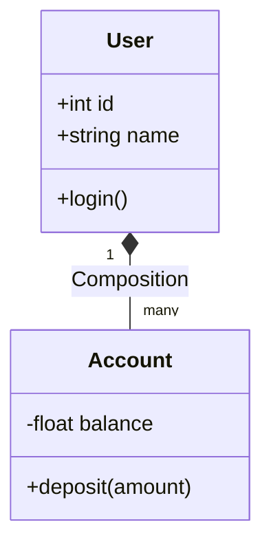

# UML Diagrams (Unified Modeling Language)

## 1. Why Should I Care About This?
- **Universal Blueprint**: In architecture, you don't just start building; you draw a floor plan. UML is the "Floor Plan" of software. It allows a developer from Japan and a designer from New York to understand the system without speaking the same language.
- **Focus on Design over Syntax**: It's much faster to sketch 5 classes and their relationships on a whiteboard in UML than it is to write the boilerplate code in Java.
- **Documentation**: For complex enterprise systems, a UML diagram is often the only way a new hire can grasp how 200 services interact.

## 2. What Problem Does This Solve?
- **Ambiguity**: Prevents the "I thought you meant X" conversations that lead to wasted development weeks.
- **Cognitive Overload**: Human brains process visual relationships much faster than they process 10,000 lines of source code.
- **Naive Approach**: Coding immediately. This leads to "accidental architecture" where you realize 15 hours in that your database schema won't support your new requirement.

## 3. Core Idea (Intuition First)
UML is like **Digital Blueprints**. 
- It's a standardized set of symbols (boxes, lines, arrows) used to describe software. 
- You don't have to follow every tiny rule of the spec, but using the "Shared Language" ensures that when you draw a diamond on a line (Composition), everyone knows exactly what it means.

## 4. How It Actually Works
UML is vast, but most engineers only use these critical diagrams:
1.  **Class Diagram**: Shows the static structure (Classes, properties, methods, and relationships like inheritance or aggregation).
2.  **Use Case Diagram**: Shows the "Who" (Actors) and "What" (Actions) of the system from a user's perspective.
3.  **Sequence Diagram**: Shows the lifecycle of a request across different objects over time.
4.  **State Diagram**: Shows how an object (like an "Order") moves through states (e.g., Pending -> Shipped -> Delivered).

## 5. Real-World Example
**Designing a Library System**:
- Instead of arguing about table names, you draw a **Class Diagram**. You quickly see that a `Book` "has-a" `Author` (Aggregation) and a `Member` "is-a" `User` (Inheritance). You realize you forgot a `Loan` class to track who has which book. This 5-minute sketch saves hours of database refactoring later.

## 6. Code Example
Translating a simple UML Class relationship to Python code:

```python
# The Code Implementation:
class Account:
    def __init__(self, balance):
        self.__balance = balance # Private (-) in UML

class User:
    def __init__(self):
        # Composition relationship (*) in UML
        # The Account cannot exist without the User
        self.accounts = [Account(0)] 
```

## 7. Design Variations & Alternatives
- **Mermaid.js**: The modern way to "Code" your diagrams (used in GitHub READMEs).
- **C4 Model**: A simpler, more modern alternative to UML focusing on context/containers.
- **Hand-drawn Sketches**: Still the most common and effective way to use UML during a meeting.

## 8. Pros and Cons
### Pros
- **Clarity**: Forces you to think about object relationships before you commit to code.
- **Communication**: Excellent for presentations to stakeholders or other teams.

### Cons
- **Outdated Docs**: Diagrams manually drawn in tools like Visio often become obsolete the moment the code changes.
- **Too Much Detail**: UML "Purity" (spending hours on the perfect arrow shape) is a waste of time. Aim for "Sketches," not "Art."

## 9. Failure Scenarios & What Can Go Wrong
- **The "Case of the Missing Legend"**: Drawing boxes and lines that only make sense in your head.
- **Over-Modeling**: Spending 3 days on UML for a feature that takes 1 day to code.
- **Mismatched Reality**: Creating a beautiful UML diagram but then coding something completely different because "the diagram was too hard to implement."

## 10. Impact on Scalability, Reliability & Cost
- **Reliability**: Improves by ensuring the system logic is sound before implementation.
- **Cost**: Reduces "Development Waste" by catching design flaws early.

## 11. When NOT to Use This
- **Simple Features**: Adding a new field to a database doesn't need a UML update.
- **Agile Speed-Runs**: When the team is small and sitting in the same room, code is often enough documentation.

## 12. Interview Perspective
- **What interviewers expect**: Ability to draw a **Class Diagram** or **Sequence Diagram** on a whiteboard. Knowing the difference between **Composition** (filled diamond) and **Aggregation** (empty diamond).
- **Common question**: "Sketch the class relationships for a Parking Lot system."

## 13. Connections to Other Topics
- **Sequence Diagrams**: A specialized sub-type of UML.
- **Object-Oriented Design**: UML is the primary tool for OOD visualization.

## 14. Visual Aids
- **Relationship Cheat Sheet**: Legend for Inheritance, Composition, Aggregation, and Association.
- **The 4 Main Diagrams**: Visual side-by-side of Class, Use Case, Sequence, and State.

## 15. Summary (TL;DR)
**UML is a standardized visual language for designing, documenting, and communicating the structure and behavior of software systems.**

## 16. Further Reading & Resources
- [UML Diagram Types - Visual Guide](https://www.visual-paradigm.com/guide/uml/what-is-uml/)
- [Mermaid.js Documentation](https://mermaid.js.org/) - Diagramming as code.
- [Lucidchart: UML Diagram Tutorial](https://www.lucidchart.com/pages/uml-diagram-tutorial)
- *UML Distilled* (Martin Fowler) - The definitive guide for modern engineers.
