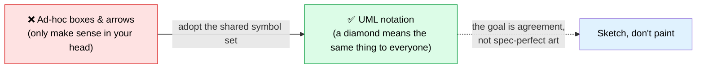
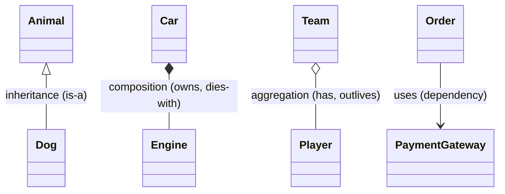
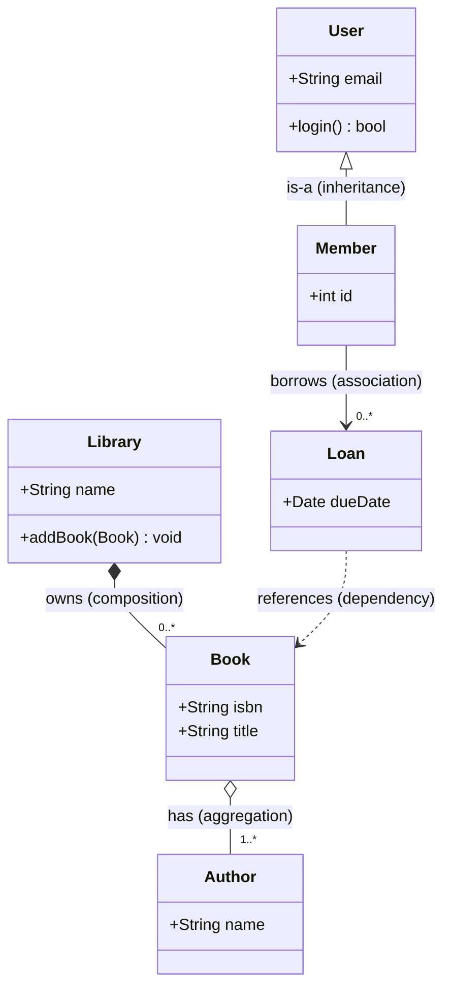
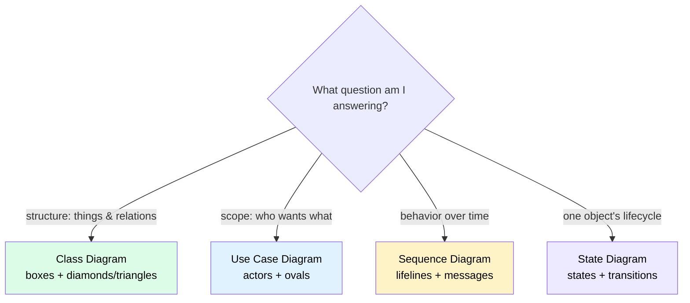
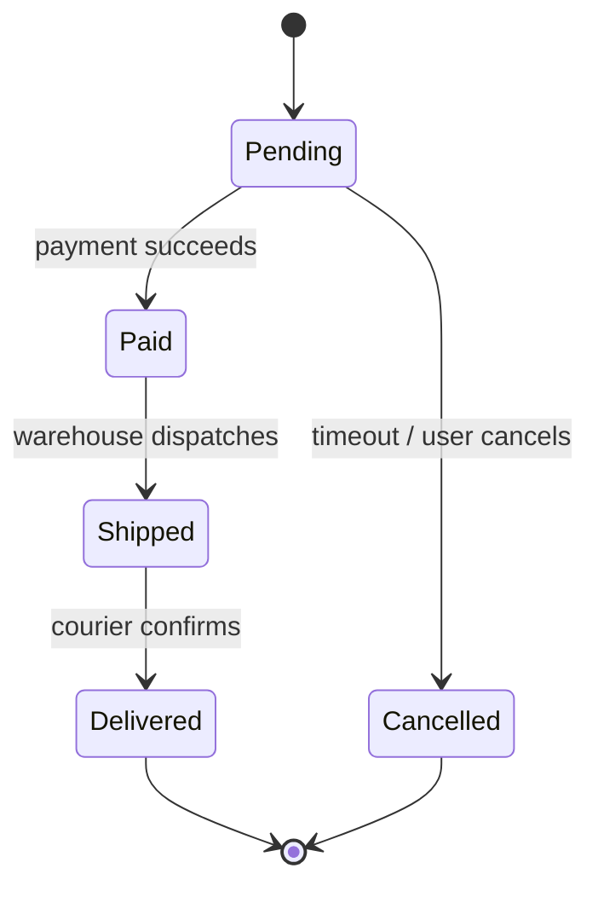
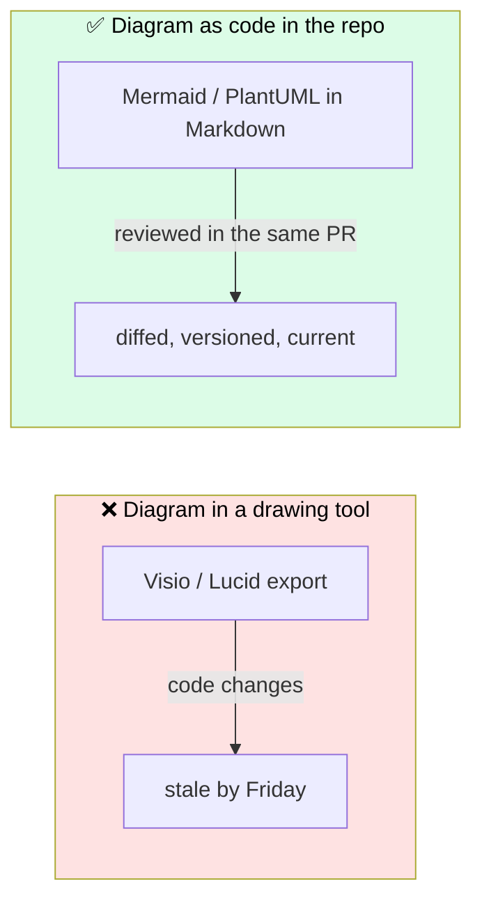
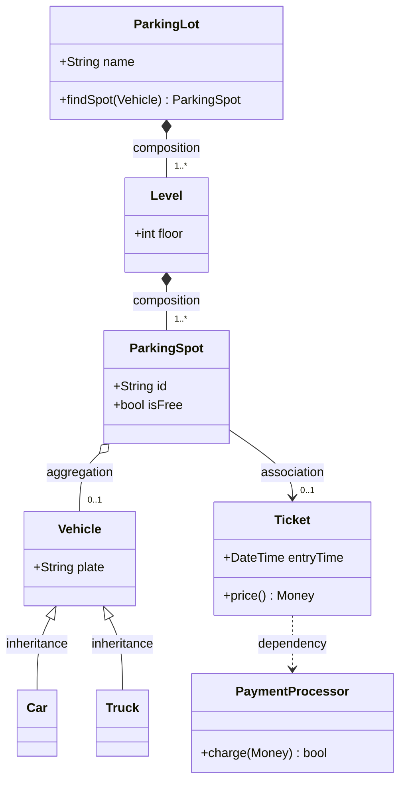
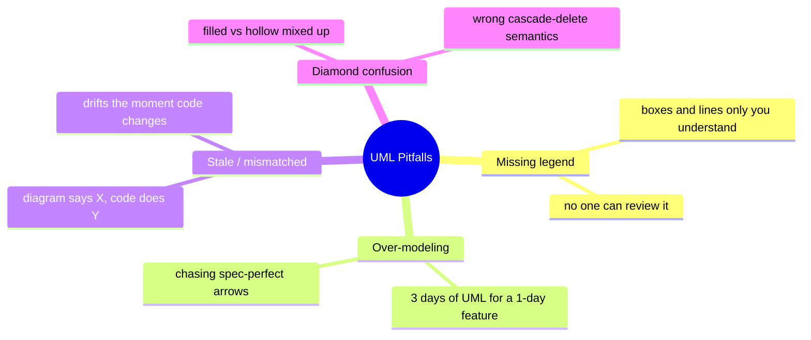
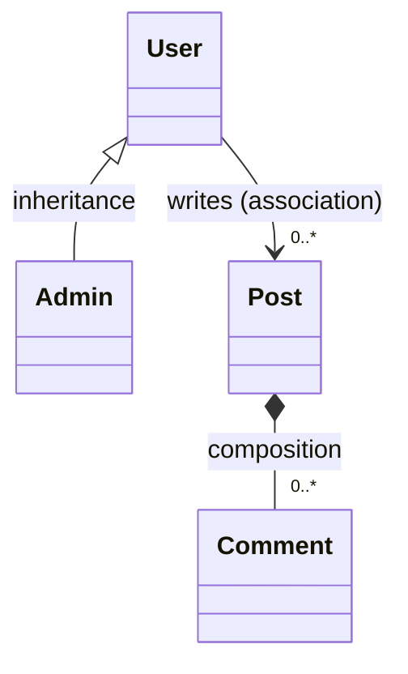

# UML Diagrams

> **One line:** UML is the shared blueprint language of software — a small set of standard boxes, lines, and diamonds that let any two engineers agree on a design *before* anyone writes the code, so a filled diamond means the same thing in Tokyo as it does in New York.

---

## Table of Contents
1. [Why You Must Master This](#1-why-you-must-master-this)
2. [The Mental Model](#2-the-mental-model)
3. [Class-Relationship Notation (the part that actually matters)](#3-class-relationship-notation-the-part-that-actually-matters)
4. [Reading the Relationships in Code](#4-reading-the-relationships-in-code)
5. [The Four Diagrams Worth Knowing](#5-the-four-diagrams-worth-knowing)
6. [Modern Alternatives — Diagrams as Code](#6-modern-alternatives--diagrams-as-code)
7. [Worked Example — Parking Lot Class Diagram](#7-worked-example--parking-lot-class-diagram)
8. [Real-Life Use Cases](#8-real-life-use-cases)
9. [Failure Modes](#9-failure-modes)
10. [🏋️ Practice Drills](#-practice-drills)
11. [🎤 Interview Q&A Bank](#-interview-qa-bank)
12. [🎯 Staff+ Nuances](#-staff-nuances)
13. [Cheat Sheet](#13-cheat-sheet)
14. [Connections & Further Reading](#14-connections--further-reading)

---

## 1. Why You Must Master This

You don't start building a house by pouring concrete — you draw a floor plan. UML is the floor plan of software, and in an interview or a design review it's the fastest way to make a design *visible* so it can be argued about before it's expensive to change.

- **Ambiguity is the enemy** — "I thought `Order` owned the `LineItems`" is a bug that costs weeks. A filled diamond in a class diagram settles it in one glyph: *composition, the line items die with the order.*
- **Whiteboard fluency is table stakes** — "sketch the class relationships for a parking lot" is a standard LLD interview prompt. You need to draw a clean class diagram and *name your arrows* without hesitating.
- **Diagrams outlive tribal knowledge** — the one artifact that lets a new hire grasp how components fit together is usually a diagram, not the 200k lines of code.
- **The notation encodes real decisions** — aggregation vs composition isn't pedantry; it's a lifecycle and ownership decision that determines cascade-deletes, memory management, and who's allowed to mutate what.

> **The core problem it solves:** *design ambiguity.* It replaces "I thought you meant X" arguments with a shared, standardized picture — so a diamond, a triangle, or a dashed arrow means exactly one thing to everyone reading it.

---

## 2. The Mental Model

UML is a **blueprint / floor plan.** An architect's floor plan uses standard symbols — a certain arc means "door that swings this way," a double line means "load-bearing wall." You don't invent your own symbols, because the whole point is that the electrician and the plumber read the same drawing and agree. UML is that agreed symbol set for software: a class is a box, "is-a" is a hollow triangle, "owns-and-controls-lifecycle" is a filled diamond. Learn the palette once and every diagram becomes readable.



The palette below is the entire "language" most engineers ever need — five relationship types plus multiplicity.



---

## 3. Class-Relationship Notation (the part that actually matters)

Ninety percent of the value of UML in an interview is knowing exactly what each line between two class boxes means. The two everyone confuses — **aggregation** and **composition** — differ only by whether the diamond is hollow or filled, and that single fill encodes a *lifecycle* decision.

| Relationship | Symbol | Meaning | Example |
|--------------|--------|---------|---------|
| **Association** | `A --> B` (plain line/arrow) | "uses / knows about" — a general structural link, no ownership implied | a `Driver` drives a `Car` |
| **Aggregation** | `A o-- B` (**hollow** diamond on A) | "has-a", **shared** ownership — the part can outlive the whole | a `Team` has `Player`s; delete the team, players still exist |
| **Composition** | `A *-- B` (**filled** diamond on A) | "owns-a", **exclusive** ownership + lifecycle — the part dies with the whole | a `House` has `Room`s; delete the house, the rooms are gone |
| **Inheritance / Generalization** | `A <|-- B` (**hollow triangle** pointing to parent) | "is-a" — B is a specialized A and inherits its interface | a `Dog` **is-a** `Animal` |
| **Realization** | `A <|.. B` (**hollow triangle, dashed**) | "implements" — B implements interface A | `ArrayList` realizes `List` |
| **Dependency** | `A ..> B` (**dashed** arrow) | "depends on" transiently — a param, return type, or local var; weakest link | `OrderService` depends on `EmailClient` passed to a method |
| **Multiplicity** | `"1"`, `"0..1"`, `"*"`, `"1..*"` on the line ends | *how many* instances participate at each end | one `Order` has `1..*` `LineItem`s |

Mnemonic for the two diamonds: **filled = fatal.** Filled diamond (composition) means the parts *die* with the whole. Hollow diamond (aggregation) means they float free. The diamond always sits on the side of the **whole** (the owner), never the part.



Read it aloud: a `Member` **is a** `User`; a `Library` **is composed of** `Book`s; a `Book` **aggregates** `Author`s (an author exists independently); a `Member` **is associated with** `Loan`s; a `Loan` merely **depends on** a `Book`.

---

## 4. Reading the Relationships in Code

The notation maps directly onto object references. The tell for **composition vs aggregation** is *who creates the part*: if the whole constructs it internally, it owns the lifecycle (composition); if the part is passed in, it's shared (aggregation).

```python
# COMPOSITION (filled *): House CREATES its Rooms → they die with it
class House:
    def __init__(self):
        self.rooms = [Room("kitchen"), Room("bedroom")]

# AGGREGATION (hollow o): Players are PASSED IN → they outlive the Team
class Team:
    def __init__(self, players: list[Player]):
        self.players = players

# INHERITANCE (hollow triangle <|): Dog "is-a" Animal, inherits its interface
class Dog(Animal):
    def speak(self) -> str: return "Woof"

# ASSOCIATION (plain -->): Driver holds a Car field — a link, no ownership
class Driver:
    def __init__(self, car: "Car"): self.car = car

# DEPENDENCY (dashed ..>): Gateway used transiently via a parameter, then forgotten
class OrderService:
    def checkout(self, gateway: "PaymentGateway"): gateway.charge(100)
```

> The lifecycle test in one line: **"If I delete the container, should the parts be deleted too?"** Yes → composition (filled). No → aggregation (hollow). Everything else that's just "knows about" is association; "briefly uses" is dependency.

---

## 5. The Four Diagrams Worth Knowing

UML defines ~14 diagram types; you will realistically use four. Each answers a different question.

| Diagram | Answers | When to reach for it |
|---------|---------|----------------------|
| **Class** | *What are the things and how do they relate?* (static structure) | LLD interviews, domain modeling, before writing entity classes |
| **Use Case** | *Who uses the system and to do what?* (actors + goals) | scoping requirements, aligning with product/stakeholders |
| **Sequence** | *In what order do objects message each other over time?* (dynamic flow) | tracing a request across services, nailing down an API handshake |
| **State** | *What states can one object be in and what triggers transitions?* | lifecycle-heavy objects (Order, Payment, Connection, Job) |



The **class diagram** is the one you must be able to draw cold — it's covered in depth above. The other three have their own dedicated notes: sequence diagrams get deep treatment in [Sequence_Diagrams.md](./Sequence_Diagrams.md), and state diagrams in [State_Machines.md](./State_Machines.md). A quick taste of a state diagram, since an `Order` lifecycle is the canonical LLD example:



---

## 6. Modern Alternatives — Diagrams as Code

The classic failure of UML is **stale diagrams**: a beautiful Visio drawing that drifts from reality the moment code changes. The modern fix is to treat diagrams as *text that lives in the repo*, versioned and reviewed alongside code.

- **Mermaid** — the diagram-as-code default. Renders natively in GitHub/GitLab Markdown, Notion, and most docs tools. Every diagram in this note is Mermaid. Great for class, sequence, state, flowchart, and ER diagrams; low ceremony, reviewable in a PR.
- **PlantUML** — the heavyweight. A fuller UML text syntax (all 14 diagram types, precise styling), rendered by a server. More powerful and more spec-faithful than Mermaid, but needs tooling to render.
- **C4 Model** — not a replacement for class diagrams but a rethink of *architecture* diagrams at four zoom levels: **Context** (system + users), **Container** (apps/services/DBs), **Component** (inside a container), and **Code** (down to classes — where UML class diagrams live). C4 fixes UML's "one giant unreadable box diagram" problem by making zoom level explicit. Use C4 for the [high-level design](../03_High_Level_Design/) picture and UML class diagrams for the [low-level](../04_Low_Level_Design/) detail.



The full relationship palette, drawn as a legend:



---

## 7. Worked Example — Parking Lot Class Diagram

The classic LLD prompt: *"sketch the class relationships for a parking lot."* Don't jump to code — draw the structure, name every arrow, and the ownership decisions fall out for free.



Now walk the arrows — each is a **decision → consequence**:

- **`ParkingLot *-- Level`, `Level *-- ParkingSpot`** (composition, filled): levels/spots have no meaning outside their lot. *Consequence:* delete the lot and they cascade-delete — no orphan spots in the DB.
- **`ParkingSpot o-- Vehicle`** (aggregation, hollow): a spot *holds* a car, but the car exists whether or not it's parked. *Consequence:* freeing a spot must **not** delete the vehicle — a `*` here instead of `o` is a real cascade-delete bug.
- **`Vehicle <|-- Car`, `<|-- Truck`** (inheritance): both are `Vehicle`s, so `findSpot(Vehicle)` accepts either — one code path, polymorphism does the rest.
- **`ParkingSpot --> Ticket`** (association): a structural link, no ownership; `0..1` says a spot may or may not have an active ticket.
- **`Ticket ..> PaymentProcessor`** (dependency, dashed): the ticket only *uses* the processor transiently to charge a fee.

The 5-minute sketch surfaced the bug that bites everyone in review: freeing a spot should never delete the car. The hollow-vs-filled diamond is where that decision lives.

---

## 8. Real-Life Use Cases

| Situation | How UML applies |
|-----------|-----------------|
| **LLD interview** ("design a parking lot / library / elevator") | Draw a **class diagram**, name the relationships, defend aggregation vs composition choices out loud. |
| **New service kickoff** | A **use case diagram** aligns product + eng on actors and goals before any schema exists. |
| **Debugging a cross-service request** | A **sequence diagram** makes the call order and the failing hop obvious. |
| **Order / payment / job lifecycle** | A **state diagram** enumerates every legal state + transition so you don't ship an impossible state. |
| **Onboarding a new hire** | One class/C4 diagram beats a week of code-spelunking to learn the domain shape. |
| **RFC / design doc** | Embed **Mermaid** so the diagram is versioned with the doc and never goes stale. |

> Real-world habit: **before writing entity classes, spend five minutes drawing the class diagram and naming every arrow** — the ownership/lifecycle bugs surface on the whiteboard, where they're free to fix, instead of in a production cascade-delete.

---

## 9. Failure Modes



- **The missing legend** — boxes and lines that only make sense in your head. *Fix:* use standard UML symbols (or a small legend) so any reader decodes it without you narrating.
- **Over-modeling** — three days perfecting arrows for a feature that takes a day to build. *Fix:* sketch, don't paint. UML is a thinking/communication tool, not a deliverable; stop at "clear enough to argue about."
- **Stale / mismatched reality** — a gorgeous diagram that no longer matches the code because the code moved on. *Fix:* diagrams-as-code (Mermaid/PlantUML) in the repo, reviewed in the same PR as the change; delete diagrams you won't maintain.
- **Diamond confusion** — mixing up filled (composition) and hollow (aggregation) ships the wrong ownership semantics (a spurious cascade-delete, or an orphaned part). *Fix:* apply the "delete the whole → should the part die?" test every time.

---

## 🏋️ Practice Drills

> *Cover the solutions and attempt first — active recall is the point.*

**Drill 1 — Aggregation vs composition.** In one sentence each, distinguish the two diamonds, and give a real example where picking the wrong one causes a bug.

<details><summary>Solution</summary>

**Composition** (filled diamond) = exclusive ownership + shared lifecycle: the part dies with the whole (a `House` and its `Room`s). **Aggregation** (hollow diamond) = shared ownership: the part outlives the whole (a `Team` and its `Player`s). Bug example: modeling `ParkingSpot *-- Vehicle` (composition) instead of `o--` (aggregation) means freeing a parking spot cascade-deletes the customer's car record — a data-loss bug. The fill of the diamond *is* the cascade-delete decision.
</details>

**Drill 2 — Draw it.** Sketch a class diagram for a simple blog: a `User` writes many `Post`s, each `Post` has many `Comment`s, an `Admin` is a kind of `User`. Name every relationship and add multiplicities.

<details><summary>Solution</summary>


`Admin <|-- User` (is-a). `User --> Post` is an association (a user *authors* posts; the post can be modeled to outlive nothing in particular — association or aggregation is defensible). `Post *-- Comment` is composition: delete the post and its comments go with it (`0..*` because a fresh post has none). Multiplicities: one user writes `0..*` posts; one post has `0..*` comments.
</details>

**Drill 3 — Pick the diagram.** For each, name the UML diagram that fits best: (a) "show how a checkout request flows through Cart → Payment → Inventory → Email"; (b) "show that an Order can be Pending, Paid, Shipped, or Cancelled"; (c) "show the actors and goals of a ride-hailing app."

<details><summary>Solution</summary>

(a) **Sequence diagram** — order of messages between objects over time. (b) **State diagram** — one object's legal states and transitions. (c) **Use case diagram** — actors (Rider, Driver) and their goals (request ride, accept ride). If the prompt were "show the entities and their relationships," that's a **class diagram**.
</details>

**Drill 4 — Dependency vs association.** Your `OrderService.checkout()` takes a `PaymentGateway` as a *method parameter* and calls it once, then forgets it. Is that a dependency or an association, and how is it drawn?

<details><summary>Solution</summary>

**Dependency** — the weakest link, because `OrderService` doesn't *hold* a `PaymentGateway`; it only uses one transiently within a method call. Drawn as a **dashed arrow** (`..>`). It would be an **association** (solid line) only if `OrderService` kept a `PaymentGateway` as a field (a persistent structural link).
</details>

---

## 🎤 Interview Q&A Bank

**Q1. Difference between composition and aggregation?**
> Both are whole/part "has-a"; they differ by lifecycle and the diamond's fill. **Composition (filled)** = exclusive ownership, the part dies with the whole (`House`/`Room`). **Aggregation (hollow)** = shared, the part outlives the whole (`Team`/`Player`). Test: "delete the whole — should the part die too?" Yes → composition. *(signal: the fill encodes a cascade-delete decision, not a drawing style.)*

**Q2. Where does the diamond go — on the whole or the part?**
> On the **whole** (the owner). `Car *-- Engine` puts the diamond on `Car`. Putting it on the part is a classic misread. *(signal: notation precision.)*

**Q3. Association vs dependency?**
> **Association** is a persistent link — A holds B as a field (solid line). **Dependency** is transient — A uses B via a parameter/return/local, then forgets it (dashed arrow). Dependency is the weakest UML relationship.

**Q4. Inheritance vs interface implementation?**
> Inheritance ("is-a") is a **hollow triangle on a solid line** to the parent. Realization ("implements") is a **hollow triangle on a dashed line** to the interface. Same triangle; dashed = implements.

**Q5. What is multiplicity and why does it matter?**
> The count on each relationship end — `1`, `0..1`, `*`, `1..*`. It encodes real constraints: `Order "1" --> "1..*" LineItem` says an order needs at least one item, which drives validation and schema (NOT NULL, FKs).

**Q6. Which UML diagrams do engineers actually use?**
> Four: **class** (static structure, the LLD workhorse), **sequence** (message order over time), **state** (one object's lifecycle), **use case** (actors + goals). The other ~10 rarely earn their keep.

**Q7. Is UML still relevant, or dead?**
> The "model everything, generate code" vision is dead; the *notation as communication* is alive — class/sequence diagrams on whiteboards and diagrams-as-code in repos. Modern practice favors lightweight sketches and C4 over exhaustive models. *(signal: pragmatism over dogma.)*

**Q8. What's the C4 model, and how does it relate to UML?**
> C4 draws *architecture* at four zoom levels — Context, Container, Component, Code — readable at the altitude you need. Complementary to UML: its "Code" level is where UML class diagrams live. It fixes UML's one-giant-unreadable-diagram problem.

---

## 🎯 Staff+ Nuances

- **The diamond is a data-modeling decision, not a drawing preference.** Composition vs aggregation determines cascade-delete rules and object lifecycle; ship the wrong one and the symptom is a production data-loss bug (freeing a container deleted a shared entity). Treat the hollow/filled choice with the rigor of a foreign-key `ON DELETE` clause. See [Class_Design.md](./Class_Design.md), [Object_Oriented_Design.md](./Object_Oriented_Design.md).
- **Prefer C4 for architecture, UML for class-level detail.** UML's flaw at the system level is one unreadable box explosion; C4's explicit zoom levels (Context → Container → Component → Code) keep each diagram legible — drop into UML class diagrams only at the "Code" level. See the [High-Level Design section](../03_High_Level_Design/).
- **Diagrams-as-code or it doesn't exist.** A diagram not diffed and reviewed in the same PR as the code is stale within a sprint. Mermaid for native rendering, PlantUML for the full spec. The durable win of the last decade is *versioned* diagrams, not prettier ones.
- **Keep sketches, not art.** A whiteboard class diagram with named arrows captures ~90% of the design insight at ~5% of the effort of a spec-perfect model. Under-invest in polish; over-invest in *naming the relationships correctly*. UML "purity" (hours on the exact arrowhead) is a smell.
- **Class diagrams and DDD are the same activity.** Drawing entities, value objects, and relationships *is* tactical domain modeling. A class diagram that ignores bounded contexts will draw a link that shouldn't cross a boundary (a foreign key from `Billing` into `Catalog` internals). Let [Domain_Driven_Design.md](./Domain_Driven_Design.md) decide which boxes may connect.
- **Sequence diagrams expose coupling class diagrams hide.** A static view can look clean while the runtime message flow is a chatterbox. When a design "looks fine" but feels wrong, draw the [sequence diagram](./Sequence_Diagrams.md) — an object messaging five others in one operation is a coupling smell.
- **Multiplicity is where invariants are born.** `1..*` vs `0..*` is a business rule in disguise ("an order must have at least one item"). Capturing it on the diagram forces the conversation early and flows straight into schema constraints and validation.

---

## 13. Cheat Sheet

```
UML = shared blueprint language. SKETCH, DON'T PAINT. Name every arrow.

CLASS-RELATIONSHIP NOTATION  (the interview-critical part)
  association    A --> B     plain line/arrow   "knows / uses"          (no ownership)
  aggregation    A o-- B     HOLLOW diamond      "has-a", shared         part OUTLIVES whole
  composition    A *-- B     FILLED diamond      "owns-a", exclusive     part DIES WITH whole
  inheritance    A <|-- B    HOLLOW triangle     "is-a"                  (solid line)
  realization    A <|.. B    HOLLOW triangle     "implements interface"  (dashed line)
  dependency     A ..> B     DASHED arrow        "uses transiently"      weakest link
  multiplicity   1 · 0..1 · * · 1..*    on line ends → how many

  Diamond sits on the WHOLE (owner).  FILLED = FATAL (part dies with whole).
  The test: "delete the whole → should the part die?"  yes→composition  no→aggregation

THE 4 DIAGRAMS THAT MATTER
  class     static structure — things & relations       (the LLD workhorse)
  use case  actors + goals — requirements scoping
  sequence  messages between objects over TIME          → Sequence_Diagrams.md
  state     one object's legal states + transitions     → State_Machines.md

MODERN "DIAGRAM AS CODE"
  Mermaid   native GitHub/Markdown render, low ceremony (used throughout this repo)
  PlantUML  full UML spec, needs a render server
  C4        architecture at 4 zooms: Context→Container→Component→Code (UML lives at "Code")

TRAPS: missing legend · over-modeling · stale/mismatched diagrams · filled↔hollow diamond mixup
```

---

## 14. Connections & Further Reading

**Within this repo:**
- [Sequence_Diagrams.md](./Sequence_Diagrams.md) — a UML sub-type in depth (message flow over time); [State_Machines.md](./State_Machines.md) — UML state diagrams and object lifecycles.
- [Object_Oriented_Design.md](./Object_Oriented_Design.md) — UML is the primary tool for visualizing OOD; [Class_Design.md](./Class_Design.md) — the relationships you draw become the classes you write.
- [Domain_Driven_Design.md](./Domain_Driven_Design.md) — class diagrams *are* tactical domain modeling; bounded contexts constrain which boxes may connect.
- [03 · High-Level Design](../03_High_Level_Design/) — where C4 architecture diagrams (Context/Container) live, above the class-level detail.

**External classics:**
- *UML Distilled* (Martin Fowler) — the definitive lightweight guide; treats UML as a sketching tool, not a spec.
- [The C4 Model](https://c4model.com/) (Simon Brown) — architecture diagrams at four zoom levels.
- [Mermaid.js docs](https://mermaid.js.org/) — diagrams as code; [PlantUML](https://plantuml.com/) — full-spec text UML.

---

## TL;DR
UML is the **shared blueprint language** that lets engineers agree on a design before writing code — and its single most valuable, interview-critical piece is **class-relationship notation**: association (plain line), aggregation (**hollow** diamond, part outlives the whole), composition (**filled** diamond, part dies with the whole), inheritance (hollow triangle, "is-a"), dependency (dashed arrow, transient use), plus **multiplicity** for counts. Remember **filled = fatal** and put the diamond on the **owner**. You'll realistically use four diagrams — **class, use case, sequence, state** — and modern practice keeps them alive as **diagrams-as-code** (Mermaid/PlantUML) in the repo, with **C4** for the architecture zoom levels above the class detail. **Sketch, don't paint; name every arrow.**
