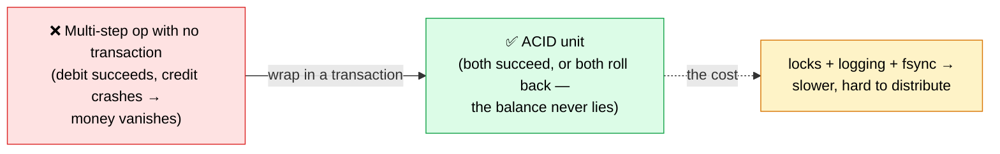
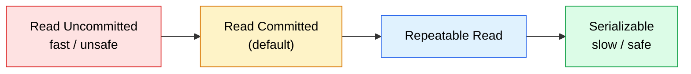
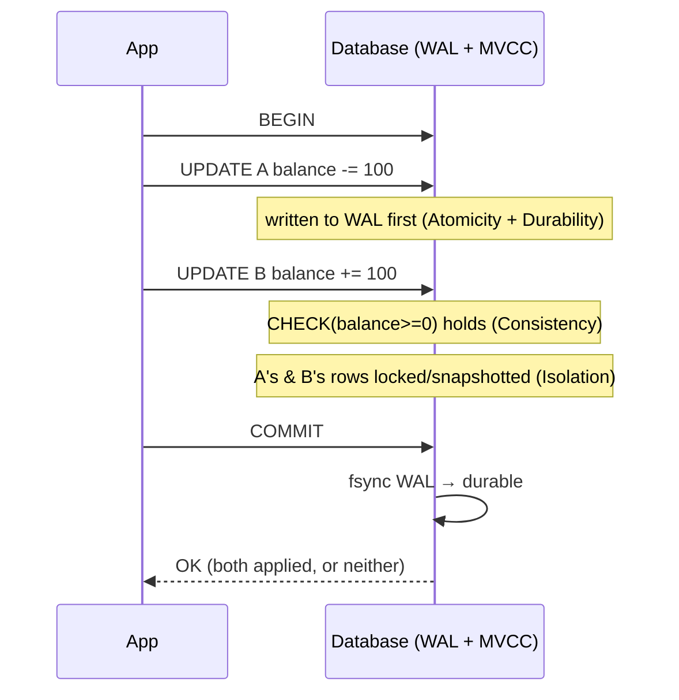
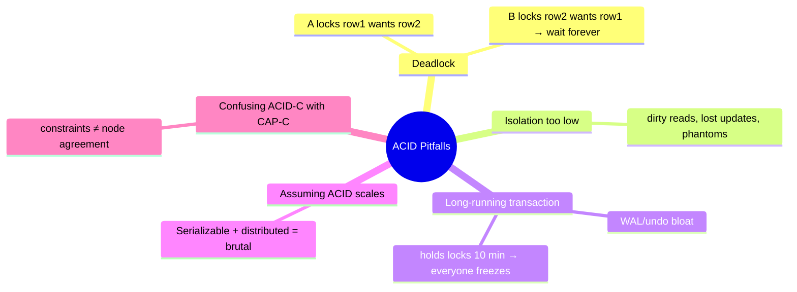

# ACID Properties

> **One line:** ACID is the contract that lets you treat a bundle of database operations as a single indivisible unit — it either happens completely or not at all, obeys all the rules, doesn't get tangled with other transactions, and survives a crash the instant it's confirmed.

---

## Table of Contents
1. [Why You Must Master This](#1-why-you-must-master-this)
2. [The Mental Model](#2-the-mental-model)
3. [The Four Properties](#3-the-four-properties)
4. [Isolation Levels & Read Anomalies](#4-isolation-levels--read-anomalies)
5. [How the Guarantees Are Implemented](#5-how-the-guarantees-are-implemented)
6. [Worked Example — The Money Transfer](#6-worked-example--the-money-transfer)
7. [Real-Life Use Cases](#7-real-life-use-cases)
8. [Failure Modes](#8-failure-modes)
9. [🏋️ Practice Drills](#-practice-drills)
10. [🎤 Interview Q&A Bank](#-interview-qa-bank)
11. [🎯 Staff+ Nuances](#-staff-nuances)
12. [Cheat Sheet](#12-cheat-sheet)
13. [Connections & Further Reading](#13-connections--further-reading)

---

## 1. Why You Must Master This

ACID is the reason you can write "transfer $100" as a few lines of code and *trust* it, even when the power dies mid-transfer or a thousand users hit the same row at once. It's the guarantee that makes correctness the database's problem instead of yours.

- **It makes partial failure impossible.** A checkout that debits the card but never creates the order — or creates the order but never decrements inventory — is a data-corruption incident. Atomicity makes "half-done" a state that cannot exist.
- **It tames concurrency without hand-written locks.** Two users buying the last ticket, both reading "1 available," both succeeding — that's a lost update. Isolation prevents it declaratively; the alternative (manual `if` checks) is impossible to get right under real concurrency.
- **It's the anchor of the ACID-vs-BASE decision.** Every serious design asks: which parts *need* these guarantees (payments, inventory, ledgers) and which can trade them for scale (feeds, analytics, logs)? You can't make that call without understanding what ACID actually promises.
- **It's a baseline interview filter.** Naming the four letters is the floor; explaining *isolation levels* and *WAL* is the signal that you've operated a real transactional system.

> **The core problem it solves:** *correctness under failure and concurrency.* Real systems crash mid-operation and serve many users at once. ACID guarantees that neither a crash nor a race can leave the data in an invalid or contradictory state.

---

## 2. The Mental Model

Think of a transaction as a **professional legal contract:**

- **Atomicity** — the contract is signed *in full* or not at all. There's no "half-signed" agreement where some clauses bind and others don't.
- **Consistency** — the contract can't violate the law. If the rules forbid a negative balance, no valid contract can produce one.
- **Isolation** — each contract is negotiated in a *private room*. Two deals happening simultaneously don't leak half-finished terms into each other.
- **Durability** — once signed, it goes into a *fireproof safe*. The building can burn down; the signed record survives.

That's why relational databases *lean vertical* ([one machine, one safe](./SQL_vs_NoSQL_Scaling.md)): keeping this contract is straightforward on a single node and genuinely hard across many — which is the whole tension behind [CAP](./CAP_Theorem.md).





---

## 3. The Four Properties

| Letter | Guarantee | Plain English | Broken → you get |
|--------|-----------|---------------|------------------|
| **A** — Atomicity | All-or-nothing | The whole transaction commits or fully rolls back | Half-applied writes (money debited, never credited) |
| **C** — Consistency | Rules always hold | Every commit leaves the DB satisfying all constraints | Invalid states (negative balance, orphaned FK) |
| **I** — Isolation | No interference | Concurrent transactions act as if run one at a time | Lost updates, dirty reads, phantoms |
| **D** — Durability | Survives crashes | Once committed, data persists through power loss | "Confirmed" data disappearing after a reboot |

A subtlety worth stating: the **"C" in ACID is not the "C" in CAP.** ACID's consistency means "the transaction respects declared invariants (constraints, triggers, FKs)" — a property of a *single* database. CAP's consistency means "all nodes see the same value at the same time" — a property of a *distributed* system. Conflating them is a classic interview stumble.

---

## 4. Isolation Levels & Read Anomalies

Full isolation (every transaction acts as if alone) is expensive, so SQL defines *levels* that trade isolation for concurrency. Each level permits a specific set of anomalies:

| Level | Dirty read | Non-repeatable read | Phantom read | Speed |
|-------|-----------|---------------------|--------------|-------|
| **Read Uncommitted** | ✅ possible | ✅ | ✅ | fastest |
| **Read Committed** *(common default)* | ❌ | ✅ | ✅ | fast |
| **Repeatable Read** | ❌ | ❌ | ✅ (mostly) | slower |
| **Serializable** | ❌ | ❌ | ❌ | slowest |

The anomalies, concretely:
- **Dirty read** — you read a value another transaction wrote but hasn't committed; it then rolls back, so you acted on data that never existed.
- **Non-repeatable read** — you read a row twice in one transaction and get different values because another transaction committed a change in between.
- **Phantom read** — you run the same `WHERE` twice and get *different rows* because another transaction inserted/deleted matching rows.



> **The habit:** pick the *lowest* isolation level that's still correct for the operation. Most workloads run fine at Read Committed; reserve Serializable for the few transactions where a phantom or write-skew would corrupt money or inventory. See [Consistency Models](./Consistency_Models.md) for the distributed analog of this dial.

---

## 5. How the Guarantees Are Implemented

Naming the *mechanism* behind each letter is what separates "I memorized ACID" from "I've run a transactional database":

- **Atomicity → Write-Ahead Log (WAL).** Before touching the actual data pages, the DB appends the intended changes to a durable log. On a crash, recovery **replays** committed transactions from the log and **undoes** uncommitted ones — so you never see a half-applied transaction.
- **Consistency → declared constraints.** `NOT NULL`, `UNIQUE`, `FOREIGN KEY`, `CHECK`, and triggers. Any transaction that would violate one is rejected at commit; the DB enforces the invariants so application code doesn't have to.
- **Isolation → locking or MVCC.** Older/simpler engines use **locks** (readers and writers block each other). Modern engines (Postgres, InnoDB, Oracle) use **MVCC** — Multi-Version Concurrency Control — keeping multiple versions of a row so *readers never block writers and writers never block readers*; each transaction sees a consistent snapshot.
- **Durability → fsync to non-volatile storage.** The WAL is flushed (fsync'd) to disk/SSD *before* the commit is acknowledged, so a confirmed write survives immediate power loss. (Group commit and battery-backed caches soften the latency cost.)

```sql
BEGIN;                                                        -- open the atomic unit
  UPDATE Accounts SET balance = balance - 100 WHERE id = 'A'; -- debit
  UPDATE Accounts SET balance = balance + 100 WHERE id = 'B'; -- credit
  -- a CHECK (balance >= 0) constraint enforces Consistency;
  -- if either statement or the constraint fails → ROLLBACK (Atomicity)
COMMIT;   -- WAL fsync'd here → Durability; the pair is now permanent & indivisible
```

---

## 6. Worked Example — The Money Transfer

**The prompt:** "Transfer $100 from account A to account B. What guarantees do you need and what enforces them?"

This is the canonical ACID example because every letter shows up:



**Walk the failure at each point — number → consequence:**
- **Crash after the debit, before the credit.** Without atomicity, $100 vanishes. With it, recovery sees an *uncommitted* transaction in the WAL and undoes the debit — the money is back in A. The transfer simply didn't happen.
- **A concurrent transfer from A at the same instant.** Without isolation, both could read A's balance as $500, both debit, and A ends up $100 short of correct (lost update). MVCC/locking serializes them so the second sees the first's committed result.
- **A tries to send more than it has.** The `CHECK (balance >= 0)` constraint (consistency) rejects the transaction — no invalid negative-balance state is ever committed.
- **Power dies one millisecond after COMMIT returns OK.** Durability guarantees the WAL was fsync'd before the OK, so on reboot the transfer is intact. "Confirmed" means confirmed.

**The consequence:** a four-line transaction is *provably* correct against crashes and races — which is exactly why banks, ledgers, and inventory systems demand ACID and won't trade it for scale. When they *must* scale, they reach for [NewSQL or distributed transactions](./Distributed_Transactions.md), not BASE.

---

## 7. Real-Life Use Cases

| Situation | Why ACID is (or isn't) required |
|-----------|--------------------------------|
| **Bank transfer / ledger** | Non-negotiable. Atomicity + consistency prevent money from being created or destroyed; durability makes a confirmed transaction permanent. |
| **E-commerce checkout** | Required. Debit payment, create order, decrement inventory must be one atomic unit — no charging without an order. |
| **Booking the last seat/ticket** | Isolation is the whole game — prevents two buyers from both getting the last unit (lost update / write skew). |
| **Username registration** | `UNIQUE` constraint (consistency) + isolation guarantee no two users grab the same handle in a race. |
| **Social feed / like counts** | Not required — a count off by one for two seconds is harmless. Use [BASE](./BASE_Philosophy.md) for scale. |
| **Log / clickstream ingestion** | Not required — losing 1 line in a million is fine; throughput matters more than atomicity. |

> **The habit:** for each write path, ask "what's the cost of this being half-done or slightly wrong?" If it's money or inventory, ACID. If it's a count or a log line, you can often trade it for availability.

---

## 8. Failure Modes



- **Deadlock.** Symptom: two transactions hang, then one is killed with a deadlock error. Cause: they acquire the same locks in opposite orders. *Fix:* always acquire locks in a consistent order (e.g. by ascending id); keep transactions short; let the DB's deadlock detector abort-and-retry.
- **Isolation set too low.** Symptom: intermittent wrong values under load (lost updates, dirty reads). *Fix:* raise the level for the affected transaction, or use explicit `SELECT … FOR UPDATE` to lock the rows you'll modify.
- **Long-running transaction.** Symptom: everyone else freezes; WAL and undo space balloon. Cause: a transaction left open across a slow network call or user think-time. *Fix:* keep transactions short and CPU-local; never hold one open across external I/O.
- **Assuming ACID scales horizontally for free.** Symptom: throughput collapses when you distribute a Serializable workload. Cause: cross-node coordination (2PC, consensus) is expensive. *Fix:* NewSQL where you truly need distributed ACID, or [Sagas](./Distributed_Transactions.md) where eventual consistency is acceptable.
- **Confusing the two "C"s.** Symptom: muddled reasoning in a distributed-systems discussion. *Fix:* ACID-C = invariants on one DB; CAP-C = agreement across nodes. Different concepts.

---

## 🏋️ Practice Drills

> *Cover the solutions and attempt first — active recall is the point.*

**Drill 1 — Which letter failed?** For each incident, name the ACID property that was violated: (a) after a crash, an order exists but the payment was never recorded; (b) two users both booked seat 4A; (c) a "successful" signup disappeared after a server reboot; (d) a report read a discount that a rolled-back transaction had written.

<details><summary>Solution</summary>

(a) **Atomicity** — the multi-step operation was left half-applied; the order and payment weren't one indivisible unit.

(b) **Isolation** — concurrent transactions interfered; both read "seat available" and both committed (a lost update / write skew).

(c) **Durability** — a committed transaction didn't survive the crash, meaning the write was acknowledged before being flushed to non-volatile storage.

(d) **Isolation** (specifically a **dirty read**) — the report read uncommitted data from another transaction that then rolled back, so it acted on a value that never truly existed.
</details>

**Drill 2 — Pick the isolation level.** A "buy the last concert ticket" operation must never sell the same ticket twice, even under a stampede of concurrent buyers. What isolation level or mechanism, and why not just use the default?

<details><summary>Solution</summary>

The default (Read Committed) permits **lost updates / write skew**: two transactions both read `tickets_left = 1`, both decide it's fine to sell, both commit — two buyers, one seat. You need stronger isolation for *this* transaction.

Options:
- **`SELECT … FOR UPDATE`** on the ticket/inventory row — takes a write lock so the second buyer blocks until the first commits, then sees `0` and is rejected. Targeted and efficient.
- **Serializable** isolation — the DB detects the conflict and aborts one transaction (which retries and sees no ticket). Correct but broader-impact.
- An **atomic conditional update**: `UPDATE tickets SET left = left - 1 WHERE id = ? AND left > 0` and check rows-affected — the DB serializes it; zero rows means it's gone.

Don't globally raise isolation to Serializable — pay the cost only on the operation that needs it.
</details>

**Drill 3 — Explain WAL.** A colleague asks how a database can guarantee both atomicity (roll back a crash) *and* durability (survive a crash) at the same time — aren't those in tension? Explain via the write-ahead log.

<details><summary>Solution</summary>

They're two sides of the same mechanism, not in tension. The **write-ahead log** is an append-only record of intended changes, fsync'd to durable storage *before* the data pages themselves are updated and before COMMIT is acknowledged.

On restart after a crash, recovery reads the WAL and:
- **Redoes** every transaction that had committed (its COMMIT record is durably in the log) but whose data pages hadn't been flushed yet → **durability**: confirmed work is not lost.
- **Undoes** every transaction that was in progress but never committed (no COMMIT record) → **atomicity**: half-done work is erased.

So the single durable log is the source of truth for *both*: "commit written → replay it" (durable) and "no commit written → roll it back" (atomic). The trick is that the log is cheap sequential appends, so it's fast to make durable, while the random data-page writes can happen lazily afterward.
</details>

---

## 🎤 Interview Q&A Bank

**Q1. "What does ACID stand for and why does each matter?"**
> Atomicity — all-or-nothing, so no half-applied transactions. Consistency — every commit satisfies declared constraints, so no invalid states. Isolation — concurrent transactions don't interfere, so no lost updates or dirty reads. Durability — a committed transaction survives crashes. Together they let you treat a multi-step operation as one correct, crash-safe unit.

**Q2. "Is the 'C' in ACID the same as the 'C' in CAP?"** *(signal: conceptual precision)*
> No, and it's a common trap. ACID's consistency is about a single database honoring its declared invariants — constraints, foreign keys, triggers. CAP's consistency is about a distributed system where every node returns the same latest value. One is invariant-enforcement on one node; the other is agreement across nodes.

**Q3. "Walk me through isolation levels."**
> From weakest to strongest: Read Uncommitted (allows dirty reads), Read Committed (the common default — no dirty reads, but non-repeatable reads and phantoms possible), Repeatable Read (stable rows within a transaction, phantoms mostly prevented), and Serializable (behaves as if transactions ran one at a time — no anomalies, but slowest). You pick the weakest level that's still correct for the operation.

**Q4. "How is atomicity actually implemented?"**
> Via a write-ahead log. Intended changes are appended to a durable log before the data pages change. On a crash, recovery replays committed transactions and undoes uncommitted ones using the log — so a partial transaction is rolled back and you never observe a half-applied state.

**Q5. "What's MVCC and why is it better than locking?"**
> Multi-Version Concurrency Control keeps multiple versions of each row, so each transaction reads a consistent snapshot as of its start. The big win: readers never block writers and writers never block readers — huge for read-heavy concurrency, unlike pure locking where they contend. Postgres, InnoDB, and Oracle all use it.

**Q6. "What is a deadlock and how do you handle it?"**
> Two transactions each hold a lock the other needs and wait forever — A holds row1 wanting row2, B holds row2 wanting row1. Databases detect the cycle and abort one (which retries). You prevent them by acquiring locks in a consistent order and keeping transactions short so lock windows are small.

**Q7. "Why is ACID hard to scale horizontally?"**
> Because its guarantees assume coordination that's cheap on one node and expensive across many. A distributed atomic commit needs two-phase commit or consensus; Serializable isolation across shards means cross-node locking. Each adds latency and failure modes. That's why relational DBs lean vertical, and why you reach for NewSQL (Spanner/Cockroach) or Sagas when you need scale and can't keep ACID cheaply.

**Q8. "When would you deliberately give up ACID?"**
> When the data can tolerate being slightly stale or approximate and availability/throughput matter more — social feeds, like counts, clickstream logs, analytics ingestion. There, BASE's eventual consistency buys massive scale and the downside (a count briefly off, a log line dropped) is harmless. I keep ACID for money, inventory, and anything where "half-done" or "slightly wrong" is a real incident.

---

## 🎯 Staff+ Nuances

- **The two "C"s are genuinely different, and mixing them derails distributed-systems reasoning.** ACID's C is invariant enforcement on one node (constraints hold at commit); CAP's C is linearizability across nodes. A system can be fully ACID-consistent on each node and still be CAP-inconsistent across a partition. Say which one you mean.
- **Isolation is a spectrum, and the default is weaker than most people assume.** Read Committed — the default in Postgres and many others — still allows non-repeatable reads and phantoms, and notably permits **write skew** (two transactions each read a consistent snapshot and make decisions that are jointly invalid). Bugs here are subtle and load-dependent; the fix is `SELECT FOR UPDATE` or Serializable on the specific transaction, not a global level change.
- **Durability has knobs, and "durable" is a spectrum too.** `fsync` per commit is safest but slow; group commit batches fsyncs; some systems offer async commit (faster, but a crash can lose the last few ms of "committed" writes). Durability across a *cluster* means "acknowledged by N replicas," which drags in [replication](./Replication.md) and quorum choices. Know which durability you're actually promising.
- **Long transactions are the silent killer of throughput.** A transaction held open across a network call or user think-time holds locks and pins MVCC snapshots, bloating the undo log and freezing others. The rule "transactions should be short and never wrap external I/O" prevents more production incidents than any isolation-level tuning.
- **NewSQL is the "have your cake" answer, at a latency cost.** Spanner and CockroachDB provide distributed ACID via TrueTime/consensus — real Serializable across nodes — but each write pays a coordination tax. When an interviewer says "we need ACID *and* horizontal scale," NewSQL is the honest answer, not "just shard Postgres."
- **Sagas trade atomicity for availability across services.** When a transaction spans microservices, a single ACID transaction is impossible; a [Saga](./Distributed_Transactions.md) chains local transactions with compensating actions. You give up isolation and instant atomicity for eventual consistency — the right call when the alternative (2PC across services) is too fragile.
- **The application still owns invariants ACID can't express.** ACID enforces *declared* constraints; business rules like "a user can't have two active subscriptions" often aren't expressible as a single-row constraint and become isolation/write-skew problems. Recognizing which invariants the DB can enforce vs which need explicit locking is a senior-level distinction.

---

## 12. Cheat Sheet

```
ACID — THE TRANSACTION CONTRACT (correctness under crash + concurrency)
═══════════════════════════════════════════════════════════════════════

THE FOUR                     BROKEN → YOU GET            MECHANISM
  A Atomicity  all-or-nothing  half-applied writes         Write-Ahead Log (redo/undo)
  C Consistency rules hold      invalid state (neg balance) constraints / FK / triggers
  I Isolation  no interference  lost update, dirty read     locks or MVCC
  D Durability survives crash   "confirmed" data vanishes   fsync WAL before ACK

⚠ ACID-C (invariants on 1 DB) ≠ CAP-C (all nodes agree). Different concepts.

ISOLATION LEVELS (pick the weakest that's still correct)
  Read Uncommitted  dirty ✓ nonrepeatable ✓ phantom ✓   fastest / unsafe
  Read Committed    dirty ✗ nonrepeatable ✓ phantom ✓   common DEFAULT
  Repeatable Read   dirty ✗ nonrepeatable ✗ phantom ~   snapshot per txn
  Serializable      dirty ✗ nonrepeatable ✗ phantom ✗   slowest / safe

READ ANOMALIES
  dirty read        read uncommitted data that then rolls back
  non-repeatable    same row, different value on 2nd read
  phantom           same WHERE, different rows on 2nd read
  write skew        both txns read valid snapshot, jointly invalid (RC allows!)

NEED ACID: money, inventory, bookings, ledgers, unique handles
SKIP ACID: feeds, like counts, logs, analytics → use BASE
SCALE ACID: NewSQL (Spanner, Cockroach) or Sagas (compensating txns)

RULES
  ✓ keep transactions SHORT — never wrap external I/O
  ✓ acquire locks in a consistent order (avoid deadlock)
  ✓ raise isolation only on the txn that needs it, not globally
  ✓ SELECT … FOR UPDATE for "last-item" contention
```

---

## 13. Connections & Further Reading

**Within this repo:**
- [BASE_Philosophy.md](./BASE_Philosophy.md) — the availability-first alternative that trades ACID's guarantees for scale.
- [CAP_Theorem.md](./CAP_Theorem.md) — why keeping ACID's consistency across nodes forces a choice under partition.
- [Consistency_Models.md](./Consistency_Models.md) — the distributed generalization of isolation levels.
- [Distributed_Transactions.md](./Distributed_Transactions.md) — 2PC and Sagas: achieving (or approximating) ACID across services.
- [SQL_vs_NoSQL_Scaling.md](./SQL_vs_NoSQL_Scaling.md) — why ACID pushes relational DBs toward vertical scaling.

**External classics:**
- *Designing Data-Intensive Applications* (Kleppmann) — Ch. 7, "Transactions," is the definitive modern treatment (including a superb take on isolation levels and write skew).
- [PostgreSQL: Concurrency Control (MVCC)](https://www.postgresql.org/docs/current/mvcc.html) — how a real engine implements isolation.
- *A Critique of ANSI SQL Isolation Levels* (Berenson et al.) — the paper that clarified what the levels actually guarantee.

---

## TL;DR
**ACID lets you treat a bundle of operations as one indivisible, crash-safe unit: Atomicity (all-or-nothing, via the write-ahead log), Consistency (declared invariants always hold), Isolation (concurrent transactions don't interfere, via locks/MVCC), and Durability (committed data survives crashes, via fsync).** It makes correctness the database's job instead of yours — essential for money, inventory, and bookings, where "half-done" or "slightly wrong" is an incident. The cost is speed and difficulty distributing it, which is exactly the trade [BASE](./BASE_Philosophy.md) and [CAP](./CAP_Theorem.md) make explicit. **Keep transactions short, pick the weakest correct isolation level, and never confuse ACID's consistency (invariants on one node) with CAP's (agreement across nodes).**
