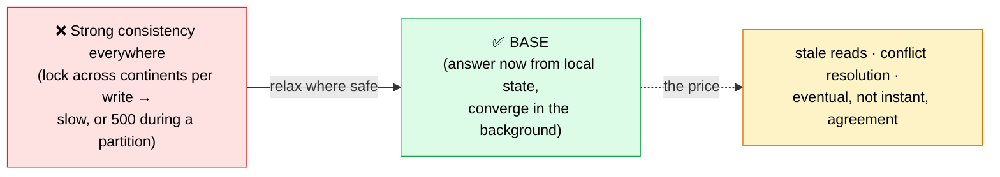
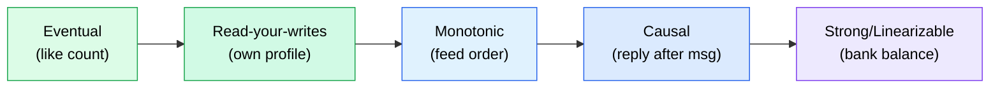
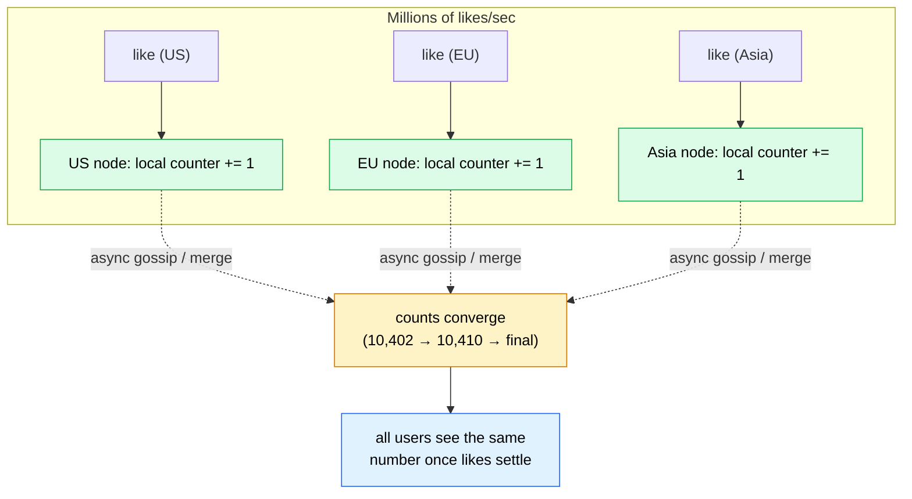
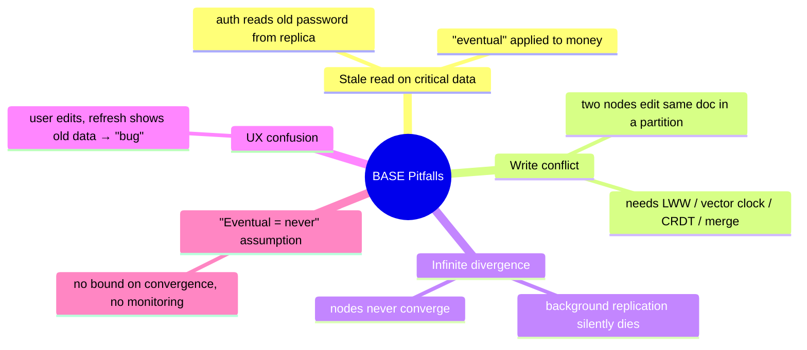

# BASE Philosophy

> **One line:** BASE is the deliberate opposite of ACID — instead of guaranteeing every read sees the latest write, it guarantees the system *always answers* and lets the data *converge to correct over time*, which is the only way to stay fast and available at global scale.

---

## Table of Contents
1. [Why You Must Master This](#1-why-you-must-master-this)
2. [The Mental Model](#2-the-mental-model)
3. [The Three Properties](#3-the-three-properties)
4. [The Consistency Spectrum](#4-the-consistency-spectrum)
5. [ACID vs BASE — Choosing Per Data Type](#5-acid-vs-base--choosing-per-data-type)
6. [Worked Example — The Viral Like Count](#6-worked-example--the-viral-like-count)
7. [Real-Life Use Cases](#7-real-life-use-cases)
8. [Failure Modes](#8-failure-modes)
9. [🏋️ Practice Drills](#-practice-drills)
10. [🎤 Interview Q&A Bank](#-interview-qa-bank)
11. [🎯 Staff+ Nuances](#-staff-nuances)
12. [Cheat Sheet](#12-cheat-sheet)
13. [Connections & Further Reading](#13-connections--further-reading)

---

## 1. Why You Must Master This

BASE is how Facebook, Twitter, Amazon, and Uber actually run. At their scale, holding an [ACID](./ACID_Properties.md) lock across continents for every write would grind the system to a halt — so they consciously give up "always correct right now" for "always up and fast, correct soon."

- **It's the scalability escape hatch.** ACID's coordination is what caps horizontal scale. BASE removes the coordination, which is *why* NoSQL stores scale out near-linearly — it's the storage philosophy behind [SQL vs NoSQL scaling](./SQL_vs_NoSQL_Scaling.md).
- **Availability usually beats freshness.** For most features, showing a feed that's 3 seconds stale beats showing a `500` error because a row is locked on another continent. BASE picks "answer with slightly old data" over "make the user wait or fail."
- **Distributed failure is a *when*, not an *if*.** Networks partition, nodes die. BASE is designed to keep serving *through* those failures rather than freezing until the system is perfectly consistent again — it's the [AP side of CAP](./CAP_Theorem.md).
- **The judgment is the interview signal.** Anyone can define eventual consistency. The senior move is knowing *which data* tolerates it (a like count) and which absolutely doesn't (an account balance), and defending the split.

> **The core problem it solves:** *the coordination bottleneck.* Strong consistency requires nodes to agree before responding, which adds latency and fails when the network splits. BASE lets each node answer immediately from local state and reconciles in the background — trading instantaneous correctness for availability, low latency, and scale.

---

## 2. The Mental Model

BASE is **the news cycle on election night:**

- **Basically Available** — turn on any channel and you get *some* result. One reporter going offline doesn't take the broadcast down.
- **Soft State** — the numbers *change on their own* as precincts report. "Candidate A leads" becomes "Candidate B leads" — not because you did anything, but because data is still flowing in.
- **Eventual Consistency** — once all votes are counted and nothing new arrives, every channel shows the same final winner. Agreement is reached; it just took propagation time.

Contrast with ACID's "signed contract in a fireproof safe": ACID refuses to answer until it can answer *correctly*; BASE answers immediately with its best current knowledge and corrects itself as more arrives.




---

## 3. The Three Properties

BASE is a backronym chosen to contrast with ACID (base vs acid, chemically). Each letter relaxes one guarantee:

| Letter | Property | What it means | Enabled by |
|--------|----------|---------------|------------|
| **BA** | **Basically Available** | Every request gets a response (maybe stale), even during partial failure | [Replication](./Replication.md) — many copies, any can answer |
| **S** | **Soft State** | State may change over time without new input, because data is still propagating | Asynchronous background replication |
| **E** | **Eventual Consistency** | Given no new writes, all replicas *converge* to the same value | Anti-entropy, gossip, read-repair, conflict resolution |

The load-bearing word is **eventual** — the system promises convergence *given enough time and no new writes*, not agreement at any instant. "Eventually" is usually milliseconds to seconds, but it's a promise about the destination, not the timing.

---

## 4. The Consistency Spectrum

The biggest misconception is that consistency is binary (ACID *or* BASE). It's a **dial** with useful settings in between — and picking the right notch per operation is the real skill (detailed in [Consistency Models](./Consistency_Models.md)):

- **Eventual** — weakest. Reads may be stale; replicas converge later. Cheapest, most available. (A like count.)
- **Read-your-own-writes** — you always see *your* latest write, even if others don't yet. (Your own profile edit.)
- **Monotonic reads** — once you've seen a value, you never see an *older* one on refresh. (A feed that doesn't jump backward in time.)
- **Causal** — operations with a cause→effect relationship are seen in order everywhere (a reply never appears before the message it answers), though unrelated ops may reorder.
- **Strong / linearizable** — strongest. Every read sees the latest committed write, as if there were one copy. (An account balance.)



> **The habit:** never say "we'll use eventual consistency" for a whole system. Say "the feed is eventual, the user's own edits are read-your-writes, and the wallet is strong." Consistency is chosen per data type.

---

## 5. ACID vs BASE — Choosing Per Data Type

| Dimension | ACID (strong) | BASE (eventual) |
|-----------|---------------|-----------------|
| **Priority** | Correctness now | Availability + speed |
| **Consistency** | Every read = latest write | Reads may be stale; converge later |
| **On partition** | May refuse to serve (CP) | Keeps serving (AP) |
| **Scaling** | Vertical / hard to distribute | Horizontal / near-linear |
| **Developer burden** | DB handles correctness | App handles conflicts & staleness |
| **Fits** | Money, inventory, bookings, auth | Feeds, counts, presence, recommendations, carts |

The key insight: **this is not a system-wide switch.** A single application uses *both* — Amazon runs the [cart](./Relational_vs_NoSQL.md) on BASE (always accept an add-to-cart) but the payment and inventory decrement on ACID (never double-sell or double-charge). The design question is always "which data, which guarantee?"

```python
# BASE write path: acknowledged as soon as ONE node accepts it.
def update_profile(user_id, new_bio):
    db.write_local(user_id, new_bio)   # returns immediately
    # replication to other nodes happens asynchronously (soft state)
    return "saved"                     # correct *eventually*, not globally-now

# A read may hit a replica that hasn't received the update yet:
def get_profile(user_id):
    return db.read_nearest_replica(user_id)  # possibly stale
    # For the user's OWN view, route to a caught-up node → read-your-writes
```

---

## 6. Worked Example — The Viral Like Count

**The prompt:** "A celebrity's post gets millions of likes in minutes. How do you store and display the count?"

**Why ACID is the wrong tool here:** an ACID counter means every like takes a lock on one `likes_count` row. Millions of concurrent likes serialize behind that single lock — the row becomes a global bottleneck and the whole feature stalls. Correctness-per-nanosecond isn't worth an outage for a *display number*.

**The BASE approach:**



**Closing the loop — the BASE properties in action:**
- **Basically Available:** every like is accepted instantly by the nearest node; nobody ever sees "liking failed because the counter is locked." No coordination on the write path = no bottleneck.
- **Soft State:** a US user sees 10,402 while an EU user sees 10,410 *at the same moment* — the count legitimately differs per replica while updates propagate.
- **Eventual Consistency:** seconds after the likes stop, background reconciliation (gossip / summing per-node counters — often a CRDT counter) converges everyone to the identical final number.

**The consequence:** the *display count* — where a few-seconds discrepancy is invisible to users — becomes trivially scalable by dropping the guarantee ACID would have enforced at ruinous cost. The exact opposite call from a [bank balance](./ACID_Properties.md), which is the point: match the guarantee to the data.

---

## 7. Real-Life Use Cases

| Situation | BASE or ACID, and why |
|-----------|-----------------------|
| **Social feed / timeline** | BASE — a 3-second-stale feed is fine; availability and latency dominate. |
| **Like / view / follower counts** | BASE — approximate-then-exact is invisible to users; ACID counters bottleneck. |
| **Shopping cart (add item)** | BASE — always accept the add even during a partition; reconcile later. |
| **Presence / "last seen" / typing** | BASE — inherently ephemeral; stale is meaningless here. |
| **Product recommendations** | BASE — approximate and eventually-updated is entirely acceptable. |
| **Account balance / payment** | ACID — money can't be "basically available"; must be exact. |
| **Inventory "last item"** | ACID — eventual consistency would double-sell the last unit. |
| **Password / permission change** | ACID (or read-your-writes minimum) — a stale replica must not honor the old password. |

> **The habit:** for each piece of data ask "is a stale or approximate value here *harmless* or an *incident*?" Harmless → BASE and scale freely. Incident → ACID and pay for coordination.

---

## 8. Failure Modes



- **Applying BASE to data that needs ACID.** Symptom: a user changes their password, but an auth node reads a stale replica and accepts the old one for minutes. *Fix:* use strong (or at least read-your-writes) consistency for auth, balances, and inventory — never "eventual" for correctness-critical data.
- **Write conflicts.** Symptom: two nodes accept edits to the same document during a partition; on heal, which wins? *Fix:* a conflict-resolution strategy — last-write-wins (simple, can lose data), vector clocks (detect conflicts), or [CRDTs](./Consistency_Models.md) (merge automatically). Decide *before* the conflict, not during.
- **Infinite divergence.** Symptom: replicas never converge. Cause: the background replication/anti-entropy process silently failed. *Fix:* monitor replication lag and convergence; alert when a replica falls too far behind. "Eventual" assumes the reconciliation actually runs.
- **UX confusion.** Symptom: a user edits their bio, refreshes, sees the old value, and files a bug. Cause: their read hit a lagging replica. *Fix:* read-your-writes routing so a user always sees their *own* latest change, even if others don't yet.
- **Treating "eventual" as unbounded.** Symptom: no SLA on convergence, so "eventually" quietly means "sometimes never." *Fix:* set and monitor a convergence bound; eventual consistency is a promise you must *measure*, not assume.

---

## 🏋️ Practice Drills

> *Cover the solutions and attempt first — active recall is the point.*

**Drill 1 — Classify the data.** For a ride-hailing app, assign BASE or ACID to each: (a) the driver's live location on the map; (b) the fare charged to the rider's card; (c) the count of nearby drivers shown; (d) the ride-completion state that triggers payment.

<details><summary>Solution</summary>

(a) **BASE** — a location that's a second stale is fine; it's high-volume, ephemeral, and availability matters more than exactness.

(b) **ACID** — money. The charge must be atomic and exact; "basically available" or "eventually the right amount" is unacceptable.

(c) **BASE** — an approximate "5 drivers nearby" that's briefly off is harmless and lets the query be fast and always-available.

(d) **ACID** — this is a state transition that triggers a financial event; it must be atomic and consistent so a ride isn't charged twice or completed twice. Even in a mostly-BASE system, the money-adjacent transitions stay ACID.

The lesson: one app, both models, chosen per data type.
</details>

**Drill 2 — The password bug.** Users report that right after changing their password, the *old* password still works for a couple of minutes, then stops. Diagnose it and fix it without abandoning replicas.

<details><summary>Solution</summary>

**A stale read under eventual consistency.** The password change was written to the primary, but the auth service validates logins against a read replica that hasn't received the update yet — so for the replication-lag window, the old hash is still what the replica returns.

Fixes:
- **Route auth reads to strong-consistency source** — validate passwords against the primary (or a synchronously-replicated quorum), not an async replica. Auth is correctness-critical; it shouldn't be eventual.
- At minimum, **read-your-writes** for the account: after a password change, pin that user's auth reads to a caught-up node.
- **Invalidate sessions/tokens** on password change so the change takes effect immediately regardless of replica lag.

Root cause framing: BASE was applied to data (credentials) that requires strong consistency. Keep the replicas for everything else; make the auth path strong.
</details>

**Drill 3 — Resolve the conflict.** Two users (or two nodes during a partition) edit the same collaborative document field at the same time. List the conflict-resolution strategies and their trade-offs.

<details><summary>Solution</summary>

1. **Last-Write-Wins (LWW):** keep the edit with the latest timestamp. Dead simple and what many systems default to — but it *silently discards* the other edit, and clock skew can pick the "wrong" winner. Fine for low-stakes fields, dangerous for anything you can't afford to lose.
2. **Vector clocks / version vectors:** detect that a genuine conflict occurred (concurrent, not causal) and surface both versions to the application (or user) to resolve. No silent data loss, but pushes the merge decision up the stack (this is Dynamo's "siblings").
3. **CRDTs (Conflict-free Replicated Data Types):** data structures mathematically designed to *merge automatically* and deterministically — e.g. a counter that sums per-node increments, or a set that unions. No lost updates, no manual merge, but you must model the data as a CRDT (not everything fits).
4. **Application-specific merge:** custom logic (e.g. operational transforms in Google Docs) that merges edits semantically. Most powerful, most work.

Choose by stakes: LWW for ephemeral fields, CRDTs for counters/sets/presence, OT/merge for real collaborative editing.
</details>

---

## 🎤 Interview Q&A Bank

**Q1. "What does BASE stand for and how does it relate to ACID?"**
> Basically Available, Soft state, Eventual consistency — a deliberate contrast to ACID. Where ACID guarantees every read sees the latest write at the cost of coordination, BASE guarantees the system always responds (possibly with stale data) and converges to consistency over time. It's the philosophy that lets NoSQL stores scale horizontally, because it drops the coordination that caps ACID's scale.

**Q2. "What is eventual consistency, exactly?"**
> A guarantee that if no new writes happen, all replicas will *eventually* converge to the same value — agreement about the destination, not the timing. Reads before convergence may be stale. "Eventually" is usually milliseconds to seconds, but it's a promise about reaching agreement, not about any instant.

**Q3. "Isn't consistency just ACID vs BASE — on or off?"** *(signal: do they know the spectrum?)*
> No, it's a spectrum. Between strong and eventual sit read-your-writes (you see your own writes), monotonic reads (never go backward in time), and causal (cause-before-effect ordering preserved everywhere). You pick the weakest level that's still correct for each operation, rather than flipping one global switch.

**Q4. "Give me a system that uses both ACID and BASE."**
> Amazon. The shopping cart is BASE — it always accepts an add-to-cart, even during a partition, and reconciles later, because a temporarily-inconsistent cart is harmless. But the payment and inventory decrement at checkout are ACID — you can't double-charge a card or sell the same last unit twice. Same app, different guarantees per data type.

**Q5. "How do you handle write conflicts under eventual consistency?"**
> With a resolution strategy chosen up front: last-write-wins (simple but silently loses an edit), vector clocks (detect conflicts and surface both versions), or CRDTs (data types that merge automatically and deterministically). The choice depends on stakes — LWW for ephemeral fields, CRDTs for counters and sets, custom merge for collaborative editing.

**Q6. "Our distributed system is slow. Should we switch to eventual consistency?"** *(signal: do they blanket-apply it?)*
> Only for the data that tolerates staleness. I'd audit each data type: feeds, counts, and presence can go eventual and get faster and more available immediately. But balances, inventory, and auth must stay strong — making those eventual trades correctness for speed, which causes double-spends and stale-credential bugs. It's a per-data decision, not a system-wide flip.

**Q7. "Why can't you just make everything strongly consistent — isn't that safer?"**
> Because strong consistency requires nodes to coordinate before responding, which adds latency and, per CAP, forces you to refuse service during a network partition. At global scale that means slow responses and outages for data that didn't need the guarantee. Strong-everywhere is "safer" for correctness but strictly worse for availability and cost — so you spend the coordination budget only where correctness actually matters.

---

## 🎯 Staff+ Nuances

- **"Eventual" is a promise you must monitor, not assume.** The whole model rests on the background reconciliation (anti-entropy, read-repair, gossip) actually running and converging within a bound. If it silently fails, "eventual" becomes "never" and you have permanent divergence. Mature BASE systems SLA and alert on convergence lag — treating it as an unmonitored given is how "eventually consistent" becomes "occasionally correct."
- **Conflict resolution is the real design work, and it's decided before the conflict.** The interesting part of BASE isn't the happy path — it's what happens when two writes race during a partition. LWW, vector clocks, and CRDTs aren't interchangeable; picking one is a data-modeling decision with data-loss implications. Dynamo's "siblings" (surfacing conflicting versions to the app) exists precisely because LWW loses data the business cared about.
- **CRDTs turn conflict resolution from a runtime problem into a type-system property.** A grow-only counter, a PN-counter, an OR-set — these merge *deterministically* regardless of order, so replicas converge with no coordination and no lost updates. When the data fits a CRDT, you get eventual consistency *and* correctness for free; the constraint is that not all data can be modeled that way.
- **Read-your-writes is the cheapest fix for the #1 BASE UX complaint.** Most "it looks like my edit didn't save" bugs are a user reading a lagging replica right after their own write. Session-based routing (pin a user's reads to a caught-up node briefly after a write) resolves the perceived-bug without abandoning replication — a small, high-value pattern.
- **BASE is CAP's AP corner made operational.** BASE *is* how you build an AP system: stay available under partition, accept temporary inconsistency, reconcile after. Reasoning about a BASE store without [CAP](./CAP_Theorem.md) and [PACELC](./PACELC_Theorem.md) in mind misses *why* the trade exists — and PACELC adds the crucial point that even with no partition, you're trading latency for consistency on every request.
- **The dangerous failure is applying BASE one field too far.** The classic incident isn't using BASE for feeds — it's letting "eventual" creep into an adjacent field that actually needed strong consistency (the balance next to the transaction log, the inventory count next to the cart). The boundary between eventual and strong data is where bugs hide; draw it explicitly and defend it.
- **Soft state changes how you test.** Code that assumes read-after-write returns the latest value will pass in a single-node test and fail intermittently in production under replica lag. BASE systems need tests that *inject* staleness and conflicts, because the failure modes are timing-dependent and invisible on a developer laptop.

---

## 12. Cheat Sheet

```
BASE — TRADE CONSISTENCY FOR AVAILABILITY & SCALE (the anti-ACID)
═══════════════════════════════════════════════════════════════════

THE THREE
  BA  Basically Available  always answers (maybe stale), even in failure
  S   Soft State           data changes on its own as it propagates
  E   Eventual Consistency converges to same value, given no new writes

THE CONSISTENCY SPECTRUM (not binary — pick per operation)
  Eventual → Read-your-writes → Monotonic → Causal → Strong/Linearizable
  weakest, fastest ............................. strongest, slowest

ACID vs BASE
  ACID  correctness NOW    read=latest write   CP   vertical   money/inventory
  BASE  available+fast     may be stale         AP   horizontal  feeds/counts

CHOOSE PER DATA TYPE (one app uses BOTH)
  BASE ✓  feeds, like/view counts, presence, recs, carts, sessions
  ACID ✓  balances, payments, "last item", auth/permission changes
  test: is a stale value HARMLESS (→BASE) or an INCIDENT (→ACID)?

CONFLICT RESOLUTION (decide BEFORE the conflict)
  Last-Write-Wins   simple, silently loses an edit, clock-skew risk
  Vector clocks     detect conflict, surface both versions (Dynamo siblings)
  CRDTs             auto-merge deterministically (counters, sets) — no loss
  App merge / OT    semantic merge (Google Docs) — most work

PITFALLS
  ✗ BASE on auth/money → stale-credential / double-spend bugs
  ✗ no conflict strategy → data loss or manual merge hell
  ✗ unmonitored replication → "eventual" becomes "never"
  ✓ read-your-writes fixes most "my edit vanished" UX complaints
```

---

## 13. Connections & Further Reading

**Within this repo:**
- [ACID_Properties.md](./ACID_Properties.md) — the strong-consistency contract BASE deliberately relaxes.
- [CAP_Theorem.md](./CAP_Theorem.md) — BASE is how you build the AP (available under partition) corner.
- [PACELC_Theorem.md](./PACELC_Theorem.md) — the latency-vs-consistency trade BASE makes even with no partition.
- [Consistency_Models.md](./Consistency_Models.md) — the full spectrum between eventual and strong, formalized.
- [Replication.md](./Replication.md) — the mechanism that makes data "basically available" and creates the lag.
- [Relational_vs_NoSQL.md](./Relational_vs_NoSQL.md) — most NoSQL stores are BASE by design.

**External classics:**
- [*BASE: An ACID Alternative*](https://queue.acm.org/detail.cfm?id=1394128) (Dan Pritchett, ACM Queue) — the original articulation.
- *Amazon Dynamo paper* (DeCandia et al., 2007) — eventual consistency, vector clocks, and conflict resolution in production.
- *Designing Data-Intensive Applications* (Kleppmann) — Ch. 5, replication and the reality of eventual consistency.

---

## TL;DR
**BASE — Basically Available, Soft state, Eventual consistency — is the deliberate opposite of ACID: instead of guaranteeing every read sees the latest write, it guarantees the system always responds and converges to correct over time, which is the only way to stay fast and available at global scale.** It's the AP corner of CAP made operational, and the reason NoSQL scales out. But consistency is a *spectrum*, not a switch — eventual, read-your-writes, monotonic, causal, strong — and the real skill is choosing per data type: BASE for feeds, counts, and carts where a stale value is harmless; ACID for money, inventory, and auth where it's an incident. **Decide your conflict-resolution strategy before the conflict, monitor that "eventual" actually converges, and never let BASE creep one field too far into data that needed strong consistency.**
