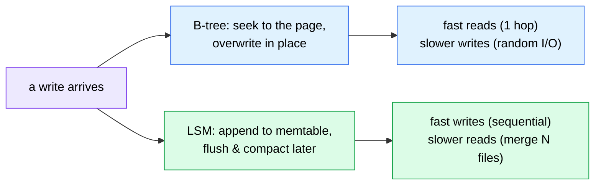
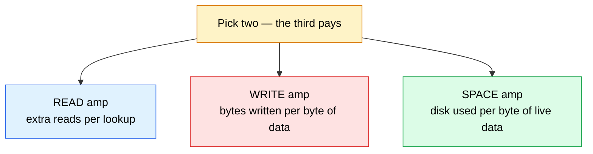
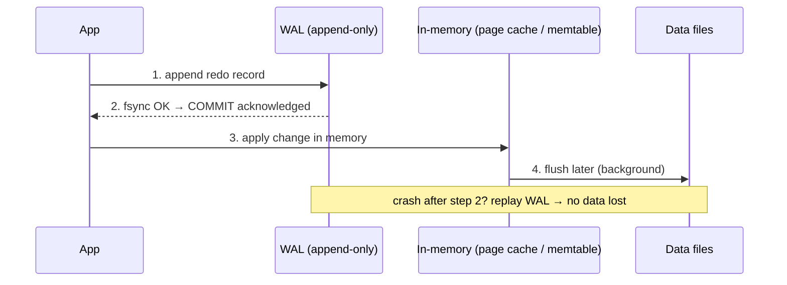
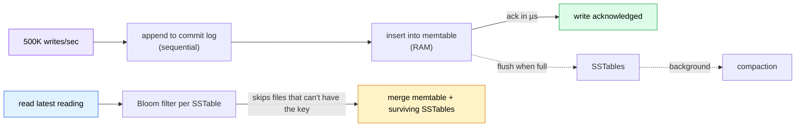
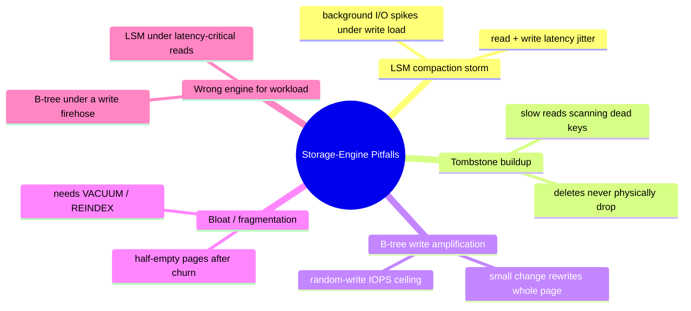

# B-Tree vs LSM Storage Engines

> **One line:** The *storage engine* is the layer beneath the index that decides how bytes actually hit the disk — a B-tree engine finds a page and overwrites it in place (fast reads), while an LSM engine only ever appends and merges later (fast writes) — and that single choice is why Postgres reads quickly and Cassandra writes quickly.

---

## Table of Contents
1. [Why You Must Master This](#1-why-you-must-master-this)
2. [The Mental Model](#2-the-mental-model)
3. [The B-Tree Engine — Pages, Update-in-Place](#3-the-b-tree-engine--pages-update-in-place)
4. [The LSM Engine — MemTable, SSTables, Compaction](#4-the-lsm-engine--memtable-sstables-compaction)
5. [The Three Amplifications — Read, Write, Space](#5-the-three-amplifications--read-write-space)
6. [WAL & Crash Recovery — Why Neither Loses Data](#6-wal--crash-recovery--why-neither-loses-data)
7. [Worked Example — "Why Does Cassandra Write Fast and Read Slow?"](#7-worked-example--why-does-cassandra-write-fast-and-read-slow)
8. [Real-Life Use Cases](#8-real-life-use-cases)
9. [Failure Modes](#9-failure-modes)
10. [🏋️ Practice Drills](#-practice-drills)
11. [🎤 Interview Q&A Bank](#-interview-qa-bank)
12. [🎯 Staff+ Nuances](#-staff-nuances)
13. [Cheat Sheet](#13-cheat-sheet)
14. [Connections & Further Reading](#14-connections--further-reading)

---

## 1. Why You Must Master This

[Database Indexing](./Database_Indexing.md) tells you *which* structure indexes your data; the storage engine tells you *how that structure is written to and read from disk* — and that's where the real performance profile of a database lives.

- **It answers the "why is this DB fast/slow at X?" question.** "Cassandra ingests a million writes/sec but a point read fans out across SSTables"; "Postgres reads are a single page hop but a hot-row update thrashes the disk." Both are *storage-engine* facts, not index facts. Naming the engine is what separates "I've used a database" from "I understand databases."
- **It's the mechanism behind LSM read amplification and Bloom filters.** [Database_Indexing.md](./Database_Indexing.md) mentions LSM "checks several SSTables (mitigated by Bloom filters)" — this file is *why*: the flush/compact lifecycle that creates those files in the first place.
- **Wrong engine = the wrong database.** Pick a B-tree engine for a write firehose and you die on random-write IOPS; pick LSM for a read-latency-critical OLTP path and you pay compaction jitter forever. This is a top-of-funnel design decision.
- **It's a favorite Staff+ interview probe.** "Walk me through what happens on disk when you `INSERT` into Cassandra vs Postgres" is a single question that reveals whether you know databases from the inside.

> **The core problem it solves:** *disks hate random writes.* A spinning disk seek is ~10 ms; even an SSD pays an erase-cycle tax for random overwrites. The storage engine's whole job is to turn your logical writes into a disk-access pattern the hardware can actually sustain — either by caching pages and batching (B-tree) or by never overwriting at all (LSM).

**Prerequisites:** [[Database_Indexing]] (index structures), [[ACID_Properties]] (WAL & durability).

---

## 2. The Mental Model

Think of two ways to keep a **household ledger.**

- **B-tree engine = a bound ledger book.** Every account has a fixed page. To record a transaction you *flip to that page and write on it* — precise, and reading an account's balance is one page-turn. But writing means seeking to the right page every time, and if a page fills you must split it and re-bind (rebalancing).
- **LSM engine = a running notepad you never erase.** You *append* every transaction to the bottom of a fresh sheet — instant, no seeking. Reading an account's current balance means scanning your recent sheets newest-first until you find it. Periodically you recopy everything into a clean, sorted summary and throw the scraps away (**compaction**).



> **Hold onto this:** B-tree *overwrites*, LSM *appends and merges*. Overwriting makes reads cheap and writes expensive; appending makes writes cheap and reads expensive. Everything else is a consequence.



> The engine you pick fixes which of read/write/space amplification you pay — you never escape all three.

---

## 3. The B-Tree Engine — Pages, Update-in-Place

A B-tree engine (Postgres, InnoDB, Oracle, SQLite) stores data in fixed-size **pages** (typically 4–16 KB) arranged as a balanced B+Tree. This is *update-in-place* storage.

**How a write actually works, step by step:**
1. The engine walks the tree from the root to find the leaf page holding (or that should hold) the key — 3–4 page reads for billions of rows.
2. It writes a redo record to the **WAL** and `fsync`s it (durability — see §6).
3. It **modifies the page in the buffer pool** (RAM cache of pages). The dirty page is flushed to its fixed disk location later by a background writer — a *random* write.
4. If the leaf is full, it **splits**: allocate a new page, move half the keys, update the parent. A cascade of splits can reach the root (rare, but it's why writes are amortized-log, not constant).

**Why reads are cheap:** a lookup is the same 3–4 page hops, and because the page *is* the current truth (no merging), one hop lands on the live value. Range scans walk the linked leaves sideways.

**The trade-off:** every write is a random-access operation against a fixed location. Under a write firehose, the buffer pool churns and the disk drowns in random I/O. **The other choice wins** (LSM) precisely when writes vastly outnumber reads and you can't buy enough IOPS.

| Property | B-tree engine |
|---|---|
| Write pattern | Random (seek to page, overwrite) |
| Read pattern | Single traversal, no merge |
| Structure | Balanced B+Tree of pages, updated in place |
| Fragmentation | Pages get partially empty → bloat → `VACUUM`/`REINDEX` |
| Best for | Read-heavy & mixed OLTP, range queries, low read latency |

---

## 4. The LSM Engine — MemTable, SSTables, Compaction

An LSM (Log-Structured Merge-tree) engine (Cassandra, RocksDB, LevelDB, ScyllaDB, HBase, and the default under many KV stores) *never updates in place.* It only appends.

**The write path:**
1. Append the write to a **commit log / WAL** on disk (durability) and insert it into the **MemTable** — an in-memory sorted structure (skiplist/red-black tree). This is the *entire* foreground cost: one sequential append + one memory insert. That's why LSM writes are blindingly fast.
2. When the MemTable fills (e.g., 64 MB), it's flushed to disk as an immutable, sorted **SSTable** (Sorted String Table) — one big sequential write. A new MemTable takes over.
3. Over time you accumulate many SSTables. **Compaction** runs in the background: it merge-sorts several SSTables into fewer, larger ones, discarding overwritten/deleted keys.

**Updates and deletes are just appends.** An update writes a *new* version with a higher timestamp; the old one lingers in an older SSTable until compaction drops it. A delete writes a **tombstone** (a "this key is gone" marker) — the key isn't physically removed until compaction.

**The read path (and why it's the expensive side):** a point read must check the MemTable, then potentially *every* SSTable from newest to oldest, because the key could live in any of them. Mitigations:
- **Bloom filters** per SSTable answer "is this key *definitely not* here?" in O(1), skipping most files — see [[Bloom_Filters_Probabilistic_Data_Structures]].
- **Sparse indexes / block indexes** locate the key within an SSTable without scanning it.
- Compaction itself reduces the number of files to check.

**Compaction strategies** (the knob that trades amplifications):

| Strategy | Merges | Optimizes | Cost |
|---|---|---|---|
| **Size-tiered (STCS)** | similarly-sized SSTables together | write amplification (fewer rewrites) | high space + read amp (many files) |
| **Leveled (LCS)** | into non-overlapping levels, each 10× the last | read + space amp (≤1 file per level) | high write amplification |
| **Time-windowed (TWCS)** | by time bucket | time-series/TTL workloads | only for append-only-by-time data |

> **Cassandra writes fast because a write is "append to log + insert to memtable"; it reads slower because a read may merge across the memtable and many SSTables.** That one sentence is the whole engine.

---

## 5. The Three Amplifications — Read, Write, Space

Every storage engine is scored on three "amplification" factors. **You can optimize at most two; the third suffers.** This is the RUM conjecture (Read, Update, Memory) in practice.



- **Read amplification** — how many physical reads to serve one logical read. B-tree: ~tree height (low, and cached). LSM: memtable + several SSTables (high, cut down by Bloom filters).
- **Write amplification** — bytes written to disk per byte of user data. B-tree: rewrite a whole page for a small change, plus WAL. LSM: the *same data is rewritten every time it's compacted*, so it can be written 10×+ over its lifetime — the hidden cost of "fast writes."
- **Space amplification** — disk consumed vs live data. B-tree: partially-empty pages (bloat). LSM: superseded versions + tombstones linger until compaction; size-tiered compaction can briefly need ~2× space to merge.

> **The reframing:** LSM doesn't make writes free — it *defers and batches* the work into compaction, converting expensive random writes into cheap sequential ones plus a background write-amplification bill. "Fast writes" is really "cheap foreground, expensive background."

---

## 6. WAL & Crash Recovery — Why Neither Loses Data

Both engines share one trick for durability: the **Write-Ahead Log** (the D in [ACID](./ACID_Properties.md)). *Before* any change is considered committed, its redo record is appended to the WAL and `fsync`'d to disk. The WAL is append-only and sequential, so it's cheap even on a B-tree engine.



- **B-tree recovery:** on restart, replay the WAL forward from the last checkpoint to redo committed changes that hadn't been flushed to their pages, and undo uncommitted ones.
- **LSM recovery:** the MemTable is volatile, so on restart the engine replays the commit log to rebuild whatever hadn't been flushed to an SSTable. Flushed SSTables are already durable and immutable.

> The WAL is why "commit" can be acknowledged before the data reaches its final home: the sequential log *is* the durability guarantee; the slow random write to the final location can happen lazily. This is the same idea LSM generalizes to the whole write path.

---

## 7. Worked Example — "Why Does Cassandra Write Fast and Read Slow?"

**The prompt:** "We ingest 500K IoT sensor writes/sec and occasionally look up a device's latest reading. We tried Postgres and the write throughput collapsed. Why, and what changes on Cassandra?"

**On Postgres (B-tree engine):** each write seeks to a leaf page and dirties it. At 500K writes/sec across random device IDs, the buffer pool can't hold the working set, so pages are evicted and re-read constantly — the disk saturates on *random* I/O. Effective ceiling: maybe a few tens of thousands of writes/sec before latency explodes. The engine is fighting its update-in-place nature.

**On Cassandra (LSM engine):**



**Closing the loop — number → consequence:**
- Every write becomes a **sequential append + memory insert** → the disk does contiguous I/O it can sustain at ~500K+/sec. The write bottleneck vanishes because we stopped doing random writes.
- The price shows up on **reads and CPU:** a "latest reading" lookup may touch the memtable plus several SSTables, and a **compaction storm** consumes disk bandwidth in the background. Bloom filters keep the typical read to ~1 SSTable, but tail latency is jittery during compaction.
- **Design consequence:** for this workload (write-dominated, read-rare, time-ordered) that trade is exactly right — and **TWCS compaction** plus a TTL makes old data drop off cheaply. The engine choice *is* the architecture.

The example is the whole topic: the same 500K/sec that melts an update-in-place engine is trivial for an append-and-compact engine — because the engine changed the disk-access pattern, not the workload.

---

## 8. Real-Life Use Cases

| Situation | Engine that wins | Why |
|-----------|------------------|-----|
| **OLTP: orders, users, low read latency** | B-tree (Postgres/InnoDB) | Single-hop reads, in-place updates, predictable tail latency; ranges free |
| **Write firehose: metrics, events, IoT, logs** | LSM (Cassandra/RocksDB) | Sequential appends absorb the rate; compaction reclaims space |
| **Embedded KV inside another system** | LSM (RocksDB/LevelDB) | RocksDB powers Kafka Streams state, TiKV, CockroachDB, MyRocks |
| **Read-mostly with big range scans** | B-tree | Linked sorted leaves make ranges cheap; no merge overhead |
| **Time-series with TTL** | LSM + TWCS | Whole SSTables age out and drop; see [[Time_Series_Databases]] |
| **MySQL but write-heavy** | Swap InnoDB → **MyRocks** (LSM) | Same MySQL front-end, LSM engine underneath for write/space savings |

> **The habit:** when a database "feels slow," ask *which amplification* you're paying — random-write pressure (B-tree overload) or read fan-out/compaction jitter (LSM). The engine tells you which lever exists.

---

## 9. Failure Modes



- **LSM compaction storm.** *Symptom:* p99 read/write latency spikes periodically, disk I/O saturates with no obvious query cause. *Root cause:* accumulated SSTables trigger heavy background merges exactly when write load is high. *Fix:* tune compaction strategy (STCS→LCS for read-heavy), throttle compaction throughput, add I/O headroom, or spread flushes.
- **Tombstone buildup (LSM).** *Symptom:* reads on a heavily-deleted partition slow to a crawl; "tombstone threshold exceeded" warnings. *Root cause:* deletes only write tombstones; until compaction (past `gc_grace_seconds`) reads must scan past thousands of dead markers. *Fix:* avoid queue-like delete-heavy patterns on LSM, lower gc grace carefully, use TTLs instead of explicit deletes.
- **B-tree write amplification / IOPS ceiling.** *Symptom:* write throughput plateaus and latency climbs though CPU is idle. *Root cause:* every random update rewrites a full page + WAL; the disk is out of random IOPS. *Fix:* batch writes, add write-back cache, or move the write-heavy table to an LSM engine.
- **Bloat & fragmentation (B-tree).** *Symptom:* table/index on disk grows far beyond the live data; scans slow. *Root cause:* deletes/updates leave partially-empty pages (MVCC dead tuples). *Fix:* `VACUUM`/`autovacuum` (Postgres), `OPTIMIZE TABLE` (InnoDB), scheduled `REINDEX`.
- **Wrong engine choice.** *Symptom:* fighting the database constantly. *Root cause:* engine mismatched to the read/write ratio. *Fix:* match the engine to the amplification you can afford — this is a design-time decision, not a tuning one.

---

## 🏋️ Practice Drills

> *Cover the solutions and attempt first — active recall is the point.*

**Drill 1 — Trace the write.** Describe exactly what hits the disk when you `UPDATE users SET name='X' WHERE id=7` on (a) a B-tree engine and (b) an LSM engine.

<details><summary>Solution</summary>

(a) **B-tree:** append a redo record to the WAL and `fsync` (durability); traverse the tree to the leaf page holding id=7; modify the row *in that page* in the buffer pool; the dirty page is flushed to its fixed disk location later by a background writer (a random write). If the page overflows, split it.

(b) **LSM:** append the new row version (with a newer timestamp) to the commit log and insert it into the MemTable — that's the whole foreground cost. The *old* version stays put in whatever SSTable holds it. Later the MemTable flushes to a new SSTable, and eventually compaction merges them and drops the superseded version.

Key contrast: B-tree does an in-place overwrite (random I/O now); LSM does an append (sequential I/O now, cleanup deferred to compaction).
</details>

**Drill 2 — Which amplification?** You benchmark an LSM store and find it writes 10 GB to disk to store 1 GB of user data. Name the amplification, explain the cause, and name the compaction strategy that would *increase* it further.

<details><summary>Solution</summary>

That's **write amplification** of ~10×. Cause: each byte of data is rewritten every time it participates in a compaction, and it participates many times as it migrates through levels/tiers. **Leveled compaction (LCS)** would increase write amplification further — it keeps each level non-overlapping (great for read and space amp) by rewriting data more often. Size-tiered (STCS) has *lower* write amp but higher read/space amp. This is the amplification triangle: you're trading write amp for read/space amp.
</details>

**Drill 3 — Design the choice.** You're building a message queue's durable log and a user-profile store. Pick an engine for each and justify from the access pattern.

<details><summary>Solution</summary>

- **Durable message log:** LSM (or a pure append-only segment log). It's write-heavy, append-ordered, read mostly sequentially, and old data ages out — the append-and-compact model fits perfectly, and TWCS-style aging drops consumed data cheaply.
- **User-profile store:** B-tree. Reads dominate (every request loads the profile), updates are point-updates on random keys, and you want low, predictable read latency — update-in-place with cached pages gives single-hop reads and no compaction jitter.

The lesson: match engine to the read/write ratio and access ordering, not to database brand names.
</details>

---

## 🎤 Interview Q&A Bank

**Q1. "What's the difference between a B-tree and an LSM storage engine?"**
> A B-tree engine stores data in fixed pages and updates them *in place*: a write seeks to the right page and overwrites it, so reads are a single traversal (fast) but writes are random I/O (slower). An LSM engine *never* overwrites — it appends writes to an in-memory memtable, flushes them to immutable sorted SSTables, and merges those in the background via compaction, so writes are sequential (fast) but a read may merge across many files (slower, mitigated by Bloom filters). B-tree suits read-heavy OLTP; LSM suits write firehoses.

**Q2. "Why does an LSM database write faster than a B-tree one?"** *(signal: mechanism depth)*
> Because an LSM write is just a sequential append to a log plus an in-memory insert — no seeking, no page rewrite. It converts the disk's worst pattern (random writes) into its best (sequential writes). The catch is it doesn't eliminate the work; it defers it into background compaction, which is where the write amplification bill comes due.

**Q3. "What are read, write, and space amplification?"**
> Read amp = extra physical reads per logical read; write amp = bytes written to disk per byte of user data; space amp = disk used per byte of live data. The RUM conjecture says you can optimize two at the expense of the third. B-tree: low read amp, low space amp, moderate write amp. LSM: high read amp (many SSTables), high write amp (repeated compaction), moderate space amp — tunable via compaction strategy.

**Q4. "What is compaction and why does it matter?"**
> It's the LSM background process that merge-sorts multiple SSTables into fewer, larger ones, dropping overwritten values and tombstones. It matters because without it read amplification and disk usage grow unbounded — but it also consumes I/O and CPU, so a poorly-tuned system suffers "compaction storms" where tail latency spikes under load. The compaction *strategy* (size-tiered vs leveled vs time-windowed) is how you pick which amplification to pay.

**Q5. "How does a delete work in an LSM engine?"** *(signal: knows tombstones)*
> It writes a **tombstone** — a marker saying "this key is deleted at timestamp T." The actual data isn't removed until a later compaction (after a grace period, to let deletes propagate to replicas). Until then, reads must scan past the tombstone. This is why delete-heavy or queue-like workloads are an anti-pattern on LSM: tombstones pile up and reads slow down.

**Q6. "Both engines use a WAL. Why?"**
> Durability. Before a commit is acknowledged, its redo record is appended to the write-ahead log and `fsync`'d — a cheap sequential write. If the process crashes, the engine replays the WAL to recover committed changes that hadn't reached their final location. It lets the DB ack a commit fast (sequential log write) while the slower final placement (random page write, or SSTable flush) happens lazily.

**Q7. "How would you turn MySQL into a write-optimized store without changing your app?"**
> Swap the storage engine: MySQL's pluggable engine architecture lets you use **MyRocks** (RocksDB, an LSM engine) instead of InnoDB (B-tree). The SQL layer and app stay identical; underneath, writes become sequential appends with far lower write and space amplification — Facebook did exactly this for its user DB to cut flash wear and storage cost.

**Q8. "When would you deliberately choose the slower-read LSM engine?"**
> When the workload is write-dominated and read-tolerant: metrics, event logs, IoT telemetry, time-series. There, sustaining the ingest rate is the hard requirement and reads are either rare, sequential, or served from recent data. I'd pair it with TWCS compaction and TTLs so old data ages out for free, and rely on Bloom filters to keep the occasional point read to about one SSTable.

---

## 🎯 Staff+ Nuances

- **"B-tree vs LSM" is really "where do you pay the random-I/O tax."** Both must eventually get sorted data onto disk; the only question is whether you pay per-write (B-tree, in place) or amortized in the background (LSM, compaction). Framing it as an amplification trade — not a "which is faster" — is the senior signal.
- **The RUM conjecture is the deep truth.** Read-optimal, Update-optimal, Memory-optimal — pick two. Every engine, index, and even every cache is a point on that triangle. When someone claims a structure is "better," ask which corner it sacrificed.
- **Compaction strategy is a workload decision, not a default.** Size-tiered minimizes write amp but bloats space and reads; leveled minimizes read/space amp but triples write amp; time-windowed is only correct for append-by-time data. Choosing wrong turns a healthy cluster into a compaction-bound one — and it interacts with SSD wear.
- **LSM and SSDs are a natural pair; B-tree and SSDs need care.** SSDs erase in large blocks and hate small random overwrites (write amplification at the *device* level). LSM's sequential writes are flash-friendly; B-tree's random page writes multiply the device's own GC. This is a real reason MyRocks exists.
- **Tombstones interact with [replication](./Replication.md).** A delete's tombstone must live long enough (`gc_grace_seconds`) to reach every replica, or a replica that missed the delete could resurrect the row during read repair. Compaction that's too aggressive causes "zombie" data — a subtle distributed-systems bug that lives inside the storage engine.
- **The buffer pool / page cache is the hidden third character.** B-tree read speed depends entirely on the working set fitting in RAM; once it spills, "fast reads" become random disk reads. Much of "tune your database" is really "keep the hot pages cached." LSM's block cache plays the analogous role for SSTable blocks.
- **Fractal trees and B-ε trees exist between the two.** TokuDB/PerconaFT use buffered B-trees (B-ε trees) that batch writes in internal nodes — a middle point that improves B-tree write amp without full LSM read cost. Knowing the space isn't binary is a nice depth flex.

---

## 13. Cheat Sheet

```
STORAGE ENGINES — HOW BYTES ACTUALLY HIT THE DISK
═══════════════════════════════════════════════════════════════════

B-TREE ENGINE (Postgres, InnoDB, Oracle, SQLite) — UPDATE IN PLACE
  write = traverse to leaf page → WAL fsync → overwrite page (random I/O)
  read  = single traversal, no merge → LOW read latency
  splits on full pages; VACUUM/REINDEX to fight bloat
  Read amp LOW · Write amp MED · Space amp LOW

LSM ENGINE (Cassandra, RocksDB, LevelDB, ScyllaDB, HBase) — APPEND + COMPACT
  write = commit log append + memtable insert (sequential) → FAST
  flush memtable → immutable sorted SSTable
  read  = memtable + N SSTables (Bloom filters skip most) → HIGHER latency
  update = new version w/ newer timestamp; delete = TOMBSTONE
  Read amp HIGH · Write amp HIGH · Space amp MED

THE THREE AMPLIFICATIONS (RUM — pick two)
  READ  = physical reads per logical read
  WRITE = bytes written to disk per byte of data
  SPACE = disk used per byte of live data

COMPACTION STRATEGIES (LSM)
  Size-tiered (STCS)  low write amp · high read+space amp
  Leveled (LCS)       low read+space amp · high write amp
  Time-windowed(TWCS) time-series / TTL only

WAL = durability for BOTH: append+fsync BEFORE ack, replay on crash

PICK IT:  read-heavy OLTP, low latency → B-TREE
          write firehose, tolerant reads → LSM
          delete/queue-heavy → NOT LSM (tombstones)
```

---

## 14. Connections & Further Reading

**Prerequisites (learn first):**
- [Database_Indexing.md](./Database_Indexing.md) — indexes are the *structures*; this file is how those structures are written to disk. LSM read amplification and Bloom filters are introduced there and mechanized here.
- [ACID_Properties.md](./ACID_Properties.md) — the WAL and durability model both engines rely on.

**Builds toward / pairs with:**
- [[Bloom_Filters_Probabilistic_Data_Structures]] — the probabilistic filter that makes LSM reads survivable.
- [[Time_Series_Databases]] — TWCS compaction + TTL is the LSM engine tuned for time.
- [SQL_vs_NoSQL_Scaling.md](./SQL_vs_NoSQL_Scaling.md) — LSM is the storage-engine expression of "scale writes."
- [Replication.md](./Replication.md) — tombstone grace periods and read repair live at the engine/replication boundary.

**Gaps this topic exposes:**
- Buffer-pool / page-cache tuning as its own operational topic (currently folded into caching).

**External classics:**
- *Designing Data-Intensive Applications* (Kleppmann) — Ch. 3, the definitive B-tree vs LSM treatment.
- *The Log-Structured Merge-Tree* (O'Neil et al., 1996) — the original LSM paper.
- [RocksDB Wiki](https://github.com/facebook/rocksdb/wiki) — compaction, amplification, and tuning in production detail.
- *"The RUM Conjecture"* (Athanassoulis et al., 2016) — the read/update/memory trade-off formalized.

---

## TL;DR
**The storage engine decides whether a write is a random overwrite or a sequential append — and that single choice sets the database's whole performance personality.** A B-tree engine updates pages in place: cheap single-hop reads, expensive random writes (Postgres, InnoDB). An LSM engine only appends to a memtable, flushes immutable SSTables, and merges them via compaction: cheap sequential writes, expensive multi-file reads mitigated by Bloom filters (Cassandra, RocksDB). You can optimize at most two of read/write/space amplification (the RUM conjecture); compaction strategy tunes which. Both use a WAL for durability. **Match the engine to your read/write ratio — B-tree for read-heavy OLTP, LSM for write firehoses — because you cannot tune your way out of the wrong engine.**
