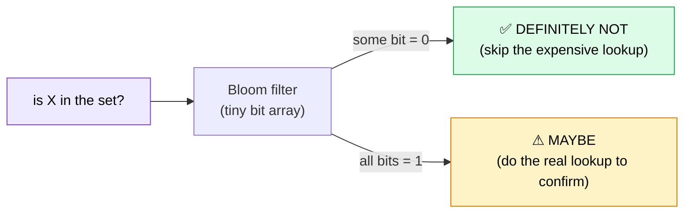
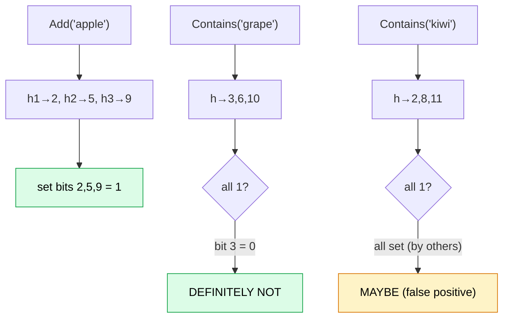
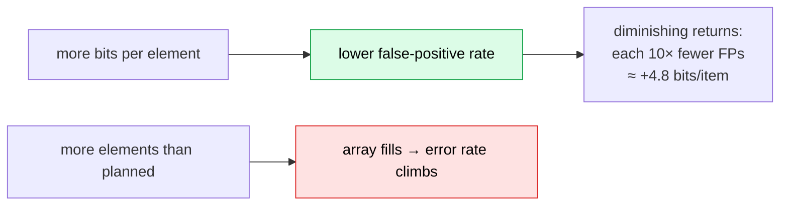
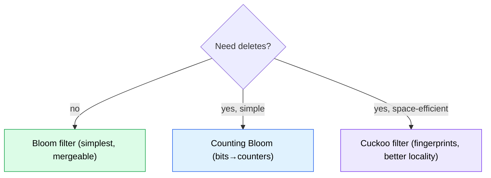
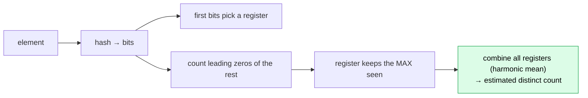
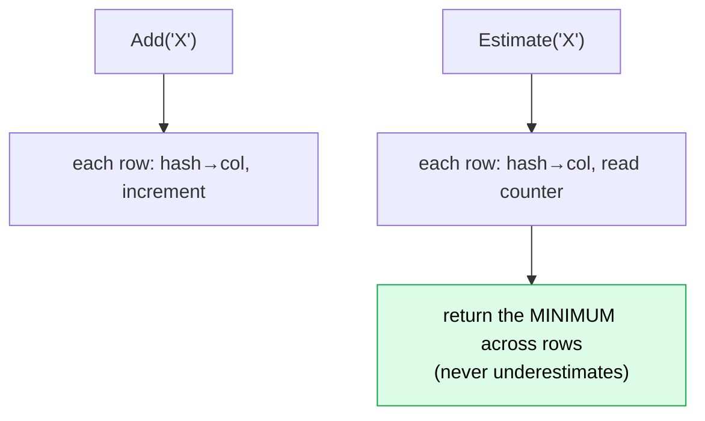
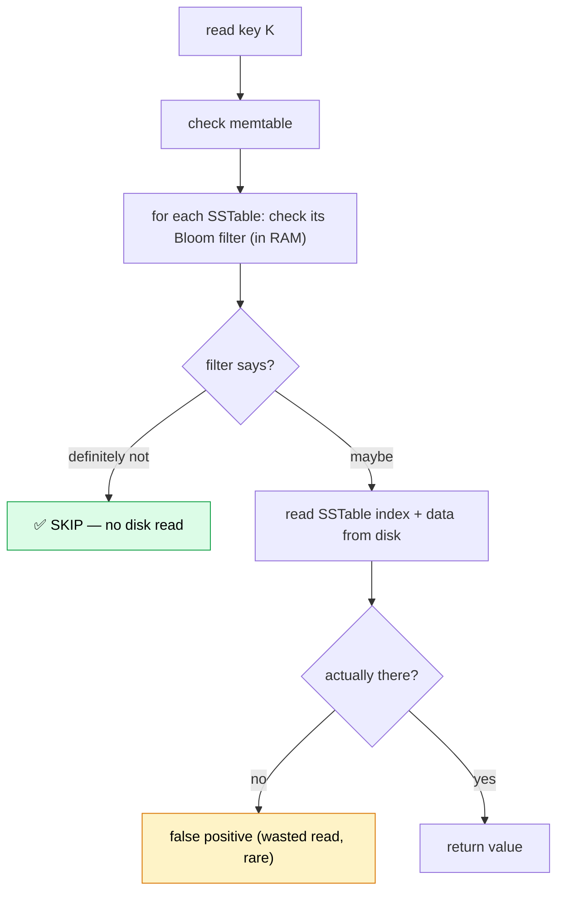
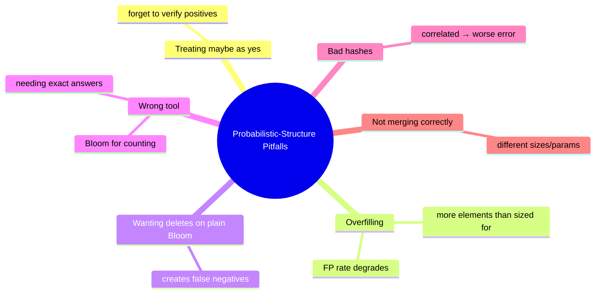

# Bloom Filters & Probabilistic Data Structures

> **One line:** Probabilistic data structures answer questions like "is this in the set?", "how many distinct things have I seen?", or "how often did this appear?" using a *tiny, fixed* amount of memory — by giving up exactness for a controllable, small error — and the Bloom filter is the canonical one: it tells you *definitely not present* or *maybe present*, never lies about absence, and fits a huge set in a few kilobytes.

---

## Table of Contents
1. [Why You Must Master This](#1-why-you-must-master-this)
2. [The Mental Model](#2-the-mental-model)
3. [The Bloom Filter — How It Works](#3-the-bloom-filter--how-it-works)
4. [The Math — False Positives, Sizing](#4-the-math--false-positives-sizing)
5. [Variants — Counting & Cuckoo Filters](#5-variants--counting--cuckoo-filters)
6. [HyperLogLog — Counting Distinct in Kilobytes](#6-hyperloglog--counting-distinct-in-kilobytes)
7. [Count-Min Sketch — Frequency in Sublinear Space](#7-count-min-sketch--frequency-in-sublinear-space)
8. [Worked Example — Bloom Filters in an LSM Read Path](#8-worked-example--bloom-filters-in-an-lsm-read-path)
9. [Real-Life Use Cases](#9-real-life-use-cases)
10. [Failure Modes](#10-failure-modes)
11. [🏋️ Practice Drills](#-practice-drills)
12. [🎤 Interview Q&A Bank](#-interview-qa-bank)
13. [🎯 Staff+ Nuances](#-staff-nuances)
14. [Cheat Sheet](#14-cheat-sheet)
15. [Connections & Further Reading](#15-connections--further-reading)

---

## 1. Why You Must Master This

These structures are the "cheat codes" of systems at scale: they answer set/cardinality/frequency questions in kilobytes where the exact answer would need gigabytes. [Database_Indexing.md](./Database_Indexing.md) mentions Bloom filters in passing — this file is *why they work and where they save you.*

- **Bloom filters are load-bearing in real databases.** They're the reason [LSM/Cassandra](./B_Tree_vs_LSM_Storage_Engines.md) reads are survivable (skip SSTables that can't hold the key), why CDNs and caches avoid pointless origin lookups, and how Bitcoin/Ethereum light clients filter transactions. If you've used Cassandra, RocksDB, HBase, or Redis, you've used these.
- **They embody the "trade exactness for resources" pattern.** Just like [ANN in vector DBs](./Vector_Databases.md) trades recall for speed, probabilistic structures trade a bounded error for enormous space savings. Recognizing when approximate is good enough is a scaling superpower.
- **The one-sided error is a beautiful, exam-worthy property.** "No false negatives, some false positives" — understanding *why* absence is certain but presence is not, and how to size the error, is a clean depth signal.
- **They come up in "count unique visitors / trending items at scale" questions.** HyperLogLog and count-min sketch are the standard answers when exact counting would blow memory — a common system-design ask.

> **The core problem it solves:** *you need to answer membership/cardinality/frequency questions over a set so large that storing it exactly is infeasible — and you can tolerate a small, quantifiable error in exchange for using a fixed, tiny amount of memory.* Exact answers cost O(n) space; these cost O(1)–O(log n).

**Prerequisites:** hashing basics, [[Database_Indexing]] (where Bloom filters plug into read paths), [[B_Tree_vs_LSM_Storage_Engines]] (the LSM read path they optimize).

---

## 2. The Mental Model

A Bloom filter is a **bouncer with a checklist of *ticked boxes*, not names.**

- Instead of keeping the full guest list (expensive), the bouncer has a small grid of checkboxes. When someone's added to the list, a few boxes (chosen by hashing their name) get ticked.
- To check "are you on the list?", the bouncer looks at *your* few boxes. If **any** is un-ticked, you're **definitely not** on the list (a box that would've been ticked isn't). If **all** are ticked, you're **probably** on it — but maybe those boxes were ticked by *other* guests who happened to share them (a false positive).
- The bouncer can be wrong by letting in someone not on the list, but *never* wrong by turning away someone who is. Absence is certain; presence needs a real check.



> **Hold onto this:** the value is the *fast, certain "no."* Most queries for things that aren't in a set can be answered instantly from kilobytes, avoiding an expensive disk/network lookup — and you only pay the real lookup for the "maybes."


> A 0 bit is proof of absence (no false negatives); all-1s is only "maybe" because other items may have set those same bits.

---

## 3. The Bloom Filter — How It Works

A Bloom filter is a bit array of `m` bits (all 0 initially) plus `k` independent hash functions. Two operations, no deletes (in the standard version):

**Add(x):** hash `x` with each of the `k` functions to get `k` positions in `[0, m)`, and set those bits to 1.

**Contains(x):** hash `x` the same `k` ways; if **all** `k` bits are 1, return "maybe present"; if **any** is 0, return "definitely not present."



**Why the error is one-sided:**
- **No false negatives:** if `x` was added, its `k` bits were set to 1 and bits are never cleared, so `Contains(x)` *must* find all 1s. A "definitely not" is always correct.
- **False positives happen:** a never-added `y` can hash to `k` positions that *other* elements already set, so all its bits read 1 → "maybe" when it's actually absent. The more elements added, the fuller the array, the higher this rate.

**Why no deletes:** you can't clear a bit for `x` because another element might depend on that same bit — clearing it would create a false *negative*. (Counting Bloom filters fix this — §5.)

> **Key operational facts:** the array is a **fixed size chosen up front** for an expected element count and target error rate; add/query are O(k) (constant); and it's trivially mergeable (bitwise OR of two same-sized filters = the union's filter), which makes it great for distributed systems.

---

## 4. The Math — False Positives, Sizing

The Bloom filter's elegance is that you can *tune the error precisely* by choosing the array size and hash count. The key formulas (worth knowing at a high level):

- For `n` elements in `m` bits with `k` hashes, the false-positive probability is approximately:
  **p ≈ (1 − e^(−kn/m))^k**
- The **optimal number of hashes** for given `m, n` is: **k = (m/n) · ln 2 ≈ 0.693 · (m/n)**.
- Rearranged, the **bits per element** needed for a target `p` is: **m/n = −(ln p) / (ln 2)² ≈ −1.44 · log₂ p**.

The practical takeaways matter more than the algebra:

| Target false-positive rate | Bits per element | Example: 1B items |
|---|---|---|
| 10% | ~4.8 | ~600 MB |
| 1% | ~9.6 | ~1.2 GB |
| 0.1% | ~14.4 | ~1.8 GB |
| 0.01% | ~19.2 | ~2.4 GB |



> **Real number:** ~**10 bits per element gives ~1% false positives** — a rule of thumb worth memorizing. A Bloom filter for 1 billion items at 1% error is ~1.2 GB, versus storing 1 billion actual keys (tens of GB+). And note the trap: the math assumes `n` matches your plan — **overfill the filter and the false-positive rate degrades toward useless**, so you size for the max expected count (or use a scalable/partitioned Bloom filter).

---

## 5. Variants — Counting & Cuckoo Filters

The standard Bloom filter can't delete. Two variants address that and other limitations:

**Counting Bloom filter:** replace each bit with a small counter (e.g., 4 bits). `Add` *increments* the k counters; `Delete` *decrements* them; `Contains` checks all k counters are > 0. Now deletion works (decrementing doesn't wrongly zero a shared slot as long as counts are tracked), at ~4× the space of a plain Bloom filter and a risk of counter overflow.

**Cuckoo filter:** stores small *fingerprints* of elements in a cuckoo hash table. It **supports deletion**, often has *better space efficiency* than a Bloom filter at low false-positive rates, and has better cache locality (fewer memory accesses per query). The trade: inserts can fail if the table gets too full (needing a resize), and it's more complex. Modern systems increasingly prefer cuckoo filters when deletes are needed.

| Structure | Deletes? | Space | Notes |
|---|---|---|---|
| **Bloom** | ❌ | baseline (~10 bits/item @1%) | simplest, mergeable, no deletes |
| **Counting Bloom** | ✅ | ~4× | counters instead of bits; overflow risk |
| **Cuckoo** | ✅ | ~ better at low FP | fingerprints; insert can fail when full |



> **The takeaway:** if a design needs to *remove* items from the filter (e.g., a cache admission filter for evictable keys), you can't use a plain Bloom filter — reach for counting Bloom or, better, a cuckoo filter.

---

## 6. HyperLogLog — Counting Distinct in Kilobytes

Different question, same philosophy: **how many *distinct* elements have I seen?** (cardinality). Exact counting requires storing every distinct element (a set) — gigabytes for billions of uniques. **HyperLogLog (HLL)** estimates cardinality in a *fixed ~12 KB* with ~2% error.

**The intuition:** hash each element to a random-looking bit string. In a stream of random bit strings, seeing one that starts with many leading zeros is *rare* — you'd expect a run of `p` leading zeros only after seeing ~2^p distinct items. So the *maximum* number of leading zeros observed is a (noisy) estimate of `log₂(cardinality)`. HLL reduces the noise by splitting the stream into many "buckets" (registers) via the first few hash bits, tracking the max-leading-zeros per bucket, and *harmonic-mean averaging* across buckets.



- **Space:** ~12 KB (e.g., 16,384 registers × 6 bits) for the whole thing, *independent of cardinality* — count 10 or 10 billion uniques in the same 12 KB.
- **Error:** ~2% standard error (tunable by register count).
- **Mergeable:** union two HLLs by taking the per-register max — so you can count distinct across shards/days by merging their sketches (Redis `PFMERGE`).

> **Real number:** Redis `PFADD`/`PFCOUNT` (HyperLogLog) counts unique visitors over billions of events in ~12 KB with ~0.81% error — versus a `SET` of a billion user IDs that could be tens of GB. This is *the* answer to "count unique X at scale."

---

## 7. Count-Min Sketch — Frequency in Sublinear Space

Another question: **how many times has element X appeared?** (frequency, not just presence). Exact counts need a counter per distinct key — huge for a high-cardinality stream. **Count-Min Sketch (CMS)** estimates frequencies in a fixed 2D array of counters.

**How it works:** a grid of `d` rows × `w` counters. `Add(x)`: for each row `i`, hash `x` to a column and *increment* that counter. `Estimate(x)`: hash `x` the same way and return the **minimum** of the `d` counters it maps to.

- **Why the minimum:** collisions can only *inflate* a counter (other elements add to the same cell), never deflate it — so each counter is an *over*-estimate, and the smallest across rows is the tightest (least-collided) over-estimate. Like Bloom filters, the error is one-sided: it **never underestimates**, may overestimate.



- **Use for:** "heavy hitters" / trending items (most-frequent search terms, top talkers, DDoS source IPs), rate limiting, and frequency features — where approximate counts over a massive stream are fine.
- **Trade:** overestimates for rare items amid frequent ones (collisions), fixed by more width/rows; can't easily list *which* keys are heavy (pair with a heap of candidates).

> **The pattern across all four:** trade a bounded, one-sided error for space that's constant or logarithmic instead of linear. Bloom = membership, HLL = distinct count, CMS = frequency — same bargain, different question.

---

## 8. Worked Example — Bloom Filters in an LSM Read Path

**The prompt:** "Cassandra stores data across many immutable SSTables. A point read for a key that *doesn't exist* would have to check every SSTable on disk. How do Bloom filters make this fast, with numbers?"

**Without Bloom filters:** a read for key `K` must check the memtable, then potentially *every* SSTable (there can be dozens), each requiring a disk seek + index lookup, until it finds `K` or exhausts them. For a **non-existent key**, that's the worst case: you pay a disk lookup on *every* SSTable only to conclude "not here." See [[B_Tree_vs_LSM_Storage_Engines]] for why LSM has this read-amplification problem.

**With a per-SSTable Bloom filter:**



- Each SSTable has a small in-memory Bloom filter of the keys it contains. Before touching disk, Cassandra asks the filter: *could this SSTable hold K?*
- **"Definitely not"** → skip that SSTable entirely, **no disk I/O.** Because Bloom filters have no false negatives, this skip is *always safe* — the key truly isn't there.
- **"Maybe"** → do the disk read. If it's a false positive (~1%), you wasted one read; otherwise you found it.

**Closing the loop — number → consequence:**
- Suppose 20 SSTables and a read for a non-existent key. Without filters: **up to 20 disk lookups**. With ~1% false-positive filters: on average **~0.2 disk lookups** (each filter independently says "maybe" ~1% of the time) — a **~100× reduction** in disk I/O for negative lookups.
- The Bloom filters cost ~**10 bits per key in RAM** (~1% FP): for 1 billion keys, ~1.2 GB of memory to save enormous disk I/O. That memory-for-I/O trade is exactly why LSM stores are usable for read-mostly-negative or point-read workloads.
- The no-false-negatives property is load-bearing: it's what lets the engine *skip* an SSTable with confidence. A false negative would mean silently missing existing data — unacceptable — which is why the one-sided error is the whole point.

The example is the whole topic: a tiny in-RAM probabilistic structure converts "check everything on disk" into "check only the ~1% that might match," turning LSM read amplification from crippling into manageable.

---

## 9. Real-Life Use Cases

| Situation | Structure | How it helps |
|-----------|-----------|--------------|
| **LSM/Cassandra/RocksDB reads** | Bloom filter | Skip SSTables that can't contain the key → avoid disk I/O. |
| **CDN / cache "is it cached?"** | Bloom filter | Skip origin/cache lookups for definitely-absent keys. |
| **"Have I seen this URL/username?"** | Bloom filter | Web crawlers dedup URLs; check username availability cheaply. |
| **Count unique visitors / uniques at scale** | HyperLogLog | ~12 KB for billions of uniques, ~2% error; mergeable across shards. |
| **Trending / heavy-hitter detection** | Count-Min Sketch | Top search terms, top talkers, DDoS sources in sublinear space. |
| **Malicious URL / breach password check** | Bloom filter | Client-side "definitely safe" check; verify the "maybes" server-side. |
| **Rate limiting / approximate counting** | Count-Min Sketch | Per-key request counts without a counter per key. |

> **The habit:** when an exact set/count/frequency would blow your memory budget and a small bounded error is acceptable, reach for the matching probabilistic structure — membership → Bloom, distinct → HLL, frequency → CMS.

---

## 10. Failure Modes



- **Treating "maybe" as "yes."** *Symptom:* wrong results / acting on absent data. *Root cause:* using the filter's positive answer as ground truth instead of a hint. *Fix:* always verify a positive with the real lookup; the filter only lets you *skip* the confirmed-absent cases.
- **Overfilling the filter.** *Symptom:* false-positive rate climbs until the filter is useless. *Root cause:* adding far more elements than it was sized for (array saturates toward all 1s). *Fix:* size for the max expected `n`; use a scalable/partitioned Bloom filter or rebuild larger when it fills.
- **Wanting to delete from a plain Bloom filter.** *Symptom:* clearing bits causes missed (false-negative) items. *Root cause:* bits are shared across elements. *Fix:* use a counting Bloom or cuckoo filter for deletable sets.
- **Using the wrong structure.** *Symptom:* Bloom filter can't count; HLL can't tell you *which* items. *Root cause:* mismatched question. *Fix:* Bloom = membership, HLL = distinct count, CMS = frequency; if you need exactness or item enumeration, use an exact structure.
- **Weak or correlated hash functions.** *Symptom:* higher error than the math predicts. *Root cause:* non-independent hashes clustering bits. *Fix:* use good hashes (often derived as `h_i = h1 + i·h2` from two strong hashes — "double hashing").
- **Merging incompatible sketches.** *Symptom:* garbage results after a union. *Root cause:* merging filters/sketches of different sizes or parameters. *Fix:* only merge structures with identical size/hash/parameters (Bloom = OR, HLL = per-register max).

---

## 🏋️ Practice Drills

> *Cover the solutions and attempt first — active recall is the point.*

**Drill 1 — Interpret the answer.** A Bloom filter guarding a database says "maybe present" for key K, and separately says "definitely not present" for key J. What action does each answer justify, and why the asymmetry?

<details><summary>Solution</summary>

- **"Definitely not present" (J):** you can **skip the expensive lookup entirely** and confidently return "not found." This is safe because Bloom filters have *no false negatives* — a 0 bit means J's bit was never set, so J was never added.
- **"Maybe present" (K):** you must **do the real lookup** to confirm, because it could be a false positive (K's k bits happened to be set by other elements). The filter only *saved you work on the certain-absence case.*

The asymmetry comes from the mechanism: bits are only ever set (never cleared) and shared across elements, so absence of a set bit proves non-membership, but presence of all set bits is merely consistent with membership.
</details>

**Drill 2 — Size it.** You want a Bloom filter for 100 million URLs with a 1% false-positive rate. Roughly how much memory, and how does it change if you want 0.1%?

<details><summary>Solution</summary>

Rule of thumb: ~**10 bits per element for ~1%** false positives. So 100M × 10 bits = 1 billion bits ≈ **125 MB** for 1%.

For 0.1%, you need ~**14.4 bits per element** (each 10× reduction in FP rate costs ~4.8 more bits/element). So 100M × 14.4 ≈ 1.44 billion bits ≈ **180 MB**.

Compare to storing 100M actual URLs (say 50 bytes each = 5 GB): the Bloom filter is ~40× smaller even at 0.1%. Note the diminishing returns — going from 1% to 0.1% costs only ~44% more memory, but 0.1% to 0.01% costs another ~4.8 bits/element again.
</details>

**Drill 3 — Pick the structure.** For each, name the right probabilistic structure: (a) "how many unique users visited today across 50 servers?"; (b) "what are the top 10 most-searched queries this hour?"; (c) "has this email already been sent to this user?" (must never re-check a real one, deletes needed).

<details><summary>Solution</summary>

(a) **HyperLogLog.** Distinct-count question at scale — ~12 KB per server, and you *merge* the 50 HLLs (per-register max) to get the global unique count with ~2% error, without shipping user-ID sets around.

(b) **Count-Min Sketch** (plus a small heap of candidate heavy hitters). CMS gives approximate frequencies of every query in sublinear space; the heap tracks the current top-K so you can report them.

(c) A **counting Bloom filter** or **cuckoo filter** — membership question, but "deletes needed" rules out a plain Bloom filter (you may need to remove a user/email pair). Cuckoo is the better modern choice for space + deletes. And since "must never re-check a real one" means false negatives are unacceptable, the no-false-negative property fits — verify positives against the real store to handle the false positives.
</details>

---

## 🎤 Interview Q&A Bank

**Q1. "What is a Bloom filter and what does it guarantee?"**
> A space-efficient probabilistic structure for set membership: a bit array plus k hash functions. Adding an element sets k bits; querying checks those k bits. It guarantees **no false negatives** — if it says "definitely not present," that's always correct — but allows **false positives** — "maybe present" might be wrong. So you use it to *skip* work for confirmed-absent items, and verify the "maybes" with a real lookup. It fits a huge set in a few bits per element (~10 bits/item for ~1% error).

**Q2. "Why can a Bloom filter have false positives but never false negatives?"** *(signal: understands the mechanism)*
> Because bits are only ever set to 1, never cleared, and they're shared across elements. If an element was added, its k bits are definitely 1, so a query for it always finds all 1s — no false negative. But a never-added element can hash to k positions that *other* elements already set to 1, so all its bits read 1 and the filter says "maybe" — a false positive. Absence of any set bit proves non-membership; presence of all set bits is only consistent with membership.

**Q3. "Where are Bloom filters used in databases?"**
> The classic case is the LSM read path (Cassandra, RocksDB, HBase): each immutable SSTable has an in-memory Bloom filter of its keys, so before doing a disk read the engine asks "could this SSTable contain the key?" A "definitely not" skips the SSTable with zero disk I/O — safe because there are no false negatives — turning "check every SSTable" into "check only the ~1% that might match." That's a huge reduction in read amplification for point reads and negative lookups.

**Q4. "How do you size a Bloom filter?"**
> You pick the array size m and hash count k for your expected element count n and target false-positive rate. The rule of thumb is ~10 bits per element for ~1% false positives, and each additional 10× reduction in the error rate costs about 4.8 more bits per element. The optimal number of hashes is about 0.693 × (m/n). The key caveat: the error rate is only valid if n stays near what you sized for — overfill it and the false-positive rate degrades, so size for the maximum or use a scalable Bloom filter.

**Q5. "How would you count unique visitors across billions of events?"**
> HyperLogLog. Instead of storing every distinct ID (gigabytes), HLL estimates cardinality in a fixed ~12 KB with ~2% error by hashing each element and tracking the maximum number of leading zeros seen across many registers, then combining them. It's mergeable — union HLLs from many servers by taking per-register maxes — so I can count global uniques across shards or time windows without moving raw data. Redis implements it as PFADD/PFCOUNT/PFMERGE.

**Q6. "What's a count-min sketch for?"**
> Estimating element *frequencies* (how many times X appeared) in sublinear space — useful for heavy-hitter detection like trending queries, top talkers, or DDoS sources, and for approximate rate limiting. It's a grid of counters; you increment a hashed cell per row on add, and estimate by taking the minimum across rows. Like Bloom filters the error is one-sided — it never underestimates, but collisions can overestimate, especially for rare items. Pair it with a small heap to actually list the top-K.

**Q7. "Bloom filters can't delete — what do you do if you need to?"**
> Use a variant. A counting Bloom filter replaces each bit with a small counter you increment on add and decrement on delete (about 4× the space, with overflow risk). A cuckoo filter stores element fingerprints in a cuckoo hash table, supporting deletes with often *better* space efficiency at low false-positive rates and better cache locality — the modern choice when deletes are needed. The trade is cuckoo inserts can fail when the table gets too full, requiring a resize.

**Q8. "What's the unifying idea behind all these structures?"**
> Trade a small, *bounded, one-sided* error for space that's constant or logarithmic instead of linear in the data. Exact membership/cardinality/frequency needs O(n) space; Bloom (membership), HyperLogLog (distinct count), and count-min sketch (frequency) answer the same questions in kilobytes by hashing into fixed structures and accepting quantifiable inaccuracy. It's the same bargain as approximate nearest-neighbor search — approximate is often good enough, and it's the only thing that scales.

---

## 🎯 Staff+ Nuances

- **The one-sided error is what makes them *safe to act on*.** A Bloom filter's "no" being certain is precisely why an LSM engine can *skip* a disk read on it — a two-sided error would be useless there. When evaluating any probabilistic structure, the first question is "which direction can it be wrong, and is that direction safe for my use?" Bloom/CMS never err on the "absence/underestimate" side; that's the load-bearing property.
- **Mergeability is why these dominate distributed systems.** Bloom filters union by bitwise OR, HLLs by per-register max, CMS by cell-wise addition — all *associative and commutative*, so you can compute per-shard/per-node and combine without coordination. This maps perfectly onto MapReduce/streaming aggregation, which is why they're everywhere in analytics pipelines.
- **Bloom filters are a cache/lookup *shield*, not a cache.** The pattern "check Bloom → skip if absent → do real lookup if maybe" prevents the expensive path for the common negative case. It's the same shape as a [negative cache](../06_Caching_Performance/), and it's why they appear in front of databases, CDNs, and even security checks (client-side "is this password breached?" filters).
- **Sizing under uncertain n is the real engineering problem.** Static Bloom filters degrade badly when you exceed the planned count. Scalable Bloom filters (chained filters that add capacity) and partitioned designs handle growth, and you monitor the actual fill ratio / false-positive rate in production rather than trusting the design-time number. "It worked in staging with 10K items, then rotted at 10M" is a classic incident.
- **HyperLogLog's accuracy is worst exactly where naive estimators fail — small cardinalities — so real HLL uses corrections.** The raw estimator is biased for very small and very large counts; production HLL (Redis, `HLL++`) adds linear-counting for small ranges and bias correction. Knowing that the textbook algorithm is refined in practice is a depth signal.
- **These trade precision for space; ANN and sampling trade precision for time — same family.** [ANN in vector search](./Vector_Databases.md), reservoir sampling, t-digest for percentiles, and these structures are all "give up exactness for a resource budget." Recognizing the family lets you reach for the right approximate tool whenever exact is infeasible — a scaling instinct, not a trick.
- **Fingerprint/hash quality and independence directly set the achievable error.** The clean formulas assume independent uniform hashes; in practice engineers use double hashing (`h_i = h1 + i·h2`) to synthesize k hashes cheaply from two, which is provably near-optimal. Poor hashes make real error exceed theory — the structure is only as good as its hashing.

---

## 14. Cheat Sheet

```
PROBABILISTIC DATA STRUCTURES — TRADE A BOUNDED ERROR FOR TINY SPACE
═══════════════════════════════════════════════════════════════════

BLOOM FILTER — set membership
  bit array (m bits) + k hash functions
  Add: set k hashed bits = 1   Query: all k bits 1?
    some bit 0  → DEFINITELY NOT (safe to skip)   ← no false negatives
    all bits 1  → MAYBE (verify with real lookup)  ← false positives
  NO deletes (bits shared) · fixed size up front · merge = bitwise OR

  SIZING: ~10 bits/item ≈ 1% FP · each 10× fewer FPs ≈ +4.8 bits/item
          optimal k ≈ 0.693 · (m/n) · overfill → error degrades

VARIANTS (need deletes)
  Counting Bloom  bits→counters, inc/dec, ~4× space
  Cuckoo filter   fingerprints, deletes, better space@low FP, insert can fail

HYPERLOGLOG — distinct count (cardinality)
  hash → count leading zeros per register → combine (harmonic mean)
  ~12 KB for BILLIONS of uniques, ~2% error, independent of count
  merge = per-register max (Redis PFADD/PFCOUNT/PFMERGE)

COUNT-MIN SKETCH — frequency (how many times X?)
  d×w counter grid · Add: inc hashed cell per row · Est: MIN across rows
  never underestimates (over-estimates on collisions) · heavy hitters, rate limit

PICK:  membership→Bloom · distinct→HLL · frequency→CMS · need exact→exact structure
KEY:   error is ONE-SIDED & bounded → safe to act on the certain side
USE:   LSM SSTable skip · cache/CDN shield · unique visitors · trending items
```

---

## 15. Connections & Further Reading

**Prerequisites (learn first):**
- [Database_Indexing.md](./Database_Indexing.md) — where Bloom filters plug into read paths (introduced there in passing).
- [B_Tree_vs_LSM_Storage_Engines.md](./B_Tree_vs_LSM_Storage_Engines.md) — the LSM read-amplification problem Bloom filters solve.

**Builds toward / pairs with:**
- [[Vector_Databases]] — ANN is the same "approximate for scale" bargain applied to similarity search.
- [Full_Text_Search_Elasticsearch.md](./Full_Text_Search_Elasticsearch.md) — probabilistic structures appear in search/analytics aggregations.
- [06 · Caching & Performance](../06_Caching_Performance/) — Bloom filters as a lookup shield / negative cache in front of caches.
- [07 · Load Balancing & Scalability](../07_Load_Balancing_Scalability/) — mergeable sketches power distributed aggregation.

**Gaps this topic exposes:**
- A broader "streaming algorithms / approximate analytics" note (reservoir sampling, t-digest percentiles) — candidate for an analytics or algorithms section.

**External classics:**
- *"Space/Time Trade-offs in Hash Coding with Allowable Errors"* (Bloom, 1970) — the original paper.
- *"HyperLogLog: the analysis of a near-optimal cardinality estimation algorithm"* (Flajolet et al., 2007).
- *"An Improved Data Stream Summary: The Count-Min Sketch"* (Cormode & Muthukrishnan, 2005).
- *"Cuckoo Filter: Practically Better Than Bloom"* (Fan et al., 2014).

---

## TL;DR
**Probabilistic data structures answer set/cardinality/frequency questions in kilobytes by trading a small, bounded, one-sided error for enormous space savings — and the Bloom filter is the archetype: it tells you *definitely not present* (always correct, safe to skip) or *maybe present* (verify it), never lying about absence, fitting a huge set in ~10 bits per element at ~1% false positives.** Plain Bloom filters can't delete (use counting Bloom or cuckoo filters if you must); HyperLogLog counts *distinct* elements in ~12 KB regardless of scale; count-min sketch estimates *frequencies* for heavy-hitter detection. They're load-bearing in LSM read paths (skip SSTables that can't hold a key), caches, and distributed analytics — all mergeable, all embodying the "approximate is good enough, and it's the only thing that scales" principle. **The one-sided error is the whole point: act confidently on the certain side, verify the uncertain side.**
