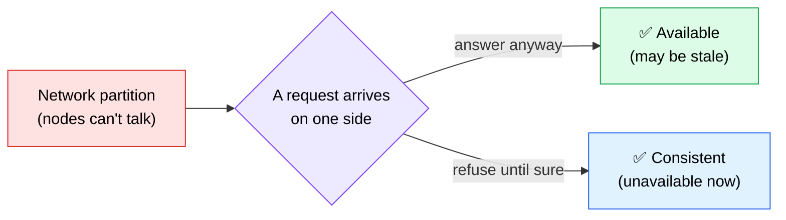
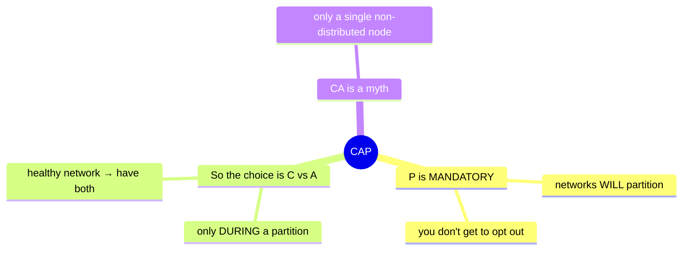
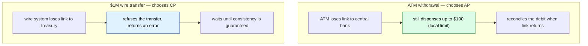
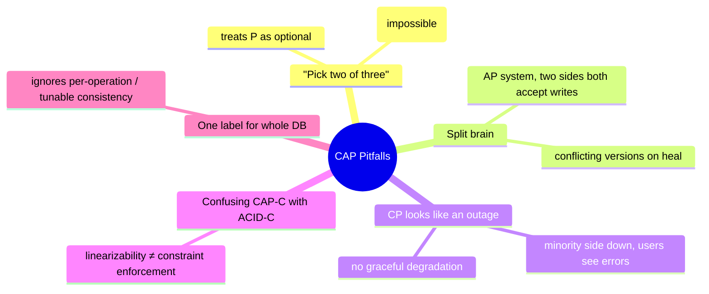

# CAP Theorem

> **One line:** When the network splits and two parts of your system can't talk, you can either keep answering (and risk returning stale data) or stay correct (and refuse to answer) — you cannot do both, so CAP is the choice every distributed database is forced to make.

---

## Table of Contents
1. [Why You Must Master This](#1-why-you-must-master-this)
2. [The Mental Model](#2-the-mental-model)
3. [The Three Properties — and Why P Is Mandatory](#3-the-three-properties--and-why-p-is-mandatory)
4. [CP vs AP — The Real Choice](#4-cp-vs-ap--the-real-choice)
5. [The Nuances Interviewers Probe](#5-the-nuances-interviewers-probe)
6. [Worked Example — ATM vs Bank Wire](#6-worked-example--atm-vs-bank-wire)
7. [Real-Life Use Cases](#7-real-life-use-cases)
8. [Failure Modes](#8-failure-modes)
9. [🏋️ Practice Drills](#-practice-drills)
10. [🎤 Interview Q&A Bank](#-interview-qa-bank)
11. [🎯 Staff+ Nuances](#-staff-nuances)
12. [Cheat Sheet](#12-cheat-sheet)
13. [Connections & Further Reading](#13-connections--further-reading)

---

## 1. Why You Must Master This

CAP is the physics of distributed systems — it tells you what is *impossible*, so you stop trying to build a system that can't exist and start making the trade-off on purpose.

- **It prevents an impossible design.** "Perfectly consistent *and* always available across a network" cannot be built, because the network *will* partition. Knowing this up front saves you from architecting toward a mirage.
- **It's the lens for evaluating every database.** MongoDB, Cassandra, HBase, DynamoDB, Spanner — each sits somewhere on the CAP map. "Is this CP or AP?" is the first question to ask of any distributed store.
- **It forces an intentional sacrifice.** Professional engineering is choosing trade-offs deliberately. CAP makes you answer: "when the network breaks, do I want this data to be *correct* or *available*?" — a decision you'd otherwise make by accident.
- **The nuance is the interview signal.** Reciting "pick two of three" is the trap answer. Understanding that P is mandatory, that the choice is really CP-vs-AP *during a partition only*, and that it's per-operation and tunable — that's the senior signal.

> **The core problem it solves:** *the network partition dilemma.* When a node can't reach its peers, it faces an unavoidable fork — respond with data that might be stale (choose availability) or refuse to respond until it can guarantee correctness (choose consistency). CAP names this fork and says you must pick a side.

---

## 2. The Mental Model

Picture a **wedding with the kitchen and the waitstaff in separate rooms**, and the phone line between them just went dead (the partition):

- A guest asks a waiter, "is the fish still available?"
- **Choose Consistency (CP):** the waiter says "I can't confirm right now" and *refuses to answer* until the line is back — never wrong, but temporarily unavailable.
- **Choose Availability (AP):** the waiter answers "yes, fish is available!" from *stale* memory — always answers, but might be wrong (the kitchen just ran out).

You literally cannot have the waiter be both *always answering* and *always correct* while the phone line is dead. That dead line is the partition, and it's not optional — phone lines (networks) fail. So the only real question is *which way the waiter behaves when they do*.





---

## 3. The Three Properties — and Why P Is Mandatory

| Letter | Property | Precise meaning |
|--------|----------|-----------------|
| **C** | Consistency (linearizability) | Every read returns the most recent committed write, or an error — the system behaves as if there's one copy |
| **A** | Availability | Every request receives a non-error response — *without* the guarantee it's the latest data |
| **P** | Partition tolerance | The system keeps operating even when the network drops/delays messages between nodes |

The theorem's real content is subtler than "pick 2 of 3." In any *distributed* (multi-node, networked) system, **partitions are a fact of nature** — cables get cut, switches fail, packets drop. You don't get to *choose* P; the network imposes it on you. So:

- **P is not optional.** You must tolerate partitions or your system falls apart the moment one occurs.
- **Therefore the only genuine choice is C vs A — and only *during* a partition.** When the network is healthy, you can have both C and A. The trade-off is a *knife-edge* that appears only while a partition is active.
- **"CA" is a myth for distributed systems.** A "CA" system is one that gives up partition tolerance — which only makes sense for a *single node* (no network to partition). The instant you distribute, CA is off the table.



---

## 4. CP vs AP — The Real Choice

During a partition, each side must decide: keep serving, or stay correct.

| | **CP** (Consistency + Partition tolerance) | **AP** (Availability + Partition tolerance) |
|---|---|---|
| **During partition** | Minority side refuses writes/reads (errors or blocks) | All sides keep serving from local state |
| **Guarantee** | Never returns stale/wrong data | Always returns *an* answer |
| **Risk** | Temporary unavailability (looks like an outage) | Stale reads; conflicting writes to reconcile later |
| **Examples** | HBase, MongoDB (default), Zookeeper, etcd, Spanner | Cassandra, DynamoDB, Riak, CouchDB |
| **Use for** | Money, inventory, config, distributed locks, leader election | Feeds, carts, like counts, presence, recommendations |


**CP** says: *"I'd rather be down than wrong."* A minority partition stops accepting operations it can't guarantee are correct. To the user this can look like an outage — but the data is never inconsistent. Right for balances, inventory, and coordination primitives.

**AP** says: *"I'd rather be wrong for a moment than down."* Every node keeps answering from whatever it last knew, and conflicts are reconciled once the partition heals (via [the strategies BASE uses](./BASE_Philosophy.md) — LWW, vector clocks, CRDTs). Right for feeds and counts where staleness is invisible.

---

## 5. The Nuances Interviewers Probe

The definitions are the floor. These distinctions are what separate a memorized answer from an operator's understanding:

- **The trade only exists *during* a partition.** With a healthy network, a well-designed system delivers both consistency and availability. CAP is not a permanent tax — it's a *contingency* choice. This is exactly the gap [PACELC](./PACELC_Theorem.md) fills: **E**lse (no partition), you *still* trade **L**atency vs **C**onsistency on every request.
- **It's per-operation, not per-database.** Many systems let you choose *per request*. Cassandra's tunable consistency and DynamoDB's "strongly consistent read" flag mean the *same store* can be CP for one query and AP for another. Labeling a whole database "AP" is a simplification.
- **Consistency and availability are spectra, not switches.** "Consistency" in CAP means *linearizability* (the strongest form); weaker models (causal, read-your-writes) sit in between (see [Consistency Models](./Consistency_Models.md)). "Available" has degrees too — a 500ms-degraded response is different from a hard error.
- **Quorums make the dial concrete.** With N replicas, requiring `R + W > N` (read quorum + write quorum exceed replica count) guarantees a read overlaps the latest write — tunable consistency. Set `W=N, R=1` for fast reads / slow strong writes; `R=W=quorum` for balance. This is the mechanism *underneath* the CP/AP label.

> **The habit:** never answer CAP with "pick two." Answer: "P is mandatory, so during a partition I choose C or A *per operation* based on whether stale data is an incident — and PACELC reminds me I'm also trading latency for consistency even when there's no partition."

---

## 6. Worked Example — ATM vs Bank Wire

**The prompt:** "Two banking operations, same institution — why does one choose AP and the other CP?"

Same domain (money!), opposite CAP choices, because the *cost of being wrong* differs.



**Closing the loop — why the same business picks differently:**
- **ATM = AP.** During a partition it keeps serving, capped at a small local limit ($100). The worst case — a customer overdraws by $100 before reconciliation — is a *bounded, acceptable* loss the bank prices in. Availability (a working ATM) is worth more than perfect consistency for a small withdrawal.
- **Wire = CP.** During a partition it refuses. The worst case of being wrong — a $1M transfer based on stale balance data — is *catastrophic and unbounded*. So it chooses to be unavailable rather than risk incorrectness. Consistency wins because the cost of error is enormous.

**The consequence:** the CAP choice is driven by the **blast radius of a stale answer**, not by the domain. Small, bounded, reversible error → lean AP for availability. Large, unbounded, irreversible error → lean CP for correctness. This is the reasoning template to apply to any "C or A?" question.

---

## 7. Real-Life Use Cases

| Situation | CAP choice and why |
|-----------|--------------------|
| **Distributed lock / leader election** (Zookeeper, etcd) | CP — two leaders (split brain) is catastrophic; better to have no leader than two. |
| **Shopping cart** (DynamoDB) | AP — always let the user add to cart; reconcile conflicting versions at checkout. |
| **Bank ledger / wire transfer** | CP — a stale balance can move real money; refuse rather than risk it. |
| **Social feed / like count** | AP — a stale count is invisible; availability and latency win. |
| **Inventory for "last item"** | CP — overselling the last unit is a real cost; block rather than double-sell. |
| **DNS** | AP — famously available and eventually consistent; a stale record for seconds is fine. |
| **Config / service discovery** | CP — serving stale config can route traffic wrong; consistency matters. |

> **The habit:** for each datastore in a design, state its CAP posture out loud and tie it to the cost of a stale read. "This is CP because a wrong answer here moves money" is a complete justification.

---

## 8. Failure Modes



- **"Pick two of three."** Symptom: someone proposes a CA distributed system. *Fix:* P is mandatory in any networked system; the real choice is C vs A during a partition. CA describes only a single node.
- **Split brain (AP).** Symptom: after a partition heals, two sides have conflicting writes to the same key. Cause: both sides kept accepting writes. *Fix:* a conflict-resolution strategy decided in advance — quorums to prevent it, or CRDTs/vector clocks to merge it (see [BASE](./BASE_Philosophy.md)).
- **CP outage surprise.** Symptom: a partition takes down the minority side and users get errors, unexpectedly. Cause: CP means unavailability by design. *Fix:* it's a deliberate trade — but pair it with graceful degradation (read-only mode, cached responses) so "consistent" doesn't mean "blank screen."
- **Confusing the two "C"s.** Symptom: muddled reasoning mixing CAP and ACID. *Fix:* CAP-C is linearizability across nodes; [ACID](./ACID_Properties.md)-C is invariant enforcement on one node. Different guarantees.
- **Labeling a whole database with one letter.** Symptom: "we use Cassandra so we're AP" ignoring that reads/writes are tunable. *Fix:* reason per operation — the same store can be CP for a quorum read and AP for a `ONE` read.

---

## 🏋️ Practice Drills

> *Cover the solutions and attempt first — active recall is the point.*

**Drill 1 — CP or AP?** For each, choose and justify in one line: (a) a distributed lock service; (b) a social media "trending" list; (c) a seat-reservation system for a concert; (d) DNS.

<details><summary>Solution</summary>

(a) **CP** — a lock exists to guarantee mutual exclusion. If a partition let both sides grant the lock (split brain), two processes act as if they hold it exclusively — corruption. Better to grant no lock than two.

(b) **AP** — a trending list that's a few seconds stale or slightly different per region is completely acceptable; availability and low latency matter far more than exactness.

(c) **CP** — selling the same seat twice is a real, customer-facing failure. During a partition, block reservations you can't confirm rather than risk double-booking.

(d) **AP** — DNS is the textbook AP system: highly available, eventually consistent. A record that's stale for the TTL window is fine, and global availability is paramount.
</details>

**Drill 2 — Debunk "CA."** A candidate says "we'll build a CA system — consistent and available, we just won't worry about partitions." What's wrong, and what are they probably describing?

<details><summary>Solution</summary>

You can't *choose* to not have partitions in a distributed system — the network will drop or delay messages whether you plan for it or not. "Not worrying about partitions" doesn't make them stop happening; it just means the system behaves undefined (likely badly) when one occurs. So "CA" isn't a design choice you can make for a networked system.

What they're probably describing:
- **A single-node database** (one Postgres instance): there's no network *between nodes* to partition, so CA is trivially true — but it's not distributed, and it doesn't scale horizontally or tolerate that node dying.
- Or, more charitably, a system that's **CP or AP but happens to be C-and-A when the network is healthy** — which is every well-designed distributed system. The CAP trade only bites *during* a partition (which is exactly PACELC's point).

The correct framing: pick CP or AP for partition behavior; enjoy both C and A the rest of the time.
</details>

**Drill 3 — Tune the quorum.** You run a datastore with N=3 replicas and tunable consistency (choose R and W). Give the R/W settings for: (a) strong consistency; (b) fastest possible reads; (c) surviving one node down while staying strongly consistent.

<details><summary>Solution</summary>

The rule for strong consistency is **R + W > N** (the read set and write set must overlap by at least one replica, guaranteeing a read sees the latest write). With N=3:

(a) **Strong consistency:** any R + W > 3. Common balanced choice: **R=2, W=2** (2+2=4 > 3). A read quorum always overlaps a write quorum.

(b) **Fastest reads:** **R=1** (read from the nearest single replica, no waiting). To keep it *correct*, pair with **W=3** (write to all), so R+W = 4 > 3 — but now writes are slow and fail if any node is down. If you don't need strong consistency, **R=1, W=1** is fastest overall but eventual.

(c) **One node down + strong:** **R=2, W=2**. With 3 nodes, a quorum of 2 is reachable even with 1 node down, and 2+2 > 3 keeps reads and writes overlapping. This is why quorum = majority is the standard resilient setting.

The point: CP/AP isn't a fixed label — R and W let you *tune* where on the spectrum each operation sits.
</details>

---

## 🎤 Interview Q&A Bank

**Q1. "Explain the CAP theorem."** *(signal: do they say "pick two"?)*
> In a distributed system you can't simultaneously guarantee consistency (every read sees the latest write) and availability (every request gets a response) when a network partition occurs. Since partitions are unavoidable in any networked system, P isn't optional — so the real choice is C versus A, and only *during* a partition. When the network is healthy you can have both.

**Q2. "Can you build a CA system?"**
> Only on a single node, which isn't distributed. Any multi-node system connected by a network will experience partitions, so you can't opt out of P. "CA" describes a single database instance where there's no inter-node network to split — the moment you distribute, you're choosing CP or AP.

**Q3. "Is the 'C' in CAP the same as in ACID?"** *(signal: precision)*
> No. CAP's C is linearizability — every node agrees on the latest value, as if there were one copy. ACID's C is that a transaction preserves declared invariants (constraints, foreign keys) on a single database. One is cross-node agreement; the other is single-node correctness rules.

**Q4. "Give me a CP database and an AP database and when you'd use each."**
> CP: Zookeeper/etcd for coordination and leader election — you never want split brain, so it refuses rather than risk two leaders. AP: Cassandra or DynamoDB for feeds, carts, and counts — always available, reconcile later. Rule of thumb: CP when a stale answer moves money or breaks coordination; AP when staleness is invisible to the user.

**Q5. "The CAP trade only happens during a partition — so what about the rest of the time?"** *(signal: knows PACELC)*
> That's exactly what PACELC adds. If Partition, then Consistency-vs-Availability (CAP). Else (normal operation), you still trade Latency-vs-Consistency on every request — because strong consistency requires cross-node coordination that costs milliseconds. So even a healthy system is constantly making a consistency trade; CAP only describes the partition case.

**Q6. "How does a quorum let you tune the CAP choice?"**
> With N replicas, you pick how many must acknowledge a write (W) and respond to a read (R). If R + W > N, every read is guaranteed to overlap the latest write — strong consistency. Lower R for faster reads, lower W for faster writes, at the cost of possible staleness. So CP-vs-AP isn't a fixed label; it's a per-operation dial set by R and W.

**Q7. "During a partition, an AP system kept taking writes on both sides. What happens when it heals?"**
> You get conflicting versions of the same data — split brain — and must reconcile them. Strategies: last-write-wins (simple, loses an edit), vector clocks (detect and surface both versions), or CRDTs (merge deterministically). The critical part is deciding the strategy *before* the conflict; an AP system without a reconciliation plan silently loses or corrupts data.

---

## 🎯 Staff+ Nuances

- **CAP is a knife-edge, PACELC is the whole blade.** CAP only describes behavior *during* a partition — a rare event. [PACELC](./PACELC_Theorem.md) captures the trade you make on *every single request*: even with no partition, choosing strong consistency means paying coordination latency. Reasoning only about CAP ignores the cost you pay 99.9% of the time.
- **"Consistency" in CAP is specifically linearizability — the strongest rung.** Real systems rarely need it everywhere. A system can be "not CAP-consistent" yet perfectly correct for its use case by using causal or read-your-writes consistency ([Consistency Models](./Consistency_Models.md)). Treating CAP's binary C as the only kind of consistency leads to over-engineering toward linearizability where causal would do.
- **The choice is per-operation, and the best systems expose the dial.** DynamoDB lets you flag a read "strongly consistent"; Cassandra sets consistency level per query; MongoDB has read/write concerns. A blanket "we're an AP shop" is a design smell — the interesting systems make the CAP posture a property of each *operation*, matched to that operation's cost-of-staleness.
- **Split brain is the failure that makes CP worth its unavailability.** For coordination primitives (locks, leader election, config), two divergent truths is catastrophic in a way that dwarfs downtime — a second leader can corrupt everything. This is why consensus systems (Raft/Paxos behind etcd/Zookeeper) deliberately choose CP: they refuse to make progress without a majority, precisely to make split brain impossible.
- **"CP looks like an outage" must be designed around, not just accepted.** A CP system going unavailable on the minority side during a partition is *correct*, but a raw error page is poor engineering. Graceful degradation — read-only mode, serving cached/last-known data with a staleness banner, failing over to the majority — turns "consistent but down" into "consistent and gracefully limited." The trade-off is real; the UX cliff is optional.
- **Modern NewSQL blurs the line by shrinking the partition window.** Spanner is CP, but with TrueTime and redundant global networking, partitions are so rare and brief that it achieves ~5 nines of availability *while* being strongly consistent. CAP still holds (during a partition it chooses C), but engineering the partition probability toward zero makes the "CP tax" nearly invisible — a reminder that CAP bounds the *worst case*, not the *common case*.

---

## 12. Cheat Sheet

```
CAP THEOREM — DURING A PARTITION, CHOOSE CONSISTENCY OR AVAILABILITY
═══════════════════════════════════════════════════════════════════

THE THREE
  C  Consistency (linearizability)  every read = latest write, or error
  A  Availability                   every request gets a (non-error) response
  P  Partition tolerance            keeps working when the network splits

THE REAL RULE (not "pick 2 of 3")
  • P is MANDATORY — networks WILL partition, you can't opt out
  • So the choice is C vs A — and ONLY during a partition
  • Healthy network → you get BOTH C and A
  • "CA" = single non-distributed node ONLY. A myth for distributed systems.

CP  "rather down than wrong"        AP  "rather wrong than down"
  minority side refuses/errors        all sides answer (maybe stale)
  never stale                         reconcile conflicts on heal
  HBase, Mongo(default), Zookeeper,   Cassandra, DynamoDB, Riak,
  etcd, Spanner                       CouchDB, DNS
  → money, inventory, locks, config   → feeds, carts, counts, presence

DECIDE BY: blast radius of a STALE answer
  small/bounded/reversible → AP        large/unbounded/irreversible → CP

⚠ CAP-C (linearizability across nodes) ≠ ACID-C (invariants on one node)

TUNE IT WITH QUORUMS (N replicas)
  R + W > N  → strong consistency (read overlaps latest write)
  N=3: R=2,W=2 balanced & survives 1 node down · R=1,W=1 fast but eventual

⚠ CAP is only the partition case. PACELC: Else, trade Latency vs Consistency
  on EVERY request. Reason per-OPERATION, not per-database.
```

---

## 13. Connections & Further Reading

**Within this repo:**
- [PACELC_Theorem.md](./PACELC_Theorem.md) — the essential extension: latency-vs-consistency even with no partition.
- [Consistency_Models.md](./Consistency_Models.md) — the spectrum between CAP's linearizable C and eventual.
- [BASE_Philosophy.md](./BASE_Philosophy.md) — the AP corner made operational, plus conflict resolution.
- [ACID_Properties.md](./ACID_Properties.md) — the CP-leaning contract, and the *other* meaning of "C."
- [Replication.md](./Replication.md) — the multi-copy mechanism that creates the partition dilemma in the first place.
- [Distributed_Transactions.md](./Distributed_Transactions.md) — coordinating correctness across the nodes CAP describes.

**External classics:**
- *Brewer's Conjecture and the Feasibility of Consistent, Available, Partition-Tolerant Web Services* (Gilbert & Lynch, 2002) — the formal proof.
- [*CAP Twelve Years Later*](https://www.infoq.com/articles/cap-twelve-years-later-how-the-rules-have-changed/) (Eric Brewer) — the author's own "it's not so binary" retrospective.
- [Jepsen](https://jepsen.io/consistency) — empirical testing of what databases *actually* guarantee under partition.

---

## TL;DR
**When a network partition splits your distributed system, you must choose: keep answering with possibly-stale data (AP) or stay correct by refusing to answer (CP) — you cannot have both, and since partitions are unavoidable, P is not a choice.** So "pick two of three" is the wrong framing; the real content is that the C-vs-A trade appears *only during a partition* and is best decided *per operation* by the blast radius of a stale answer — small and reversible leans AP, large and irreversible leans CP. Quorums (`R + W > N`) let you tune the dial, CAP-C (linearizability) is not ACID-C, and **PACELC completes the picture: even with no partition, every request still trades latency for consistency.**
