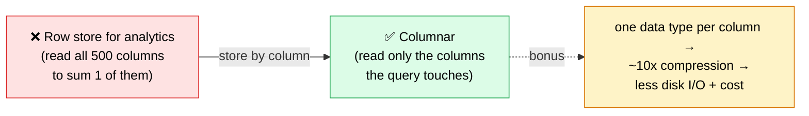
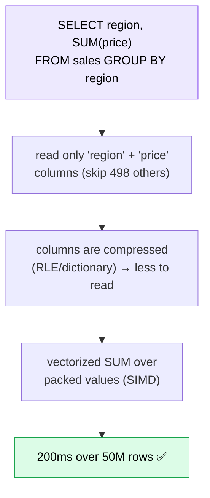
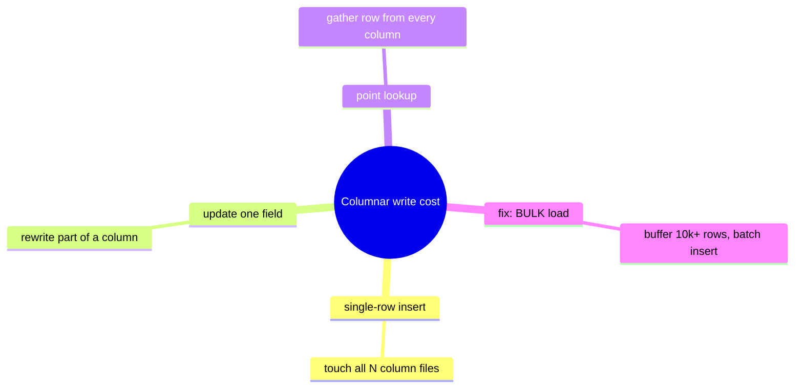
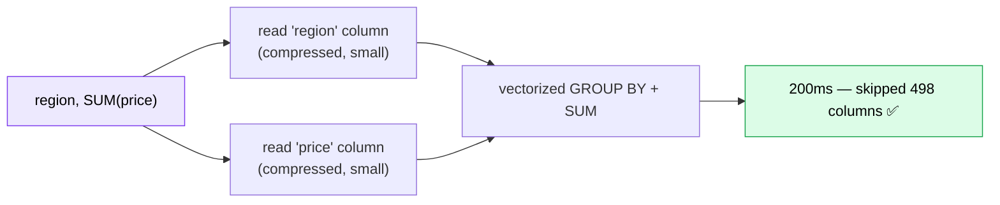
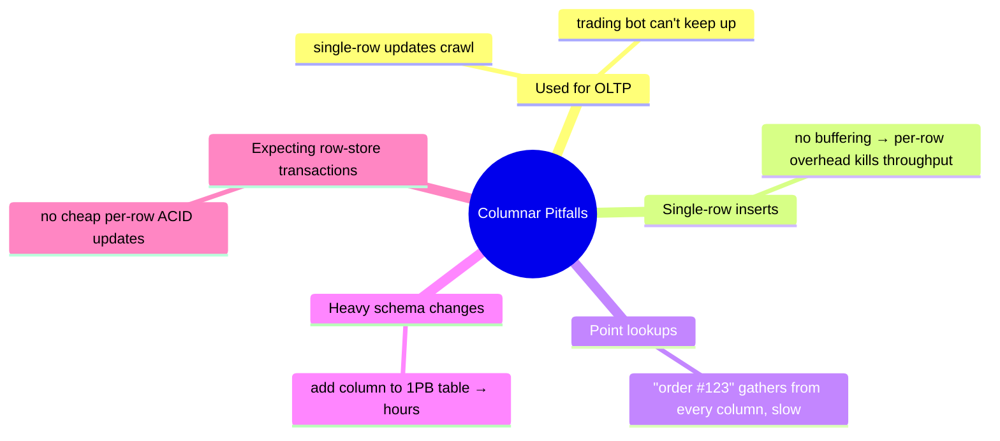

# Columnar Databases

> **One line:** A columnar database stores each *column* contiguously instead of each *row*, so an analytical query that touches 2 of 500 columns reads only those 2 off disk — and because a column is all one data type, it compresses ~10×, which is why the same aggregate that takes an hour in Postgres takes a second in BigQuery.

---

## Table of Contents
1. [Why You Must Master This](#1-why-you-must-master-this)
2. [The Mental Model](#2-the-mental-model)
3. [Row vs Columnar Layout](#3-row-vs-columnar-layout)
4. [Why It's Fast — I/O, Compression, Vectorization](#4-why-its-fast--io-compression-vectorization)
5. [The Trade-off — Why Writes Are Terrible](#5-the-trade-off--why-writes-are-terrible)
6. [Worked Example — Revenue by Region](#6-worked-example--revenue-by-region)
7. [Real-Life Use Cases](#7-real-life-use-cases)
8. [Failure Modes](#8-failure-modes)
9. [🏋️ Practice Drills](#-practice-drills)
10. [🎤 Interview Q&A Bank](#-interview-qa-bank)
11. [🎯 Staff+ Nuances](#-staff-nuances)
12. [Cheat Sheet](#12-cheat-sheet)
13. [Connections & Further Reading](#13-connections--further-reading)

---

## 1. Why You Must Master This

Columnar storage is the single technical reason analytics at scale is even possible — it's why a BI dashboard over 50M rows returns in 200ms instead of timing out. Understanding it is understanding the OLAP/OLTP split that shapes every data architecture.

- **It's the OLAP speed king.** The same `SUM(price) GROUP BY region` over a billion rows can take an hour on row-based Postgres and a second on columnar BigQuery/ClickHouse. That's not tuning — it's a fundamentally different storage layout matched to a different query shape.
- **It turns compression into money.** Because a column holds one data type ("USA" 5,000 times, all timestamps, all prices), it compresses 10× better than mixed-type rows — slashing both storage cost and the disk I/O that dominates analytical query time.
- **It's the wrong tool for OLTP, and knowing the line matters.** Columnar is catastrophic for single-row updates (order placement, chat, profile edits). The senior skill is recognizing "this is analytics → columnar" vs "this is transactions → row-based" instantly.
- **It's a guaranteed data-architecture interview.** "Why is Snowflake faster than Postgres for a dashboard?" has one right answer — columnar storage — and the follow-up is *why*: I/O reduction, compression, vectorization.

> **The core problem it solves:** *wasted I/O on analytical scans.* An aggregate query needs a few columns over many rows, but a row store must read *entire rows* — every unused column — off disk to get them. Columnar stores each column separately so the query reads only the columns it references, skipping the rest of the disk entirely.

---

## 2. The Mental Model

Two ways to record a shopping trip:

- **Row-based = a stack of grocery receipts.** Each receipt (row) has everything about one purchase: `[Apple, $1, Red]`. To total all prices, you pick up *every* receipt and read past "Apple" and "Red" to find the "$1" — you touch all the data even though you wanted one field.
- **Columnar = itemized ledger sheets.** One sheet lists all items `[Apple, Pear]`, another all prices `[$1, $2]`, another all colors `[Red, Green]`. To total prices, you grab *only the prices sheet* — you never even look at the items or colors.

That's the whole idea: store together what you *query together*. Analytics queries scan one column across all rows, so storing columns contiguously means reading exactly what's needed and nothing else.





---

## 3. Row vs Columnar Layout

The difference is purely *what sits next to what on disk:*

```
Table:  id | name  | price | country

ROW-BASED (OLTP):   1,Alice,$40,US | 2,Bob,$12,US | 3,Cara,$99,UK
                    └── one row contiguous ──┘   (whole record together)

COLUMNAR (OLAP):    id:      1,2,3
                    name:    Alice,Bob,Cara
                    price:   $40,$12,$99        ← SUM(price) reads ONLY this
                    country: US,US,UK
                    └── one column contiguous ──┘
```

| Aspect | Row-based | Columnar |
|--------|-----------|----------|
| **Stored together** | All fields of a row | All values of a column |
| **Best query** | "Get/update everything about row X" | "Aggregate column Y over all rows" |
| **Read one row** | Fast (one seek) | Slow (gather from every column file) |
| **Aggregate one column** | Slow (reads all columns) | Fast (reads one column) |
| **Compression** | Poor (mixed types per block) | Excellent (uniform type per column) |
| **Workload** | OLTP (transactions) | OLAP (analytics) |

This maps directly onto the **OLTP vs OLAP** divide: transactional systems (place an order, edit a profile) touch *whole rows* one at a time → row-based; analytical systems (revenue by region, DAU trends) *aggregate columns* over millions of rows → columnar.

---

## 4. Why It's Fast — I/O, Compression, Vectorization

Three compounding effects, and naming all three is the signal:

1. **Reduced I/O (the biggest win).** Analytical query time is dominated by *reading data off disk*. A query referencing 2 of 500 columns reads ~0.4% of the table in a columnar store, versus 100% in a row store. Skipping 99.6% of the disk is the headline speedup.

2. **Superior compression.** Since a column is homogeneous (all timestamps, all country codes), it compresses far better than mixed-type rows:
   - **Run-length encoding (RLE):** `USA` repeated 5,000 times → store `(USA, 5000)`. Near-zero space.
   - **Dictionary encoding:** map distinct values to small integers (`US→0, UK→1`) and store the integers.
   - Better compression means *even less* data to read from disk — compounding win #1 — plus 60–90% storage cost savings.

3. **Vectorized execution.** Because a column's values are packed contiguously in memory, the CPU processes them in *batches* (SIMD) — computing `price * quantity` for 1,000 rows in a few instructions instead of one row at a time. Row stores, jumping between fields, can't vectorize as effectively.



---

## 5. The Trade-off — Why Writes Are Terrible

Everything that makes columnar fast for analytics makes it awful for transactions:

- **Single-row insert/update is expensive.** A row lives *scattered across every column file*. Inserting one order means appending to 500 separate column structures; updating one field means rewriting part of a column. What's one cheap write in a row store becomes many in a columnar store.
- **Point lookups are slow.** "Get all details for order #123" must gather that row's value from every column — the opposite of what columnar optimizes. Row stores do this in one seek.
- **It demands bulk, buffered writes.** Columnar stores *hate* single-row inserts; you buffer and load in large batches (10k+ rows) so the per-row overhead amortizes. This is why analytics pipelines are batch/micro-batch, not row-at-a-time.
- **Schema changes on huge tables are heavy.** Adding a column to a petabyte table can take hours of reorganization.



> **The rule:** columnar = read-optimized for analytics. **Never** use it for OLTP — user updates, order placement, chat messages are all individual-row operations that belong in a [row-based](./Relational_vs_NoSQL.md) store. The two coexist: OLTP row store as system of record, columnar warehouse for analytics, with data flowing OLTP→columnar via [ETL/CDC](./Data_Warehousing_Data_Lakes.md).

---

## 6. Worked Example — Revenue by Region

**The prompt:** "A BI dashboard runs `SELECT region, SUM(price) FROM sales GROUP BY region` on a 50M-row, 500-column sales table. It's timing out on Postgres. Why, and what fixes it?"

**Why Postgres (row-based) is slow:**
- The query needs only `region` and `price`, but a row store keeps all 500 columns of each sale *contiguous*. To read `price` for a row, it pulls the *entire 500-column record* off disk.
- Over 50M rows that's reading essentially the whole table — gigabytes of user info, product info, shipping info the query never uses. The time is almost all **I/O wait**.

**On a columnar store (ClickHouse / BigQuery / Snowflake):**



**Closing the loop — number → consequence:**
- It reads **2 of 500 columns** — ~0.4% of the table's data — skipping 99.6% of the disk. I/O drops by orders of magnitude.
- Those two columns are **compressed** (region via dictionary/RLE, price packed), so even that 0.4% is smaller to read.
- The `SUM`/`GROUP BY` runs **vectorized** over the packed price values.
- Result: **hour → ~200ms.** No amount of Postgres index tuning matches this, because the bottleneck was the *row layout* forcing whole-record reads, not a missing index.

**The consequence:** the fix isn't optimizing the OLTP database — it's recognizing this is an *analytical* query and routing it to a store whose *layout matches the query shape*. That "columnar for OLAP, row for OLTP" recognition is the entire lesson, and it's why the sales data lands in both a transactional store (to record sales) and a columnar warehouse (to analyze them).

---

## 7. Real-Life Use Cases

| Situation | Columnar or row, and why |
|-----------|--------------------------|
| **BI dashboards / reporting** | Columnar (Snowflake, BigQuery, Redshift) — aggregate few columns over many rows. |
| **Product analytics / clickstream** | Columnar (ClickHouse) — huge event tables, aggregate queries, bulk ingest. |
| **Data lake analytics** | Columnar file formats (Parquet, ORC) — bring columnar benefits to object storage. |
| **Time-series / metrics at scale** | Columnar-leaning (ClickHouse, Druid) — scan/aggregate over time windows. |
| **Order placement / user profile edit** | **Row-based** (Postgres, MySQL) — single-row read/write; columnar would be terrible. |
| **Chat messages / OLTP writes** | **Row-based** — individual-row operations, high write rate. |
| **Real-time trading writes** | **Row-based / in-memory** — columnar write latency can't keep up. |

> **The habit:** classify the workload first — "aggregate columns over many rows" → columnar; "read/write whole rows one at a time" → row-based. The data often lives in *both*, connected by a pipeline.

---

## 8. Failure Modes



- **Using columnar for OLTP.** Symptom: a high-frequency write path (trading, chat) can't keep up; single-row updates crawl. Cause: each write touches every column file. *Fix:* row-based store for the transactional path; columnar only for analytics downstream.
- **Single-row inserts.** Symptom: ingest throughput far below expectations. Cause: feeding one row at a time. *Fix:* buffer and bulk-load (10k+ rows per batch); use micro-batching in the pipeline.
- **Point lookups.** Symptom: "fetch the full record for X" is slow. Cause: the row must be reassembled from every column. *Fix:* don't use columnar for row-retrieval workloads; keep those in the OLTP store.
- **Schema changes on huge tables.** Symptom: adding a column takes hours. *Fix:* plan schema evolution; some formats (Parquet) handle additive schema changes more gracefully than others.
- **Expecting transactional semantics.** Symptom: relying on cheap per-row ACID updates. *Fix:* columnar warehouses are append/bulk-oriented; model updates as inserts + versioning, not in-place edits.

---

## 🏋️ Practice Drills

> *Cover the solutions and attempt first — active recall is the point.*

**Drill 1 — Row or columnar?** For each, choose the storage layout: (a) recording a new order at checkout; (b) "average order value by month for the last 3 years"; (c) fetching one user's full profile to render their settings page; (d) counting daily active users across a 2-billion-row events table.

<details><summary>Solution</summary>

(a) **Row-based** — a single-row insert of a whole order record; OLTP. Columnar would scatter the write across every column file.

(b) **Columnar** — an aggregation (`AVG`) over a few columns (`amount`, `date`) across millions of rows; classic OLAP where reading only those columns is the win.

(c) **Row-based** — a point lookup retrieving *all* columns of one row. Columnar would have to gather that row from every column file — the worst case for it.

(d) **Columnar** — aggregate/count over one or two columns across billions of rows. Reading only the needed columns and vectorizing the count is exactly columnar's strength.

Pattern: whole-row read/write → row; aggregate-a-few-columns-over-many-rows → columnar.
</details>

**Drill 2 — Explain the compression.** Why does a `country` column with values like "US, US, US, UK, US, UK…" compress dramatically better in a columnar store than the same data in a row store? Name the techniques.

<details><summary>Solution</summary>

**Because a column is homogeneous — all values are the same type and often highly repetitive — while a row store interleaves it with unrelated types.**

In a row store, `country` values are scattered between `id`, `name`, `price`, etc., so a disk block contains mixed types (integers, strings, decimals) with little local redundancy — general-purpose compression finds few patterns.

In a columnar store, all `country` values sit contiguously, so you can apply specialized encodings:
- **Run-length encoding (RLE):** "US" appearing 5,000 times in a row is stored as `(US, 5000)` — near-zero space.
- **Dictionary encoding:** map the few distinct values to small integers (`US→0, UK→1`) and store a compact stream of integers instead of repeated strings.
- **Bit-packing / delta encoding** for numeric columns (e.g. sorted IDs stored as small deltas).

The result is often 10× better compression, which *compounds* the I/O win — there's less compressed data to read *and* only the needed columns are read. Better compression → less disk I/O → faster analytical queries, on top of the storage-cost savings.
</details>

**Drill 3 — The timing-out dashboard.** A dashboard query on Postgres over a wide sales table times out. A colleague suggests adding more indexes. Why won't indexes fully fix it, and what will?

<details><summary>Solution</summary>

**Indexes help find *rows*, but this query's cost is reading *all the columns of many rows*, which the row layout forces regardless of indexing.**

An index on `region` can quickly locate the matching rows, but the query still has to read the `price` value from each of those rows — and in a row store, reading `price` means pulling the entire ~500-column record off disk for every row in the aggregation. If the query aggregates over most of the table (as dashboards do), an index barely helps because you're scanning most rows anyway, and each scanned row drags all 500 columns with it. You're I/O-bound on data the query never uses.

The real fix is a **columnar store** (or a columnar copy of the data): ClickHouse/BigQuery/Snowflake, or exporting the table to **Parquet** in a data lake. Then the query reads only `region` and `price` — a tiny, compressed fraction of the data — and finishes in milliseconds. The root cause is the *storage layout*, not the index; you fix it by matching the layout to the query shape, which usually means routing analytics to a separate columnar warehouse fed from the OLTP database.
</details>

---

## 🎤 Interview Q&A Bank

**Q1. "Why is a columnar database faster for analytics than a row-based one?"**
> Three compounding reasons. First and biggest: I/O — an analytical query touches a few columns, and columnar reads only those, skipping the rest of the disk, while a row store reads whole records. Second: compression — a column is one data type, so run-length and dictionary encoding shrink it ~10×, meaning even less to read. Third: vectorized execution — contiguous same-type values let the CPU batch-process aggregates with SIMD.

**Q2. "Why is Snowflake/BigQuery faster than Postgres for a dashboard?"**
> Columnar storage. The dashboard aggregates a couple of columns over millions of rows; Postgres's row layout forces it to read entire records off disk, so it's I/O-bound on data it doesn't use. Snowflake stores each column separately and compressed, so it reads only the queried columns — orders of magnitude less I/O — and vectorizes the aggregation.

**Q3. "Why are columnar databases bad at writes?"**
> Because a single row is stored scattered across every column's structure. Inserting one row means appending to all N column files, and updating one field means rewriting part of a column — what's a single cheap write in a row store becomes many. They're built for bulk loads, not row-at-a-time OLTP, so you buffer and batch-insert.

**Q4. "What's the difference between OLTP and OLAP, and how does storage map to it?"**
> OLTP is transactional — many small operations reading and writing *whole rows* (place order, update profile) — best served by row-based storage. OLAP is analytical — aggregating *a few columns over many rows* (revenue by region) — best served by columnar storage. The same data often lives in both: a row-based system of record, and a columnar warehouse fed from it for analytics.

**Q5. "What is Parquet and why does it matter?"** *(signal: data lake awareness)*
> Parquet is a columnar file format — it brings columnar storage benefits (per-column reads, compression, encoding) to files in a data lake or object storage, independent of any single database engine. It's the de-facto standard because engines like Spark, Presto, Athena, and BigQuery can all query the same Parquet files efficiently, decoupling storage from compute.

**Q6. "How do you handle the write problem for analytics?"**
> You don't write to the columnar store transactionally — you feed it in bulk. The OLTP row store handles the real-time single-row writes as the system of record, and data flows to the columnar warehouse via batch ETL or streaming CDC, buffered into large batches (micro-batching) so the per-row columnar overhead amortizes. Updates become append + versioning rather than in-place edits.

**Q7. "When would you never use a columnar database?"**
> Any OLTP workload — order placement, user profile updates, chat messages, session state — anything that reads or writes individual whole rows at high frequency. Columnar's per-row write cost and slow point lookups make it the wrong tool; those belong in a row-based store. Columnar is strictly for read-heavy analytical aggregation.

---

## 🎯 Staff+ Nuances

- **I/O reduction and compression compound — that's why the speedup is order-of-magnitude, not incremental.** People cite "reads fewer columns" *or* "compresses well" as if they're alternatives. They multiply: you read only the needed columns *and* those columns are 10× smaller. A 500→2 column reduction × 10× compression is why an hour becomes sub-second, not merely faster.
- **Columnar makes storage and compute separable — the cloud-warehouse revolution.** Because Parquet/ORC files are self-describing columnar data on object storage, compute engines (BigQuery, Snowflake, Athena, Spark) can scale independently of storage and multiple engines can query the same files. This decoupling — not just the layout — is what made elastic, pay-per-query analytics economical. Mentioning "separation of storage and compute" signals you understand the architectural consequence, not just the file format.
- **The write penalty is why the Lambda/Kappa and CDC patterns exist.** You can't serve fresh analytics from a store that hates single-row writes, so real systems keep an OLTP row store for writes and stream changes into the columnar warehouse ([CDC](./Data_Warehousing_Data_Lakes.md)). The "how do we get real-time analytics on a columnar store?" question is really an ingestion-pipeline question — micro-batching, streaming inserts (ClickHouse's async inserts), or a serving layer over recent data.
- **Column-family stores (Cassandra) are NOT columnar databases — a classic conflation.** Cassandra groups columns into families and is a *row-oriented, wide-column* OLTP store optimized for writes (LSM-tree); a columnar OLAP store (ClickHouse, Parquet) physically stores each column separately for scan/aggregate speed. Same "column" word, opposite workload. Getting this distinction right is a strong seniority signal.
- **Sort order and partitioning inside a columnar store are the real tuning levers.** Beyond the layout, how you *sort* and *partition* the data (ClickHouse's `ORDER BY`/primary key, partition pruning by date) determines whether the engine can skip entire data blocks via min/max statistics (zone maps). A columnar store with a bad sort key still scans too much; the layout is necessary but not sufficient.
- **Vectorization interacts with modern CPUs in ways row stores can't exploit.** Packed same-type columns enable SIMD, better cache locality, and branch-free processing. This is why columnar engines keep getting faster with hardware (wider SIMD registers) while row-store scan performance is more constrained — the layout is *designed* for how CPUs actually process bulk data.
- **The "just add an index" instinct fails for aggregations, and knowing why is diagnostic.** An index accelerates *selective* row lookups; a dashboard aggregation touches most rows, so the index barely helps and each row still drags its full width. Recognizing that the problem is *layout* (whole-row reads) not *findability* (missing index) — and that the fix is a columnar copy, not more indexes — separates people who've operated analytics systems from those who've only read about indexes.

---

## 12. Cheat Sheet

```
COLUMNAR DATABASES — STORE BY COLUMN → READ ONLY WHAT THE QUERY TOUCHES
═══════════════════════════════════════════════════════════════════════

LAYOUT
  Row store   [1,Alice,$40,US][2,Bob,$12,US]   whole row contiguous  → OLTP
  Columnar    id:1,2 | name:Alice,Bob | price:$40,$12 | ...          → OLAP
              each column contiguous → read only the columns you need

WHY FAST (3 compounding effects)
  1. I/O      read 2 of 500 columns = skip 99.6% of disk (biggest win)
  2. Compress one type per column → RLE / dictionary → ~10x smaller
  3. Vectorize packed values → SIMD batch SUM/AVG (not row-by-row)
  → hour on Postgres becomes ~200ms on BigQuery

WHY WRITES ARE TERRIBLE
  single row scattered across N column files
  → insert/update one row = touch every column   ✗ OLTP
  → point lookup "order #123" = gather from all columns  (slow)
  → MUST bulk/buffer inserts (10k+ rows), micro-batch ingest

OLTP vs OLAP
  OLTP  whole-row read/write, transactions   → ROW (Postgres, MySQL)
  OLAP  aggregate few cols over many rows     → COLUMNAR (BigQuery,
                                                 Snowflake, Redshift, ClickHouse)
  data lives in BOTH → OLTP row store → (ETL/CDC) → columnar warehouse

FORMATS: Parquet / ORC = columnar files → decouple storage from compute (data lakes)

⚠ Cassandra "column-family" ≠ columnar. It's row-oriented wide-column OLTP (LSM).
GOTCHA: "add an index" won't fix a slow dashboard — the problem is ROW LAYOUT,
        fix = columnar copy of the data.
NEVER use columnar for: user updates, order placement, chat, sessions, trading writes.
```

---

## 13. Connections & Further Reading

**Within this repo:**
- [Data_Warehousing_Data_Lakes.md](./Data_Warehousing_Data_Lakes.md) — warehouses are columnar; this is where analytics data lands.
- [Relational_vs_NoSQL.md](./Relational_vs_NoSQL.md) — the OLTP row-based world columnar complements.
- [Database_Indexing.md](./Database_Indexing.md) — why indexes help point lookups but not full-column aggregations.
- [Database_Normalization_Denormalization.md](./Database_Normalization_Denormalization.md) — analytics deliberately denormalizes into star schemas on columnar stores.
- [Sharding_Partitioning.md](./Sharding_Partitioning.md) — where cross-cutting/fan-out analytical queries belong.

**External classics:**
- [ClickHouse: column-oriented databases](https://clickhouse.com/docs/en/concepts/column-oriented-databases) — clear, concrete explanation with benchmarks.
- [Apache Parquet](https://parquet.apache.org/docs/) — the columnar file format standard.
- *C-Store / MonetDB papers* — the academic origins of modern columnar engines.
- *Designing Data-Intensive Applications* (Kleppmann) — Ch. 3, "Column-Oriented Storage."

---

## TL;DR
**A columnar database stores each column contiguously instead of each row, so an analytical query reads only the columns it references — skipping the rest of the disk — and because a column is one data type it compresses ~10×, which is why the same aggregate is an hour on row-based Postgres and a second on columnar BigQuery.** The speedup compounds three effects: less I/O (read 2 of 500 columns), better compression (RLE/dictionary on uniform data), and vectorized SIMD execution. The flip side is terrible writes — a single row is scattered across every column file — so columnar is strictly for OLAP analytics (bulk-loaded, read-heavy aggregation), never OLTP. **Match the layout to the query shape: row-based for whole-row transactions, columnar for aggregate-over-many-rows analytics — and remember the data usually lives in both, connected by an ETL/CDC pipeline.**
