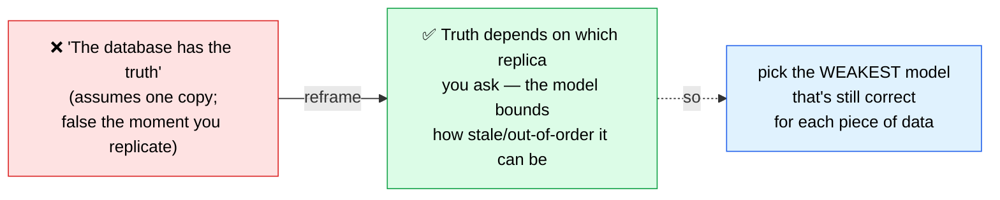
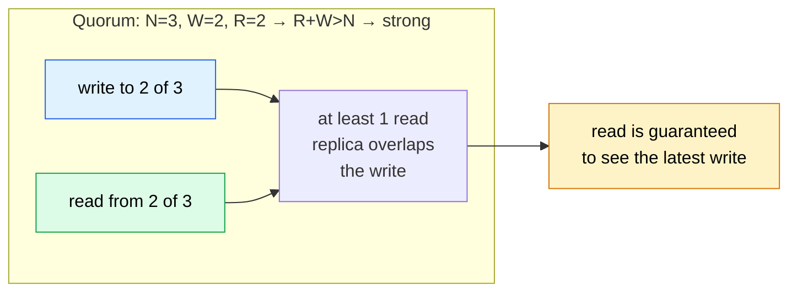
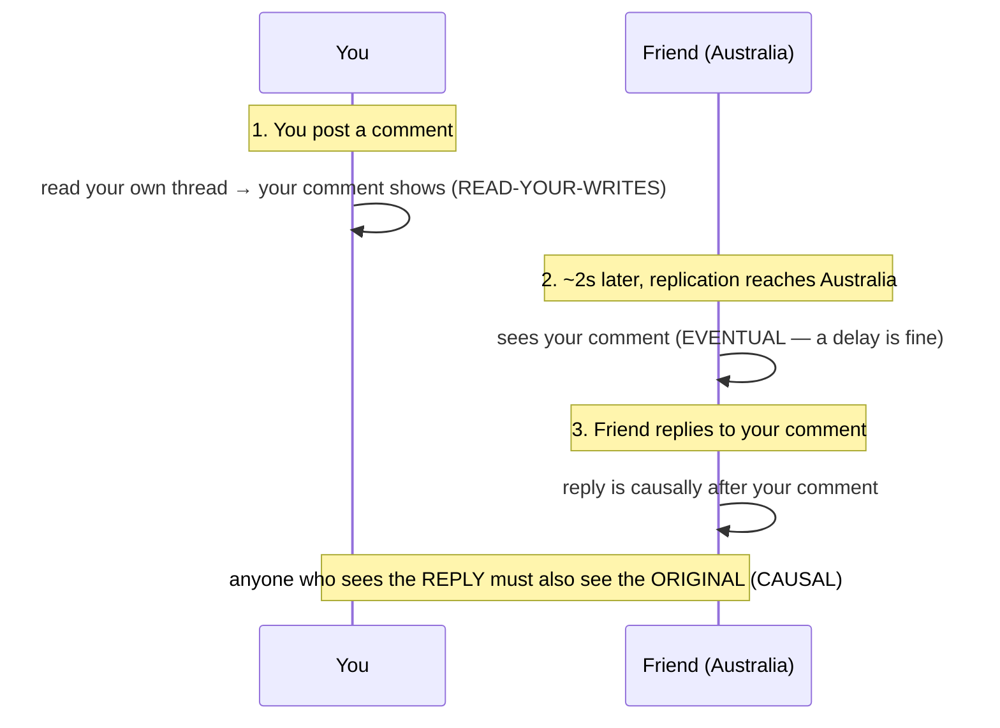
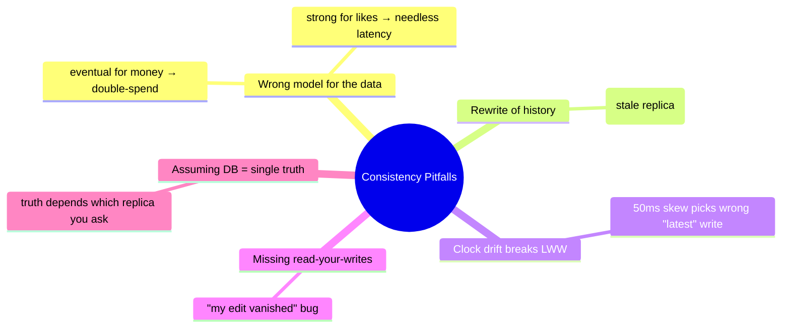

# Consistency Models

> **One line:** In a system with more than one copy of the data, "the truth" depends on which copy you ask — a consistency model is the *contract* that tells you exactly how stale or out-of-order a read is allowed to be, so you can pick fresh-and-slow or fast-and-stale on purpose.

---

## Table of Contents
1. [Why You Must Master This](#1-why-you-must-master-this)
2. [The Mental Model](#2-the-mental-model)
3. [The Spectrum — Strong to Eventual](#3-the-spectrum--strong-to-eventual)
4. [The Client-Centric Middle Ground](#4-the-client-centric-middle-ground)
5. [How Strong Consistency Is Achieved](#5-how-strong-consistency-is-achieved)
6. [Worked Example — A Facebook Comment Thread](#6-worked-example--a-facebook-comment-thread)
7. [Real-Life Use Cases](#7-real-life-use-cases)
8. [Failure Modes](#8-failure-modes)
9. [🏋️ Practice Drills](#-practice-drills)
10. [🎤 Interview Q&A Bank](#-interview-qa-bank)
11. [🎯 Staff+ Nuances](#-staff-nuances)
12. [Cheat Sheet](#12-cheat-sheet)
13. [Connections & Further Reading](#13-connections--further-reading)

---

## 1. Why You Must Master This

Consistency models are the vocabulary for the single most consequential trade-off in distributed data: how *fresh* a read must be versus how *fast* and *available* the system can be. Get it wrong and you either ship security holes (old password still works) or a system too slow to use.

- **It's a correctness *and* UX contract.** "You change your password but the old one works for 5 minutes" is a stale-read security bug. "You like a post and it vanishes on refresh" is a stale-read UX bug. The model defines which of these are possible.
- **Consistency is a spectrum, not a switch.** The costly mistake is thinking there are only two settings (strong vs eventual). Between them sit read-your-writes, monotonic, and causal — each solving a specific class of "weird bug" without paying full strong-consistency cost.
- **It's physics, not preference.** With replicas separated by network distance, it's *physically impossible* for every node to reflect a write at the same instant (speed of light + latency). The model is how you manage a limitation you cannot remove.
- **Interviewers test judgment, not definitions.** The signal is mapping the *right* model to each feature — strong for balances, eventual for like counts, causal for comment threads — and knowing the mechanism (quorums) underneath.

> **The core problem it solves:** *disagreement between replicas.* When data is copied across nodes and a write lands on one, the others are briefly out of date. A consistency model is the precise promise about what a read may observe during that window — turning "it depends which node you hit" into a guarantee you can design against.

---

## 2. The Mental Model

Consistency models are **different ways a group stays in sync:**

- **Strong consistency = a live video call.** The moment someone speaks, everyone hears it, and everyone agrees on the exact order of the conversation. Perfect agreement — but it requires everyone connected and listening in real time (coordination).
- **Eventual consistency = email.** You send a message; one person reads it in 5 seconds, another in 5 minutes. For a while everyone's inbox differs, but eventually all inboxes match. Fast to send, no waiting — but temporarily divergent.
- **Causal consistency = a threaded conversation.** You only see "the reply" if you've already seen "the question it answers." Related events keep their order everywhere, even if unrelated messages arrive in different orders for different people.

The whole topic is choosing which of these promises each piece of data needs — and paying only for the strength you actually require.





---

## 3. The Spectrum — Strong to Eventual

| Model | Guarantee | Cost | Fits |
|-------|-----------|------|------|
| **Strong (linearizable)** | Every read returns the latest committed write; behaves like one copy | Highest latency; needs coordination; unavailable if quorum unreachable | Balances, inventory, locks, auth |
| **Causal** | Cause-before-effect order preserved everywhere; concurrent ops may reorder | Moderate; tracks causal dependencies | Comment threads, chat, collaboration |
| **Read-your-writes** | You always see *your own* latest write | Low; session routing | A user's own profile/cart/comment |
| **Monotonic reads** | Once you've seen a value, you never see an older one | Low; sticky sessions | Any feed that shouldn't jump backward |
| **Eventual** | If writes stop, all replicas converge — reads may be stale meanwhile | Lowest; no coordination | Like counts, feeds, presence, recs |

The two endpoints define the trade:
- **Strong (linearizability)** makes the system *behave as if there were a single copy* — every observer sees the same value at the same logical time, in the same order. It's the easiest to program against (no "weird" bugs) and the most expensive (coordination on every operation, and unavailability when a quorum can't be reached).
- **Eventual** promises only convergence *given no new writes*. Blazing fast and highly available, but it admits stale reads and forces you to handle [conflict resolution](./BASE_Philosophy.md) when writes race.

> **The habit:** default to the *weakest* model that keeps the feature correct. Most data is fine with eventual + read-your-writes; reserve strong for the few operations where a stale read is an incident.

---

## 4. The Client-Centric Middle Ground

The most practically useful models sit *between* strong and eventual, and they're framed from a single client's perspective — cheap to provide, and they eliminate the most common "this looks broken" bugs:

- **Read-your-writes:** after *you* write, *your* reads reflect it — even if other users don't see it yet. Kills the #1 complaint: "I edited my bio, refreshed, and it showed the old one." Implemented by routing a user's reads to the node they wrote to (sticky sessions) or a caught-up replica.
- **Monotonic reads:** successive reads never go *backward* in time for a given client. Prevents the jarring "I saw 50 comments, refreshed, now I see 45." Implemented by pinning a client to a replica (or one at least as fresh).
- **Causal:** the strongest of the "cheap" models — preserves cause→effect ordering across *all* clients. A reply never appears before the message it answers; an "edit" never appears before the "create." This is often the *right* target: much cheaper than linearizability, and it matches human intuition about ordering.

```python
# EVENTUAL — read any replica, maybe stale
def get_count_fast(post_id):
    return random_replica().read(post_id)

# STRONG — force the leader / quorum, guaranteed latest
def get_balance_safe(user_id):
    return leader_or_quorum().read(user_id)

# READ-YOUR-WRITES — pin the user to the node they wrote to
def get_own_profile(user_id, session):
    return sticky_node(session).read(user_id)
```

---

## 5. How Strong Consistency Is Achieved

Naming the *mechanism* is the difference between reciting definitions and understanding the cost:

- **Leader reads.** Route every read and write through a single leader/primary for that data. Trivially strong (one authority), but the leader is a bottleneck and a single point of failure — if it's down, you're unavailable (a CP choice).
- **Quorums.** With N replicas, require W acknowledgements per write and R responses per read. If **R + W > N**, the read set and write set *must overlap* by at least one replica that has the latest write — guaranteeing strong reads without a single leader. This is the tunable knob behind [PACELC's](./PACELC_Theorem.md) EL/EC dial and [CAP's](./CAP_Theorem.md) CP/AP posture.
- **Consensus (Paxos/Raft).** For the strongest guarantees (linearizable writes with automatic failover), replicas run a consensus protocol to agree on an ordered log of operations. This powers etcd, Zookeeper, and Spanner — correct and fault-tolerant, but every write pays a coordination round-trip.



> The tighter the quorum (larger R and W), the stronger and slower. `R=W=1` is eventual and fast; `R+W>N` is strong and slower. Consistency is literally a number you tune (see [SQL vs NoSQL Scaling](./SQL_vs_NoSQL_Scaling.md) for replicas/quorums in the scaling context).

---

## 6. Worked Example — A Facebook Comment Thread

**The prompt:** "One comment thread needs three *different* consistency guarantees at once. Identify them."



**Closing the loop — three models, one feature:**
- **Read-your-writes** for *your* view: you must see your own comment the instant you post it, or it feels broken. Cheap — just route your reads to a fresh node.
- **Eventual** for *others'* views: your friend in Australia seeing the comment 2 seconds later is completely acceptable; forcing strong consistency here would add global coordination latency for zero user benefit.
- **Causal** for *reply ordering*: if anyone sees the reply "I agree!", they must also see the original comment it answers — a reply floating with no parent is nonsensical. This ordering must hold for *all* observers, but it's far cheaper than full linearizability.

**The consequence:** notice that *nowhere* did this feature need strong consistency — a comment thread is correct with the three cheaper models. Reserving linearizability for balances and inventory (where it's truly needed) and using client-centric + causal models everywhere else is exactly how large systems stay both correct and fast. The skill is seeing that "one feature" decomposes into multiple consistency needs.

---

## 7. Real-Life Use Cases

| Situation | Right model and why |
|-----------|---------------------|
| **Bank balance / payment** | Strong — a stale read moves real money; must see the latest write. |
| **Inventory "last item"** | Strong — eventual would oversell; needs linearizable decrement. |
| **Your own profile edit** | Read-your-writes — you must see your change; others can lag. |
| **A feed/timeline** | Monotonic reads (+ eventual) — never jump backward; slight staleness fine. |
| **Comment / chat thread** | Causal — replies must never precede what they answer. |
| **Like / view counts** | Eventual — approximate-then-exact is invisible; optimize for speed. |
| **Password / permission change** | Strong (or at minimum read-your-writes for auth) — stale credentials are a security hole. |

> **The habit:** for each read path, ask "what's the *weakest* guarantee that avoids a bug here?" — then provide exactly that, no more.

---

## 8. Failure Modes



- **Wrong model for the data.** Symptom: double-spends (eventual on money) or a sluggish app (strong on like counts). *Fix:* map each data type to the weakest correct model; money/inventory → strong, counts/feeds → eventual.
- **Rewrite of history.** Symptom: a user sees "Order Shipped," refreshes, and it's "Pending" again. Cause: the refresh hit a *lagging* replica. *Fix:* monotonic reads (pin the client to a replica at least as fresh) so state never appears to move backward.
- **Clock drift breaks last-write-wins.** Symptom: the "wrong" write wins a conflict. Cause: LWW uses wall-clock timestamps, and two servers' clocks differ by tens of ms. *Fix:* logical clocks (Lamport/vector clocks) or hybrid logical clocks instead of raw wall time; never trust `now()` for ordering across nodes.
- **Missing read-your-writes.** Symptom: "I saved it but it shows the old value." Cause: the user's read hit a replica that hadn't received their write. *Fix:* session-sticky routing for the writer's own reads.
- **Treating the DB as one truth.** Symptom: reasoning that ignores replica divergence entirely. *Fix:* internalize that with replication there is no single instantaneous truth — only the guarantee your model provides.

---

## 🏋️ Practice Drills

> *Cover the solutions and attempt first — active recall is the point.*

**Drill 1 — Assign the model.** For a messaging app, choose the weakest correct model for each: (a) delivering a message and its reply in order; (b) the sender seeing their own sent message immediately; (c) the "message count" badge; (d) a payment sent in-chat.

<details><summary>Solution</summary>

(a) **Causal** — a reply must never be visible before the message it answers, for every observer. Causal consistency preserves cause→effect ordering without the full cost of linearizability.

(b) **Read-your-writes** — the sender must see their own message the instant they send it; others can receive it slightly later. Cheap via session routing.

(c) **Eventual** — a badge count that's briefly off by one is harmless and shouldn't cost coordination latency.

(d) **Strong (linearizable)** — money. The payment must reflect the latest state exactly once; a stale read could double-send or overdraw. This is the one operation in the list that justifies full coordination.

Lesson: a single app needs four different models, and only the payment needs strong.
</details>

**Drill 2 — The disappearing status.** Users report that an order flips from "Shipped" back to "Pending" when they refresh, then forward again. No data is actually wrong. Diagnose and fix.

<details><summary>Solution</summary>

**A monotonic-reads violation caused by replica lag.** The order genuinely progressed Pending → Shipped on the primary and most replicas, but the user's refresh load-balanced to a *lagging* replica that hadn't yet applied the "Shipped" update — so they saw an *older* state than a previous read. Nothing is corrupt; the reads just aren't monotonic.

Fix: guarantee **monotonic reads** — pin the client (via session affinity) to a specific replica, or to one guaranteed to be at least as fresh as their last read, so successive reads never move backward in time. Alternatively route status reads for a recently-active order to the primary. The general principle: when a user has already observed a newer state, never serve them an older one.
</details>

**Drill 3 — Tune the quorum.** You run N=5 replicas with tunable R/W. Give settings for: (a) strongly consistent reads that tolerate 2 nodes being down; (b) lowest-latency reads where staleness is acceptable; (c) explain the R+W>N intuition.

<details><summary>Solution</summary>

(a) **W=3, R=3** (or any R+W>5 with each ≤ available nodes). With 5 nodes, a quorum of 3 is a majority, reachable with 2 nodes down, and R+W=6>5 guarantees overlap → strong. This is the resilient default.

(b) **R=1** — read from the single nearest replica, no waiting (fast but possibly stale). Pair with a low W (e.g. W=1) if writes should also be fast and you accept eventual consistency.

(c) **R+W>N intuition:** picture the write landing on some set of W replicas and the read querying some set of R replicas. If R+W>N, those two sets *cannot be disjoint* — by pigeonhole they must share at least one replica, and that shared replica has the latest write. So the read is guaranteed to observe it. If R+W≤N, the sets can miss each other entirely and the read may return stale data (eventual). Consistency strength is literally controlled by that inequality.
</details>

---

## 🎤 Interview Q&A Bank

**Q1. "Is consistency just strong vs eventual?"** *(signal: knows the spectrum)*
> No — it's a spectrum. Between strong (every read sees the latest write) and eventual (converges later) sit client-centric models: read-your-writes (you see your own writes), monotonic reads (never go backward), and causal (cause-before-effect ordering everywhere). Those middle models kill the most common "looks broken" bugs at a fraction of strong consistency's cost, so I default to the weakest model that's still correct.

**Q2. "What is linearizability?"**
> The strongest single-object model: the system behaves as if there's exactly one copy of the data, and every operation appears to take effect atomically at some point between its start and completion. Every read sees the most recent committed write, and all clients agree on one global order. It's the easiest to reason about and the most expensive — it requires coordination on every operation.

**Q3. "How do you actually achieve strong consistency across replicas?"**
> Three mechanisms: route everything through a single leader (simple, but a bottleneck/SPOF); use quorums where R+W>N so read and write sets always overlap on a replica with the latest write; or run a consensus protocol like Raft/Paxos for a linearizable, fault-tolerant ordered log (etcd, Spanner). All three trade latency for the guarantee — coordination is the cost.

**Q4. "What's causal consistency and why is it often the sweet spot?"**
> It guarantees that operations with a cause→effect relationship are seen in that order by everyone — a reply never appears before the message it answers — while letting unrelated concurrent operations reorder freely. It matches human intuition about ordering, prevents the nonsensical bugs, and is far cheaper than linearizability because it only tracks causal dependencies, not a global order. For social and collaborative apps it's frequently exactly what's needed.

**Q5. "A user changes their password but the old one still works briefly. What happened?"**
> A stale read under weak consistency — the auth service validated against a replica that hadn't received the password update yet. The fix is to make auth reads strongly consistent (validate against the primary or a quorum) or at least read-your-writes for the account, plus invalidating existing sessions on change. Credentials are one of the few things that genuinely need strong consistency.

**Q6. "Why can't you just make everything strongly consistent?"**
> Because it's physically expensive and reduces availability. Strong consistency needs cross-node coordination on every operation (quorum round-trips or consensus), which adds latency that scales with replica distance, and under a partition it forces unavailability (CAP). For data where staleness is harmless — counts, feeds, recommendations — you'd be paying a large latency and availability tax for zero benefit. You spend strong consistency only where a stale read is an incident.

**Q7. "Why is 'last-write-wins' dangerous?"**
> Because "last" is usually decided by wall-clock timestamps, and clocks on different servers drift by tens of milliseconds. Under concurrent writes, LWW can pick the write with the *later clock reading* rather than the one that truly happened later, silently discarding the correct update. Safer approaches use logical clocks (Lamport/vector clocks) to establish ordering, or CRDTs that merge without needing a single winner.

---

## 🎯 Staff+ Nuances

- **Default to the weakest model that's correct — strength is a cost, not a virtue.** Junior instinct is "stronger is safer." But every rung up the spectrum costs latency and availability. The senior move is decomposing a feature into its actual consistency needs (the comment thread needed read-your-writes + eventual + causal, and *no* linearizability) and buying exactly that. Over-provisioning consistency is as much a design flaw as under-provisioning it.
- **Causal consistency is underused and often the right target.** It's the strongest model that stays highly available under partition (unlike linearizability), and it captures what humans actually mean by "in order." Systems like COPS and Bayou built on it; most apps reach reflexively for either eventual (too weak, causes ordering bugs) or strong (too expensive) when causal is the fit.
- **Clocks are the hidden landmine in every eventual system.** Last-write-wins, TTL expiry, and event ordering all secretly depend on time, and physical clocks drift. Hybrid Logical Clocks (HLC) and vector clocks exist precisely because you cannot trust wall-clock `now()` to order events across nodes. An interviewer who hears you mention clock skew in an LWW discussion knows you've been burned by it.
- **Linearizability is per-object; serializability is per-transaction — and they compose into "strict serializability."** These are often conflated. Linearizability is about a single object's real-time order; [serializability](./ACID_Properties.md) (an isolation property) is about multiple objects in a transaction appearing to run one-at-a-time. Spanner's headline guarantee is *external consistency* = strict serializability = both at once, which is why it needs TrueTime.
- **Consistency is a property you can vary by operation, region, and even field.** The mature pattern is asymmetric: strong within a region, eventual across regions; strong for the writer's own reads, eventual for observers; strong for the balance field, eventual for the display-name field on the same record. Treating consistency as one global setting leaves both performance and correctness on the table.
- **The model determines your testing strategy.** Eventual and causal systems have timing-dependent bugs that never appear on a single-node dev setup — read-after-write returns the right value locally and the wrong one under production lag. Testing these means *injecting* replication delay and reordering, which most test suites don't do, which is why consistency bugs so often reach production.
- **"Bounded staleness" is the pragmatic dial nobody names.** Between eventual and strong lies "stale by at most X seconds / N versions" — Azure Cosmos DB exposes it directly. It lets you cap the *worst-case* staleness (bounding the blast radius of a stale read) without paying full strong-consistency latency, and it's often the honest answer to "how stale is too stale?"

---

## 12. Cheat Sheet

```
CONSISTENCY MODELS — HOW STALE/OUT-OF-ORDER A READ MAY BE
═══════════════════════════════════════════════════════════════════

THE SPECTRUM (pick the WEAKEST that's still correct)
  Eventual ──> Monotonic ──> Read-your-writes ──> Causal ──> Strong
  fast/available/stale ........................... slow/coordinated/fresh

  Strong (linearizable)  read=latest write, acts like ONE copy   balances, inventory, locks
  Causal                 cause seen before effect, everywhere    threads, chat, collab
  Read-your-writes       you see YOUR own writes                 own profile/cart edit
  Monotonic reads        never see an OLDER value than before    feeds (no backward jump)
  Eventual               converges if writes stop; may be stale  counts, feeds, presence

ACHIEVED BY
  leader read     one authority — simple, bottleneck/SPOF
  quorum          R + W > N → read set overlaps latest write (TUNABLE)
                  N=3: R=2,W=2 strong+resilient · R=1,W=1 eventual+fast
  consensus       Raft/Paxos → linearizable ordered log (etcd, Spanner)

CHOOSE BY DATA (weakest correct model)
  strong ✓ money, inventory last-item, auth/password, distributed locks
  causal ✓ comment/chat ordering, collaborative edits
  RYW/mono ✓ user's own data, feeds
  eventual ✓ like/view counts, presence, recommendations

PITFALLS
  ✗ eventual on money → double-spend    ✗ strong on likes → needless latency
  ✗ LWW + clock drift → wrong winner (use logical/vector clocks)
  ✗ no monotonic reads → status flips backward on refresh
  ✗ no read-your-writes → "my edit vanished"
  ⚠ truth depends WHICH replica you ask — there is no single instant truth
```

---

## 13. Connections & Further Reading

**Within this repo:**
- [CAP_Theorem.md](./CAP_Theorem.md) — why strong consistency forces an availability choice under partition.
- [PACELC_Theorem.md](./PACELC_Theorem.md) — the latency you pay for stronger consistency on every request.
- [Replication.md](./Replication.md) — the mechanism that creates replica divergence in the first place.
- [BASE_Philosophy.md](./BASE_Philosophy.md) — eventual consistency and conflict resolution in practice.
- [ACID_Properties.md](./ACID_Properties.md) — isolation levels are the single-node cousin of these distributed models.

**External classics:**
- [Jepsen: Consistency Models](https://jepsen.io/consistency) — the definitive map of models and their relationships.
- *Designing Data-Intensive Applications* (Kleppmann) — Ch. 5 & 9, replication and linearizability.
- *Time, Clocks, and the Ordering of Events* (Leslie Lamport, 1978) — why logical clocks exist.

---

## TL;DR
**With more than one copy of the data, "the truth" depends on which replica you ask — a consistency model is the contract bounding how stale or out-of-order a read may be.** It's a spectrum, not a switch: strong/linearizable (every read sees the latest write, but coordination-heavy), causal (cause-before-effect everywhere, the cheap sweet spot), read-your-writes and monotonic (kill the common "my edit vanished" and "status went backward" bugs), and eventual (fast, available, converges later). Strong consistency is achieved by leader reads, quorums (`R + W > N`), or consensus — always trading latency for freshness. **Default to the weakest model that keeps the feature correct, spend strong consistency only where a stale read is an incident, and never trust wall-clock time to order events across nodes.**
