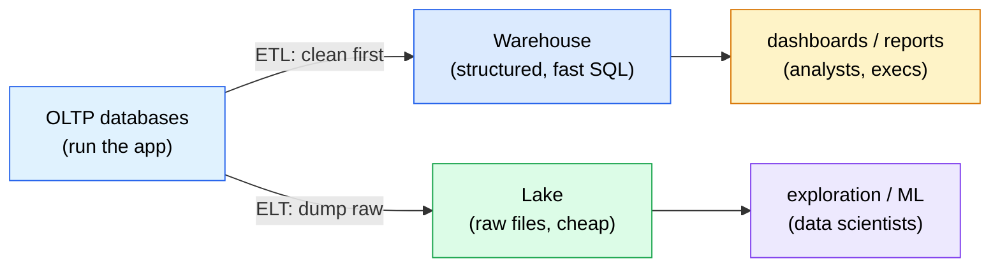
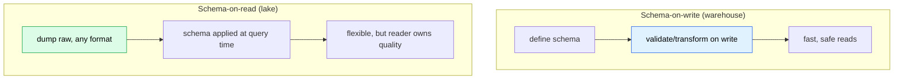
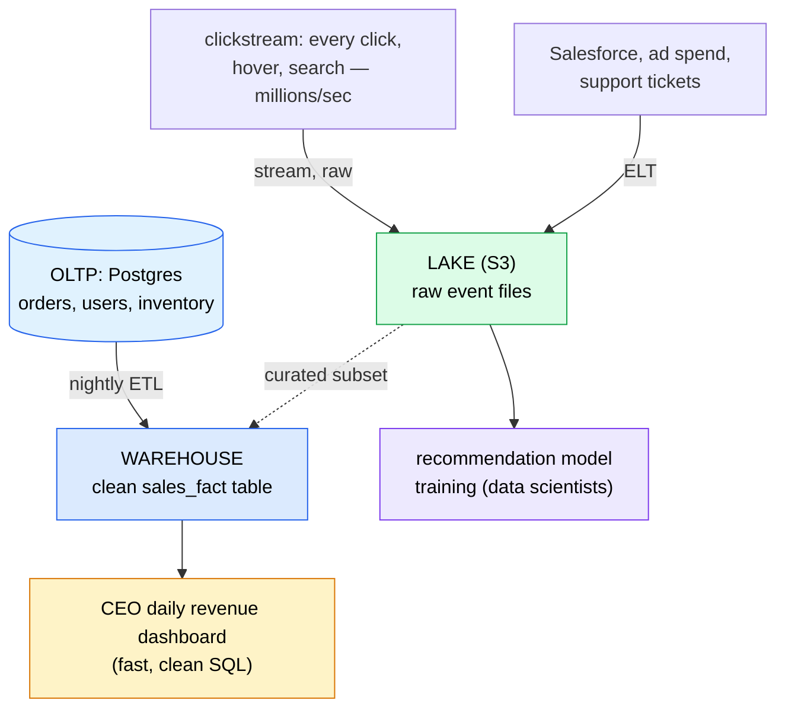
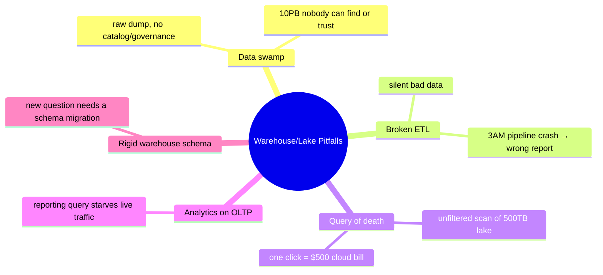

# Data Warehousing vs Data Lakes

> **One line:** Your operational database runs the app; a warehouse and a lake are separate analytical stores that help you *understand* it — a warehouse holds clean, structured data transformed *before* loading (ETL) for fast reports, while a lake holds raw everything transformed *when queried* (ELT) for exploration and ML.

---

## Table of Contents
1. [Why You Must Master This](#1-why-you-must-master-this)
2. [The Mental Model](#2-the-mental-model)
3. [Warehouse vs Lake — ETL vs ELT](#3-warehouse-vs-lake--etl-vs-elt)
4. [Schema-on-Write vs Schema-on-Read](#4-schema-on-write-vs-schema-on-read)
5. [The Lakehouse — Convergence](#5-the-lakehouse--convergence)
6. [Worked Example — E-commerce Analytics Strategy](#6-worked-example--e-commerce-analytics-strategy)
7. [Real-Life Use Cases](#7-real-life-use-cases)
8. [Failure Modes](#8-failure-modes)
9. [🏋️ Practice Drills](#-practice-drills)
10. [🎤 Interview Q&A Bank](#-interview-qa-bank)
11. [🎯 Staff+ Nuances](#-staff-nuances)
12. [Cheat Sheet](#12-cheat-sheet)
13. [Connections & Further Reading](#13-connections--further-reading)

---

## 1. Why You Must Master This

Every company past a certain size needs a place to *analyze* its data that isn't the database serving live traffic — running heavy reporting queries against your OLTP store slows the app and eventually crashes it. Warehouses and lakes are that separate analytical tier, and choosing between (and combining) them is a core data-architecture decision.

- **It protects the operational database.** A "list all sales in 2023" report or an ML training scan against your production Postgres competes with real user traffic for I/O and can take it down. The whole point of a warehouse/lake is to *offload* analytics onto infrastructure built for it.
- **It's a major cost decision.** Storing 1 PB in an operational database costs ~$100k/month; the same data as files in a lake (S3) costs ~$2k/month. Deciding what lives where — and how compute is billed — is real financial responsibility.
- **It's the fuel for AI/ML.** You can't train models on an operational DB without crippling it. Data lakes are the training ground for modern ML, holding the raw, high-volume, multi-format data models need.
- **It's a standard data-architecture interview.** "Our Postgres is slow from reporting queries — how do you offload them?" (→ warehouse), and "warehouse vs lake, ETL vs ELT, schema-on-read vs write" are baseline distinctions.

> **The core problem it solves:** *separating analytical workloads from operational ones.* OLTP databases are built for many small transactions on live data; analytics needs large scans, historical depth, and cross-source consolidation. Warehouses and lakes provide a dedicated OLAP tier so heavy analysis never competes with — or crashes — the app serving users.

---

## 2. The Mental Model

Two ways to store the company's information for later analysis:

- **Data Warehouse = a library.** Every book is cleaned, catalogued, and shelved in a labeled section *before* it goes on the shelf. You know exactly what's there and can find "Monthly Revenue by Region" instantly. Highly usable — but you did the organizing work up front, and only well-understood, structured material gets in.
- **Data Lake = a giant storage unit you toss everything into.** Photos, receipts, recordings, raw logs — dumped in as-is, instantly, cheaply. Nothing is pre-organized, so *saving* is trivial and *finding* requires digging (and skill). Perfect for a data scientist hunting for patterns nobody anticipated.

The defining difference is *when you do the work of structuring the data*: the warehouse structures it on the way **in** (before it's useful), the lake structures it on the way **out** (when you query it).





---

## 3. Warehouse vs Lake — ETL vs ELT

| Dimension | Data Warehouse | Data Lake |
|-----------|----------------|-----------|
| **Data** | Structured tables | Raw: CSV, JSON, Parquet, images, video, logs |
| **Process** | **ETL** — transform *before* load | **ELT** — load raw, transform *on read* |
| **Schema** | Schema-on-write (defined up front) | Schema-on-read (interpreted at query time) |
| **Storage cost** | Higher (managed, optimized) | Very low (object storage: S3/GCS) |
| **Query** | Clean SQL, fast | Needs code/engines (Spark, Athena) |
| **Users** | Analysts, executives (BI) | Data scientists, ML engineers |
| **Tools** | Snowflake, Redshift, BigQuery | S3+Athena, Azure Data Lake, Databricks |
| **Risk** | Rigid schema; fragile ETL | "Data swamp" — unfindable mess |

The pivotal distinction is **ETL vs ELT** — *where the Transform step sits*:

```sql
-- WAREHOUSE (ETL): data was cleaned & structured before load → clean SQL
SELECT country, SUM(total_sales) FROM sales_fact GROUP BY country;
```
```python
# LAKE (ELT): raw files loaded as-is, transformed at query time in code
df = spark.read.json("s3://raw-logs/2023/*/*.json")
result = df.filter(df.action == "purchase").groupBy("region").count()
```

- **ETL (Extract, Transform, Load)** — clean and structure data *before* storing it. Guarantees quality and query speed, but the transform pipeline is slow, rigid, and breaks when sources change ("the 3 AM ETL crashed → the revenue report is wrong").
- **ELT (Extract, Load, Transform)** — store raw *first*, transform *when* you query. Infinitely flexible (save now, decide structure later) and cheap, but pushes complexity and quality burden onto the reader.

Both are OLAP and both are typically [columnar](./Columnar_Databases.md) under the hood — the difference is the *pipeline* and *when structure is imposed*.

---

## 4. Schema-on-Write vs Schema-on-Read

This is the conceptual core, and it explains everything downstream:

- **Schema-on-write (warehouse):** you define the schema *before* writing; data that doesn't fit is rejected or transformed to fit. Reads are fast and safe because structure is guaranteed. The cost: you must know the questions in advance, and evolving the schema is painful.
- **Schema-on-read (lake):** you write raw data with *no* enforced structure; the schema is applied *when you read*, by whoever queries. Writes are trivial and flexible (any format, any time); the cost is that reads are harder and data quality is uncertain until you look.



> **The trade in one line:** schema-on-write pays *up front* for fast, trustworthy reads; schema-on-read pays *later* for flexible, cheap writes. It's the same "when do you do the work" trade as ETL/ELT, one layer down. (Compare [schema-less NoSQL](./Relational_vs_NoSQL.md) — same idea at the operational tier.)

---

## 5. The Lakehouse — Convergence

The modern answer to "warehouse *or* lake?" is increasingly "both, unified." A **lakehouse** puts warehouse-like structure, ACID transactions, and fast SQL *on top of* cheap lake storage:

- **How:** open table formats — **Apache Iceberg, Delta Lake, Apache Hudi** — layer a transaction log, schema enforcement, and metadata over [Parquet](./Columnar_Databases.md) files in object storage. You get ACID, time-travel, and schema evolution on data that still lives as cheap files.
- **Why it wins:** one copy of the data serves both BI (SQL dashboards) and ML (raw access), avoiding the classic "copy everything from the lake into the warehouse" duplication. Storage stays cheap (S3), compute scales independently (Databricks, Snowflake-on-Iceberg, Spark).
- **Data Mart** (worth knowing): a smaller, department-scoped slice of a warehouse (a "marketing data mart") — a subset optimized for one team's queries.

The lakehouse is the current center of gravity because it dissolves the warehouse-vs-lake dichotomy: structure *when you want it*, on storage that's *always cheap*.

---

## 6. Worked Example — E-commerce Analytics Strategy

**The prompt:** "Design the analytics data strategy for an e-commerce company. Where does each kind of data go?"



**Closing the loop — what goes where and why:**
- **Clean sales → warehouse.** The CEO's daily revenue report must be *fast, correct, and self-serve* for non-technical execs. Sales data is well-understood and structured, so ETL it nightly into a warehouse `sales_fact` table → clean SQL, sub-second dashboards.
- **Raw clickstream → lake.** Every click, hover, and search — millions of events/sec, semi-structured, and you don't yet know which signals matter. Dumping it raw into S3 (ELT) is cheap and preserves *everything* for future questions. Data scientists mine it to train the recommendation engine — a use case you couldn't have specified in advance, which is exactly why schema-on-read fits.
- **Never the OLTP database.** Neither report nor training touches Postgres directly — that would starve live checkout traffic. The operational DB stays dedicated to running the app.
- **Cost consequence:** the high-volume, uncertain-value clickstream lives in cheap lake storage ($2k/PB), while the smaller, high-value, frequently-queried sales data justifies the warehouse's premium.

**The consequence:** the strategy is driven by *who queries it, how structured it is, and what it costs* — structured/known/exec-facing → warehouse; raw/high-volume/exploratory → lake; live operations → stay in OLTP. A lakehouse would let the sales and clickstream data share one cheap storage layer while still serving both the dashboard and the model.

---

## 7. Real-Life Use Cases

| Situation | Warehouse, Lake, or OLTP — and why |
|-----------|-----------------------------------|
| **CEO revenue dashboard** | Warehouse — structured, fast SQL, non-technical users, known questions. |
| **Clickstream / event logs (millions/sec)** | Lake — raw, high-volume, cheap storage, future-unknown analysis. |
| **ML model training data** | Lake — raw multi-format data at scale; never train on OLTP. |
| **Consolidating Salesforce + Postgres + Excel** | Warehouse (or lakehouse) — single source of truth for BI across silos. |
| **"Offload heavy reporting off our slow Postgres"** | Warehouse — move analytical queries off the operational DB. |
| **Place an order / log in** | **OLTP** — real-time, single-row; warehouses/lakes are far too slow. |
| **Both BI and ML on one dataset** | Lakehouse — warehouse structure on cheap lake storage, one copy. |

> **The habit:** ask three questions — *who queries it* (execs → warehouse, scientists → lake), *how structured/known is it* (structured → warehouse, raw → lake), and *is this operational* (yes → stays in OLTP, never analytics store).

---

## 8. Failure Modes



- **Data swamp.** Symptom: petabytes in a bucket nobody can find, trust, or use. Cause: raw dumping with no catalog, partitioning, or governance. *Fix:* a data catalog (metadata, ownership, schemas), sensible partitioning (by date/source), and lifecycle policies. A lake needs governance or it rots.
- **Broken ETL pipeline.** Symptom: a report is silently wrong because the cleaning job failed overnight. *Fix:* pipeline monitoring, data-quality checks/assertions, alerting on failures, and idempotent reruns; treat pipelines as production code.
- **Query of death.** Symptom: one unfiltered scan of a 500 TB lake racks up a huge bill (compute/scan is billed per byte). *Fix:* partition pruning (query by date partition), require filters, cost guards/quotas, and columnar formats so scans read only needed columns.
- **Running analytics on the OLTP database.** Symptom: heavy reporting queries slow or crash the app. *Fix:* that's the whole reason the warehouse/lake exists — offload analytics off the operational store.
- **Warehouse schema too rigid.** Symptom: every new analytical question needs a painful schema migration and ETL change. *Fix:* consider ELT/lakehouse for exploratory data so structure can be deferred; reserve strict schemas for stable, high-value reporting.

---

## 🏋️ Practice Drills

> *Cover the solutions and attempt first — active recall is the point.*

**Drill 1 — Route the data.** For an e-commerce company, where does each go — OLTP, warehouse, or lake? (a) the live shopping cart; (b) the finance team's quarterly revenue report; (c) raw server logs and every user click; (d) a cleaned "daily active users" metric shown to executives.

<details><summary>Solution</summary>

(a) **OLTP** — the cart is live operational state, read/written per user action in real time. Never an analytics store.

(b) **Warehouse** — structured, high-value, exec-facing, known questions, needs clean fast SQL. ETL the sales data in.

(c) **Lake** — raw, high-volume, semi-structured, cheap to store, future analyses unknown. Dump to S3 (ELT).

(d) **Warehouse** (or a data mart / serving layer) — a curated, structured metric for non-technical users needs to be fast and trustworthy. It's often *derived* from raw event data in the lake, then materialized into the warehouse.

Pattern: operational → OLTP; structured/known/exec → warehouse; raw/high-volume/exploratory → lake.
</details>

**Drill 2 — ETL vs ELT.** Your team can't decide whether to clean data before loading (ETL) or load raw and transform later (ELT). What questions decide it, and when is each right?

<details><summary>Solution</summary>

The decision turns on **whether you know the questions in advance** and **how much you value flexibility vs immediate query-readiness**.

**ETL (transform before load)** is right when:
- The data feeds *known, stable* reports (financial dashboards) where quality and speed matter most.
- Consumers are non-technical (analysts/execs) who need clean, ready-to-query tables.
- You can afford a rigid schema and want to reject/fix bad data at the door.

**ELT (load raw, transform on read)** is right when:
- You *don't yet know* how the data will be used (exploratory analytics, future ML).
- The data is high-volume and multi-format, where transforming everything up front is expensive and wasteful.
- Consumers are technical (data scientists) comfortable transforming at query time, and you want to preserve the raw data for questions you haven't thought of.

Modern default: **ELT into cheap storage** (especially with a lakehouse), because storage is cheap, compute is elastic, and preserving raw data keeps future options open. Reserve heavy up-front ETL for the stable, high-value, must-be-clean reporting paths.
</details>

**Drill 3 — Prevent the data swamp.** Your company dumped 5 PB of raw data into an S3 bucket and now nobody can find or trust anything. What went wrong and what practices prevent it?

<details><summary>Solution</summary>

**A lake without governance became a swamp.** Raw dumping is the lake's strength for *writes*, but with no metadata, organization, or ownership, the data is unusable — you can't tell what's there, what it means, whether it's current, or whether it's correct.

Practices that prevent (or fix) it:
1. **Data catalog / metadata layer** — a searchable registry (AWS Glue Catalog, Apache Hive Metastore, a data catalog tool) recording each dataset's schema, source, owner, and freshness. Without a catalog you can't find anything.
2. **Sensible partitioning & layout** — organize by source and date (`s3://logs/source=web/date=2024-01-01/`) so queries prune to relevant data and costs stay bounded.
3. **Governance & ownership** — every dataset has an owner, documentation, and a quality/freshness SLA; enforce naming and format conventions on ingest.
4. **Lifecycle policies** — expire or tier-off stale data so the lake doesn't grow without bound.
5. **Adopt a lakehouse table format** (Iceberg/Delta) — brings schema enforcement, ACID, and a transaction log to lake files, structurally preventing much of the swamp.

The lesson: a lake's cheap, schema-on-read writes are a feature *only* if paired with cataloging and governance; otherwise "save everything instantly" becomes "find and trust nothing."
</details>

---

## 🎤 Interview Q&A Bank

**Q1. "Data warehouse vs data lake — what's the difference?"**
> A warehouse stores structured, cleaned data transformed *before* loading (ETL, schema-on-write) — fast SQL for known reports and non-technical users, at higher storage cost. A lake stores raw, multi-format data as-is (ELT, schema-on-read) — dirt-cheap object storage that holds everything for exploration and ML, but needs code to query and can become a swamp. Warehouse = organized library; lake = giant cheap storage unit.

**Q2. "ETL vs ELT?"**
> Both move data into analytics; the difference is where the Transform happens. ETL transforms *before* loading — clean, structured, query-ready, but a rigid and fragile pipeline. ELT loads raw *first* and transforms at query time — flexible, cheap, preserves raw data for unknown future questions, but pushes work and quality concerns to the reader. Cheap storage and elastic compute have made ELT the modern default.

**Q3. "Our Postgres is slow because of heavy reporting queries. How do you fix it?"** *(signal: OLTP/OLAP awareness)*
> Offload the analytics off the operational database. Reporting queries do large scans that compete with live transactions for I/O — the fix is to replicate or ETL the data into an OLAP store (a columnar warehouse like Snowflake/BigQuery) and run reports there. The OLTP database goes back to serving the app; analysts query the warehouse. It's the OLTP/OLAP separation.

**Q4. "Schema-on-write vs schema-on-read?"**
> Schema-on-write (warehouse) enforces structure *before* storing, so reads are fast and trustworthy but you must know the schema up front and evolving it is painful. Schema-on-read (lake) stores raw data and applies structure *at query time*, so writes are trivial and flexible but the reader bears the quality and interpretation burden. It's the "when do you do the structuring work" trade.

**Q5. "What is a lakehouse?"**
> A hybrid that puts warehouse capabilities — ACID transactions, schema enforcement, fast SQL — on top of cheap data-lake storage, using open table formats like Apache Iceberg or Delta Lake over Parquet files. It lets one copy of the data serve both BI and ML without the classic lake-to-warehouse duplication, keeping storage cheap while making the data query-ready and governed.

**Q6. "Why not just run analytics on the operational database?"**
> Because analytical queries — large scans, aggregations, historical joins — are resource-intensive and would compete with the small, latency-sensitive transactions the app needs, degrading or crashing live service. They also want *historical* and *cross-source* data the OLTP store doesn't hold. A separate OLAP tier isolates that heavy workload onto infrastructure (columnar, elastic) built for it.

**Q7. "How do you keep a data lake from becoming a data swamp?"**
> Governance: a data catalog with schemas, ownership, and freshness metadata so data is findable and trustworthy; sensible partitioning (by source/date) so queries are cheap and bounded; lifecycle policies to expire stale data; and increasingly a lakehouse table format (Iceberg/Delta) that adds schema enforcement and ACID. The lake's cheap raw writes are only useful if paired with cataloging — otherwise "save everything" becomes "find nothing."

---

## 🎯 Staff+ Nuances

- **The real distinction is "when do you impose structure," and it recurs everywhere.** ETL vs ELT, schema-on-write vs schema-on-read, warehouse vs lake — they're the same trade at different layers: pay up front for fast/safe reads, or pay later for cheap/flexible writes. It even echoes [normalization vs denormalization](./Database_Normalization_Denormalization.md) and [SQL vs NoSQL schema](./Relational_vs_NoSQL.md). Seeing it as one recurring principle, not four facts, is the senior frame.
- **Separation of storage and compute is the economic engine underneath all of this.** Cheap object storage (S3) plus elastic, pay-per-query compute (BigQuery, Snowflake, Spark) is *why* the lake and lakehouse are viable — you store petabytes cheaply and spin up compute only when querying. The [columnar](./Columnar_Databases.md) format is what makes that per-query compute efficient. Mention this and you're explaining the architecture, not just the labels.
- **The lakehouse is winning because two copies is a governance and cost disaster.** The old pattern — raw in the lake, curated copy in the warehouse — means data drift, double storage, and reconciliation pain. Table formats (Iceberg/Delta/Hudi) collapse it to one governed copy serving both BI and ML. When someone frames it as "warehouse *or* lake," the sophisticated answer is "increasingly neither — a lakehouse."
- **ETL fragility is an operational, not conceptual, problem — and it dominates real systems.** The clean diagrams hide that pipelines break silently, sources change schemas without warning, and a 3 AM failure surfaces as a wrong executive report days later. Data-quality assertions, schema-change detection, lineage tracking, and idempotent reruns are what make analytics *trustworthy* — the hard part is reliability, not the SQL.
- **"Query of death" makes cost a first-class design constraint in a way OLTP rarely is.** When scans are billed per byte, an unfiltered query over a huge dataset is a direct financial event, not just a slow one. Partition pruning, columnar formats, materialized aggregates, and cost guardrails are *cost* optimizations as much as performance ones — a dimension that surprises engineers coming from fixed-cost operational databases.
- **This tier is where batch and streaming ingestion meet, and freshness is a spectrum.** Data reaches the warehouse/lake via nightly batch ETL, micro-batches, or streaming CDC — and the choice sets how fresh analytics can be (yesterday's data vs minutes-old). "Real-time analytics" is really a question about the *ingestion pipeline* and a serving layer over recent data, tying this topic to [batch vs stream processing](../09_Message_Queues_Event_Streaming/) and [CDC](./Distributed_Transactions.md).
- **A data mart is the pragmatic 'start small' that prevents warehouse sprawl.** Rather than one monolithic warehouse serving all teams (slow, contended, governance-heavy), department-scoped marts give each team a fast, focused subset. The trade is potential duplication/inconsistency across marts — which is exactly the tension a well-governed lakehouse resolves. Knowing when to federate vs centralize the analytical layer is an architecture-level judgment.

---

## 12. Cheat Sheet

```
DATA WAREHOUSE vs DATA LAKE — the ANALYTICAL (OLAP) tier, separate from OLTP
═══════════════════════════════════════════════════════════════════════════

                WAREHOUSE                    LAKE
  data          structured tables            raw: CSV/JSON/Parquet/video/logs
  process       ETL (transform BEFORE load)  ELT (load raw, transform on read)
  schema        schema-on-WRITE              schema-on-READ
  storage cost  higher                       very low (S3/GCS object storage)
  query         clean fast SQL               code/engines (Spark, Athena)
  users         analysts, execs (BI)         data scientists, ML
  tools         Snowflake, Redshift, BigQuery  S3+Athena, Databricks
  risk          rigid schema, fragile ETL    DATA SWAMP (unfindable)

THE ONE TRADE (recurs at every layer)
  structure UP FRONT (ETL / schema-on-write)  → fast, safe reads; rigid, pricier
  structure LATER    (ELT / schema-on-read)   → cheap, flexible writes; reader owns quality

LAKEHOUSE = warehouse structure (ACID, schema, SQL) ON cheap lake storage
  via Iceberg / Delta / Hudi over Parquet → ONE governed copy serves BI + ML
  Data Mart = department-scoped slice of a warehouse

ROUTE DATA BY 3 QUESTIONS
  who queries?    execs → warehouse · scientists → lake
  structured/known? yes → warehouse · raw/unknown → lake
  operational?    yes → stays in OLTP (never analytics store)

PITFALLS
  ✗ analytics on OLTP → starves/crashes the live app (that's why this tier exists)
  ✗ raw dump, no catalog → data swamp → catalog + partition + govern
  ✗ unfiltered scan of huge lake → per-byte billing → "$500 per click"
  ✗ broken ETL at 3AM → silently wrong report → quality checks + alerting
  ✓ separation of storage & compute + columnar = the economic engine
```

---

## 13. Connections & Further Reading

**Within this repo:**
- [Columnar_Databases.md](./Columnar_Databases.md) — the storage technology inside warehouses and lakehouse formats.
- [Relational_vs_NoSQL.md](./Relational_vs_NoSQL.md) — the OLTP tier that feeds the analytical stores; schema-on-read parallels.
- [Database_Normalization_Denormalization.md](./Database_Normalization_Denormalization.md) — warehouses use denormalized star schemas.
- [Distributed_Transactions.md](./Distributed_Transactions.md) — CDC (change data capture) as a streaming ingestion path.
- [Message Queues & Event Streaming](../09_Message_Queues_Event_Streaming/) — batch vs stream ingestion into the lake/warehouse.

**External classics:**
- [AWS: Data Lake vs Data Warehouse](https://aws.amazon.com/big-data/datalake-on-aws/data-lake-vs-data-warehouse/) — clear vendor-neutral-ish comparison.
- [Databricks: What is a Lakehouse?](https://www.databricks.com/glossary/data-lakehouse) — the convergence architecture.
- *The Data Warehouse Toolkit* (Ralph Kimball) — the classic on dimensional modeling and star schemas.
- [Apache Iceberg](https://iceberg.apache.org/) — the open table format defining modern lakehouses.

---

## TL;DR
**Your operational (OLTP) database runs the app; warehouses and lakes are a separate analytical (OLAP) tier so heavy reporting and ML never compete with — or crash — live traffic.** A warehouse holds structured data transformed *before* loading (ETL, schema-on-write) for fast, trustworthy SQL that execs and analysts self-serve; a lake holds raw, multi-format data as-is (ELT, schema-on-read) in dirt-cheap object storage for exploration and ML, at the risk of becoming an ungoverned "data swamp." The underlying question is always *when you impose structure* — up front for fast reads, or later for cheap flexible writes. The modern convergence is the **lakehouse** (Iceberg/Delta over Parquet): warehouse structure and ACID on cheap lake storage, one governed copy serving both BI and ML. **Route data by who queries it, how structured it is, and whether it's operational — and never run analytics against the database serving your users.**
