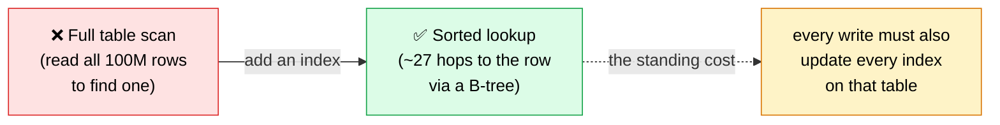
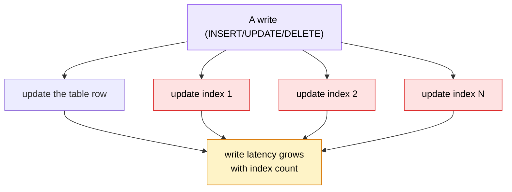

# Database Indexing (B-Tree, Hash, LSM)

> **One line:** An index is a second, sorted copy of *just* the column you search on, kept next to a pointer back to the row — so the database jumps straight to the data instead of reading every row, at the cost of maintaining that copy on every write.

---

## Table of Contents
1. [Why You Must Master This](#1-why-you-must-master-this)
2. [The Mental Model](#2-the-mental-model)
3. [The Index Structures — B-Tree, Hash, LSM](#3-the-index-structures--b-tree-hash-lsm)
4. [Index Types — Clustered, Secondary, Composite, Covering](#4-index-types--clustered-secondary-composite-covering)
5. [The Read/Write Trade-off](#5-the-readwrite-trade-off)
6. [Worked Example — Search by Email at 10M Users](#6-worked-example--search-by-email-at-10m-users)
7. [Real-Life Use Cases](#7-real-life-use-cases)
8. [Failure Modes](#8-failure-modes)
9. [🏋️ Practice Drills](#-practice-drills)
10. [🎤 Interview Q&A Bank](#-interview-qa-bank)
11. [🎯 Staff+ Nuances](#-staff-nuances)
12. [Cheat Sheet](#12-cheat-sheet)
13. [Connections & Further Reading](#13-connections--further-reading)

---

## 1. Why You Must Master This

Indexing is the single highest-leverage database skill: one `CREATE INDEX` can turn a 20-second query into 2 milliseconds, and one *missing* index is the most common cause of a database melting down under load.

- **It's the difference between O(N) and O(log N).** Finding one row in 100M without an index means scanning all 100M (a "full table scan"); with a B-tree it's ~27 node reads. That's not an optimization — it's a different complexity class.
- **Missing indexes cause outages.** Under a traffic spike, an unindexed query on a hot column pins CPU at 100% scanning disk, queries queue, and the whole database stalls. The #1 "why did prod go down" postmortem.
- **Every index taxes writes.** An index is a structure the DB must *also* update on every insert/update/delete. Over-indexing turns a 1ms insert into 100ms. The art is indexing exactly what you query and nothing more.
- **It's a guaranteed interview topic.** B-tree vs hash, why indexes slow writes, and reading `EXPLAIN ANALYZE` are baseline questions; the deeper signal is knowing *why* an index you created isn't being used.

> **The core problem it solves:** *the full table scan.* Without a fast lookup path, every filtered query must inspect every row. An index gives the query planner a sorted shortcut to the matching rows — trading write cost and disk space for read speed.

---

## 2. The Mental Model

An index is **the index at the back of a textbook.**

- To find "photosynthesis," you don't read all 500 pages — you flip to the back, where topics sit in **alphabetical order** (the sort), find the term, and it points to **page 214** (the pointer to the row).
- Because it's sorted, you can also find *ranges* — every topic between "photo" and "photR" sits together.
- And there's the catch: **add a new page and you must update the index too.** The index is a maintenance burden that only pays off because you look things up far more often than you rewrite the book.

That's the whole trade in one image: a sorted lookup structure that makes finding fast and writing a little slower.





---

## 3. The Index Structures — B-Tree, Hash, LSM

Three structures dominate, each optimized for a different access shape. Naming *why* you'd pick each is the signal.

| Structure | Lookup | Range queries? | Optimized for | Used by |
|-----------|--------|----------------|---------------|---------|
| **B-Tree / B+Tree** | O(log N) | ✅ Yes — leaves are sorted & linked | Balanced read/write, the default | PostgreSQL, MySQL/InnoDB, Oracle |
| **Hash** | O(1) | ❌ No — hashing destroys order | Exact-match only (`= 'x'`) | Redis, Postgres hash indexes, in-memory maps |
| **LSM-Tree** | O(log N)+ | ✅ Yes | Write-heavy workloads | Cassandra, RocksDB, LevelDB, ScyllaDB |

**B-Tree (B+Tree in practice)** — a balanced, sorted tree. Every lookup descends a shallow tree (~3–4 levels even for billions of rows). Because leaves store keys *in order* and are linked, it handles `WHERE price BETWEEN 10 AND 50`, `ORDER BY`, and `GROUP BY` efficiently — the sort is free. It's **update-in-place**: a write finds the right leaf and modifies it, which can trigger rebalancing (disk I/O). This is the right default for the vast majority of workloads.

**Hash index** — a hash map from key to row pointer. O(1) exact-match lookups, unbeatable for `WHERE user_id = '123'`. But hashing scatters keys, so it's **useless for ranges or sorting** — there's no order to walk. Niche in relational DBs; ubiquitous as the model behind key-value stores.

**LSM-Tree** — flips the write model. Instead of updating a tree on disk per write, it buffers writes in an in-memory **MemTable** (fast, sequential), flushes sorted **SSTables** to disk, and periodically **compacts** (merges) them in the background. Result: blazing sequential writes, at the cost of **read amplification** — a read may check several SSTables (mitigated by Bloom filters). This is why write-heavy stores like Cassandra choose it — it's the storage-engine expression of [scaling writes](./SQL_vs_NoSQL_Scaling.md).

---

## 4. Index Types — Clustered, Secondary, Composite, Covering

Beyond the *structure*, indexes come in *kinds* that matter for query planning:

- **Clustered index** — the table's rows are physically stored *in the index's order* (usually the primary key). There's only one per table (data can be sorted one way). Lookups by the clustered key are fastest — the index *is* the data, no second hop.
- **Secondary (non-clustered) index** — a separate structure whose leaves hold the indexed value + a pointer to the row. A lookup finds the pointer, then does a second read to fetch the row ("bookmark lookup").
- **Composite index** — an index on multiple columns, e.g. `(last_name, first_name)`. **Column order is everything:** this index serves `WHERE last_name = ?` and `WHERE last_name = ? AND first_name = ?`, but *not* `WHERE first_name = ?` alone — it's a phone book sorted by last name, useless for finding a first name directly. This is the **leftmost-prefix rule**.
- **Covering index** — an index that includes *every* column a query needs, so the query is answered from the index alone without touching the table ("index-only scan"). The fastest possible read for that query.

```sql
-- Create a B-tree secondary index
CREATE INDEX idx_user_email ON Users(email);

-- The staff-engineer reflex: ask the planner what it's actually doing.
EXPLAIN ANALYZE SELECT * FROM Users WHERE email = 'test@example.com';
-- WITHOUT index:  Seq Scan on Users  (cost=0.00..150000.00 rows=1)   ← reads everything
-- WITH index:     Index Scan using idx_user_email (cost=0.50..8.50 rows=1)  ← jumps to it

-- Composite: serves (last_name) and (last_name, first_name), NOT (first_name) alone.
CREATE INDEX idx_name ON Users(last_name, first_name);
```

---

## 5. The Read/Write Trade-off

Every index is a **bet that reads outnumber writes** on that column. The bet has a cost you must price in:

- **Reads win big:** O(N) scan → O(log N) or O(1) lookup, plus free sorting/ranges (B-tree). Often 100×–1,000,000×.
- **Writes pay:** every insert/update/delete on the table must also update *every* index on it. Five indexes ≈ 5× the write-side work for the indexed columns.
- **Disk & memory cost:** indexes take space — sometimes *more* than the table itself — and they only stay fast while they fit in RAM. An index that spills to disk under memory pressure loses much of its advantage.



> **Rule of thumb:** index the columns you **filter, join, or sort** on — and no others. Add indexes from *measured* slow queries (`EXPLAIN ANALYZE`), not speculatively. On a small table (a few hundred rows) an index can be *slower* than a scan; the planner may ignore it entirely.

---

## 6. Worked Example — Search by Email at 10M Users

**The prompt:** "Login looks up a user by email. You have 10M users and logins are timing out."

**Without an index** — the login query is `WHERE email = ?`, and with no index the planner does a **sequential scan**: read all 10M rows off disk, comparing each email. At scale that's 10–20 seconds *per login*, and under concurrent load the CPU pins at 100% and the whole DB stalls — this is the "search of death" outage.

**Add a B-tree index on `email`:**


**Closing the loop — number → consequence:**
- The lookup goes from *scan 10M rows* to *~23 node reads* — 10–20 s becomes ~2 ms, and the CPU pressure that threatened an outage evaporates.
- The price: each time a user changes their email (rare), the DB does ~log N extra operations to keep the tree balanced — a trade that's obviously worth it because logins vastly outnumber email changes.
- **Deeper win:** if login also reads `password_hash`, a **covering index** `(email) INCLUDE (password_hash)` answers the query from the index alone — no second hop to the table row at all.

The example is the whole topic: an index turned a linear scan into a logarithmic lookup, prevented a meltdown, and cost only a little write-side maintenance on a rarely-written column — the ideal case for indexing.

---

## 7. Real-Life Use Cases

| Situation | How indexing decides the outcome |
|-----------|----------------------------------|
| **Login by email / username** | B-tree (or unique) index on the lookup column → 2ms auth instead of a table scan; unique index also enforces no duplicates. |
| **`WHERE created_at BETWEEN … AND …`** | B-tree index — ranges and `ORDER BY created_at` come free from the sorted leaves. |
| **Exact-match key-value lookups** | Hash index / hash-based KV store → O(1). Never for ranges. |
| **Write-heavy telemetry / event log** | LSM-tree engine (Cassandra, RocksDB): sequential writes absorb the firehose; fewer/leaner indexes to keep writes fast. |
| **Multi-column filter (`status` + `created_at`)** | Composite index in the right column order (equality columns first, range column last). |
| **Reporting query that reads 3 columns** | Covering index → index-only scan, no table access at all. |

> **The habit:** before adding an index, run `EXPLAIN ANALYZE` on the real query; after adding it, run it again to *confirm* the planner uses it. Never assume.

---

## 8. Failure Modes

```mermaid
mindmap
  root((Indexing Pitfalls))
    Over-indexing
      50 indexes, INSERTs crawl
      indexes bigger than the data
    Index not used
      function on the column (WHERE lower(email)=…)
      leading wildcard LIKE '%x'
      wrong composite column order
    Fragmentation
      millions of deletes → bloated tree
      needs REINDEX / VACUUM
    Low selectivity
      index on boolean/gender → planner ignores it
    LSM read amplification
      read checks many SSTables
      needs Bloom filters + compaction
```

- **Over-indexing.** Symptom: writes slow to a crawl, disk bloats. Cause: an index per column "just in case." *Fix:* keep only indexes that serve real queries; drop unused ones (check `pg_stat_user_indexes`).
- **Index exists but isn't used.** Symptom: `EXPLAIN` still shows a Seq Scan despite the index. Causes: a function wraps the column (`WHERE lower(email) = …` can't use an index on `email`), a leading-wildcard `LIKE '%foo'`, wrong composite order, or the query returns so many rows a scan is genuinely cheaper. *Fix:* index the expression, reorder the composite, or accept the scan.
- **Low selectivity.** Symptom: an index on a column with few distinct values (boolean, gender) is ignored. Cause: it doesn't narrow the search enough to beat a scan. *Fix:* don't index low-cardinality columns alone; use them as later parts of a composite.
- **Fragmentation / bloat.** Symptom: an index that was fast slowly degrades after heavy deletes/updates. *Fix:* `REINDEX` / `VACUUM` (Postgres) or rebuild; schedule maintenance for churny tables.
- **LSM read amplification.** Symptom: reads slower than expected on a write-optimized store. Cause: a read fans out across many un-compacted SSTables. *Fix:* tune compaction; rely on Bloom filters to skip files that can't contain the key.

---

## 🏋️ Practice Drills

> *Cover the solutions and attempt first — active recall is the point.*

**Drill 1 — Pick the structure.** For each, name B-tree, hash, or LSM and why: (a) `WHERE signup_date BETWEEN '2024-01' AND '2024-06'`; (b) `WHERE session_id = 'abc'` in an in-memory cache; (c) ingesting 1M sensor writes/sec.

<details><summary>Solution</summary>

(a) **B-tree** — it's a range query, and B-tree leaves are sorted and linked, so the DB walks the range directly. Hash can't do ranges at all.

(b) **Hash** — a single exact-match lookup by an opaque key with no range or sort need; O(1) is ideal and it's exactly how an in-memory KV store models it.

(c) **LSM-tree** — a write firehose. LSM buffers writes in memory and flushes sequentially, absorbing high write rates far better than a B-tree that must update in place on disk per write. This is why Cassandra/RocksDB use it.
</details>

**Drill 2 — The unused index.** You created `CREATE INDEX idx ON Users(email)`, but `EXPLAIN ANALYZE SELECT * FROM Users WHERE lower(email) = 'a@x.com'` still shows a Seq Scan. Why, and how do you fix it?

<details><summary>Solution</summary>

The query filters on `lower(email)`, but the index is on `email` — the raw column. Wrapping the column in a function means the stored index keys (original-case emails) don't match what's being compared, so the planner can't use the index and falls back to scanning every row and computing `lower()` on each.

Fixes:
1. **Expression index** matching the query: `CREATE INDEX idx ON Users(lower(email));` — now the index stores the lowercased values the query looks up.
2. Or normalize at write time (store email already-lowercased) and index the plain column.

General lesson: an index on a column only helps if the query uses that column *bare* — any function, cast, or leading-wildcard `LIKE '%x'` on it defeats the index.
</details>

**Drill 3 — Composite order.** You have `CREATE INDEX idx ON Orders(status, created_at)`. Which of these use it, and which don't? (a) `WHERE status='shipped'`; (b) `WHERE status='shipped' AND created_at > '2024-01-01'`; (c) `WHERE created_at > '2024-01-01'`.

<details><summary>Solution</summary>

- (a) **Uses it** — `status` is the leftmost column; the index is sorted by it first.
- (b) **Uses it fully** — equality on `status` then a range on `created_at` is the ideal composite pattern (equality columns first, range last). The index narrows to `status='shipped'` then walks the sorted `created_at` range within it.
- (c) **Does NOT use it** (efficiently) — `created_at` is the *second* column, so the index is only sorted by `created_at` *within each status group*, not globally. With no `status` filter there's no leftmost prefix to seek on. This is the **leftmost-prefix rule**; you'd need a separate index leading with `created_at`.
</details>

---

## 🎤 Interview Q&A Bank

**Q1. "What is a database index and what does it cost?"**
> It's a sorted auxiliary structure over one or more columns, holding the indexed value plus a pointer to the row, so the DB can jump to matching rows instead of scanning the whole table — O(N) becomes O(log N). The cost is write amplification (every write updates every index on the table) and disk/memory space. An index is a bet that reads on that column outnumber writes.

**Q2. "B-tree vs hash index — when each?"**
> B-tree for anything involving order — range queries, `ORDER BY`, `BETWEEN`, prefix matches — because its leaves are sorted. Hash for pure exact-match lookups (`= value`) where it gives O(1), but it can't do ranges or sorting because hashing destroys order. B-tree is the sensible default; hash is niche in relational DBs.

**Q3. "Why does adding an index slow down writes?"**
> Because the index is a separate structure that must stay consistent with the table. Every insert, update, or delete has to update the row *and* every index covering the affected columns — including possibly rebalancing a B-tree. Five indexes means roughly five times the index-maintenance work per write.

**Q4. "My query is slow even though there's an index. Why?"** *(signal: debugging depth)*
> Most often the index isn't being used: a function or cast wraps the column, a leading-wildcard `LIKE '%x'`, the wrong column order in a composite index, or low selectivity so the planner judges a scan cheaper. I'd run `EXPLAIN ANALYZE` to see the actual plan, then fix the query or add an expression/covering index to match it.

**Q5. "What's a composite index and why does column order matter?"**
> An index on multiple columns, sorted by the first, then the second within that, etc. — like a phone book by last then first name. Order matters because of the leftmost-prefix rule: `(a, b)` serves filters on `a` and on `a AND b`, but not on `b` alone. Put equality columns first and the range column last.

**Q6. "What's an LSM-tree and why do write-heavy databases use it?"**
> A log-structured merge-tree buffers writes in an in-memory table and flushes them to disk as sorted files (SSTables), merging them via background compaction — so writes are fast sequential appends instead of in-place disk updates. The trade is read amplification (a read may check several SSTables, mitigated by Bloom filters). It's why Cassandra and RocksDB handle write firehoses that would overwhelm a B-tree.

**Q7. "What's a covering index?"**
> One that contains every column a query needs, so the query is answered from the index alone without fetching the table row — an index-only scan. It's the fastest read for that query because it skips the second lookup, at the cost of a wider index to maintain.

**Q8. "When would you NOT add an index?"**
> On tiny tables (a scan in RAM beats index navigation), on write-mostly tables where reads are rare (the write tax isn't repaid), and on low-cardinality columns queried alone (the planner will ignore it). Also, I don't add indexes speculatively — only from measured slow queries, because each one taxes every write.

---

## 🎯 Staff+ Nuances

- **The index is a bet, and you must know the read/write ratio to price it.** On a read-heavy table, more indexes are almost free wins; on a write-heavy one, each index is a tax on your hottest path. The same `CREATE INDEX` is brilliant or catastrophic depending on the workload — which is why LSM vs B-tree is really a workload decision, not a database-feature trivia question.
- **`EXPLAIN ANALYZE` is the only source of truth.** The planner is a cost-based optimizer; it may rationally *ignore* your index if statistics say a scan is cheaper (returning >~10–20% of rows), or pick a worse plan on stale statistics. Reading query plans — and running `ANALYZE` to refresh stats — is the actual skill; "I added an index" is not the same as "the query uses it."
- **Write amplification compounds with denormalization.** A [denormalized](./Database_Normalization_Denormalization.md) counter column that's also indexed multiplies the cost of every increment. Index count and denormalization interact — audit them together, not separately.
- **Selectivity, not intuition, decides usefulness.** An index only helps when it narrows the search a lot. High-cardinality columns (email, UUID) are ideal; a boolean is nearly useless alone. Partial indexes (`WHERE status = 'active'`) can rescue low-selectivity cases by indexing only the rows you actually query.
- **B+Tree vs B-Tree matters on disk.** Real databases use B+Trees — all values live in the leaves, which are linked in sorted order, so range scans walk sideways without re-descending the tree, and internal nodes pack more keys (shallower tree, fewer disk seeks). When someone says "B-tree index," it's almost always a B+Tree.
- **Indexes and [replication](./Replication.md) lag interact.** Index maintenance is part of the write, so heavier indexing means more replication work and potentially more lag on replicas. The read-scaling benefit of an index on the primary is partly offset by the write cost it imposes on the whole replication topology.
- **LSM compaction is a background cost that can foreground itself.** Compaction consumes I/O and CPU; a poorly-tuned LSM store can stall under a "compaction storm" exactly when write load is highest. The write-speed advantage isn't free — it's deferred work that must be scheduled, which is why write-heavy systems monitor compaction closely.

---

## 12. Cheat Sheet

```
DATABASE INDEXING — TRADE WRITE COST + SPACE FOR READ SPEED
═══════════════════════════════════════════════════════════════════

WHAT AN INDEX IS
  a sorted copy of the indexed column + a pointer to the row
  → O(N) full scan becomes O(log N) (B-tree) or O(1) (hash)
  → every write must update EVERY index on the table

STRUCTURES
  B-Tree/B+Tree  O(log N)  ranges ✓  DEFAULT — reads+writes balanced (Postgres, MySQL)
  Hash           O(1)      ranges ✗  exact-match only (KV stores, Redis)
  LSM-Tree       O(log N)+ ranges ✓  WRITE-heavy — buffer+flush+compact (Cassandra, RocksDB)

INDEX KINDS
  Clustered   table stored in index order (1 per table, usually PK)
  Secondary   separate structure → value + row pointer (extra hop)
  Composite   multi-column; LEFTMOST-PREFIX rule: (a,b) serves a and a+b, NOT b
              → equality columns first, range column last
  Covering    holds all query columns → index-only scan, no table hit

INDEX THESE                        DON'T INDEX
  columns you FILTER / JOIN / SORT   tiny tables (scan wins)
  high-cardinality (email, UUID)     write-mostly tables
  from MEASURED slow queries         low-cardinality alone (boolean)
                                     speculatively ("just in case")

WHY MY INDEX ISN'T USED
  function/cast on the column (WHERE lower(email)=…)   → expression index
  leading wildcard  LIKE '%foo'                        → can't seek
  wrong composite column order                         → reorder
  returns too many rows / stale stats                  → run ANALYZE

RULE: EXPLAIN ANALYZE before AND after. Adding an index ≠ using an index.
```

---

## 13. Connections & Further Reading

**Within this repo:**
- [SQL_vs_NoSQL_Scaling.md](./SQL_vs_NoSQL_Scaling.md) — indexing is rung 1 of the scaling ladder; LSM is the write-scaling structure.
- [Database_Normalization_Denormalization.md](./Database_Normalization_Denormalization.md) — a missing index is often the *real* cause of "slow joins," not normalization.
- [Replication.md](./Replication.md) — index maintenance is part of every write, so it feeds replication lag.
- [Columnar_Databases.md](./Columnar_Databases.md) — a different indexing/storage model tuned for analytical scans.
- [Caching & Performance](../06_Caching_Performance/) — the layer above indexing for read speed.

**External classics:**
- [Use The Index, Luke!](https://use-the-index-luke.com/) — the definitive, developer-focused indexing guide.
- [PostgreSQL: Indexes](https://www.postgresql.org/docs/current/indexes.html) — index types and when the planner uses them.
- *Designing Data-Intensive Applications* (Kleppmann) — Ch. 3, B-trees vs LSM-trees in depth.
- [B-Tree visualizer](https://www.cs.usfca.edu/~galles/visualization/BTree.html) — watch splits and rebalancing happen.

---

## TL;DR
**An index is a sorted copy of a column plus a pointer to the row, turning an O(N) full table scan into an O(log N) (B-tree) or O(1) (hash) lookup — the highest-leverage read optimization there is, and a missing one is the classic cause of a database meltdown under load.** B-tree is the default (ranges + sorting free); hash is exact-match only; LSM trades read amplification for fast sequential writes in write-heavy stores. Every index taxes every write and consumes space, so index exactly the columns you filter/join/sort on, drive decisions from `EXPLAIN ANALYZE`, and remember that **adding an index isn't the same as the planner using it** — verify, don't assume.
