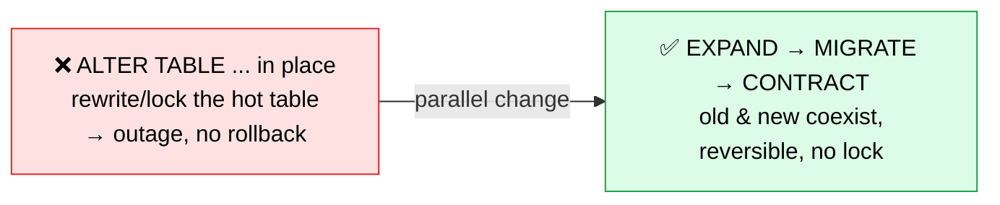
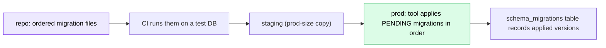
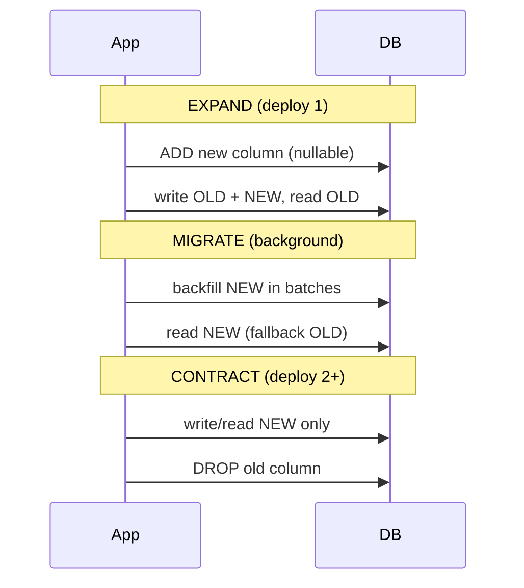
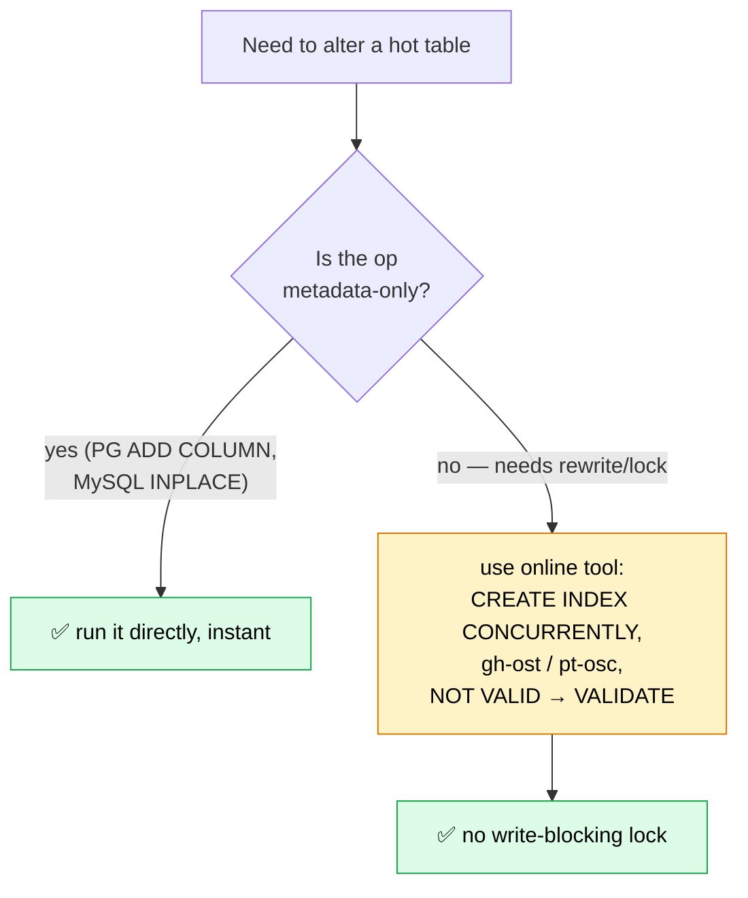
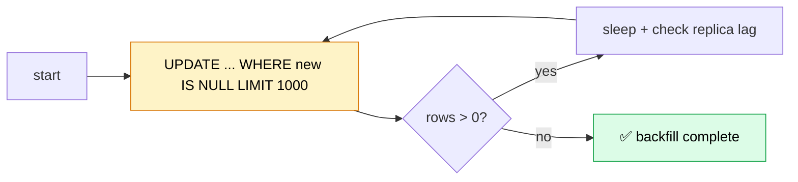
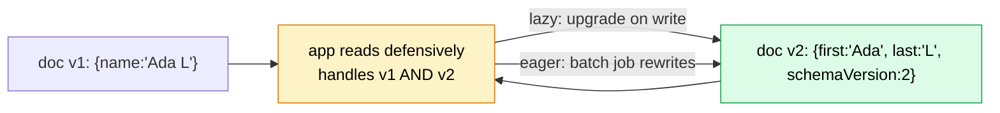
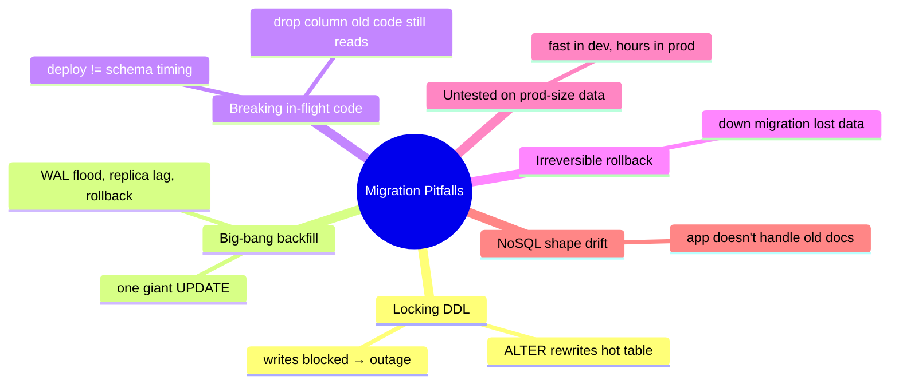

# Database Migrations & Schema Evolution

> **One line:** A database migration is a *versioned, ordered* change to your schema or data — and the whole art is changing a live, hot table without downtime by never editing a column in place: you **expand** (add the new), **migrate** (backfill + dual-write), then **contract** (drop the old), each as its own deploy, so old and new code can run side by side.

---

## Table of Contents
1. [Why You Must Master This](#1-why-you-must-master-this)
2. [The Mental Model](#2-the-mental-model)
3. [Versioned Migrations — Ordered, Repeatable, Forward-Only](#3-versioned-migrations--ordered-repeatable-forward-only)
4. [The Expand/Contract (Parallel-Change) Pattern](#4-the-expandcontract-parallel-change-pattern)
5. [Online DDL — Changing a Hot Table Without Locking It](#5-online-ddl--changing-a-hot-table-without-locking-it)
6. [Backfills — Migrating Billions of Rows Safely](#6-backfills--migrating-billions-of-rows-safely)
7. [Schema Evolution in NoSQL](#7-schema-evolution-in-nosql)
8. [Worked Example — Splitting `name` into `first_name`/`last_name` on a Hot Table](#8-worked-example--splitting-name-into-first_namelast_name-on-a-hot-table)
9. [Real-Life Use Cases](#9-real-life-use-cases)
10. [Failure Modes](#10-failure-modes)
11. [🏋️ Practice Drills](#-practice-drills)
12. [🎤 Interview Q&A Bank](#-interview-qa-bank)
13. [🎯 Staff+ Nuances](#-staff-nuances)
14. [Cheat Sheet](#14-cheat-sheet)
15. [Connections & Further Reading](#15-connections--further-reading)

---

## 1. Why You Must Master This

Schemas are never done — you add columns, split tables, change types, add constraints, forever. Doing that on a running system without an outage is a distinct engineering skill, and "how would you change a hot table with zero downtime?" is a standard senior follow-up.

- **A naive `ALTER TABLE` can take the site down.** On a large table, an `ALTER` that rewrites the table or takes a lock can block every read/write for minutes — an instant, self-inflicted outage. The number-one cause of "the deploy caused an incident."
- **Code and schema deploy at different times.** You can't atomically flip both app servers and the database at once — during a rollout, *old and new code run simultaneously* against *one* schema. A migration that breaks the old code (or new code that needs a column the migration hasn't added) causes errors mid-deploy.
- **Data migrations at scale are their own hazard.** Backfilling a column across 500M rows in one `UPDATE` locks the table, blows up the WAL/replication, and can OOM the box. Doing it in throttled, resumable batches is the difference between a smooth change and a 3am page.
- **It's where reliability and velocity meet.** Teams that can't evolve their schema safely either stop shipping or keep causing incidents. Expand/contract is the pattern that lets you do both.

> **The core problem it solves:** *you must change the shape of the data that a live system is actively reading and writing, deployed incrementally, without an outage and with a way back if it goes wrong.* The enemy is any moment where the schema and the running code disagree, or a single statement holds a long lock.

**Prerequisites:** [[Database_Normalization_Denormalization]] (why schemas change), [[ACID_Properties]] (locks, transactions, DDL semantics).

---

## 2. The Mental Model

Changing a hot schema is **renovating a store while it stays open for business.**

- You *don't* rip out the old checkout counter (the column) while customers are paying at it — that's a lock/outage. You **build the new counter alongside** the old (expand), gradually **move operations over** while both work (migrate), and only **remove the old counter** once nobody's using it (contract).
- At every moment the store is fully operational, and you can stop and reverse until the final teardown.

The naive vs safe change:



> **Hold onto this:** never change a column *in place* on a live table. Add the new thing, move to it while both exist, then remove the old thing — three separate, individually-safe, reversible deploys.



> Because old and new coexist through the middle phase, the app deploy and the schema change never have to happen at the same instant.

---

## 3. Versioned Migrations — Ordered, Repeatable, Forward-Only

A migration is a *checked-in, ordered* script that transforms the schema from one version to the next. Tools: Flyway, Liquibase, Alembic (Python), Rails/Django/Prisma migrations, golang-migrate.

**The properties that make migrations safe:**
- **Versioned & ordered** — each migration has a sequence number/timestamp (`V007__add_full_name.sql`). The tool records which have run (a `schema_migrations` table) so every environment converges to the same schema in the same order.
- **Deterministic & repeatable** — running the pending set brings any database (a fresh dev box, staging, prod) to the identical state. No manual "just run this SQL in prod."
- **Reviewed like code** — migrations live in the repo, go through PR review, and run in CI against a test DB. A schema change is a code change.
- **Forward-only in production (mostly).** Migrations often ship a `down`/rollback, but *rolling back a migration that already dropped a column or transformed data loses data.* In practice you "roll forward" — write a new migration to fix a bad one — rather than reversing a destructive one. `down` scripts are for local dev.



> **The rule:** treat the schema as version-controlled state. If a change didn't go through a reviewed, ordered migration, it doesn't exist — manual prod SQL is how environments drift and "works on staging, breaks in prod" happens.

---

## 4. The Expand/Contract (Parallel-Change) Pattern

This is *the* zero-downtime pattern, and the one to name in interviews. To change anything about a hot column/table, split it into three phases across separate deploys:

**Phase 1 — Expand (additive, backward-compatible):**
- Add the new column/table (nullable, no rewriting default). The old schema still works untouched.
- Deploy app code that **writes to both** old and new (dual-write) but still **reads from old**. Old code (still running mid-rollout) is unaffected because the change is purely additive.

**Phase 2 — Migrate (move the data and the reads):**
- **Backfill** existing rows into the new column in throttled batches (§6).
- Switch reads to prefer the new column (falling back to old if needed). Verify parity.

**Phase 3 — Contract (remove the old, only when safe):**
- Deploy app code that uses the **new only** and stops writing the old.
- Once no code references the old column, `DROP` it (or drop the old table). This is the only destructive step, and it happens last, after everything is confirmed on the new path.



**Why three deploys, not one:** during any rollout, old and new app instances run at once against a single schema. Expand/contract guarantees the schema is compatible with *both* versions at every step — the old code never sees a column vanish, the new code never needs a column that isn't there yet. It also means you can **pause or roll back** at any point before contract with no data loss.

> **The trade-off:** it's more steps and takes longer (multiple deploys, a backfill window) than one `ALTER`. You pay that for zero downtime and reversibility — worth it on any table that matters, overkill on a tiny config table you can lock for 50ms.

---

## 5. Online DDL — Changing a Hot Table Without Locking It

Even an "additive" change can lock the table if the database has to *rewrite* it. You must know which DDL operations are cheap (metadata-only) and which are expensive (rewrite/lock), per database.

- **The danger:** a classic `ALTER TABLE ... ADD COLUMN ... NOT NULL DEFAULT x` historically rewrote every row while holding an exclusive lock — minutes of blocked writes on a big table. `CREATE INDEX` (non-concurrent) locks against writes for its whole build.
- **Postgres:** `ADD COLUMN` with a non-volatile default is metadata-only and instant (since PG11). Use **`CREATE INDEX CONCURRENTLY`** (builds without blocking writes, slower). Adding a `NOT NULL` or a check constraint can be done in two steps: add it `NOT VALID`, then `VALIDATE CONSTRAINT` (which takes a weaker lock).
- **MySQL/InnoDB:** many alters support **`ALGORITHM=INPLACE, LOCK=NONE`** (online DDL) so writes continue; some still require a copy. For the ones that would lock, use **`gh-ost`** or **`pt-online-schema-change`**: they build a shadow copy of the table, backfill it, keep it in sync via triggers/binlog, then atomically swap — a table rebuild with near-zero locking.



> **The habit:** before running *any* DDL on a big table in prod, know whether it takes a rewrite/lock. "It's just adding a column" has caused outages because a `NOT NULL DEFAULT` triggered a full rewrite under lock. Check your DB version's rules and set a short `lock_timeout` so a blocked DDL fails fast instead of freezing the app.

---

## 6. Backfills — Migrating Billions of Rows Safely

A schema change often needs a **data** change: populate the new column for existing rows. Doing that at scale is where migrations go wrong.

**The anti-pattern:** `UPDATE users SET full_name = first_name || ' ' || last_name;` on 500M rows. This is one giant transaction: it locks huge swaths of rows, generates enormous WAL/binlog (blowing replication lag), holds a transaction open for hours (bloating [MVCC](./Transaction_Isolation_Levels_MVCC.md) dead tuples), and if it fails at row 499M it rolls *all* of it back.

**The safe pattern — batched, throttled, resumable:**

```sql
-- Loop in the app or a job, small committed batches:
UPDATE users SET full_name = first_name || ' ' || last_name
WHERE full_name IS NULL
ORDER BY id
LIMIT 1000;                     -- small batch, its own transaction
-- sleep briefly between batches; repeat until 0 rows affected
```

- **Batched** — each batch is a small, fast transaction (1K–10K rows), so locks are held briefly and WAL stays manageable.
- **Throttled** — a short pause between batches lets replicas catch up and leaves I/O for live traffic. Watch replication lag and back off if it grows.
- **Resumable / idempotent** — the `WHERE full_name IS NULL` (or a cursor on `id`) means a crashed backfill just restarts where it left off, and re-running is safe.
- **Off-peak & observable** — run during low traffic, monitor lag and error rates, and be able to stop instantly.



> **Real number:** a single `UPDATE` on 500M rows might run 2+ hours holding locks and generating hundreds of GB of WAL that pins replication; the same work in 500K batches of 1,000 with backoff runs quietly in the background over a day with no lock contention and lag under control. Same data, no outage.

---

## 7. Schema Evolution in NoSQL

"Schemaless" databases (document stores like MongoDB, wide-column like Cassandra, KV) don't have a central schema to `ALTER` — but the schema doesn't disappear, it moves *into the application*. Evolution is still real; it's just handled differently.

- **Schema-on-read.** Old and new document shapes coexist in the same collection. The app must handle *both* — e.g., a `user` doc might have `name` (old) or `firstName`/`lastName` (new). You read defensively and normalize in code.
- **Two strategies:**
  - **Lazy / on-write migration** — when a document is read (or next written), upgrade it to the new shape and save it. Cheap, spreads the work out, but old docs linger until touched (possibly forever) so the app carries both-shape logic indefinitely.
  - **Eager / batch migration** — a background job rewrites all documents to the new shape (the NoSQL backfill), after which the app can drop the old-shape handling. Same batching/throttling discipline as §6.
- **Schema versioning** — stamp each document with a `schemaVersion` field so the app knows which shape it's reading and can route to the right upgrade path. This is the durable, explicit approach.



> **The insight:** NoSQL doesn't remove migration work — it *defers* it from a DDL step to application-level compatibility handling. That flexibility (deploy new shape instantly, no `ALTER`) is a real advantage for rapid change, paid for by permanent multi-shape logic unless you also run eager migrations. See [[Relational_vs_NoSQL]].

---

## 8. Worked Example — Splitting `name` into `first_name`/`last_name` on a Hot Table

**The prompt:** "The `users` table (200M rows, thousands of writes/sec) has a single `name` column. We need `first_name` and `last_name`. Do it with zero downtime."

**The wrong way:** `ALTER TABLE users ADD first_name, ADD last_name; UPDATE users SET first_name=split_part(name,' ',1), ...; ALTER TABLE users DROP name;` — the `UPDATE` locks and floods WAL for hours, and dropping `name` breaks any old app instance still reading it. Outage.

**The expand/contract way:**

```mermaid
sequenceDiagram
    participant App
    participant DB as users (200M rows)
    Note over App,DB: EXPAND (deploy 1)
    App->>DB: ADD first_name, last_name (nullable, metadata-only)
    App->>DB: on write, populate name + first/last (dual-write); reads use name
    Note over App,DB: MIGRATE (background job)
    loop batches of 5000 WHERE first_name IS NULL
        App->>DB: UPDATE ... SET first/last from name; sleep; watch lag
    end
    App->>DB: switch reads to first/last (fallback name)
    Note over App,DB: CONTRACT (deploy 2)
    App->>DB: write/read first/last only
    App->>DB: DROP COLUMN name
```

**Walk-through:**
1. **Expand:** `ADD COLUMN first_name/last_name` nullable — instant metadata change in Postgres, no lock. Deploy code that on every write sets `name` *and* the split fields, but still reads `name`. Old instances mid-rollout only touch `name` → fine.
2. **Migrate:** a throttled batch job backfills `first_name/last_name` from `name` (5K rows/txn, `WHERE first_name IS NULL`, pause + watch replication lag). Resumable if it dies. Then flip reads to the new columns with a fallback, and verify parity.
3. **Contract:** deploy code using only `first_name/last_name`. Once no instance references `name`, `DROP COLUMN name`.

**Closing the loop — number → consequence:**
- The dangerous 200M-row `UPDATE` (hours of locks, hundreds of GB of WAL, replicas falling behind) becomes **40,000 tiny transactions** that trickle in the background with lag under control — no lock contention, no outage.
- Because the old `name` column survives until the final contract deploy, **every stage is rollback-safe** — if the new read path misbehaves, you flip reads back to `name` with no data lost.
- The single moment that would have broken old code (dropping `name`) is deferred to *after* all code is confirmed off it. Deploy and schema never have to be simultaneous.

The example is the whole topic: additive-first, backfill-in-batches, drop-last — three safe deploys instead of one risky statement.

---

## 9. Real-Life Use Cases

| Situation | How migration strategy decides the outcome |
|-----------|--------------------------------------------|
| **Add a column to a huge table** | PG `ADD COLUMN` (metadata-only) or MySQL online DDL / gh-ost → no lock, no outage. |
| **Change a column type** | Expand: add new-typed column, dual-write, backfill, switch reads, drop old — never `ALTER TYPE` in place on a hot table. |
| **Add a NOT NULL / constraint** | Add `NOT VALID` then `VALIDATE` (PG) so validation doesn't lock; backfill nulls first. |
| **Split/rename a column or table** | Full expand/contract with dual-write and batched backfill. |
| **Add an index to a live table** | `CREATE INDEX CONCURRENTLY` (PG) / online index (MySQL) so writes aren't blocked. |
| **Evolve a MongoDB document shape** | Schema-on-read: handle both shapes, stamp `schemaVersion`, lazy- or eager-migrate. |
| **Roll back a bad schema change** | Roll *forward* with a new migration; never reverse a destructive one that lost data. |

> **The habit:** for any schema change, ask three questions — *does this DDL lock the table? is it compatible with the currently-running code? and how do I undo it?* If any answer is scary, reach for expand/contract.

---

## 10. Failure Modes



- **Locking DDL on a hot table.** *Symptom:* app errors/timeouts the moment a migration runs; writes pile up. *Root cause:* an `ALTER` that rewrites the table or takes an exclusive lock. *Fix:* use metadata-only ops, `CREATE INDEX CONCURRENTLY`, `NOT VALID`→`VALIDATE`, or gh-ost/pt-osc; set a short `lock_timeout`.
- **Big-bang backfill.** *Symptom:* replication lag spikes, WAL/disk fills, the box slows for everyone. *Root cause:* one massive `UPDATE`/`DELETE` transaction. *Fix:* batch (1K–10K rows), throttle, monitor lag, make it resumable and idempotent.
- **Breaking the currently-running code.** *Symptom:* errors during the deploy window, then they clear. *Root cause:* the schema changed to something the still-running old (or the not-yet-deployed new) code can't handle. *Fix:* expand/contract — keep the schema compatible with both versions at every step.
- **Irreversible rollback.** *Symptom:* a bad migration can't be undone without data loss. *Root cause:* it dropped/transformed data destructively. *Fix:* separate additive from destructive; delay the destructive contract step; roll *forward* to fix, don't reverse.
- **Untested against production-size data.** *Symptom:* a migration that was instant in dev runs for hours in prod. *Root cause:* dev has 100 rows, prod has 500M. *Fix:* rehearse on a prod-size copy/staging; measure lock time and duration before shipping.
- **NoSQL shape drift.** *Symptom:* nulls/crashes when reading old documents. *Root cause:* app assumes the new shape but old-shape docs still exist. *Fix:* read defensively, version documents, and eager-migrate to eventually drop old-shape handling.

---

## 🏋️ Practice Drills

> *Cover the solutions and attempt first — active recall is the point.*

**Drill 1 — Sequence the change.** You must change `orders.amount` from `INTEGER` (cents) to `DECIMAL`. The table has 300M rows and constant traffic. List the ordered steps for zero downtime.

<details><summary>Solution</summary>

Expand/contract, because you can't safely change a column's type in place on a hot table:
1. **Expand:** `ADD COLUMN amount_decimal DECIMAL NULL` (metadata-only). Deploy code that writes both `amount` and `amount_decimal` on every insert/update, still reading `amount`.
2. **Migrate:** batch-backfill `amount_decimal = amount / 100.0` in throttled chunks (`WHERE amount_decimal IS NULL LIMIT 5000`, pause, watch lag; resumable). Then switch reads to `amount_decimal` with a fallback, and verify totals match.
3. **Contract:** deploy code using only `amount_decimal`; once nothing reads `amount`, `DROP COLUMN amount` (and optionally rename `amount_decimal`→`amount` in a later expand/contract if the name matters).

Each step is a separate, reversible deploy; the destructive drop is last.
</details>

**Drill 2 — Spot the outage.** A teammate's migration is `ALTER TABLE events ADD COLUMN source VARCHAR(50) NOT NULL DEFAULT 'web';` on a 1B-row MySQL table. What could go wrong and how do you make it safe?

<details><summary>Solution</summary>

Depending on the engine/version, `ADD COLUMN ... NOT NULL DEFAULT` may **rewrite the entire 1B-row table under a lock**, blocking writes for a long time → outage. (Modern InnoDB can do instant `ADD COLUMN`, but older versions or certain option combinations still copy the table.)

Make it safe: (a) confirm whether your MySQL version supports instant `ADD COLUMN` (`ALGORITHM=INSTANT`); (b) if not, add the column **nullable with no default** first (cheap), backfill `'web'` in throttled batches, then add the `NOT NULL`/default separately; or (c) use **gh-ost / pt-online-schema-change** to rebuild the table online with near-zero locking. Always set `lock_timeout` so a blocking DDL fails fast rather than freezing the app.
</details>

**Drill 3 — NoSQL evolution.** A MongoDB `users` collection has documents with a single `name` field. You want `firstName`/`lastName`. There's no `ALTER`. How do you evolve it?

<details><summary>Solution</summary>

Schema-on-read evolution:
1. Deploy app code that **writes** the new shape (`firstName`/`lastName` + `schemaVersion: 2`) and **reads defensively** — if a doc only has `name`, split it in code (and optionally upgrade-on-read: rewrite it to v2 when touched — lazy migration).
2. Optionally run an **eager batch job** that rewrites all v1 docs to v2 (throttled, resumable, `WHERE schemaVersion != 2`).
3. Once every document is v2 (verified), remove the old-shape handling from the app.

The work didn't vanish — it moved from a DDL statement into application compatibility logic plus an optional background rewrite. Versioning docs makes it explicit and finite.
</details>

---

## 🎤 Interview Q&A Bank

**Q1. "How do you change a hot table's schema with zero downtime?"**
> The expand/contract (parallel-change) pattern across separate deploys. Expand: add the new column/table additively (nullable, metadata-only) and dual-write to old and new while reading old. Migrate: backfill existing rows in throttled batches, then switch reads to the new. Contract: deploy code that uses only the new, then drop the old. Because old and new coexist through the middle, the schema stays compatible with whatever code is running during the rollout, and every step before the final drop is reversible.

**Q2. "Why not just run one `ALTER TABLE` and be done?"** *(signal: knows the two failure axes)*
> Two reasons. First, the DDL itself may rewrite or lock a large table for minutes, blocking all traffic — an outage. Second, code and schema don't deploy atomically: during a rollout, old and new app instances run against one schema, so a change that removes or requires a column breaks one of them mid-deploy. Expand/contract avoids both by making changes additive and incremental, and by never dropping anything until all code is off it.

**Q3. "How do you backfill a column across hundreds of millions of rows?"**
> Never as one `UPDATE` — that locks rows, floods the WAL/binlog, spikes replication lag, and rolls everything back if it fails late. Instead, batched (1K–10K rows per transaction), throttled (pause between batches, watch replica lag and back off), resumable/idempotent (`WHERE new_col IS NULL` or a cursor on the PK so a crash just resumes), run off-peak with monitoring and a kill switch. Small committed batches keep locks brief and lag controlled.

**Q4. "What DDL operations are dangerous, and how do you make them safe?"**
> Anything that rewrites the table or takes a strong lock: adding a `NOT NULL DEFAULT` (historically), changing a type, or a non-concurrent `CREATE INDEX`. Safe alternatives: in Postgres, `ADD COLUMN` with a constant default is metadata-only, `CREATE INDEX CONCURRENTLY` avoids write locks, and constraints can go `NOT VALID` then `VALIDATE`; in MySQL, use `ALGORITHM=INPLACE, LOCK=NONE` where supported or gh-ost/pt-online-schema-change to rebuild the table online. Always know your DB version's rules and set a short `lock_timeout`.

**Q5. "How do you roll back a migration?"**
> Carefully — you distinguish additive from destructive. Additive changes (add a nullable column) are trivially reversible. Destructive ones (drop a column, transform data) can't be reversed without data loss, so in production you *roll forward*: ship a new migration that corrects the problem, rather than running a `down` script. That's exactly why expand/contract delays all destructive steps to the end, keeping the change reversible until you're confident.

**Q6. "How does schema evolution work in a schemaless NoSQL database?"**
> The schema moves into the application. Old and new document shapes coexist, so the app reads defensively and handles both, ideally stamping each document with a `schemaVersion`. You migrate either lazily (upgrade a document's shape when it's next read/written) or eagerly (a throttled background job rewrites all documents). NoSQL removes the `ALTER` step but not the migration work — it trades a DDL change for permanent multi-shape compatibility logic unless you also run eager migrations.

**Q7. "Why must a migration be compatible with both the old and new version of the app?"**
> Because deploys are rolling, not atomic: for a window, some servers run old code and some run new, all hitting the same database. If the migration removes a column the old code still selects, those servers error; if the new code needs a column the migration hasn't added yet, the new servers error. Making each migration backward- and forward-compatible (additive first, destructive last) is what lets the deploy proceed without a coordinated big-bang cutover.

**Q8. "How do you make sure a migration that's fast in dev won't be slow in prod?"**
> Rehearse it against production-scale data — a restored prod snapshot or a staging DB of comparable size — and measure the lock duration and total runtime before shipping. Dev has a handful of rows so any `ALTER` is instant; prod has hundreds of millions, where the same statement can lock for minutes. I also run DDL with a short `lock_timeout` so if it *would* block, it fails fast and safe instead of freezing the app.

---

## 🎯 Staff+ Nuances

- **The real invariant is "the schema is compatible with every version of the code that is currently running."** Zero-downtime migration is fundamentally a *distributed-systems compatibility* problem, not a SQL problem. Every rule (additive first, destructive last, dual-write, backfill) exists to preserve that invariant across a rolling deploy. State it that way and the whole pattern is derivable.
- **Separate schema migrations from data migrations, and deploy them independently.** DDL (structure) and DML backfills (data) have different risk profiles, durations, and rollback stories. Coupling them into one step means a slow backfill holds a schema lock, or a failed DDL orphans a half-done backfill. Ship the additive DDL, then run the backfill as its own controlled job, then the read switch, then the drop.
- **`lock_timeout` and `statement_timeout` are your safety net for DDL.** A migration that silently waits behind a long-running transaction can queue *every* subsequent query behind it (lock queue) and take the app down even though the ALTER itself is cheap. Setting a short lock_timeout makes the DDL abort and retry rather than freeze the world — a subtle, high-impact production practice.
- **Backfills interact with [MVCC](./Transaction_Isolation_Levels_MVCC.md) and [replication](./Replication.md).** A giant `UPDATE` creates a dead tuple per row (bloat requiring VACUUM) and a mountain of WAL that stalls replicas and PITR. Batching isn't just about locks — it's about keeping vacuum, replication lag, and backup pipelines healthy. This is why the "boring" batching discipline is actually deep.
- **Online-schema-change tools are a mini distributed system.** gh-ost/pt-osc build a shadow table, backfill it, keep it synced via binlog/triggers, and cut over atomically — with their own failure modes (trigger overhead, replica lag, cutover lock). Knowing they exist *and* their costs (roughly doubling write load during the copy) is the senior signal.
- **Feature flags decouple the schema change from the behavior change.** Ship the migration dark, then flip reads/writes to the new path behind a flag you can toggle instantly — turning a risky "does the new schema work?" into a controlled, reversible rollout independent of deploys. Migrations and flags together are how high-velocity teams change data models safely.
- **Contracts with downstream consumers (CDC, replicas, analytics) constrain your schema.** Dropping or renaming a column can break a [CDC](./Full_Text_Search_Elasticsearch.md) pipeline, a read replica's queries, or a warehouse ETL that expects the old shape. Schema evolution isn't just about your app — coordinate destructive changes with everything that reads the change stream. See [[Data_Warehousing_Data_Lakes]].

---

## 14. Cheat Sheet

```
DATABASE MIGRATIONS — CHANGE A LIVE SCHEMA WITHOUT DOWNTIME
═══════════════════════════════════════════════════════════════════

THE INVARIANT
  the schema must stay compatible with EVERY version of the code
  currently running (rolling deploy = old + new at once)

EXPAND / CONTRACT (parallel change) — the zero-downtime pattern
  1. EXPAND    add new (nullable/additive); dual-write old+new; read old
  2. MIGRATE   backfill in batches; switch reads to new (fallback old)
  3. CONTRACT  write/read new only; DROP old  ← only destructive step, LAST
  → reversible until contract; deploy & schema never simultaneous

VERSIONED MIGRATIONS
  ordered, checked-in, run by tool (Flyway/Alembic/Liquibase/Rails)
  reviewed like code · run in CI · roll FORWARD in prod (don't reverse destructive)

ONLINE DDL (don't lock the hot table)
  PG:    ADD COLUMN (const default) = metadata-only · CREATE INDEX CONCURRENTLY
         constraint: ADD ... NOT VALID → VALIDATE CONSTRAINT
  MySQL: ALGORITHM=INPLACE, LOCK=NONE · gh-ost / pt-online-schema-change
  set short lock_timeout so blocking DDL fails fast

BACKFILL (data migration at scale)
  ❌ one big UPDATE → locks, WAL flood, replica lag, full rollback
  ✅ batches (1K–10K) · throttle + watch lag · resumable (WHERE new IS NULL) · off-peak

NOSQL
  schema-on-read: app handles BOTH shapes · stamp schemaVersion
  lazy (upgrade on write) or eager (batch rewrite) migration

DON'T:  ALTER-in-place on hot table · big-bang backfill · drop before code is off it
        · skip testing on prod-size data
```

---

## 15. Connections & Further Reading

**Prerequisites (learn first):**
- [Database_Normalization_Denormalization.md](./Database_Normalization_Denormalization.md) — schema design decisions are what you later have to migrate.
- [ACID_Properties.md](./ACID_Properties.md) — locks, transactions, and DDL semantics underpin safe migrations.

**Builds toward / pairs with:**
- [[Transaction_Isolation_Levels_MVCC]] — backfills create MVCC bloat and interact with long transactions.
- [Replication.md](./Replication.md) — big backfills spike replication lag; throttle to protect replicas.
- [[Full_Text_Search_Elasticsearch]] — schema changes can break CDC pipelines feeding derived stores.
- [Relational_vs_NoSQL.md](./Relational_vs_NoSQL.md) — schema-on-write vs schema-on-read changes how evolution works.

**Gaps this topic exposes:**
- A dedicated feature-flags / progressive-delivery note (lives in deployment/CI-CD), and a blue-green/canary deploy note that pairs with schema rollout.

**External classics:**
- *"Evolutionary Database Design"* (Fowler & Sadalage) — the foundational treatment of versioned, incremental schema change.
- [gh-ost](https://github.com/github/gh-ost) — GitHub's online schema-change tool; its README explains the shadow-table cutover in depth.
- *Refactoring Databases* (Ambler & Sadalage) — a catalog of schema-refactoring patterns.
- [Postgres: ALTER TABLE](https://www.postgresql.org/docs/current/sql-altertable.html) — which operations lock and which are metadata-only.

---

## TL;DR
**A database migration is a versioned, ordered, reviewed change to your schema/data — and the art is changing a live hot table with zero downtime by never editing anything in place.** Use expand/contract: add the new additively and dual-write (expand), backfill existing rows in throttled resumable batches and switch reads (migrate), then drop the old only after all code is off it (contract) — three separate, reversible deploys so the schema is always compatible with whatever code is currently running. Use online DDL (metadata-only adds, `CREATE INDEX CONCURRENTLY`, gh-ost) so the change doesn't lock the table, and batch every backfill so it doesn't flood WAL or stall replicas. In NoSQL the work moves into the app (handle both shapes, version documents, lazy/eager migrate). **Additive first, destructive last, backfill in batches, and roll forward — never reverse a change that already destroyed data.**
