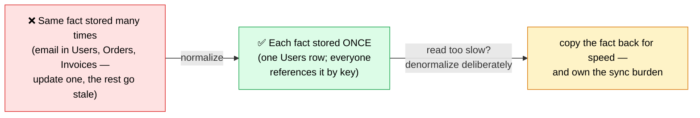
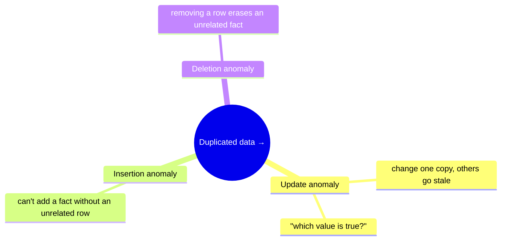
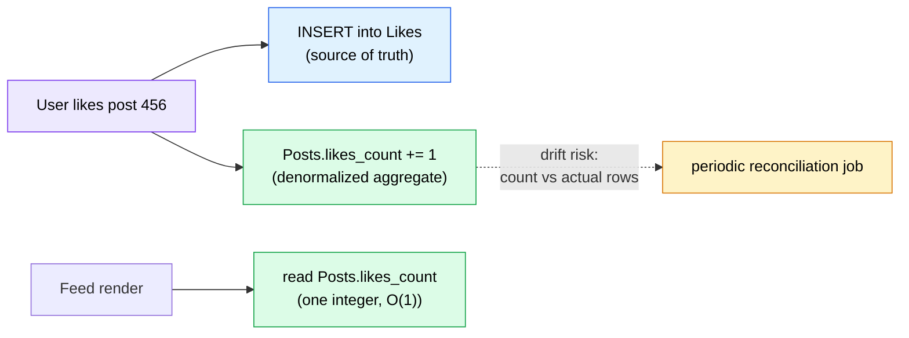
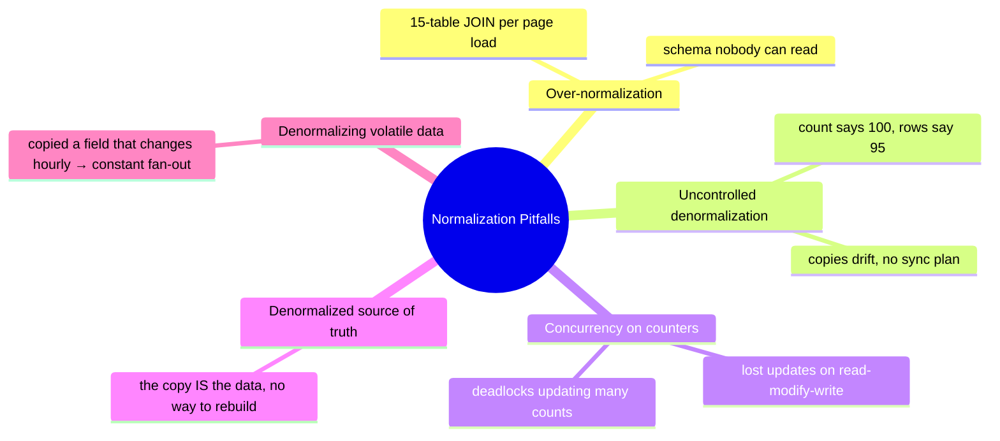

# Database Normalization & Denormalization

> **One line:** Normalization stores every fact *exactly once* so it can never disagree with itself; denormalization deliberately copies facts so reads don't have to reassemble them — and mature schema design is knowing exactly where to switch from the first to the second.

---

## Table of Contents
1. [Why You Must Master This](#1-why-you-must-master-this)
2. [The Mental Model](#2-the-mental-model)
3. [The Normal Forms (1NF → 3NF)](#3-the-normal-forms-1nf--3nf)
4. [Denormalization — Breaking the Rules on Purpose](#4-denormalization--breaking-the-rules-on-purpose)
5. [The Anomalies Normalization Prevents](#5-the-anomalies-normalization-prevents)
6. [Worked Example — The Likes Counter](#6-worked-example--the-likes-counter)
7. [Real-Life Use Cases](#7-real-life-use-cases)
8. [Failure Modes](#8-failure-modes)
9. [🏋️ Practice Drills](#-practice-drills)
10. [🎤 Interview Q&A Bank](#-interview-qa-bank)
11. [🎯 Staff+ Nuances](#-staff-nuances)
12. [Cheat Sheet](#12-cheat-sheet)
13. [Connections & Further Reading](#13-connections--further-reading)

---

## 1. Why You Must Master This

Schema design is the decision you make earliest and change latest. Normalization is the theory behind *where the seams go* — and denormalization is the pressure-release valve every real high-traffic system eventually pulls.

- **It's the mechanism behind the "C" in ACID.** Normalization is *how* you get [consistency](./ACID_Properties.md): if a fact lives in one place, it's structurally impossible for two parts of the system to disagree about it. Duplicate it, and you've signed up to keep the copies in sync yourself.
- **JOINs vs redundancy is a real performance lever.** A fully normalized schema can force a 15-table join for one page load; a denormalized one reads a single row. Knowing when the join tax is worth paying (and when it isn't) is a daily engineering call.
- **Interviewers use it to separate memorizers from designers.** Reciting the normal forms is table stakes. The signal is knowing *when to break them* — and being able to name the cost you're taking on when you do.
- **NoSQL is denormalization as a default.** A document store *is* a pre-joined aggregate; understanding normalization is understanding what you traded away when you chose it (see [Relational vs NoSQL](./Relational_vs_NoSQL.md)).

> **The core problem it solves:** *update anomalies.* When the same fact is stored in many places, an update that misses one copy leaves the database contradicting itself. Normalization removes the duplication so the anomaly can't happen; denormalization reintroduces it deliberately, accepting the sync burden in exchange for read speed.

---

## 2. The Mental Model

Think about how you store clothes:

- **Normalized = a closet with labeled boxes.** Shirts in one box, pants in another, socks in a third. Each item lives in exactly one place, nothing is duplicated, and changing "all my socks" means opening one box. But assembling an *outfit* means visiting three boxes — a JOIN.
- **Denormalized = a pre-packed suitcase.** You've copied the shirt, pants, and socks you need into one bag. Grab it and go — one lookup, no assembly. The cost: those clothes now exist in two places, so if you tailor the shirt, you must remember to fix *both* the closet copy and the suitcase copy, or they'll disagree.

The trade is **when you pay the assembly cost**: normalized pays it on every read (the JOIN); denormalized pays it once on write (the copy), plus a standing obligation to keep copies in sync.





---

## 3. The Normal Forms (1NF → 3NF)

Each form removes one *kind* of redundancy. In practice, **3NF is the working target** — most OLTP schemas aim for it and stop.

| Form | Rule (plain English) | The smell it removes |
|------|----------------------|----------------------|
| **1NF** | One value per cell — no comma-lists, no repeating column groups | `phones = "555-1, 555-2"` crammed in one cell |
| **2NF** | (composite keys only) Every non-key column depends on the *whole* key, not part of it | In `(order_id, product_id) → …`, storing `product_name` that depends on `product_id` alone |
| **3NF** | No non-key column depends on *another* non-key column | `zip → city → row`: `city` is determined by `zip`, not by the key |

The classic 3NF fix — pull the transitively-dependent columns into their own table and reference them by key:

```sql
-- ❌ NOT 3NF: city/zip depend on each other, not on the employee key.
-- Change a zip's city once, and every employee with that zip drifts.
Employee(emp_id PK, name, dept_id, zip, city)

-- ✅ 3NF: the fact "this zip is in this city" lives in exactly one place.
Employee(emp_id PK, name, dept_id, zip)
Zip(zip PK, city)
Department(dept_id PK, dept_name)     -- and dept_name normalized out too
```

Beyond 3NF live **BCNF, 4NF, 5NF** — they handle rarer key-overlap and multi-valued-dependency edge cases. Know they exist; you'll almost never design past 3NF in practice, and reaching for them without a concrete anomaly is usually over-engineering.

---

## 4. Denormalization — Breaking the Rules on Purpose

Denormalization is *intentional, measured* redundancy added to make a specific read fast. The keyword is **intentional** — accidental duplication is a bug; denormalization is a documented trade with an owner for the sync burden.

Common techniques:
- **Precomputed aggregates.** Store `likes_count` on the post instead of `COUNT(*)`-ing the likes table every render (see [§6](#6-worked-example--the-likes-counter)).
- **Copied reference data.** Store `user_name` on the `Orders` row so an order list doesn't join `Users`. Valid when the copied field is *stable* and the read is hot.
- **Materialized views.** Let the database maintain a precomputed result table, refreshed on a schedule or on write — denormalization the engine keeps in sync for you.
- **Read-model caching.** Keep the source of truth normalized in the DB, and store the pre-joined "grab-and-go" shape in [a cache](../06_Caching_Performance/) (Redis) — the write path stays clean, the read path is fast.

```sql
-- NORMALIZED: correct, but this JOIN runs on every order-list page load.
SELECT o.id, u.name FROM Orders o JOIN Users u ON o.user_id = u.id;

-- DENORMALIZED: copy the stable name onto the order.
ALTER TABLE Orders ADD COLUMN user_name VARCHAR(255);
-- Reads are now a single-table scan — no JOIN:
SELECT id, user_name FROM Orders;
-- The price: renaming a user must fan out to their order rows,
-- or user_name drifts out of sync with Users.name.
```

> **The discipline:** denormalize *last*, from a measured slow query, with a written plan for how the copies stay consistent (synchronous update, async event/CDC, or periodic reconciliation). "Normalize until it hurts, then denormalize until it works."

---

## 5. The Anomalies Normalization Prevents

Normalization isn't aesthetics — it eliminates three concrete failure classes that duplicated data invites:

- **Update anomaly.** The same email is stored in 5 tables; an update touches 4. Now the system contradicts itself, and which value is "true" depends on which table you read.
- **Insertion anomaly.** You can't record a new department until at least one employee is assigned to it, because department data only lives on employee rows.
- **Deletion anomaly.** Deleting the last product in a category silently erases the category itself, because the category name only existed on product rows.



Each anomaly is the same root cause — *a fact stored in more than one place* — which is exactly what normalization forbids and denormalization knowingly reintroduces.

---

## 6. Worked Example — The Likes Counter

**The prompt:** "Show the like count on every post. A viral post has 10M likes and the feed renders hundreds of posts per screen."

**The normalized approach** stores each like as a row and counts on read:

```sql
SELECT COUNT(*) FROM Likes WHERE post_id = 456;   -- scans 10M rows, per post, per render
```

On a feed of 200 posts, that's 200 counts, some over millions of rows, on every scroll. It will not hold up.

**The denormalized approach** stores the count on the post and maintains it on write:



**Closing the loop — number → consequence:**
- Read cost drops from *scan 10M rows* to *read one integer* — the whole reason to denormalize.
- New cost: every like now does **two writes**, and under heavy concurrency those increments contend (`likes_count += 1` can lose updates or deadlock).
- New failure mode: the count can drift from the true row count (says 100, really 95). The mitigation is a **reconciliation job** that periodically recomputes the exact count, plus atomic increments (`UPDATE … SET likes_count = likes_count + 1`) rather than read-modify-write.

The example is the whole topic in miniature: denormalization bought a massive read win and, in exchange, handed you a write-consistency problem you must now actively manage.

---

## 7. Real-Life Use Cases

| Situation | How the normalize/denormalize call decides the outcome |
|-----------|--------------------------------------------------------|
| **Financial ledger** | Fully normalized — every amount stored once, ACID-protected. Drift is unacceptable; the join cost is worth it. |
| **Social feed / like & follower counts** | Denormalized counters; reconcile periodically. `COUNT(*)` at read time can't survive viral scale. |
| **Order history list** | Copy stable fields (`user_name`, `product_name` at purchase time) onto the order — also a correctness win: it captures the value *as of the sale*. |
| **Analytics / reporting** | Denormalized star schema (facts + dimensions) or a [columnar warehouse](./Columnar_Databases.md); joins pre-flattened for scan speed. |
| **Logging / event store** | Denormalized by nature — write-once, self-contained records optimized for append and read, never updated. |
| **Admin/config tables** | Normalized — low volume, correctness-critical, rarely read on a hot path, so the join cost is irrelevant. |

> **The habit:** normalize the *source of truth*; denormalize the *read models* — and never let a denormalized copy become the system of record.

---

## 8. Failure Modes



- **Over-normalization.** Symptom: every page joins a dozen tables; devs can't hold the schema in their heads. *Fix:* stop at 3NF unless a concrete anomaly demands more; denormalize the hot read paths deliberately.
- **Uncontrolled denormalization / drift.** Symptom: the counter and the row count disagree. *Fix:* one owner for the copy, a defined sync mechanism (sync update, CDC/event, or reconciliation), and monitoring that alerts on drift.
- **Counter concurrency.** Symptom: 1,000 simultaneous likes, count off by dozens; deadlocks. *Fix:* atomic in-DB increments (not read-modify-write), or shard the counter and sum shards; consider a queue to serialize.
- **Denormalized source of truth.** Symptom: the only copy of a fact is a denormalized one, so you can't rebuild it. *Fix:* always keep a normalized system of record; denormalized shapes must be *derivable* from it.
- **Denormalizing volatile fields.** Symptom: you copied a value that changes constantly, so writes fan out endlessly. *Fix:* only denormalize *stable* fields (a name, a purchase-time price); join for volatile ones.

---

## 🏋️ Practice Drills

> *Cover the solutions and attempt first — active recall is the point.*

**Drill 1 — Spot the violation.** A table `Orders(order_id PK, customer_id, customer_email, product_id, product_name, product_category)`. Which normal form does it violate, and how do you fix it?

<details><summary>Solution</summary>

It violates **3NF** (and arguably good sense) via multiple transitive dependencies: `customer_email` depends on `customer_id` (not the order), and `product_name`/`product_category` depend on `product_id` (not the order). None of these are properties *of the order* — they're properties of the customer and product that happen to be copied in.

Fix — pull each set of transitively-dependent columns into its own table, referenced by key:
```sql
Orders(order_id PK, customer_id FK, product_id FK)
Customers(customer_id PK, email)
Products(product_id PK, name, category)
```
Now a customer's email lives in exactly one place; changing it can't create drift. (Exception: if this were an *order history*, you might deliberately denormalize `product_name` and the *price at purchase time* — because you want the value **as of the sale**, which is a correctness reason, not just speed.)
</details>

**Drill 2 — Fix the counter.** Your `likes_count` column is drifting: under load it undercounts. The code does `count = SELECT likes_count; UPDATE SET likes_count = count + 1`. What's wrong and how do you fix it?

<details><summary>Solution</summary>

**Lost updates from read-modify-write.** Two concurrent likes both read `count = 100`, both write `101` — two likes, one increment. The read and the write aren't atomic.

Fixes, in order of preference:
1. **Atomic increment in the DB:** `UPDATE Posts SET likes_count = likes_count + 1 WHERE id = 456;` — the database serializes it; no lost updates.
2. **Sharded counters** for extreme write rates: maintain N sub-counters, increment a random one, sum on read — spreads contention so a single hot row isn't the bottleneck.
3. **Periodic reconciliation** regardless: a job that recomputes the true `COUNT(*)` and corrects drift from any missed events.
</details>

**Drill 3 — Should you denormalize?** A dashboard runs a 6-table join that takes 4 seconds and is loaded 10,000×/day. Walk through the decision.

<details><summary>Solution</summary>

Yes — but choose the *right* mechanism, and keep the source of truth normalized.

1. **Try cheaper fixes first:** are the join columns indexed? Is the query plan sane? Sometimes a missing [index](./Database_Indexing.md) turns 4s into 40ms with zero denormalization.
2. **If it's genuinely a join-assembly cost**, use a **materialized view** — the DB precomputes the flattened result and refreshes it on a schedule (or a **read-model cache** in Redis if slight staleness is fine). The base tables stay normalized.
3. **Match freshness to need:** a dashboard usually tolerates minutes-old data, so a periodically-refreshed materialized view is ideal — no per-write fan-out, no drift on the hot path.

The point: denormalize the *read model*, not the *system of record*, and prefer engine-maintained denormalization (materialized views) over hand-maintained copies.
</details>

---

## 🎤 Interview Q&A Bank

**Q1. "Walk me through the normal forms."** *(signal: baseline literacy)*
> 1NF: atomic cells, no repeating groups. 2NF (for composite keys): every non-key column depends on the whole key, not part of it. 3NF: no non-key column depends on another non-key column — no transitive dependencies. In practice I design to 3NF and stop; BCNF/4NF/5NF exist for rarer key-overlap and multi-valued cases but I only reach for them against a concrete anomaly.

**Q2. "Our app is slow because of too many JOINs. How do you fix it?"** *(signal: do they jump straight to denormalizing?)*
> First I'd confirm it's actually the joins — check indexes and query plans, because a missing index masquerades as "joins are slow." If the joins are genuinely the cost, I'd denormalize the specific hot read path: a materialized view or a cached read model, keeping the base tables normalized. I denormalize surgically from a measured query, not by flattening the whole schema.

**Q3. "What's an update anomaly?"**
> When the same fact is stored in multiple places and an update misses some copies, leaving the database contradicting itself. It's the core problem normalization prevents — store each fact once and it's structurally impossible.

**Q4. "When is denormalization the right call?"**
> When a read path is hot and measurably slow, the copied data is *stable*, and I have a concrete plan to keep copies in sync. Classic cases: precomputed counters (likes/followers), copying stable reference fields onto a row, and analytics star schemas. I avoid it for volatile fields (endless fan-out) and never make the denormalized copy the source of truth.

**Q5. "How do you keep denormalized data consistent?"**
> Three mechanisms depending on freshness needs: synchronous update in the same transaction (strongest, slowest), asynchronous propagation via events/CDC (eventual consistency, scalable), or periodic reconciliation jobs that recompute the true value. Usually a combination — async propagation for speed plus reconciliation as a safety net against drift.

**Q6. "Is NoSQL just denormalization?"**
> Largely, yes — a document store pre-joins related data into one aggregate, which is denormalization as the default storage model. That's why it reads fast by key and why it inherits denormalization's cost: duplicated fields must be kept in sync, and there's no engine-enforced single source of truth. The normalization skills transfer directly.

**Q7. "Why might you copy a product's name and price onto an order row?"** *(signal: correctness vs performance)*
> Two reasons, and the correctness one is stronger. Performance: the order-history list avoids joining Products. Correctness: I want the name and price **as they were at purchase time** — if the product later gets renamed or repriced, the historical order must not change. Here the "copy" isn't drift, it's an intentional immutable snapshot.

---

## 🎯 Staff+ Nuances

- **Normalization and denormalization aren't opposites — they're layers.** Mature systems keep a normalized system of record and derive denormalized read models from it (materialized views, caches, search indexes, CQRS read stores). The denormalized shapes are *disposable and rebuildable*; the normalized core is the truth. Losing that separation is where drift becomes unrecoverable.
- **Some denormalization is correctness, not performance.** Copying a price onto an order at purchase time is not an optimization — it's capturing a fact *as of a moment in time* that must never change when the source does. Recognizing "temporal snapshot" vs "cached copy" changes how you reason about drift: the snapshot is *supposed* to diverge.
- **Counters are a distributed-systems problem in disguise.** A single hot `likes_count` row is a contention point; the real answer at scale is sharded counters or an append-only event log summed asynchronously — the same pattern as CRDT counters. "Add a column" hides a concurrency design decision.
- **3NF is a floor for OLTP and a ceiling you invert for OLAP.** Transactional systems normalize (write integrity); analytical systems deliberately denormalize into star/snowflake schemas (scan/aggregate speed). The *same data* is modeled oppositely depending on whether it's being written or analyzed — which is why analytics gets its own [columnar](./Columnar_Databases.md) store.
- **CDC turns denormalization from a liability into a pipeline.** Change Data Capture streams the normalized source's changes so downstream denormalized views update automatically — the modern way to have both integrity and fast reads without hand-maintained copies. It converts "keep the copy in sync" from application code into infrastructure.
- **Over-normalization has a real cognitive cost.** A schema so fragmented that a common query joins 15 tables is its own failure mode — it slows development, invites wrong joins, and buries the domain model. Normalization serves correctness; past 3NF it often stops serving *anyone*.

---

## 12. Cheat Sheet

```
NORMALIZATION vs DENORMALIZATION — STORE A FACT ONCE, OR COPY IT ON PURPOSE
═══════════════════════════════════════════════════════════════════════════

THE NORMAL FORMS (design target = 3NF)
  1NF  atomic cells — no comma-lists, no repeating groups
  2NF  (composite keys) non-key cols depend on the WHOLE key
  3NF  no non-key col depends on another non-key col (no transitive dep)
  BCNF/4NF/5NF  rare key-overlap / multi-valued cases — reach only for a real anomaly

NORMALIZE (default)                DENORMALIZE (surgical, measured)
  + one source of truth              + fast reads, no JOIN
  + no update/insert/delete anomaly  + simple queries
  + minimal storage                  + precomputed aggregates
  - JOIN cost on every read          - write fan-out + drift risk
  - many small tables                - must keep copies in sync

ANOMALIES NORMALIZATION KILLS (all = "fact stored twice")
  UPDATE   change one copy, others go stale
  INSERT   can't add a fact without an unrelated row
  DELETE   removing a row erases an unrelated fact

WHEN TO DENORMALIZE
  ✓ hot read path, MEASURED slow
  ✓ copied field is STABLE (or a temporal snapshot: price-at-purchase)
  ✓ you have a sync plan: sync-update | event/CDC | reconciliation
  ✗ never make the denormalized copy the source of truth
  ✗ never denormalize volatile fields (endless fan-out)

COUNTERS: use atomic `col = col + 1`, or sharded counters + reconcile.
MANTRA: normalize until it hurts, then denormalize until it works.
```

---

## 13. Connections & Further Reading

**Within this repo:**
- [ACID_Properties.md](./ACID_Properties.md) — normalization is the structural mechanism behind Consistency.
- [Relational_vs_NoSQL.md](./Relational_vs_NoSQL.md) — NoSQL document stores are denormalization as the default model.
- [Database_Indexing.md](./Database_Indexing.md) — often the *real* fix for "slow joins" before you denormalize.
- [Columnar_Databases.md](./Columnar_Databases.md) · [Data_Warehousing_Data_Lakes.md](./Data_Warehousing_Data_Lakes.md) — where deliberate denormalization (star schemas) is the norm.
- [Caching & Performance](../06_Caching_Performance/) — the read-model cache that lets the DB stay normalized.

**External classics:**
- *Database System Concepts* (Silberschatz, Korth, Sudarshan) — the canonical normalization treatment.
- *Designing Data-Intensive Applications* (Kleppmann) — Ch. 2 on normalization vs the document model.
- [Microsoft: Normalization Basics](https://learn.microsoft.com/en-us/office/troubleshoot/access/database-normalization-description) — a concise reference.

---

## TL;DR
**Normalize so every fact lives in exactly one place — that's what makes update, insertion, and deletion anomalies structurally impossible and is the real mechanism behind the "C" in ACID.** Design to 3NF and stop; go further only against a concrete anomaly. Then, from *measured* slow read paths, denormalize deliberately — precomputed counters, copied stable fields, materialized views — accepting the write fan-out and drift risk in exchange for read speed, and keeping a defined sync mechanism plus a normalized source of truth you can always rebuild from. **Normalize until it hurts, then denormalize until it works — but never let the copy become the truth.**
