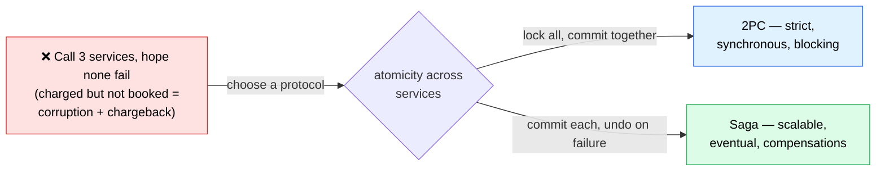
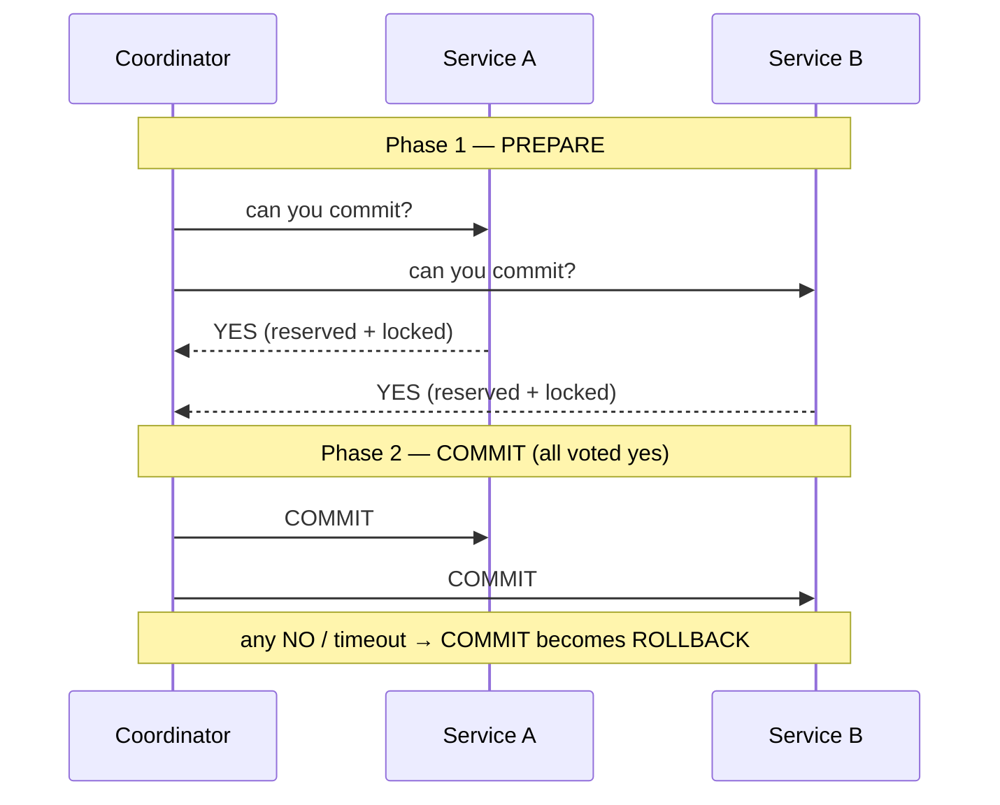
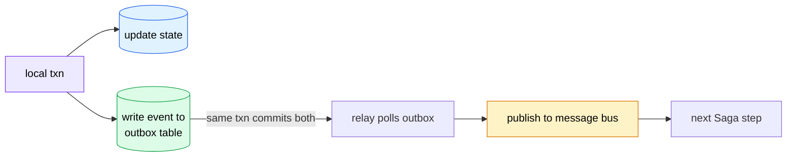
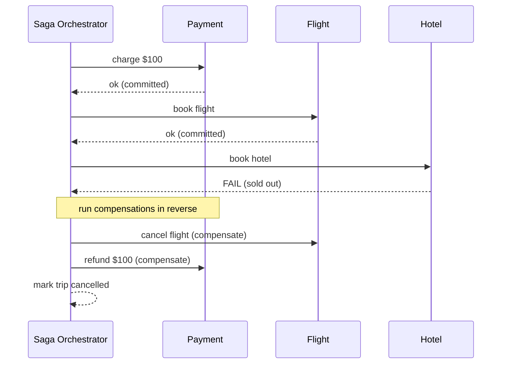
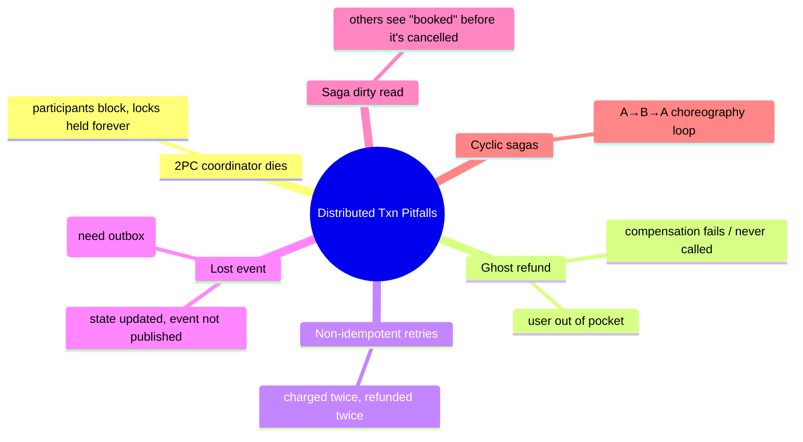

# Distributed Transactions (2PC, 3PC, Saga)

> **One line:** A single database's [ACID](./ACID_Properties.md) guarantee stops at its own edge — so when one business action spans several services or databases, you need a distributed protocol to keep "charged the card" and "booked the flight" from drifting apart, and the two options are *lock everyone until all agree* (2PC) or *do each step and undo it if a later one fails* (Saga).

---

## Table of Contents
1. [Why You Must Master This](#1-why-you-must-master-this)
2. [The Mental Model](#2-the-mental-model)
3. [Two-Phase Commit (2PC) — and 3PC](#3-two-phase-commit-2pc--and-3pc)
4. [The Saga Pattern](#4-the-saga-pattern)
5. [Making Sagas Correct — Idempotency & Outbox](#5-making-sagas-correct--idempotency--outbox)
6. [Worked Example — Booking a Trip](#6-worked-example--booking-a-trip)
7. [Real-Life Use Cases](#7-real-life-use-cases)
8. [Failure Modes](#8-failure-modes)
9. [🏋️ Practice Drills](#-practice-drills)
10. [🎤 Interview Q&A Bank](#-interview-qa-bank)
11. [🎯 Staff+ Nuances](#-staff-nuances)
12. [Cheat Sheet](#12-cheat-sheet)
13. [Connections & Further Reading](#13-connections--further-reading)

---

## 1. Why You Must Master This

The moment you split a monolith into microservices — or [shard](./Sharding_Partitioning.md) one database into many — you *lose* the free ACID transaction that used to wrap a multi-step operation. Re-establishing consistency across those boundaries is one of the defining hard problems of distributed backend engineering.

- **Partial failure is a financial and legal event.** "Booking a trip" touches Flights, Hotels, and Payments. Charge the card but fail to book the flight, and you have an angry customer and a chargeback. Distributed transactions exist to make that state impossible — or self-healing.
- **ACID doesn't cross process boundaries.** `BEGIN TRANSACTION` is atomic *within one database*. Across services, "just call three APIs and hope" works 99% of the time — and the 1% is lost revenue and corruption. You need an explicit protocol.
- **The 2PC-vs-Saga choice is a scalability decision.** 2PC gives strict atomicity but holds locks and blocks; Sagas give scale and resilience but force you to write compensating "undo" logic for everything. Knowing which to reach for (and that 2PC rarely survives at scale) is senior signal.
- **It's the classic microservices interview.** "How do you move a balance between two services?" or "ensure consistency across services?" is really "2PC or Saga, and why?" — plus the correctness machinery (idempotency, outbox) that makes it actually work.

> **The core problem it solves:** *atomicity across multiple independent systems.* A local transaction guarantees all-or-nothing within one database. When an operation spans several, there's no shared transaction — so you either coordinate a synchronized commit (2PC) or sequence local commits with compensating rollbacks (Saga) to prevent a half-completed, inconsistent state.

---

## 2. The Mental Model

Think of organizing a **group vacation:**

- **2PC = the synchronized "everyone buy now."** One organizer asks everyone, "Are you *ready* to buy your ticket?" Everyone who says yes *holds their money aside* (locks resources) and waits. Only when *all* have confirmed does the organizer say "buy!" If even one person says no or goes silent, nobody buys. Atomic — but everyone's money is frozen while they wait, and if the organizer disappears mid-process, everyone's stuck holding.
- **Saga = do-then-undo.** No global freeze. You buy the flight; that worked, so you book the hotel; the hotel fails, so you *call the airline and cancel the flight* (a compensating transaction). Each step commits immediately and independently, and failures are handled by explicitly reversing what was already done.

The trade is **locks-and-atomicity (2PC) vs no-locks-but-eventual-and-you-write-the-undos (Saga)**. At scale, holding locks across services is untenable, so Sagas dominate real microservice architectures.





---

## 3. Two-Phase Commit (2PC) — and 3PC

**2PC** uses a *coordinator* to drive an all-or-nothing commit across participants:



- **Phase 1 (Prepare):** the coordinator asks each participant "can you commit?" Each reserves the resources, writes to its log, locks, and votes YES/NO.
- **Phase 2 (Commit/Abort):** if *all* voted YES, the coordinator says COMMIT; any NO (or timeout) → ROLLBACK everywhere.

It's **strongly consistent and atomic** — but the fatal weakness is **blocking**: participants hold locks between the two phases, and *if the coordinator dies after Phase 1*, participants are stuck holding locks indefinitely, unable to decide. That plus its synchronous latency and the coordinator being a single point of failure make 2PC a poor fit at scale.

**3PC (Three-Phase Commit)** inserts a "pre-commit" phase so participants can safely decide on a coordinator timeout, removing the indefinite block — but it adds a round trip and *still* fails under network partitions, so it's largely theoretical and rarely deployed.

> **When 2PC is acceptable:** low-participant-count, low-latency, high-value operations within a controlled environment (e.g. XA transactions across two databases in one datacenter). At microservice scale across a network, it's usually the wrong tool.

---

## 4. The Saga Pattern

A **Saga** breaks the distributed transaction into a sequence of **local** transactions, each with a matching **compensating transaction** that semantically undoes it. Steps commit immediately (no cross-service locks); if a later step fails, the Saga runs the compensations for the completed steps in reverse.

```python
class TripSaga:
    def execute(self, user):
        if not payment.charge(user, 100):
            return "payment failed"                    # nothing to undo yet
        if not flight.book("F123"):
            payment.refund(user, 100)                  # compensate step 1
            return "flight failed, refunded"
        if not hotel.book("H456"):
            flight.cancel("F123"); payment.refund(user, 100)  # compensate 2 then 1
            return "hotel failed, trip cancelled"
        return "trip booked"
```

Two coordination styles:

| Style | How it works | Pros | Cons |
|-------|--------------|------|------|
| **Orchestration** | A central Saga manager tells each service what to do next | Explicit, easy to see/monitor the flow; centralized error handling | The orchestrator is a component to build and scale |
| **Choreography** | Each service reacts to events and emits its own; no central brain | Fully decoupled, no central bottleneck | Flow is implicit/scattered — hard to trace, risk of cyclic dependencies |

Sagas are **highly scalable** (no long-held locks, asynchronous) but come at real cost: you must write and test **compensating logic for every step**, and the system is only **eventually consistent** — between steps, the world is in a visible intermediate state (the flight is booked before the hotel step decides the trip's fate).

> **The design reality:** compensations aren't always a clean rollback. You can't "un-send" an email; the compensation is a *second* action (send a cancellation). Modeling semantic undo — not literal rollback — is the hard part.

---

## 5. Making Sagas Correct — Idempotency & Outbox

Two patterns turn a naive Saga into a reliable one:

- **Idempotency.** Saga steps and compensations are retried on failure (networks are unreliable), so each must be safe to run *more than once* — charging a card twice or refunding twice is a disaster. Use an idempotency key (a unique request ID) so a retried "charge" or "refund" is deduplicated to a single effect. This is the safety net behind "the compensation failed, retry it."
- **The Outbox pattern.** A Saga step usually must *update its database* AND *publish an event* (so the next step fires). If those two aren't atomic, a crash between them loses the event (step done, next step never triggered) or emits a phantom (event sent, DB rolled back). The outbox pattern writes the event into an `outbox` table *in the same local transaction* as the state change; a separate relay reads the outbox and publishes reliably. This makes "update state + emit event" atomic without a distributed transaction — it's the backbone of correct [event-driven](../03_High_Level_Design/Event_Driven_Architecture.md) Sagas.



**TCC (Try-Confirm-Cancel)** is a related middle-ground: a Try phase reserves resources (like 2PC's prepare, but at the application layer), then Confirm or Cancel — giving 2PC-like semantics without holding database locks.

---

## 6. Worked Example — Booking a Trip

**The prompt:** "Book a trip = charge payment + reserve flight + reserve hotel, across three services. One fails. Keep it consistent."

**Why not 2PC?** It would lock payment, flight, and hotel resources across a multi-second, network-spanning flow, and a coordinator crash would freeze all three. For a user-facing, scalable booking flow, that's untenable. → **Orchestrated Saga.**



**Closing the loop — number → consequence:**
- Each step **commits immediately** and independently — no locks held across services, so the flow scales and doesn't block other bookings.
- The hotel failure triggers **compensations in reverse order**: cancel the flight, then refund the payment. The user ends where they started — no charge, no phantom booking.
- **Correctness machinery in play:** the refund and cancel are **idempotent** (retried safely if they fail), and each service uses the **outbox pattern** so its state change and its event publish are atomic — a crash can't leave the flight booked but the "flight booked" event unsent.
- **The cost you accept:** *eventual* consistency and a visible intermediate state — for a brief window the flight *was* booked before being cancelled. If another process read "flight booked" in that window (a dirty read), it saw a state that got rolled back. You design around this (mark tentative bookings as "pending") because it's the price of not holding locks.

**The consequence:** the Saga converted an impossible-to-lock cross-service operation into a resilient, scalable flow whose failures self-heal via compensations — trading strict atomicity and isolation for availability and scale, exactly the [ACID→BASE](./BASE_Philosophy.md) trade at the transaction level.

---

## 7. Real-Life Use Cases

| Situation | Approach and why |
|-----------|------------------|
| **Trip / order booking across services** | Orchestrated Saga — multi-step, user-facing, must scale; compensate on failure. |
| **Ride-hailing (reserve payment → find driver)** | Saga — release/refund the reservation if no driver is found. |
| **Two databases in one datacenter (XA)** | 2PC — few participants, controlled network, strict atomicity worth the locks. |
| **E-commerce checkout (order → payment → inventory)** | Saga + outbox — decrement inventory and charge as compensatable steps. |
| **Bank transfer across two account services** | Saga/TCC — reserve (Try), then Confirm/Cancel; never hold cross-service locks. |
| **Everything inside one database** | Plain local ACID `BEGIN…COMMIT` — no distributed transaction needed. |

> **The habit:** first ask "does this actually span transaction boundaries?" If it's one database, use a local transaction. Only reach for 2PC/Saga when the operation genuinely crosses services or shards — and default to Saga unless the participant count is tiny and locks are acceptable.

---

## 8. Failure Modes



- **2PC blocking on coordinator failure.** Symptom: participants stuck holding locks, whole flow frozen. *Fix:* avoid 2PC at scale; if used, add coordinator failover/recovery logs; prefer Saga/TCC.
- **Ghost refund (compensation fails).** Symptom: the forward step committed but its compensation never completed — user charged with no booking. *Fix:* make compensations idempotent and *retried until success* (durable retry queue); alert on stuck compensations; never treat a compensation as fire-and-forget.
- **Non-idempotent retries.** Symptom: a retried charge double-bills. *Fix:* idempotency keys so a repeated operation has one effect.
- **Lost event / dual-write problem.** Symptom: DB updated but the event that triggers the next step was never published (crash in between). *Fix:* the outbox pattern — write state change and event in one local transaction, relay publishes.
- **Saga dirty reads / intermediate state.** Symptom: another process acts on a state that later gets compensated. *Fix:* model intermediate states explicitly ("pending"/"tentative") so consumers don't treat them as final; use semantic locks (TCC reservations).
- **Cyclic sagas (choreography).** Symptom: service events trigger each other in a loop. *Fix:* prefer orchestration for complex flows so the sequence is explicit and traceable.

---

## 🏋️ Practice Drills

> *Cover the solutions and attempt first — active recall is the point.*

**Drill 1 — 2PC or Saga?** For each, choose and justify: (a) committing across two Postgres databases in the same datacenter for a nightly batch; (b) an e-commerce checkout spanning order, payment, and inventory microservices; (c) transferring money between two independently-deployed account services.

<details><summary>Solution</summary>

(a) **2PC (XA).** Few participants (two databases), controlled low-latency network, batch context where holding locks briefly is acceptable, and you want strict atomicity. This is exactly the niche where 2PC is reasonable.

(b) **Saga (orchestrated) + outbox.** Three network-separated services, user-facing latency requirements, must scale — holding 2PC locks across them would block and bottleneck. Model each step (reserve order, charge, decrement inventory) as a local transaction with a compensation (cancel order, refund, restock).

(c) **Saga or TCC.** Cross-service money movement should never hold distributed locks. Use a Try-Confirm-Cancel reservation (reserve funds on the source, then confirm/cancel) or a Saga (debit source → credit dest → compensate the debit if the credit fails), with idempotency to make retries safe. The key insight: money transfer across services is *not* one ACID transaction and can't be treated as one.
</details>

**Drill 2 — The dual-write bug.** A service does `db.save(order)` then `queue.publish("order_created")`. Occasionally the order exists but downstream services never react. What's the bug and the fix?

<details><summary>Solution</summary>

**The dual-write problem.** The database write and the event publish are two separate operations with no shared transaction. If the service crashes (or the broker is briefly unreachable) *after* `db.save` but *before* `queue.publish` succeeds, the order is persisted but the event is lost — so the Saga stalls and downstream steps never fire. (The mirror bug: publish succeeds, DB write rolls back → phantom event for an order that doesn't exist.)

**Fix: the Outbox pattern.** Within the *same local transaction* that saves the order, insert a row into an `outbox` table describing the event. Because both writes are in one ACID transaction, they commit or roll back together — no lost or phantom events. A separate relay process (or Change Data Capture on the outbox table) then reads unpublished outbox rows and publishes them to the broker, marking them sent. Retries are safe because consumers are idempotent. This gives atomic "update state + emit event" without any distributed transaction.
</details>

**Drill 3 — Design the compensation.** A Saga step "send confirmation email to customer" needs a compensating transaction because a later step fails. What's the compensation, and what general lesson does this reveal about Sagas?

<details><summary>Solution</summary>

You **cannot un-send an email** — there is no literal rollback. The compensation must be a *new forward action*: send a **cancellation/correction email** ("Your booking could not be completed; you have not been charged").

General lessons:
1. **Compensations are semantic, not literal.** They restore business-level consistency, not byte-level prior state. Refund ≠ "undo charge," it's a new offsetting transaction.
2. **Some actions are hard or impossible to compensate** — sent emails, dispatched physical goods, fired external webhooks. Order the Saga so that **irreversible/hard-to-compensate steps come last** (the "pivot transaction"), after all the reversible steps have succeeded. Send the confirmation email only *after* flight+hotel+payment all commit — so you rarely need to compensate it at all.
3. This is why Saga design is real modeling work: you sequence steps by reversibility, and you accept that "undo" means "do something new that makes it right."
</details>

---

## 🎤 Interview Q&A Bank

**Q1. "Why can't you just use a normal ACID transaction across microservices?"**
> Because ACID transactions are scoped to a single database — `BEGIN…COMMIT` can't span separate services with separate databases. There's no shared transaction manager, no shared lock table. Once an operation crosses that boundary you need an explicit distributed protocol — 2PC to coordinate an atomic commit, or a Saga to sequence local transactions with compensations.

**Q2. "Explain two-phase commit and its main weakness."**
> A coordinator runs two phases: Prepare (ask all participants "can you commit?", they lock and vote) and Commit (if all voted yes, tell everyone to commit; otherwise roll back). It gives atomicity, but its fatal flaw is blocking — participants hold locks between phases, and if the coordinator crashes after Prepare, they're stuck holding those locks with no way to decide. That plus synchronous latency and the coordinator being a SPOF makes it a poor fit at scale.

**Q3. "What is the Saga pattern?"**
> A distributed transaction modeled as a sequence of local transactions, each with a compensating transaction that semantically undoes it. Each step commits immediately without cross-service locks; if a later step fails, the Saga runs the completed steps' compensations in reverse. It trades strict atomicity and isolation for scalability and eventual consistency.

**Q4. "Orchestration vs choreography for Sagas?"**
> Orchestration uses a central coordinator that explicitly tells each service what to do next — the flow is visible and easy to monitor, at the cost of building that orchestrator. Choreography has each service react to events and emit its own, fully decoupled but with an implicit, scattered flow that's hard to trace and can form cycles. I lean orchestration for complex, multi-step flows and choreography for simple, loosely-coupled ones.

**Q5. "Why do Saga steps need to be idempotent?"** *(signal: reliability depth)*
> Because steps and compensations are retried when the network fails or a response is lost, and a retried "charge" or "refund" must not double-charge or double-refund. Idempotency keys — a unique request ID per operation — let each service deduplicate retries to a single effect, which is what makes "retry until success" safe rather than dangerous.

**Q6. "What's the dual-write problem and how does the outbox pattern solve it?"**
> A Saga step often must update its database and publish an event; if those are separate operations, a crash between them loses the event (or emits a phantom). The outbox pattern writes the event into an outbox table in the *same local transaction* as the state change, so they commit atomically. A relay then reads the outbox and publishes reliably — giving atomic "update + emit" without a distributed transaction.

**Q7. "How do you handle a step that can't be rolled back, like sending an email?"**
> Compensations are semantic, not literal — you can't un-send an email, so the compensation is a new action (a cancellation email). More importantly, you order the Saga so irreversible steps come *last*, after all reversible steps succeed (the pivot transaction). That way you rarely need to compensate the un-compensatable action at all.

**Q8. "When would you avoid distributed transactions entirely?"**
> When the operation fits in one database — then a local ACID transaction is simpler and stronger, so I wouldn't split it just to use a Saga. And for non-critical flows (a failed log write doesn't need a compensating Saga), the coordination cost isn't worth it. Distributed transactions are for genuinely cross-boundary, correctness-critical operations only.

---

## 🎯 Staff+ Nuances

- **2PC is a trap at microservice scale, and knowing *why* is the signal.** Its blocking behavior means one slow or crashed participant can freeze resources across the whole system, and the coordinator is a SPOF. It's defensible only with few participants on a controlled low-latency network (XA across two DBs). Reaching for 2PC across services in an interview is a red flag; explaining its blocking failure mode and choosing Sagas is a green one.
- **Sagas trade away isolation, and that's the subtle cost, not atomicity.** People focus on "eventual consistency," but the sharper issue is *lost isolation*: between steps, the intermediate state is visible to everyone (the flight shows booked before the hotel step cancels it). This causes dirty-read-style anomalies at the business level. The mitigations — semantic locks, "pending" states, commutative updates, ordering the pivot last — are Saga design's real intellectual content.
- **Order steps by reversibility; the pivot transaction is the fulcrum.** A well-designed Saga puts all compensatable steps first and the hard-to-undo step (charge the card, dispatch goods, send email) last, as the "pivot." Before the pivot, any failure cleanly compensates; after it, the Saga is committed to completing forward. Getting this ordering right minimizes both the frequency and the pain of compensation.
- **The outbox pattern is non-negotiable and the most-skipped detail.** Almost every real Saga has the dual-write problem lurking, and teams discover it only when events mysteriously vanish under load. Writing the event transactionally with the state change (outbox) — or using CDC on the outbox table — is what makes the whole edifice reliable. An interviewer who mentions outbox unprompted has built one of these for real.
- **Idempotency + retries turn "at-least-once" delivery into "effectively-once."** Distributed messaging is at-least-once; duplicates *will* happen. Rather than fighting for exactly-once delivery (impossible in general), you make consumers idempotent so duplicate delivery is harmless. This reframing — "don't prevent duplicates, absorb them" — is a core distributed-systems maturity marker and ties directly to [idempotency](../02_API_Interface_Design/) as an API property.
- **TCC is the underappreciated middle path.** Try-Confirm-Cancel gives you 2PC-like reservation semantics (a Try phase that tentatively reserves) without holding *database* locks — the reservation is application-level state with a timeout. For money movement it's often cleaner than a compensation-based Saga because "cancel a reservation" is a natural, clean inverse, whereas "refund a completed charge" involves real settlement.
- **Distributed transactions are a reason to reconsider service boundaries.** If two services are constantly entangled in Sagas, that's a smell that the boundary is wrong — data that must change together often *belongs* together. The best distributed transaction is the one you designed away by co-locating the data (or the shard key) so a local transaction suffices. Sagas are a tool of last resort, not a default architecture.

---

## 12. Cheat Sheet

```
DISTRIBUTED TRANSACTIONS — ATOMICITY ACROSS SERVICES/DBs (ACID stops at one DB)
═══════════════════════════════════════════════════════════════════════════════

2PC — Two-Phase Commit               SAGA — local txns + compensations
  Phase1 PREPARE: lock + vote          each step commits immediately (NO locks)
  Phase2 COMMIT: all yes → commit      later step fails → run compensations reverse
  + strong, atomic                     + scalable, async, resilient
  - BLOCKS: coordinator dies in P2     - eventual consistency, lost isolation
    → locks held forever               - you write ALL the undo logic
  - synchronous, coordinator = SPOF    - compensations are SEMANTIC not literal
  use: few participants, 1 DC (XA)     use: microservices, scale — the DEFAULT

3PC adds pre-commit (non-blocking) but still fails on partition → rarely used.
TCC (Try-Confirm-Cancel): app-level reservation, 2PC-like without DB locks.

SAGA COORDINATION
  Orchestration  central manager drives steps   visible, monitorable  (complex flows)
  Choreography   services react to events       decoupled, hard to trace, cycle risk

MAKE SAGAS CORRECT (non-negotiable)
  Idempotency   unique key per op → retried charge/refund = ONE effect
  Outbox        write event + state in SAME local txn → no lost/phantom event
                (relay/CDC publishes) — solves the DUAL-WRITE problem
  Pivot last    order steps by reversibility; hard-to-undo step goes LAST

PITFALLS
  ✗ 2PC across services → blocking, frozen locks
  ✗ non-idempotent step → double charge on retry
  ✗ dual write (save + publish separately) → lost event → use OUTBOX
  ✗ treat compensation as fire-and-forget → ghost refund → retry until success
  ✗ Saga when one DB would do → just use local ACID

⚠ The best distributed transaction is the one you AVOID by co-locating the data.
```

---

## 13. Connections & Further Reading

**Within this repo:**
- [ACID_Properties.md](./ACID_Properties.md) — the single-database guarantee that stops at the service edge.
- [BASE_Philosophy.md](./BASE_Philosophy.md) — Sagas are the ACID→BASE trade at the transaction level.
- [Sharding_Partitioning.md](./Sharding_Partitioning.md) — cross-shard operations create the same coordination need.
- [Event_Driven_Architecture](../03_High_Level_Design/Event_Driven_Architecture.md) — the event backbone of choreographed Sagas and the outbox relay.
- [Consistency_Models.md](./Consistency_Models.md) — the eventual consistency a Saga accepts between steps.
- [Message Queues & Event Streaming](../09_Message_Queues_Event_Streaming/) — at-least-once delivery that idempotency absorbs.

**External classics:**
- [Saga pattern (microservices.io)](https://microservices.io/patterns/data/saga.html) — Chris Richardson's definitive reference.
- *Designing Data-Intensive Applications* (Kleppmann) — Ch. 9, distributed transactions and their limits.
- Caitie McCaffrey, *Applying the Saga Pattern* — the talk that popularized Sagas for modern systems.

---

## TL;DR
**A single database's ACID transaction can't span multiple services or shards, so a cross-boundary business action needs a distributed protocol to avoid half-completed, inconsistent state.** Two-Phase Commit locks all participants and commits atomically — strict but *blocking* (a coordinator crash freezes locks) and a poor fit at scale. The Saga pattern sequences local transactions, each with a compensating "undo," committing each step immediately with no cross-service locks — scalable and resilient, but only eventually consistent and it forgoes isolation, so you must write compensations, order the irreversible step last, and expose intermediate states as "pending." Make Sagas correct with **idempotency** (safe retries) and the **outbox pattern** (atomic state-change-plus-event, defeating the dual-write problem). **Default to Sagas across microservices, reserve 2PC for a few participants on a controlled network, and remember the best distributed transaction is the one you avoid by co-locating the data.**
