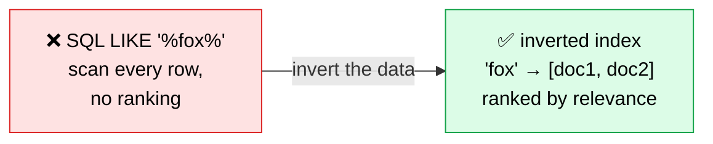
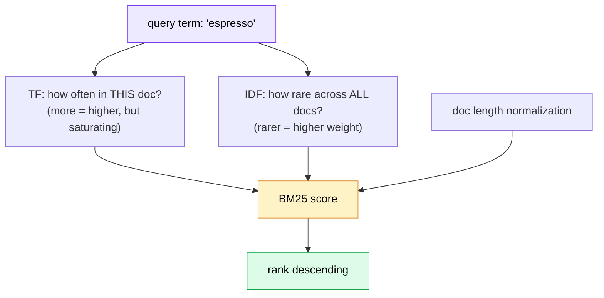
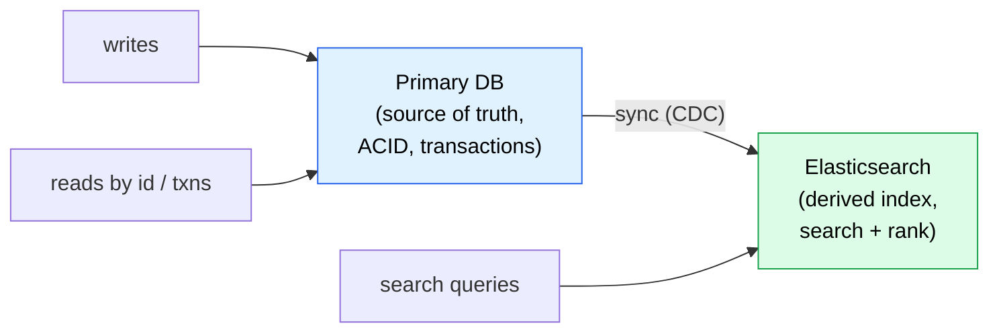
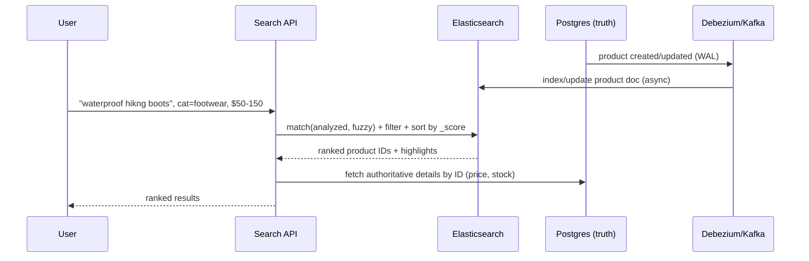
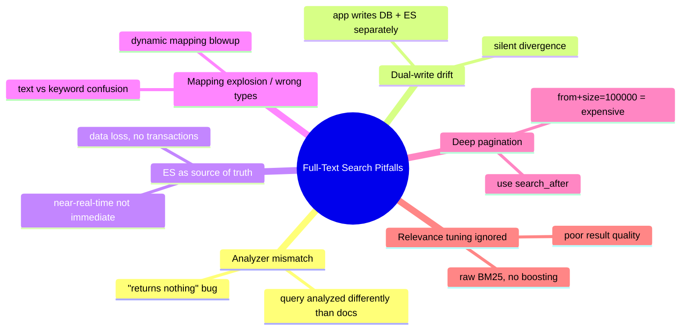

# Full-Text Search & Elasticsearch

> **One line:** Full-text search flips your data inside-out — instead of "for each document, what words does it have?", it builds an *inverted index* of "for each word, which documents have it?" — so a search becomes a hash lookup that returns results *ranked by relevance*, something `WHERE description LIKE '%...%'` can never do.

---

## Table of Contents
1. [Why You Must Master This](#1-why-you-must-master-this)
2. [The Mental Model](#2-the-mental-model)
3. [The Inverted Index — How Search Actually Works](#3-the-inverted-index--how-search-actually-works)
4. [Analysis — Tokenization, Stemming, Analyzers](#4-analysis--tokenization-stemming-analyzers)
5. [Relevance Scoring — TF-IDF and BM25](#5-relevance-scoring--tf-idf-and-bm25)
6. [Elasticsearch as a Secondary Datastore](#6-elasticsearch-as-a-secondary-datastore)
7. [Keeping It in Sync — CDC vs Dual-Write](#7-keeping-it-in-sync--cdc-vs-dual-write)
8. [Worked Example — Product Search on an E-commerce Catalog](#8-worked-example--product-search-on-an-e-commerce-catalog)
9. [Real-Life Use Cases](#9-real-life-use-cases)
10. [Failure Modes](#10-failure-modes)
11. [🏋️ Practice Drills](#-practice-drills)
12. [🎤 Interview Q&A Bank](#-interview-qa-bank)
13. [🎯 Staff+ Nuances](#-staff-nuances)
14. [Cheat Sheet](#14-cheat-sheet)
15. [Connections & Further Reading](#15-connections--further-reading)

---

## 1. Why You Must Master This

The moment a design has a search box — products, documents, messages, listings, logs — the answer is almost never "SQL `LIKE`." Full-text search is a distinct capability with its own data structure, and Elasticsearch (or OpenSearch/Solr/Lucene) is the reflex tool.

- **`LIKE '%term%'` doesn't scale and doesn't rank.** A leading-wildcard `LIKE` can't use a [B-tree index](./Database_Indexing.md) (it's a full table scan), and even if it matches, it returns rows in no meaningful order — no notion of "best match first." Search needs both fast matching *and* relevance ranking.
- **Search is a ranking problem, not a matching problem.** Users expect the *most relevant* result on top, typo tolerance, synonyms, stemming ("running" matches "run"), and phrase/proximity matching. That's an entire discipline your OLTP database wasn't built for.
- **It's a canonical "secondary datastore" design.** Running Elasticsearch *alongside* your primary DB — keeping them in sync — teaches the dual-write / CDC problem that shows up everywhere. Interviewers love "how do you keep search in sync with the source of truth?"
- **It powers more than search.** Log analytics (ELK), observability, autocomplete, geo-search, and even aggregations/dashboards run on the same inverted-index engine.

> **The core problem it solves:** *finding the most relevant documents for a text query, fast, across millions of documents* — where "relevant" means ranked by how well the text matches, with linguistic normalization the user never sees. A row store can filter; it can't rank text relevance at speed.

**Prerequisites:** [[Database_Indexing]] (why `LIKE '%x'` can't use an index), [[Relational_vs_NoSQL]] (source-of-truth vs derived stores).

---

## 2. The Mental Model

A regular database index is **a book's table of contents**; a search engine's inverted index is **a book's back-of-book index.**

- The table of contents (a forward view) is organized *by document*: chapter 1, chapter 2… To find every mention of "mitochondria" you'd read the whole book.
- The back-of-book index is organized *by term*: "mitochondria … pp. 34, 88, 210." One lookup gives you *every* place the word appears — instantly. That's an **inverted index**: term → list of documents (a "postings list").

The naive approach vs the right one:



> **Hold onto this:** don't ask "which documents contain this word?" by scanning documents — *precompute* the answer by building word→documents up front. Search is a lookup into a structure you built at index time, plus a ranking step.



> Documents and queries pass through the *same* analyzer; matching is a postings-list lookup; the result is *ranked*, not just filtered.

---

## 3. The Inverted Index — How Search Actually Works

The inverted index is the whole trick. Building and querying it:

**At index time**, each document's text is analyzed into terms, and for each term the engine records a **postings list** — the documents containing it, usually with extra data:

```
Documents:
  doc1: "the quick brown fox"
  doc2: "quick foxes run"
  doc3: "the brown dog"

Inverted index (after analysis):
  quick → [doc1, doc2]
  brown → [doc1, doc3]
  fox   → [doc1, doc2]        (foxes stemmed to fox)
  run   → [doc2]
  dog   → [doc3]
  (the → dropped as a stop word)
```

Each posting typically stores the **term frequency** (how many times the term is in that doc, for scoring) and **positions** (where, for phrase/proximity queries like `"quick fox"`).

**At query time:**
1. Analyze the query *the same way* the documents were analyzed (critical — see §4).
2. Look up each term's postings list (an O(1) hash/FST lookup).
3. Combine them: `AND` intersects lists, `OR` unions them. `"quick fox"` → `quick:[1,2] ∩ fox:[1,2] = {1,2}`.
4. **Score** each matching document by relevance and return them sorted (§5).


**Under the hood it's Lucene**, and Lucene's index segments are **immutable** (like [LSM SSTables](./B_Tree_vs_LSM_Storage_Engines.md)): new documents go into new segments, deletes are tombstoned, and background **merges** consolidate segments. That's why Elasticsearch is near-real-time (a ~1s refresh interval to make new docs searchable) rather than instantly consistent, and why it's write-optimized for bulk indexing.

> **The trade-off:** the inverted index is fantastic for text retrieval but is a *derived, denormalized* structure — you rebuild it from the source of truth, it lags slightly (near-real-time), and it's not transactional. It's a read-optimized secondary store, never your system of record.

---

## 4. Analysis — Tokenization, Stemming, Analyzers

**Analysis** is the pipeline that turns raw text into index terms — and it's where most "why didn't my search match?" bugs live. An **analyzer** = character filters → tokenizer → token filters:

1. **Character filters** — strip HTML, normalize characters (`&` → `and`).
2. **Tokenizer** — split text into tokens, usually on whitespace/punctuation: `"quick brown-fox"` → `[quick, brown, fox]`.
3. **Token filters** — transform tokens:
   - **Lowercasing** — `Fox` → `fox` (so search is case-insensitive).
   - **Stop-word removal** — drop `the, a, is, and` (high-frequency, low-value; though modern BM25 handles them so this is optional).
   - **Stemming** — reduce to root form: `running, runs, ran` → `run`; `foxes` → `fox`. This is *why* a search for "run" matches "running."
   - **Synonyms** — `laptop` ⇄ `notebook`.
   - **N-grams / edge-n-grams** — for autocomplete and typo tolerance (`quick` → `qu, qui, quic, quick`).


**The golden rule of analysis:** *the query must be analyzed with the same analyzer as the documents.* If documents were stemmed to `fox` but the query `foxes` isn't stemmed, they won't match. Mismatched analyzers is the #1 "search returns nothing" cause.

> **Real number / nuance:** language matters — an English stemmer mangles German or Chinese (which needs a dedicated tokenizer since words aren't space-separated). Pick analyzers per language; `keyword` type (no analysis) for exact-match fields like SKUs or tags, `text` type (analyzed) for prose.

---

## 5. Relevance Scoring — TF-IDF and BM25

Matching finds the candidate documents; **scoring** decides their order — and ordering is what makes search *search*. The classic intuition is **TF-IDF**, and the modern default is **BM25**.

- **TF (Term Frequency):** a term that appears *more often in a document* makes that document more relevant to it. A page saying "espresso" 10 times is more about espresso than one that says it once.
- **IDF (Inverse Document Frequency):** a term that is *rare across the whole corpus* is more discriminating. Matching "espresso" tells you far more than matching "the" — so rare terms get more weight.
- **TF-IDF score** ≈ TF × IDF, summed over query terms. It rewards documents that use the query's *rare* words *often*.

**BM25** (Best Matching 25) is TF-IDF's refined successor and the Elasticsearch/Lucene default. It fixes two TF-IDF weaknesses:
- **Term-frequency saturation** — the 20th occurrence of a word shouldn't count 20× the first. BM25 has diminishing returns (a saturation curve), so keyword stuffing stops helping.
- **Document-length normalization** — a term appearing in a short title is more significant than the same term buried in a 10,000-word article. BM25 penalizes length so long documents don't win just by being long.



Real systems layer **boosting** on top of BM25: boost by field (title matches > body matches), by business signals (in-stock, popularity, recency), and by exact-phrase bonuses. Increasingly, BM25 (lexical) is combined with [[Vector_Databases]] semantic search into **hybrid search** — BM25 for exact keyword precision, vectors for meaning.

> **Why SQL can't do this:** `LIKE` returns matched/not-matched — a boolean. It has no concept of "how well" a row matches, no term frequencies, no corpus statistics. Relevance ranking is the fundamental capability a search engine adds.

---

## 6. Elasticsearch as a Secondary Datastore

The central architectural point: **Elasticsearch is a *derived, read-optimized* store, not your system of record.** Your source of truth stays in a transactional database ([Postgres, etc.](./Relational_vs_NoSQL.md)); Elasticsearch holds a searchable *copy* of the fields you query.



**Why not just make Elasticsearch the primary?**
- It's **not a transactional database** — no multi-document ACID transactions, no foreign keys, near-real-time (not immediate) visibility, and it favors availability over strict consistency. Using it as a system of record risks data loss and consistency bugs.
- It's a **denormalized index** — you shape documents for search (flattened, duplicated fields), which is wrong for transactional writes.

**The division of labor:**
- **Primary DB:** writes, transactions, point lookups by ID, relational integrity — the truth.
- **Elasticsearch:** text search, faceting/aggregations, autocomplete, "search results" pages — a fast, ranked, disposable view you can *rebuild from the primary at any time.*

> **The reframing:** treat the search index like a cache you can regenerate. If it's corrupted or the mapping changes, you **reindex** from the source of truth. That "always rebuildable from the primary" property is what makes it safe to run as a secondary store.

---

## 7. Keeping It in Sync — CDC vs Dual-Write

The hard part isn't running Elasticsearch; it's keeping it consistent with the primary DB. Two approaches:

**Dual-write (the tempting anti-pattern):** the app writes to the DB *and* to Elasticsearch in the same request.
- *Problem:* it's a distributed dual-write with no atomicity. If the DB commit succeeds but the ES write fails (or vice versa), they diverge — silently. Retries can double-apply. This is the classic [dual-write inconsistency](./Distributed_Transactions.md).

**Change Data Capture (CDC) — the robust pattern:** the app writes *only* to the DB; a CDC pipeline tails the DB's write-ahead log/replication stream and streams changes to Elasticsearch.


- **Why CDC wins:** there's a single write (to the DB), so the app never has a dual-write to keep atomic. The log is the source of order; the pipeline is **eventually consistent** but *reliable* (replayable, idempotent). If ES falls behind or is rebuilt, you replay from the log/snapshot.
- **The transactional outbox** is a close cousin: the app writes the data row and an "outbox" event row in *one* DB transaction, and a relay publishes outbox rows to ES/Kafka. Same goal — make the event atomic with the data.
- **Accept eventual consistency:** search results lag the DB by seconds. That's almost always fine ("I edited a product; search shows the old title for 2 seconds") — but know it, and don't build read-your-writes-critical flows on the search index.

> **The rule:** never dual-write from the app. Write to the source of truth once, and *derive* the search index from its change stream — see [[Distributed_Transactions]] and the CDC note in [09 · Message Queues](../09_Message_Queues_Event_Streaming/).

---

## 8. Worked Example — Product Search on an E-commerce Catalog

**The prompt:** "10M products. Users search by free text ('waterproof hiking boots'), filter by category/price, sort by relevance, and expect typo tolerance and instant results. Design it."

**Why not Postgres `LIKE`:** `WHERE name LIKE '%hiking%' OR description LIKE '%hiking%'` can't use an index (leading wildcard → full scan of 10M rows), returns rows in arbitrary order, has no typo tolerance, and no relevance. At 10M rows and real traffic it's a non-starter.

**The design:**



- **Index:** each product becomes an ES document with analyzed `name`/`description` (`text` type, English analyzer + synonyms), and `keyword` fields for `category`, plus numeric `price`. The **primary DB stays the source of truth**; CDC keeps ES current.
- **Query:** a `multi_match` across name/description with **fuzziness** (`hikng`→`hiking` via edit distance), a `filter` on category and price range (filters don't affect score and are cached), and sort by BM25 `_score` with a **boost** on title matches and in-stock items.
- **Authoritative read:** ES returns *IDs and highlights*; the API fetches live price/stock from Postgres so users never see a stale price even if the index lags.

**Closing the loop — number → consequence:**
- The `LIKE` full scan (10M rows, ~seconds, unordered) becomes an **inverted-index lookup (~milliseconds, ranked)** — a different complexity class *and* a better result order.
- Fuzziness + stemming + synonyms convert "no results for a typo" into "the boots they meant, ranked best-first" — directly moving conversion.
- The CDC pipeline means the app writes products **once** to Postgres; search stays correct without a fragile dual-write, and the index can be **fully rebuilt** from Postgres if the mapping changes (e.g., adding a new analyzer).

The example is the whole topic: the inverted index makes search fast *and* ranked, analysis makes it forgiving, and CDC keeps the derived index honest against the source of truth.

---

## 9. Real-Life Use Cases

| Situation | How full-text search decides the outcome |
|-----------|------------------------------------------|
| **E-commerce product search** | Inverted index + BM25 + filters/facets + fuzziness → ranked, typo-tolerant results; primary DB stays truth. |
| **Log & observability (ELK)** | Ingest logs into Elasticsearch, search/aggregate/dashboard in Kibana — the analytics angle of the same engine. |
| **Site / docs / help-center search** | Analyzed text + highlighting + synonyms; near-real-time indexing via CDC. |
| **Autocomplete / search-as-you-type** | Edge-n-gram or completion suggester → sub-10ms prefix matches. |
| **Geo + text search** | "coffee shops near me named 'roast'" → geo filter + text match in one query. |
| **Search inside stored documents** | Extract text from PDFs/docs in [object storage](./Object_Storage_Blob_Stores.md), index the text in ES; blob stays in S3. |
| **Hybrid semantic search** | BM25 (lexical) + [vector](./Vector_Databases.md) (semantic) combined for meaning + keyword precision. |

> **The habit:** when a feature is "search" (ranked, fuzzy, text-relevant), reach for a search engine; when it's "lookup/filter" (exact, transactional), stay in the database. Most apps need both, kept in sync.

---

## 10. Failure Modes



- **Analyzer mismatch.** *Symptom:* exact terms return no results, or partial matches behave oddly. *Root cause:* the query is analyzed differently than the documents (or a `keyword` field is queried as `text`). *Fix:* ensure index-time and search-time analyzers agree; use `keyword` for exact fields, `text` for prose; test with the `_analyze` API.
- **Dual-write drift.** *Symptom:* search shows products that were deleted, or misses new ones, permanently. *Root cause:* the app writes DB and ES separately and one write failed silently. *Fix:* switch to CDC/outbox — single write to the DB, derive ES from the log; add a periodic full reconcile/reindex.
- **Using Elasticsearch as the system of record.** *Symptom:* lost writes, inconsistency, no way to do a transaction. *Root cause:* it isn't a transactional DB and is near-real-time. *Fix:* keep a transactional primary; treat ES as a rebuildable derived index.
- **Mapping/type problems.** *Symptom:* "field expected numeric, got string" errors, or index size explodes. *Root cause:* dynamic mapping inferred wrong types, or too many fields. *Fix:* define explicit mappings, disable dynamic mapping where risky, use `keyword` vs `text` deliberately.
- **Deep pagination.** *Symptom:* page 500 of results times out. *Root cause:* `from + size` must gather and sort all prior results on every shard — O(from). *Fix:* use `search_after` (cursor-based) or scroll for exports; cap accessible pages.
- **Ignoring relevance tuning.** *Symptom:* users complain the "right" result isn't on top. *Root cause:* raw BM25 with no field boosting or business signals. *Fix:* boost title over body, factor in popularity/recency/stock, add synonyms, and measure with click/relevance metrics.

---

## 🏋️ Practice Drills

> *Cover the solutions and attempt first — active recall is the point.*

**Drill 1 — Build the index.** Given docs `d1:"red running shoes"`, `d2:"red dress"`, `d3:"running late"`, build the inverted index (assume lowercasing + stemming `running→run`), then answer the query `red run`.

<details><summary>Solution</summary>

Inverted index:
```
red → [d1, d2]
run → [d1, d3]        (running stemmed to run)
shoe → [d1]           (shoes stemmed)
dress → [d2]
late → [d3]
```
Query `red run` (default OR, or AND depending on config):
- `AND`: red[d1,d2] ∩ run[d1,d3] = **{d1}** — only d1 has both.
- `OR`: red[d1,d2] ∪ run[d1,d3] = {d1,d2,d3}, but d1 matches *both* terms so it scores highest, then d2/d3.

Ranking then orders by BM25: d1 first (matches both, "run" and "red" both relatively rare), then the single-term matches.
</details>

**Drill 2 — Diagnose "no results."** Documents were indexed with an English analyzer (stemming on). A user searches the exact product code `"AB-1200X"` and gets nothing, though the product exists. Why, and how do you fix it?

<details><summary>Solution</summary>

The `text` field with an English analyzer tokenized and possibly split/stemmed `AB-1200X` (e.g., on the hyphen into `ab`, `1200x`), so the stored terms don't match the exact query — and product codes shouldn't be stemmed at all. 

Fix: index the product code as a **`keyword`** field (no analysis, stored verbatim) and query it exactly, or use a multi-field mapping: `code` as `keyword` for exact match plus `code.text` analyzed for partial search. Exact identifiers (SKUs, emails, tags, enums) should almost always be `keyword`, not `text`.
</details>

**Drill 3 — Design the sync.** Your team wants product search. A dev proposes: "in the create-product endpoint, save to Postgres, then call the Elasticsearch index API." What's wrong, and what do you propose?

<details><summary>Solution</summary>

That's a **dual-write**: two independent writes with no shared transaction. If the Postgres commit succeeds but the ES call fails (network blip, ES down), the index silently misses the product — and a retry might double-index or write to ES but then fail Postgres. Over time the two drift with no way to notice.

Propose **CDC**: the endpoint writes *only* to Postgres. Debezium tails Postgres's WAL, publishes change events to Kafka, and a consumer updates Elasticsearch. Now there's a single source-of-truth write; ES is eventually consistent but reliably derived and replayable. Add a nightly reconcile/reindex job as a safety net, and use the **transactional outbox** if you need the event emitted atomically with the data write. Accept that search lags the DB by seconds.
</details>

---

## 🎤 Interview Q&A Bank

**Q1. "Why not just use SQL `LIKE` for search?"**
> A leading-wildcard `LIKE '%term%'` can't use a B-tree index, so it's a full table scan that gets slower as data grows, and it returns rows unranked — no notion of best match. Full-text search uses an inverted index (term→documents) for fast matching plus relevance scoring (BM25) to rank results, and adds stemming, synonyms, and typo tolerance. `LIKE` is fine for a tiny table or exact prefix; real search needs a search engine.

**Q2. "What is an inverted index?"** *(signal: the core data structure)*
> It maps each *term* to the list of documents containing it (a postings list), the inverse of a forward index that maps documents to their words. At index time you analyze each document's text and add it to each term's postings; at query time you analyze the query, look up each term's list (O(1)), intersect or union them, and score the matches. It turns "scan every doc for this word" into a direct lookup.

**Q3. "Explain TF-IDF and BM25."**
> TF-IDF scores a match by term frequency (how often the term appears in the document — more is more relevant) times inverse document frequency (how rare the term is across the corpus — rarer is more discriminating), so documents that use the query's rare words often rank highest. BM25 is the modern default: it adds term-frequency *saturation* (diminishing returns, so keyword stuffing fails) and document-length normalization (short, focused docs aren't penalized against long ones). Both answer "how well does this doc match?", which `LIKE` can't.

**Q4. "What does an analyzer do, and what's the classic bug?"**
> An analyzer turns raw text into index terms: character filters, a tokenizer (split into tokens), then token filters (lowercase, stop-word removal, stemming, synonyms). The classic bug is an analyzer mismatch — the query is analyzed differently than the documents (or an exact field was mapped as analyzed `text`), so terms that should match don't. The rule: analyze queries with the same analyzer as the documents, and use `keyword` for exact-match fields.

**Q5. "Would you use Elasticsearch as your primary database?"** *(signal: knows its role)*
> No. It's a derived, read-optimized, near-real-time index — not a transactional system of record. It lacks multi-document ACID transactions and foreign keys, favors availability, and makes new documents searchable after a short refresh delay. Keep a transactional primary (e.g., Postgres) as the source of truth and treat Elasticsearch as a rebuildable search index kept in sync via CDC. If it's ever corrupted, you reindex from the primary.

**Q6. "How do you keep Elasticsearch in sync with your primary database?"**
> Not with dual-writes from the app — that's an atomicity trap where one write can fail and the stores silently diverge. Instead use Change Data Capture: the app writes only to the DB, and a CDC pipeline (e.g., Debezium → Kafka → consumer) tails the DB's log and updates Elasticsearch. It's eventually consistent but reliable and replayable, and the index can be fully rebuilt. The transactional outbox is the variant when you need the change event emitted atomically with the data write.

**Q7. "What consistency does search give, and does it matter?"**
> Eventual consistency — Elasticsearch is near-real-time, so a change in the DB appears in search after a refresh (~1s) plus CDC lag (seconds). That's fine for search results ("edited product shows old title for a moment"). What you *don't* do is serve authoritative, must-be-current data (like the exact price to charge) from the index — you fetch that from the primary by ID after search returns the candidates.

**Q8. "How would you add typo tolerance and autocomplete?"**
> Typo tolerance: fuzzy matching based on edit (Levenshtein) distance so `hikng`→`hiking`, tuned by fuzziness. Autocomplete: edge-n-grams or a completion suggester that indexes prefixes (`qu, qui, quic…`) for sub-10ms search-as-you-type. Both are analysis/query features of the search engine; combine them with field boosting and synonyms for good perceived quality, and measure with click-through/relevance metrics.

---

## 🎯 Staff+ Nuances

- **The search index is a cache you can regenerate — design for reindex.** The single most freeing property is "rebuildable from the source of truth." That means mapping changes, analyzer upgrades, and corruption are all handled by reindexing, not by heroics — so keep the pipeline replayable (CDC from the log/snapshot) and never store anything *only* in Elasticsearch.
- **Dual-write vs CDC is the whole distributed-systems lesson in miniature.** Every "keep two stores in sync" problem — cache, search, read models, warehouses — reduces to: don't write twice from the app; write once to the source of truth and derive the rest from its change stream. See [[Distributed_Transactions]] and CDC.
- **Filters vs queries: scoring is expensive, filtering is cached.** In Elasticsearch, a `filter` clause (category=X, price range, in-stock) is boolean, cacheable, and doesn't compute relevance; a `query` clause scores. Put everything that's a yes/no constraint in `filter` and only score the text match — a big performance and correctness win people miss.
- **BM25 is a starting point, not the answer — relevance is a product.** Real ranking blends BM25 with field boosts, business signals (popularity, margin, recency, availability), and increasingly a learned re-ranker or [[Vector_Databases]] semantic layer (hybrid search). Treat relevance as an evolving, measured system with A/B tests, not a fixed formula.
- **Lucene segments are immutable and LSM-like.** New docs → new segments, deletes → tombstones, background merges — exactly the [B-tree vs LSM](./B_Tree_vs_LSM_Storage_Engines.md) write-optimized story. This is why ES is great at bulk indexing, why deletes don't reclaim space until merge, and why refresh (not commit) governs visibility.
- **Sharding and the relevance/aggregation gotchas.** An index is split into shards; IDF is computed *per shard* by default, so with few documents scores can differ across shards (use `dfs_query_then_fetch` if it matters), and top-N aggregations across shards are approximate. Know that distributed search trades exactness for speed.
- **Cluster sizing is about heap, shards, and hot data.** Too many small shards waste heap and coordination; too few limit parallelism. Time-based data (logs) uses rolling indices + ILM (index lifecycle management) to age data to cheaper tiers — the search-engine analog of [object-storage lifecycle tiering](./Object_Storage_Blob_Stores.md).

---

## 14. Cheat Sheet

```
FULL-TEXT SEARCH — INVERTED INDEX + RELEVANCE RANKING
═══════════════════════════════════════════════════════════════════

WHY NOT SQL LIKE
  LIKE '%x%' → no index (full scan), no ranking, no typo/stem/synonym
  search = fast MATCH (inverted index) + RANK (BM25)

INVERTED INDEX
  term → postings list [docs] (+ term freq, positions)
  query: analyze → lookup terms → AND=intersect / OR=union → SCORE

ANALYSIS PIPELINE (index AND query — must match!)
  char filters → tokenizer → token filters
  lowercase · stop-words · STEM (run/running/ran→run) · synonyms · n-grams
  text type = analyzed (prose) · keyword type = exact (SKU, tags, enums)
  #1 bug: analyzer mismatch → "returns nothing"

RELEVANCE
  TF   term frequent in THIS doc ↑
  IDF  term rare across ALL docs ↑
  BM25 = TF-IDF + saturation + length norm (the default)
  + boosting: title>body, popularity, recency, in-stock
  + hybrid: BM25 (lexical) + vectors (semantic)

ELASTICSEARCH'S ROLE
  DERIVED, read-optimized, near-real-time (~1s refresh)
  NOT a system of record (no ACID txns, favors availability)
  primary DB = truth · ES = rebuildable search index

KEEP IN SYNC
  ❌ dual-write from app (silent drift)
  ✅ CDC: app→DB only; Debezium→Kafka→ES (eventual, replayable)
  ✅ transactional outbox for atomic event emission
  reindex from primary anytime

PERF: filter (cached, no score) vs query (scored) · search_after not deep from+size
```

---

## 15. Connections & Further Reading

**Prerequisites (learn first):**
- [Database_Indexing.md](./Database_Indexing.md) — why `LIKE '%x%'` can't use an index, and how B-tree indexing differs from an inverted index.
- [Relational_vs_NoSQL.md](./Relational_vs_NoSQL.md) — the source-of-truth vs derived-store distinction.

**Builds toward / pairs with:**
- [[Distributed_Transactions]] — the dual-write problem and outbox pattern behind keeping search in sync.
- [B_Tree_vs_LSM_Storage_Engines.md](./B_Tree_vs_LSM_Storage_Engines.md) — Lucene segments are immutable/LSM-like (merges, tombstones, refresh).
- [[Vector_Databases]] — semantic search that combines with BM25 into hybrid search.
- [Object_Storage_Blob_Stores.md](./Object_Storage_Blob_Stores.md) — index extracted text while the document blob stays in object storage.
- [09 · Message Queues & Event Streaming](../09_Message_Queues_Event_Streaming/) — CDC and Kafka are the sync backbone.

**Gaps this topic exposes:**
- A dedicated recommender/ranking (learning-to-rank) note, and the ELK log-analytics angle (partly in [12 · Observability](../12_Monitoring_Logging_Observability/)).

**External classics:**
- *Introduction to Information Retrieval* (Manning, Raghavan, Schütze) — the definitive text on inverted indexes and ranking; free online.
- [Elasticsearch: The Definitive Guide](https://www.elastic.co/guide/en/elasticsearch/guide/current/index.html) — analyzers, relevance, and mappings in practice.
- *"The Probabilistic Relevance Framework: BM25 and Beyond"* (Robertson & Zaragoza) — BM25 from the source.

---

## TL;DR
**Full-text search inverts your data into a term→documents index so a query becomes a fast lookup that returns results *ranked by relevance* (BM25) — something SQL `LIKE` fundamentally cannot do.** Documents and queries pass through the same analyzer (tokenize, lowercase, stem, synonyms), so "running" matches "run" and typos are forgiven; BM25 scores matches by term frequency, corpus rarity, and document length. Run Elasticsearch as a **derived, rebuildable secondary store** — never the system of record — and keep it in sync with your primary DB via **CDC, not dual-writes**, accepting a few seconds of eventual consistency. **Search is a ranking problem over an inverted index; your database is still the source of truth.**
