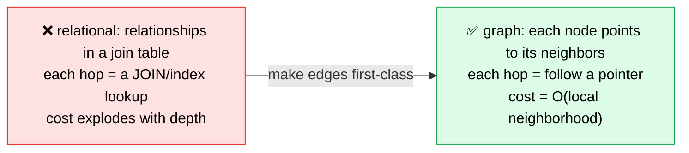
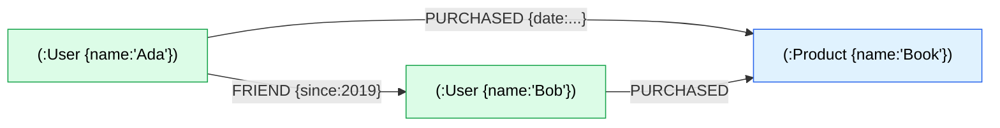
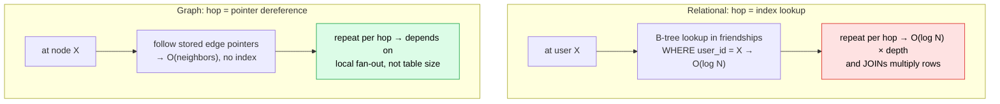
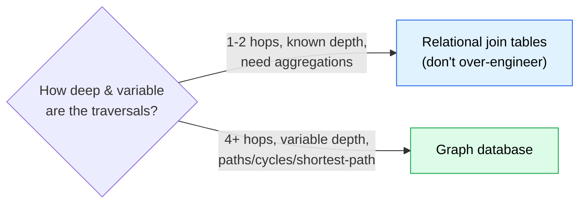
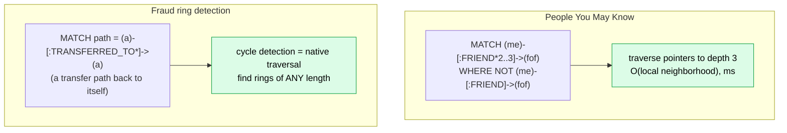
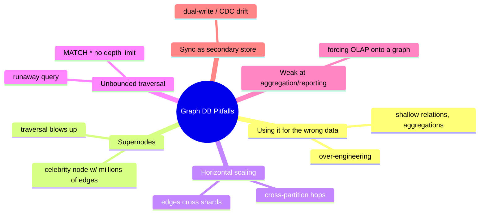

# Graph Databases

> **One line:** A graph database makes *relationships* first-class — data is nodes connected by edges, each node holding direct pointers to its neighbors — so a deep "friends of friends of friends" traversal that becomes an exponential JOIN explosion in a relational database is just a fast pointer-walk whose cost depends on the local neighborhood, not the size of the table.

---

## Table of Contents
1. [Why You Must Master This](#1-why-you-must-master-this)
2. [The Mental Model](#2-the-mental-model)
3. [The Property Graph Model — Nodes, Edges, Properties](#3-the-property-graph-model--nodes-edges-properties)
4. [Index-Free Adjacency — Why Traversals Are Fast](#4-index-free-adjacency--why-traversals-are-fast)
5. [Query Languages — Cypher & Gremlin](#5-query-languages--cypher--gremlin)
6. [Graph DB vs Relational Join Tables](#6-graph-db-vs-relational-join-tables)
7. [When a Graph DB Wins (and When It Doesn't)](#7-when-a-graph-db-wins-and-when-it-doesnt)
8. [Worked Example — Friends-of-Friends & Fraud Rings](#8-worked-example--friends-of-friends--fraud-rings)
9. [Real-Life Use Cases](#9-real-life-use-cases)
10. [Failure Modes](#10-failure-modes)
11. [🏋️ Practice Drills](#-practice-drills)
12. [🎤 Interview Q&A Bank](#-interview-qa-bank)
13. [🎯 Staff+ Nuances](#-staff-nuances)
14. [Cheat Sheet](#14-cheat-sheet)
15. [Connections & Further Reading](#15-connections--further-reading)

---

## 1. Why You Must Master This

[Relational_vs_NoSQL.md](./Relational_vs_NoSQL.md) surveys graph databases in a single row; this file is the deep dive on *when relationships themselves are the query* and why a specialized store beats sharded relational for traversals.

- **Some queries are exponentially hard in SQL and trivial in a graph DB.** "Find all people within 4 degrees of X," "shortest path between two accounts," "detect a cycle of transactions" — each hop is another self-join in SQL, and the cost explodes. A graph DB walks pointers; the same query is milliseconds.
- **It's the answer to a class of high-value problems.** Social networks, fraud detection (ring/cycle detection), recommendation engines, knowledge graphs, network/IT topology, identity/access graphs — these are relationship-centric domains where graph databases are the natural fit.
- **"When would you use a graph database?" is a standard modeling question.** Knowing the *specific* signal — deep, variable-depth traversals over a densely connected dataset — separates a real answer from "when you have graph data."
- **Index-free adjacency is a clean, deep mechanism.** Understanding *why* traversal cost is O(neighbors) rather than O(rows), and how that differs from a join-table lookup, is a strong depth signal.

> **The core problem it solves:** *querying deep, variable-length relationships over highly-connected data* — where the answer requires following chains of connections (traversals) rather than filtering rows, and a relational join per hop makes the query cost grow explosively with depth.

**Prerequisites:** [[Relational_vs_NoSQL]] (data-model selection), [[Database_Indexing]] (why join-table lookups need indexes).

---

## 2. The Mental Model

A graph database is a **subway map, not a spreadsheet of stations.**

- A relational store lists stations in one table and connections in another; to plan a 5-transfer route you'd repeatedly cross-reference the connections table — a lookup per transfer.
- A subway map draws each station with lines *directly connecting* it to its neighbors. To trace a route you just *follow the lines* from station to station. You never consult a master index; the connections are drawn in place.

That "connections are stored in place at each node" is **index-free adjacency**, and it's why traversal is a walk, not a search.



> **Hold onto this:** in a graph DB, a relationship is a *stored pointer*, not something you compute with a join. Traversal cost scales with how connected the *starting neighborhood* is, not with how many rows exist — which is exactly backwards from relational joins.



> The same multi-hop query is a JOIN per level in SQL (exponential) and a pointer-walk in a graph DB (local).

---

## 3. The Property Graph Model — Nodes, Edges, Properties

The dominant model (Neo4j, Amazon Neptune, JanusGraph, TigerGraph) is the **labeled property graph**:

- **Nodes** — the entities: a `User`, a `Product`, an `Account`. Nodes have **labels** (types) and **properties** (key/value data: `name`, `age`).
- **Edges (relationships)** — connect two nodes, and they are *first-class*: each edge has a **type** (`FRIEND`, `PURCHASED`, `TRANSFERRED_TO`), a **direction**, and its own **properties** (`since: 2021`, `amount: 500`). This is the key difference from relational — the relationship *carries data and is directly stored*, not inferred from matching foreign keys.



**Contrast with the relational representation:** to model a many-to-many "friendship" relationally you need a **join table** (`friendships(user_id, friend_id)`); a friendship *with properties* needs extra columns there; a query across relationships needs a JOIN per hop. In a property graph, the friendship *is an edge* with its properties on it, and querying it is following the edge.

There's also the **RDF/triple** model (subject-predicate-object, used in semantic web / knowledge graphs, queried with SPARQL) — but the property-graph model is what most "graph database" system-design questions mean.

> **The modeling shift:** in relational you model *entities* and derive relationships via keys; in a graph you model *entities and relationships as equal citizens.* This makes relationship-centric queries natural and relationship-heavy schemas (which sprawl into many join tables relationally) clean.

---

## 4. Index-Free Adjacency — Why Traversals Are Fast

This is the mechanism that makes graph databases fast at what they're for. **Index-free adjacency** means each node stores *direct references (pointers)* to its adjacent nodes and edges — so finding a node's neighbors requires *no index lookup*, just dereferencing pointers.



- **Relational multi-hop:** each hop is a query against the join table — a B-tree lookup of O(log N) in the *total* number of relationships, and joins can multiply intermediate rows. Depth `d` compounds this; the query planner may materialize huge intermediate sets. A 5–6 hop query on a large social graph can take minutes or time out.
- **Graph traversal:** starting at a node, you follow its edge pointers to neighbors directly — **O(number of neighbors)** per hop, *independent of the total graph size*. A traversal's cost is a function of the *local neighborhood* you visit, not the billions of nodes you don't.

> **Real number / the crux:** the classic Neo4j example — "find friends-of-friends" to depth 5 on a ~1M-person social network — runs in **milliseconds on a graph DB but can take minutes (or fail) with recursive SQL joins**, and the gap *widens* with depth. That's the entire reason to reach for a graph database: traversal cost decoupled from dataset size.

The trade-off: index-free adjacency optimizes *traversal* by co-locating a node with its relationships, but this makes the data model harder to shard (a node's neighbors may live anywhere) — which is why graph databases are hard to scale horizontally (§7, §Staff+).

---

## 5. Query Languages — Cypher & Gremlin

Graph queries are expressed as **pattern matching** over the graph, which reads very differently from SQL — you draw the shape you want.

**Cypher** (Neo4j, and the basis of the new ISO **GQL** standard) is declarative and visual — its `()` are nodes and `-[]->` are edges, so the query *looks like* the pattern:

```cypher
// Friends-of-friends of Ada, 2 hops, not already her friends
MATCH (me:User {name:'Ada'})-[:FRIEND*2]->(fof:User)
WHERE NOT (me)-[:FRIEND]->(fof) AND fof <> me
RETURN DISTINCT fof.name

// Shortest path between two accounts (fraud investigation)
MATCH p = shortestPath(
  (a:Account {id:1})-[:TRANSFERRED_TO*]->(b:Account {id:2}))
RETURN p
```

The `*2` (fixed depth) and `*` (any depth) **variable-length path** syntax is the superpower — expressing "any number of hops" is trivial in Cypher and painful in SQL (recursive CTEs).

**Gremlin** (Apache TinkerPop, used by Neptune, JanusGraph) is imperative/functional — you *chain traversal steps*:

```groovy
g.V().has('User','name','Ada').out('FRIEND').out('FRIEND').dedup().values('name')
```

| Language | Style | Used by |
|---|---|---|
| **Cypher / GQL** | Declarative pattern-match (`()-[]->()`) | Neo4j, Memgraph; GQL is the ISO standard |
| **Gremlin** | Imperative traversal steps (`.out().has()`) | Amazon Neptune, JanusGraph, TinkerPop |
| **SPARQL** | Triple pattern matching | RDF/knowledge-graph stores |

> **The contrast to hold:** SQL expresses "join these tables on these keys"; graph languages express "match this *shape* of connections." Variable-length traversal — "however many hops it takes" — is native to graph languages and awkward-to-impossible in standard SQL.

---

## 6. Graph DB vs Relational Join Tables

The honest comparison, because "just use a join table" is the right answer surprisingly often:

| Dimension | Relational (join tables) | Graph database |
|---|---|---|
| Relationships | Inferred via foreign keys / join tables | First-class edges with properties |
| Shallow join (1–2 hops) | **Fast** — indexed joins are efficient | Fast |
| Deep/variable traversal (4+ hops) | **Slow/exponential** — JOIN per hop | **Fast** — O(local neighborhood) |
| Variable-length paths | Recursive CTEs, painful | Native (`*`, `*1..5`) |
| Aggregations / reporting | **Excellent** (SQL, mature) | Weaker |
| Horizontal scaling | Well-understood ([sharding](./Sharding_Partitioning.md)) | **Hard** (edges cross shards) |
| Ecosystem / tooling / talent | Vast | Smaller, specialized |

**The key insight:** relational databases handle *shallow* relationships (1–2 joins) perfectly well — you do *not* need a graph DB just because you have foreign keys. The crossover is **depth and variability**: when queries traverse many hops, or *unknown* numbers of hops, or need path/cycle/shortest-path semantics, the relational approach degrades exponentially and the graph approach stays flat.



> **Anti-pattern to avoid:** adopting a graph DB for data that's merely *relational with foreign keys* but only ever queried 1–2 joins deep. You inherit a harder-to-scale, smaller-ecosystem store for no traversal benefit. Reach for it when traversal depth/variability is the *actual* query shape.

---

## 7. When a Graph DB Wins (and When It Doesn't)

**Graph databases win when:**
- **Relationships are the primary query** — you're asking about *connections*, not filtering attributes.
- **Traversals are deep and/or variable-length** — friends-of-friends-of-friends, "any path between," reachability.
- **The graph is densely connected** — many-to-many relationships everywhere.
- **You need graph algorithms** — shortest path, PageRank, community detection, centrality, cycle detection.

**Graph databases are the wrong choice when:**
- **Your queries are attribute filters and aggregations** — "sum sales by region" is SQL's home turf; a graph DB is worse at it.
- **Relationships are shallow** — 1–2 joins; relational is simpler and faster overall.
- **You need massive horizontal write scale** — graphs are hard to shard (see below), so extreme scale is a real challenge.

**The scaling caveat (important for senior discussions):** index-free adjacency co-locates a node with its edges, which is *why* traversal is fast — but it also means a node's neighbors can be *anywhere*, so partitioning the graph across machines inevitably cuts edges that span shards, and a traversal that crosses a shard boundary pays a network hop. Graph partitioning is NP-hard, so most graph databases scale *up* (bigger machine, fit the graph in RAM) rather than *out*, or replicate for read scaling. This is the opposite of [sharding](./Sharding_Partitioning.md) a relational/KV store by key.

> **The decision rule:** graph DB when the *relationships and their traversal* are the point and depth/variability defeats SQL; relational when you have structured entities with shallow relationships and heavy reporting; and expect [polyglot persistence](./Relational_vs_NoSQL.md) — many systems keep the source of truth relational and a graph DB alongside for the relationship queries.

---

## 8. Worked Example — Friends-of-Friends & Fraud Rings

**The prompt:** "A social/payments app needs two features: (1) 'people you may know' (friends-of-friends up to 3 degrees), and (2) fraud detection — flag when money flows in a *cycle* through accounts (A→B→C→A), any length. You're on Postgres and it's timing out. Why, and what changes?"

**Why Postgres struggles:**
- *Friends-of-friends to depth 3* needs three self-joins on the `friendships` table; each join multiplies intermediate rows, and on a dense social graph the depth-3 result set explodes. Depth 4–6 is often minutes or a timeout.
- *Cycle detection of arbitrary length* is even worse — you don't know the path length, so it's a recursive CTE that can blow up, and detecting cycles is exactly the kind of traversal SQL was not built for.

**The graph-DB design:**



- **Model:** `User` nodes with `FRIEND` edges; `Account` nodes with `TRANSFERRED_TO` edges carrying `amount`/`timestamp`.
- **People-you-may-know:** `MATCH (me:User)-[:FRIEND*2..3]->(fof)` — a variable-length traversal from `me` out to 3 hops, following neighbor pointers. Cost tracks the size of `me`'s 3-hop neighborhood, not the whole user base.
- **Fraud rings:** cycle detection — `MATCH p=(a:Account)-[:TRANSFERRED_TO*]->(a)` finds money returning to its origin through any number of intermediaries. Graph engines do this with built-in traversal/algorithms; it's a first-class operation.

**Closing the loop — number → consequence:**
- The depth-3 friend query goes from **three exponential self-joins (seconds-to-minutes, growing with depth)** to a **pointer-walk over the local neighborhood (milliseconds, flat in graph size)** — because index-free adjacency decouples traversal cost from table size.
- Cycle/ring detection, essentially *impossible* to express cleanly and run fast in SQL, becomes a **native variable-length path query** — turning a "we can't really do this" into a shipped fraud feature.
- The design consequence: keep the transactional source of truth wherever it belongs, but run the *relationship queries* on a graph DB (polyglot). The traversal-shaped questions define the datastore, not the raw data.

The example is the whole topic: when the query is "follow the connections, however deep," a graph DB's index-free adjacency makes flat what relational joins make exponential.

---

## 9. Real-Life Use Cases

| Situation | How a graph DB decides the outcome |
|-----------|-----------------------------------|
| **Social networks** | Friends-of-friends, mutual connections, "people you may know" — multi-hop traversals. |
| **Fraud detection** | Ring/cycle detection, shared-attribute linking (same device/IP across accounts). |
| **Recommendations** | "Users who bought X also bought Y," collaborative paths through the graph. |
| **Knowledge graphs** | Entities + relationships for search/QA (Google Knowledge Graph, enterprise KGs). |
| **Network & IT topology** | Dependency/impact analysis: "what breaks if this router fails?" — reachability. |
| **Identity & access (IAM)** | Who-can-access-what through nested group/role memberships (transitive). |
| **Supply chain / logistics** | Path finding, dependency chains, single-point-of-failure analysis. |

> **The habit:** when a requirement contains "connected," "path," "hops," "network of," "ring," "reachable," or "degrees of separation," ask whether the traversal depth/variability defeats SQL — if so, it's a graph problem.

---

## 10. Failure Modes



- **Using a graph DB for non-graph workloads.** *Symptom:* poor performance on aggregations/reporting, operational overhead with no benefit. *Root cause:* the queries are attribute filters or shallow joins, not traversals. *Fix:* use relational; reserve the graph DB for genuine traversal problems.
- **Supernodes (hotspots).** *Symptom:* traversals touching a hugely-connected node (a celebrity with 50M followers) blow up. *Root cause:* one node's fan-out dominates; every path through it fans to millions. *Fix:* model around it (edge partitioning, filtering by edge properties, capping fan-out), or special-case supernodes.
- **Horizontal scaling / cross-partition traversals.** *Symptom:* traversals slow drastically when the graph is sharded across machines. *Root cause:* edges span partitions (graph partitioning is NP-hard), so hops become network calls. *Fix:* scale up (fit in RAM), replicate for reads, or use engines designed for distributed graphs (TigerGraph, JanusGraph) — accept it's a hard problem.
- **Unbounded/variable-length traversals.** *Symptom:* a query runs forever or OOMs. *Root cause:* `MATCH ...-[:REL*]->...` with no depth limit on a dense graph explores exponentially. *Fix:* bound the depth (`*1..4`), add filters, use shortest-path/limit clauses.
- **Weak aggregation/analytics.** *Symptom:* reporting queries are slow/awkward. *Root cause:* graph engines aren't optimized for scan-heavy OLAP. *Fix:* offload aggregations to a [warehouse/columnar](./Data_Warehousing_Data_Lakes.md) store; keep the graph for traversals.
- **Keeping a graph DB in sync as a secondary store.** *Symptom:* graph and source-of-truth drift. *Root cause:* dual-write. *Fix:* [CDC](./Full_Text_Search_Elasticsearch.md) from the primary, same as any derived store.

---

## 🏋️ Practice Drills

> *Cover the solutions and attempt first — active recall is the point.*

**Drill 1 — Graph or relational?** For each, decide graph DB or relational, and why: (a) "list all orders over $100 last month, grouped by region"; (b) "find the shortest chain of introductions between two LinkedIn users"; (c) "show a user's profile and their 10 most recent posts."

<details><summary>Solution</summary>

(a) **Relational.** This is filtering + aggregation (`WHERE amount>100 ... GROUP BY region`) — SQL's core strength. No traversal; a graph DB would be worse.

(b) **Graph DB.** Shortest path over an unknown number of hops through a densely-connected network — the canonical graph query. Recursive SQL would explode; a graph engine does `shortestPath` natively.

(c) **Relational.** Shallow: a user and their posts is a single join (or a document). No multi-hop traversal — relational (or even a document store) is simpler and faster. Don't reach for a graph DB just because "users have posts."
</details>

**Drill 2 — Why does SQL explode?** Explain concretely why "friends of friends of friends" (depth 3) gets exponentially slower in SQL but stays fast in a graph database.

<details><summary>Solution</summary>

In SQL, each degree of separation is another self-join on the `friendships` table. Depth 3 = `friendships f1 JOIN friendships f2 JOIN friendships f3`. Each join expands the intermediate result by the average fan-out (branching factor): if each person has ~150 friends, depth 1 ≈ 150 rows, depth 2 ≈ 150² ≈ 22,500, depth 3 ≈ 150³ ≈ 3.4M intermediate rows — the planner materializes and de-duplicates this growing set, and each join also does index lookups over the whole table. Cost grows *multiplicatively* with depth.

In a graph DB, **index-free adjacency** means you start at the node and follow its stored edge pointers to neighbors — O(neighbors) per hop, touching only the actual neighborhood you traverse, with no index lookup over the full relationship set and no intermediate-row materialization from joins. The traversal cost depends on the local neighborhood you visit, not the total data size, so it stays fast as depth increases (until you hit a supernode or explore too much of a dense graph).
</details>

**Drill 3 — Model it.** Design a property graph for a fraud-detection system that links accounts sharing a device, IP, or physical address. What are the nodes, edges, and what query finds suspicious clusters?

<details><summary>Solution</summary>

**Nodes:** `Account`, `Device`, `IP`, `Address` (each shared attribute is its own node so many accounts can connect to it).
**Edges:** `(:Account)-[:USED_DEVICE]->(:Device)`, `(:Account)-[:LOGGED_IN_FROM]->(:IP)`, `(:Account)-[:REGISTERED_AT]->(:Address)`, and `(:Account)-[:TRANSFERRED_TO]->(:Account)` with `amount`/`timestamp`.

**Suspicious-cluster query (Cypher-ish):** find many distinct accounts sharing one device/IP/address:
```cypher
MATCH (d:Device)<-[:USED_DEVICE]-(a:Account)
WITH d, collect(a) AS accts
WHERE size(accts) > 5          // one device, many accounts = ring signal
RETURN d, accts
```
And for money-laundering rings: `MATCH p=(a:Account)-[:TRANSFERRED_TO*2..6]->(a) RETURN p` to find funds cycling back to origin. The graph model makes "accounts linked by shared identity/device" and "money in a cycle" first-class, cheap traversals — exactly what fraud teams need and what SQL makes painful.
</details>

---

## 🎤 Interview Q&A Bank

**Q1. "What is a graph database and when would you use one?"**
> A database where data is nodes connected by edges, and relationships are first-class — each edge has a type, direction, and properties, and each node stores direct pointers to its neighbors. You use one when relationships *are* the query: deep or variable-length traversals (friends-of-friends, any-path-between), densely-connected many-to-many data, and graph algorithms like shortest path or cycle detection. Those queries become exponential JOINs in SQL but stay fast in a graph DB because traversal cost depends on the local neighborhood, not the table size.

**Q2. "What is index-free adjacency and why does it matter?"** *(signal: the core mechanism)*
> It means each node physically stores references to its adjacent nodes and edges, so finding a node's neighbors is a pointer dereference — no index lookup. That's why a traversal costs O(number of neighbors) per hop, independent of the total graph size, whereas a relational multi-hop query does an O(log N) index lookup into the join table *per hop* and joins multiply intermediate rows. Index-free adjacency is exactly what decouples traversal performance from dataset size — the whole reason graph DBs are fast at traversals.

**Q3. "Why not just use join tables in a relational database?"**
> For shallow relationships (1–2 hops) you absolutely should — indexed joins are efficient and you get SQL's mature tooling and aggregations. The problem is *depth and variability*: each additional hop is another self-join, so intermediate results grow multiplicatively with the branching factor, and "any number of hops" needs painful recursive CTEs. At 4+ hops or variable-length paths on a dense graph, relational queries slow exponentially or time out. Reach for a graph DB only when traversal depth/variability is the actual query shape — not just because you have foreign keys.

**Q4. "How do graph query languages differ from SQL?"**
> They express *pattern matching over connections* rather than joins over tables. Cypher (Neo4j, and the basis of the ISO GQL standard) is declarative and visual — `(a)-[:FRIEND]->(b)` literally draws the pattern — and supports variable-length paths like `-[:FRIEND*1..5]->` for "1 to 5 hops," which is native and trivial. Gremlin (Neptune, JanusGraph) is imperative, chaining traversal steps like `.out('FRIEND').out('FRIEND')`. The superpower versus SQL is expressing "however many hops it takes," which recursive SQL handles awkwardly at best.

**Q5. "What's a supernode and why is it a problem?"**
> A supernode is a node with an enormous number of edges — a celebrity with tens of millions of followers, or a shared "public" resource. It's a problem because traversals through it fan out to millions of neighbors, blowing up query time and memory, and it makes partitioning worse. You handle it by bounding traversal depth, filtering on edge properties before expanding, capping fan-out, or special-casing/denormalizing around the supernode. It's the graph analog of a hot key.

**Q6. "Why are graph databases hard to scale horizontally?"**
> Because index-free adjacency co-locates a node with its edges for fast traversal, but a node's neighbors can be anywhere, so any partitioning of the graph across machines inevitably cuts edges that span partitions — and finding a partition that minimizes cut edges is NP-hard. A traversal that crosses a shard boundary becomes a network hop, killing the performance benefit. So most graph DBs scale *up* (fit the graph in RAM on a big machine) or replicate for read scaling, rather than sharding by key like a relational or KV store.

**Q7. "Give a real example where a graph DB clearly beats relational."**
> Fraud ring detection: flag when money flows in a cycle A→B→C→…→A of any length. In SQL that's an arbitrary-length recursive CTE that explodes and is hard to even express; in a graph DB it's a native variable-length path query `MATCH p=(a)-[:TRANSFERRED_TO*]->(a)`. Similarly, "shortest introduction path between two people" or "everything within 4 degrees" — cycle/path/reachability queries over deep, variable traversals are where the graph model turns "we can't really do this" into a fast, first-class operation.

**Q8. "Would a graph DB be your system of record?"**
> Often not — it's frequently a *secondary* store for the relationship queries, with a relational/document primary as source of truth, kept in sync via CDC (the usual derived-store pattern). Graph DBs are weaker at aggregation/reporting and hard to scale horizontally, so you don't want them carrying the whole workload. It's polyglot persistence: transactional data where it belongs, the graph alongside for traversal-shaped questions. Some systems do run graph-native as primary when the domain is fundamentally a graph, but the secondary-store pattern is common.

---

## 🎯 Staff+ Nuances

- **The decision signal is *traversal depth and variability*, not "I have relationships."** Every relational schema has relationships; that's not the trigger. The trigger is queries that follow *chains* of connections — especially unknown-length chains, paths, cycles, and reachability — where the relational cost is exponential in depth. Naming that precise signal (not "graph data") is what separates a real answer.
- **Index-free adjacency is a performance *and* a scaling trade in one.** The same design that makes traversal O(neighborhood) — storing a node with its edges — is exactly what makes the graph hard to shard, because neighbors aren't grouped by any partition key. You can't have cheap traversal *and* easy horizontal partitioning; that tension is the deep truth of graph storage, and contrasts sharply with [sharding by key](./Sharding_Partitioning.md).
- **Graph analytics (OLAP) and graph transactions (OLTP) are different beasts.** Neo4j-style traversal is real-time OLTP; running PageRank/community-detection over the *whole* graph is analytics, often done with different engines (Spark GraphX, TigerGraph, GraphFrames). Conflating "graph database" (transactional traversal) with "graph processing" (batch algorithms) is a common imprecision — senior answers separate them.
- **Supernodes are the graph analog of hot keys, and they break the O(neighborhood) promise.** A traversal's cost is only "local" if the local fan-out is bounded; a supernode makes one hop O(millions). Real graph modeling spends serious effort on supernode strategies (edge properties to filter before expanding, splitting/denormalizing hot nodes) — the equivalent of hot-shard mitigation in [partitioning](./Sharding_Partitioning.md).
- **Property graphs vs RDF/triples is a real modeling fork.** Property graphs (Cypher/Gremlin) suit application/operational graphs with rich edge properties; RDF/SPARQL suits standardized, interoperable knowledge graphs and semantic reasoning. Choosing the wrong model creates friction — knowing both exist and their fit is a depth signal beyond "graph database."
- **GQL becoming an ISO standard (2024) matters like SQL did.** Until recently every graph DB had its own language, fragmenting the ecosystem; a standard query language (GQL, derived from Cypher) is a maturation signal that reduces lock-in and grows tooling — worth noting as the field's trajectory.
- **Many "graph" needs are met without a graph database.** A closure/transitive-closure table, recursive CTEs for bounded depth, or precomputed adjacency in a KV store can serve moderate graph queries on your existing stack. The mature engineer weighs "do I need a *new datastore* or a *modeling technique*?" — adopting a graph DB is a real operational commitment (scaling, ecosystem, talent), justified only when traversal is central and deep.

---

## 14. Cheat Sheet

```
GRAPH DATABASES — RELATIONSHIPS ARE FIRST-CLASS, TRAVERSAL IS LOCAL
═══════════════════════════════════════════════════════════════════

MODEL: labeled property graph
  NODES (entities + labels + properties)
  EDGES (relationships: type + direction + PROPERTIES) ← first-class
  vs relational: relationships inferred from foreign keys / join tables

INDEX-FREE ADJACENCY (the mechanism)
  each node stores direct pointers to its neighbors
  traversal hop = pointer dereference = O(neighbors), NOT O(rows)
  → traversal cost independent of total graph size
  relational multi-hop = O(log N) index lookup PER HOP + joins multiply rows

QUERY LANGUAGES (pattern matching, not joins)
  Cypher/GQL (Neo4j)  declarative: (a)-[:FRIEND*1..3]->(b)  ← variable-length native
  Gremlin (Neptune)   imperative: .out('FRIEND').out('FRIEND')
  SPARQL              RDF triples / knowledge graphs

USE A GRAPH DB WHEN
  ✓ relationships ARE the query · deep/variable traversals (4+ hops)
  ✓ paths, cycles, shortest-path, reachability · dense many-to-many
  ✓ graph algorithms (PageRank, community, centrality)
DON'T WHEN
  ✗ shallow (1-2 hops) — relational join is fine, don't over-engineer
  ✗ aggregations/reporting (SQL/columnar wins)
  ✗ need massive horizontal write scale (graphs hard to shard)

WATCH: supernodes (hot nodes) · bound traversal depth · cross-shard hops
USE FOR: social · fraud rings · recommendations · knowledge graphs · IT topology · IAM
SCALING: scale UP (fit in RAM) / replicate reads — partitioning cuts edges (NP-hard)
```

---

## 15. Connections & Further Reading

**Prerequisites (learn first):**
- [Relational_vs_NoSQL.md](./Relational_vs_NoSQL.md) — where graph fits in the data-model landscape (surveyed there in one row).
- [Database_Indexing.md](./Database_Indexing.md) — why relational multi-hop joins pay an index lookup per hop.

**Builds toward / pairs with:**
- [Sharding_Partitioning.md](./Sharding_Partitioning.md) — the contrast: graphs are hard to partition because edges cross shards.
- [[Vector_Databases]] — another specialized model; graphs + vectors combine in GraphRAG/knowledge graphs.
- [Data_Warehousing_Data_Lakes.md](./Data_Warehousing_Data_Lakes.md) — offload graph *aggregations* to columnar/warehouse stores.
- [Full_Text_Search_Elasticsearch.md](./Full_Text_Search_Elasticsearch.md) — keep a graph DB in sync as a secondary store via CDC.

**Gaps this topic exposes:**
- A graph-algorithms / graph-analytics (PageRank, community detection, GraphX) note — candidate for an algorithms or analytics section.

**External classics:**
- *Graph Databases* (Robinson, Webber, Eifrem) — the definitive intro; free from Neo4j.
- [Neo4j Cypher Manual](https://neo4j.com/docs/cypher-manual/current/) — the pattern-matching language in depth.
- *Designing Data-Intensive Applications* (Kleppmann) — Ch. 2, graph data models vs relational/document.
- [Apache TinkerPop / Gremlin docs](https://tinkerpop.apache.org/) — the traversal-language ecosystem.

---

## TL;DR
**A graph database makes relationships first-class — nodes connected by edges, each node holding direct pointers to its neighbors (index-free adjacency) — so multi-hop traversals cost O(local neighborhood) instead of the exponential JOIN-per-hop that cripples relational databases at depth.** Use it when *relationships and their traversal are the query*: deep or variable-length paths, cycles, shortest-path, reachability, and dense many-to-many data (social networks, fraud rings, recommendations, knowledge graphs) — expressed as pattern matching in Cypher/GQL or Gremlin. Do *not* reach for one just because you have foreign keys: relational join tables handle shallow (1–2 hop) relationships fine and win at aggregation, and graph DBs are hard to scale horizontally because edges cross shards. **When the question is "follow the connections, however deep," it's a graph problem; when it's "filter and aggregate rows," it's not.**
