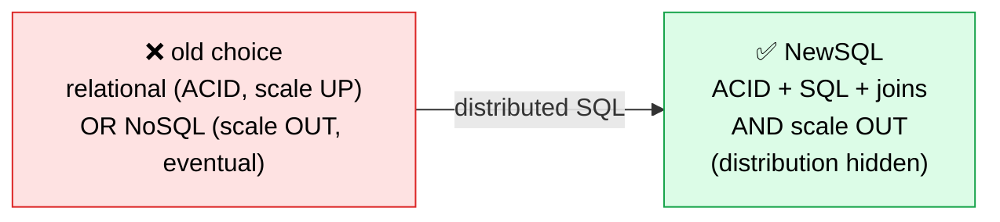
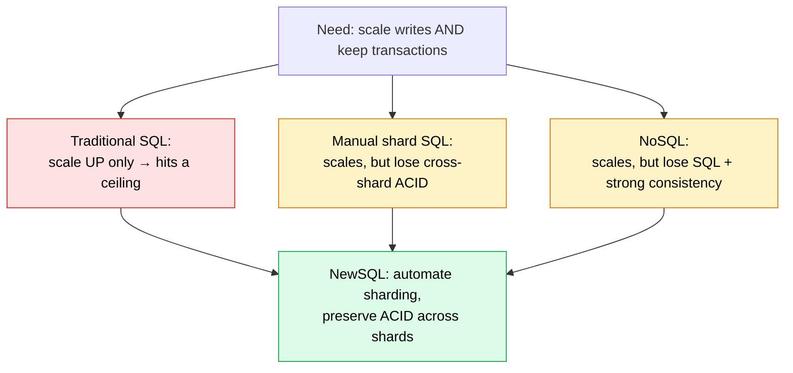
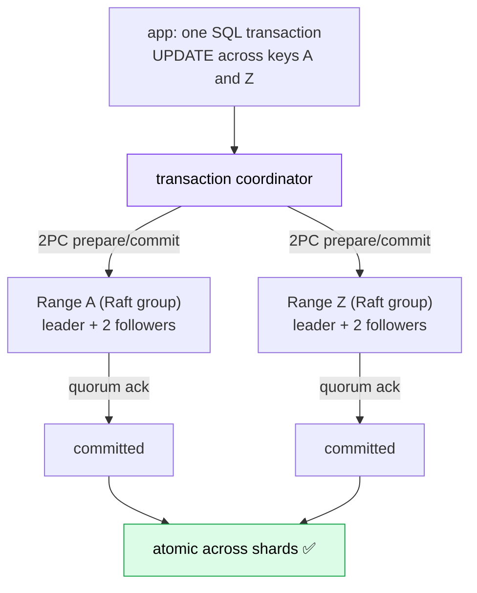
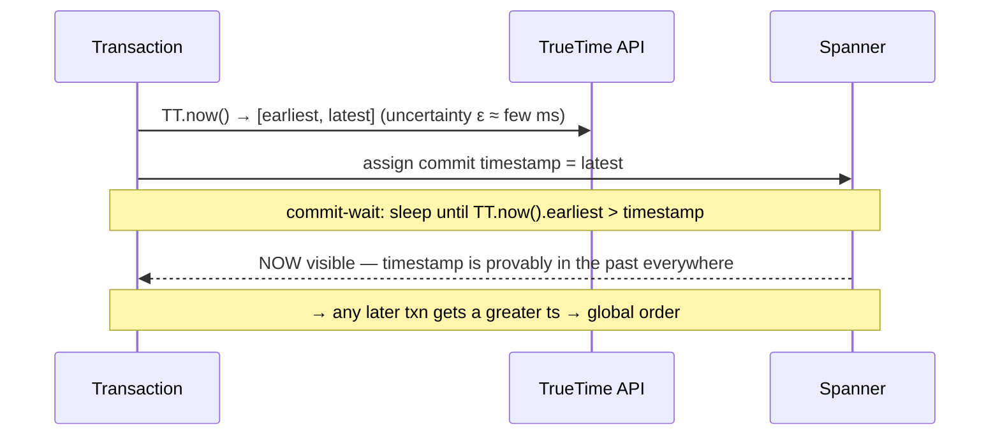
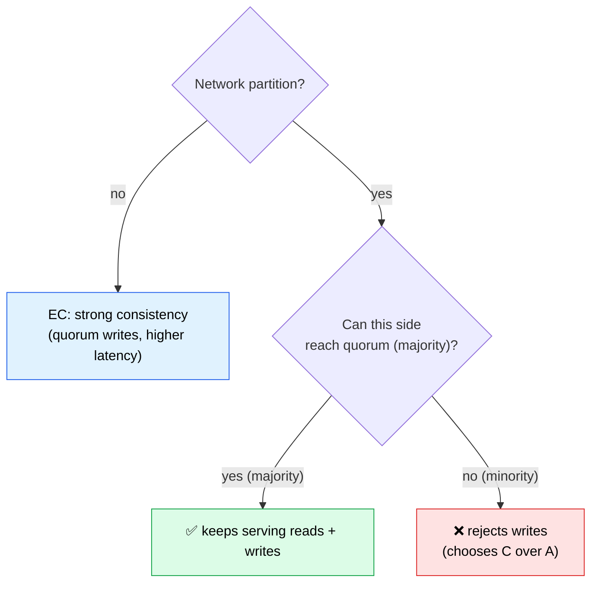
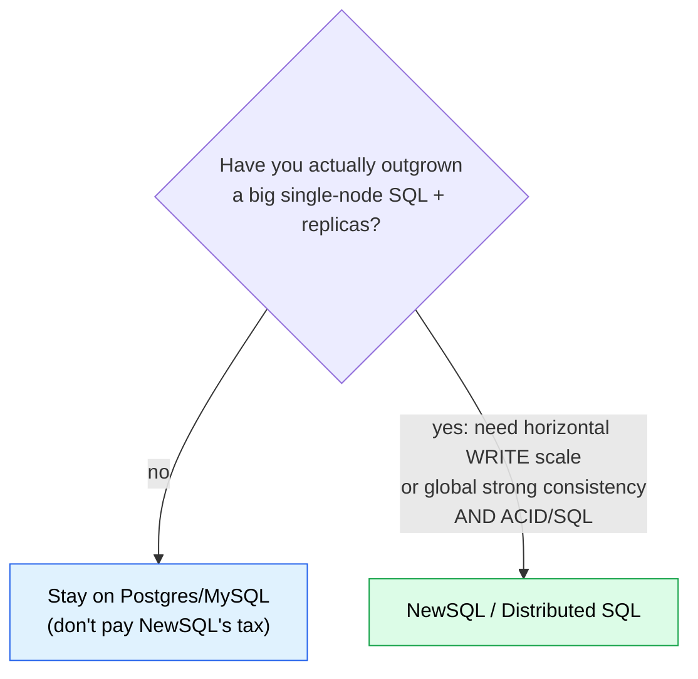
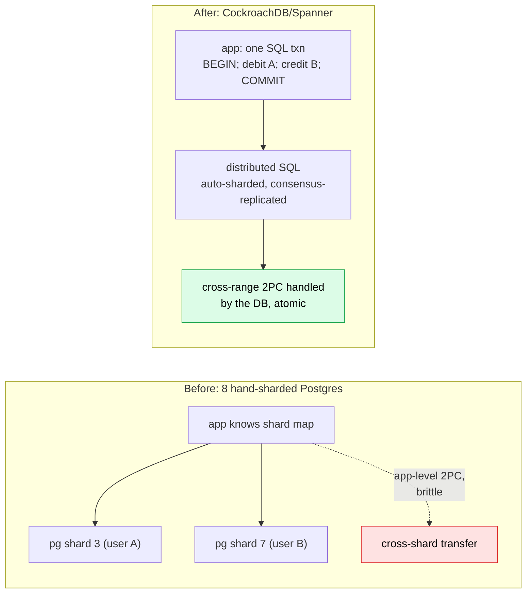
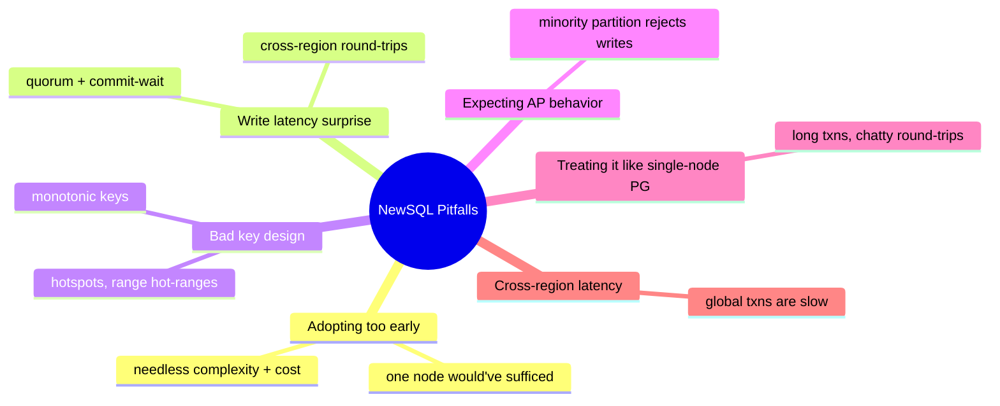

# NewSQL & Distributed SQL

> **One line:** NewSQL (distributed SQL) refuses the old "scale *or* transactions" trade-off — databases like Google Spanner, CockroachDB, and TiDB give you the SQL, joins, and ACID transactions of a relational database *and* the horizontal, add-more-nodes scaling of NoSQL, by automatically sharding data and using consensus replication (and, in Spanner's case, synchronized atomic clocks) to keep it strongly consistent across the whole cluster.

---

## Table of Contents
1. [Why You Must Master This](#1-why-you-must-master-this)
2. [The Mental Model](#2-the-mental-model)
3. [The Problem NewSQL Solves](#3-the-problem-newsql-solves)
4. [How It Works — Sharding + Consensus Replication](#4-how-it-works--sharding--consensus-replication)
5. [TrueTime & Clock-Bound Commits (Spanner)](#5-truetime--clock-bound-commits-spanner)
6. [How NewSQL Squares CAP](#6-how-newsql-squares-cap)
7. [The Landscape & The Costs](#7-the-landscape--the-costs)
8. [Worked Example — Outgrowing a Sharded Postgres](#8-worked-example--outgrowing-a-sharded-postgres)
9. [Real-Life Use Cases](#9-real-life-use-cases)
10. [Failure Modes](#10-failure-modes)
11. [🏋️ Practice Drills](#-practice-drills)
12. [🎤 Interview Q&A Bank](#-interview-qa-bank)
13. [🎯 Staff+ Nuances](#-staff-nuances)
14. [Cheat Sheet](#14-cheat-sheet)
15. [Connections & Further Reading](#15-connections--further-reading)

---

## 1. Why You Must Master This

[SQL_vs_NoSQL_Scaling.md](./SQL_vs_NoSQL_Scaling.md) names "re-platform to NewSQL" as the final rung of the scaling ladder but never explains it. This file is that explanation — the databases you reach for when you've outgrown a single-node relational DB but refuse to give up transactions.

- **It resolves the defining database trade-off of the last two decades.** For years you had to choose: relational (ACID, SQL, but scales up only) or NoSQL (scales out, but eventual consistency and no cross-shard transactions). NewSQL is the "have both" answer, and knowing *how* it's possible is a genuine depth signal.
- **It's the modern answer to "how do you scale writes while keeping transactions?"** Manual [sharding](./Sharding_Partitioning.md) of Postgres/MySQL is painful and loses cross-shard transactions; NewSQL automates the sharding and preserves ACID across shards. That's exactly the question senior interviews probe.
- **Spanner's TrueTime is a landmark idea.** Using GPS and atomic clocks to bound clock uncertainty and produce globally-ordered commit timestamps is one of the most elegant systems ideas of the era — a favorite "explain how this actually works" question.
- **These databases are now mainstream infrastructure.** Spanner runs Google's core systems; CockroachDB, TiDB, YugabyteDB, and Vitess power fintech, gaming, and global SaaS. Designing for global scale increasingly means one of these.

> **The core problem it solves:** *you need to scale writes and storage horizontally across many machines, but you also need SQL, joins, and ACID transactions that span the whole dataset — and traditional relational scales only up, while NoSQL gives up transactions and strong consistency to scale out.* NewSQL delivers relational guarantees on a horizontally-scalable, self-sharding cluster.

**Prerequisites:** [[Sharding_Partitioning]] (horizontal split), [[Replication]] (copies + consensus failover), [[CAP_Theorem]] and [[ACID_Properties]] (the guarantees at stake), [[Distributed_Transactions]] (2PC across shards).

---

## 2. The Mental Model

NewSQL is **a single database that's secretly a coordinated cluster.**

- To your application, it looks like one Postgres/MySQL — you connect, run SQL, `BEGIN`/`COMMIT` transactions, join tables. One logical database.
- Underneath, the data is automatically chopped into ranges spread across many machines, each range replicated for durability, and the nodes coordinate (via consensus and clocks) so that transactions spanning multiple machines still commit atomically and reads see a consistent view. The distribution is *hidden.*
- It's the opposite of manual sharding, where *you* split the data and your application has to know which shard holds what and can't do a transaction across two of them.



> **Hold onto this:** NewSQL looks like one relational database to the app but is a self-sharding, consensus-replicated cluster underneath — you get transactions *and* horizontal scale because the database does the hard distributed-systems work you'd otherwise do (badly) by hand.



> NewSQL sits in the middle-right: it keeps the left column's guarantees while gaining the right column's scaling — paying with write latency and operational complexity.

---

## 3. The Problem NewSQL Solves

Recall the [scaling ladder](./SQL_vs_NoSQL_Scaling.md): optimize → scale up → read replicas → shard → re-platform. The wall it hits:

- **Reads scale by copying** ([replicas](./Replication.md)), but **writes only scale by splitting** ([sharding](./Sharding_Partitioning.md)) — and once you shard a traditional relational database, you *lose cross-shard transactions and joins.* A transaction touching two shards isn't atomic anymore; you're back to [distributed-transaction](./Distributed_Transactions.md) pain (2PC or Sagas) *in your application.*
- **NoSQL scaled out by giving up the relational guarantees** — eventual consistency, no multi-key transactions, no joins, denormalized data models. For many workloads that's fine; for anything with money, inventory, or invariants across entities, losing ACID is a serious problem.
- So historically you had a painful fork: stay relational and cap out at one big machine (vertical scaling has a ceiling and gets exponentially expensive), or go NoSQL and rebuild your data model and correctness by hand.



> **The pitch in one line:** NewSQL says "you shouldn't have to choose between transactions and horizontal scale" — it automates the sharding you'd do manually *and* preserves ACID transactions across those shards, which manual sharding cannot.

---

## 4. How It Works — Sharding + Consensus Replication

NewSQL databases combine three ideas you already know into one system:

**1. Automatic sharding (range partitioning).** The data is transparently split into contiguous key ranges ("ranges," "tablets," "regions"). As data grows or a range gets hot, the system **auto-splits and rebalances** ranges across nodes — no manual [shard-key](./Sharding_Partitioning.md) management or resharding downtime. The app sees one keyspace.

**2. Consensus replication per shard.** Each range is replicated (typically 3× or 5×) across nodes, and the replicas of a range form a **consensus group** using [Raft or Paxos](../10_Microservices_Distributed_Systems/). Writes go to the range's leader, which replicates to followers; a write commits when a **quorum** (majority) acknowledges. This gives:
   - **Strong consistency** — a majority must agree, so there's no split-brain and reads see committed data.
   - **Automatic failover** — if the leader dies, the consensus group elects a new one; no manual promotion, no data loss of committed writes.

**3. Distributed transactions across shards.** A transaction touching multiple ranges is coordinated with **two-phase commit (2PC)** layered *on top of* the per-range consensus groups (so each participant is itself fault-tolerant, avoiding classic 2PC's blocking-on-coordinator-failure weakness). Combined with [MVCC](./Transaction_Isolation_Levels_MVCC.md), this gives serializable cross-shard transactions.



> **The synthesis:** NewSQL = [sharding](./Sharding_Partitioning.md) (for scale) + [consensus replication](./Replication.md) (for consistency + failover) + [distributed transactions](./Distributed_Transactions.md) (for cross-shard ACID) + [MVCC](./Transaction_Isolation_Levels_MVCC.md) (for isolation), assembled into something that looks like one SQL database. Every piece is a topic you already know; NewSQL is their integration.

---

## 5. TrueTime & Clock-Bound Commits (Spanner)

The hardest part of a globally-distributed transactional database is *ordering*: to give every transaction a globally consistent commit order, nodes across continents must agree on time — but clocks drift and you can't trust "now." Google Spanner's answer, **TrueTime**, is the landmark idea.

**The problem:** if node A commits at "10:00:00.000" and node B commits at "10:00:00.001" by their own clocks, but their clocks are skewed by 5ms, you can't tell which *really* happened first — so you can't produce a globally consistent order (external consistency / linearizability across the whole database).

**TrueTime's solution:** instead of pretending clocks are exact, Spanner **quantifies the uncertainty.** Every datacenter has GPS receivers and atomic clocks, and TrueTime's API returns not a single timestamp but an *interval*: `[earliest, latest]` — "the true time is *somewhere* in this window," with the window bounded to a few milliseconds.

**Commit-wait:** to guarantee a transaction's assigned timestamp is truly in the past everywhere before it's visible, Spanner **waits out the uncertainty** — it delays commit until it's certain the timestamp has passed (`commit_wait` ≈ the clock uncertainty, ~a few ms). After waiting, any later transaction anywhere gets a strictly greater timestamp, yielding a globally consistent order.



> **Real number / the insight:** TrueTime bounds clock uncertainty to ~1–7ms using GPS + atomic clocks, and Spanner "waits out" that uncertainty (~a few ms per commit) to get **external consistency** across a *global* database. It's a rare case of solving a distributed-systems problem partly with *better hardware* (real synchronized clocks) instead of pure algorithms. CockroachDB achieves similar guarantees *without* special hardware by using hybrid logical clocks (HLC) and slightly weaker/adjusted semantics — a key architectural contrast.

---

## 6. How NewSQL Squares CAP

A common confusion: "doesn't CAP say you can't have consistency *and* availability?" NewSQL doesn't break CAP — it makes a deliberate choice within it.

- Recall [CAP](./CAP_Theorem.md): during a **network partition**, you must choose Consistency **or** Availability. NewSQL databases are **CP** — they choose *consistency*. During a partition, the side of a consensus group that *can't* reach a quorum (majority) **stops accepting writes** rather than serve stale or divergent data.
- This is the right choice for their target workloads: a financial ledger should *refuse* a write during a partition, not accept two conflicting ones. Availability is sacrificed *only* for the minority partition, and only for writes to the affected ranges — the majority side keeps working.
- In [PACELC](./PACELC_Theorem.md) terms, NewSQL is **PC/EC**: during a Partition it favors Consistency, and Else (normal operation) it *still* favors Consistency over Latency — which is exactly why it has higher write latency (quorum round-trips, commit-wait) than an eventually-consistent AP store.



> **The clarification:** NewSQL doesn't "beat CAP" — it *chooses CP* and uses consensus to make the availability hit minimal (only the minority partition, only affected ranges). The cost of that choice is the **latency** of quorum coordination and commit-wait, which is the everyday price PACELC's "EC" describes. There is no free lunch — strong consistency across machines *costs write latency*, always.

---

## 7. The Landscape & The Costs

| System | Origin / model | Distinguishing trait |
|---|---|---|
| **Google Spanner** | Google, managed (Cloud Spanner) | TrueTime (GPS/atomic clocks); global external consistency |
| **CockroachDB** | Open-source, Postgres-wire-compatible | Spanner-inspired, *no special hardware* (HLC); "Cockroach" = survives anything |
| **TiDB** | Open-source, MySQL-compatible | Separates SQL layer (TiDB) from storage (TiKV, on RocksDB); strong HTAP story |
| **YugabyteDB** | Open-source, Postgres-compatible | Postgres query layer on a distributed storage engine |
| **Vitess** | Sharding middleware over MySQL (YouTube) | Not "true" NewSQL — orchestrates MySQL shards; powers Slack, GitHub |
| **VoltDB / others** | In-memory NewSQL | Extreme OLTP throughput via in-memory + partitioning |

**The costs — why you don't default to NewSQL:**
- **Write latency.** Every write pays quorum replication (a network round-trip to a majority), and Spanner adds commit-wait. A single-node Postgres commit can be sub-millisecond; a NewSQL cross-region commit is tens of milliseconds. For write-latency-critical single-region workloads, it's a regression.
- **Operational & cost complexity.** A distributed cluster is harder to run, tune, and reason about than one Postgres, and managed offerings (Cloud Spanner) are expensive.
- **You often don't need it.** A well-tuned single Postgres with read replicas handles enormous workloads. NewSQL earns its complexity at *genuine* horizontal-write scale or global distribution — not before. Adopting it early is over-engineering.



> **The decision rule:** reach for NewSQL when you need *both* horizontal write scale (or multi-region strong consistency) *and* relational guarantees (SQL, joins, ACID) — and only after a single big node with replicas genuinely can't cope. If eventual consistency is acceptable, NoSQL is simpler and cheaper; if one node suffices, plain Postgres wins.

---

## 8. Worked Example — Outgrowing a Sharded Postgres

**The prompt:** "A global fintech runs on Postgres. Writes have outgrown the biggest instance, so the team hand-sharded by `user_id` across 8 Postgres instances. Now cross-user transfers (which touch two shards) are a nightmare and reporting joins across shards are impossible. What went wrong and what's the fix?"

**What went wrong (manual sharding on a relational DB):**
- A transfer from user A (shard 3) to user B (shard 7) touches *two* databases. There's no built-in atomic transaction across them, so the team hand-rolled [2PC or a Saga](./Distributed_Transactions.md) in the app — brittle, and a coordinator crash can leave money in limbo.
- Any query joining data across shards (reporting, "all transactions involving user X's counterparties") must be done in application code, fanning out to all 8 shards and merging — slow and complex.
- Rebalancing when a shard gets hot means a painful manual data migration.

**The NewSQL fix:**



- Migrate to a NewSQL store (CockroachDB — Postgres-compatible, so minimal app rewrite). The database **auto-shards** by key range across nodes; the app just sees one Postgres-like endpoint.
- The cross-user transfer becomes a **normal SQL transaction**: `BEGIN; UPDATE accounts SET balance=balance-100 WHERE id=A; UPDATE accounts SET balance=balance+100 WHERE id=B; COMMIT;` — the database handles the cross-range 2PC + consensus atomically. No app-level distributed-transaction code.
- Cross-shard reporting joins are just **SQL joins** — the query planner distributes them across nodes.

**Closing the loop — number → consequence:**
- The brittle app-level 2PC (a correctness liability handling *money*) is **replaced by the database's built-in cross-shard transactions** — the app deletes its distributed-transaction code, and money can't be lost to a coordinator crash because each participant is a fault-tolerant Raft group.
- Horizontal write scaling continues *automatically* — add nodes, ranges rebalance — versus the manual re-sharding the team dreaded. The trade paid: **write latency rises** from sub-ms (local Postgres) to ~5–20ms (quorum + possibly cross-region), which for financial transactions is an acceptable price for correctness and scale.
- The lesson: *hand-sharding a relational database re-creates every distributed-systems problem in your app.* NewSQL exists precisely so you don't — it's the "re-platform" rung for exactly this situation.

The example is the whole topic: when you need relational guarantees *and* you've truly outgrown one node, NewSQL automates the sharding and preserves the transactions that manual sharding destroys.

---

## 9. Real-Life Use Cases

| Situation | How NewSQL decides the outcome |
|-----------|-------------------------------|
| **Global fintech / payments** | Cross-region ACID transactions with strong consistency — money needs correctness at scale. |
| **Outgrew single-node Postgres, need transactions** | Auto-sharding + cross-shard ACID instead of brittle manual sharding. |
| **Multi-region SaaS with data residency** | Geo-partition ranges to keep EU data in the EU while one logical DB spans regions. |
| **High-scale OLTP (gaming, e-commerce)** | Horizontal write scale without giving up SQL/joins/transactions. |
| **Migrating off NoSQL that needs transactions** | Regain ACID/SQL while keeping horizontal scale. |
| **HTAP (transactions + analytics)** | TiDB-style split lets OLTP and OLAP run on one system. |

> **The habit:** when a design needs strong consistency and transactions *across* a dataset too big for one machine (or spanning regions), NewSQL is the answer — but first confirm a big single node with replicas genuinely can't do the job, because it usually can for longer than people think.

---

## 10. Failure Modes



- **Adopting NewSQL too early.** *Symptom:* huge operational burden and cost for a workload one Postgres could handle. *Root cause:* reaching for horizontal scale before hitting the single-node ceiling. *Fix:* exhaust vertical scaling + read replicas first; adopt NewSQL when writes/scale/geo genuinely demand it.
- **Write-latency surprise.** *Symptom:* writes are much slower than the old single-node DB. *Root cause:* every commit pays quorum replication (and commit-wait in Spanner), amplified across regions. *Fix:* keep transactions local where possible, co-locate related data, use follower/stale reads for read-heavy paths, and set expectations — strong consistency costs latency.
- **Poor key/locality design.** *Symptom:* hot ranges, uneven load, or slow cross-range transactions. *Root cause:* monotonic keys concentrate writes on one range's leader, or related rows scattered across ranges. *Fix:* hash/spread hot keys, co-locate rows accessed together (interleaved tables / locality), avoid sequential PKs on hot tables — same [shard-key discipline](./Sharding_Partitioning.md).
- **Expecting availability during a partition.** *Symptom:* the minority side rejects writes during a network split. *Root cause:* NewSQL is CP — it chooses consistency. *Fix:* understand it's by design; if you need AP (writes always accepted), you want a different (eventually-consistent) store for that data.
- **Treating it like a single-node database.** *Symptom:* chatty, round-trip-heavy code or long transactions perform terribly. *Root cause:* each round-trip and lock now spans the network/consensus. *Fix:* batch statements, minimize round-trips and transaction duration, design for the distributed reality.
- **Underestimating cross-region latency.** *Symptom:* global transactions take tens+ of ms. *Root cause:* quorum spans continents. *Fix:* geo-partition so most transactions stay in one region; accept that truly global strong-consistency transactions are inherently slower.

---

## 🏋️ Practice Drills

> *Cover the solutions and attempt first — active recall is the point.*

**Drill 1 — Do you even need it?** A startup's Postgres is at 40% CPU with one read replica, serving 5K writes/sec. The CTO wants to migrate to CockroachDB "to be ready to scale." Advise.

<details><summary>Solution</summary>

**Don't migrate yet.** 5K writes/sec at 40% CPU is nowhere near a single-node ceiling — modern Postgres on good hardware handles tens of thousands of writes/sec, and there's ample headroom (vertical scaling, tuning, more replicas for reads). Migrating to NewSQL now buys operational complexity, higher write latency, and cost with *no* current benefit — textbook over-engineering.

The right advice: stay on Postgres; climb the [scaling ladder](./SQL_vs_NoSQL_Scaling.md) as needed (optimize queries/indexes, scale up, add read replicas, consider partitioning). Re-evaluate NewSQL only when write throughput genuinely approaches the single-node limit, or when you need multi-region strong consistency — real signals, not "to be ready." Design so the eventual migration is feasible (avoid deep vendor lock-in), but don't pay the tax before you must.
</details>

**Drill 2 — Explain TrueTime.** In an interview, explain in ~45 seconds how Spanner orders transactions globally despite clock skew.

<details><summary>Solution</summary>

"Ordering transactions globally requires agreeing on time, but clocks drift, so you can't trust a single timestamp. Spanner's TrueTime doesn't pretend clocks are exact — it *quantifies* the uncertainty. Using GPS and atomic clocks in every datacenter, its API returns a time *interval* `[earliest, latest]` guaranteeing the true time is somewhere inside, with the window bounded to a few milliseconds. When a transaction commits, Spanner assigns it a timestamp and then does **commit-wait** — it waits until it's certain that timestamp is in the past *everywhere* (about the width of the uncertainty). After that wait, any later transaction anywhere is guaranteed a greater timestamp, producing a globally consistent commit order — external consistency. It's clever because it solves ordering partly with better hardware (real synchronized clocks) rather than pure algorithms. CockroachDB gets similar guarantees without special hardware using hybrid logical clocks."
</details>

**Drill 3 — CAP placement.** Is a NewSQL database CP or AP? What happens to a 5-node cluster split 3–2 by a network partition?

<details><summary>Solution</summary>

NewSQL is **CP** — it chooses consistency over availability during a partition. In a 5-node cluster (with ranges replicated across them, each range needing a majority quorum), a 3–2 split means:
- The **3-node majority side** can still form a quorum for its ranges → it keeps serving reads *and* writes, staying consistent.
- The **2-node minority side** *cannot* reach a majority for the affected ranges → it **rejects writes** (and may serve only stale reads or none) rather than accept writes that would diverge from the majority.

This is the deliberate CP choice: rather than let both sides accept conflicting writes (AP, which risks split-brain and lost/conflicting data), NewSQL sacrifices availability on the minority side to preserve consistency. When the partition heals, the minority rejoins and catches up. In PACELC terms it's PC/EC — consistent during partitions, and consistent-over-latency even normally.
</details>

---

## 🎤 Interview Q&A Bank

**Q1. "What is NewSQL / distributed SQL?"**
> A class of databases that provide the SQL, joins, and ACID transactions of a traditional relational database *and* the horizontal, add-nodes scalability of NoSQL — Google Spanner, CockroachDB, TiDB, YugabyteDB. They achieve it by automatically sharding data into ranges, replicating each range with consensus (Raft/Paxos) for strong consistency and failover, and coordinating cross-shard transactions with 2PC on top of those consensus groups. To the app it looks like one relational database; underneath it's a coordinated cluster.

**Q2. "What problem does NewSQL solve that neither SQL nor NoSQL could?"** *(signal: the core trade-off)*
> The old fork: relational databases give ACID and SQL but scale only vertically, and once you manually shard them you lose cross-shard transactions and joins; NoSQL scales out but gives up strong consistency, transactions, and joins. NewSQL refuses that trade — it automates sharding *and* preserves ACID transactions across shards. It's the answer to "I need to scale writes horizontally but I can't give up transactions," which is common for financial and inventory systems where correctness across entities is non-negotiable.

**Q3. "How does NewSQL scale writes while staying consistent?"**
> It shards data into key ranges spread across nodes (writes to different ranges parallelize across machines → horizontal write scale), and each range is replicated across nodes as a consensus group using Raft or Paxos, so a write commits only when a majority quorum agrees — giving strong consistency and automatic leader failover with no data loss. Transactions spanning ranges use two-phase commit layered over those consensus groups, so each 2PC participant is itself fault-tolerant. It's sharding + consensus replication + distributed transactions + MVCC assembled into one system.

**Q4. "Explain TrueTime and why it matters."**
> TrueTime is Google Spanner's way of ordering transactions globally despite clock skew. Instead of trusting a single clock, it uses GPS and atomic clocks to return a time *interval* `[earliest, latest]` guaranteed to contain the true time, bounded to a few milliseconds. Spanner assigns a commit timestamp and then does "commit-wait" — delaying until that timestamp is provably in the past everywhere — so any later transaction gets a strictly greater timestamp, yielding a globally consistent order (external consistency). It matters because it's a rare case of using better *hardware* to solve a distributed-ordering problem; CockroachDB achieves similar guarantees without special clocks using hybrid logical clocks.

**Q5. "Does NewSQL violate the CAP theorem?"**
> No — it makes a deliberate CAP choice. NewSQL databases are CP: during a network partition they choose consistency over availability, so the side of a consensus group that can't reach a majority quorum rejects writes rather than serve divergent data. They don't beat CAP; they use consensus to *minimize* the availability hit (only the minority partition, only affected ranges are unavailable). In PACELC terms they're PC/EC — favoring consistency during partitions and even in normal operation, which is exactly why they have higher write latency than an AP store.

**Q6. "What's the cost of NewSQL — why not always use it?"**
> Two big costs. Write latency: every commit pays quorum replication (a network round-trip to a majority), plus commit-wait in Spanner, so writes are much slower than a single-node Postgres commit — tens of milliseconds across regions versus sub-millisecond locally. And operational/financial complexity: running a distributed cluster is harder than one database, and managed offerings are expensive. Most importantly, a well-tuned single Postgres with read replicas handles far more than people expect, so NewSQL is over-engineering until you genuinely hit the single-node write ceiling or need multi-region strong consistency.

**Q7. "When would you choose NewSQL over sharding Postgres manually?"**
> When you need cross-shard transactions or joins — which manual sharding destroys. If you hand-shard Postgres, a transaction spanning two shards forces you to build app-level 2PC or Sagas (brittle, especially for money), and cross-shard queries become fan-out-and-merge code. NewSQL gives you those transactions and joins back *automatically* while still scaling out, and it auto-rebalances instead of requiring manual re-sharding. Manual sharding is fine if your access is cleanly partitionable with no cross-shard transactions; NewSQL is the answer when it isn't.

**Q8. "Spanner vs CockroachDB — key difference?"**
> Both are Spanner-lineage distributed SQL with strong consistency via consensus, but Spanner relies on **TrueTime** — special GPS and atomic-clock hardware in Google's datacenters — to bound clock uncertainty and provide external consistency, and it's a managed Google Cloud service. CockroachDB is open-source, runs anywhere on commodity hardware with *no special clocks*, using hybrid logical clocks and a configured max-clock-offset instead, and it's Postgres-wire-compatible for easy adoption. The trade: Spanner's hardware gives tighter guarantees; CockroachDB's approach is portable and self-hostable.

---

## 🎯 Staff+ Nuances

- **NewSQL is an *integration* of the distributed-systems primitives, not a new invention — name the parts.** Sharding ([partitioning](./Sharding_Partitioning.md)), quorum replication + failover ([consensus/Raft](./Replication.md)), cross-shard 2PC ([distributed transactions](./Distributed_Transactions.md)), and [MVCC](./Transaction_Isolation_Levels_MVCC.md) isolation are each independently understood; the achievement is composing them so the app sees one ACID SQL database. Explaining it as "these known pieces, assembled" is far stronger than treating it as magic.
- **Strong consistency across machines *always* costs write latency — there is no free lunch.** Every "have your cake and eat it" NewSQL pitch is paid for in the latency of quorum coordination (and commit-wait). PACELC's "EC" is precisely this: even with no partition, choosing consistency over latency. A senior answer states the cost plainly rather than implying NewSQL defeats physics.
- **Data locality is the master performance lever.** A transaction that stays within one range (one leader) is cheap; one that spans ranges or regions pays 2PC and cross-region round-trips. Real NewSQL design is obsessive about co-locating data accessed together (interleaved/child tables, geo-partitioning by tenant/region) so the *common* transaction is local — the distributed cost is reserved for the rare cross-boundary case.
- **The clock-uncertainty problem is fundamental, and the two solutions (TrueTime vs HLC) are a genuine architectural fork.** Spanner buys tight bounds with hardware; CockroachDB trades that for portability by using hybrid logical clocks and a max-offset assumption (with restart/uncertainty-window mechanics for reads). Understanding *why* global ordering needs bounded time — and the two ways to get it — is deep-end distributed-systems knowledge.
- **Vitess is a different animal — "sharding middleware," not native distributed SQL.** It orchestrates a fleet of real MySQL instances (routing, resharding, connection pooling) rather than being a from-scratch distributed database. It scales MySQL enormously (YouTube, Slack, GitHub) but its transaction/consistency guarantees across shards differ from Spanner/CockroachDB. Lumping it with native NewSQL misses an important distinction.
- **HTAP is a real emerging value-add.** Some distributed SQL systems (notably TiDB) run transactional (row) and analytical (columnar) workloads on one platform via separate storage engines kept in sync, avoiding a separate ETL to a [warehouse](./Data_Warehousing_Data_Lakes.md) for near-real-time analytics. Whether HTAP beats specialized OLTP + OLAP systems is an active debate worth being able to discuss.
- **The migration and lock-in calculus matters as much as the tech.** Postgres/MySQL wire-compatibility (CockroachDB, YugabyteDB, TiDB) dramatically lowers adoption cost, but SQL dialect gaps, different performance characteristics, and operational maturity are real. The mature decision weighs not just "can it scale?" but "what's the migration cost, the ecosystem, and the exit path?" — NewSQL is a serious, sticky commitment.

---

## 14. Cheat Sheet

```
NEWSQL / DISTRIBUTED SQL — RELATIONAL GUARANTEES + HORIZONTAL SCALE
═══════════════════════════════════════════════════════════════════

THE PITCH: SQL + joins + ACID (like Postgres)  AND  scale-out (like NoSQL)
  refuses the old "scale OR transactions" trade-off
  systems: Spanner · CockroachDB · TiDB · YugabyteDB · (Vitess = MySQL middleware)

HOW IT WORKS (integration of known primitives)
  1. auto-SHARD data into key ranges (scale writes, auto-split/rebalance)
  2. per-range CONSENSUS replication (Raft/Paxos) → quorum writes
     → strong consistency + automatic failover (no split-brain)
  3. cross-shard TRANSACTIONS via 2PC over the consensus groups
  4. MVCC for isolation
  = sharding + consensus + distributed txns + MVCC, looks like ONE SQL DB

TRUETIME (Spanner) — global ordering despite clock skew
  GPS + atomic clocks → time INTERVAL [earliest, latest], uncertainty ~few ms
  commit-wait: delay until ts is provably past everywhere → global order (external consistency)
  CockroachDB: same idea, NO special hardware, uses hybrid logical clocks

CAP: it's CP (chooses Consistency)
  partition → minority (no quorum) REJECTS writes, doesn't diverge
  PACELC: PC/EC — consistent during partition AND normally (→ higher latency)

THE COSTS (why not always)
  ✗ write latency: quorum round-trip + commit-wait (ms, worse cross-region)
  ✗ operational + $ complexity of a distributed cluster
  ✗ often unnecessary — big Postgres + replicas goes far

USE WHEN: need horizontal WRITE scale / multi-region strong consistency
           AND ACID/SQL/joins — after a single big node truly can't cope
```

---

## 15. Connections & Further Reading

**Prerequisites (learn first):**
- [SQL_vs_NoSQL_Scaling.md](./SQL_vs_NoSQL_Scaling.md) — NewSQL is the "re-platform" final rung of the scaling ladder.
- [Sharding_Partitioning.md](./Sharding_Partitioning.md) — the auto-sharding that gives horizontal scale.
- [Replication.md](./Replication.md) — consensus replication is how NewSQL stays consistent and fails over.
- [Distributed_Transactions.md](./Distributed_Transactions.md) — the 2PC-over-consensus that preserves cross-shard ACID.

**Builds toward / pairs with:**
- [CAP_Theorem.md](./CAP_Theorem.md) & [PACELC_Theorem.md](./PACELC_Theorem.md) — NewSQL is CP / PC-EC; the trade it makes.
- [ACID_Properties.md](./ACID_Properties.md) & [[Transaction_Isolation_Levels_MVCC]] — the guarantees it delivers at scale.
- [Consistency_Models.md](./Consistency_Models.md) — external consistency / linearizability is the strongest end of the spectrum.
- [10 · Microservices & Distributed Systems](../10_Microservices_Distributed_Systems/) — Raft/Paxos consensus underpinning it.

**Gaps this topic exposes:**
- A dedicated HTAP (transactional + analytical) note and a distributed-consensus (Raft/Paxos) deep-dive (the latter lives in 10).

**External classics:**
- *"Spanner: Google's Globally-Distributed Database"* (Corbett et al., OSDI 2012) — TrueTime and external consistency from the source.
- [CockroachDB Architecture docs](https://www.cockroachlabs.com/docs/stable/architecture/overview.html) — Spanner-without-special-hardware in detail.
- *Designing Data-Intensive Applications* (Kleppmann) — Ch. 9, linearizability, consensus, and distributed transactions.
- *"What's Really New with NewSQL?"* (Pavlo & Aslett, SIGMOD Record 2016) — the definitive survey and taxonomy.

---

## TL;DR
**NewSQL (distributed SQL) — Spanner, CockroachDB, TiDB — gives you the SQL, joins, and ACID transactions of a relational database *and* the horizontal scale of NoSQL, refusing the old "scale or transactions" choice.** It works by integrating primitives you already know: auto-sharding data into key ranges (horizontal write scale), consensus replication per range via Raft/Paxos (strong consistency + automatic failover), cross-shard 2PC over those consensus groups (cross-shard ACID), and MVCC (isolation) — all hidden behind a single relational endpoint. Spanner's **TrueTime** uses GPS/atomic clocks to bound clock uncertainty and order transactions globally (commit-wait), while CockroachDB gets similar guarantees without special hardware. It's **CP** (PACELC PC/EC) — during a partition the minority rejects writes rather than diverge — and the price of that strong consistency is always **write latency** plus operational complexity. **Reach for it only when you genuinely need both horizontal write scale (or multi-region strong consistency) and relational guarantees, after a big single node with replicas truly can't cope — it's the re-platform rung, not the default.**
