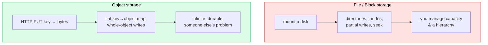
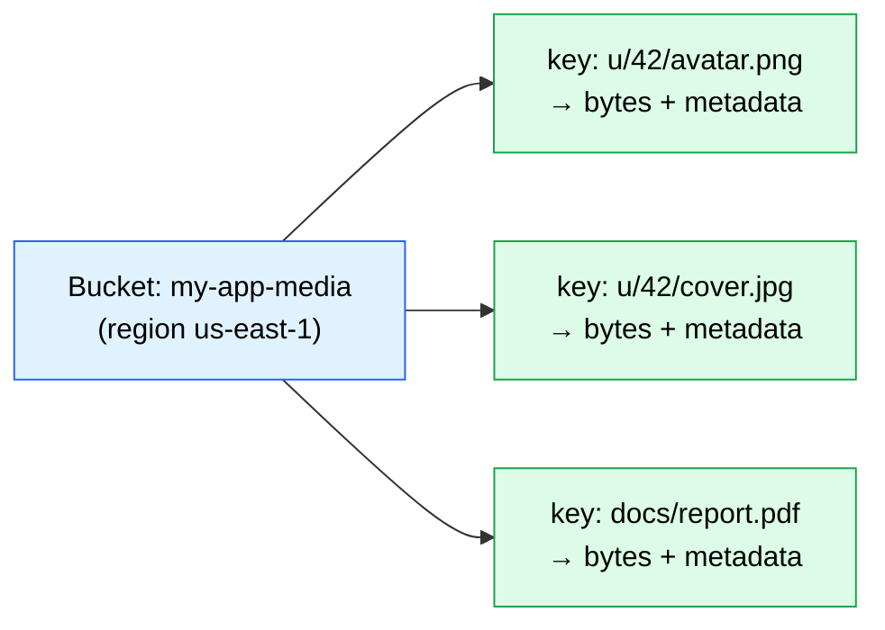
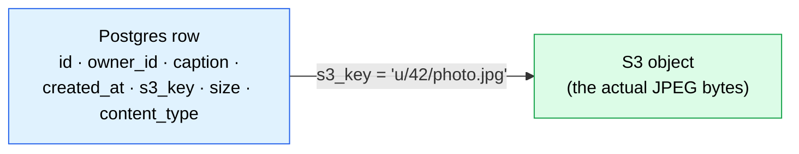
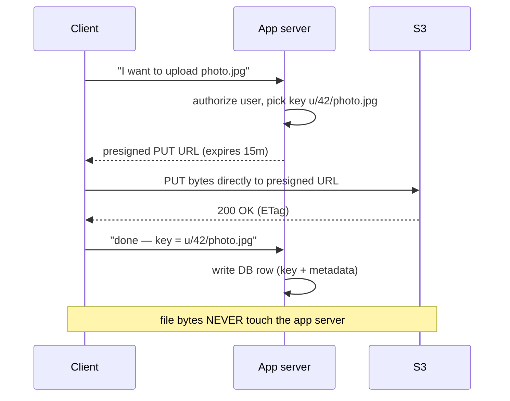
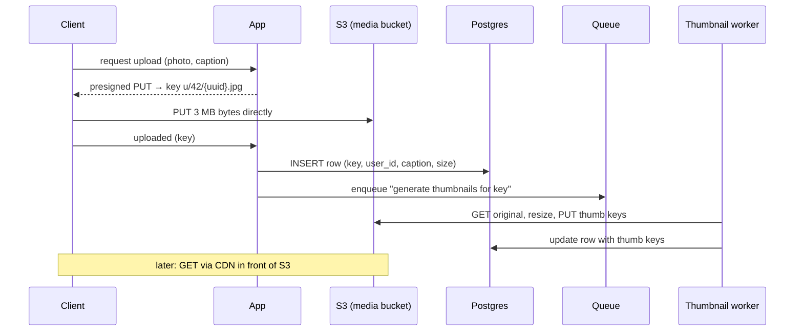
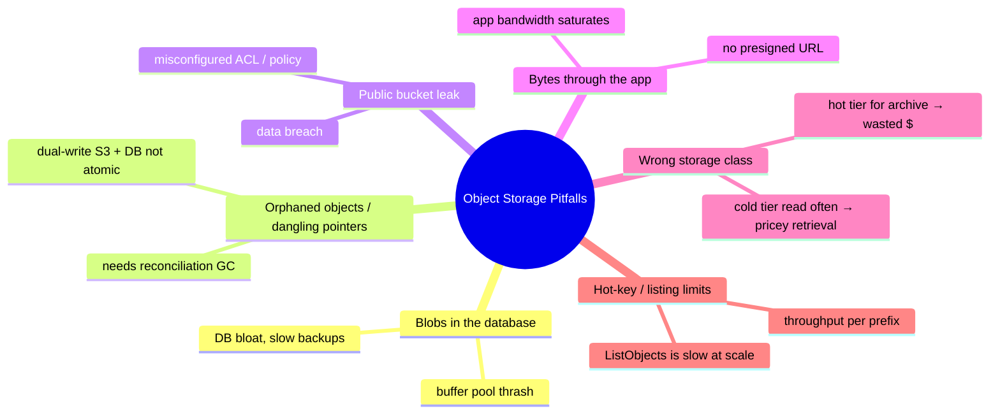

# Object Storage & Blob Stores (S3, GCS, Azure Blob)

> **One line:** Object storage is an infinitely large, dirt-cheap key→bytes bucket reached over HTTP — you put a file in under a key and get it back by that key — and the golden rule of every file-upload design is *store the blob in object storage and only the pointer in your database.*

---

## Table of Contents
1. [Why You Must Master This](#1-why-you-must-master-this)
2. [The Mental Model](#2-the-mental-model)
3. [The Object Storage Model — Buckets, Keys, Flat Namespace](#3-the-object-storage-model--buckets-keys-flat-namespace)
4. [The Golden Pattern — Blob in S3, Pointer in the DB](#4-the-golden-pattern--blob-in-s3-pointer-in-the-db)
5. [Presigned URLs & Direct Upload/Download](#5-presigned-urls--direct-uploaddownload)
6. [Multipart Upload, Consistency & Durability](#6-multipart-upload-consistency--durability)
7. [Storage Classes & Lifecycle Tiering](#7-storage-classes--lifecycle-tiering)
8. [Worked Example — Instagram-style Photo Upload](#8-worked-example--instagram-style-photo-upload)
9. [Real-Life Use Cases](#9-real-life-use-cases)
10. [Failure Modes](#10-failure-modes)
11. [🏋️ Practice Drills](#-practice-drills)
12. [🎤 Interview Q&A Bank](#-interview-qa-bank)
13. [🎯 Staff+ Nuances](#-staff-nuances)
14. [Cheat Sheet](#14-cheat-sheet)
15. [Connections & Further Reading](#15-connections--further-reading)

---

## 1. Why You Must Master This

Almost every real system stores *files* — profile pictures, videos, PDFs, ML datasets, backups, static assets — and the single most common junior mistake is putting them in the database. Object storage is where blobs belong, and the pattern shows up in nearly every file-heavy interview.

- **It's the default answer to "where do the files go?"** Design a photo-sharing app, a video platform, a document store, a data lake — the blobs live in S3/GCS/Azure Blob, full stop. Not knowing this is a red flag; knowing *why* and the exact upload flow is the signal.
- **Putting blobs in your DB melts it.** A relational DB is tuned for small, structured rows and transactions — storing MBs of binary as `BLOB` columns bloats the storage engine, wrecks the buffer-pool cache hit rate, slows backups to a crawl, and caps you at the DB's disk. Object storage is *built* for this and scales independently.
- **It underpins the whole cloud data stack.** Data lakes ([[Data_Warehousing_Data_Lakes]]), backups/DR, static-site hosting, CDN origins, and log archives all sit on object storage. It's foundational infrastructure, not a niche feature.
- **The economics are transformative.** ~$0.023/GB-month for hot storage, dropping to ~$0.004 for archive, with eleven 9s of durability and no capacity planning. It changes what's affordable to keep.

> **The core problem it solves:** *where do arbitrarily large, unstructured files live so they're durable, cheap, and infinitely scalable — without burdening the database that holds your structured, transactional data?* Object storage separates the bytes (huge, static, cheap) from the metadata (small, queried, transactional).

**Prerequisites:** [[Relational_vs_NoSQL]] (what databases are good at), basic HTTP.

---

## 2. The Mental Model

Object storage is a **coat check, not a filing cabinet.**

- You hand over a coat (your file) and get a **ticket** (the key). You don't care *where* in the back room it's hung, how many rooms there are, or how the racks are organized — there's no folder hierarchy, just ticket → coat.
- To get your coat back, you present the ticket. To find *all* coats belonging to you, the attendant filters tickets by a prefix (`u/42/…`) — there are no real folders, just key prefixes that *look* like paths.
- The back room is effectively infinite and shared by everyone, and it's someone else's job to keep every coat safe (durability). You just keep the ticket.

The contrast with a file system or a block device is the whole point:



> **Hold onto this:** it's a giant HTTP-addressable hash map from *key* to *immutable bytes* — no folders, no partial edits, no capacity planning. You address the whole object by its key, and you don't run the storage.



> The bytes flow client↔S3 directly; the database only ever holds the key and metadata.

---

## 3. The Object Storage Model — Buckets, Keys, Flat Namespace

Three primitives, and understanding each precisely is the depth interviewers probe.

- **Bucket** — a globally-named container (a namespace) in a region. It's the unit of policy: access control, versioning, lifecycle rules, replication, and default encryption are configured per bucket.
- **Object** — the *bytes* plus **metadata** (content-type, size, ETag, custom `x-amz-meta-*` tags) plus a **key**. Objects are **immutable**: you can't edit byte 500 of an object — you overwrite the *entire* object with a new version. There's no append, no random write.
- **Key** — the full string name of the object, e.g. `uploads/user/42/2026/photo.jpg`. The namespace is **flat**: `/` is just a character in the key. "Folders" are a UI fiction over key *prefixes*. `ListObjects(prefix="uploads/user/42/")` is how you "list a folder."



**How it differs from a database or file system:**

| Dimension | Object storage | Relational DB | File system |
|---|---|---|---|
| Access | HTTP GET/PUT by key | SQL query | POSIX read/write/seek |
| Structure | Flat key→bytes | Rows/tables/joins | Hierarchical tree |
| Mutation | Whole-object overwrite | Row updates, transactions | Byte-range writes |
| Query | Prefix list only | Rich (WHERE, JOIN) | Path traversal |
| Scale | Effectively infinite | Bounded by disk/shards | Bounded by volume |
| Cost/GB | Lowest (~$0.023 → $0.004) | Highest | Medium |
| Best for | Large static blobs | Structured, queried data | OS files, low latency |

> **The trade-off:** object storage gives you infinite cheap durable storage but *only* key-based access — no queries, no partial edits, higher per-request latency (tens of ms, it's HTTP). That's exactly why you pair it with a database: the DB provides the query layer over the pointers.

---

## 4. The Golden Pattern — Blob in S3, Pointer in the DB

This is the pattern to reflexively state in any file-upload interview:

> **Store the blob in object storage; store the pointer (key) plus queryable metadata in the database.**



**Why split it this way:**
- The DB stays **small and fast** — rows are tiny (a key is ~50 bytes vs a 5 MB photo), so the buffer pool caches millions of them, backups are quick, and [indexing](./Database_Indexing.md) works normally.
- Each layer **scales on its own axis** — blobs grow to petabytes in S3 without touching DB capacity; the DB scales on query load, not file size.
- The DB gives you the **query layer** object storage lacks: "all photos by user 42, newest first, that are public" is a normal indexed SQL query over the metadata rows; the blob is fetched by key only when needed.
- **CDN-friendly** — the blob has a stable URL you can front with a CDN; the metadata stays private.

**The consistency wrinkle you must handle:** the write spans two systems (S3 + DB), so it's not a single transaction. If the DB row is written but the S3 upload failed, you have a dangling pointer; if S3 succeeded but the DB write failed, you have an **orphaned object**. Standard fixes: upload to S3 *first*, then commit the DB row (so a failure leaves an orphan, not a dangling pointer), and run a periodic **reconciliation/GC job** that deletes S3 objects with no matching DB row. This is the same dual-write problem [[Distributed_Transactions]] addresses.

---

## 5. Presigned URLs & Direct Upload/Download

The naive design routes file bytes *through* your app server: client → app → S3. That's a disaster at scale — every upload/download ties up an app thread and app bandwidth for the whole transfer. **Presigned URLs** eliminate the middleman.

A presigned URL is a temporary, cryptographically-signed URL that grants a *specific* operation (PUT this key, or GET this key) for a *limited time* (e.g., 15 minutes), generated by your backend using its credentials — **the client never sees your S3 keys.**



- **Upload:** backend issues a presigned `PUT`; the client uploads straight to S3. The app only handles the tiny authorize + metadata step.
- **Download:** backend issues a presigned `GET` (or serves via CloudFront/CDN with signed URLs/cookies) so private objects stay private but the bytes flow S3→client, not through the app.
- **Why it matters:** your app scales on *requests*, not *bandwidth*. Serving a 4K video through your app would saturate it; handing out a URL costs microseconds.

> **The rule:** the app server is a *control plane* (authorize, sign, record) — it should almost never be in the *data plane* for large blobs.

---

## 6. Multipart Upload, Consistency & Durability

**Multipart upload** — for large objects (S3 requires it above 5 GB; recommended above ~100 MB), you split the file into parts (5 MB–5 GB each), upload them **in parallel and independently**, then send a "complete" request that stitches them into one object.
- **Why:** parallelism saturates bandwidth; and if part 7 of 200 fails, you retry *just that part*, not the whole 40 GB file. Essential for flaky networks and huge files.
- Parts can be resumed and even paused; incomplete multipart uploads linger (and cost money) until aborted — set a lifecycle rule to clean them up.

**Consistency** — modern S3 (since Dec 2020) provides **strong read-after-write consistency** for new objects and overwrites: after a successful PUT, a subsequent GET returns the new data immediately. Historically S3 was *eventually consistent* for overwrites/lists, and many older designs and other object stores still are — so *know the guarantee of your specific store*. Listing may still lag in some systems.

**Durability & availability** — S3 Standard advertises **11 nines of durability** (99.999999999%): it erasure-codes/replicates each object across multiple devices and Availability Zones, so a lost disk or even a lost AZ doesn't lose data. Availability is a separate, lower number (~99.9%). Durability ≠ availability: your data is safe even during an outage that briefly makes it unreachable.

> **Interview nuance:** "eleven 9s of durability" means the *expected* annual loss is ~1 object in 10 million over 10,000 years — you design as if S3 never loses data, and put your energy into *availability* and *access* instead.

---

## 7. Storage Classes & Lifecycle Tiering

Not all data is equally hot. Object stores offer **storage classes** trading retrieval speed/cost for storage cost, and **lifecycle rules** to move objects between them automatically as they age.

| Class (S3 names) | Cost/GB-mo | Retrieval | Use for |
|---|---|---|---|
| **Standard** | ~$0.023 | instant | Hot, frequently accessed |
| **Intelligent-Tiering** | auto | instant | Unknown/changing access patterns |
| **Standard-IA** (infrequent) | ~$0.0125 | instant + per-GB fee | Backups, older content |
| **Glacier Flexible** | ~$0.0036 | minutes–hours | Archives, compliance |
| **Glacier Deep Archive** | ~$0.00099 | ~12 hours | Cold, rarely-if-ever read |

**Lifecycle rules** automate the journey: *"transition to Standard-IA after 30 days, to Glacier after 90, expire after 365."* Set once per bucket/prefix; it can cut storage bills by 70–90% for aging data with zero app changes.


> **The trap:** IA and Glacier charge for *retrieval* and have minimum storage durations. Tier data that's genuinely cold; a "cold" object you actually read often can cost *more* than leaving it in Standard.

---

## 8. Worked Example — Instagram-style Photo Upload

**The prompt:** "Design photo upload for a social app: 100M users, average photo 3 MB, must be fast and cheap, thumbnails needed."

**The wrong design (blobs in DB):** `INSERT INTO photos (id, user_id, image_bytes)` with a 3 MB `BLOB`. At even 10M photos that's 30 TB in Postgres — backups take days, the buffer pool thrashes (every photo read evicts thousands of hot metadata pages), and you're paying premium DB storage for static bytes. This design falls over well before 100M users.

**The right design:**



**Closing the loop — number → consequence:**
- 100M users × ~50 photos × 3 MB ≈ **15 PB** of blobs. In S3 Standard that's ~$345K/mo; with lifecycle tiering old photos to IA/Glacier, well under half that. In a database it would be *impossible* — no single DB holds 15 PB affordably or backs it up.
- The **DB holds ~5 billion tiny rows** (key + metadata ≈ 200 bytes each ≈ 1 TB) — easily indexed, cached, sharded, and backed up. "Show user 42's recent public photos" is one indexed query; the blobs load by key via CDN.
- Uploads/downloads **never touch the app server's bandwidth** (presigned URLs + CDN), so the app fleet scales on request rate, not petabytes of transfer.
- Thumbnails are generated **async** by workers reading/writing S3 — the upload path stays fast.

The example is the whole topic: separating the 15 PB of static bytes (S3, cheap, infinite) from the 1 TB of queryable metadata (DB, fast, indexed) is what makes the system both possible and affordable.

---

## 9. Real-Life Use Cases

| Situation | How object storage decides the outcome |
|-----------|----------------------------------------|
| **User uploads (photos, videos, docs)** | Blob in S3 via presigned URL, pointer + metadata in DB; CDN in front for reads. |
| **Data lake** | Raw/parquet files land in S3; query engines (Athena, Spark, Trino) read them in place — see [[Data_Warehousing_Data_Lakes]]. |
| **Backups & DR** | DB snapshots/WAL archives to S3 with versioning + cross-region replication; Glacier for long retention. |
| **Static website / SPA assets** | HTML/JS/CSS/images served from a bucket behind a CDN — no servers to run. |
| **Log & event archival** | Ship logs to S3 (cheap, immutable), query with Athena; lifecycle to Glacier — see [[Data_Warehousing_Data_Lakes]]. |
| **ML training datasets & model artifacts** | Petabyte datasets and model checkpoints live in object storage, streamed to training jobs. |
| **Large exports / report generation** | Generate a big CSV/PDF async, put it in S3, hand the user a presigned download link. |

> **The habit:** the moment a design involves a file larger than a few KB, say "that goes in object storage; the DB holds the key." Then decide upload path (presigned direct), access (CDN/signed), and lifecycle.

---

## 10. Failure Modes



- **Blobs stored in the database.** *Symptom:* DB storage explodes, backups take hours, query latency degrades. *Root cause:* large `BLOB`/`BYTEA` columns bloat the storage engine and evict hot pages. *Fix:* migrate blobs to object storage, keep only the key.
- **Orphaned objects / dangling pointers.** *Symptom:* S3 objects with no DB row (wasted spend) or DB rows pointing to missing objects (broken images). *Root cause:* the S3-write + DB-write pair isn't atomic and one half failed. *Fix:* upload to S3 first then commit the row; run a reconciliation job that GCs orphans and flags dangling pointers.
- **Publicly-exposed bucket.** *Symptom:* a data-leak headline. *Root cause:* a bucket policy/ACL left public "to make it work." *Fix:* block public access by default, serve via presigned URLs / CloudFront OAC, enable access logging and least-privilege IAM.
- **Streaming bytes through the app.** *Symptom:* app servers saturate on bandwidth/threads under upload load. *Root cause:* client → app → S3 routing. *Fix:* presigned URLs for direct client↔S3 transfer; CDN for downloads.
- **Wrong storage class.** *Symptom:* surprise retrieval charges, or overpaying for cold data. *Root cause:* frequently-read data in Glacier/IA, or archives in Standard. *Fix:* Intelligent-Tiering when unsure; lifecycle rules matched to real access patterns.
- **Hot prefix / listing at scale.** *Symptom:* throttling on a busy prefix, or slow `ListObjects` over millions of keys. *Root cause:* request-rate limits per prefix; list is O(n) prefix scan, not an index. *Fix:* spread keys across prefixes (hashed/high-entropy prefixes), and keep the *queryable* index in your DB, not in S3 listings.

---

## 🏋️ Practice Drills

> *Cover the solutions and attempt first — active recall is the point.*

**Drill 1 — Place the data.** You're storing user resumes (PDFs, ~1 MB) that users search by name, upload date, and skills tags. What goes in object storage and what goes in the database?

<details><summary>Solution</summary>

- **Object storage:** the PDF bytes themselves, under a key like `resumes/{user_id}/{uuid}.pdf`. They're large, static, and never queried by content at the storage layer.
- **Database:** one row per resume with `s3_key`, `user_id`, `filename`, `uploaded_at`, and the searchable `skills` tags (or a foreign key to a tags table). All the *search* (by name/date/skills) happens over these small indexed rows; the PDF is fetched by key only when a user opens it.

If full-text search *inside* the PDF is required, extract the text and index it in [[Full_Text_Search_Elasticsearch]] — still keeping the blob in S3.
</details>

**Drill 2 — Fix the upload path.** A junior built upload as: browser POSTs the file to the API server, which writes it to S3, then returns 200. Under load the API servers fall over. Diagnose and redesign.

<details><summary>Solution</summary>

The file bytes flow *through* the app server, so every upload occupies an app thread and app bandwidth for the entire transfer — a few hundred concurrent 10 MB uploads saturate the fleet. 

Redesign with **presigned URLs**: the browser asks the API for permission; the API authorizes the user, picks a key, and returns a presigned `PUT` URL; the browser uploads the bytes **directly to S3**; then it tells the API the key so the API can write the metadata row. Now the app handles only tiny control-plane requests; S3 absorbs the bandwidth. For downloads, use presigned `GET` or a CDN with signed URLs.
</details>

**Drill 3 — Cost optimization.** You have 500 TB of user videos. 5% are watched daily; 95% haven't been touched in 6 months but must stay retrievable within hours for legal reasons. Design the storage-class strategy.

<details><summary>Solution</summary>

- Keep the hot 5% (~25 TB) in **Standard** for instant playback (front with a CDN so repeated views don't even hit S3).
- Move the cold 95% (~475 TB) toward **Glacier Flexible Retrieval** via a **lifecycle rule** ("transition to Glacier after 90 days of no access"), which satisfies "retrievable within hours."
- Consider **Intelligent-Tiering** if access is unpredictable — it auto-moves objects between tiers based on access without retrieval fees for the monitoring.
- Rough math: 475 TB at ~$0.0036 (Glacier) ≈ $1,700/mo vs ~$11,000/mo in Standard — an ~85% saving on the cold tier, with hours-not-instant retrieval as the accepted trade.
</details>

---

## 🎤 Interview Q&A Bank

**Q1. "Where do you store uploaded files in a web app, and why not the database?"**
> In object storage (S3/GCS/Azure Blob), with only the key and metadata in the database. Databases are tuned for small, structured, transactional rows — storing multi-MB blobs bloats the storage engine, evicts hot pages from cache, slows backups, and caps you at the DB's disk. Object storage is purpose-built: infinite, ~$0.023/GB, eleven 9s durable, and independently scalable. The pattern is *blob in object storage, pointer in the DB.*

**Q2. "What's a presigned URL and why use one?"** *(signal: knows the data/control plane split)*
> A temporary, signed URL that grants one specific operation (PUT or GET a specific key) for a limited time, generated by the backend with its credentials. The client uploads/downloads **directly to/from S3** using it, so file bytes never flow through the app server. That keeps the app scaling on request rate, not bandwidth, and keeps private objects private without exposing your credentials.

**Q3. "How is object storage different from a file system or block storage?"**
> Object storage is a flat key→immutable-bytes map accessed over HTTP; there are no real directories (just key prefixes), no partial/byte-range writes (you overwrite the whole object), and it's effectively infinite and durable with no capacity planning. A file system is a mutable hierarchical tree with POSIX byte-level access and low latency but bounded size; block storage is raw volumes you format yourself. Object storage trades rich access and low latency for scale, durability, and cost.

**Q4. "You write the DB row and upload to S3 — what if one fails?"** *(signal: dual-write awareness)*
> It's a two-system write, so it's not atomic. I upload to S3 *first*, then commit the DB row — that way a failure leaves an orphaned object (harmless, cheap) rather than a DB pointer to a missing file (broken UX). Then a background reconciliation job GCs S3 objects that have no matching DB row. It's the same dual-write problem as distributed transactions; you make it eventually consistent with an idempotent cleanup.

**Q5. "What does 'eleven nines of durability' mean, and how is it achieved?"**
> 99.999999999% expected annual durability — practically, you design as if S3 never loses an object. It's achieved by erasure-coding or replicating each object redundantly across multiple devices and Availability Zones, so a failed disk or even a lost AZ doesn't lose data. Durability is separate from *availability* (~99.9%): your data survives an outage even if it's briefly unreachable.

**Q6. "Why and when would you use multipart upload?"**
> For large files (required above 5 GB, recommended above ~100 MB). You split the object into parts, upload them in parallel to saturate bandwidth, and retry only failed parts instead of the whole file — critical over flaky networks. A final "complete" call stitches them together. Remember to lifecycle-abort incomplete multipart uploads, since their parts keep costing money.

**Q7. "How do you keep storage costs down for aging data?"**
> Storage classes plus lifecycle rules. Hot data in Standard, then automatically transition to Standard-IA, Glacier, and Deep Archive as it ages ("IA after 30d, Glacier after 90d, expire after a year"). This cuts bills 70–90% for cold data with no app changes. The caveat is retrieval fees and minimum durations on cold tiers, so only tier data that's genuinely infrequently accessed — or use Intelligent-Tiering when the pattern is unknown.

**Q8. "How do you serve private files quickly to users worldwide?"**
> Put a CDN (CloudFront) in front of the bucket with Origin Access Control so the bucket stays private, and use **signed URLs or signed cookies** for authorization. The CDN caches objects at the edge for low latency and offloads S3; the signature ensures only authorized users fetch a given object. For uploads, presigned PUT URLs do the mirror-image job.

---

## 🎯 Staff+ Nuances

- **The dual-write between S3 and the DB is a real consistency problem, not a footnote.** Order matters (S3 first, DB second), idempotency matters (retried uploads shouldn't duplicate), and you need a GC sweep for orphans. This is the [[Distributed_Transactions]] pattern applied to storage — treat it as such, don't hand-wave "just upload it."
- **Object immutability is a feature — lean on it.** Because objects don't change in place, you get trivial caching (a key can be cached forever if you use content-hash keys), safe CDN behavior, and cheap versioning. Design keys to be *immutable and content-addressed* (`.../{sha256}.jpg`) where you can — then cache-control can be `immutable, max-age=1y`.
- **`ListObjects` is not a query engine.** It's a prefix scan, O(n) in the number of keys, eventually consistent in some stores, and slow at millions of objects. Never make your app's "list a user's files" path a live S3 list — that's what the DB metadata index is for. S3 Inventory (a daily manifest) is the right tool for batch enumeration.
- **Strong consistency is recent and store-specific.** S3 became strongly read-after-write consistent in 2020; before that, and in some other object stores, overwrites and lists were eventually consistent. Designs that "read what you just wrote" must confirm their store's guarantee — an old assumption baked into a new system is a subtle bug.
- **Request cost can dominate storage cost for small objects.** PUT/GET/LIST requests are billed per-thousand; a workload of billions of tiny objects can cost more in *requests* than in *storage*. Batch small objects (e.g., pack into larger files / use formats like Parquet in a lake), or reconsider whether a database/KV store fits better.
- **Cross-region replication and versioning are your DR and ransomware defenses.** Bucket versioning + MFA-delete + Object Lock (WORM) protect against accidental/malicious deletion; cross-region replication gives geographic durability. These are the object-storage side of [[Replication]] and disaster recovery.
- **Object storage is the substrate of the modern lakehouse.** Parquet/ORC files in S3 + a table format (Iceberg/Delta/Hudi) + a query engine turns "dumb bucket" into a queryable warehouse — the separation of cheap storage from elastic compute that defines [[Data_Warehousing_Data_Lakes]]. Knowing object storage is the floor of that whole stack.

---

## 14. Cheat Sheet

```
OBJECT STORAGE — INFINITE, CHEAP, DURABLE KEY→BYTES OVER HTTP
═══════════════════════════════════════════════════════════════════

THE GOLDEN RULE
  blob → object storage (S3/GCS/Azure Blob)
  pointer (key) + metadata → database
  access → presigned URL (direct client↔S3) + CDN

MODEL
  Bucket   named container, unit of policy (region-scoped)
  Object   immutable bytes + metadata, addressed by KEY
  Key      full string name; namespace is FLAT ("/" is just a char)
  → no folders, no partial writes, no capacity planning

UPLOAD PATH (do this)
  client → app: "want to upload"
  app → client: presigned PUT URL (expires)
  client → S3: PUT bytes DIRECTLY (not through app)
  client → app: key; app writes DB row
  ⚠ S3 first, DB second → orphan (safe) not dangling pointer

BIG FILES: multipart upload (>5GB required, >100MB advised)
  parallel parts, retry only failed part, abort incompletes (lifecycle)

GUARANTEES
  durability ~11 nines (multi-AZ erasure coding) — assume no loss
  availability ~99.9% (durability ≠ availability)
  consistency: modern S3 strong read-after-write (confirm your store)

STORAGE CLASSES (cost/GB-mo, retrieval)
  Standard      $0.023   instant   hot
  Standard-IA   $0.0125  instant+fee backups
  Glacier       $0.0036  min–hours archive
  Deep Archive  $0.001   ~12h     cold
  Lifecycle rule: transition by age → save 70-90%

DON'T:  blobs in DB · bytes through app · public buckets ·
        List as a query · cold tier for hot data
```

---

## 15. Connections & Further Reading

**Prerequisites (learn first):**
- [Relational_vs_NoSQL.md](./Relational_vs_NoSQL.md) — what databases are good at (structured, queried data) and why blobs don't belong there.

**Builds toward / pairs with:**
- [[Data_Warehousing_Data_Lakes]] — object storage is the substrate of the data lake and lakehouse.
- [[Distributed_Transactions]] — the S3+DB dual-write is a distributed-transaction / dual-write consistency problem.
- [[Full_Text_Search_Elasticsearch]] — when you must search *inside* stored documents, index extracted text separately while the blob stays in S3.
- [Replication.md](./Replication.md) — cross-region bucket replication and versioning are the object-storage side of durability/DR.
- [06 · Caching & Performance](../06_Caching_Performance/) — CDNs cache blob reads at the edge in front of object storage.

**Gaps this topic exposes:**
- CDN & edge delivery deep-dive (lives in caching/performance), and a dedicated Disaster Recovery / RPO-RTO note (lives in 13).

**External classics:**
- [Amazon S3 documentation](https://docs.aws.amazon.com/s3/) — the reference model, consistency, and storage classes.
- *Designing Data-Intensive Applications* (Kleppmann) — the storage/retrieval trade-offs behind blob vs structured stores.
- [AWS: Best Practices Design Patterns — S3 Performance](https://docs.aws.amazon.com/AmazonS3/latest/userguide/optimizing-performance.html) — prefixes, request rates, multipart.

---

## TL;DR
**Object storage is an infinite, cheap, eleven-nines-durable key→bytes map reached over HTTP — and the reflex for any file-upload design is *store the blob in object storage, the pointer (key) plus queryable metadata in the database.*** It's a flat namespace of immutable objects: no folders, no partial edits, no capacity planning. Have clients upload and download **directly** via presigned URLs (and a CDN) so file bytes never flow through your app; handle the S3+DB dual-write by uploading first and committing second, with a GC sweep for orphans; and use storage classes + lifecycle rules to age cold data into Glacier for 70–90% savings. **Blobs in the database is the mistake; blob in the bucket, key in the row is the pattern.**
