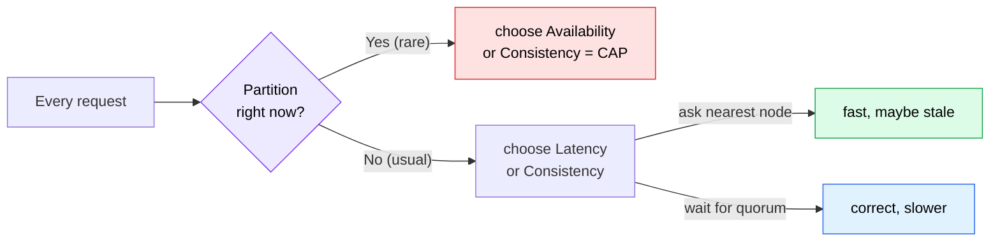
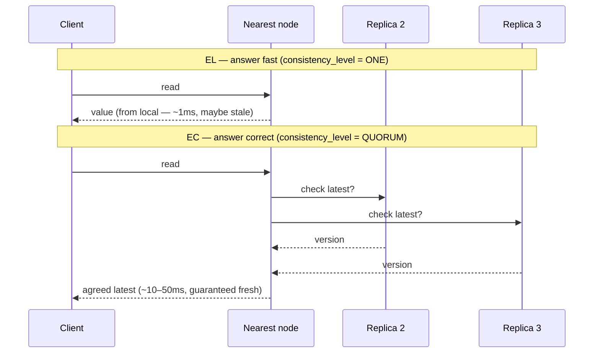
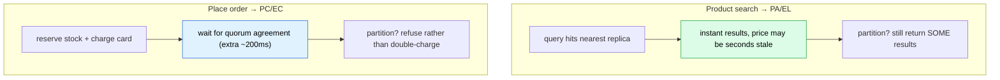
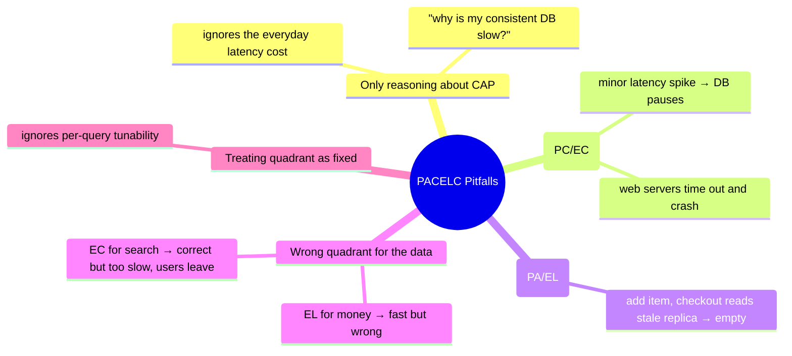

# PACELC Theorem

> **One line:** CAP only describes what happens when the network *breaks*; PACELC adds the trade-off you make every single request when it's working perfectly — because strong consistency always costs latency, even with no partition in sight.

---

## Table of Contents
1. [Why You Must Master This](#1-why-you-must-master-this)
2. [The Mental Model](#2-the-mental-model)
3. [The Two Halves — PAC and ELC](#3-the-two-halves--pac-and-elc)
4. [The Four Quadrants](#4-the-four-quadrants)
5. [Why Consistency Costs Latency](#5-why-consistency-costs-latency)
6. [Worked Example — Amazon Search vs Checkout](#6-worked-example--amazon-search-vs-checkout)
7. [Real-Life Use Cases](#7-real-life-use-cases)
8. [Failure Modes](#8-failure-modes)
9. [🏋️ Practice Drills](#-practice-drills)
10. [🎤 Interview Q&A Bank](#-interview-qa-bank)
11. [🎯 Staff+ Nuances](#-staff-nuances)
12. [Cheat Sheet](#12-cheat-sheet)
13. [Connections & Further Reading](#13-connections--further-reading)

---

## 1. Why You Must Master This

PACELC is the theorem that completes [CAP](./CAP_Theorem.md). CAP tells you what to do during a partition — a rare event. PACELC tells you what you're trading on *every ordinary request*, which is where your latency budget and your consistency guarantees actually get spent.

- **CAP is incomplete, and PACELC is the fix.** CAP says "no partition → you get both C and A." PACELC corrects the record: even with no partition, there's a standing conflict between **L**atency and **C**onsistency. That conflict governs 99.9% of your requests.
- **Latency is the silent user-killer.** Everyone obsesses over consistency; users leave over slowness. PACELC forces you to admit that "strongly consistent" and "fast" are in tension *all the time*, not just during failures.
- **It's how architects actually classify databases.** "Cassandra is PA/EL, MongoDB is PC/EL, Spanner is PC/EC" is a far more precise vocabulary than "AP vs CP." Using PACELC correctly is a strong seniority signal.
- **It maps to a real dial.** Every tunable-consistency knob (`ONE` vs `QUORUM`, read/write concerns) is a PACELC choice made per query. Understanding the theorem is understanding what that knob does.

> **The core problem it solves:** *CAP's blind spot for the normal case.* By adding "Else, Latency-vs-Consistency," PACELC names the trade-off that exists during healthy operation — so you design for the cost you pay constantly, not just the cost you pay during a partition.

---

## 2. The Mental Model

Think of asking a group of friends to confirm a fact:

- **Fast but maybe wrong (EL):** ask the *nearest* friend and go with their answer. Instant, but they might be out of date.
- **Slow but correct (EC):** call *everyone*, wait for the majority to agree, then answer. Takes longer, but you're sure.

There's no free option: getting the *guaranteed-correct* answer means *waiting* for others to weigh in. That waiting is latency, and it exists even when nobody's phone is broken. CAP's partition is the special case where a friend is *unreachable*; PACELC's "Else" is the everyday case where they're reachable but *asking them still costs time*.





---

## 3. The Two Halves — PAC and ELC

PACELC reads as: **P**artition → **A**vailability or **C**onsistency, **E**lse → **L**atency or **C**onsistency.

- **PAC (the CAP half):** *If* there's a partition, do you choose Availability (keep serving, maybe stale) or Consistency (refuse rather than risk wrong)? This is exactly [CAP](./CAP_Theorem.md).
- **ELC (the new half):** *Else* — when the network is healthy — do you choose Latency (answer fast from the nearest replica) or Consistency (wait for replicas to agree before answering)?

The insight PACELC contributes is the second half. A system that insists on strong consistency doesn't only pay during partitions — it pays a coordination cost on *every* strongly-consistent operation, because it must confirm with other nodes before responding. That cost is invisible in CAP's framing and dominant in real operation.

---

## 4. The Four Quadrants

Combining the two independent choices gives four categories:

| Type | Partition → | Else → | Meaning | Examples |
|------|-------------|--------|---------|----------|
| **PA/EL** | Availability | Latency | Fast and available *always*; reconcile conflicts later | Cassandra, DynamoDB, Riak, Couchbase |
| **PC/EC** | Consistency | Consistency | Correct *always*, pays coordination latency constantly | HBase, BigTable, VoltDB, Spanner\* |
| **PC/EL** | Consistency | Latency | Fast when healthy, but stops rather than serve stale under partition | MongoDB (default), PNUTS |
| **PA/EC** | Availability | Consistency | Available under partition, consistent when healthy (rare) | some MySQL cluster configs |

The two common poles are **PA/EL** ("speed at all times") and **PC/EC** ("truth at all times"). The interesting hybrid is **PC/EL**: MongoDB serves low-latency reads normally but, if the primary is lost during a partition, blocks writes rather than risk inconsistency — a different posture in each regime.

> \*Spanner is PC/EC in classification, but engineers partitions to be so rare (via TrueTime and redundant networking) that it delivers near-AP availability in practice — a reminder that the quadrant is a *worst-case* label.

---

## 5. Why Consistency Costs Latency

The ELC half rests on a physical fact: **to guarantee a read sees the latest write, the responding node must coordinate with other nodes** — and coordination takes time.



```python
# EL preference — fastest, may be stale (answer from one node)
db.read(key, consistency_level="ONE")

# EC preference — wait for a majority to agree before returning
db.read(key, consistency_level="QUORUM")
```

The `QUORUM` read is *correct* but pays the round-trips to other replicas; the `ONE` read is *fast* but may miss a recent write. There's no configuration that gives both guaranteed-freshness and single-node latency — that's the ELC trade, and it's present on every request, partition or not.

---

## 6. Worked Example — Amazon Search vs Checkout

**The prompt:** "Same company, same infrastructure — why does product search behave differently from checkout under PACELC?"



**Closing the loop — number → consequence:**
- **Search = PA/EL.** A shopper expects instant results; a 2-second search feels broken and they leave. So search reads from the nearest node (EL) and stays available even under partition (PA). The cost — a price that's a few seconds stale — is invisible and harmless. **Optimize for latency because the blast radius of staleness is ~zero.**
- **Checkout = PC/EC.** Placing an order charges a card and reserves inventory. Here Amazon *accepts* an extra ~200ms (EC) to confirm across replicas that the stock exists and the charge is recorded exactly once, and *refuses* rather than serve stale data under partition (PC). **Pay the latency because the blast radius of being wrong is money and oversold inventory.**

**The consequence:** PACELC quadrant is chosen *per operation* by the same rule as CAP — the cost of a stale answer — but now including the everyday latency cost. Search can't afford the coordination latency and doesn't need the correctness; checkout needs the correctness and can absorb the latency. One system, two quadrants, matched to each operation's stakes.

---

## 7. Real-Life Use Cases

| Situation | Quadrant and why |
|-----------|------------------|
| **Product search / catalog browse** | PA/EL — instant results win; a stale price for seconds is harmless. |
| **Payment / order placement** | PC/EC — correctness is worth extra latency; refuse rather than risk under partition. |
| **Social feed / timeline** | PA/EL — availability and snappiness dominate; eventual freshness is fine. |
| **Inventory reservation** | PC/EC — overselling costs real money; coordinate every time. |
| **User session / cache** | PA/EL — a stale session read is cheap; latency matters for every page. |
| **Distributed config / feature flags** | PC/EL — fast reads normally, but must not serve divergent config under partition. |
| **Bank ledger** | PC/EC — never fast-but-wrong with money. |

> **The habit:** classify each operation into a quadrant out loud, and justify the ELC half explicitly — "search is EL because I'd rather return a slightly stale price in 20ms than a fresh one in 200ms."

---

## 8. Failure Modes



- **Reasoning only with CAP.** Symptom: "our strongly-consistent DB is mysteriously slow even though the network is fine." Cause: ignoring ELC — strong consistency coordinates on every request. *Fix:* recognize the latency cost is inherent to EC; relax to EL where staleness is acceptable.
- **Over-waiting (PC/EC).** Symptom: a minor cross-datacenter latency spike makes the DB pause for consistency, and upstream web servers time out and cascade-fail. *Fix:* set sane coordination timeouts, use EL for non-critical reads, and consider whether every operation truly needs EC.
- **Dirty cart (PA/EL).** Symptom: user adds an item then immediately checks out, and checkout (hitting a different, lagging replica) sees an empty cart. Cause: EL read caught replication lag. *Fix:* read-your-writes routing for the user's own cart, or EC for the checkout read specifically.
- **Wrong quadrant for the data.** Symptom: money handled EL (fast but wrong) or search handled EC (correct but users bounce on latency). *Fix:* pick the quadrant by cost-of-staleness *and* latency-sensitivity, per operation.
- **Assuming the quadrant is fixed.** Symptom: designing as if a database has one immutable posture. *Fix:* tunable stores choose per query — the quadrant is a *default*, not a cage.

---

## 🏋️ Practice Drills

> *Cover the solutions and attempt first — active recall is the point.*

**Drill 1 — Classify the database.** Put each in a PACELC quadrant: (a) Cassandra with default settings; (b) HBase; (c) MongoDB default; (d) Google Spanner.

<details><summary>Solution</summary>

(a) **Cassandra → PA/EL.** Under partition it stays available (AP); normally it favors low latency by reading from the nearest replica(s). It's the archetypal "fast and available always" store, with tunable consistency to move toward EC per query.

(b) **HBase → PC/EC.** Built on a strongly-consistent model (single region server owns a key range); under partition it favors consistency, and normally it still coordinates for consistency. Truth over speed in both regimes.

(c) **MongoDB default → PC/EL.** Normally it serves low-latency reads (EL, especially from the primary or with relaxed read concern), but under a partition that loses the primary it stops accepting writes rather than risk inconsistency (PC). Different posture in each regime — the interesting hybrid.

(d) **Spanner → PC/EC** by classification (strong consistency always, via TrueTime), though it engineers partitions to be so rare that it *behaves* highly available in practice. The label is worst-case; the operational reality is near-AP uptime with EC guarantees.
</details>

**Drill 2 — "Why is my consistent database slow?"** A teammate is confused: there's no network partition, the cluster is healthy, yet their strongly-consistent reads are 10× slower than eventually-consistent ones. Explain using PACELC.

<details><summary>Solution</summary>

This is the **ELC** trade-off, and CAP alone can't explain it (CAP only talks about partitions). Even with a perfectly healthy network, a strongly-consistent read must **coordinate** with other replicas — the responding node has to confirm it has the latest committed value, which means waiting for a quorum of replicas to respond (round-trips of 10–50ms) before answering.

An eventually-consistent read skips that coordination — it answers immediately from the nearest node's local state (~1ms), accepting that the value might be slightly stale.

So the 10× difference isn't a bug or a partition — it's the physical cost of the correctness guarantee. The fix is to ask whether *that specific read* needs strong consistency; if a slightly-stale value is acceptable, drop it to EL (`consistency_level=ONE`) and reclaim the latency. PACELC names this exact everyday trade that CAP omits.
</details>

**Drill 3 — Per-query tuning.** In a PA/EL store like Cassandra, you have two reads: showing a user their account's remaining gift-card balance before a purchase, and showing a "customers also viewed" carousel. Set the consistency level for each and justify.

<details><summary>Solution</summary>

- **Gift-card balance before purchase → `QUORUM` (lean EC).** This value gates spending real money. A stale balance could let a user spend more than they have (or block a valid purchase). Pay the coordination latency to read a guaranteed-fresh value — correctness is worth ~tens of ms here.
- **"Customers also viewed" carousel → `ONE` (EL).** A recommendation list that's slightly stale or varies per node is completely invisible to the user and not worth any extra latency. Read from the nearest node for the fastest possible response.

The lesson: even within a single "PA/EL database," you move individual queries toward EC or EL per their stakes. The quadrant is the default; the consistency level is the per-operation dial.
</details>

---

## 🎤 Interview Q&A Bank

**Q1. "What does PACELC add to CAP?"** *(signal: top-tier if used correctly)*
> CAP only covers the partition case — if Partition, choose Availability or Consistency. PACELC adds the "Else": when there's no partition, you *still* choose between Latency and Consistency, because strong consistency requires cross-node coordination that costs time. So PACELC captures the trade-off you make on every request, not just during rare failures.

**Q2. "Why is a strongly-consistent database often slower even when nothing is broken?"**
> That's the ELC half of PACELC. To guarantee a read returns the latest write, the node must coordinate with other replicas — wait for a quorum to confirm the current value — before answering, adding round-trip latency. An eventually-consistent read skips that and answers from local state instantly. The consistency guarantee is literally paid for in latency, partition or not.

**Q3. "Classify Cassandra and Spanner in PACELC."**
> Cassandra is PA/EL — available under partition, latency-optimized normally (with tunable consistency per query). Spanner is PC/EC — strongly consistent always, via TrueTime, accepting coordination latency — though it engineers partitions to be rare enough that it's highly available in practice. They're the two poles: speed-always vs truth-always.

**Q4. "What's a PC/EL system and why is it interesting?"**
> It behaves differently in each regime: low-latency when healthy (EL), but consistency-preserving under partition (PC). MongoDB's default is the classic example — fast reads normally, but if the primary is lost during a partition it stops accepting writes rather than risk divergence. It's a pragmatic hybrid: don't pay for coordination when you don't have to, but never serve wrong data during a failure.

**Q5. "How do you choose a PACELC quadrant for an operation?"**
> Two questions: what's the cost of a *stale* answer (that's the C-vs-A/L axis), and how *latency-sensitive* is this operation? Money, inventory, and coordination → EC/PC, pay the latency. Feeds, search, recommendations, sessions → EL/PA, optimize for speed. And I decide per operation, since tunable stores let me set consistency per query.

**Q6. "Does PACELC apply to a single-node database?"**
> No — like CAP, it's a distributed-systems framework. On a single node there's no cross-node coordination and no partition, so neither the PAC nor the ELC trade-off exists. PACELC only becomes meaningful once data is replicated across multiple nodes.

**Q7. "Give a failure caused by choosing the wrong ELC side."**
> The 'over-wait': a PC/EC system in normal operation hits a small cross-datacenter latency spike, and because every read waits for quorum agreement, response times balloon and upstream web servers start timing out — a latency choice cascading into an outage. The fix is to use EL for reads that don't need freshness and set coordination timeouts, so a minor network hiccup doesn't freeze the whole request path.

---

## 🎯 Staff+ Nuances

- **PACELC is the theorem that matters in steady state; CAP matters at the tail.** Partitions are rare; the ELC trade is paid on every request. When you're sizing a latency budget or explaining why p99 is high, PACELC is the relevant lens — yet most engineers only know CAP. Leading with PACELC signals you think about the common case, not just the failure case.
- **The quadrant is a *default*, not a property — the dial is per-operation.** The real design artifact isn't "we chose an AP database"; it's a table of operations each mapped to a consistency level. Cassandra's `ONE`/`QUORUM`/`ALL`, DynamoDB's strongly-consistent-read flag, Mongo's read/write concerns — these move individual operations across the ELC line. Reasoning at the per-query granularity is the senior move.
- **Spanner shows the quadrant is a worst-case bound, not a lived experience.** It's PC/EC by classification, but by making partitions astronomically rare (TrueTime, dedicated fiber) it delivers ~5 nines of availability while strongly consistent. The lesson: you can sometimes *engineer away* the frequency of the bad case rather than accept the quadrant's implied downside — CAP/PACELC bound the worst case, and money can shrink how often you hit it.
- **ELC latency compounds with geography.** The coordination cost of EC isn't fixed — it scales with the distance between replicas. Cross-region quorum reads pay speed-of-light round-trips (tens to >100ms). This is why globally-distributed strongly-consistent systems are hard and why many designs keep strong consistency *within* a region and go eventual *across* regions.
- **The dirty-cart bug is PACELC's read-your-writes gap.** A PA/EL store serving a user's own just-written data from a lagging replica produces "my change vanished" bugs. The targeted fix isn't full EC — it's read-your-writes routing for the *actor's own* data, keeping EL for everyone else. Knowing you can apply consistency asymmetrically (strong for the writer, eventual for observers) is a subtle but powerful pattern.
- **PACELC reframes "consistency" as a cost center you budget.** Every EC operation spends latency; every EL operation spends correctness. Treating consistency as a resource you *allocate* per operation — rather than a global setting — is how you keep both the latency budget and the correctness guarantees under control. It ties directly to [consistency models](./Consistency_Models.md): the finer-grained your model vocabulary, the more precisely you can spend.

---

## 12. Cheat Sheet

```
PACELC — THE TRADE-OFF CAP FORGETS (the everyday one)
═══════════════════════════════════════════════════════════════════

THE FORMULA
  if (P)artition → (A)vailability or (C)onsistency      ← this is just CAP
  (E)lse         → (L)atency      or (C)onsistency      ← the NEW, everyday half

WHY ELC EXISTS
  guaranteed-latest read must COORDINATE with replicas → costs latency
  → strong consistency is slower EVEN WITH NO PARTITION
  EL: read nearest node   ~1ms   maybe stale
  EC: wait for quorum      ~10–50ms  guaranteed fresh

THE FOUR QUADRANTS
  PA/EL  fast+available always   Cassandra, DynamoDB, Riak    feeds/search/carts
  PC/EC  correct always          HBase, BigTable, Spanner*    money/inventory/config
  PC/EL  fast normal, safe on P  MongoDB(default), PNUTS       hybrid
  PA/EC  available on P, strict  (rare — some MySQL clusters)  —
  *Spanner: PC/EC but partitions so rare it's ~AP in practice

CHOOSE PER OPERATION (quadrant is a DEFAULT, dial is per-query)
  cost of stale answer HIGH + latency-tolerant → EC/PC (checkout, ledger)
  cost of stale answer LOW  + latency-sensitive → EL/PA (search, feed, recs)
  Cassandra: ONE (EL) ↔ QUORUM (EC) ↔ ALL   per query

PITFALLS
  ✗ reason only with CAP → can't explain "why is my consistent DB slow?"
  ✗ EC everywhere → over-wait, latency spike cascades to timeouts
  ✗ EL for the writer's own data → "my edit vanished" (use read-your-writes)
  ✗ treat quadrant as fixed → ignore per-query tunability

SAYING "PACELC" CORRECTLY = top-tier interview signal.
```

---

## 13. Connections & Further Reading

**Within this repo:**
- [CAP_Theorem.md](./CAP_Theorem.md) — the PAC half; PACELC's foundation and the partition-only view it completes.
- [Consistency_Models.md](./Consistency_Models.md) — the "C" you're trading, from eventual to linearizable.
- [BASE_Philosophy.md](./BASE_Philosophy.md) — the PA/EL worldview and its conflict-resolution machinery.
- [Replication.md](./Replication.md) — the multi-replica coordination that *is* the ELC latency cost.
- [SQL_vs_NoSQL_Scaling.md](./SQL_vs_NoSQL_Scaling.md) — why EL systems scale out more easily (no global handshakes).

**External classics:**
- [*Consistency Tradeoffs in Modern Distributed Database System Design*](https://cs-www.cs.yale.edu/homes/dna/papers/abadi-pacelc.pdf) (Daniel Abadi, 2012) — the original PACELC paper.
- [Wikipedia: PACELC theorem](https://en.wikipedia.org/wiki/PACELC_theorem) — quadrant classifications for common databases.
- *Designing Data-Intensive Applications* (Kleppmann) — Ch. 9 on the latency cost of linearizability.

---

## TL;DR
**PACELC completes CAP: if there's a Partition, choose Availability or Consistency (that's CAP) — Else, when the network is healthy, you *still* choose between Latency and Consistency, because a guaranteed-fresh read must coordinate with other replicas and that costs time.** The everyday ELC trade explains why strongly-consistent databases are slower even with no failure, and it applies to every request, not just the rare partition. Classify systems into quadrants — PA/EL (Cassandra: fast always), PC/EC (Spanner: correct always), PC/EL (MongoDB: hybrid) — but remember the quadrant is a *default*: tunable stores let you pick per query. **Choose the ELC side by the operation's cost-of-staleness and latency-sensitivity — pay coordination latency for money and inventory, buy speed with eventual consistency for feeds and search.**
