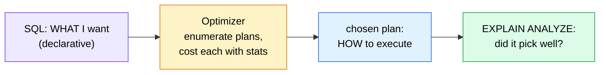
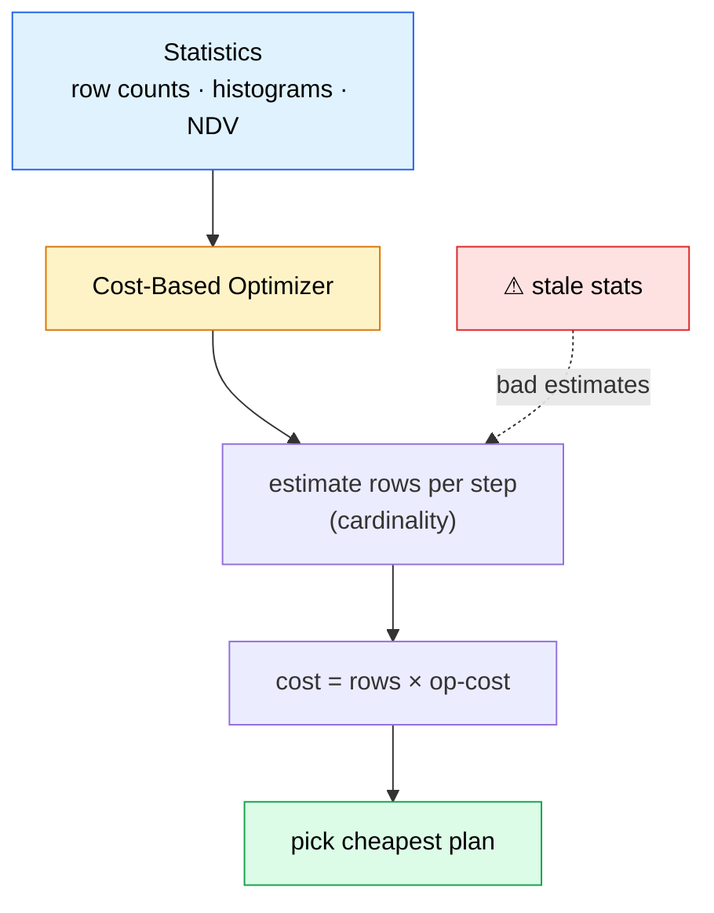
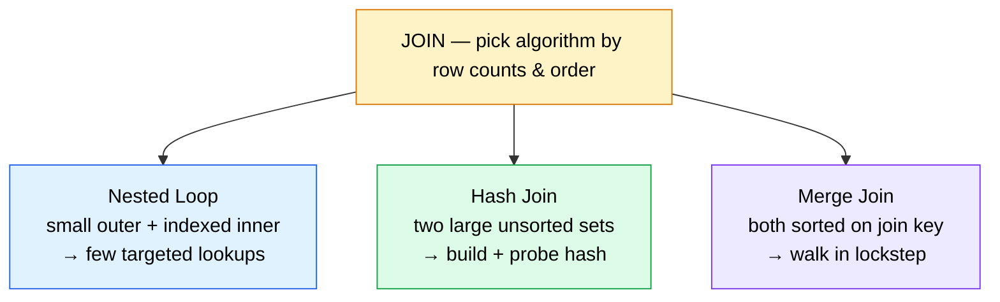
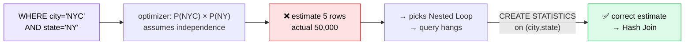
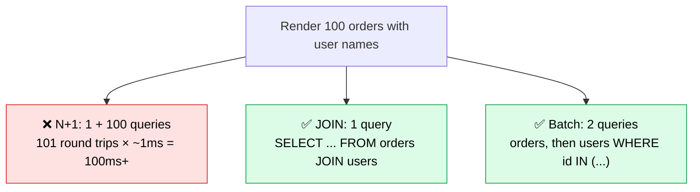
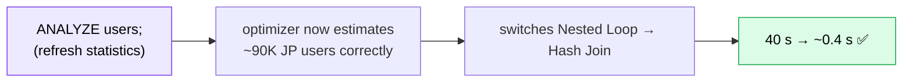
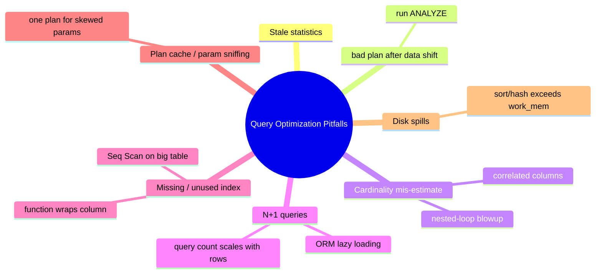

# Query Optimization & Execution Plans

> **One line:** SQL is *declarative* — you say *what* rows you want, not *how* to get them — so the database's cost-based optimizer generates many possible execution plans, estimates each one's cost from table statistics, and runs the cheapest; `EXPLAIN ANALYZE` is your window into which plan it actually chose and why.

---

## Table of Contents
1. [Why You Must Master This](#1-why-you-must-master-this)
2. [The Mental Model](#2-the-mental-model)
3. [The Cost-Based Optimizer & Statistics](#3-the-cost-based-optimizer--statistics)
4. [Reading EXPLAIN / EXPLAIN ANALYZE](#4-reading-explain--explain-analyze)
5. [Join Algorithms — Nested Loop, Hash, Merge](#5-join-algorithms--nested-loop-hash-merge)
6. [Cardinality Estimation — Where Plans Go Wrong](#6-cardinality-estimation--where-plans-go-wrong)
7. [The N+1 Query Problem](#7-the-n1-query-problem)
8. [Worked Example — Debugging a Slow Join](#8-worked-example--debugging-a-slow-join)
9. [Real-Life Use Cases](#9-real-life-use-cases)
10. [Failure Modes](#10-failure-modes)
11. [🏋️ Practice Drills](#-practice-drills)
12. [🎤 Interview Q&A Bank](#-interview-qa-bank)
13. [🎯 Staff+ Nuances](#-staff-nuances)
14. [Cheat Sheet](#14-cheat-sheet)
15. [Connections & Further Reading](#15-connections--further-reading)

---

## 1. Why You Must Master This

[Database Indexing](./Database_Indexing.md) tells you to "run `EXPLAIN ANALYZE`" — but it never teaches you to *read* the plan. This file is that missing skill: the difference between "I added an index" and "I understand why the query is slow."

- **It's the actual debugging skill for slow queries.** Adding indexes blindly is guessing. Reading the execution plan tells you *exactly* where time goes — the `Seq Scan` on a 10M-row table, the `Nested Loop` running a million times, the row estimate that was off by 1000×. That's the loop every senior engineer runs.
- **The optimizer is smart but not magic — you must know its blind spots.** It relies on *statistics* that can be stale, and *cardinality estimates* that collapse on correlated columns. When it picks a bad plan, only someone who reads plans can diagnose *why* and force a better one.
- **N+1 queries are the most common app-level performance bug.** An ORM that quietly fires 1,001 queries to render a page is the #1 reason "the app is slow" — and it's invisible without looking at the query log or plan.
- **It's a Staff+ separator.** "Here's a slow query and its `EXPLAIN` output — what's wrong?" instantly reveals whether someone actually operates databases or just writes SQL.

> **The core problem it solves:** *SQL doesn't tell the database how to execute — so the same query can run in 2ms or 20s depending on the plan.* The optimizer's job is to pick the fast plan; your job is to verify it did, and to fix the inputs (indexes, statistics, query shape) when it didn't.

**Prerequisites:** [[Database_Indexing]] (indexes are the plans' fast paths), [[Database_Normalization_Denormalization]] (joins come from normalization).

---

## 2. The Mental Model

Think of SQL as **telling a taxi driver your destination, not the route.**

- You say "take me to the airport" (declarative — *what*). You don't dictate every turn. The driver (the **optimizer**) knows the roads, checks traffic (**statistics**), and chooses among routes: the highway (index scan), surface streets (sequential scan), or a shortcut (index-only scan).
- A *good* driver with *current* traffic data picks the fast route. A driver with a stale map (stale statistics) might take you down a road that's now gridlocked — technically valid, disastrously slow.
- `EXPLAIN` is asking "which route will you take?"; `EXPLAIN ANALYZE` is riding along and *timing every leg*.



> **Hold onto this:** you don't write the execution — you write the *goal* and the optimizer writes the execution. When a query is slow, the query text is often fine; the *plan* (or the statistics that produced it) is the problem.



> The same query has many valid plans with wildly different costs — the optimizer's whole value is picking the cheap one from accurate statistics.

---

## 3. The Cost-Based Optimizer & Statistics

Modern databases (Postgres, MySQL, Oracle, SQL Server) use a **cost-based optimizer (CBO)**. Given a query, it:

1. **Enumerates candidate plans** — different access methods (seq scan vs index scan), join orders, and join algorithms. For a 4-table join there are many possible orders; the optimizer prunes and searches this space.
2. **Estimates the cost of each** using a cost model: estimated *rows* processed × per-operation costs (sequential page reads, random reads, CPU per row, etc.). Cost is an abstract unit, not milliseconds.
3. **Picks the lowest-cost plan** and executes it.

The estimates come from **statistics** the database maintains about each table:
- **Row counts** (table cardinality).
- **Column histograms** — the distribution of values (how many rows have `country='JP'`?).
- **Number of distinct values (NDV)** and most-common-values lists.
- **Correlation** between physical row order and column order (helps decide index vs scan).



**Why this matters:** the optimizer is only as good as its statistics. Postgres refreshes them via `ANALYZE` (and autovacuum's autoanalyze); after a big bulk load or data-distribution shift, stats can be stale and the optimizer picks a plan based on the *old* shape of the data — the classic "it was fast yesterday" regression.

> **Real number:** the optimizer may *rationally ignore your index* if it estimates the query returns a large fraction of the table (typically >~5–20%) — because at that point a sequential scan reading pages in order beats thousands of random index lookups. "I added an index but it's not used" is often the optimizer being *correct*, not broken.

---

## 4. Reading EXPLAIN / EXPLAIN ANALYZE

`EXPLAIN` shows the plan the optimizer *would* use (estimates only, doesn't run it). `EXPLAIN ANALYZE` **actually runs it** and shows real timing and row counts — the truth. (In Postgres; MySQL uses `EXPLAIN ANALYZE` too, SQL Server has actual/estimated execution plans.)

A plan is a **tree of nodes**, read inside-out / bottom-up: leaves fetch rows, parents combine them.

```
EXPLAIN ANALYZE SELECT * FROM orders o JOIN users u ON o.user_id=u.id
                WHERE u.country='JP';

Nested Loop  (cost=0.42..340.5 rows=48 width=64) (actual time=0.05..2.1 rows=51 loops=1)
  ->  Index Scan using idx_users_country on users u
        (cost=0.29..8.4 rows=50 width=32) (actual time=0.02..0.3 rows=50 loops=1)
        Index Cond: (country = 'JP')
  ->  Index Scan using idx_orders_userid on orders o
        (cost=0.42..6.6 rows=1 width=32) (actual time=0.01..0.03 rows=1 loops=50)
        Index Cond: (user_id = u.id)
Planning Time: 0.3 ms
Execution Time: 2.4 ms
```

**What to read, in order of importance:**
- **Node types** — `Seq Scan` (read whole table), `Index Scan` (seek via index), `Index Only Scan` (answered from the index alone — a [covering index](./Database_Indexing.md)), `Bitmap Heap Scan` (many matches gathered then fetched), and the join nodes.
- **`cost=start..total`** — the optimizer's estimate. Startup cost..total cost in abstract units.
- **`actual time=start..total` and `rows` / `loops`** — the *measured* reality. **`loops`** is critical: a node with `rows=1 loops=50` ran 50 times.
- **Estimated `rows` vs actual `rows`** — *the single most important signal.* A big gap (est 50, actual 50,000) means the statistics/estimate is wrong, which is usually the root cause of a bad plan.

**Red flags to hunt:**
1. **`Seq Scan` on a large table** in a selective query → missing or unused index.
2. **Estimated rows wildly off from actual** → stale stats or correlated columns (§6).
3. **`Nested Loop` with a high `loops` count** over a big inner table → wrong join algorithm for the row counts.
4. **A `Sort` or `Hash` spilling to disk** (`external merge Disk: … kB`) → `work_mem` too small or too many rows.

> **The habit:** always `EXPLAIN ANALYZE` (not just `EXPLAIN`) on real data, and always compare **estimated vs actual rows first** — that comparison points straight at the problem faster than anything else.

---

## 5. Join Algorithms — Nested Loop, Hash, Merge

When you `JOIN`, the optimizer picks *how* to match rows. There are three algorithms, each optimal for a different situation — naming the right one is a strong signal.

| Algorithm | How it works | Best when | Cost |
|---|---|---|---|
| **Nested Loop** | For each row in the outer table, look up matches in the inner (ideally via an index) | Outer set is **small** and inner has an **index** on the join key | O(outer × inner-lookup); brutal if both are large |
| **Hash Join** | Build a hash table on the smaller input, then probe it with each row of the larger | Both inputs **large**, **equality** join, no useful sort order | O(N+M); needs memory for the hash table |
| **Merge Join** | Sort both inputs on the join key, then walk them in lockstep | Both inputs **already sorted** on the key (e.g., via indexes) or sorting is cheap | O(N+M) + sort cost |



**The classic failure:** a **Nested Loop over two large tables** because the optimizer *underestimated* the row count. It thought the outer side had 10 rows (10 cheap index lookups) but it actually has 500,000 rows → 500,000 index lookups → the query hangs. The fix is almost always making the estimate correct (fresh stats, better index) so the optimizer switches to a Hash Join.

> **Real number:** a nested loop doing 500K index lookups at ~0.1ms each is ~50 seconds; the equivalent hash join over the same data might be ~0.5s. Same query, same data — the join algorithm is a 100× difference, chosen entirely by the optimizer's row estimate.

---

## 6. Cardinality Estimation — Where Plans Go Wrong

**Cardinality** = how many rows a step will produce. Every cost estimate cascades from it, so a bad cardinality estimate produces a bad plan. This is the optimizer's Achilles' heel.

**Where estimates break:**
- **Stale statistics** — after a bulk load or a shifting distribution, the histograms describe old data. *Fix:* `ANALYZE` (Postgres), `ANALYZE TABLE` (MySQL); ensure autoanalyze is keeping up.
- **Correlated columns** — the optimizer assumes columns are *independent* and multiplies selectivities. `WHERE city='NYC' AND state='NY'` is estimated as P(city=NYC) × P(state=NY), but city determines state — the real count is far higher than the product. This under-estimation is a top cause of nested-loop blowups. *Fix:* Postgres **extended statistics** (`CREATE STATISTICS`) teach it the correlation.
- **Functions/expressions the optimizer can't see through** — `WHERE lower(email)=...` or a complex predicate defaults to a rough guess.
- **Parameter sniffing / skewed data** — a plan cached for `country='SM'` (tiny) is reused for `country='US'` (huge), or vice versa. *Fix:* plan-cache controls, `OPTIMIZE FOR`, or forcing recompilation.



> **The insight:** most "the optimizer chose a terrible plan" incidents are really "the optimizer had a wrong row estimate." Fix the *estimate* (fresh stats, extended statistics, a better-shaped query) and the good plan usually falls out naturally — far more robust than hint-forcing a plan.

---

## 7. The N+1 Query Problem

The most common *application-level* query performance bug, usually caused by ORMs. To render a list of N items with a related field, the code fires **1 query for the list + N queries for the relations** = N+1 round trips.

```python
# N+1: 1 query for orders, then 1 query PER order for its user
orders = db.query("SELECT * FROM orders LIMIT 100")   # 1 query
for o in orders:
    user = db.query("SELECT * FROM users WHERE id=?", o.user_id)  # 100 queries!
# → 101 queries, each a network round trip
```



**Why it's so damaging:** each query is a network round trip (~0.5–2ms even on a LAN). 101 queries that could be 1 turns a 2ms page into 150ms+, and it scales *with the data* — the page gets slower as the list grows. It's invisible in code review because each individual query looks fine.

**Fixes:**
- **`JOIN`** — fetch orders and users in one query when you need related columns.
- **Eager loading / batch loading** — the ORM equivalent (`includes`/`joinedload`/`prefetch`), which fetches all related rows in one `WHERE id IN (...)` query (turning N+1 into 2).
- **DataLoader pattern** (GraphQL) — batch and dedupe lookups within a request.

> **The habit:** watch the query count per request (log it, or use an APM). If rendering a page fires a number of queries proportional to the number of rows, you have an N+1 — fix it with a join or batch load.

---

## 8. Worked Example — Debugging a Slow Join

**The prompt:** "This report query took 50ms last month; today it takes 40 seconds. The data grew but not 800×. Debug it."

```sql
SELECT * FROM orders o JOIN users u ON o.user_id = u.id
WHERE u.country = 'JP' AND o.status = 'shipped';
```

**Step 1 — `EXPLAIN ANALYZE`:**
```
Nested Loop  (cost=... rows=12) (actual time=... rows=480000 loops=1)   ← est 12, actual 480K!
  ->  Seq Scan on users u  (rows=12) (actual rows=90000 loops=1)
        Filter: (country = 'JP')
  ->  Index Scan on orders  (actual rows=5 loops=90000)   ← 90,000 loops
Execution Time: 40213 ms
```

**Step 2 — read the signals:** the estimate says the outer side is 12 rows; the actual is 90,000. Because it expected ~12 rows, the optimizer chose a **Nested Loop** — perfect for 12 lookups, catastrophic for 90,000 (`loops=90000`). The root cause is a **cardinality mis-estimate**.

**Step 3 — why the estimate is wrong:** the app expanded into Japan last month; `country='JP'` went from a dozen users to 90,000, but the table's **statistics are stale** — the histogram still thinks JP is rare. The optimizer is planning for last month's data.

**Step 4 — the fix and its effect:**



**Closing the loop — number → consequence:**
- The nested loop ran an index lookup **90,000 times** (~40s). With correct stats the optimizer sees 90,000 rows and picks a **Hash Join** (build a hash on the JP users once, probe with orders) → ~0.4s. **A 100× speedup with zero query or index changes — just fresh statistics.**
- If reports on JP stay hot, a **composite index** on `orders(status, user_id)` and ensuring `users(country)` is indexed keeps the hash/merge inputs cheap.
- The lesson: the query was never the problem, and adding an index blindly wouldn't have helped — the *estimate* was stale, and reading the plan (est vs actual rows) pointed straight at it.

The example is the whole topic: `EXPLAIN ANALYZE` exposed an estimate off by 4 orders of magnitude, which explained the wrong join algorithm, which the right fix (statistics) corrected.

---

## 9. Real-Life Use Cases

| Situation | How reading the plan decides the outcome |
|-----------|------------------------------------------|
| **"It was fast yesterday, slow today"** | `EXPLAIN ANALYZE`, spot est-vs-actual row gap → stale stats after a data shift → `ANALYZE`. |
| **A dashboard query times out** | Find the `Seq Scan` on the big table → add the missing index → index scan. |
| **Correlated filters over-select** | `city AND state` under-estimated → `CREATE STATISTICS` (extended stats) fixes the estimate. |
| **App page slow as list grows** | Query count scales with rows → N+1 → replace with JOIN / eager load. |
| **A join hangs on big tables** | Nested Loop with huge `loops` → fix estimate so optimizer picks Hash Join. |
| **Sort/aggregation spills to disk** | Plan shows `external merge Disk` → raise `work_mem` or reduce rows earlier. |
| **Same query fast/slow by param** | Parameter sniffing / plan cache reuse across skewed values → force recompile. |

> **The habit:** never optimize a query by intuition. Reproduce it, `EXPLAIN ANALYZE`, read est-vs-actual and node types, form a hypothesis, apply one fix, re-run. Measure, don't guess.

---

## 10. Failure Modes



- **Stale statistics.** *Symptom:* a query that was fast regresses badly after a bulk load or growth. *Root cause:* histograms describe old data → wrong estimates → wrong plan. *Fix:* `ANALYZE` the table; tune autovacuum/autoanalyze thresholds for high-churn tables.
- **Cardinality mis-estimate on correlated columns.** *Symptom:* nested-loop blowup, estimate off by orders of magnitude. *Root cause:* optimizer assumes column independence and under-estimates. *Fix:* extended statistics (`CREATE STATISTICS`), or restructure the query.
- **N+1 queries.** *Symptom:* page latency grows with list size; hundreds of tiny identical queries in the log. *Root cause:* ORM lazy-loads a relation per row. *Fix:* JOIN or eager/batch loading; watch query-per-request count.
- **Missing or unused index.** *Symptom:* `Seq Scan` on a large table in a selective query. *Root cause:* no matching index, or a function/cast/leading-wildcard defeats one, or low selectivity. *Fix:* add/repair the index (see [[Database_Indexing]]); confirm with a re-`EXPLAIN`.
- **Plan-cache / parameter sniffing.** *Symptom:* the same query is fast for some parameter values and slow for others. *Root cause:* a cached plan built for one value's data distribution is reused for a very different one. *Fix:* force recompilation, use `OPTIMIZE FOR`, or split the query paths.
- **Disk spills.** *Symptom:* `external merge Disk: … kB` in the plan; sorts/hashes slow. *Root cause:* the operation exceeds `work_mem` and spills to disk. *Fix:* increase `work_mem` (carefully — it's per-operation), or filter/aggregate to fewer rows earlier.

---

## 🏋️ Practice Drills

> *Cover the solutions and attempt first — active recall is the point.*

**Drill 1 — Read the plan.** You run `EXPLAIN ANALYZE` and see a node: `Seq Scan on orders (cost=0..180000 rows=1) (actual rows=1 loops=1)` for `WHERE order_id = 12345` on a 20M-row table. What's wrong and what do you do?

<details><summary>Solution</summary>

A `Seq Scan` for an equality lookup on what should be a unique key means there's **no usable index on `order_id`** — the database is reading all 20M rows to find one. (Note the estimate `rows=1` is correct; the *access method* is the problem, not the estimate.)

Fix: `CREATE INDEX idx_orders_id ON orders(order_id)` (or ensure the primary key is on `order_id`). Re-run `EXPLAIN ANALYZE` and confirm it becomes an `Index Scan` with a tiny cost. If an index *exists* but isn't used, check for a type mismatch (e.g., `order_id` is text but you passed a number) or a function wrapping the column.
</details>

**Drill 2 — Estimate vs actual.** A plan shows `Nested Loop … (rows=5) (actual rows=200000 loops=1)` and the query is slow. Walk through the diagnosis.

<details><summary>Solution</summary>

The optimizer estimated the outer side at 5 rows and therefore chose a Nested Loop (5 cheap inner lookups). But the actual is 200,000 rows, so it's doing 200,000 inner lookups — a nested-loop blowup. The root cause is a **cardinality mis-estimate** (estimate off by 40,000×).

Diagnose *why* the estimate is wrong: (a) stale statistics → run `ANALYZE`; (b) correlated columns in the filter → add extended statistics; (c) a predicate the optimizer can't estimate well → reshape it. Once the estimate is right, the optimizer will switch to a Hash Join and the query drops from seconds to sub-second. Fixing the estimate is more robust than forcing the join type.
</details>

**Drill 3 — Kill the N+1.** This Django-ish code renders 200 posts with author names and is slow:
```python
posts = Post.objects.all()[:200]
for p in posts: print(p.author.name)   # p.author triggers a query each time
```
Identify the bug and fix it two ways.

<details><summary>Solution</summary>

It's an **N+1**: 1 query for posts + 1 query per post for its author = 201 queries, each a round trip, so latency scales with the number of posts.

Fix 1 — **eager/batch load** (ORM): `Post.objects.select_related('author')[:200]` issues a single JOIN (or `prefetch_related` issues 2 queries: posts, then authors `WHERE id IN (...)`).

Fix 2 — **explicit JOIN**: `SELECT p.*, a.name FROM posts p JOIN authors a ON p.author_id=a.id LIMIT 200` — one query returns everything.

Either way you go from 201 queries to 1–2. Verify by counting queries per request (Django Debug Toolbar / query log).
</details>

---

## 🎤 Interview Q&A Bank

**Q1. "What does a query optimizer do?"**
> SQL is declarative — you specify the result, not the procedure — so the cost-based optimizer generates many candidate execution plans (different access methods, join orders, join algorithms), estimates each one's cost using table statistics (row counts, histograms), and executes the cheapest. The same query can run in milliseconds or minutes depending on that choice, which is why reading the chosen plan is the core tuning skill.

**Q2. "How do you debug a slow query?"** *(signal: methodology, not guessing)*
> `EXPLAIN ANALYZE` it on real data and read the plan. First I compare estimated vs actual rows at each node — a big gap points to stale statistics or bad cardinality estimation. Then I look for red flags: a `Seq Scan` on a large table (missing index), a `Nested Loop` with a huge loop count (wrong join algorithm from a bad estimate), or sorts spilling to disk. I form one hypothesis, apply one fix (ANALYZE, add an index, add extended statistics), and re-run to confirm.

**Q3. "The optimizer isn't using my index. Why?"**
> Often it's correct: if the query returns a large fraction of the table (say >10–20%), a sequential scan reading pages in order beats thousands of random index lookups, so the optimizer rationally skips the index. Other causes: a function or cast wraps the column, a leading-wildcard `LIKE`, wrong composite-index column order, low selectivity, or stale statistics making it misjudge. I'd `EXPLAIN ANALYZE` and check whether skipping the index is a good decision or a symptom of stale stats.

**Q4. "Explain the three join algorithms and when each wins."**
> Nested Loop: for each outer row, look up matches in the inner table — best when the outer set is small and the inner has an index on the join key. Hash Join: build a hash table on the smaller input and probe it with the larger — best for two large inputs with an equality join and no useful order. Merge Join: sort both inputs on the join key and walk them together — best when they're already sorted (e.g., via indexes). The optimizer picks based on estimated row counts, which is why a bad estimate can pick a nested loop over huge tables and hang.

**Q5. "What is cardinality estimation and why does it break?"**
> It's the optimizer's guess of how many rows each step produces; every cost estimate cascades from it. It breaks on stale statistics (data changed, histograms didn't), and on correlated columns — the optimizer assumes independence and multiplies selectivities, so `city='NYC' AND state='NY'` is under-estimated because city implies state. Under-estimates cause nested-loop blowups. Fixes are fresh statistics and extended statistics that capture the correlation.

**Q6. "What's the N+1 query problem?"** *(signal: app-level performance)*
> Rendering N items with a related field by firing 1 query for the list plus 1 per item for the relation = N+1 queries, each a network round trip, so a page that could be one query becomes hundreds and gets slower as the data grows. It's usually an ORM lazily loading relations. Fix it with a JOIN, or eager/batch loading (`select_related`/`includes`/DataLoader) so related rows come back in one `WHERE id IN (...)` query.

**Q7. "What's the difference between EXPLAIN and EXPLAIN ANALYZE?"**
> `EXPLAIN` shows the plan the optimizer *would* choose with only its estimates — it doesn't run the query. `EXPLAIN ANALYZE` actually executes it and reports real timings, actual row counts, and loop counts. You want ANALYZE because the estimated-vs-actual comparison is the most valuable diagnostic signal — but note it *runs* the query, so be careful with writes (wrap in a transaction you roll back).

**Q8. "How do statistics get maintained, and what happens when they're stale?"**
> The database samples tables to build row counts and histograms — Postgres via `ANALYZE` and autovacuum's autoanalyze, MySQL via `ANALYZE TABLE`, triggered by change thresholds. When they're stale (after a bulk load or a distribution shift), the optimizer plans for the old data shape and can pick a badly wrong plan — the classic "fast yesterday, slow today." The fix is running ANALYZE and tuning the auto-analyze thresholds for high-churn tables.

---

## 🎯 Staff+ Nuances

- **Fix the estimate, not the plan.** Junior engineers reach for query hints to force a join type; that's brittle and breaks as data grows. The robust fix is making the optimizer's *inputs* correct — fresh statistics, extended statistics for correlations, better indexes, a query shape it can estimate — so the good plan emerges on its own and keeps emerging as data changes.
- **`EXPLAIN ANALYZE` runs the query — mind the side effects.** On an `UPDATE`/`DELETE` it actually modifies data; wrap it in `BEGIN … ROLLBACK`. And ANALYZE on a genuinely slow query *takes that long to return* — sometimes you use `EXPLAIN` (estimate-only) first to avoid a 40-second wait.
- **The estimated-vs-actual row gap is the master diagnostic.** Almost every bad plan traces to a cardinality error. Train yourself to scan the plan for the node where estimate and actual diverge most — that node is your root cause, and everything above it inherited the mistake.
- **Parameter sniffing is a subtle, high-severity trap.** A plan compiled and cached for one parameter value is reused for others; if the data distribution is skewed (one value matches 10 rows, another matches 10M), the cached plan is disastrous for the other. This causes "randomly slow" queries that are maddening without knowing to look at plan reuse.
- **The optimizer's cost model is not wall-clock.** Costs are abstract units calibrated to assumptions about random vs sequential I/O (`random_page_cost` etc.). On SSDs the default assumptions can be wrong, biasing the optimizer toward scans; tuning those parameters can systematically improve plans across a whole workload.
- **Denormalization and covering indexes exist to give the optimizer cheaper plans.** A [covering index](./Database_Indexing.md) enables an index-only scan (no heap fetch); [denormalization](./Database_Normalization_Denormalization.md) removes a join entirely. Both are really "make the fast plan available to the optimizer." Read the plan first to know *which* join or fetch is the bottleneck before denormalizing.
- **Plan stability matters in production.** A query that flips between a good and bad plan as stats drift causes intermittent incidents. Tools like `pg_stat_statements`, auto_explain, and plan management (in Oracle/SQL Server) help you *detect regressions* — observability of query plans is an operational discipline, not a one-time tuning task.

---

## 14. Cheat Sheet

```
QUERY OPTIMIZATION — SQL SAYS WHAT, THE OPTIMIZER DECIDES HOW
═══════════════════════════════════════════════════════════════════

THE OPTIMIZER (cost-based)
  enumerate plans → cost each via STATISTICS → run cheapest
  stats = row counts, histograms, NDV, correlation
  refresh: ANALYZE (Postgres), ANALYZE TABLE (MySQL); autoanalyze
  cost = abstract units (NOT milliseconds)

READING EXPLAIN ANALYZE  (read bottom-up, it's a tree)
  EXPLAIN        = plan + estimates (doesn't run)
  EXPLAIN ANALYZE= runs it → ACTUAL time, rows, loops
  ★ compare ESTIMATED rows vs ACTUAL rows first ★
  nodes: Seq Scan · Index Scan · Index Only Scan · Bitmap · joins
  red flags: Seq Scan big table · est≠actual · high loops · Disk spill

JOIN ALGORITHMS (optimizer picks by row counts)
  Nested Loop  small outer + indexed inner  (few lookups)
  Hash Join    two large sets, equality     (build+probe)
  Merge Join   both sorted on join key       (walk lockstep)
  ⚠ nested loop over 2 big tables = mis-estimate → hang

CARDINALITY (why plans go wrong)
  stale stats → ANALYZE
  correlated cols (city+state) → CREATE STATISTICS (extended)
  function on column → optimizer can't estimate
  fix the ESTIMATE, not the plan (don't hint-force)

N+1 QUERIES (app-level #1 bug)
  1 list query + N relation queries = N+1 round trips
  fix: JOIN · eager/batch load (select_related, IN(...)) · DataLoader

RULE: reproduce → EXPLAIN ANALYZE → est vs actual → one fix → re-run
```

---

## 15. Connections & Further Reading

**Prerequisites (learn first):**
- [Database_Indexing.md](./Database_Indexing.md) — indexes are the fast access paths the optimizer chooses among; this file teaches reading whether it chose them.
- [Database_Normalization_Denormalization.md](./Database_Normalization_Denormalization.md) — joins (and their algorithms) come from normalized schemas; denormalization removes them.

**Builds toward / pairs with:**
- [B_Tree_vs_LSM_Storage_Engines.md](./B_Tree_vs_LSM_Storage_Engines.md) — the access-method costs (random vs sequential) come from the storage engine.
- [Replication.md](./Replication.md) — read replicas can have different statistics/plans; route heavy analytical queries there.
- [06 · Caching & Performance](../06_Caching_Performance/) — caching sits above query tuning; fix the query first, then cache.
- [14 · Performance Optimization](../14_Performance_Optimization_Scalability/) — materialized views precompute expensive plans.

**Gaps this topic exposes:**
- A dedicated ORM-patterns / connection-pooling note (pooling lives in 06/14), and a plan-observability (`pg_stat_statements`, auto_explain) operations note.

**External classics:**
- [Use The Index, Luke!](https://use-the-index-luke.com/) — indexing *and* how the optimizer uses (or ignores) indexes.
- [PostgreSQL: Using EXPLAIN](https://www.postgresql.org/docs/current/using-explain.html) — the canonical guide to reading plans.
- *Designing Data-Intensive Applications* (Kleppmann) — query execution and the declarative/imperative split.
- [PgMustard EXPLAIN glossary](https://www.pgmustard.com/docs/explain) — every plan node explained.

---

## TL;DR
**SQL is declarative, so the cost-based optimizer picks the execution plan — and the same query runs in 2ms or 40s depending on that choice, which is driven entirely by table statistics.** Learn to read `EXPLAIN ANALYZE`: compare *estimated vs actual rows* first (a big gap means stale stats or a cardinality error), then hunt red flags — `Seq Scan` on a big table, a `Nested Loop` with a huge loop count, sorts spilling to disk. The three join algorithms (nested loop for small+indexed, hash for large equality, merge for sorted) are chosen from row estimates, so a bad estimate picks the wrong one and the query hangs — **fix the estimate (ANALYZE, extended statistics), not the plan.** And watch for the N+1 query: a page firing one query per row, fixed by a JOIN or eager loading. **Don't optimize by intuition — read the plan.**
