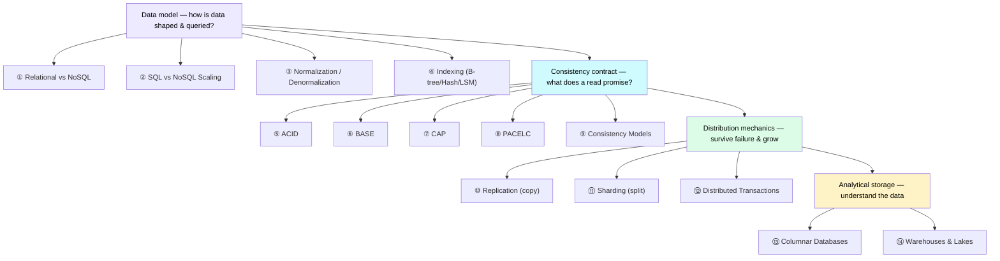
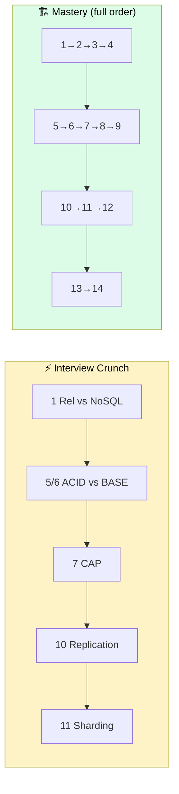

# 05 · Databases & Storage 🗄️

> **Where the state lives.** Every design eventually comes down to *where the data sits, how it's guaranteed, and how it scales.* This section is the storage layer end to end: pick the right data model, decide the consistency contract, and choose the mechanics — indexing, replication, sharding, distributed transactions — that let it survive failure and grow. Get these right and the system has a spine; get them wrong and no amount of clean application code saves you.

---

## 🎯 What You'll Be Able To Do

- **Pick a data model from the access pattern** — relational, document, key-value, column-family, graph — not from hype.
- **Choose the consistency contract deliberately** — reason through ACID vs BASE, CAP vs PACELC, and the full consistency spectrum, per piece of data.
- **Make reads and writes fast** — normalization/denormalization, indexing (B-tree/hash/LSM), and columnar storage for analytics.
- **Scale the data tier** — replication for reads and availability, sharding for writes and capacity, and know which to reach for.
- **Keep correctness across boundaries** — distributed transactions (2PC vs Saga) when one action spans services or shards.
- **Separate operations from analytics** — route data to OLTP, a warehouse, or a lake by who queries it and how.

---

## 🗺️ How the 14 Topics Interlock



> **The spine:** *choose the data model → decide the consistency contract → distribute it (copy + split) without losing correctness → peel analytics onto storage built for it.* Replication (⑩) creates the divergence that CAP/PACELC/Consistency (⑦⑧⑨) describe; sharding (⑪) creates the cross-boundary problem distributed transactions (⑫) solve; columnar (⑬) is the engine inside every warehouse (⑭).

---

## 📚 The Complete File Index

| # | Topic | One-line | Key takeaway |
|---|-------|----------|--------------|
| 1 | [Relational vs NoSQL](./Relational_vs_NoSQL.md) | Filing cabinet vs dossier folder | Store data the way you query it; the access pattern picks the DB; expect polyglot |
| 2 | [SQL vs NoSQL Scaling](./SQL_vs_NoSQL_Scaling.md) | Faster car vs fleet of bikes | Reads scale by copying, writes only by splitting; climb the scaling ladder in order |
| 3 | [Normalization & Denormalization](./Database_Normalization_Denormalization.md) | Closet boxes vs packed suitcase | Store a fact once (kills anomalies); denormalize measured hot paths, keep a sync plan |
| 4 | [Database Indexing](./Database_Indexing.md) | The index at the back of a book | O(N)→O(log N); B-tree default, hash exact, LSM writes; every index taxes writes |
| 5 | [ACID Properties](./ACID_Properties.md) | A signed, fireproof contract | Atomic/Consistent/Isolated/Durable via WAL, constraints, MVCC, fsync; ACID-C ≠ CAP-C |
| 6 | [BASE Philosophy](./BASE_Philosophy.md) | The election-night news cycle | Basically Available, Soft state, Eventual; the AP corner; choose per data type |
| 7 | [CAP Theorem](./CAP_Theorem.md) | The wedding with a dead phone line | P is mandatory → CP vs AP *during a partition*; decide by blast radius of a stale read |
| 8 | [PACELC Theorem](./PACELC_Theorem.md) | Ask the nearest friend, or call everyone | Else (no partition) still trades Latency vs Consistency — the everyday cost CAP omits |
| 9 | [Consistency Models](./Consistency_Models.md) | Live call vs email vs threaded replies | A spectrum, not a switch; pick the weakest correct model; quorum R+W>N tunes it |
| 10 | [Replication](./Replication.md) | The newspaper: press → shops | Copy for availability + read scale; handle lag (read-your-writes) & failover (no split brain) |
| 11 | [Sharding & Partitioning](./Sharding_Partitioning.md) | One book split across 26 libraries | Split for write/storage scale; the shard key is everything; don't shard until you must |
| 12 | [Distributed Transactions](./Distributed_Transactions.md) | Synchronized buy vs do-then-undo | 2PC blocks & is brittle; Saga scales via compensations; idempotency + outbox make it correct |
| 13 | [Columnar Databases](./Columnar_Databases.md) | Grocery receipts vs itemized ledgers | Store by column → read only what you query + 10× compression; OLAP only, never OLTP |
| 14 | [Warehouses & Lakes](./Data_Warehousing_Data_Lakes.md) | A library vs a cheap storage unit | Warehouse=ETL/schema-on-write, Lake=ELT/schema-on-read; lakehouse converges them |

---

## 🧭 Suggested Study Paths



| Goal | Path | Why |
|------|------|-----|
| **⚡ Interview in 48h** | 1 → 5 → 6 → 7 → 10 → 11 | Model choice + ACID/BASE + CAP + copy/split — the most-asked 80% |
| **🏗️ Deep mastery** | 1→2→3→4 → 5→6→7→8→9 → 10→11→12 → 13→14 | Model → guarantees → distribution → analytics, in dependency order |
| **🧠 Theory cluster** | 5 → 6 → 7 → 8 → 9 | ACID/BASE → CAP → PACELC → consistency spectrum as one connected argument |
| **📈 Scaling focus** | 2 → 4 → 10 → 11 → 12 | The scaling ladder: index → replicate → shard → coordinate |
| **📊 Analytics focus** | 3 → 13 → 14 | Denormalized star schemas → columnar engine → warehouse vs lake |

> **Study each file by** attempting the 🏋️ **Practice Drills before the solutions**, rehearsing the 🎤 **Interview Q&A out loud**, and reading 🎯 **Staff+ Nuances** for senior-level depth.

---

## 🔑 The Decision Card (whole-section cheat sheet)

```
MODEL     access pattern picks the DB — relational (joins/reporting) · document (aggregate by key) ·
          KV (pure lookup) · column-family (write firehose) · graph (traversals) · expect POLYGLOT
SCALE     reads scale by COPYING (replicas+cache) · writes only by SPLITTING (sharding)
          ladder: optimize/index → scale-up → replicas → shard → re-platform (NewSQL)
SCHEMA    normalize to 3NF (a fact stored once kills anomalies) · denormalize MEASURED hot paths + sync plan
INDEX     B-tree (ranges, default) · hash (exact only) · LSM (writes) · every index taxes writes · EXPLAIN it
ACID      Atomic(WAL) Consistent(constraints) Isolated(MVCC/locks) Durable(fsync) · ⚠ ACID-C ≠ CAP-C
BASE      Basically Available · Soft state · Eventual · the AP corner · choose per data type
CAP       P is mandatory → CP vs AP ONLY during a partition · decide by blast radius of a stale read
PACELC    Else (no partition) → Latency vs Consistency on EVERY request (the cost CAP forgets)
CONSISTENCY spectrum: eventual → read-your-writes → monotonic → causal → strong · quorum R+W>N tunes it
REPLICATION copy: leader-follower (default) · multi-leader (conflicts) · leaderless (quorum)
          sync=safe/slow · async=fast/lossy · handle LAG (read-your-writes) + FAILOVER (Raft, no split brain)
SHARDING  split by shard key (high-cardinality!) · hot-spot/fan-out/rebalance · consistent hashing · shard LAST
DIST TXN  2PC = atomic but BLOCKS · Saga = compensations, eventual, scalable · idempotency + OUTBOX = correct
ANALYTICS columnar (store by column → OLAP scans + 10× compression, never OLTP) ·
          warehouse (ETL/schema-on-write) vs lake (ELT/schema-on-read) · lakehouse converges · NEVER analytics on OLTP
RECURRING the same trade everywhere: pay UP FRONT for fast/safe reads, or LATER for cheap/flexible writes
```

---

## 🎨 Conventions & Authoring

- Every file follows the root [TEMPLATE.md](../TEMPLATE.md). Animated SVGs live in [/assets](../assets/) with the topic prefixes `rel_ scale_ norm_ idx_ acid_ base_ cap_ pacelc_ cons_ repl_ shard_ txn_ col_ dw_`.
- Each file ends with the three mastery sections: 🏋️ Practice Drills, 🎤 Interview Q&A Bank, 🎯 Staff+ Nuances, then a Cheat Sheet and TL;DR.

---

## ➡️ Where This Connects

- ⬅️ Built on [01 · Planning & Foundations](../01_Planning_Foundations/) — estimation, CAP/PACELC, and availability math underpin every storage choice.
- ⬅️ [03 · High-Level Design](../03_High_Level_Design/) — stateless services push state *down here*; event-driven architecture feeds the outbox/CDC pipelines.
- ➡️ [06 · Caching & Performance](../06_Caching_Performance/) — the read-scaling layer in front of the database.
- ➡️ [07 · Load Balancing & Scalability](../07_Load_Balancing_Scalability/) — routing and horizontal scale for the data tier.
- ➡️ [09 · Message Queues & Event Streaming](../09_Message_Queues_Event_Streaming/) — CDC, batch/stream ingestion, and the delivery guarantees Sagas rely on.
- ➡️ [10 · Microservices & Distributed Systems](../10_Microservices_Distributed_Systems/) — where distributed transactions and per-service data ownership play out.

---
*Part of the [System Design & Architecture Master Repository](../README.md). This is where the state lives — everything upstream decides what to store, everything downstream makes it fast and safe.*
