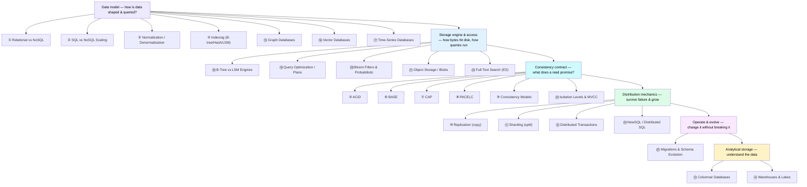
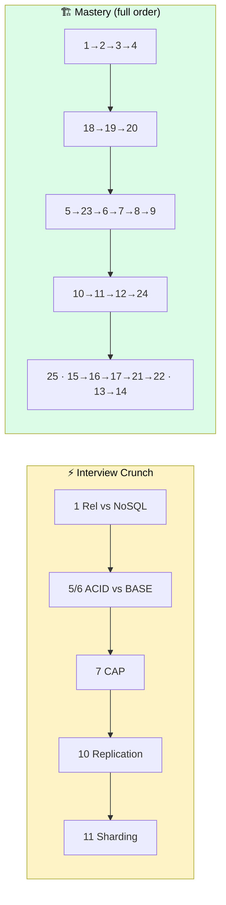

# 05 · Databases & Storage 🗄️

> **Where the state lives.** Every design eventually comes down to *where the data sits, how it's guaranteed, and how it scales.* This section is the storage layer end to end: pick the right data model, decide the consistency contract, and choose the mechanics — indexing, replication, sharding, distributed transactions — that let it survive failure and grow. Get these right and the system has a spine; get them wrong and no amount of clean application code saves you.

---

## 🎯 What You'll Be Able To Do

- **Pick a data model from the access pattern** — relational, document, key-value, column-family, graph, vector, time-series — not from hype.
- **Choose the consistency contract deliberately** — reason through ACID vs BASE, CAP vs PACELC, isolation levels/MVCC, and the full consistency spectrum, per piece of data.
- **Make reads and writes fast** — normalization/denormalization, indexing (B-tree/hash/LSM), reading execution plans, Bloom filters, and columnar storage for analytics.
- **Reason about the storage engine underneath** — B-tree vs LSM, the read/write/space amplification trade, and why a database is fast or slow at a given workload.
- **Scale the data tier** — replication for reads and availability, sharding for writes and capacity, and NewSQL when you need both scale *and* transactions.
- **Keep correctness across boundaries** — distributed transactions (2PC vs Saga) when one action spans services or shards.
- **Store the right things in the right place** — blobs in object storage, text in a search index, embeddings in a vector store — kept in sync via CDC.
- **Evolve schema without downtime** — expand/contract migrations, online DDL, and safe backfills on live, hot tables.
- **Separate operations from analytics** — route data to OLTP, a warehouse, or a lake by who queries it and how.

---

## 🗺️ How the 25 Topics Interlock



> **The spine:** *choose the data model (relational, graph, vector, time-series…) → understand the engine and query mechanics underneath → decide the consistency contract → distribute it (copy + split) without losing correctness → evolve it safely in production → peel analytics onto storage built for it.* The engine layer (⑱ B-tree/LSM) is *under* every index (④) and store; Bloom filters (⑳) make LSM reads survivable; isolation/MVCC (㉓) is the deep-dive on ACID's "I" (⑤); NewSQL (㉔) fuses sharding (⑪) + replication (⑩) + distributed transactions (⑫) to square CAP (⑦); migrations (㉕) is how any of it changes without downtime.

---

## 📚 The Complete File Index

**Core spine — data model → guarantees → distribution → analytics:**

| # | Topic | One-line | Key takeaway |
|---|-------|----------|--------------|
| 1 | [Relational vs NoSQL](./Relational_vs_NoSQL.md) | Filing cabinet vs dossier folder | Store data the way you query it; the access pattern picks the DB; expect polyglot |
| 2 | [SQL vs NoSQL Scaling](./SQL_vs_NoSQL_Scaling.md) | Faster car vs fleet of bikes | Reads scale by copying, writes only by splitting; climb the scaling ladder in order |
| 3 | [Normalization & Denormalization](./Database_Normalization_Denormalization.md) | Closet boxes vs packed suitcase | Store a fact once (kills anomalies); denormalize measured hot paths, keep a sync plan |
| 4 | [Database Indexing](./Database_Indexing.md) | The index at the back of a book | O(N)→O(log N); B-tree default, hash exact, LSM writes; every index taxes writes |
| 5 | [ACID Properties](./ACID_Properties.md) | A signed, fireproof contract | Atomic/Consistent/Isolated/Durable via WAL, constraints, MVCC, fsync; ACID-C ≠ CAP-C |
| 6 | [BASE Philosophy](./BASE_Philosophy.md) | The election-night news cycle | Basically Available, Soft state, Eventual; the AP corner; choose per data type |
| 7 | [CAP Theorem](./CAP_Theorem.md) | The wedding with a dead phone line | P is mandatory → CP vs AP *during a partition*; decide by blast radius of a stale read |
| 8 | [PACELC Theorem](./PACELC_Theorem.md) | Ask the nearest friend, or call everyone | Else (no partition) still trades Latency vs Consistency — the everyday cost CAP omits |
| 9 | [Consistency Models](./Consistency_Models.md) | Live call vs email vs threaded replies | A spectrum, not a switch; pick the weakest correct model; quorum R+W>N tunes it |
| 10 | [Replication](./Replication.md) | The newspaper: press → shops | Copy for availability + read scale; handle lag (read-your-writes) & failover (no split brain) |
| 11 | [Sharding & Partitioning](./Sharding_Partitioning.md) | One book split across 26 libraries | Split for write/storage scale; the shard key is everything; don't shard until you must |
| 12 | [Distributed Transactions](./Distributed_Transactions.md) | Synchronized buy vs do-then-undo | 2PC blocks & is brittle; Saga scales via compensations; idempotency + outbox make it correct |
| 13 | [Columnar Databases](./Columnar_Databases.md) | Grocery receipts vs itemized ledgers | Store by column → read only what you query + 10× compression; OLAP only, never OLTP |
| 14 | [Warehouses & Lakes](./Data_Warehousing_Data_Lakes.md) | A library vs a cheap storage unit | Warehouse=ETL/schema-on-write, Lake=ELT/schema-on-read; lakehouse converges them |

**Specialized data models — pick the store from the access pattern:**

| # | Topic | One-line | Key takeaway |
|---|-------|----------|--------------|
| 15 | [Graph Databases](./Graph_Databases.md) | A subway map, not a spreadsheet | Relationships are first-class; index-free adjacency makes deep traversal O(neighborhood), not exponential joins |
| 16 | [Vector Databases](./Vector_Databases.md) | A map where meaning is location | Embeddings + ANN search find *similar* by meaning; recall vs latency is the knob; powers RAG |
| 17 | [Time-Series Databases](./Time_Series_Databases.md) | A logbook, not a ledger | Time is the axis: append-only, 10–100× compression, downsample + drop chunks; watch tag cardinality |

**Storage engine & access mechanics — what's under the model:**

| # | Topic | One-line | Key takeaway |
|---|-------|----------|--------------|
| 18 | [B-Tree vs LSM Storage Engines](./B_Tree_vs_LSM_Storage_Engines.md) | Bound ledger vs append notepad | B-tree overwrites (fast reads), LSM appends+compacts (fast writes); RUM: pick 2 of read/write/space amp |
| 19 | [Query Optimization & Execution Plans](./Query_Optimization_Execution_Plans.md) | Destination, not the route | SQL is declarative; read EXPLAIN ANALYZE (est vs actual rows); fix the estimate, kill N+1 |
| 20 | [Bloom Filters & Probabilistic Structures](./Bloom_Filters_Probabilistic_Data_Structures.md) | A bouncer with ticked boxes | "Definitely not" or "maybe"; trade bounded one-sided error for tiny space; HLL/CMS too |
| 21 | [Object Storage & Blob Stores](./Object_Storage_Blob_Stores.md) | A coat check, not a filing cabinet | Blob in S3, pointer in the DB; presigned URLs; 11 nines; lifecycle tiering |
| 22 | [Full-Text Search & Elasticsearch](./Full_Text_Search_Elasticsearch.md) | Back-of-book index | Inverted index + BM25 ranking; derived store kept in sync via CDC, not dual-write |

**Guarantees, distribution & operations — deep dives:**

| # | Topic | One-line | Key takeaway |
|---|-------|----------|--------------|
| 23 | [Isolation Levels & MVCC](./Transaction_Isolation_Levels_MVCC.md) | Track-changes strictness | Default isn't Serializable; MVCC = versioned snapshots; write skew needs Serializable/locks |
| 24 | [NewSQL / Distributed SQL](./NewSQL_Distributed_SQL.md) | One DB, secretly a cluster | ACID+SQL *and* horizontal scale via shard+consensus+2PC; TrueTime; it's CP, costs write latency |
| 25 | [Migrations & Schema Evolution](./Database_Migrations_Schema_Evolution.md) | Renovate while open for business | Expand→migrate→contract; online DDL; batch backfills; additive first, destructive last |

---

## 🧭 Suggested Study Paths



| Goal | Path | Why |
|------|------|-----|
| **⚡ Interview in 48h** | 1 → 5 → 6 → 7 → 10 → 11 | Model choice + ACID/BASE + CAP + copy/split — the most-asked 80% |
| **🏗️ Deep mastery** | 1→2→3→4 → 18→19→20 → 5→23→6→7→8→9 → 10→11→12→24 → 25 → 15→16→17→21→22 → 13→14 | Model → engine → guarantees → distribution → operate → specialized stores → analytics |
| **🧠 Theory cluster** | 5 → 23 → 6 → 7 → 8 → 9 | ACID → isolation/MVCC → BASE → CAP → PACELC → consistency spectrum as one argument |
| **📈 Scaling focus** | 2 → 4 → 18 → 10 → 11 → 12 → 24 | The scaling ladder: index → engine → replicate → shard → coordinate → re-platform (NewSQL) |
| **⚙️ Engine & performance** | 4 → 18 → 19 → 20 → 23 | Index → B-tree/LSM engine → read the plan → probabilistic structures → isolation/MVCC |
| **🧰 Polyglot stores** | 1 → 15 → 16 → 17 → 21 → 22 | Relational baseline → graph, vector, time-series, object storage, search — pick from access pattern |
| **🚀 Operate in prod** | 25 → 23 → 10 → 11 | Zero-downtime migrations, isolation, replication lag, sharding — running it, not just designing it |
| **📊 Analytics focus** | 3 → 13 → 14 → 17 | Denormalized star schemas → columnar engine → warehouse vs lake → time-series |

> **Study each file by** attempting the 🏋️ **Practice Drills before the solutions**, rehearsing the 🎤 **Interview Q&A out loud**, and reading 🎯 **Staff+ Nuances** for senior-level depth.

---

## 🔑 The Decision Card (whole-section cheat sheet)

```
MODEL     access pattern picks the DB — relational (joins/reporting) · document (aggregate by key) ·
          KV (pure lookup) · column-family (write firehose) · graph (traversals) · vector (similarity) ·
          time-series (metrics over time) · expect POLYGLOT
SCALE     reads scale by COPYING (replicas+cache) · writes only by SPLITTING (sharding)
          ladder: optimize/index → scale-up → replicas → shard → re-platform (NewSQL)
SCHEMA    normalize to 3NF (a fact stored once kills anomalies) · denormalize MEASURED hot paths + sync plan
INDEX     B-tree (ranges, default) · hash (exact only) · LSM (writes) · every index taxes writes · EXPLAIN it
ENGINE    B-tree = overwrite in place (fast reads) · LSM = append + compact (fast writes) · RUM: pick 2 of
          read/write/space amplification · WAL makes both crash-safe
QUERY     SQL declarative → optimizer picks plan from STATISTICS · EXPLAIN ANALYZE (est vs actual rows) ·
          joins: nested-loop / hash / merge · fix the ESTIMATE not the plan · kill N+1
PROBABILISTIC Bloom = "definitely not / maybe" (skip lookups, no false negatives) · HLL = distinct count ·
          CMS = frequency · trade a bounded one-sided error for tiny space
ACID      Atomic(WAL) Consistent(constraints) Isolated(MVCC/locks) Durable(fsync) · ⚠ ACID-C ≠ CAP-C
ISOLATION default is NOT Serializable (RC/RR) · MVCC = versioned snapshots · WRITE SKEW needs Serializable/locks
BASE      Basically Available · Soft state · Eventual · the AP corner · choose per data type
CAP       P is mandatory → CP vs AP ONLY during a partition · decide by blast radius of a stale read
PACELC    Else (no partition) → Latency vs Consistency on EVERY request (the cost CAP forgets)
CONSISTENCY spectrum: eventual → read-your-writes → monotonic → causal → strong · quorum R+W>N tunes it
REPLICATION copy: leader-follower (default) · multi-leader (conflicts) · leaderless (quorum)
          sync=safe/slow · async=fast/lossy · handle LAG (read-your-writes) + FAILOVER (Raft, no split brain)
SHARDING  split by shard key (high-cardinality!) · hot-spot/fan-out/rebalance · consistent hashing · shard LAST
DIST TXN  2PC = atomic but BLOCKS · Saga = compensations, eventual, scalable · idempotency + OUTBOX = correct
NEWSQL    ACID+SQL AND scale-out via shard+consensus+2PC (Spanner/CockroachDB/TiDB) · TrueTime · CP · costs latency
BLOB      blob → object storage (S3) · pointer → DB · presigned URLs · 11 nines · lifecycle tiering
SEARCH    inverted index + BM25 ranking (not LIKE) · derived store · sync via CDC not dual-write
MIGRATE   expand → migrate (batch backfill) → contract · online DDL · additive first, destructive last · roll forward
ANALYTICS columnar (store by column → OLAP scans + 10× compression, never OLTP) ·
          warehouse (ETL/schema-on-write) vs lake (ELT/schema-on-read) · lakehouse converges · NEVER analytics on OLTP
RECURRING the same trade everywhere: pay UP FRONT for fast/safe reads, or LATER for cheap/flexible writes ·
          and APPROXIMATE (ANN, Bloom, HLL) scales where EXACT can't
```

---

## 🧩 Gap Analysis — What Else Belongs Here

The section spine (25 files) now covers the data models, storage engines, guarantees, distribution mechanics, and operations a Staff+ engineer needs. Remaining candidates live (or belong) elsewhere — one home per idea, cross-linked:

| Candidate topic | Why it matters | Status |
|-----------------|----------------|--------|
| Database caching / cache-aside / eviction | Read-scaling layer above the DB | 🔗 [06 · Caching](../06_Caching_Performance/Caching_Strategies.md), [Cache_Eviction_Policies.md](../06_Caching_Performance/Cache_Eviction_Policies.md) |
| Connection pooling | Bounded DB connections under load | 🔗 [06 · Database_Connection_Pooling.md](../06_Caching_Performance/Database_Connection_Pooling.md) (dup in 14) |
| Consistent hashing | Shard/replica placement | 🔗 [07 · Consistent_Hashing.md](../07_Load_Balancing_Scalability/Consistent_Hashing.md) |
| Change Data Capture / outbox mechanics | Sync derived stores (search, cache, warehouse) | 🔗 [09 · Change_Data_Capture_CDC.md](../09_Message_Queues_Event_Streaming/) |
| Materialized views / precomputation | Precompute expensive query plans | 🔗 [14 · Precompute_Materialized_Views.md](../14_Performance_Optimization_Scalability/) |
| Optimistic vs pessimistic locking | App-level companion to isolation levels | 🔗 [14 · Optimistic_vs_Pessimistic_Locking.md](../14_Performance_Optimization_Scalability/) |
| Backups / DR / RPO-RTO | Durability & recovery objectives | 🔗 [13 · Disaster_Recovery_RPO_RTO.md](../13_Cloud_Native_Infrastructure/) |
| Consensus (Raft/Paxos) | Behind replication failover & NewSQL | 🔗 [10 · Distributed_Consensus_Raft_Paxos.md](../10_Microservices_Distributed_Systems/) |
| LLM/RAG pipeline patterns | Where vector search plugs in | 🔗 [16 · LLM_Ops_Patterns.md](../16_Emerging_Trends_Miscellaneous/) |

**Housekeeping note:** this folder keeps deep dives for [CAP](./CAP_Theorem.md) + [PACELC](./PACELC_Theorem.md); `01_Planning_Foundations` has a planning-level `CAP_Theorem_PACELC.md` covering the same two theorems — keep the 01 file a summary that links here to avoid drift. `Database_Connection_Pooling.md` is duplicated across folders 06 and 14 — dedup when either is next touched.

---

## 🎨 Conventions & Authoring

- Every file follows the root [TEMPLATE.md](../TEMPLATE.md). Animated SVGs live in [/assets](../assets/) with the topic prefixes `rel_ scale_ norm_ idx_ acid_ base_ cap_ pacelc_ cons_ repl_ shard_ txn_ col_ dw_ graph_ vec_ tsdb_ se_ qo_ bloom_ obj_ fts_ iso_ newsql_ mig_`.
- Each file ends with the three mastery sections: 🏋️ Practice Drills, 🎤 Interview Q&A Bank, 🎯 Staff+ Nuances, then a Cheat Sheet and TL;DR.

---

## ➡️ Where This Connects

- ⬅️ Built on [01 · Planning & Foundations](../01_Planning_Foundations/) — estimation, CAP/PACELC, and availability math underpin every storage choice.
- ⬅️ [03 · High-Level Design](../03_High_Level_Design/) — stateless services push state *down here*; event-driven architecture feeds the outbox/CDC pipelines.
- ➡️ [06 · Caching & Performance](../06_Caching_Performance/) — the read-scaling layer in front of the database.
- ➡️ [07 · Load Balancing & Scalability](../07_Load_Balancing_Scalability/) — routing and horizontal scale for the data tier.
- ➡️ [09 · Message Queues & Event Streaming](../09_Message_Queues_Event_Streaming/) — CDC, batch/stream ingestion, and the delivery guarantees Sagas rely on.
- ➡️ [10 · Microservices & Distributed Systems](../10_Microservices_Distributed_Systems/) — where distributed transactions and per-service data ownership play out.

---
*Part of the [System Design & Architecture Master Repository](../README.md). This is where the state lives — everything upstream decides what to store, everything downstream makes it fast and safe.*
