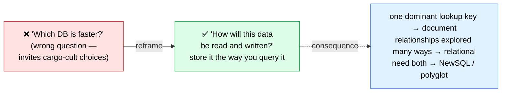
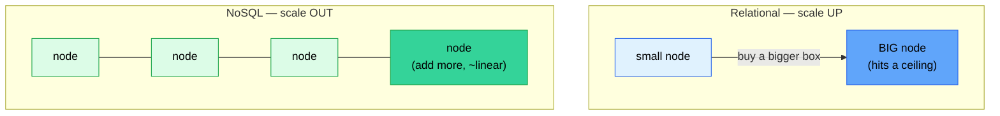
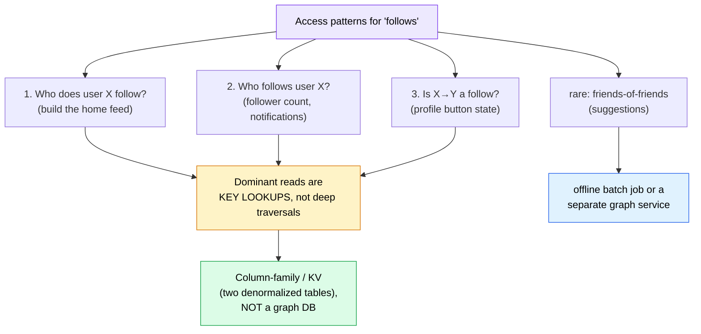
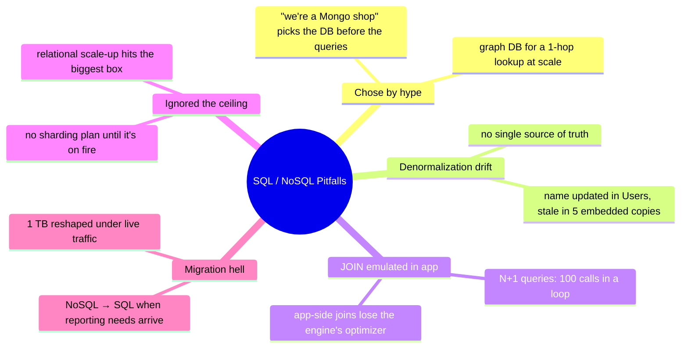

# Relational (RDBMS) vs NoSQL

> **One line:** The same data can be stored as *normalized tables you join at read time* (SQL) or as *pre-joined documents you fetch by one key* (NoSQL) — and the right choice is dictated by how you'll **query** the data, not by which one is "faster."

---

## Table of Contents
1. [Why You Must Master This](#1-why-you-must-master-this)
2. [The Mental Model](#2-the-mental-model)
3. [The Data Models](#3-the-data-models)
4. [How They Scale — Up vs Out](#4-how-they-scale--up-vs-out)
5. [Choosing by Access Pattern](#5-choosing-by-access-pattern)
6. [Worked Example — Instagram's "Follow" Graph](#6-worked-example--instagrams-follow-graph)
7. [Real-Life Use Cases](#7-real-life-use-cases)
8. [Failure Modes](#8-failure-modes)
9. [🏋️ Practice Drills](#-practice-drills)
10. [🎤 Interview Q&A Bank](#-interview-qa-bank)
11. [🎯 Staff+ Nuances](#-staff-nuances)
12. [Cheat Sheet](#12-cheat-sheet)
13. [Connections & Further Reading](#13-connections--further-reading)

---

## 1. Why You Must Master This

The database is the one decision that's *expensive to reverse*. Pick wrong and you're not refactoring a class — you're migrating terabytes of live data while the business keeps writing to it.

- **It's the persistence bedrock.** Every byte of durable state lands here. A wrong paradigm early (a key-value store for a financial ledger, or a relational schema for a 1M-writes/sec event firehose) surfaces as a rewrite 6–12 months in, not a config change.
- **It exposes your grasp of trade-offs.** "NoSQL is faster" is a junior answer. "We read this data only by `user_id` and never join it, so a document store gives us better write throughput and horizontal scale" is a staff answer. The interviewer is listening for the *reason*, not the *name*.
- **The dichotomy is mostly a myth now.** SQL scales horizontally (sharding, read replicas); NoSQL added ACID transactions (MongoDB 4.0+, DynamoDB transactions). The real axis is **data model + access pattern**, not "old vs new."
- **It drives cost.** A single-key document read can be 100× cheaper than a 10-table JOIN over 1 TB — and a JOIN can be free where a document store forces you to fan out 10 reads and stitch them in the app.

> **The core problem it solves:** *matching storage shape to query shape.* Store data the way you'll read it. Normalize when relationships are explored many ways; denormalize when one access path dominates. Everything else — consistency, scaling, cost — follows from that fit.

---

## 2. The Mental Model

Two ways to store a customer and their orders:

- **Relational = a filing cabinet with cross-references.** Each fact lives in exactly one drawer (a table). "Ada's orders" means opening the *Users* drawer, reading her ID, then walking to the *Orders* drawer to find matching rows — a **JOIN at read time**. Nothing is duplicated, so nothing can disagree, but every read pays the assembly cost.
- **NoSQL (document) = a folder of ready-made dossiers.** Ada's entire record — name, orders, addresses — sits in one file, **pre-joined at write time**. One lookup by her ID returns everything, blazing fast. But her name now lives in many dossiers, so a rename means editing all of them.

The trade is **when you pay the join**: relational pays it on every read (flexible, consistent); document pays it once on write (fast reads, duplication risk).





---

## 3. The Data Models

"NoSQL" is not one thing — it's four families that each optimize a different access pattern. Naming the *family* (not just "NoSQL") is the mark of someone who's actually used them.

| Model | Shape | Reads best by | Exemplars | Sweet spot |
|-------|-------|---------------|-----------|------------|
| **Relational** | Tables, rows, fixed columns | Any column, any join | PostgreSQL, MySQL, Oracle | Relationships explored many ways; reporting |
| **Document** | Self-contained JSON/BSON | A document key (+ secondary indexes) | MongoDB, Couchbase, DynamoDB | An aggregate read/written as a unit (a cart, a profile) |
| **Key-Value** | Opaque value at a key | The key, nothing else | Redis, DynamoDB, Riak | Caches, sessions, feature flags — pure lookups |
| **Column-Family** | Rows of sparse column groups | Partition key + clustering key | Cassandra, HBase, ScyllaDB | Massive write throughput, time-series, wide rows |
| **Graph** | Nodes + edges | Traversals ("friends of friends") | Neo4j, Neptune | Deeply connected data: social, fraud, recommendations |

The relational model's superpower is the **schema + normalization + declarative query**: define the data once, and the engine figures out *how* to answer any question you pose in SQL — including questions you didn't anticipate when you designed the tables.

```sql
-- SQL: the JOIN assembles the answer at read time.
-- Costs CPU, but works for ANY relationship — even ones you didn't plan for.
SELECT u.name, o.total
FROM   Users u
JOIN   Orders o ON o.user_id = u.id
WHERE  u.id = 123;
```

The document model's superpower is the **aggregate**: the data you read together is *stored* together, so one round trip returns it all.

```javascript
// NoSQL (MongoDB): the "join" already happened at write time.
// One disk read, no assembly — but 'name' is duplicated into every order doc,
// so renaming Ada means touching every place it was denormalized.
db.users.findOne({ _id: 123 }, { name: 1, "orders.total": 1 });
```

> The choice between these is the choice between [Normalization and Denormalization](./Database_Normalization_Denormalization.md) made at the *storage-engine* level.

---

## 4. How They Scale — Up vs Out

This is where the two paradigms genuinely diverge, and it traces straight back to [ACID](./ACID_Properties.md) vs [BASE](./BASE_Philosophy.md).

- **Relational scales UP (vertically):** a bigger box — more CPU, RAM, faster disk. Strong consistency and multi-row transactions are *easy* on one machine and *hard* across many, because a distributed JOIN or a cross-node transaction requires coordination (locks, two-phase commit) that adds latency and fragility. There's a ceiling: the biggest box money can buy.
- **NoSQL scales OUT (horizontally):** more boxes. It gets there by *giving up* the hard-to-distribute guarantees — cross-partition transactions and joins — so each node can answer independently. Add nodes, add capacity, near-linearly.



**But the line has blurred — don't overstate it:**
- Relational databases *do* scale out via [read replicas](./Replication.md) and [sharding](./Sharding_Partitioning.md); you just take on the complexity NoSQL bakes in.
- **NewSQL** (Google Spanner, CockroachDB, YugabyteDB) delivers ACID *and* horizontal scale — at the cost of write latency (Spanner waits out clock uncertainty via TrueTime). See [SQL vs NoSQL Scaling](./SQL_vs_NoSQL_Scaling.md) for the full mechanics.

---

## 5. Choosing by Access Pattern

The decision procedure senior engineers actually run — start from the queries, not the tools:

1. **List the access patterns first.** "Fetch cart by user_id." "Find all orders in a date range." "Show me friends-of-friends." Write them down *before* naming a database.
2. **Is there one dominant lookup key?** If ~all reads go through a single key and you never join → **key-value or document**.
3. **Are relationships explored many different ways** (today by user, tomorrow by product, next quarter by region for a report)? → **relational** — its declarative query layer answers questions you didn't design for.
4. **Is it a traversal problem** (degrees of separation, paths)? → **graph**.
5. **Is it write-firehose / time-series at massive scale?** → **column-family**.
6. **Do you need strong multi-entity transactions AND horizontal scale?** → **NewSQL**, or **polyglot persistence** (the modern default: Postgres for orders, Redis for sessions, Elasticsearch for search, all in one system).

> **The real-world habit:** never let "we're a Mongo shop" or "just use Postgres" answer a design question. Enumerate the access patterns, then let the *dominant* one pick the store.

---

## 6. Worked Example — Instagram's "Follow" Graph

**The prompt:** "Model the follow relationship for a social network. Which database?"

Naively, "social = graph database." But run the access-pattern procedure and watch the numbers decide.



**The numbers that force the decision:**
- ~500M daily active users; the home feed hits *"who does X follow?"* on nearly every session → **billions of reads/day**, each a simple key lookup.
- A graph database excels at *deep* traversals (5+ hops), but the hot path here is **1 hop**, at extreme volume. Graph engines don't shard those cheaply.
- **Consequence:** store follows as two denormalized column-family tables — `following(user_id → [followees])` and `followers(user_id → [followers])`. Each dominant query becomes a single partition read. The rare friends-of-friends suggestion runs offline in a batch/graph job, off the hot path.

The lesson: the *shape of the relationship* said "graph," but the **access pattern at scale** said "wide-column key lookup." Access pattern wins — every time.

---

## 7. Real-Life Use Cases

| Situation | How the SQL/NoSQL choice decides the outcome |
|-----------|----------------------------------------------|
| **Banking ledger** | Multi-row ACID transactions are non-negotiable → **relational** (or NewSQL if scale demands). A debit and credit must commit atomically. |
| **Amazon shopping cart** | Read/written by `user_id`, must always accept a write during Prime Day → **DynamoDB (KV/document)**; availability over strict consistency. |
| **Product catalog with varied attributes** | A book has an ISBN, a shirt has a size — schema varies per item → **document store**; no sparse-column sprawl. |
| **Analytics / BI reporting** | Ad-hoc aggregations across many dimensions → **relational / columnar warehouse**; SQL answers unplanned questions. See [Columnar Databases](./Columnar_Databases.md). |
| **Session / cache / rate-limit counters** | Pure key lookups, TTL eviction → **Redis (KV)**. |
| **Fraud ring detection** | "Accounts sharing a device 3 hops out" → **graph DB**; the traversal *is* the query. |

> **The habit:** most real systems are **polyglot** — the question is rarely "SQL *or* NoSQL," it's "which store for *this* access pattern."

---

## 8. Failure Modes



- **Choosing by paradigm, not access pattern.** Symptom: a graph DB straining under simple key lookups, or Postgres melting under a write firehose. *Fix:* list access patterns first (§5); let the dominant one choose.
- **Denormalization drift.** Symptom: the same `user_name` disagrees across embedded documents after a rename. *Fix:* pick a single source of truth; update copies via async fan-out (CDC / events), and accept eventual consistency — or normalize that field.
- **The N+1 query.** Symptom: 1 query for the list + 100 for the details, in a loop. *Fix:* a single JOIN (SQL) or a batch/`$in` read (NoSQL); never join in an application loop.
- **Unplanned reporting on a document store.** Symptom: analysts need cross-collection aggregations a document DB can't express. *Fix:* stream to a columnar warehouse ([Data Warehousing](./Data_Warehousing_Data_Lakes.md)); don't force OLAP onto an OLTP document store.
- **No scaling plan.** Symptom: relational box maxed out, no sharding strategy, outage. *Fix:* decide the shard key and read-replica topology *before* the ceiling, not during the incident.

---

## 🏋️ Practice Drills

> *Cover the solutions and attempt first — active recall is the point.*

**Drill 1 — Pick the store.** A URL shortener: write a short code → long URL once, then read it billions of times by the short code. No relationships, no reporting. Which model, and why?

<details><summary>Solution</summary>

**Key-value store** (Redis, or DynamoDB). The entire access pattern is `GET(short_code) → long_url` — one immutable lookup by a single key, at read-heavy scale. There are no relationships to join and no ad-hoc queries, so the flexibility of SQL buys nothing while its scale-up ceiling costs you. A KV store gives O(1) lookups and trivial horizontal scaling. (A cache in front absorbs the hottest codes; the KV store is the durable backing.)
</details>

**Drill 2 — Defend the JOIN.** A colleague says "JOINs are slow, let's denormalize everything into one big Mongo document." When is *he* right, and when is he setting a trap?

<details><summary>Solution</summary>

**Right when:** the data forms a natural *aggregate* read and written as a unit through one access path — a shopping cart, an order, a user profile. Pre-joining at write time turns each read into one round trip.

**A trap when:** the data is queried many different ways or the embedded fields change independently. Denormalizing a `user_name` into every one of her order documents means a rename must fan out to all of them — miss one and you have **drift** (§8). If relationships are explored from multiple angles, the JOIN's cost is the price of a single source of truth and unplanned-query flexibility. Rule: denormalize *stable* data along the *dominant* access path; normalize *volatile* or *multi-path* data.
</details>

**Drill 3 — The scaling wall.** A Postgres primary handling all reads and writes is at 90% CPU and climbing. List the scaling moves in order, from cheapest/least disruptive to most.

<details><summary>Solution</summary>

1. **Optimize first** — add missing [indexes](./Database_Indexing.md), kill N+1 queries, cache hot reads. Often buys months.
2. **Scale up** — a bigger instance. One config change, zero app change; buys time but has a ceiling.
3. **Read replicas** — offload read traffic ([Replication](./Replication.md)). Great if the workload is read-heavy; introduces replication lag (eventual consistency on replicas).
4. **Shard/partition** — split data across nodes by a shard key ([Sharding](./Sharding_Partitioning.md)). Removes the write ceiling but adds real complexity: cross-shard joins and transactions get hard.
5. **Re-platform** — move the hot dataset to NewSQL (CockroachDB/Spanner) or a purpose-built NoSQL store. Highest effort; reserve for when sharding Postgres is fighting you.

The point: don't jump to "switch to NoSQL" at step 1 — the first two moves are cheap and often sufficient.
</details>

---

## 🎤 Interview Q&A Bank

**Q1. "SQL or NoSQL — how do you decide?"** *(signal: do they start from tools or from data?)*
> I start from the **access patterns**, not the products. I list how the data will be read and written, then find the dominant path. One lookup key and no joins → key-value/document. Relationships explored many ways or ad-hoc reporting → relational. Massive write firehose → column-family. Need multi-entity ACID *and* horizontal scale → NewSQL. Naming a database before listing the queries is backwards.

**Q2. "Can a relational database scale horizontally?"**
> Yes — via read replicas for read-heavy load and sharding for write scale. The catch is that cross-shard joins and cross-node transactions become hard, which is exactly the complexity NoSQL avoids by *not offering* those guarantees. NewSQL (Spanner, CockroachDB) gives you ACID + horizontal scale, paying for it in write latency.

**Q3. "What does 'NoSQL' actually mean?"** *(signal: do they know it's four families?)*
> Not "no SQL" — "not *only* relational." It's an umbrella over four models: document, key-value, column-family, and graph. Each optimizes a different access pattern, so saying "we'll use NoSQL" is underspecified — the real choice is *which* model.

**Q4. "You denormalized a user's name into their order documents. What breaks?"**
> Consistency on update. Renaming the user now requires touching every order document that embedded the name — a fan-out. Miss one and the data drifts. It's a valid trade if names rarely change and orders are read far more than users are renamed, but you handle the update asynchronously (CDC/events) and accept eventual consistency, or you keep the name normalized and join.

**Q5. "Why is a JOIN 'expensive' and when is it worth it?"**
> A JOIN assembles the answer at read time — matching rows across tables costs CPU and I/O, especially at scale. It's worth it when relationships are explored many different ways: the alternative (denormalizing) forces you to anticipate every access path at write time and duplicate data. JOINs trade read cost for a single source of truth and query flexibility.

**Q6. "When would you use a graph database over a document store?"**
> When the *traversal itself* is the query — deep, variable-hop relationships like friends-of-friends-of-friends, or fraud rings sharing devices several hops out. A document/KV store excels at 1-hop key lookups; a graph engine is built to walk edges efficiently. But watch scale: if the hot path is really a 1-hop lookup at huge volume (like a social follow feed), a wide-column store often beats a graph DB.

**Q7. "Give me a system that's genuinely polyglot."** *(signal: do they think in single-DB monoliths?)*
> Most large systems are. An e-commerce backend: Postgres for orders and inventory (needs ACID), Redis for sessions and rate limits (KV, TTL), Elasticsearch for product search (inverted index), a columnar warehouse for analytics, and maybe DynamoDB for the always-writable cart. Each store matches one access pattern; forcing all of it into one database is the anti-pattern.

**Q8. "Is switching databases later a big deal?"**
> It's one of the most expensive changes there is — you're migrating live data whose *shape* differs between paradigms while the app keeps writing. That's why the initial choice matters and why I over-invest in getting the access patterns right up front. Abstracting data access behind a repository layer softens the blow, but it never makes a paradigm switch cheap.

---

## 🎯 Staff+ Nuances

- **The choice is really ACID-vs-BASE in disguise.** Relational's scale-up ceiling and NoSQL's scale-out ease both stem from consistency guarantees: strong multi-row transactions are hard to distribute, so systems that keep them ([ACID](./ACID_Properties.md)) stay small-and-consistent, while systems that drop them ([BASE](./BASE_Philosophy.md)) scale out. The DB choice *is* a [CAP Theorem](./CAP_Theorem.md) choice one layer up.
- **"Schema-less" is a lie — the schema moves, it doesn't vanish.** A document store has *schema-on-read*: the structure lives in your application code instead of the DDL. You still have a schema; you've just traded the DB enforcing it for the freedom (and risk) of enforcing it yourself, version by version.
- **Postgres is often the right "NoSQL."** `JSONB` columns give you document flexibility *with* ACID, joins, and indexes on JSON paths. Reaching for MongoDB when a `JSONB` column would do is a common over-correction — start relational, add a document column, and only split stores when an access pattern truly demands it.
- **NewSQL's cost is latency, not magic.** Spanner achieves global ACID by *waiting out* clock uncertainty (TrueTime commit-wait); CockroachDB uses distributed consensus per write. You get horizontal ACID, but each write pays a coordination tax. Don't pitch NewSQL as "free lunch" — it's the right call when you genuinely need both properties, not by default.
- **Secondary indexes are where NoSQL scaling leaks.** A document/KV store is fast on its *partition key*; query by anything else and you either scan or maintain a global secondary index that reintroduces cross-partition consistency problems. The "scales linearly" promise holds for the primary access path and quietly weakens for the rest.
- **Migration risk compounds with denormalization.** Moving from NoSQL back to SQL isn't just an ETL — you must *re-derive* the relationships you dissolved into documents, often reconstructing foreign keys that were never explicitly stored. Design the [normalization](./Database_Normalization_Denormalization.md) boundaries as if the migration will happen, because for successful products it eventually does.
- **The interview trap is committing early.** Strong candidates delay the database choice until they've sketched the entities and access patterns; weak ones name "MongoDB" in the first minute. State the access patterns aloud, *then* choose — and mention polyglot persistence so the interviewer knows you won't force one store to do everything.

---

## 12. Cheat Sheet

```
RELATIONAL vs NoSQL — DECIDE BY ACCESS PATTERN, NOT BY HYPE
═══════════════════════════════════════════════════════════════════

DECISION PROCEDURE
  1. List access patterns (reads + writes) BEFORE naming a DB
  2. One dominant lookup key, no joins ........ Key-Value / Document
  3. Relationships explored many ways ......... Relational
  4. Traversals (N-hop paths) ................. Graph
  5. Write firehose / time-series ............. Column-family
  6. Need ACID + horizontal scale ............. NewSQL / polyglot

RELATIONAL (Postgres, MySQL)          NoSQL (Mongo, Dynamo, Cassandra)
  + JOINs, ad-hoc queries               + horizontal scale, fast reads
  + ACID multi-row txns                 + flexible / evolving schema
  + single source of truth              + write throughput at scale
  - scale UP (ceiling)                  - denormalization drift
  - schema migrations                   - weak cross-partition txns/joins
  pay the join on every READ            pay the join once on WRITE

THE FOUR NoSQL FAMILIES
  Document  = self-contained JSON aggregate   (Mongo, Couchbase)
  Key-Value = opaque value at a key           (Redis, Dynamo)
  Column    = sparse wide rows, huge writes   (Cassandra, HBase)
  Graph     = nodes + edges, traversals       (Neo4j, Neptune)

RULES OF THUMB
  • Start with Postgres; add JSONB before adding MongoDB.
  • Denormalize STABLE data on the DOMINANT path; normalize volatile/multi-path.
  • Never JOIN in an application loop (N+1). One JOIN or one batch read.
  • Most real systems are POLYGLOT — one store per access pattern.
  • DB switches are the most expensive migration — get access patterns right first.

DON'T
  ✗ say "NoSQL is faster" — say WHICH pattern it's faster for
  ✗ pick the DB before listing the queries
  ✗ force OLAP reporting onto an OLTP document store
  ✗ treat "schema-less" as "no schema" — it moved into your code
```

---

## 13. Connections & Further Reading

**Within this repo:**
- [ACID_Properties.md](./ACID_Properties.md) — the transactional guarantees relational stores keep and NoSQL often relaxes.
- [BASE_Philosophy.md](./BASE_Philosophy.md) — the availability-first philosophy behind most NoSQL.
- [CAP_Theorem.md](./CAP_Theorem.md) — the deeper trade-off that explains *why* the two paradigms scale differently.
- [SQL_vs_NoSQL_Scaling.md](./SQL_vs_NoSQL_Scaling.md) — how each side actually scales (replicas, sharding, NewSQL).
- [Database_Normalization_Denormalization.md](./Database_Normalization_Denormalization.md) — the modeling decision this choice embodies at storage-engine level.
- [Sharding_Partitioning.md](./Sharding_Partitioning.md) · [Replication.md](./Replication.md) — the mechanics of scaling either paradigm out.

**External classics:**
- *Designing Data-Intensive Applications* (Martin Kleppmann) — Ch. 2, "Data Models and Query Languages," is the definitive treatment.
- *Amazon Dynamo paper* (DeCandia et al., 2007) — the origin of the availability-first, key-value design lineage.
- [AWS: SQL vs NoSQL](https://aws.amazon.com/nosql/sql-vs-nosql/) — a concise vendor-neutral-ish overview.

---

## TL;DR
**Store data the way you'll query it — the access pattern picks the database, not the other way around.** Relational normalizes and pays the join on every read (flexible, strongly consistent, scales *up* with a ceiling); NoSQL pre-joins into aggregates and pays once on write (fast single-key reads, scales *out*, but risks denormalization drift and weak cross-partition guarantees). "NoSQL" is four distinct families — document, key-value, column-family, graph — each for a different pattern, and NewSQL now offers ACID *with* horizontal scale at a latency cost. **Enumerate the reads and writes first, let the dominant one choose the store, and expect real systems to be polyglot.**
