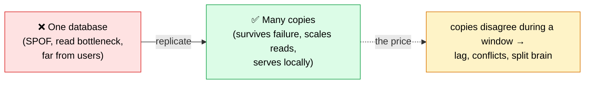
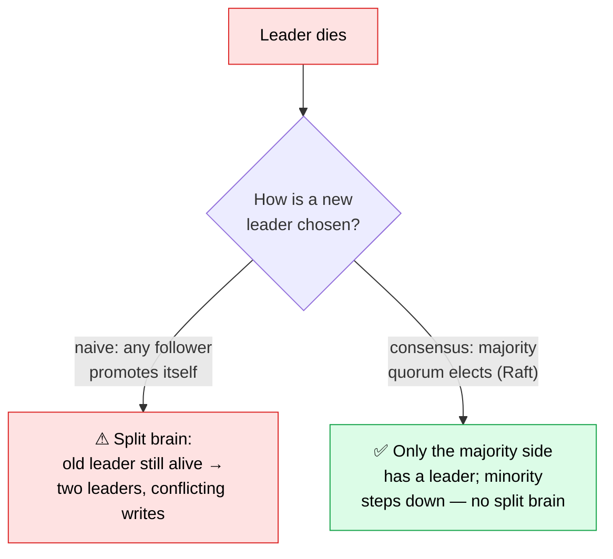
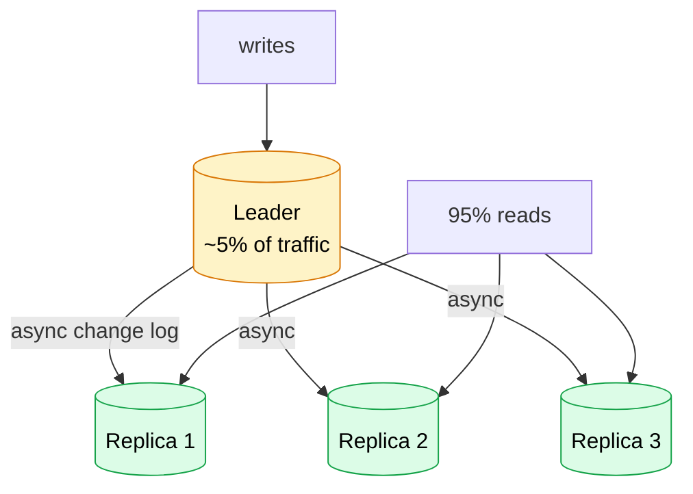
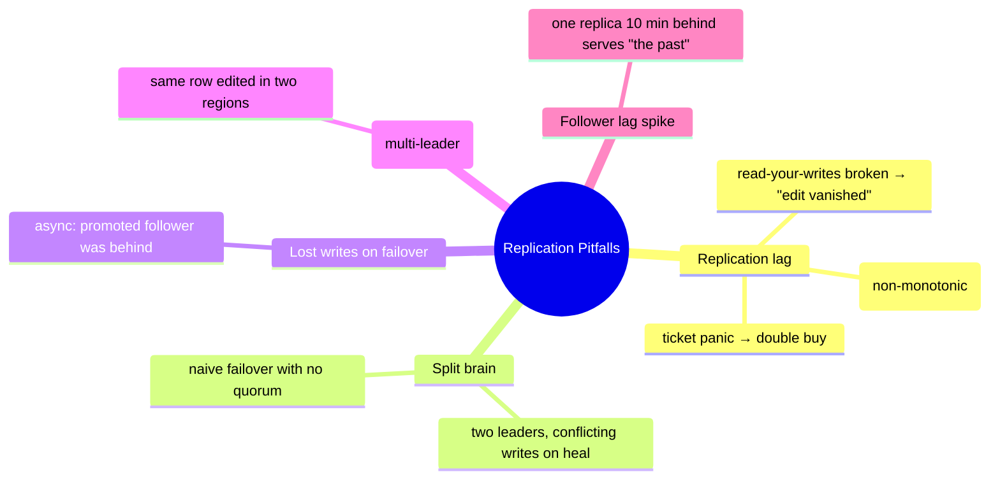

# Replication (Leader-Follower, Multi-Leader, Leaderless)

> **One line:** Replication keeps copies of your data on multiple machines so the system survives a node dying, serves reads from many places at once, and puts data near users — but every copy you add creates a window where the copies disagree, which is the source of nearly every hard distributed-systems bug.

---

## Table of Contents
1. [Why You Must Master This](#1-why-you-must-master-this)
2. [The Mental Model](#2-the-mental-model)
3. [The Three Topologies](#3-the-three-topologies)
4. [Synchronous vs Asynchronous — The Durability Dial](#4-synchronous-vs-asynchronous--the-durability-dial)
5. [Replication Lag & Failover](#5-replication-lag--failover)
6. [Worked Example — Read Replicas for a Read-Heavy App](#6-worked-example--read-replicas-for-a-read-heavy-app)
7. [Real-Life Use Cases](#7-real-life-use-cases)
8. [Failure Modes](#8-failure-modes)
9. [🏋️ Practice Drills](#-practice-drills)
10. [🎤 Interview Q&A Bank](#-interview-qa-bank)
11. [🎯 Staff+ Nuances](#-staff-nuances)
12. [Cheat Sheet](#12-cheat-sheet)
13. [Connections & Further Reading](#13-connections--further-reading)

---

## 1. Why You Must Master This

Replication is how a database stops being a single point of failure and starts scaling reads — it's the foundation under high availability, read scaling, and geo-latency. It's also where [consistency](./Consistency_Models.md), [CAP](./CAP_Theorem.md), and [scaling](./SQL_vs_NoSQL_Scaling.md) all become concrete.

- **It removes the single point of failure.** One database server dies and, without replicas, so does your business — you wait hours for a backup restore. With replicas, a standby takes over in seconds. Replication *is* availability.
- **It scales reads.** Read-heavy systems (Twitter: ~1000 reads per write) spread those reads across many follower replicas, so no single machine's CPU is the read bottleneck. It's rung 3 of the [scaling ladder](./SQL_vs_NoSQL_Scaling.md).
- **It cuts latency by geography.** Put replicas in US, EU, and Asia and each user reads from a nearby copy instead of crossing an ocean per request.
- **It's the birthplace of the hard problems.** Replication lag, split brain, and write conflicts all come from having more than one copy. Understanding replication is understanding *why* eventual consistency and CAP exist at all.

> **The core problem it solves:** *surviving failure and scaling reads — at the cost of divergence.* A single copy is a liability (dies, bottlenecks, far away). Many copies fix all three, but introduce the fundamental tension: the instant data lives in two places, they can disagree, and managing that disagreement is the whole game.

---

## 2. The Mental Model

Replication is **the newspaper industry:**

- **Leader-Follower** — one central printing press (the leader) produces the news; every morning thousands of identical copies ship to local shops (followers). You *read* at your local shop, but the news is only *written* at the press. Fast local reads, one authoritative writer.
- **Multi-Leader** — several main offices (New York, London, Tokyo) each write news for their region, then swap stories with each other. Great for regional autonomy, but two offices might publish contradictory versions of the same story and have to reconcile.
- **Leaderless** — no central office; everyone shouts news to everyone, and if enough people agree on a fact, you believe it. Maximally resilient, but there's no single authority on what's true.

The topology you pick is really a choice about *where writes are allowed*, and that single decision sets your conflict risk, failover complexity, and consistency options.





---

## 3. The Three Topologies

| Topology | Who writes | Strength | Main pain | Examples |
|----------|-----------|----------|-----------|----------|
| **Leader-Follower** | One leader only | Simple; no write conflicts; easy read scaling | Write bottleneck; failover complexity | Postgres/MySQL read replicas |
| **Multi-Leader** | Several leaders | Regional write locality; survives DC loss | **Write conflicts** to resolve | Multi-region MySQL, CouchDB |
| **Leaderless** | Any node | Extreme write availability; no failover step | No global order; read-repair needed | Cassandra, DynamoDB, Riak |

**Leader-Follower (a.k.a. primary-replica, master-slave).** All writes go to the leader, which streams a change log (WAL/binlog) to followers; reads can hit any follower. It's the default and the simplest — because there's exactly one writer, *there are no write conflicts*. The costs: the leader caps write throughput (one machine), and when it dies you must *elect* a new leader (failover), which is where split brain lurks.

```python
# The canonical read/write split: writes → leader, reads → replicas
def execute(query):
    if query.is_write():
        return leader.run(query)          # all writes to the one leader
    return random.choice(replicas).run(query)  # reads load-balanced across followers
```

**Multi-Leader.** Multiple nodes accept writes (typically one leader per region) and sync to each other asynchronously. This gives write locality and survives an entire datacenter going down — but if NY and London both edit the same row, you get a **conflict** that needs resolution (LWW, [CRDTs](./BASE_Philosophy.md), or app logic). Conflict resolution is the defining difficulty.

**Leaderless (quorum-based).** No leader at all — the client writes to W nodes and reads from R nodes. If **R + W > N**, a read is guaranteed to overlap the latest write (strong consistency); tune R and W down for speed. Failed/stale nodes are healed by *read-repair* and *anti-entropy*. Maximally available (survive many nodes dying with no failover step), but there's no natural ordering of events. This is the [Dynamo](./BASE_Philosophy.md) lineage.

---

## 4. Synchronous vs Asynchronous — The Durability Dial

Independent of topology, *when* does the leader tell the client "success"?

- **Synchronous:** the leader waits for a follower to confirm it received the write before acknowledging. **No data loss on failover** — a promoted follower has the write — but writes are slower and *block entirely if the follower is down*.
- **Asynchronous:** the leader acknowledges immediately and ships to followers in the background. **Fast and non-blocking**, but if the leader crashes before replicating, those acknowledged writes are **lost**.
- **Semi-synchronous:** wait for *at least one* follower to confirm (the rest async). The common compromise — durability of one synchronous copy without the latency of waiting for all.

```mermaid
sequenceDiagram
    participant C as Client
    participant L as Leader
    participant F as Follower
    Note over C,F: SYNCHRONOUS — safe, slower
    C->>L: write
    L->>F: replicate
    F-->>L: ACK
    L-->>C: success (F has it → no loss on failover)
    Note over C,F: ASYNCHRONOUS — fast, risky
    C->>L: write
    L-->>C: success (immediately)
    L->>F: replicate (later; lost if L crashes first)
```

> **The trade:** synchronous buys durability with latency; asynchronous buys latency with a data-loss window. Most systems run semi-synchronous — one sync follower for safety, the rest async for speed. This is the same latency-vs-guarantee dial [PACELC](./PACELC_Theorem.md) describes.

---

## 5. Replication Lag & Failover

The two hazards that dominate replication in practice — and their fixes:

**Replication lag** is the delay between a write committing on the leader and appearing on a follower (async: ms to seconds; a struggling follower: minutes). It produces the classic bugs:
- **Read-your-writes violation:** user updates profile, refreshes, hits a lagging follower, sees the old value. *Fix:* route the user's own reads to the leader (or a caught-up replica) briefly after a write.
- **Monotonic-reads violation:** successive reads hit followers with different lag, so state appears to move *backward*. *Fix:* pin a user to one replica.
- **The ticket panic:** buy a ticket (leader), refresh (stale follower), don't see it, buy again. *Fix:* read-your-writes for post-purchase reads.

**Failover** is promoting a follower when the leader dies. It's deceptively dangerous:
- **Split brain:** a network glitch makes the cluster think the leader is dead and promote a new one — but the old leader is still alive and accepting writes. Now *two* leaders take conflicting writes. On heal, you have two divergent truths. *Fix:* consensus-based election (Raft/Paxos) that requires a majority quorum, so only one side (the majority) can have a leader — the minority side steps down.
- **Lost writes on async failover:** the promoted follower was behind, so writes acknowledged by the old leader are gone. *Fix:* semi-sync replication so the promoted node has at least the synchronously-replicated writes.



---

## 6. Worked Example — Read Replicas for a Read-Heavy App

**The prompt:** "A social app's Postgres primary is at 90% CPU, and it's 95% reads. Scale it."

**Step 1 — Diagnose the axis.** 95% reads means this is a *read* bottleneck, and reads scale by *copying* ([SQL vs NoSQL Scaling](./SQL_vs_NoSQL_Scaling.md)). Leader-follower replication is the direct fit — no need to shard yet.

**Step 2 — Topology.** Single leader (all writes), 3–5 async read replicas. Route writes to the leader, load-balance reads across replicas.



**Step 3 — Handle the lag it introduces (number → consequence):**
- The leader now handles only ~5% of traffic (writes); read capacity ~4×'d by three replicas. CPU crisis solved.
- **New cost:** async replicas lag by milliseconds. So a user who edits their profile and immediately re-reads might hit a stale replica → "my change didn't save." *Fix:* read-your-writes — route a user's reads to the leader for a few seconds after they write, everyone else reads replicas.
- **New risk:** if the leader dies, failover must promote a replica *and* avoid split brain → use a consensus-based failover manager (Patroni/etcd for Postgres), and semi-sync so the promoted replica isn't missing acknowledged writes.

**The consequence:** replication solved the read bottleneck cheaply (rung 3, before sharding), but *created* a consistency obligation (lag) and an availability obligation (safe failover) that you must design for explicitly. That cause-and-effect — "adding copies buys scale and creates divergence" — is the entire topic in one example.

---

## 7. Real-Life Use Cases

| Situation | Topology / mode and why |
|-----------|-------------------------|
| **Read-heavy web app** | Leader-follower, async replicas — cheap read scaling; handle lag with read-your-writes. |
| **Global app, low latency everywhere** | Multi-leader (one per region) — local writes; accept conflict resolution across regions. |
| **Write-available at massive scale** | Leaderless (Cassandra/Dynamo) — any node writes, quorum reads, no failover step. |
| **Financial primary that must not lose writes** | Leader-follower, *synchronous* (or semi-sync) — durability over write latency. |
| **HA cluster with automatic failover** | Leader-follower + consensus election (Raft/Patroni) — no split brain. |
| **Offline-capable mobile app** | Multi-leader-like — each device is a "leader," sync + merge conflicts (CRDTs) on reconnect. |

> **The habit:** state the topology, the sync mode, *and* the lag/failover plan together — "leader-follower, semi-sync, read-your-writes for the writer, Raft failover." A topology without a failover story is half a design.

---

## 8. Failure Modes



- **Replication lag bugs.** Symptom: users don't see their own writes, or state moves backward. *Fix:* read-your-writes (route writer's reads to leader) and monotonic reads (sticky replica).
- **Split brain.** Symptom: after a network blip, two nodes both accept writes; divergent data on heal. Cause: failover without a majority requirement. *Fix:* consensus-based election requiring a quorum — only the majority partition can elect a leader.
- **Lost writes on async failover.** Symptom: acknowledged writes vanish after promotion. Cause: async replica was behind the dead leader. *Fix:* semi-synchronous replication so the promoted node has the sync-confirmed writes; accept the small latency cost for durability.
- **Multi-leader write conflicts.** Symptom: two regions edited the same row; which wins? *Fix:* a resolution strategy decided in advance — LWW (lossy), version vectors (detect), or CRDTs (auto-merge).
- **Follower lag spike.** Symptom: one replica falls minutes behind and serves badly stale data. Cause: overloaded/slow replica. *Fix:* monitor per-replica lag; pull laggards out of the read pool until caught up.

---

## 🏋️ Practice Drills

> *Cover the solutions and attempt first — active recall is the point.*

**Drill 1 — Pick the topology.** For each, choose leader-follower, multi-leader, or leaderless: (a) a read-heavy blog with occasional writes; (b) a globally-distributed collaborative doc where each region must accept writes locally; (c) a write-heavy metrics store that must stay writable even if several nodes die.

<details><summary>Solution</summary>

(a) **Leader-follower** — writes are rare so one leader is no bottleneck, and many followers scale the heavy reads. Simplest option, no conflict handling needed.

(b) **Multi-leader** — each region needs to accept writes locally for latency and offline tolerance, so you run a leader per region and sync between them. You accept the defining cost: conflict resolution when two regions edit the same data.

(c) **Leaderless** — write availability is paramount and you want no failover step; any node accepts writes, quorum (R+W>N) tunes consistency, and the system survives many node deaths. This is exactly Cassandra's design point for metrics/time-series.
</details>

**Drill 2 — The ticket panic.** Users buy a ticket, immediately refresh, don't see it, and buy again — creating duplicate purchases. Diagnose and fix without removing replicas.

<details><summary>Solution</summary>

**Replication lag breaking read-your-writes.** The purchase committed on the leader, but the immediate refresh load-balanced to an async follower that hadn't received it yet — so the user saw no ticket and re-bought.

Fixes:
- **Read-your-writes routing:** for a short window after a user's write, send *that user's* reads to the leader (or a replica confirmed caught-up), so they always see their own purchase. Everyone else keeps reading replicas.
- **Idempotency** as a safety net: make the purchase idempotent (a client-generated request key) so even if they do click "buy" twice, the second is deduplicated rather than charged. This defends against the bug regardless of lag.

The general principle: a user must always see the effect of their *own* recent action, even under eventual consistency.
</details>

**Drill 3 — Avoid split brain.** Your leader-follower Postgres cluster promoted a new leader during a brief network partition, but the old leader was still alive and kept taking writes. Explain what went wrong and how consensus-based failover prevents it.

<details><summary>Solution</summary>

**Split brain from quorum-less failover.** A network partition isolated the old leader from the followers. The followers assumed it was dead and promoted one of their own — but the old leader hadn't actually crashed; it was just unreachable, and it kept accepting writes on its side. Now two leaders accept conflicting writes, and when the partition heals you have two divergent histories to reconcile (likely with data loss).

**Consensus-based failover (Raft/Paxos, via a manager like Patroni + etcd) prevents it** by requiring a *majority quorum* to elect or remain leader:
- A leader must continuously confirm it still has majority support; if it's in the *minority* partition, it loses that support and **steps down** — it stops accepting writes.
- A new leader can only be elected by the *majority* partition.
- Since a network can split into only one majority side, at most one leader can exist at a time — split brain is structurally impossible.

The cost is that the minority side becomes unavailable for writes during the partition — a deliberate CP choice, trading availability for the guarantee of a single leader.
</details>

---

## 🎤 Interview Q&A Bank

**Q1. "Why replicate at all?"**
> Three reasons: availability (survive a node dying without downtime), read scalability (spread reads across many copies), and latency (serve users from a geographically close replica). The cost is that copies diverge temporarily, which is where replication lag and conflicts come from.

**Q2. "Leader-follower vs multi-leader vs leaderless — when each?"**
> Leader-follower for the common read-heavy case: one writer means no conflicts, and followers scale reads — simplest and most common. Multi-leader when multiple regions must accept writes locally, accepting the cost of conflict resolution. Leaderless (Cassandra/Dynamo) when write availability is paramount and you want quorum-tunable consistency with no failover step.

**Q3. "Synchronous vs asynchronous replication?"**
> Synchronous: the leader waits for a follower to confirm before acknowledging — no data loss on failover, but slower and blocks if the follower is down. Asynchronous: acknowledge immediately, replicate in the background — fast, but a leader crash loses unreplicated writes. Semi-synchronous (wait for at least one follower) is the usual compromise.

**Q4. "What is replication lag and how do you handle it?"**
> The delay between a write on the leader and its appearance on a follower — milliseconds normally, more if a follower struggles. It causes stale reads: users not seeing their own writes, or state jumping backward. You handle it with read-your-writes (route the writer's reads to the leader briefly) and monotonic reads (pin a user to one replica), rather than by making everything synchronous.

**Q5. "What is split brain and how do you prevent it?"** *(signal: failover depth)*
> After a network partition, two nodes both believe they're the leader and both accept writes, producing divergent data. It's prevented with consensus-based leader election (Raft/Paxos) that requires a majority quorum: a leader must keep majority support or step down, and only the majority partition can elect one. Since only one side can hold the majority, only one leader can exist.

**Q6. "How does a leaderless system guarantee consistency without a leader?"**
> Through quorums. The client writes to W nodes and reads from R nodes; if R + W > N (total replicas), the read set is guaranteed to overlap a node with the latest write, giving strong consistency. Stale nodes are healed by read-repair (fix on read) and anti-entropy (background sync). Lower R and W for speed at the cost of possible staleness.

**Q7. "A user updated their profile in an eventually-consistent system and wants to see it immediately. How?"**
> Read-your-writes consistency: for that user, route their reads to the leader (or a replica confirmed to have their write) for a short window after the update, so they always see their own change even though other users may briefly see the old value. It's a targeted fix that keeps the read-scaling benefit of replicas for everyone else.

---

## 🎯 Staff+ Nuances

- **Every replica you add is a consistency liability, not just a capacity gain.** The instinct is "more replicas = more scale/safety." True — but each async replica widens the staleness window and adds a node that can lag, fail, or serve the past. The design work isn't adding replicas; it's managing the divergence they create (read routing, lag monitoring, failover). A replica topology without a lag-and-failover plan is incomplete.
- **Failover is the hard part, and split brain is why.** Adding read replicas is easy; *safely* promoting one when the leader dies is a distributed-consensus problem. This is why production Postgres HA uses Patroni+etcd (Raft) rather than a simple health-check-and-promote script — the naive version *will* split-brain during a partition. Naming the consensus layer is the seniority signal.
- **Asynchronous replication makes durability a probabilistic statement.** "Committed" on an async leader means "committed *here*, probably replicated soon." A crash in that window loses acknowledged writes. For money, that's unacceptable — hence semi-sync or sync for the critical path. The subtle point: your durability guarantee is only as strong as your *slowest synchronous* replica, and choosing zero sync replicas is choosing a data-loss window.
- **Multi-leader is a conflict-resolution project wearing a replication costume.** The replication is the easy 20%; the 80% is deciding what happens when two leaders edit the same key. LWW silently loses data, version vectors push the decision to the app, CRDTs constrain your data model. Teams underestimate this and ship multi-leader systems that quietly corrupt data on conflict — which is why single-leader is preferred whenever one writer suffices.
- **Read replicas and lag turn consistency into a routing problem.** Once you have replicas, "which consistency does this read get?" becomes "which node do I route it to?" Read-your-writes = route to leader; bounded staleness = route to a replica within a lag threshold; eventual = route to nearest. The consistency model is implemented in the *connection router*, which is why smart proxies (ProxySQL, PgBouncer + routing) are core infrastructure, not an afterthought.
- **Chain vs star vs cascading topologies change the lag profile.** Followers can replicate from the leader (star) or from other followers (cascading/chained) to reduce leader load — but chaining *adds* lag at each hop and makes a mid-chain failure orphan downstream replicas. The topology shape is a real operational decision, not just "leader and followers."
- **Replication is the substrate; CAP/PACELC/consistency are the theory describing it.** Every abstract trade-off in those topics is *physically enacted* by replication choices: sync vs async is the durability/latency dial, quorum settings are the CP/AP knob, and lag is why eventual consistency exists. When you can trace a consistency model down to "which replicas ack which operations," you understand the whole cluster of topics as one system.

---

## 12. Cheat Sheet

```
REPLICATION — COPY DATA ACROSS NODES (availability + read scale + locality)
═══════════════════════════════════════════════════════════════════════════

TOPOLOGIES (= where writes are allowed)
  Leader-Follower  1 writer, N readers    simple, no conflicts    write bottleneck, failover
                   → default; read scaling (Postgres/MySQL replicas)
  Multi-Leader     many writers (regions) local writes, DC-loss   WRITE CONFLICTS
                   → global apps; needs conflict resolution
  Leaderless       any node, R+W>N        extreme write avail     no order, read-repair
                   → Cassandra, DynamoDB, Riak

SYNC vs ASYNC (durability/latency dial)
  Sync   wait for follower ACK    no loss on failover   slower, blocks if follower down
  Async  ACK immediately          fast                  crash before replicate = LOST writes
  Semi-sync = wait for ≥1 follower → the common compromise

THE TWO HAZARDS
  Replication LAG   stale follower read after a write
                    → read-your-writes (route writer to leader), monotonic reads (sticky)
  SPLIT BRAIN       two leaders after a partition, conflicting writes
                    → consensus election (Raft/Paxos), majority quorum, minority steps down

QUORUM (leaderless / tunable)
  R + W > N → read overlaps latest write → strong
  N=3: R=2,W=2 strong+survives 1 down · R=1,W=1 fast+eventual

RULES
  ✓ writes → leader, reads → replicas (load-balanced)
  ✓ read-your-writes for the user's OWN recent writes
  ✓ semi-sync for anything you can't afford to lose
  ✓ consensus-based failover — never naive promote (split brain)
  ✓ monitor per-replica lag; eject laggards from the read pool
  ✗ multi-leader without a conflict-resolution strategy
```

---

## 13. Connections & Further Reading

**Within this repo:**
- [Consistency_Models.md](./Consistency_Models.md) — replication lag is *why* eventual/read-your-writes/monotonic exist.
- [CAP_Theorem.md](./CAP_Theorem.md) — failover and quorum choices are the CP/AP decision in action.
- [PACELC_Theorem.md](./PACELC_Theorem.md) — sync vs async is the latency-vs-consistency dial made physical.
- [SQL_vs_NoSQL_Scaling.md](./SQL_vs_NoSQL_Scaling.md) — replicas are how you scale reads (rung 3 of the ladder).
- [Sharding_Partitioning.md](./Sharding_Partitioning.md) — the complement: replication copies data, sharding splits it. Real systems do both.
- [BASE_Philosophy.md](./BASE_Philosophy.md) — conflict resolution (LWW, CRDTs) for multi-leader/leaderless.

**External classics:**
- *Designing Data-Intensive Applications* (Kleppmann) — Ch. 5, "Replication," the definitive treatment.
- *In Search of an Understandable Consensus Algorithm* (Ongaro & Ousterhout) — the Raft paper behind safe failover.
- [PostgreSQL: Streaming Replication](https://wiki.postgresql.org/wiki/Streaming_Replication) · [Patroni](https://patroni.readthedocs.io/) — HA failover in practice.

---

## TL;DR
**Replication keeps copies of your data on multiple nodes to survive failures, scale reads, and serve users locally — but every copy creates a window where copies disagree, which is the root of the hard bugs.** Choose the topology by where writes are allowed: leader-follower (one writer, no conflicts, the default) scales reads; multi-leader gives regional write locality at the cost of conflict resolution; leaderless (quorum, R+W>N) maximizes write availability. Sync vs async is the durability-vs-latency dial (semi-sync is the usual compromise). **The two things you must design for are replication lag — fixed with read-your-writes and monotonic reads — and safe failover, which needs consensus-based election (Raft) to prevent split brain; a replication topology without a lag-and-failover plan is only half a design.**
