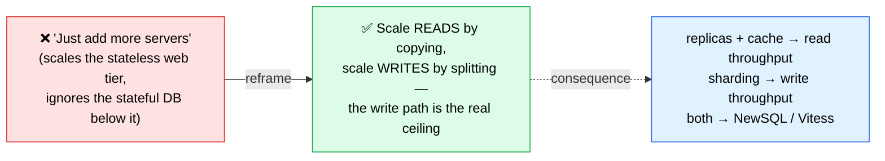
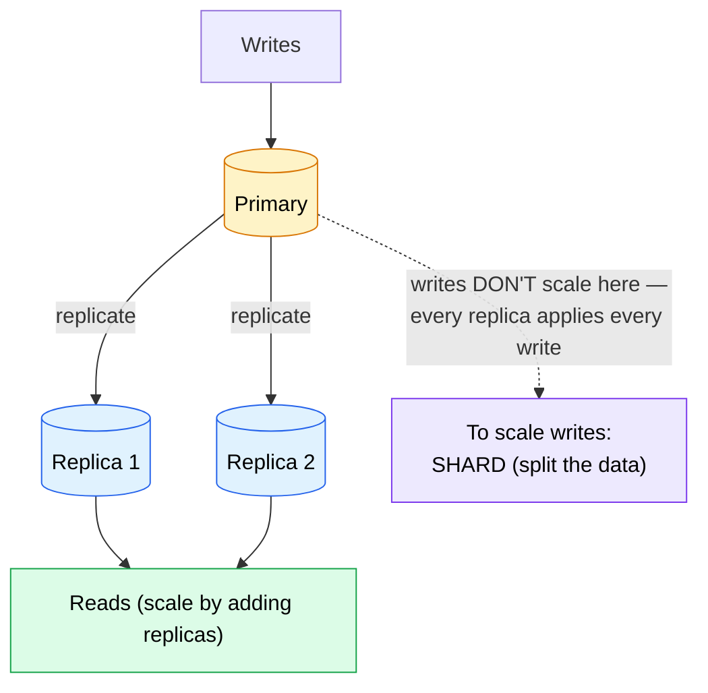
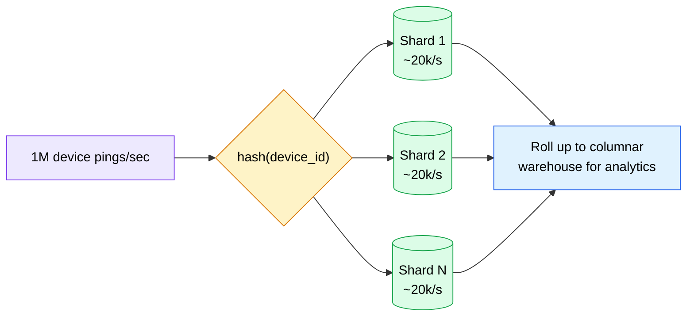

# SQL vs NoSQL Scaling

> **One line:** Scaling reads is easy (copy the data to more replicas); scaling *writes* is the hard part — and the whole SQL-vs-NoSQL scaling debate is really about how much complexity you'll accept to spread writes across many machines.

---

## Table of Contents
1. [Why You Must Master This](#1-why-you-must-master-this)
2. [The Mental Model](#2-the-mental-model)
3. [Vertical vs Horizontal Scaling](#3-vertical-vs-horizontal-scaling)
4. [Scaling Reads vs Scaling Writes](#4-scaling-reads-vs-scaling-writes)
5. [The Scaling Ladder](#5-the-scaling-ladder)
6. [Worked Example — Scaling to 1M Writes/sec](#6-worked-example--scaling-to-1m-writessec)
7. [Real-Life Use Cases](#7-real-life-use-cases)
8. [Failure Modes](#8-failure-modes)
9. [🏋️ Practice Drills](#-practice-drills)
10. [🎤 Interview Q&A Bank](#-interview-qa-bank)
11. [🎯 Staff+ Nuances](#-staff-nuances)
12. [Cheat Sheet](#12-cheat-sheet)
13. [Connections & Further Reading](#13-connections--further-reading)

---

## 1. Why You Must Master This

Scaling the database is where most system-design interviews (and most real outages) actually live. The web tier scales trivially — spin up more stateless boxes. The database is the *shared, stateful* thing at the bottom of the stack, and it's what falls over first.

- **The bottleneck is almost always the database.** "Add more web servers" fixes nothing if 5,000 of them hammer one primary. The interviewer wants to see you identify the *stateful* bottleneck, not the stateless one.
- **Writes and reads scale by completely different mechanisms.** Reads scale by *copying* data (replicas, caches). Writes scale only by *splitting* data (sharding). Conflating the two is a classic junior mistake.
- **It's a cost-curve decision.** Vertical scaling costs grow *super-linearly* (the last 10% of a top-end server costs more than the first 90%); horizontal scaling on commodity nodes grows roughly *linearly*. At scale, the curve you're on determines whether the business can afford to grow.
- **The SQL/NoSQL line is blurry and you must know where.** Sharded MySQL (Vitess) scales writes like NoSQL; NewSQL gives ACID at horizontal scale. Naming *how* each gets there is the signal.

> **The core problem it solves:** *removing the single-machine ceiling on throughput and dataset size* — without silently giving up the consistency guarantees the application still depends on.

---

## 2. The Mental Model

You run a pizza shop that's suddenly slammed with orders:

- **Scale up (vertical) = buy a faster car.** One Ferrari delivers more than one hatchback, and you still manage *one driver* — simple. But there's no infinitely-fast car; eventually you hit the fastest machine money can buy, and the price of each extra mph goes vertical.
- **Scale out (horizontal) = hire a fleet of bikes.** No single bike beats the Ferrari, but 1,000 bikes carry far more pizza than any one car — and you can always add another bike. The catch: now you coordinate 1,000 riders, route them, and make sure two don't try to deliver the same order.

Reads and writes map onto this too: **reads are like handing out photocopies of the menu** (copy it to as many riders as you want, cheap), while **writes are like taking new orders** (two riders taking the same table's order must not double-charge — that coordination is what makes write-scaling hard).





---

## 3. Vertical vs Horizontal Scaling

| Dimension | Vertical (scale UP) | Horizontal (scale OUT) |
|-----------|---------------------|------------------------|
| **Move** | Bigger box: more CPU/RAM/NVMe | More boxes: add nodes to a cluster |
| **Complexity** | Trivial — one machine, one config | High — routing, rebalancing, partial failure |
| **Cost curve** | Super-linear at the high end | ~Linear on commodity hardware |
| **Ceiling** | The biggest server on the market | Effectively none (add nodes) |
| **Consistency** | Easy — one node, one clock | Hard — cross-node coordination |
| **Natural home** | Relational (ACID on one box) | NoSQL (partitioned from day one) |

The reason relational databases *lean* vertical and NoSQL *leans* horizontal isn't dogma — it's their consistency contract. A multi-row [ACID](./ACID_Properties.md) transaction is cheap on one machine and expensive across many (locks, [two-phase commit](./Distributed_Transactions.md), round trips). NoSQL scales out easily precisely because it *dropped* the guarantees that are hard to distribute — it embraces [BASE](./BASE_Philosophy.md). Neither is "better"; they sit at different points on the same trade-off.

```python
# SQL primary: bounded by ONE node's capacity.
def write_to_sql(row):
    # Connection pool has a hard cap; when the primary's CPU hits 100%,
    # every new write queues behind it. One machine = one ceiling.
    db.execute("INSERT INTO users ...")

# NoSQL: the write is ROUTED to one of N nodes by the partition key.
def write_to_nosql(row, nodes):
    # Total write throughput ≈ per-node throughput × N.
    # Overloaded? Add nodes and rebalance — no single ceiling.
    node = nodes[hash(row.id) % len(nodes)]
    node.write(row)
```

---

## 4. Scaling Reads vs Scaling Writes

This is the distinction that separates a coherent scaling answer from hand-waving.

**Reads scale by copying.** Add [read replicas](./Replication.md) — copies of the data that serve reads while the primary handles writes. Put a [cache](../06_Caching_Performance/) (Redis) in front to absorb the hottest keys. Read capacity becomes almost arbitrary. The cost: **replication lag** — a replica can be milliseconds to seconds behind, so a user may read their own just-deleted comment. That's eventual consistency creeping in through the read path.

**Writes scale by splitting.** A replica does *not* help writes — every replica must eventually apply *every* write, so the write volume is the same everywhere. The only way to raise write throughput is [sharding/partitioning](./Sharding_Partitioning.md): split the data so each shard owns a slice of the writes. This is genuinely hard — cross-shard joins and transactions become expensive or impossible, and a bad shard key creates hot spots.



> **Rule of thumb:** if a system is read-heavy (LinkedIn profiles, product catalogs), replicas + cache take you very far on relational. If it's write-heavy (Uber location pings, IoT telemetry, activity feeds), you need partitioning — and that's where NoSQL's day-one sharding earns its keep.

---

## 5. The Scaling Ladder

The moves, cheapest and least disruptive first. Climbing in order avoids over-engineering — most systems never reach the bottom rungs.

1. **Optimize what you have.** Add missing [indexes](./Database_Indexing.md), kill N+1 queries, batch writes, cache hot reads. Often buys 10× and months of runway for near-zero cost.
2. **Scale up.** Move to a bigger instance. One config change, no application change. Buys time; has a ceiling.
3. **Add read replicas.** Route reads off the primary. Ideal for read-heavy loads; introduces replication lag you must design around (read-your-writes, sticky sessions).
4. **Shard the writes.** Partition data across nodes by a shard key. Removes the write ceiling but adds real cost: cross-shard queries, rebalancing, hot-shard risk. This is the leap from vertical to horizontal.
5. **Re-platform.** Move the hot dataset to NewSQL (Spanner, CockroachDB, YugabyteDB) for ACID + horizontal scale, or to a purpose-built NoSQL store. Highest effort — reserve for when sharding your current DB is fighting you daily.

> **The habit:** name the rung you're on and the *next* one, out loud. "We're read-bound, so replicas + cache (rung 3); if writes become the ceiling we shard on `user_id` (rung 4)." That's a scaling *strategy*, not a guess.

---

## 6. Worked Example — Scaling to 1M Writes/sec

**The prompt:** "Design storage for a service ingesting 1,000,000 writes/second" (IoT telemetry, or Uber driver-location pings).

**Step 1 — Is this a read or write problem?** Writes dominate, ~1M/sec, mostly append. Replicas won't help — every replica would have to absorb all 1M/sec too. **This is a sharding problem from the start.**

**Step 2 — Can one node take it?** A well-tuned relational primary handles maybe ~10k–50k writes/sec before saturating. 1M/sec needs **~20–100 nodes** sharing the write load. Vertical scaling is off the table by two orders of magnitude.

**Step 3 — Pick the partition strategy.** Shard by `device_id` (or `driver_id`) so each device's writes hash to one node and load spreads evenly. **Avoid** sharding by anything low-cardinality or time-bucketed (e.g. current-hour) — that creates a [hot shard](./Sharding_Partitioning.md) where all "now" traffic lands on one node.



**Step 4 — Choose the engine.** A wide-column store (Cassandra, ScyllaDB) is purpose-built for this: append-optimized (LSM-tree) writes, day-one partitioning, tunable consistency. Sharded MySQL via Vitess *could* do it too — that's exactly why Facebook built Vitess — but you take on the sharding-layer complexity yourself.

**The consequence:** the number (1M/sec) *forced* horizontal write scaling, which forced a partition-key decision, which forced an append-optimized store. Each number drove the next architectural choice — and analytics gets peeled off to a [columnar warehouse](./Columnar_Databases.md) rather than burdening the write path.

---

## 7. Real-Life Use Cases

| Situation | How the scaling choice decides the outcome |
|-----------|--------------------------------------------|
| **LinkedIn profile views (read-heavy)** | Primary + many read replicas + cache. Reads scale by copying; writes are modest. Relational stays fine. |
| **Uber driver locations (write-heavy)** | ~millions of pings/sec → shard by driver/geo on a wide-column store. Replicas alone can't absorb the write volume. |
| **Facebook at MySQL scale** | Vitess: a sharding layer that makes MySQL scale writes horizontally while keeping SQL semantics. |
| **Google indexing the web** | Bigtable: SQL couldn't take the trillion-page write scale; a purpose-built wide-column store could. |
| **Black Friday spike** | Cache + read replicas absorb the read surge; write path pre-sharded so checkout writes don't queue behind one primary. |
| **Financial ledger, growing** | Stay ACID: scale up first, then NewSQL (Spanner/Cockroach) — never sacrifice transactional integrity for throughput. |

> **The habit:** classify the workload as read-heavy or write-heavy *first* — it picks the entire scaling strategy before you name a product.

---

## 8. Failure Modes

```mermaid
mindmap
  root((Scaling Pitfalls))
    Hot shard
      bad partition key (city, current-hour)
      one node gets 90% of traffic, crashes
    Replication lag
      read replica 30s behind primary
      user sees own deleted data
    Connection exhaustion
      5000 web servers, one primary
      pool maxed, every query queues
    Scaled the wrong axis
      added replicas for a WRITE problem
      replicas don't help writes at all
    Premature sharding
      sharded at 1000 users
      pay cross-shard join pain for no reason
```



- **Hot shard.** Symptom: one node at 100% CPU while others idle. Cause: low-cardinality or time-based shard key (`city`, `current_hour`). *Fix:* shard on a high-cardinality, evenly-distributed key (`user_id` hash); add a random suffix to hot keys.
- **Replication lag surprises.** Symptom: user posts a comment, refreshes, it's gone. Cause: the read hit a lagging replica. *Fix:* read-your-writes routing (send a user's reads to the primary briefly after a write), or accept and design for eventual consistency.
- **Connection exhaustion.** Symptom: "too many connections" under load with the CPU not even maxed. Cause: thousands of app instances × a large pool each. *Fix:* a connection pooler (PgBouncer/ProxySQL) in front of the primary.
- **Scaling the wrong axis.** Symptom: added five replicas, write latency unchanged. Cause: it was a *write* bottleneck; replicas only help reads. *Fix:* shard, or move writes to a partitioned store.
- **Premature sharding.** Symptom: cross-shard joins and rebalancing pain on a system with modest load. Cause: sharded before hitting the vertical ceiling. *Fix:* climb the ladder — optimize and scale up first; shard only when writes genuinely exceed one node.

---

## 🏋️ Practice Drills

> *Cover the solutions and attempt first — active recall is the point.*

**Drill 1 — Read-heavy vs write-heavy.** For each, name the primary scaling move: (a) a news site where 1M people read the same 10 articles; (b) a fleet-tracking service ingesting 500k GPS pings/sec.

<details><summary>Solution</summary>

(a) **Read-heavy** → cache the hot articles (CDN + Redis) and add read replicas. The working set is tiny (10 articles) and reads dominate, so copying the data everywhere is the win; the origin DB barely gets touched.

(b) **Write-heavy** → shard/partition on `vehicle_id` across a wide-column store. Replicas are useless here because every replica would still have to apply all 500k writes/sec. Only splitting the write load across nodes raises write throughput.
</details>

**Drill 2 — The lag bug.** After adding read replicas, users report that editing their profile "doesn't save" — but a refresh a few seconds later shows the change. What's happening and how do you fix it without removing the replicas?

<details><summary>Solution</summary>

**Replication lag.** The write went to the primary; the immediate read after it hit a replica that hadn't applied the change yet — so the user sees stale data momentarily. The replicas are working correctly; the app just isn't accounting for lag.

Fixes: **read-your-writes consistency** — for a short window after a user writes, route *that user's* reads to the primary (or to a replica known to be caught up). Alternatives: sticky-session pinning, or version/timestamp checks so the app waits for the replica to catch up. Don't drop the replicas — the fix is smart read routing, not fewer replicas.
</details>

**Drill 3 — When do you shard?** A Postgres primary is at 60% CPU, mostly reads, a modest write rate, and you have no DBA team. A teammate proposes sharding now "to be safe." Argue the counter-position.

<details><summary>Solution</summary>

Sharding is the *last* rung of the ladder, not a precaution. At 60% CPU and read-dominated, the cheap moves aren't exhausted: add indexes / fix slow queries, add a cache, add read replicas, and scale up the instance. Each is a config-level change with no cross-shard-join tax.

Sharding permanently complicates the system — cross-shard queries, transactions, and rebalancing — and without a DBA team that complexity is a liability. Shard only when the *write* path genuinely exceeds one node's capacity after the cheaper rungs are used up. Premature sharding pays a large, permanent cost to solve a problem you don't have yet.
</details>

---

## 🎤 Interview Q&A Bank

**Q1. "How would you scale a database handling 1M writes/sec?"** *(signal: do they separate reads from writes?)*
> That's a write-scaling problem, so replicas won't help — every replica applies every write. I'd shard the data across many nodes by a high-cardinality key so each node takes a slice of the writes, on an append-optimized store like Cassandra (or sharded MySQL via Vitess if I need SQL semantics). Then I'd peel analytics off to a columnar warehouse so reporting doesn't compete with ingestion.

**Q2. "What's the difference between vertical and horizontal scaling?"**
> Vertical is a bigger box — simple, one machine, but capped by the largest server available and super-linear in cost at the top. Horizontal is more boxes — near-linear cost on commodity hardware and no real ceiling, but you take on routing, rebalancing, and partial-failure complexity, and cross-node consistency gets hard.

**Q3. "Why don't read replicas help with write scaling?"**
> Because a replica isn't a slice of the data — it's a full *copy*. Every write on the primary must eventually be applied on every replica, so total write volume is identical everywhere. Replicas multiply *read* capacity; only sharding (splitting the data so each node owns a subset of writes) raises write capacity.

**Q4. "Can a relational database scale writes horizontally?"**
> Yes, via sharding — but SQL doesn't do it for you natively, so you either shard at the application layer or run a sharding middleware like Vites (which is how Facebook and Pinterest scale MySQL). NewSQL databases — Spanner, CockroachDB — build horizontal write scaling in while keeping ACID, at the cost of higher write latency from distributed consensus.

**Q5. "What is replication lag and why does it matter?"**
> It's the delay between a write committing on the primary and appearing on a replica — milliseconds to seconds. It matters because reads served from a lagging replica can be stale: a user might not see their own just-made change. You design around it with read-your-writes routing or by accepting eventual consistency where it's harmless.

**Q6. "What's a hot shard and how do you avoid it?"** *(signal: partition-key judgment)*
> A hot shard is one node receiving a disproportionate share of traffic because the shard key is skewed — e.g. sharding by `city` sends all of NYC to one node. It bottlenecks the whole system while other nodes idle. Avoid it by choosing a high-cardinality, evenly-distributed key (a hash of `user_id`), and for unavoidable hot keys, add a salt/suffix to spread them.

**Q7. "When is sharding the wrong move?"**
> When you haven't exhausted the cheaper rungs — query optimization, caching, read replicas, scaling up. Sharding permanently adds cross-shard join/transaction complexity and rebalancing overhead, so doing it before you've hit the single-node *write* ceiling is paying a big cost to solve a problem you don't have. It's the last resort, not the default.

---

## 🎯 Staff+ Nuances

- **The write path is the true ceiling, and everyone forgets it.** Reads have escape hatches everywhere — replicas, caches, CDNs, materialized views. Writes have exactly one: partitioning. When you architect for scale, design the *write* path first; the read path almost always has an answer.
- **Sharded SQL and NoSQL converge.** Vitess makes MySQL a horizontally-scaled, partitioned system; DynamoDB added transactions. At the high end the two paradigms meet in the middle — the honest framing is "how much of the consistency contract am I keeping, and what does that cost per write," not "SQL vs NoSQL."
- **Connection management is a hidden scaling wall.** Long before CPU saturates, a relational primary can die of connection exhaustion when thousands of app instances each hold a pool. A pooler (PgBouncer/ProxySQL) is often the single highest-leverage scaling fix and gets omitted from most designs.
- **Replication lag turns a consistency choice into a UX choice.** The moment you add a replica, some reads become eventually consistent. That's not a database detail — it's a product decision about which screens tolerate staleness. Tie it to [consistency models](./Consistency_Models.md) explicitly rather than letting lag leak into the UI unmanaged.
- **NewSQL's write latency is the tax people underestimate.** Spanner's commit-wait and CockroachDB's per-write consensus buy you ACID at horizontal scale, but each write pays a coordination cost (single-digit to tens of ms). For a write-firehose workload that tax can dominate — sometimes an eventually-consistent store is the right call precisely because it *skips* the coordination.
- **Rebalancing is the operational cost nobody demos.** Adding a shard means moving data while serving live traffic. Consistent hashing and virtual nodes ([Sharding](./Sharding_Partitioning.md)) minimize how much moves, but "just add a node" is never free — plan for the rebalance, not just the steady state.
- **Auto-scaling storage is not auto-scaling throughput.** Serverless offerings (DynamoDB on-demand, Aurora) scale capacity elastically, but a bad partition key still creates hot partitions the autoscaler can't fix — it scales the *aggregate*, not the *skew*. The data model still has to be right.

---

## 12. Cheat Sheet

```
SQL vs NoSQL SCALING — READS COPY, WRITES SPLIT
═══════════════════════════════════════════════════════════════════

THE ONE DISTINCTION
  READS  scale by COPYING  → replicas + cache (near-arbitrary)
  WRITES scale by SPLITTING → sharding ONLY (the real ceiling)
  A replica does NOT help writes — it applies every write too.

VERTICAL (scale UP)              HORIZONTAL (scale OUT)
  + trivial: one box               + ~linear cost, no ceiling
  + easy ACID / consistency        + write throughput scales
  - super-linear cost at top       - routing, rebalance, hot shards
  - hard hardware ceiling          - cross-node joins/txns hard
  home: relational                 home: NoSQL (partitioned day 1)

THE SCALING LADDER (climb in order)
  1. Optimize   indexes, kill N+1, batch, cache      cheap, often 10x
  2. Scale up   bigger instance                       1 config change
  3. Replicas   offload READS                          adds lag
  4. Shard      split WRITES by key                    joins/txns hard
  5. Re-platform NewSQL (ACID+scale) / NoSQL           highest effort

WORKLOAD → STRATEGY
  read-heavy  (profiles, catalog)  → cache + replicas, stay relational
  write-heavy (pings, telemetry)   → shard on high-cardinality key
  need ACID + scale                → NewSQL (Spanner, Cockroach) / Vitess

DON'T
  ✗ add replicas to fix a WRITE bottleneck
  ✗ shard on low-cardinality/time keys → hot shard
  ✗ shard before exhausting rungs 1–3 → premature complexity
  ✗ forget the connection pooler — it's often the first wall
```

---

## 13. Connections & Further Reading

**Within this repo:**
- [Replication.md](./Replication.md) — the mechanism behind read scaling and the source of replication lag.
- [Sharding_Partitioning.md](./Sharding_Partitioning.md) — the mechanism behind write scaling and hot-shard risk.
- [Relational_vs_NoSQL.md](./Relational_vs_NoSQL.md) — the paradigm choice this scaling debate sits on top of.
- [ACID_Properties.md](./ACID_Properties.md) · [BASE_Philosophy.md](./BASE_Philosophy.md) — the guarantees that make writes cheap to distribute (or not).
- [Consistency_Models.md](./Consistency_Models.md) — what replication lag does to what a read can promise.
- [Caching & Performance](../06_Caching_Performance/) — the read-scaling layer that sits in front of the database.

**External classics:**
- *Designing Data-Intensive Applications* (Martin Kleppmann) — Ch. 5–6, replication and partitioning.
- [Vitess](https://vitess.io/) — the sharding layer that scales MySQL horizontally (YouTube, Slack, Pinterest).
- *Bigtable* (Chang et al., 2006) — the wide-column design built for web-scale writes.

---

## TL;DR
**Reads scale by copying the data (replicas + cache); writes scale only by splitting it (sharding) — and everything else follows from that.** Vertical scaling (a bigger box) is simple but capped and super-linear in cost; horizontal scaling (more nodes) is near-linear and uncapped but adds routing, rebalancing, and cross-node consistency pain. Climb the ladder in order — optimize, scale up, add replicas, then shard, then re-platform — so you never pay sharding's complexity before hitting the single-node *write* ceiling. **Classify the workload as read- or write-heavy first; that one call picks the entire strategy.**
