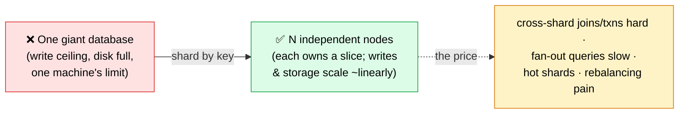
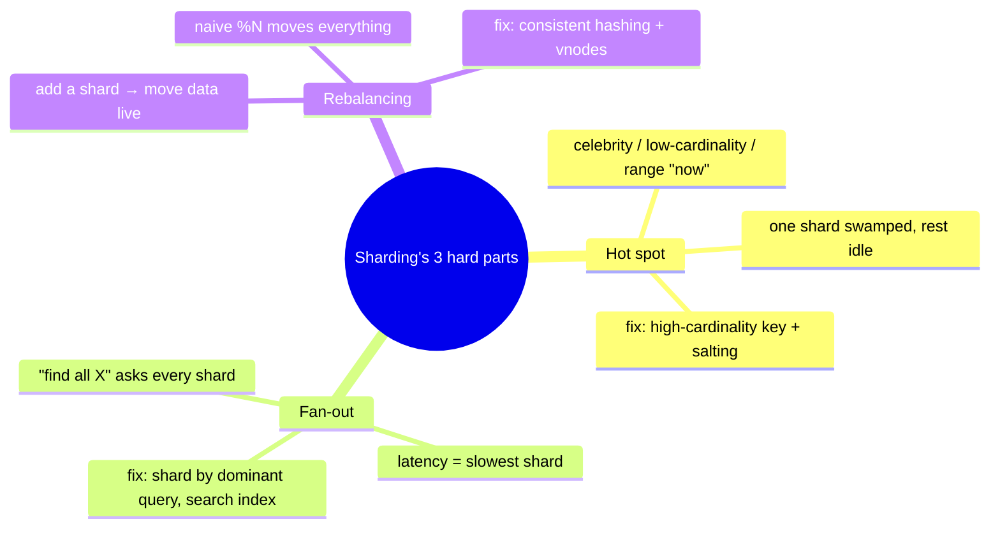
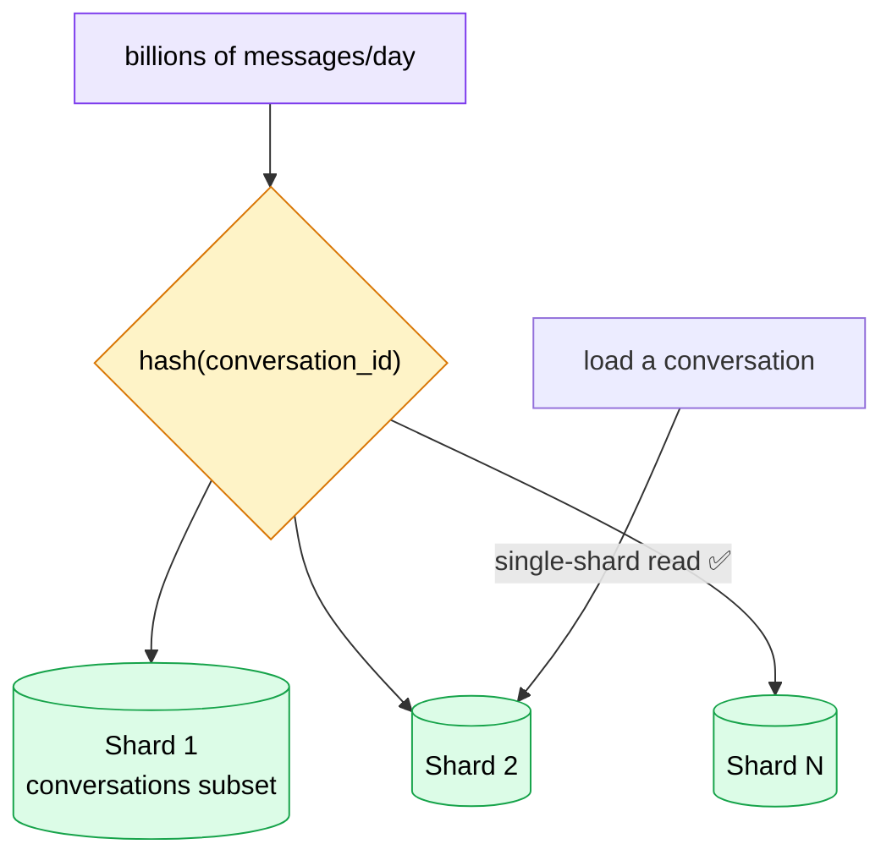
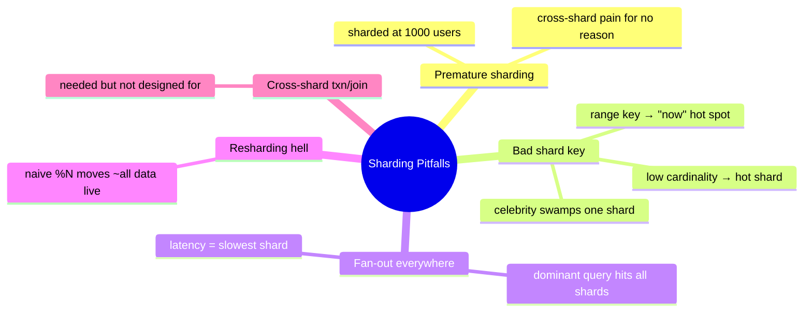

# Sharding & Partitioning

> **One line:** Sharding splits one database into many independent nodes, each owning a slice of the data chosen by a *shard key* — it's the only way past the single-machine ceiling for writes and storage, and the shard key you pick determines whether the load spreads evenly or all lands on one overloaded node.

---

## Table of Contents
1. [Why You Must Master This](#1-why-you-must-master-this)
2. [The Mental Model](#2-the-mental-model)
3. [Partitioning Directions — Horizontal vs Vertical](#3-partitioning-directions--horizontal-vs-vertical)
4. [Sharding Strategies](#4-sharding-strategies)
5. [The Hard Parts — Hot Spots, Fan-out, Rebalancing](#5-the-hard-parts--hot-spots-fan-out-rebalancing)
6. [Worked Example — Sharding a Global Chat App](#6-worked-example--sharding-a-global-chat-app)
7. [Real-Life Use Cases](#7-real-life-use-cases)
8. [Failure Modes](#8-failure-modes)
9. [🏋️ Practice Drills](#-practice-drills)
10. [🎤 Interview Q&A Bank](#-interview-qa-bank)
11. [🎯 Staff+ Nuances](#-staff-nuances)
12. [Cheat Sheet](#12-cheat-sheet)
13. [Connections & Further Reading](#13-connections--further-reading)

---

## 1. Why You Must Master This

Sharding is the last rung of the [scaling ladder](./SQL_vs_NoSQL_Scaling.md) — the move you make when a single machine, no matter how big, can't hold the data or absorb the writes. It's how YouTube, WhatsApp, and Instagram store trillions of rows, and it's the highest-complexity database decision you'll make.

- **It's the only way past the write/storage ceiling.** Read replicas scale reads, vertical scaling buys headroom — but when *writes* or *dataset size* exceed one machine, only splitting the data across nodes helps. Sharding is that split.
- **The shard key is a near-irreversible decision.** Choose well and load spreads evenly and scales linearly; choose badly (low cardinality, time-based) and you get a hot shard that bottlenecks everything — and fixing it means migrating terabytes under live traffic.
- **It changes what queries are possible.** Cross-shard joins and transactions become hard or impossible; a query that touches all shards ("fan-out") gets slow. Sharding reshapes your data access, not just your capacity.
- **It's the canonical scaling interview.** "Design WhatsApp / a URL shortener / Instagram" is really "pick a shard key and defend it against hot spots and fan-out." The reasoning is the signal.

> **The core problem it solves:** *the single-node ceiling on writes and storage.* Replication copies the whole dataset (helping reads and availability); sharding *divides* it so each node owns a fraction of the writes and bytes — the only mechanism that scales the write path and total capacity beyond one machine.

---

## 2. The Mental Model

The difference between partitioning and sharding is the difference between *volumes* and *libraries*:

- **Partitioning** = splitting one 10,000-page encyclopedia into 26 volumes (A, B, C…). It's more manageable, but all 26 volumes still sit on *your* desk — one person, one location.
- **Sharding** = opening 26 separate libraries, each holding one volume, each with its own building and staff. Now 26 people can look up words *simultaneously* without elbowing each other. The data is split *and distributed across independent machines* — that's what unlocks parallel writes and true horizontal scale.

The choice of *how* to split the encyclopedia — by first letter (range) or by scrambling words across libraries (hash) — is the shard-key decision, and it determines whether every library gets equal traffic or one gets swamped.




---

## 3. Partitioning Directions — Horizontal vs Vertical

"Partitioning" splits a table two ways; **sharding is horizontal partitioning distributed across machines.**

| Type | Splits by | Example | Purpose |
|------|-----------|---------|---------|
| **Horizontal (sharding)** | Rows | Users A–M → Shard 1, N–Z → Shard 2 | Scale out: each node owns a subset of rows |
| **Vertical** | Columns | Hot `profile` columns in one table, rarely-read `bio/settings` in another | Keep the hot, frequently-scanned columns compact |

- **Horizontal partitioning / sharding** puts *different rows* on different nodes. This is the scaling workhorse — every node handles its own slice of writes and storage. When those partitions live on *separate machines*, it's sharding.
- **Vertical partitioning** puts *different columns* on different tables/stores — separating a user's frequently-accessed fields from bulky rarely-read ones so the hot table stays small and cache-friendly. (Not to be confused with vertical *scaling* = a bigger box.)

The rest of this note is about horizontal sharding, because that's what "sharding" means and where the hard decisions live.

---

## 4. Sharding Strategies

The shard key + strategy together decide data placement. Three classic strategies, each with a signature failure:

| Strategy | Placement rule | Wins | Signature failure |
|----------|----------------|------|-------------------|
| **Hash-based** | `hash(key) % N` | Even distribution, no hot spots | Range queries fan out; naive `% N` moves ~all data on resharding |
| **Range-based** | Contiguous ranges (A–H, dates) | Efficient range scans | **Hot spot** — all "current" writes hit one shard |
| **Directory-based** | A lookup table maps key → shard | Flexible rebalancing | Lookup table is a SPOF and an extra hop |

```python
import hashlib

def get_shard(key, total_shards):
    h = int(hashlib.md5(key.encode()).hexdigest(), 16)
    return h % total_shards           # even spread — but changing total_shards remaps almost everything

# range-based instead: shard by first letter / date bucket → range scans are cheap,
# but the "current" bucket becomes a write hot spot.
```

**Hash-based** scatters keys uniformly — great balance, but you lose locality (a range query must ask every shard) and the naive `% N` is brittle: change N and nearly every key remaps. **Range-based** keeps related keys together (excellent for time-series range scans) but concentrates writes — everyone writing "today" hits the same shard. **Directory-based** trades a lookup indirection for rebalancing flexibility.

**Consistent hashing** is the essential upgrade to plain hash-based: it places shards and keys on a hash ring so that **adding or removing a node moves only ~1/N of the keys** instead of remapping everything. It's how Cassandra, DynamoDB, and every serious auto-sharded store handle elasticity — and the answer to "how do you add a shard without a massive migration?"

**Instagram's trick:** encode the shard ID *inside* the primary key (their IDs embed the shard number). You know which shard to query just by looking at the ID — no directory lookup, no fan-out.

---

## 5. The Hard Parts — Hot Spots, Fan-out, Rebalancing

Sharding's difficulty isn't the split — it's these three consequences:

- **Hot spots.** One shard receives a disproportionate share of traffic — a celebrity user, a low-cardinality key (`country`), or a range key where all "now" writes land. That one shard bottlenecks the entire system while others idle. *Fix:* high-cardinality keys, and **salting** hot keys (append a random suffix so a celebrity's data spreads across shards, reassembled on read).
- **Fan-out queries.** A query that can't be answered from one shard must ask *all* of them and merge — "find all users named John." Latency becomes the *slowest* shard's latency, and it scales badly. *Fix:* design the shard key around the dominant query so hot paths hit one shard; push cross-cutting queries to a search index or a [columnar warehouse](./Columnar_Databases.md).
- **Rebalancing.** Adding shards means moving data while serving live traffic — a genuine operational nightmare with naive `% N` (moves ~everything). *Fix:* consistent hashing (moves ~1/N) and virtual nodes (finer-grained, smoother rebalancing).



> **The habit:** never pick a shard key without asking "what's the hottest key, and what's the most common query?" A key that spreads writes evenly *and* keeps the dominant query on one shard is the goal; you rarely get both perfectly, so optimize for the dominant access pattern.

---

## 6. Worked Example — Sharding a Global Chat App

**The prompt:** "Design the message storage for a WhatsApp-scale chat app — billions of messages/day."

**Step 1 — Confirm sharding is warranted.** Billions of writes/day exceeds any single node ([scaling ladder](./SQL_vs_NoSQL_Scaling.md) rung 5). Writes dominate, so replicas won't help — this is a sharding problem.

**Step 2 — Choose the shard key by the dominant query.** The hot path is "load the messages for *this conversation*." So shard by **`conversation_id`** (hashed):



**Step 3 — Reason through the trade-offs (number → consequence):**
- **Why `conversation_id`, not `user_id`?** All messages in a conversation live on one shard, so loading a chat is a *single-shard read* — the dominant query stays fast and non-fan-out. Sharding by `user_id` would scatter one conversation's messages across shards (both participants), forcing a fan-out per chat load.
- **Hot spot check:** a huge group chat could overload its shard. *Mitigation:* salt very large conversations across sub-shards, or cap group size. Most conversations are small, so hashing spreads them evenly.
- **Fan-out queries** like "search all my messages" can't hit one shard — route those to a dedicated search index (Elasticsearch), off the hot write path.
- **Elasticity:** use consistent hashing so adding capacity moves ~1/N of conversations, not everything.
- **Availability:** each shard is itself [replicated](./Replication.md) (leader + followers) so a shard's node death doesn't lose that 1/N of chats — **sharding and replication compose**.

**The consequence:** choosing the shard key to match the dominant access pattern (`conversation_id` → single-shard reads) turned an impossible single-node problem into linear horizontal scale, while pushing the awkward cross-cutting queries to a purpose-built index. That shard-key-follows-the-query reasoning is the whole exercise.

---

## 7. Real-Life Use Cases

| Situation | Shard key / strategy and why |
|-----------|------------------------------|
| **Chat app (WhatsApp)** | Hash by `conversation_id` — dominant query "load this chat" stays single-shard. |
| **Instagram posts** | Shard ID embedded in the primary key — routing with no directory lookup. |
| **Time-series / metrics** | Range by time *plus* hash by series — range scans work, but salt to avoid the "now" hot shard. |
| **Multi-tenant SaaS** | Shard by `tenant_id` — each customer's data co-located; natural isolation and per-tenant scaling. |
| **Geo-partitioned data (GDPR)** | Range/directory by region — EU data in EU shards for latency and legal compliance. |
| **URL shortener** | Hash by short code — pure key lookups spread evenly, no fan-out. |

> **The habit:** the shard key is chosen from the *dominant access pattern and the data-locality/legal requirements together* — co-locate what's read together, spread what's written heavily, and keep the region rules in mind.

---

## 8. Failure Modes



- **Premature sharding.** Symptom: cross-shard joins and rebalancing pain on a system with modest load. *Fix:* "don't shard until you must" — exhaust indexing, caching, replicas, and vertical scaling first. Sharding is rung 5, not rung 1.
- **Bad shard key → hot spot.** Symptom: one shard at 100% CPU, others idle. Cause: low cardinality (`country`), time-based ("now"), or a celebrity key. *Fix:* high-cardinality hashed key; salt hot keys; split mega-entities.
- **Pervasive fan-out.** Symptom: most queries touch every shard and latency tracks the slowest. Cause: shard key doesn't match the dominant query. *Fix:* re-key around the hot query; offload cross-cutting queries to a search index/warehouse.
- **Resharding hell.** Symptom: adding a shard requires moving ~all data under live traffic. Cause: naive `hash % N`. *Fix:* consistent hashing + virtual nodes so only ~1/N moves.
- **Unsupported cross-shard operations.** Symptom: a needed join or multi-shard transaction is slow/impossible. *Fix:* denormalize to co-locate, use [distributed transactions/Sagas](./Distributed_Transactions.md) sparingly, or reconsider the shard key.

---

## 🏋️ Practice Drills

> *Cover the solutions and attempt first — active recall is the point.*

**Drill 1 — Diagnose the hot shard.** You sharded a social app by `country`. Traffic from one country's shard is pegging its node while others idle. What went wrong and how do you fix it?

<details><summary>Solution</summary>

**Low-cardinality shard key.** `country` has very few distinct, wildly-unequal values — one populous or high-engagement country routes a huge fraction of all traffic to a single shard, while small-country shards sit nearly idle. The load can't spread because the key itself doesn't spread.

Fixes:
- **Re-shard on a high-cardinality key** — a hash of `user_id` — so users distribute evenly across shards regardless of country.
- If geo-locality is genuinely required (GDPR, latency), use a **composite key**: partition by region for compliance, then hash by `user_id` *within* each region so no single node inside a region is hot.
- For any residual celebrity/mega-user hot key, **salt** it (spread that entity's data across sub-shards).

General rule: shard keys must be high-cardinality and evenly distributed; `country`, `gender`, `status`, and dates are classic bad keys used alone.
</details>

**Drill 2 — Range vs hash.** You're storing IoT sensor readings and need both fast writes and efficient "last hour" range queries. Pure range-by-time hot-spots; pure hash kills range queries. What do you do?

<details><summary>Solution</summary>

This is the classic time-series tension: range gives you cheap range scans but a write hot spot on the current time bucket; hash spreads writes but scatters a time range across all shards.

The standard solution is a **composite (compound) shard key: hash by series/device, then range by time within it.** Concretely:
- Partition by `hash(sensor_id)` so writes from thousands of sensors spread evenly across shards — no single "now" hot spot.
- *Within* each partition, cluster/order rows by timestamp so a "last hour for this sensor" query is an efficient local range scan.

This is exactly Cassandra's partition-key + clustering-key model. If you need "last hour across *all* sensors," that's an inherent fan-out — serve it from a rollup/[columnar](./Columnar_Databases.md) store rather than the write path. The lesson: combine hash (for write spread) and range (for scan locality) rather than choosing one.
</details>

**Drill 3 — Add a shard without downtime.** Your app hashes with `key % 4` and you need to go to 8 shards. Why is this painful, and what should you have used?

<details><summary>Solution</summary>

**Naive modulo resharding remaps almost everything.** With `% 4 → % 8`, a key that hashed to shard 2 might now belong to shard 6 — in fact ~half (or more) of all keys change ownership. Moving that much data across the network while the app is live is slow, risky, and easy to get wrong (reads/writes racing the migration).

What you should have used: **consistent hashing** (with **virtual nodes**). Keys and shards are placed on a hash ring; each key belongs to the next shard clockwise. Adding a shard only steals the keys in *its arc* from *one* neighbor — about **1/N of the data moves**, not half. Virtual nodes (many ring positions per physical shard) make the redistribution finer-grained and smoother, and also handle heterogeneous node sizes.

So the fix for future elasticity is architectural: adopt consistent hashing up front (or use a store like Cassandra/DynamoDB that does it for you) so scaling out is a ~1/N data move, not a full reshuffle.
</details>

---

## 🎤 Interview Q&A Bank

**Q1. "What's the difference between partitioning, sharding, and replication?"**
> Partitioning splits a table (horizontally by rows or vertically by columns). Sharding is horizontal partitioning distributed across separate machines — each node owns a slice of the rows. Replication *copies* the whole dataset to multiple nodes. Sharding scales writes and storage by splitting; replication scales reads and availability by copying. Real systems shard *and* replicate each shard.

**Q2. "How do you choose a shard key?"** *(signal: the core skill)*
> By the dominant access pattern and cardinality. It must be high-cardinality and evenly distributed to avoid hot spots, and ideally co-locate the data that's read together so the hottest query stays single-shard. For a chat app that's `conversation_id`; for multi-tenant SaaS it's `tenant_id`. I explicitly check the worst case — the celebrity/mega-key — and plan salting for it.

**Q3. "Hash vs range sharding?"**
> Hash spreads keys evenly so there are no hot spots, but range queries must fan out to every shard and naive modulo makes resharding move everything. Range keeps related keys contiguous so range scans are efficient, but it concentrates writes — everyone writing "now" hits one shard. Time-series often uses a composite: hash by series for write spread, range by time within for scan locality.

**Q4. "What is a hot shard and how do you prevent it?"**
> A shard receiving a disproportionate share of load — from a low-cardinality key, a range key where all current writes land, or a celebrity entity. It bottlenecks the whole system while other shards idle. Prevent it with a high-cardinality, evenly-distributed key, and for unavoidable hot keys, salt them (add a suffix so the entity's data spreads across shards, reassembled on read).

**Q5. "How does consistent hashing help?"**
> With naive `hash % N`, changing N remaps almost all keys, so adding a shard is a massive migration. Consistent hashing places shards and keys on a ring; a key belongs to the next shard clockwise, so adding or removing a shard only moves ~1/N of the keys — from one neighbor. Virtual nodes make it smoother and handle uneven node sizes. It's how elastic stores add capacity without a full reshuffle.

**Q6. "Why are joins and transactions hard after sharding?"**
> Because the related rows may live on different nodes. A join across shards means gathering data over the network and merging — slow, and not something SQL does for you across independent databases. A transaction spanning shards needs distributed coordination (two-phase commit or Sagas), which is expensive and failure-prone. You avoid it by co-locating related data under the same shard key, or denormalizing.

**Q7. "When should you NOT shard?"**
> When you haven't hit the single-node write/storage ceiling. Sharding permanently adds cross-shard join/transaction complexity, hot-spot risk, and rebalancing overhead. If indexing, caching, read replicas, and a bigger box still work, do those first — "don't shard until you must." Premature sharding pays a large permanent cost to solve a problem you don't have yet.

---

## 🎯 Staff+ Nuances

- **The shard key is the most expensive-to-reverse decision in the system.** It's baked into how data is written, routed, and queried; changing it means re-sharding terabytes under live traffic. Spend disproportionate design effort here, model the worst-case hot key explicitly, and prefer a key that keeps the *dominant* query single-shard even at the cost of making rare queries fan out.
- **"Don't shard until you must" is real, and the ordering matters.** Sharding is the last resort because it forecloses joins and transactions and adds permanent operational load. The rungs before it — indexing, caching, read replicas, vertical scaling, even functional/[federated](./Relational_vs_NoSQL.md) splits — are cheaper and often sufficient. Teams that shard at rung 1 spend years paying for complexity they didn't need.
- **Sharding and replication are orthogonal and you almost always need both.** Sharding splits data (write/storage scale) but a single-copy shard is a SPOF for its 1/N of the data. So each shard is itself a replicated cluster (leader+followers). Reasoning about one without the other is incomplete — the full topology is "N shards, each replicated M ways."
- **Fan-out latency is governed by the slowest shard, not the average.** A scatter-gather query completes only when the last shard responds, so tail latency and a single struggling shard dominate. This is why the shard key should keep hot queries single-shard, and why cross-cutting queries belong in a separate search/analytics store rather than being fanned out on the OLTP path.
- **Salting trades read complexity for write distribution.** Spreading a celebrity's data across sub-shards fixes the write hot spot but means reads must gather from all sub-shards and merge. It's a deliberate trade — you accept read fan-out *for the hot entities only* to protect the whole system from their write load. Knowing when the celebrity problem justifies it is the judgment call.
- **Virtual nodes solve two problems at once.** Beyond smoothing rebalancing, vnodes let heterogeneous hardware carry proportional load (a bigger box gets more ring positions) and speed up recovery (a failed node's vnodes redistribute across *many* peers, not one). "Consistent hashing" in production almost always means "consistent hashing with vnodes."
- **Auto-sharding hides the shard key, not the shard-key problem.** DynamoDB and Cassandra shard for you — but a poorly-chosen partition key still creates hot partitions the platform can't fix, because the *data distribution* is your responsibility, not the router's. "The database handles sharding" is true for the mechanics and false for the modeling; the hot-partition failure mode is identical.

---

## 12. Cheat Sheet

```
SHARDING & PARTITIONING — SPLIT DATA ACROSS NODES BY A SHARD KEY
═══════════════════════════════════════════════════════════════════

VOCABULARY
  Vertical partition   split by COLUMNS (hot fields vs bulky rare fields)
  Horizontal partition split by ROWS
  Sharding             horizontal partition across SEPARATE MACHINES
  Replication          COPY the whole dataset (reads/availability)
  → sharding SPLITS (write/storage scale); replication COPIES. Use BOTH.

STRATEGIES
  Hash        hash(key)%N       even spread; range fan-out; naive reshard=move all
  Range       A–H | dates       range scans great; "now" = HOT SPOT
  Directory   lookup table      flexible; table is SPOF + extra hop
  Consistent hashing (+vnodes)  add/remove node → only ~1/N keys move ← use this

SHARD KEY RULES (most expensive decision — get it right)
  ✓ HIGH cardinality, evenly distributed
  ✓ co-locate what's read together → dominant query stays SINGLE-SHARD
  ✓ salt celebrity / mega keys to spread write load
  ✗ low-cardinality (country, status, gender) → hot shard
  ✗ range on "now" (current date) alone → write hot spot

THE 3 HARD PARTS
  Hot spot     one shard swamped → high-cardinality key + salting
  Fan-out      query hits all shards, latency=slowest → key follows hot query;
               push cross-cutting queries to a search index / warehouse
  Rebalancing  add shard moves data live → consistent hashing + vnodes (~1/N)

CROSS-SHARD joins & txns are HARD → co-locate/denormalize, or Sagas (sparingly)

⚠ "DON'T SHARD UNTIL YOU MUST" — it's rung 5. Try index→cache→replica→scale-up first.
```

---

## 13. Connections & Further Reading

**Within this repo:**
- [SQL_vs_NoSQL_Scaling.md](./SQL_vs_NoSQL_Scaling.md) — sharding is the write-scaling rung of the ladder.
- [Replication.md](./Replication.md) — the complement; each shard is itself replicated.
- [Distributed_Transactions.md](./Distributed_Transactions.md) — how to (carefully) coordinate across shards.
- [Relational_vs_NoSQL.md](./Relational_vs_NoSQL.md) — NoSQL stores auto-shard; the modeling burden remains yours.
- [Consistency_Models.md](./Consistency_Models.md) · [CAP_Theorem.md](./CAP_Theorem.md) — the guarantees that get harder once data is split.
- [Columnar_Databases.md](./Columnar_Databases.md) — where cross-shard analytical/fan-out queries belong.

**External classics:**
- *Designing Data-Intensive Applications* (Kleppmann) — Ch. 6, "Partitioning," the definitive treatment.
- [Sharding IDs at Instagram](https://instagram-engineering.com/sharding-ids-at-instagram-1cf5a0410652) — embedding the shard in the primary key.
- *Amazon Dynamo paper* (2007) — consistent hashing and virtual nodes in production.

---

## TL;DR
**Sharding splits one database into many independent nodes, each owning a slice of the rows chosen by a shard key — the only way past the single-machine ceiling for writes and storage.** Replication copies the whole dataset; sharding divides it, and real systems do both (each shard is replicated). The shard key is the near-irreversible decision: pick a high-cardinality, evenly-distributed key that keeps your dominant query single-shard, and salt celebrity keys to avoid hot spots. The three hard parts are hot spots (bad key), fan-out (query touches all shards, latency = slowest one), and rebalancing (use consistent hashing + virtual nodes so only ~1/N moves). **Don't shard until you've exhausted the cheaper rungs — it permanently makes joins and transactions hard, so it's the last resort, chosen by matching the shard key to the access pattern.**
