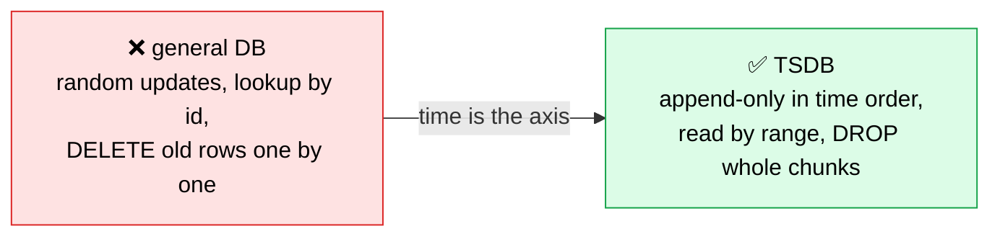
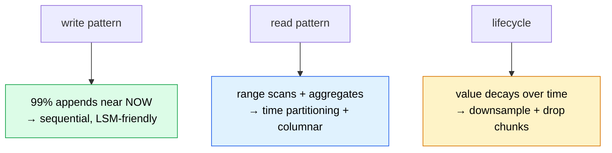
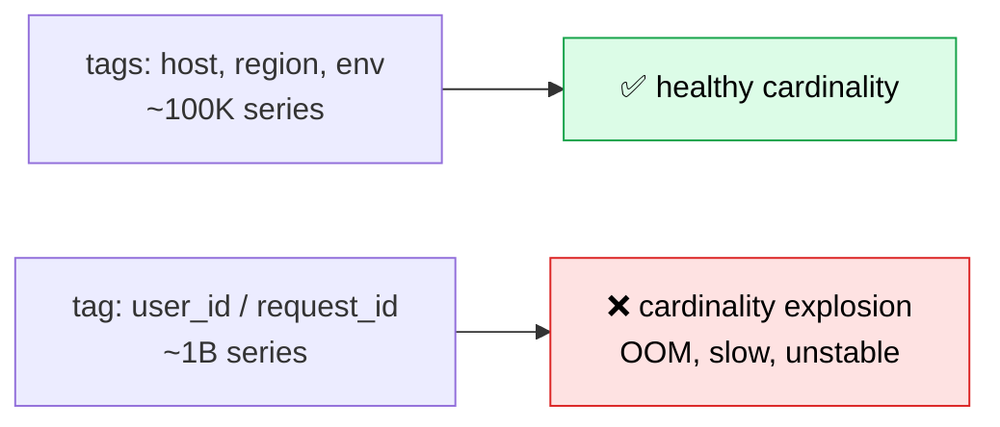
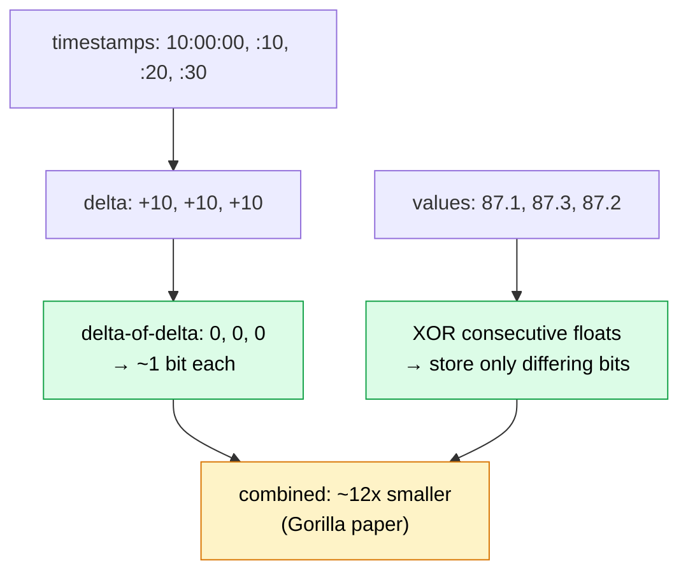
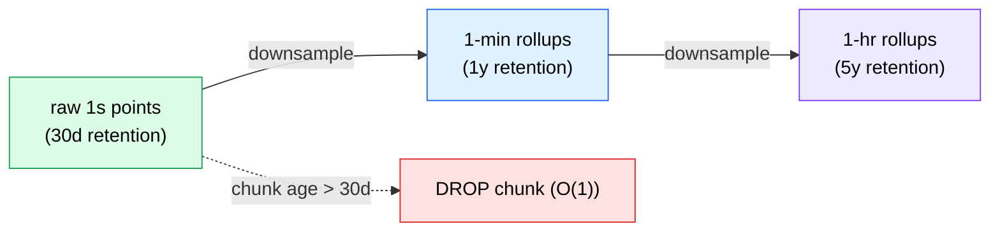
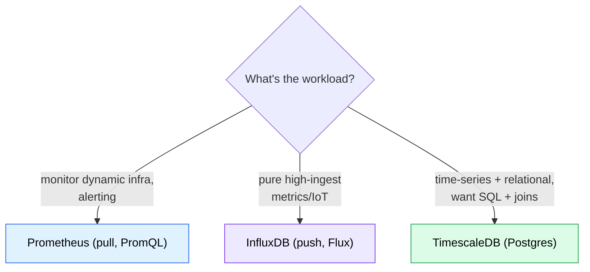
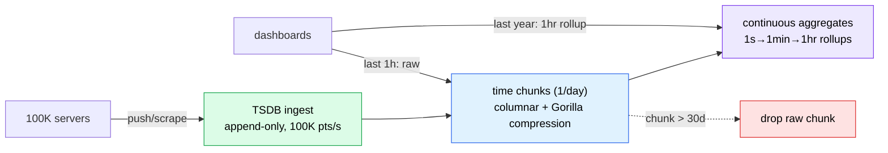
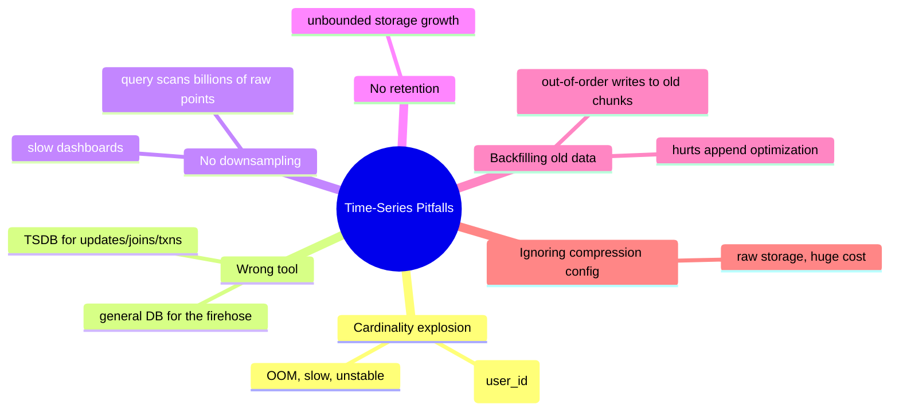

# Time-Series Databases

> **One line:** A time-series database is built around one assumption a general database doesn't make — *time is the primary axis*: data arrives append-only in timestamp order, is queried by time range, and ages out — which lets it ingest millions of points per second, compress them 10–100×, and expire old data by dropping whole time chunks instead of deleting rows.

---

## Table of Contents
1. [Why You Must Master This](#1-why-you-must-master-this)
2. [The Mental Model](#2-the-mental-model)
3. [What Makes Time-Series Data Special](#3-what-makes-time-series-data-special)
4. [The Data Model — Timestamp, Tags, Fields](#4-the-data-model--timestamp-tags-fields)
5. [Compression — Delta, Delta-of-Delta, Gorilla](#5-compression--delta-delta-of-delta-gorilla)
6. [Downsampling & Retention Policies](#6-downsampling--retention-policies)
7. [The Landscape — InfluxDB, TimescaleDB, Prometheus](#7-the-landscape--influxdb-timescaledb-prometheus)
8. [Worked Example — Metrics for 100K Servers](#8-worked-example--metrics-for-100k-servers)
9. [Real-Life Use Cases](#9-real-life-use-cases)
10. [Failure Modes](#10-failure-modes)
11. [🏋️ Practice Drills](#-practice-drills)
12. [🎤 Interview Q&A Bank](#-interview-qa-bank)
13. [🎯 Staff+ Nuances](#-staff-nuances)
14. [Cheat Sheet](#14-cheat-sheet)
15. [Connections & Further Reading](#15-connections--further-reading)

---

## 1. Why You Must Master This

Metrics, monitoring, IoT, financial ticks, application telemetry — an enormous class of data is timestamped measurements arriving in a firehose. It has a specialized storage answer, and "design a metrics/monitoring system" is a recurring interview prompt.

- **It's the storage tier under every observability system.** Prometheus, Datadog, Grafana, and cloud metrics all sit on time-series storage. If you design monitoring, alerting, or IoT ingestion, this is the database you're implicitly choosing.
- **General databases buckle under the workload.** Millions of appends per second, retained for months, queried as ranges and aggregates — a row-store OLTP database can't ingest that fast, bloats storing it, and struggles to expire it. The mismatch is the whole reason TSDBs exist.
- **The compression numbers are staggering and interview-worthy.** Facebook's Gorilla paper reported ~12× compression, shrinking a metrics store from hundreds of GB to fit in memory. Knowing *how* (delta-of-delta + XOR) is a strong depth signal.
- **Retention as a chunk-drop, not a `DELETE`, is a beautiful design lesson.** It shows why partitioning by the query axis (time) turns an expensive operation (deleting a billion old rows) into a cheap one (dropping a partition).

> **The core problem it solves:** *how do you ingest a relentless stream of timestamped measurements, keep months of it affordably, answer "show me the last hour / the daily average over a year" fast, and automatically forget old data* — all of which a general-purpose database does badly because it doesn't assume time is the axis.

**Prerequisites:** [[B_Tree_vs_LSM_Storage_Engines]] (LSM append-optimized writes), [[Columnar_Databases]] (columnar compression for scans).

---

## 2. The Mental Model

A time-series database is a **ship's logbook, not a ledger.**

- A ledger (OLTP database) is full of *updates*: balances change, rows are edited, any account can be touched. You look things up by identity.
- A logbook is **append-only and time-ordered**: you only ever write the next entry at the bottom, you never go back and edit page 40, and you read it as "what happened between noon and 3pm." Old volumes get summarized and archived.

That single difference — append-at-the-end, read-by-range, never-update — is what a TSDB optimizes for end to end.



> **Hold onto this:** in a TSDB, *time is the index.* Writes append to the newest time chunk, reads scan a time range, and expiry drops old chunks. Everything follows from "the timestamp is the primary key axis, and data is immutable once written."



> Recent data is high-resolution and hot; older data is compressed and downsampled; oldest data is dropped whole-chunk — the lifecycle is the architecture.

---

## 3. What Makes Time-Series Data Special

Four properties distinguish time-series workloads, and each drives a design choice:

| Property | What it means | Design consequence |
|---|---|---|
| **Append-only, time-ordered** | New points always have `now`-ish timestamps; you rarely update the past | [LSM](./B_Tree_vs_LSM_Storage_Engines.md)-style sequential appends; no in-place update cost |
| **Immutable** | A measurement, once recorded, doesn't change | Aggressive compression is safe; no MVCC churn |
| **Read by time range + aggregate** | "last 1h", "daily avg over a year" — not point lookups | Partition by time; columnar layout for fast scans/rollups |
| **Value decays** | Yesterday's per-second detail matters less than this second's | Downsample old data, expire it entirely |



**The key architectural move is time partitioning (chunking):** the data is physically split into chunks by time window (e.g., one chunk per day). This makes three things cheap at once: writes hit only the current chunk (kept in memory), range queries touch only the relevant chunks (chunk pruning, like [partition pruning](./Sharding_Partitioning.md)), and retention drops an entire old chunk as a metadata operation — no scanning, no per-row `DELETE`, no [tombstones](./B_Tree_vs_LSM_Storage_Engines.md).

> **The trade-off:** a TSDB is *phenomenal* at time-ordered append + range-aggregate and *bad* at everything else — updating historical rows, arbitrary joins, lookups by non-time keys, transactions. If your access pattern isn't "by time," it's the wrong tool.

---

## 4. The Data Model — Timestamp, Tags, Fields

Most TSDBs model a data point as three parts, and understanding the split (especially tags vs fields) is where practical mastery lives:

```
measurement: cpu_usage
  timestamp: 2026-07-08T10:30:00Z      ← the primary axis
  tags:  {host: "web-01", region: "us-east", env: "prod"}   ← indexed metadata (identity)
  fields: {usage: 87.2, cores: 8}       ← the actual measured values (not indexed)
```

- **Timestamp** — the axis everything is ordered and queried by.
- **Tags** — indexed key/value metadata that identify *which* series a point belongs to (`host`, `region`, `sensor_id`). You filter and group by tags: "avg cpu by region." A unique combination of measurement + tag-set defines a **series**.
- **Fields** — the measured numeric values (`usage=87.2`). Not indexed; you aggregate over them but don't filter the *set of series* by them.

**Why the tag/field split matters — cardinality:** the number of distinct series = the product of all tag-value combinations. Tagging by `host` (100K values) is fine; tagging by `request_id` or `user_id` (billions of values) causes a **cardinality explosion** — each unique combination is a new series with its own index entry, blowing up memory and destroying performance. *High-cardinality identifiers belong in fields (or a different store), never in tags.* This is the number-one operational footgun in TSDBs.



> **Real number / rule:** keep total series cardinality bounded (thousands to low millions, per the engine). If a would-be tag has unbounded distinct values, it's a field, not a tag — get this wrong and the "fast" database becomes unusable.

---

## 5. Compression — Delta, Delta-of-Delta, Gorilla

Time-series data compresses *extraordinarily* well because consecutive points are highly regular — and the compression is why months of data fit affordably (often in memory). Three techniques, best understood in sequence:

- **Delta encoding (timestamps).** Timestamps arrive at near-regular intervals, so instead of storing full 64-bit timestamps, store the *difference* from the previous one. `10:00:00, 10:00:10, 10:00:20…` becomes `base=10:00:00, +10, +10…` — tiny numbers.
- **Delta-of-delta (timestamps).** If the interval is *constant* (every 10s), the deltas are all identical, so store the *change in the delta* — which is `0, 0, 0…`. A perfectly regular stream compresses timestamps to almost nothing (a bit per point).
- **XOR compression (float values, "Gorilla").** Consecutive metric values are usually close (CPU 87.1 → 87.3), so XOR the current value's bits with the previous; similar floats share most bits, leaving a short run of meaningful bits to store. This is the core of Facebook's **Gorilla** encoding.



> **Real number:** Facebook's Gorilla achieved ~**12× compression** (average ~1.37 bytes per point vs 16), which let them hold 26 hours of monitoring data *in memory* for fast queries. Combined with columnar storage (compressing each column separately), TSDBs routinely hit 10–100× on real metrics — the difference between a metrics store that fits in RAM and one that thrashes disk.

---

## 6. Downsampling & Retention Policies

Because a metric's *value decays with age*, TSDBs manage the data's lifecycle automatically — this is what keeps them fast and cheap over time.

**Downsampling (rollups / continuous aggregates):** you don't need per-second resolution from last year. So the TSDB precomputes lower-resolution rollups as data ages: raw 1-second points → 1-minute averages after a week → 1-hour averages after a month. A dashboard showing "last year" reads the cheap 1-hour rollup, not a billion raw points.
- Implemented as **continuous aggregates** (TimescaleDB), **continuous queries / tasks** (InfluxDB), or **recording rules** (Prometheus) — precompute the aggregate incrementally as data streams in, so the query is a cheap lookup.

**Retention policies:** automatically expire data past a threshold. "Keep raw for 30 days, 1-minute rollups for 1 year, delete the rest." Because data is partitioned into time chunks, expiry **drops whole chunks** — a metadata operation, not a scan-and-delete. This is the elegant payoff of time partitioning.



> **The insight:** downsampling + retention together give a "resolution pyramid" — recent data at full detail, old data summarized, ancient data gone. It bounds both storage cost and query cost automatically. Contrast with a general DB where deleting a billion old rows is a lock-heavy, WAL-flooding [batch job](./Database_Migrations_Schema_Evolution.md); here it's dropping a partition.

---

## 7. The Landscape — InfluxDB, TimescaleDB, Prometheus

Three archetypes, each a different design point:

| System | Architecture | Query language | Sweet spot |
|---|---|---|---|
| **Prometheus** | Pull-based scraping, local TSDB, single-node core | PromQL | Cloud-native monitoring & alerting; ephemeral, service-discovery metrics |
| **InfluxDB** | Purpose-built TSDB, push-based ingest | Flux / InfluxQL | General metrics/IoT; high write throughput |
| **TimescaleDB** | **Postgres extension** — TSDB features on relational | Full **SQL** | When you want time-series *and* joins, SQL, relational integrity in one DB |

- **Prometheus** is the observability default: it **pulls** metrics from targets it discovers, stores them locally, and its power is **PromQL** + alerting. It's built for monitoring dynamic infrastructure (Kubernetes), with short local retention and remote-write to long-term stores (Thanos/Cortex/Mimir) for scale and durability.
- **InfluxDB** is a dedicated TSDB tuned for very high ingest, with built-in downsampling/retention. Good when metrics are the whole job and you want a purpose-built engine.
- **TimescaleDB** takes the opposite bet: it's **Postgres** with automatic time-chunk partitioning ("hypertables"), continuous aggregates, and compression bolted on — so you keep full SQL, joins, and the Postgres ecosystem while getting time-series performance. Best when your time-series data lives alongside relational data.



> **Interview framing:** "Prometheus for cloud-native monitoring/alerting; InfluxDB for high-ingest IoT/metrics; TimescaleDB when you want time-series *and* SQL/joins in one relational database." Naming the fit shows you've used them, not just read about them.

---

## 8. Worked Example — Metrics for 100K Servers

**The prompt:** "Collect CPU/memory/disk metrics from 100K servers, 10 metrics each, every 10 seconds, keep a year, and power real-time dashboards. Design the storage."

**The scale:** 100K servers × 10 metrics = 1M series, one point per series every 10s = **100K points/sec** (~8.6 billion points/day). A year of raw data is ~3 trillion points.

**Why not Postgres (row store):**
- Ingest: 100K INSERTs/sec of tiny rows overwhelms a [B-tree engine](./B_Tree_vs_LSM_Storage_Engines.md)'s random-write path (see the Cassandra-vs-Postgres example there).
- Storage: 3 trillion rows at ~30 bytes uncompressed = ~90 TB — unaffordable and unqueryable.
- Retention: deleting a year of old rows daily is a lock-heavy, WAL-flooding disaster.

**The TSDB design:**



- **Data model:** measurement per metric, tags `{host, region, env, metric_type}` (bounded cardinality — *not* tagging by PID or request). 1M series is healthy.
- **Ingest:** append-only into the current time chunk; the TSDB sustains 100K pts/s because writes are sequential.
- **Compression:** delta-of-delta timestamps (regular 10s interval → ~1 bit each) + Gorilla XOR on values → ~10–12×, taking 90 TB down to single-digit TB.
- **Downsampling:** continuous aggregates precompute 1-min and 1-hr rollups; the "last year" dashboard reads 1-hr rollups (~8,760 points/series) instead of 3M raw points.
- **Retention:** keep raw 30 days, 1-min 6 months, 1-hr 2 years; expiry drops whole chunks (O(1)).

**Closing the loop — number → consequence:**
- Compression turns **90 TB → ~8 TB**, which combined with downsampling means dashboards scan thousands of points, not billions — sub-second even for year-long ranges.
- Retention as **chunk-drop** turns "delete a billion old rows daily" (an outage-class batch job on Postgres) into a metadata operation with no lock or WAL flood.
- The append-only ingest sustains **100K pts/s** on hardware that Postgres would choke on at a fraction of that — because the whole engine assumes time-ordered appends.

The example is the whole topic: time-partitioning enables cheap ingest and retention, compression makes a year affordable, and downsampling makes long-range queries fast — none of which a general DB gives you.

---

## 9. Real-Life Use Cases

| Situation | How a TSDB decides the outcome |
|-----------|-------------------------------|
| **Infrastructure & app monitoring** | Prometheus/Datadog store metrics; PromQL/aggregates power dashboards and alerts. |
| **IoT / sensor telemetry** | Millions of devices append readings; downsample + retention bound storage. |
| **Financial market data** | Tick data (price/volume over time) ingested and range-queried; delta compression shrinks it. |
| **Application performance (APM)** | Latency/throughput/error rates over time; percentiles via rollups. |
| **Real-time analytics dashboards** | "Requests per second over the last 24h" — range + aggregate, the TSDB's sweet spot. |
| **Capacity planning** | Long-range downsampled trends (year-over-year growth) from cheap rollups. |
| **Event/usage metering** | Timestamped usage counters aggregated per billing period. |

> **The habit:** when the data is "measurements over time, written once, read by range, and less valuable as it ages," reach for a TSDB — and immediately think about tag cardinality, compression, downsampling, and retention as first-class design, not afterthoughts.

---

## 10. Failure Modes



- **Cardinality explosion.** *Symptom:* memory usage climbs, queries slow, the DB becomes unstable. *Root cause:* a high-cardinality value (user_id, request_id, UUID, dynamic labels) used as a tag/label, creating millions/billions of series. *Fix:* move high-cardinality identifiers to fields or a different store; keep tags bounded; monitor series count. This is the #1 TSDB incident.
- **Using a TSDB for the wrong workload.** *Symptom:* fighting the database on updates, joins, or transactions. *Root cause:* the data isn't really time-series, or needs relational features. *Fix:* use a general DB (or TimescaleDB if you need both); reserve pure TSDBs for time-ordered append + range-aggregate.
- **No downsampling.** *Symptom:* long-range dashboard queries are slow or time out. *Root cause:* querying raw high-resolution data over a year. *Fix:* continuous aggregates/rollups; query the right resolution for the range.
- **No retention policy.** *Symptom:* storage grows without bound, costs balloon. *Root cause:* keeping raw data forever. *Fix:* retention policies that drop old chunks; tier to cold storage if needed.
- **Heavy out-of-order / backfill writes.** *Symptom:* ingest slows, old chunks get rewritten. *Root cause:* writing lots of historical data disrupts the append-optimized, time-partitioned model. *Fix:* minimize backfills; some engines have special backfill paths — use them, and expect it to be slower than live ingest.
- **Not configuring compression.** *Symptom:* storage far larger than expected. *Root cause:* compression not enabled/tuned on older chunks. *Fix:* enable columnar/Gorilla compression on aged chunks (often a policy per chunk age).

---

## 🏋️ Practice Drills

> *Cover the solutions and attempt first — active recall is the point.*

**Drill 1 — Tag or field?** For an IoT fleet, you want to store, per reading: `device_id` (1M devices), `firmware_version` (~20 values), `temperature`, and `reading_id` (unique per reading). Which are tags, which are fields, and why?

<details><summary>Solution</summary>

- **Tags (indexed identity, bounded cardinality):** `device_id` (1M — high but usually acceptable as *the* series identifier) and `firmware_version` (~20 — perfect tag). You'll filter/group by these ("avg temp by firmware_version").
- **Fields (measured values, not indexed):** `temperature` — the actual measurement you aggregate.
- **Neither as a tag:** `reading_id` is unique per point → tagging it would create a new series *per reading* = instant cardinality explosion. It's a field at most, or just omitted (the timestamp already identifies the point).

Rule: tags are for the bounded set of dimensions you slice by; anything unbounded/unique must not be a tag.
</details>

**Drill 2 — Why is retention cheap here?** Explain why deleting a year of old data in a TSDB is trivial but deleting a year of old rows in Postgres is an operational hazard.

<details><summary>Solution</summary>

A TSDB partitions data into **time chunks** (e.g., one per day). "Delete data older than a year" means **dropping whole chunks** — a metadata operation that instantly frees the storage, with no row scanning, no locks on live data, and no WAL/tombstone churn.

In Postgres (unless you've manually partitioned by time), old rows are interleaved in the same table/indexes as new ones, so `DELETE FROM metrics WHERE ts < now() - interval '1 year'` must scan and delete billions of rows one by one: huge lock contention, a flood of WAL, replication lag, dead-tuple bloat requiring VACUUM, and it doesn't even shrink the table on disk. It's a [batch-migration hazard](./Database_Migrations_Schema_Evolution.md). Partitioning by the query axis (time) is exactly what makes expiry O(1).
</details>

**Drill 3 — Design the resolution pyramid.** You must keep 3 years of metrics but dashboards must stay fast. Design retention + downsampling.

<details><summary>Solution</summary>

A resolution pyramid via downsampling + tiered retention:
- **Raw (e.g., 10s):** keep 7–30 days — for detailed recent debugging.
- **1-minute rollups** (avg/min/max/count via continuous aggregates): keep ~6 months — for recent trend dashboards.
- **1-hour rollups:** keep 3 years — for long-range/capacity dashboards.
- Retention policies drop each tier's chunks when they age out.

Queries pick resolution by range: "last hour" hits raw, "last quarter" hits 1-min, "3-year trend" hits 1-hr — so every dashboard scans thousands of points regardless of range. Storage is bounded (old data is summarized then dropped), and query cost is bounded (never scan raw over long ranges).
</details>

---

## 🎤 Interview Q&A Bank

**Q1. "What is a time-series database and when do you use one?"**
> A database built around time as the primary axis: data arrives append-only in timestamp order, is queried by time range and aggregation, and ages out. You use one for metrics, monitoring, IoT telemetry, financial ticks — any high-volume stream of timestamped measurements written once and read by range. It ingests far faster, compresses far better (10–100×), and expires data far more cheaply than a general-purpose database, because it assumes the workload a general DB doesn't.

**Q2. "Why can't I just use Postgres/MySQL for metrics?"** *(signal: knows the specific mismatches)*
> You can at small scale, but three things break at volume. Ingest: a row store's random-write path can't sustain hundreds of thousands of appends per second. Storage: uncompressed rows make months of data enormous and slow to scan. Retention: deleting old rows is a lock-heavy, WAL-flooding batch job. A TSDB fixes all three via append-optimized time-chunked storage, delta/Gorilla compression, and dropping whole chunks for expiry. (TimescaleDB adds exactly these to Postgres if you want both worlds.)

**Q3. "What's the tag/field distinction and why does cardinality matter?"**
> Tags are indexed key/value metadata that identify a series and that you filter/group by (host, region); fields are the measured values you aggregate (cpu=87.2). Cardinality — the number of distinct series — equals the product of tag-value combinations, and it's the master constraint: a high-cardinality identifier as a tag (user_id, request_id, UUID) creates millions or billions of series, blowing up memory and making the DB unusable. High-cardinality identifiers belong in fields, not tags. It's the number-one TSDB footgun.

**Q4. "How does time-series compression achieve 10× or more?"**
> Because consecutive points are highly regular. Timestamps use delta and delta-of-delta encoding: a steady interval compresses to near-zero bits per point. Values use XOR-based (Gorilla) compression: consecutive floats are close, so XORing them leaves only a few differing bits to store. Facebook's Gorilla reported ~12×, letting them keep a day of metrics in memory. Columnar storage then compresses each column independently for even more. It's why a year of metrics can be affordable.

**Q5. "Explain downsampling and retention."**
> A metric's value decays with age, so you keep recent data at full resolution and progressively summarize old data. Downsampling precomputes rollups — raw → 1-minute → 1-hour averages — via continuous aggregates, so long-range dashboards read cheap summaries instead of billions of raw points. Retention policies expire data past a threshold; because data is time-partitioned, expiry drops whole chunks instead of deleting rows. Together they bound both storage cost and query cost automatically.

**Q6. "Prometheus vs InfluxDB vs TimescaleDB?"**
> Prometheus is the cloud-native monitoring default: pull-based scraping, local storage, PromQL, and strong alerting — great for dynamic infrastructure, with remote-write to Thanos/Mimir for scale. InfluxDB is a purpose-built TSDB for high-ingest metrics/IoT with built-in downsampling and retention. TimescaleDB is a Postgres extension that adds time-chunk partitioning, compression, and continuous aggregates while keeping full SQL and joins — best when time-series data lives alongside relational data. Pick by whether you're monitoring infra, ingesting pure metrics, or need SQL + relational features.

**Q7. "How would you design a system ingesting 1M metrics/sec?"**
> Append-only ingest into a TSDB partitioned by time chunk; bounded-cardinality tags (never tag by high-cardinality IDs); delta-of-delta + Gorilla compression on aged chunks; continuous aggregates for 1-min/1-hr rollups; tiered retention dropping raw chunks after weeks and rollups after months/years. Dashboards query the resolution matching the range. For durability/scale beyond one node, shard by series and/or use remote-write to a horizontally scalable long-term store. The whole design leans on time-ordered appends and chunk-level lifecycle.

**Q8. "What happens if you backfill a lot of historical data?"** *(signal: understands the append assumption)*
> It works against the append-optimized model: writes normally land in the current (in-memory) chunk, but backfilling old timestamps forces writes into already-flushed, possibly-compressed historical chunks, which must be reopened/rewritten — much slower and disruptive to compression. Some engines have dedicated backfill paths, but as a rule you minimize out-of-order/historical writes; time-series storage is optimized for "data arrives roughly in order, near now."

---

## 🎯 Staff+ Nuances

- **Cardinality is the single metric that predicts TSDB health.** Everything else is secondary — a well-tuned TSDB with runaway series cardinality still falls over. Senior engineers instrument *series count* and treat any unbounded label as a design bug. The mental check on every tag: "is the set of possible values bounded and small?" If not, it's a field.
- **A TSDB is essentially [LSM](./B_Tree_vs_LSM_Storage_Engines.md) + [columnar](./Columnar_Databases.md) + time-partitioning specialized.** Append-optimized writes (LSM), per-column compression on scans (columnar), and time-chunk pruning/expiry (partitioning) — the "specialized database" is a purposeful composition of storage ideas you already know. Framing it that way shows you understand *why* it's fast, not just that it is.
- **The "hot data in memory" trick is the real performance unlock.** Gorilla's contribution wasn't just compression for storage — it was compressing enough that recent data fits in RAM, so the common query ("last few hours") never touches disk. Compression here buys *latency*, not just *cost*. That's a subtle, important reframing.
- **Downsampling loses information — choose the aggregate deliberately.** A 1-hour average hides a 1-second spike; if you alert on spikes, you must keep max/min/count (or percentiles), not just avg, in the rollup. What you downsample to determines what questions you can still answer about the past. This is a data-modeling decision, not a storage detail.
- **Prometheus's pull model is a design philosophy, not just a mechanism.** Pull gives you liveness detection for free (a target that can't be scraped is down), easy local testing, and no client-side buffering complexity — but it struggles with short-lived jobs (hence the Pushgateway) and needs service discovery. Knowing *why* pull was chosen (and its limits) is deeper than "it scrapes."
- **Long-term storage and horizontal scale are separate problems.** A single-node TSDB (Prometheus core) handles ingest and recent queries; durability, HA, and multi-year retention at scale come from remote-write to Thanos/Cortex/Mimir/VictoriaMetrics, which shard series and store to [object storage](./Object_Storage_Blob_Stores.md). The scaling story is "local for hot, sharded object-storage-backed for cold."
- **Out-of-order and exactly-once matter for correctness, not just speed.** Late-arriving points (network delays, batch uploads) and duplicate writes can corrupt aggregates. Modern engines handle bounded lateness and idempotent writes; if you're designing ingestion, define the lateness window and dedup strategy explicitly — it's the same [delivery-guarantee](../09_Message_Queues_Event_Streaming/) problem streaming systems face.

---

## 14. Cheat Sheet

```
TIME-SERIES DATABASES — TIME IS THE PRIMARY AXIS
═══════════════════════════════════════════════════════════════════

WHY SPECIAL (vs general DB)
  append-only, time-ordered · immutable · read by range+aggregate · value decays
  → LSM-style appends + columnar compression + time-chunk partitioning

DATA MODEL: point = timestamp + tags + fields
  timestamp  the axis (order + query by range)
  tags       indexed identity metadata (host, region) — filter/group by
  fields     measured values (cpu=87.2) — aggregate, NOT indexed
  ⚠ series count = product of tag-value combos
  ⚠ HIGH-CARDINALITY as a tag (user_id, uuid) = explosion → OOM  ← #1 footgun

COMPRESSION (10–100×)
  timestamps: delta → delta-of-delta (regular interval → ~1 bit)
  values:     XOR consecutive floats (Gorilla) → store only differing bits
  Gorilla ~12× → fits recent data in RAM (latency win, not just cost)

LIFECYCLE
  downsample: raw 1s → 1min → 1hr rollups (continuous aggregates)
              query resolution matches the range
  retention:  drop whole time CHUNKS (O(1), no per-row DELETE, no tombstones)
  resolution pyramid: recent=hi-res, old=summarized, ancient=gone

LANDSCAPE
  Prometheus   pull/PromQL — cloud-native monitoring + alerting
  InfluxDB     push/Flux  — high-ingest metrics/IoT
  TimescaleDB  Postgres ext — time-series + SQL + joins

USE FOR: metrics, monitoring, IoT, ticks, APM  ·  NOT: updates, joins, txns
```

---

## 15. Connections & Further Reading

**Prerequisites (learn first):**
- [B_Tree_vs_LSM_Storage_Engines.md](./B_Tree_vs_LSM_Storage_Engines.md) — TSDBs use LSM-style append-optimized writes and time-windowed compaction.
- [Columnar_Databases.md](./Columnar_Databases.md) — per-column compression is a core TSDB storage technique.

**Builds toward / pairs with:**
- [Sharding_Partitioning.md](./Sharding_Partitioning.md) — time-chunking is partitioning by the query axis; scaling shards series across nodes.
- [[Database_Migrations_Schema_Evolution]] — contrast chunk-drop retention with the batch-delete hazard.
- [Object_Storage_Blob_Stores.md](./Object_Storage_Blob_Stores.md) — long-term TSDB storage backends (Thanos/Mimir) tier to object storage.
- [12 · Monitoring & Observability](../12_Monitoring_Logging_Observability/) — TSDBs are the storage tier under metrics/monitoring.
- [09 · Message Queues & Event Streaming](../09_Message_Queues_Event_Streaming/) — ingestion, late data, and delivery guarantees.

**Gaps this topic exposes:**
- A dedicated metrics/monitoring & alerting design note (lives in 12), and a streaming-ingestion/exactly-once note (lives in 09).

**External classics:**
- *"Gorilla: A Fast, Scalable, In-Memory Time Series Database"* (Facebook, VLDB 2015) — the delta-of-delta + XOR compression paper.
- [Prometheus documentation](https://prometheus.io/docs/) — pull model, PromQL, recording rules, remote-write.
- [TimescaleDB docs](https://docs.timescale.com/) — hypertables, continuous aggregates, compression on Postgres.
- *Designing Data-Intensive Applications* (Kleppmann) — column-oriented storage and compression foundations.

---

## TL;DR
**A time-series database assumes time is the primary axis — data is append-only, immutable, read by range, and decays with age — which lets it ingest millions of points per second, compress them 10–100×, and expire old data by dropping whole time chunks.** Model each point as timestamp + tags (bounded-cardinality indexed identity) + fields (measured values), and *never* make a high-cardinality identifier a tag — that cardinality explosion is the top failure. Compression uses delta-of-delta on timestamps and XOR (Gorilla) on values, small enough to keep recent data in memory; downsampling builds a resolution pyramid (raw → minute → hour rollups) and retention drops old chunks in O(1). **Reach for Prometheus for monitoring, InfluxDB for high-ingest metrics, TimescaleDB when you want time-series plus SQL — and treat cardinality, compression, downsampling, and retention as the core design, not afterthoughts.**
