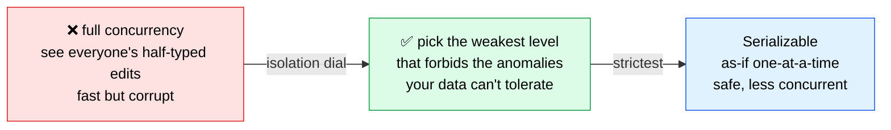
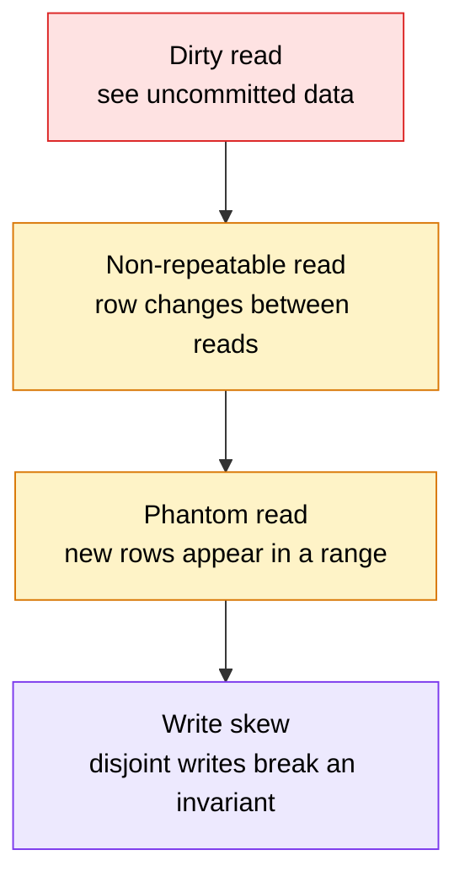
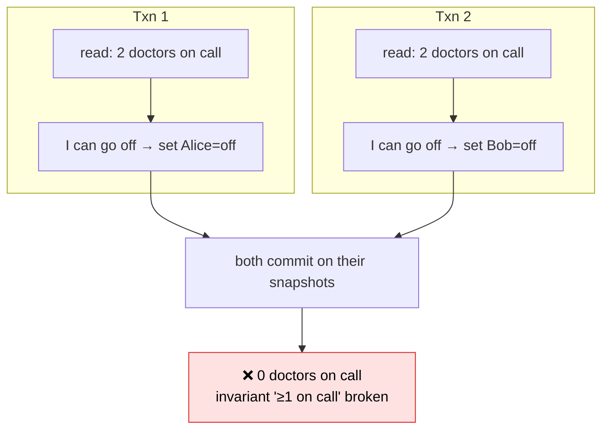
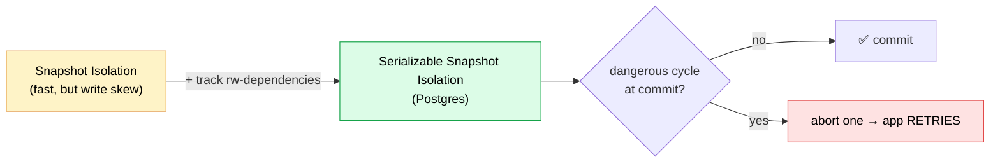
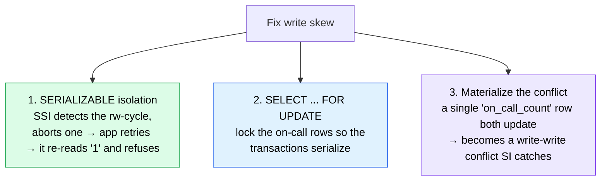
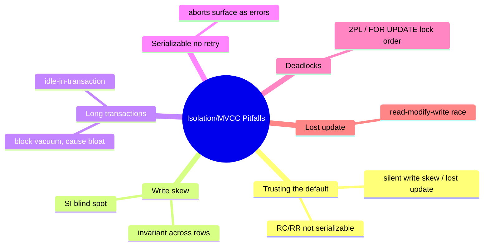

# Transaction Isolation Levels & MVCC

> **One line:** Isolation levels are the dial that trades *correctness under concurrency* for *performance* — each level permits a specific set of read anomalies — and MVCC (Multi-Version Concurrency Control) is the mechanism modern databases use to give each transaction a consistent snapshot *without* readers and writers blocking each other.

---

## Table of Contents
1. [Why You Must Master This](#1-why-you-must-master-this)
2. [The Mental Model](#2-the-mental-model)
3. [The Read Anomalies — What Can Go Wrong](#3-the-read-anomalies--what-can-go-wrong)
4. [The Four Isolation Levels](#4-the-four-isolation-levels)
5. [MVCC — Snapshots Without Locking Reads](#5-mvcc--snapshots-without-locking-reads)
6. [Snapshot Isolation & Write Skew](#6-snapshot-isolation--write-skew)
7. [Serializable & SSI](#7-serializable--ssi)
8. [Worked Example — The Doctor On-Call Write Skew Bug](#8-worked-example--the-doctor-on-call-write-skew-bug)
9. [Real-Life Use Cases](#9-real-life-use-cases)
10. [Failure Modes](#10-failure-modes)
11. [🏋️ Practice Drills](#-practice-drills)
12. [🎤 Interview Q&A Bank](#-interview-qa-bank)
13. [🎯 Staff+ Nuances](#-staff-nuances)
14. [Cheat Sheet](#14-cheat-sheet)
15. [Connections & Further Reading](#15-connections--further-reading)

---

## 1. Why You Must Master This

The **I** in [ACID](./ACID_Properties.md) is "Isolation," and it's the property people understand least and get wrong most. Isolation levels decide what *concurrent* transactions can see of each other — and the default is almost never "fully safe."

- **Your database's default isolation is weaker than you think.** Postgres and Oracle default to *Read Committed*; MySQL/InnoDB to *Repeatable Read*. Neither is Serializable, so subtle concurrency bugs are *allowed by default* — and they only appear under load, making them maddening to reproduce.
- **Concurrency bugs corrupt data silently.** Two transactions racing on the same rows can double-spend a balance, oversell inventory, or violate a business invariant — with no error, no crash, just wrong data. Understanding isolation is how you prevent them by design.
- **MVCC is how modern databases actually work.** "Readers don't block writers" is the feature that makes Postgres/Oracle/MySQL scale, and it's built on multi-versioning. It also explains vacuum/bloat, long-transaction problems, and replication behavior — so it pays off far beyond correctness.
- **Write skew is a favorite senior interview topic.** It's the anomaly that snapshot isolation *doesn't* prevent, it's non-obvious, and reasoning through it (and why only Serializable stops it) is a clear Staff+ signal.

> **The core problem it solves:** *many transactions run at the same time, but each should behave as if it had the database to itself.* True serial execution is safe but slow; running fully concurrently is fast but corrupts data. Isolation levels are the calibrated middle, and MVCC is how you get strong isolation without serializing everything.

**Prerequisites:** [[ACID_Properties]] (this is a deep-dive on the "I"; it covers isolation at overview depth in §4), [[Consistency_Models]] (isolation ≠ distributed consistency).

---

## 2. The Mental Model

Isolation is **editing a shared document with different "track changes" strictness.**

- At the loosest setting, you see other people's *half-typed* sentences (dirty reads) — you might act on text they immediately delete.
- Tighter, you only see *saved* changes, but a paragraph can change *between* two times you look at it (non-repeatable read).
- Tighter still, you work on a **frozen snapshot** taken when you opened the doc — stable to read, but two people editing snapshots can still make contradictory edits that break the document as a whole (write skew).
- At the strictest, the system behaves as if everyone edited *one at a time in some order* — fully safe, but people wait on each other.



> **Hold onto this:** stronger isolation = fewer anomalies but less concurrency. The skill is picking the *weakest* level that still forbids the anomalies your specific data can't survive — not blindly cranking to Serializable (slow) or trusting the default (often too weak).


> Each level is defined by which read anomalies it *permits*; MVCC gives snapshots cheaply; write skew is the gap only Serializable closes.

---

## 3. The Read Anomalies — What Can Go Wrong

Isolation levels are formally *defined* by which of these anomalies they allow. Know the anomalies and the levels follow.

- **Dirty read** — you read data another transaction has written but *not yet committed*. If it rolls back, you acted on data that never existed. Example: reading a balance mid-transfer, before the transfer aborts.
- **Non-repeatable read** — you read a row, another transaction commits an *update* to it, and when you read it again *in the same transaction* you get a different value. The same query, twice, gives two answers.
- **Phantom read** — you run a *range* query (`WHERE age > 30`), another transaction *inserts* a new matching row and commits, and re-running the query returns a different *set* of rows. Not a changed row — a new/vanished one.
- **Lost update** — two transactions read a value, both modify it, and one overwrites the other's change (read-modify-write race). Classic double-spend.
- **Write skew** — two transactions read an overlapping set, each writes to a *different* row based on what it read, and both commit; each is valid alone but together they violate an invariant (§6). The subtle one.



> **The point:** these aren't exotic — they're the concrete ways concurrent transactions corrupt each other. An isolation level is just a *promise about which of these cannot happen.*

---

## 4. The Four Isolation Levels

The ANSI SQL standard defines four levels, each forbidding more anomalies than the last:

| Level | Dirty read | Non-repeatable | Phantom | Write skew | Concurrency |
|---|---|---|---|---|---|
| **Read Uncommitted** | ✗ allowed | ✗ | ✗ | ✗ | highest |
| **Read Committed** | ✓ prevented | ✗ | ✗ | ✗ | high |
| **Repeatable Read** | ✓ | ✓ prevented | ✗ (✓ in PG) | ✗ | medium |
| **Serializable** | ✓ | ✓ | ✓ | ✓ prevented | lowest |

- **Read Uncommitted** — sees uncommitted data. Almost never used; in Postgres it behaves like Read Committed anyway.
- **Read Committed** *(Postgres/Oracle default)* — you only see committed data, but each *statement* gets a fresh view, so two reads in one transaction can differ (non-repeatable reads and phantoms allowed). Good enough for most OLTP; the standard default for a reason.
- **Repeatable Read** *(MySQL/InnoDB default)* — the whole transaction sees one consistent **snapshot**, so re-reading a row gives the same value. This is **snapshot isolation** in practice. (Postgres's Repeatable Read also prevents phantoms; the standard technically allows them.) Still permits *write skew*.
- **Serializable** — the strongest: the result is *as if* transactions ran one at a time in some serial order. Prevents every anomaly including write skew — at the cost of aborts/retries or locking.

> **The critical realization:** the *default* is not Serializable. If your correctness depends on an invariant that spans rows, Read Committed / Repeatable Read may silently allow it to break. You must *choose* the level per the invariant you're protecting — the database won't protect you beyond its default unless you ask.

---

## 5. MVCC — Snapshots Without Locking Reads

How does a database give a transaction a stable snapshot while others are writing? The naive answer is locking — but read locks make readers block writers and vice versa, killing concurrency. **MVCC** avoids that by keeping *multiple versions* of each row.

**The mechanism:**
- Every transaction gets a monotonically increasing **transaction ID (XID)**.
- An **update doesn't overwrite** the row — it writes a *new version* stamped with the writer's XID, leaving the old version in place. A delete marks a version as deleted-at-XID.
- Each row version records the XID that created it and the XID that (later) superseded it — a validity window.
- A reader sees the **snapshot** consistent with its own start: for each row, the version whose validity window includes the reader's XID and that was committed. It simply *ignores* newer, uncommitted, or concurrent versions.

```mermaid
sequenceDiagram
    participant W as Writer (XID 105)
    participant Row as Row "balance"
    participant R as Reader (XID 102, started earlier)
    Row->>Row: v1 balance=100 (created XID 90)
    W->>Row: UPDATE → v2 balance=50 (created XID 105)
    R->>Row: SELECT balance
    Note over R,Row: reader XID 102 < 105 → sees v1 (100), NOT v2
    Note over W,R: readers never block writers; writers never block readers
```

**The consequences (why MVCC is everywhere):**
- **Readers never block writers and writers never block readers** — only writer–writer conflicts on the *same* row wait. This is the concurrency unlock that makes Postgres/Oracle/MySQL fast.
- **Old versions accumulate.** Once no active transaction can still need a version, it's garbage — a **dead tuple**. Postgres reclaims them with **VACUUM** (autovacuum); MySQL's InnoDB uses a rollback/undo log with purge. Neglected, dead tuples cause **bloat** and slow scans.
- **Long-running transactions are toxic under MVCC** — an old open transaction forces the DB to keep *every* version newer than it (something might still read them), so vacuum can't clean up and bloat explodes. "Kill the idle-in-transaction connection" is an MVCC lesson.

> **The trade-off:** MVCC buys enormous read concurrency at the cost of storage (multiple versions) and background cleanup (vacuum/purge). That cleanup is why MVCC databases have a whole operational discipline around vacuum, bloat, and transaction age (Postgres's "transaction ID wraparound" is the extreme failure).

---

## 6. Snapshot Isolation & Write Skew

**Snapshot isolation (SI)** is what MVCC naturally provides at Repeatable Read: each transaction reads from a consistent snapshot taken at its start, and it prevents dirty reads, non-repeatable reads, and (in Postgres) phantoms. It's fast and covers most cases — but it has one famous blind spot.

**Write skew:** two transactions read the *same* data, then each updates a *different* row based on that read. Neither sees the other's write (both read the old snapshot), both commit, and together they violate an invariant that each alone preserved.



The insidious part: there's **no write-write conflict** (they touched different rows), so SI/MVCC sees nothing wrong and lets both commit. Each transaction was individually correct against its snapshot; the *combination* isn't serializable.

**Other classic write skews:** double-booking a meeting room (both check "free" then both book), going below a bank balance limit across two accounts, allocating the last of a shared resource twice.

**Fixes:**
- **Serializable isolation** — the clean fix; it detects the read/write dependency cycle and aborts one (§7).
- **Explicit locking** — `SELECT ... FOR UPDATE` on the rows the invariant depends on, or a lock on a "materialized conflict" row, forcing the transactions to serialize.
- **Restructure** — make the writes touch a *common* row (e.g., a counter) so the conflict becomes a write-write conflict SI *does* catch.

> **The insight:** snapshot isolation is not serializable. If your invariant spans multiple rows and each transaction reads-then-writes-elsewhere, SI can break it silently. This is *the* reason to know your isolation level rather than trusting the default.

---

## 7. Serializable & SSI

**Serializable** is the gold standard: any concurrent execution produces the same result as *some* serial (one-at-a-time) order, so *every* anomaly — including write skew — is impossible. Two ways databases implement it:

- **Two-Phase Locking (2PL)** — the classic pessimistic approach: transactions acquire shared (read) and exclusive (write) locks and hold them until commit, with predicate/range locks to stop phantoms. Correct but *low concurrency* (lots of blocking) and deadlock-prone. Used by SQL Server's default-ish serializable and older systems.
- **Serializable Snapshot Isolation (SSI)** — Postgres's optimistic approach (since 9.1): run on MVCC snapshots (no read locks, full concurrency) but *track* the read/write dependencies between transactions. At commit, if the tracker detects a dangerous cycle that could produce a non-serializable outcome, it **aborts** one transaction, which the app **retries**. You get serializable correctness at near-snapshot performance — for a modest abort rate.



**The cost of Serializable:**
- **2PL:** blocking, reduced concurrency, deadlocks.
- **SSI:** transactions may be aborted and must be retried — so *your application must handle serialization-failure errors by retrying the transaction.* If you turn on Serializable without retry logic, you'll get intermittent errors under contention.

> **The practical rule:** use Serializable for the specific transactions whose invariants can't tolerate write skew (and wrap them in retry logic), not blanket across the whole app. Everywhere else, the weaker default plus targeted `SELECT ... FOR UPDATE` is usually the right balance of safety and throughput.

---

## 8. Worked Example — The Doctor On-Call Write Skew Bug

**The prompt:** "A hospital app must always keep *at least one* doctor on call. Two doctors, each currently on call, both request to go off-call at the same time. On Repeatable Read (snapshot isolation), what happens, and how do you fix it?"

**The buggy execution:**

```mermaid
sequenceDiagram
    participant A as Txn A (Alice off-call)
    participant DB as DB (SI snapshot)
    participant B as Txn B (Bob off-call)
    A->>DB: SELECT count(*) on_call → 2  (snapshot)
    B->>DB: SELECT count(*) on_call → 2  (snapshot)
    A->>DB: check 2 ≥ 2 → OK; UPDATE Alice = off_call
    B->>DB: check 2 ≥ 2 → OK; UPDATE Bob = off_call
    A->>DB: COMMIT
    B->>DB: COMMIT
    Note over DB: ❌ 0 doctors on call — invariant broken, no error raised
```

Both transactions read "2 on call" from their snapshots, both conclude it's safe to leave (2 ≥ 2), and each updates a *different* doctor's row. There's no write-write conflict (different rows), so snapshot isolation happily commits both — leaving zero doctors on call. Each transaction was correct in isolation; the combination is not serializable. This is textbook write skew.

**The fixes:**



**Closing the loop — number → consequence:**
- On **Serializable (SSI)**, the dependency tracker sees both transactions read the same set and wrote based on it; at commit it detects the dangerous cycle and **aborts one**. The app retries it, which now reads "1 on call" and correctly *refuses* to let the second doctor leave. Invariant preserved — at the cost of one retry.
- The lesson quantified: on the *default* MySQL Repeatable Read, this bug is a **100% silent data corruption** under a simultaneous request; the only isolation level that prevents it automatically is Serializable, and the app must be retry-aware to use it.
- If Serializable's abort rate is too costly, the targeted fix is `SELECT ... FOR UPDATE` on the on-call rows (or a materialized count row) so the two requests serialize on a lock instead.

The example is the whole topic: a real invariant spanning multiple rows, an anomaly the default level permits, and the deliberate choice of Serializable (or explicit locking) to close the gap.

---

## 9. Real-Life Use Cases

| Situation | Right isolation / mechanism | Why |
|-----------|----------------------------|-----|
| **Most OLTP reads/writes** | Read Committed (default) | Fast; anomalies it allows don't matter for independent-row updates. |
| **Read-modify-write a counter/balance** | `SELECT ... FOR UPDATE` or atomic `UPDATE ... SET x=x+1` | Prevents lost updates without full Serializable. |
| **Invariant spanning rows (on-call, seats, limits)** | Serializable (with retry) or explicit locks | Only these prevent write skew. |
| **Reporting / analytics snapshot** | Repeatable Read (snapshot) | Consistent view across many queries in one transaction. |
| **Inventory: don't oversell** | Serializable or `FOR UPDATE` on the stock row | Concurrent buyers must serialize on the count. |
| **High-contention hot row** | Restructure (queue, sharded counter) | Even correct locking serializes; reduce contention structurally. |

> **The habit:** for every transaction, ask "what invariant must hold, and could two concurrent transactions break it?" If the invariant spans rows or is a read-then-write, don't trust the default — choose the level or add the lock.

---

## 10. Failure Modes



- **Trusting the default level.** *Symptom:* rare, load-dependent data corruption (double-spend, oversell). *Root cause:* Read Committed/Repeatable Read allow lost updates/write skew, and the invariant spans rows. *Fix:* choose Serializable for those transactions or add `SELECT ... FOR UPDATE`.
- **Write skew.** *Symptom:* an invariant across rows breaks though each transaction looks correct. *Root cause:* snapshot isolation permits disjoint writes based on the same read. *Fix:* Serializable, explicit locks, or materialize the conflict onto one row.
- **Long-running / idle-in-transaction.** *Symptom:* table bloat, vacuum can't keep up, disk grows, scans slow. *Root cause:* an old open transaction pins every newer version so MVCC can't reclaim dead tuples. *Fix:* keep transactions short, set `idle_in_transaction_session_timeout`, monitor oldest XID.
- **Serializable without retry logic.** *Symptom:* intermittent "could not serialize access" errors under contention. *Root cause:* SSI aborts conflicting transactions expecting the app to retry. *Fix:* wrap Serializable transactions in a retry loop with backoff.
- **Deadlocks.** *Symptom:* transactions abort with deadlock errors under `FOR UPDATE`/2PL. *Root cause:* two transactions acquire locks in opposite order. *Fix:* acquire locks in a consistent order; keep transactions short; let the DB's deadlock detector abort-and-retry.
- **Lost update.** *Symptom:* one user's change silently overwrites another's. *Root cause:* read-modify-write without locking or atomicity. *Fix:* atomic `UPDATE ... SET x=x+1`, `SELECT ... FOR UPDATE`, or [optimistic locking](../14_Performance_Optimization_Scalability/Optimistic_vs_Pessimistic_Locking.md) with a version column.

---

## 🏋️ Practice Drills

> *Cover the solutions and attempt first — active recall is the point.*

**Drill 1 — Name the anomaly.** For each, name the anomaly and the lowest isolation level that prevents it: (a) you read a row twice in one transaction and get different values; (b) you read a balance another transaction later rolls back; (c) two transactions each check "≥1 admin exists," each demotes a *different* admin, leaving zero.

<details><summary>Solution</summary>

(a) **Non-repeatable read** — prevented by **Repeatable Read** (snapshot isolation): the whole transaction reads one snapshot, so the row can't change under it.

(b) **Dirty read** — prevented by **Read Committed**: you only ever see committed data, so an uncommitted (later rolled-back) value is never visible.

(c) **Write skew** — prevented only by **Serializable**: each transaction reads the same set and writes a different row; snapshot isolation sees no conflict and commits both, breaking the invariant. Only serializable execution (SSI/2PL) catches the dependency cycle.
</details>

**Drill 2 — Why is the app bloating?** Postgres disk usage is climbing and queries slow down, but the data isn't growing much. `pg_stat_activity` shows a connection "idle in transaction" for 6 hours. Explain the link.

<details><summary>Solution</summary>

MVCC keeps old row versions as long as *any* active transaction might still need to read them. That 6-hour idle-in-transaction connection has an old snapshot, so Postgres must retain **every row version created since it started** — autovacuum cannot reclaim those dead tuples. As updates/deletes pile up, dead tuples accumulate → table and index **bloat** → more pages to scan → slower queries and growing disk, even though live data barely changed.

Fix: end the long transaction (commit/rollback), set `idle_in_transaction_session_timeout` to auto-kill such connections, keep transactions short, and let autovacuum catch up (possibly a manual `VACUUM`). Long transactions are toxic under MVCC precisely because they freeze the cleanup horizon.
</details>

**Drill 3 — Prevent the oversell.** An e-commerce checkout does: `SELECT stock FROM items WHERE id=42` (reads 1), then if stock>0, `UPDATE items SET stock=stock-1 WHERE id=42`. Two buyers hit it simultaneously and both succeed, overselling. Give two fixes.

<details><summary>Solution</summary>

It's a **lost update / write-skew-style race**: both read stock=1 on their snapshots, both pass the check, both decrement → stock = -1 (oversold).

Fix 1 — **atomic conditional update:** `UPDATE items SET stock = stock - 1 WHERE id=42 AND stock > 0` and check rows-affected. The decrement-and-check happens in one atomic statement the DB serializes on the row; the second buyer's update affects 0 rows and is rejected. Simple and lock-cheap.

Fix 2 — **pessimistic lock:** `SELECT stock FROM items WHERE id=42 FOR UPDATE` inside the transaction locks the row, so the second buyer blocks until the first commits, then reads stock=0 and refuses. 

(Fix 3 — Serializable isolation with retry would also work, aborting one buyer.) Prefer the atomic update for a hot single-row counter; use `FOR UPDATE` when the decision needs multiple statements.
</details>

---

## 🎤 Interview Q&A Bank

**Q1. "What are the isolation levels and what does each prevent?"**
> Four ANSI levels, each forbidding more anomalies. Read Uncommitted allows dirty reads (rarely used). Read Committed (Postgres/Oracle default) prevents dirty reads but allows non-repeatable and phantom reads. Repeatable Read (MySQL default) gives a stable snapshot preventing non-repeatable reads — and in Postgres, phantoms too — but still allows write skew. Serializable prevents everything, behaving as if transactions ran one at a time. Stronger levels mean fewer anomalies but less concurrency.

**Q2. "What isolation level does your database use by default, and why does that matter?"** *(signal: knows defaults aren't safe)*
> Postgres and Oracle default to Read Committed; MySQL/InnoDB to Repeatable Read. Neither is Serializable, so concurrency anomalies like lost updates and write skew are *allowed by default*. It matters because correctness bugs that depend on invariants spanning rows won't be caught unless you explicitly raise the level or add locking — and they only show up under concurrent load, so they're easy to miss until production.

**Q3. "Explain MVCC."**
> Multi-Version Concurrency Control gives each transaction a consistent snapshot without locking reads. Instead of overwriting a row, an update writes a new version stamped with the transaction's ID, keeping the old one; each reader sees the version valid as of its start, ignoring newer/uncommitted ones. So readers never block writers and writers never block readers — only writer-writer conflicts on the same row wait. The cost is storing multiple versions and cleaning up obsolete ones (VACUUM in Postgres, undo purge in InnoDB).

**Q4. "What is write skew, and why doesn't snapshot isolation prevent it?"**
> Write skew is when two transactions read the same data, then each writes to a *different* row based on that read, and both commit — each valid alone but together breaking an invariant (e.g., both doctors go off-call leaving zero). Snapshot isolation doesn't prevent it because there's no write-write conflict — they touched different rows — so MVCC sees nothing to block. Only Serializable, which tracks read/write dependencies, detects the non-serializable outcome and aborts one. It's the canonical reason snapshot isolation isn't serializable.

**Q5. "How does Postgres implement Serializable?"**
> With Serializable Snapshot Isolation (SSI), an optimistic method: transactions run on normal MVCC snapshots (no read locks, full concurrency) while the database tracks the read/write dependencies among them. At commit, if it detects a dependency cycle that could yield a non-serializable result, it aborts one transaction with a serialization failure, and the application retries it. You get true serializability at close to snapshot-isolation performance, in exchange for handling occasional aborts with retry logic.

**Q6. "Why are long-running transactions a problem under MVCC?"**
> Because MVCC must keep every row version that any active transaction might still read. A long-running (or idle-in-transaction) transaction holds an old snapshot, so the database can't reclaim any version created after it started — dead tuples accumulate, tables and indexes bloat, scans slow, and disk grows. In Postgres it can also block vacuum enough to risk transaction-ID wraparound. The rule is keep transactions short and auto-kill idle-in-transaction connections.

**Q7. "How do you prevent a lost update?"**
> Don't do a naive read-modify-write. Use an atomic statement (`UPDATE items SET stock = stock - 1 WHERE id=? AND stock > 0` and check rows affected), a pessimistic lock (`SELECT ... FOR UPDATE` so the second writer blocks), or optimistic locking with a version column (update `WHERE version = ?` and retry on mismatch). Serializable isolation also prevents it by aborting the conflicting transaction. Choose atomic update for hot single-row counters, locking/optimistic for multi-statement logic.

**Q8. "When would you actually use Serializable?"**
> For the specific transactions whose correctness depends on an invariant that spans rows and that concurrent execution could violate via write skew — allocating a last shared resource, keeping a minimum count, preventing double-booking. I'd apply it narrowly to those transactions (not the whole app, to avoid its throughput and abort cost) and make sure they're wrapped in retry logic for serialization failures. Everywhere else, the weaker default plus targeted `SELECT ... FOR UPDATE` is the better trade.

---

## 🎯 Staff+ Nuances

- **The database default is a performance choice, not a safety guarantee — own the gap.** Read Committed/Repeatable Read exist because Serializable is expensive; they deliberately permit anomalies. A senior engineer treats "which invariants could concurrency break?" as a design question per transaction, and reaches for Serializable or explicit locks surgically. Blindly trusting the default *or* blanket-Serializable are both junior moves.
- **ACID isolation is not distributed consistency — don't conflate the two.** Serializable is about *concurrent transactions on one database*; [linearizability/consistency models](./Consistency_Models.md) are about *reads across replicas/nodes*. "Strict serializable" (Serializable + linearizable) is what distributed databases like Spanner target, and it's strictly harder. Keeping the [ACID-C vs CAP-C](./ACID_Properties.md) and isolation-vs-consistency distinctions straight is a hallmark of depth.
- **SSI's abort rate is a real capacity-planning input.** Under high contention on overlapping read/write sets, SSI aborts more, and each abort is wasted work plus a retry. If a hot path is Serializable, you must budget for the abort/retry amplification — sometimes restructuring to reduce conflict (sharded counters, queues) beats paying the serialization tax.
- **MVCC explains a surprising amount of "database operations."** Vacuum tuning, table bloat, index bloat, `HOT` updates, transaction-ID wraparound, replication feedback (`hot_standby_feedback`), and the cost of long transactions are *all* MVCC consequences. Understanding the versioning model turns these from mysterious ops chores into predictable behavior.
- **Phantoms and predicate locking are subtler than row anomalies.** Preventing phantoms means locking *rows that don't exist yet* (a range/predicate), which is why true Serializable needs range locks (2PL) or dependency tracking (SSI). Postgres's Repeatable Read prevents phantoms via snapshots but *not* write skew; MySQL's uses next-key locks. The exact phantom behavior varies by engine — know your engine, not just the standard.
- **"Materializing the conflict" is an elegant, underused fix.** When write skew comes from disjoint-row writes, forcing the transactions to touch one shared row (a counter, a lock row) converts the silent skew into a write-write conflict that even snapshot isolation catches — often cheaper than global Serializable. It's the kind of targeted fix that shows you understand *why* SI fails, not just that it does.
- **Isolation interacts with [migrations](./Database_Migrations_Schema_Evolution.md) and backfills.** Long backfill transactions create MVCC bloat and hold snapshots; batching them isn't just about locks, it's about keeping the vacuum horizon moving. The isolation/versioning model is why "batch your big writes" is a rule, not a suggestion.

---

## 14. Cheat Sheet

```
ISOLATION LEVELS & MVCC — CORRECTNESS vs CONCURRENCY DIAL
═══════════════════════════════════════════════════════════════════

READ ANOMALIES (levels are defined by which they forbid)
  Dirty read        see uncommitted data
  Non-repeatable    row changes between reads in one txn
  Phantom           new rows appear in a re-run range query
  Lost update       read-modify-write race overwrites
  Write skew        disjoint writes on same read break an invariant

LEVELS (weak → strong)          Dirty  NonRep  Phantom  WriteSkew
  Read Uncommitted                ✗      ✗       ✗         ✗
  Read Committed (PG/Oracle def)  ✓      ✗       ✗         ✗
  Repeatable Read (MySQL def)     ✓      ✓      ✓(PG)      ✗   ← snapshot isolation
  Serializable                    ✓      ✓       ✓         ✓
  ⚠ DEFAULT IS NOT SERIALIZABLE

MVCC (how snapshots work without locking reads)
  update = new version stamped w/ XID (old version kept)
  reader sees snapshot valid at its start
  → readers don't block writers & vice versa
  → old versions = dead tuples → VACUUM (PG) / undo purge (InnoDB)
  ⚠ long/idle transactions block cleanup → BLOAT

WRITE SKEW FIX
  1. Serializable (SSI aborts → app RETRIES)
  2. SELECT ... FOR UPDATE (lock the rows)
  3. materialize conflict onto one shared row

SERIALIZABLE
  2PL = pessimistic locks (blocking, deadlocks)
  SSI (Postgres) = MVCC + track rw-deps → abort cycles → RETRY needed

RULE: pick the WEAKEST level that forbids the anomalies your data can't tolerate
```

---

## 15. Connections & Further Reading

**Prerequisites (learn first):**
- [ACID_Properties.md](./ACID_Properties.md) — this is the deep-dive on the "I"; that file covers isolation at overview depth and defines WAL/durability.

**Builds toward / pairs with:**
- [Consistency_Models.md](./Consistency_Models.md) — isolation (concurrent transactions on one DB) vs consistency (reads across replicas) — keep them distinct.
- [Distributed_Transactions.md](./Distributed_Transactions.md) — isolation across services/shards is much harder; 2PC/Saga.
- [B_Tree_vs_LSM_Storage_Engines.md](./B_Tree_vs_LSM_Storage_Engines.md) — MVCC dead tuples and bloat are storage-engine concerns (VACUUM).
- [Optimistic vs Pessimistic Locking](../14_Performance_Optimization_Scalability/Optimistic_vs_Pessimistic_Locking.md) — the app-level companions to isolation.

**Gaps this topic exposes:**
- A vacuum/bloat operations note and a deadlock-handling deep-dive (candidates for a DB-ops section).

**External classics:**
- *"A Critique of ANSI SQL Isolation Levels"* (Berenson, Gray, et al., 1995) — the paper that clarified the anomalies and snapshot isolation.
- *Designing Data-Intensive Applications* (Kleppmann) — Ch. 7, the clearest modern treatment of isolation, MVCC, and write skew.
- [PostgreSQL: Transaction Isolation](https://www.postgresql.org/docs/current/transaction-iso.html) — levels, SSI, and serialization-failure handling.
- *"Serializable Snapshot Isolation in PostgreSQL"* (Ports & Grittner, 2012) — how SSI works.

---

## TL;DR
**Isolation levels trade correctness under concurrency for performance — each level permits a specific set of read anomalies — and MVCC is how modern databases give each transaction a consistent snapshot without readers and writers blocking each other.** The four levels (Read Uncommitted → Read Committed → Repeatable Read → Serializable) forbid progressively more anomalies (dirty read → non-repeatable → phantom → write skew), and crucially **the default is not Serializable** — Postgres/Oracle use Read Committed, MySQL uses Repeatable Read, so lost updates and write skew are allowed by default. MVCC keeps multiple row versions stamped by transaction ID, which unlocks read concurrency but requires vacuuming dead tuples and makes long transactions toxic (bloat). Snapshot isolation's blind spot is **write skew** — disjoint writes on the same read breaking an invariant — fixed only by Serializable (SSI, needs retry logic) or explicit locking. **Pick the weakest level that forbids the anomalies your data can't tolerate, and never assume the default is safe.**
