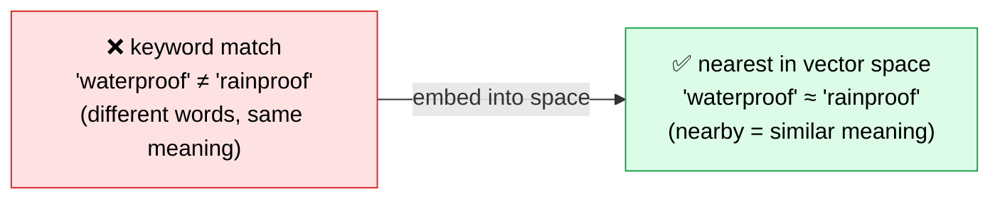
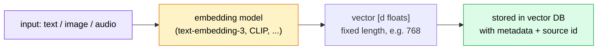
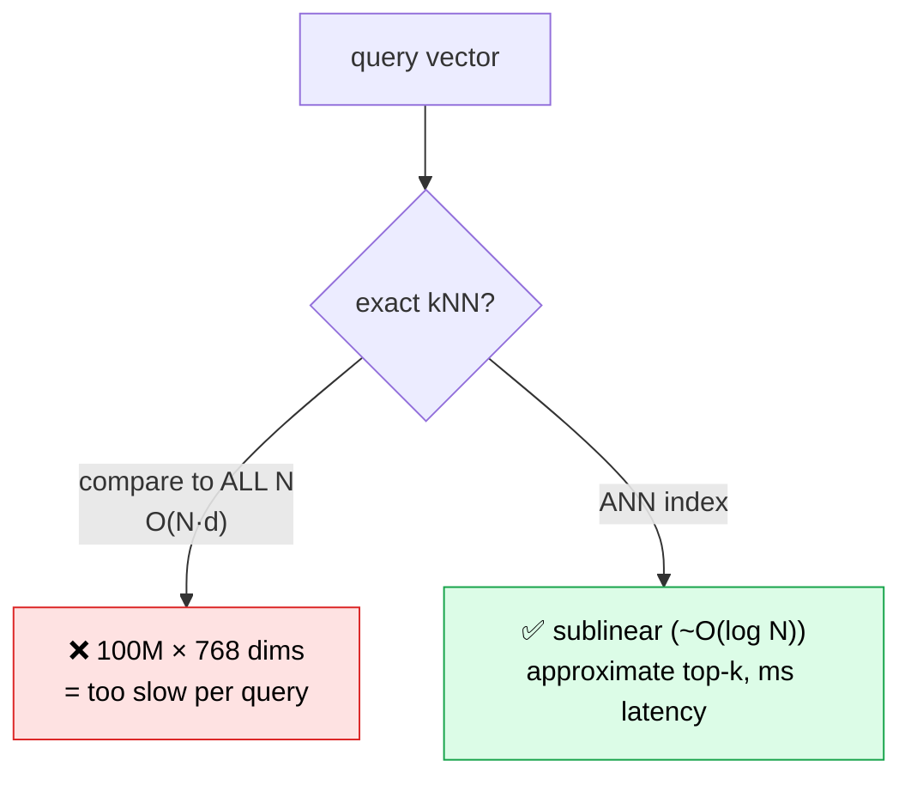
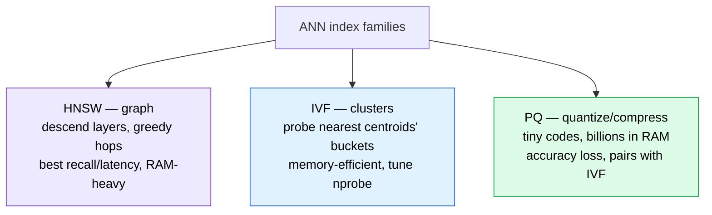
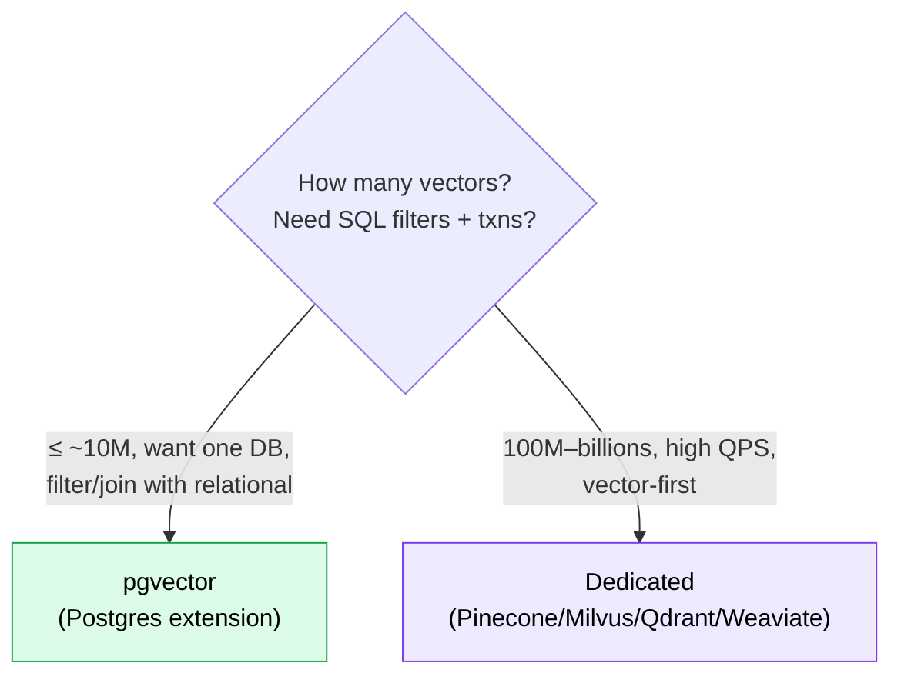
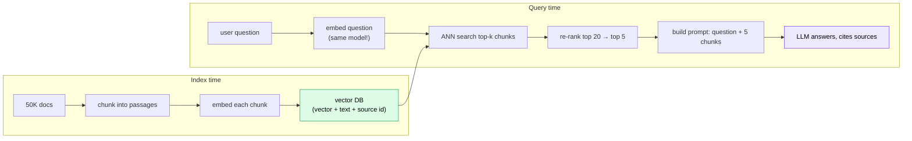
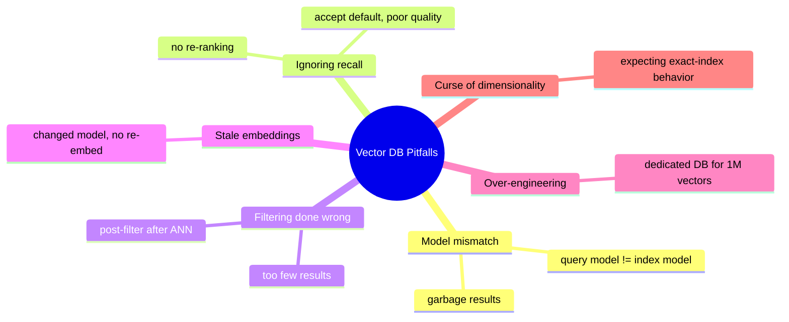

# Vector Databases

> **One line:** A vector database stores data as *embeddings* — lists of numbers where "similar meaning" means "nearby in space" — and answers "find the most *similar* things" by approximate nearest-neighbor (ANN) search, which is the storage engine behind semantic search, recommendations, and Retrieval-Augmented Generation (RAG).

---

## Table of Contents
1. [Why You Must Master This](#1-why-you-must-master-this)
2. [The Mental Model](#2-the-mental-model)
3. [Embeddings — Meaning as Coordinates](#3-embeddings--meaning-as-coordinates)
4. [Similarity Metrics & the kNN Problem](#4-similarity-metrics--the-knn-problem)
5. [ANN Indexes — HNSW, IVF, PQ](#5-ann-indexes--hnsw-ivf-pq)
6. [The Recall vs Latency Trade-off](#6-the-recall-vs-latency-trade-off)
7. [pgvector vs Dedicated Vector Stores](#7-pgvector-vs-dedicated-vector-stores)
8. [Worked Example — RAG over a Company Knowledge Base](#8-worked-example--rag-over-a-company-knowledge-base)
9. [Real-Life Use Cases](#9-real-life-use-cases)
10. [Failure Modes](#10-failure-modes)
11. [🏋️ Practice Drills](#-practice-drills)
12. [🎤 Interview Q&A Bank](#-interview-qa-bank)
13. [🎯 Staff+ Nuances](#-staff-nuances)
14. [Cheat Sheet](#14-cheat-sheet)
15. [Connections & Further Reading](#15-connections--further-reading)

---

## 1. Why You Must Master This

Vector search went from research niche to a first-class datastore because of the LLM/RAG wave — and it's now a standard system-design topic. Any feature involving "find similar" or "give the LLM relevant context" runs on a vector database.

- **It's the datastore behind RAG, the dominant LLM pattern.** To make an LLM answer from *your* data, you retrieve relevant chunks by semantic similarity and stuff them into the prompt — and that retrieval is a vector search. "Design a chatbot over our docs" is a RAG-and-vector-DB question. See [[LLM_Ops_Patterns]].
- **It answers a query no other database can.** Relational filters exact values; [full-text search](./Full_Text_Search_Elasticsearch.md) matches keywords; a vector DB matches *meaning* — "waterproof jacket" finds "rainproof coat" with no shared keyword. That's a genuinely new capability.
- **The recall-vs-latency trade-off is a clean, deep interview topic.** "Approximate" nearest neighbor means you *deliberately* trade accuracy for speed; understanding *why* exact search doesn't scale and *how* HNSW/IVF approximate it is a strong signal.
- **It's increasingly polyglot-normal.** Semantic search, recommendations, dedup, image search, anomaly detection — teams add a vector store alongside their primary DB the way they added a cache or a search index.

> **The core problem it solves:** *finding the items most semantically similar to a query, fast, across millions or billions of high-dimensional vectors* — where "similar" is by meaning, not exact match, and exact comparison against every vector (O(N)) is far too slow. Vector DBs make similarity search sublinear via ANN indexes.

**Prerequisites:** [[Full_Text_Search_Elasticsearch]] (search as ranking; lexical vs semantic), [[Database_Indexing]] (an ANN index is another index structure).

---

## 2. The Mental Model

A vector database is a **map where meaning is location.**

- Imagine every concept placed on a giant map so that *related things sit close together*: "dog," "puppy," and "canine" cluster in one neighborhood; "car" and "engine" cluster far away. The map has hundreds of dimensions, not two, but the intuition holds.
- To answer "what's similar to *puppy*?", you don't read every point on the map — you go to the puppy's location and grab its **nearest neighbors.**
- The catch: with billions of points in hundreds of dimensions, even *finding* the neighbors exactly is too slow, so you use a clever index that gets you *approximately* the nearest ones, fast.



> **Hold onto this:** an embedding turns meaning into coordinates so *semantic similarity becomes geometric distance*; a vector DB is the engine that finds nearest neighbors in that space without comparing against everything.



> The embedding model creates the space; the ANN index makes searching it sublinear; recall vs latency is the knob you tune.

---

## 3. Embeddings — Meaning as Coordinates

An **embedding** is a fixed-length list of floating-point numbers (a vector) produced by a model that maps an input (text, image, audio, a product) into a space where *semantic similarity corresponds to geometric closeness.*

```
embed("puppy")  → [0.21, -0.68, 0.11, ...]   (e.g., 768 dimensions)
embed("dog")    → [0.19, -0.71, 0.14, ...]   ← very close to "puppy"
embed("car")    → [-0.55, 0.30, -0.88, ...]  ← far away
```

- **Where they come from:** an embedding model — OpenAI `text-embedding-3`, Cohere, or open models (sentence-transformers, BERT-family). The model is trained so that inputs meaning similar things land near each other. Typical dimensionality: 256–3072.
- **Multimodal:** the same idea embeds images, audio, and code. CLIP embeds images and text into a *shared* space, so you can search images with a text query.
- **The key property:** the vector captures *semantics*, not surface form. "How do I reset my password?" and "I forgot my login credentials" embed to nearby vectors despite sharing almost no words — which is exactly what keyword search misses.



> **The trade-off / gotcha:** embeddings are only as good as the model, and *you must query with the same model* you indexed with — a vector from model A is meaningless in model B's space. Changing the embedding model means **re-embedding everything** (a full [backfill](./Database_Migrations_Schema_Evolution.md)). The dimensionality and model are near-permanent decisions.

---

## 4. Similarity Metrics & the kNN Problem

**How "close" is measured** — the distance/similarity metric, chosen to match how the embedding model was trained:

| Metric | Measures | Use when |
|---|---|---|
| **Cosine similarity** | Angle between vectors (direction, ignores magnitude) | Most text embeddings — the common default |
| **Dot product** | Direction *and* magnitude | When magnitude carries meaning; fast |
| **Euclidean (L2)** | Straight-line distance | Some image/spatial embeddings |

The operation is **k-Nearest-Neighbors (kNN):** given a query vector, return the `k` closest stored vectors.

**Why exact kNN doesn't scale:** the brute-force approach computes the distance from the query to *every* stored vector and keeps the top k — O(N × d). At 100M vectors of 768 dims, that's ~77 billion multiply-adds *per query* — hundreds of milliseconds to seconds, far too slow for interactive search. And there's no shortcut like a [B-tree](./Database_Indexing.md): high-dimensional space defeats traditional spatial indexes (the "curse of dimensionality" — everything is roughly equidistant, tree pruning stops working).



> **The reframing:** we give up *exactness* to get *speed*. Approximate nearest neighbor (ANN) returns *almost always* the true nearest neighbors, fast — and for similarity search (unlike a bank balance) "99% of the true top-10" is perfectly fine. That acceptance of approximation is the whole field.

---

## 5. ANN Indexes — HNSW, IVF, PQ

ANN indexes make similarity search sublinear by *not* comparing against every vector. Three families dominate; naming them and their trade-offs is the depth signal.

**HNSW (Hierarchical Navigable Small World) — the graph approach, most popular:**
- Build a multi-layer graph where each vector is a node connected to nearby vectors. Upper layers are sparse (long-range "highway" links); lower layers are dense (local roads).
- Search **greedily descends**: start at the top, hop toward the query through sparse long links, drop a layer, repeat — like zooming in on a map. Reaches the neighborhood in ~O(log N) hops.
- **Trade-off:** excellent recall and low latency, but memory-hungry (stores the graph) and slower to build/update.

**IVF (Inverted File Index) — the clustering approach:**
- Cluster all vectors into buckets (via k-means centroids). At query time, find the few *closest centroids* and search only those buckets (`nprobe` of them), skipping the rest.
- **Trade-off:** memory-efficient and fast to build; recall depends on `nprobe` (probe more buckets → better recall, slower). Can miss neighbors that fall just across a cluster boundary.

**PQ (Product Quantization) — the compression approach (usually combined with IVF):**
- **Compress** each vector into a compact code (split into sub-vectors, quantize each to the nearest of a small codebook). A 768-dim float32 vector (3 KB) shrinks to ~tens of bytes.
- **Trade-off:** massive memory savings (fit billions of vectors in RAM) at some accuracy loss; distances are approximate on the compressed codes. Often `IVF + PQ` for billion-scale.



> **Real number:** HNSW routinely serves ~95–99% recall at single-digit-millisecond latency on millions of vectors, versus hundreds of ms for exact search — a 50–100× speedup for a few percent of missed neighbors. IVF+PQ trades a bit more recall to fit billions of vectors in memory.

---

## 6. The Recall vs Latency Trade-off

The defining knob of every vector database: **recall vs latency (and memory).** Because search is *approximate*, you choose how hard it looks.

- **Recall** = of the true `k` nearest neighbors, how many did the search actually return? (Recall@10 = 0.95 means it found 9.5 of the true top 10 on average.)
- Searching **more** of the index (more HNSW candidates via `ef_search`, more IVF buckets via `nprobe`) → **higher recall, higher latency.** Searching **less** → faster but misses more true neighbors.

```mermaid
quadrantChart
    title Recall vs Latency (tune per SLA)
    x-axis "Faster" --> "Slower"
    y-axis "Lower recall" --> "Higher recall"
    quadrant-1 "ideal but costly"
    quadrant-2 "sweet spot (tune here)"
    quadrant-3 "too approximate"
    quadrant-4 "wasteful"
    "low ef/nprobe": [0.2, 0.3]
    "tuned": [0.4, 0.85]
    "high ef/nprobe": [0.85, 0.97]
    "exact kNN": [0.95, 1.0]
```

**How to think about it in a design:**
- Set the **latency SLA** first (e.g., <20ms), then tune `ef_search`/`nprobe` up until you hit it, taking whatever recall that allows.
- **Build-time parameters** (HNSW `M`, `ef_construction`) trade index build time/memory for better achievable recall.
- **Re-ranking** rescues recall cheaply: retrieve a larger approximate candidate set (say top 100) fast, then compute *exact* distances (or a heavier cross-encoder) on just those 100 to get an accurate top 10. Cheap because you re-rank 100, not N.

> **The insight:** "approximate" isn't a weakness to apologize for — it's the deliberate exchange that makes vector search possible at scale. The engineering is *choosing the operating point*: recall high enough that quality is fine, latency low enough that it's interactive, memory low enough that it's affordable. You can't max all three.

---

## 7. pgvector vs Dedicated Vector Stores

Where should the vectors live? Two paths, and the choice is a classic "extend what you have vs adopt a specialist."

**pgvector (Postgres extension):**
- Adds a `vector` column type and ANN indexes (HNSW, IVF) to Postgres. Your embeddings live *in the same database* as your relational data.
- **Wins:** one database to run, backup, and secure; **transactional** consistency between vectors and their metadata; trivial to combine vector search with SQL `WHERE` filters and joins ("nearest neighbors *where* `tenant_id=42 AND price<100`"); no sync/dual-write problem.
- **Limits:** scales to millions–low tens of millions of vectors comfortably; at billions, or for very high QPS, a dedicated store's specialized indexing and horizontal scaling pull ahead.

**Dedicated vector databases (Pinecone, Milvus, Weaviate, Qdrant, Vespa):**
- Purpose-built for vectors: distributed ANN indexing, billion-scale, high QPS, advanced features (hybrid search, filtering during ANN, multi-tenancy). Pinecone is fully managed; Milvus/Qdrant/Weaviate are open-source.
- **Cost:** another datastore to operate and keep in sync with your source of truth (the [dual-write / CDC](./Full_Text_Search_Elasticsearch.md) problem again), and (usually) no cross-store transactions.



> **Interview framing:** "Start with pgvector if you're already on Postgres and at moderate scale — one system, transactional, easy metadata filtering. Move to a dedicated store when scale (hundreds of millions+), QPS, or vector-specific features justify running a second datastore." Defaulting to a fancy vector DB when 5M vectors fit in pgvector is over-engineering.

---

## 8. Worked Example — RAG over a Company Knowledge Base

**The prompt:** "Build a chatbot that answers questions from our internal docs (50K documents) accurately, citing sources, without the LLM hallucinating."

**Why not just prompt the LLM:** the model doesn't know your private docs, has a limited context window (can't fit 50K docs), and will confidently make things up. RAG fixes this: retrieve the *relevant* chunks and give them to the LLM as grounding.

**The design — indexing (offline) and querying (online):**



- **Chunk & embed:** split docs into ~500-token passages (so retrieval is granular and fits the context window), embed each with `text-embedding-3`, store `{vector, chunk_text, doc_id, url}` in the vector DB (pgvector is plenty for 50K docs → maybe a few hundred K chunks).
- **Retrieve:** embed the user's question *with the same model*, ANN-search the top ~20 chunks (cosine), then **re-rank** to the best 5 (cheap exact/cross-encoder re-rank on 20 candidates).
- **Ground the LLM:** put the 5 chunks + the question in the prompt; the LLM answers *from them* and cites the `url`s. If nothing relevant is retrieved, the bot says "I don't know" instead of hallucinating.
- **Hybrid search:** combine ANN (semantic) with [BM25](./Full_Text_Search_Elasticsearch.md) (keyword) so exact terms (error codes, product names) aren't lost — the increasingly standard approach.

**Closing the loop — number → consequence:**
- 50K docs → ~300K chunks → ~300K vectors: **pgvector handles this trivially**, and keeping chunks + metadata in Postgres means retrieval can filter by `WHERE team='billing'` in the same query — no second datastore needed at this scale.
- ANN retrieval over 300K vectors is **single-digit ms** at high recall; re-ranking only 20 candidates keeps quality high without re-ranking all 300K.
- Grounding the LLM in retrieved chunks turns "confidently wrong" into "correct with citations" — the retrieval quality (embedding model + recall + re-ranking) directly determines answer quality. Bad retrieval → bad answers, no matter how good the LLM.

The example is the whole topic: embeddings make the docs searchable by meaning, ANN makes retrieval fast, recall/re-ranking control quality, and the vector DB is the memory that grounds the LLM. See [[LLM_Ops_Patterns]] for the full RAG pipeline.

---

## 9. Real-Life Use Cases

| Situation | How a vector DB decides the outcome |
|-----------|------------------------------------|
| **RAG / LLM chatbots over private data** | Retrieve semantically relevant chunks to ground the LLM and prevent hallucination. |
| **Semantic search** | "find docs about X" by meaning, not keywords; combine with BM25 for hybrid. |
| **Recommendations** | Embed users/items; nearest neighbors = "similar to what you liked." |
| **Image / multimodal search** | CLIP embeddings → search images by text or by example image. |
| **Deduplication / near-duplicate detection** | Near-identical items have near-identical vectors → cluster/threshold. |
| **Anomaly detection** | Points far from all clusters (large NN distance) are outliers. |
| **Face / audio recognition** | Embed biometrics; match = nearest neighbor within a distance threshold. |

> **The habit:** when the requirement is "find *similar* / *relevant* things by meaning" (not exact match, not keyword), reach for embeddings + a vector store — and immediately decide embedding model, metric, ANN index, and the recall/latency operating point.

---

## 10. Failure Modes



- **Embedding model mismatch.** *Symptom:* results are nonsense despite a working pipeline. *Root cause:* the query was embedded with a different model (or version) than the stored vectors — different spaces. *Fix:* pin the embedding model everywhere; re-embed all data if you change it.
- **Ignoring recall / no re-ranking.** *Symptom:* "the search misses obvious matches." *Root cause:* ANN parameters (`ef_search`/`nprobe`) too low, or no re-rank step. *Fix:* measure recall against exact kNN on a sample; tune parameters to your SLA; retrieve-more-then-re-rank.
- **Metadata filtering done wrong.** *Symptom:* filtered queries return too few or slow results. *Root cause:* post-filtering *after* ANN (the top-k came back, then the filter removed most). *Fix:* use engines that filter *during* ANN traversal (pre-/in-filtering), or use pgvector where SQL `WHERE` composes naturally; watch that heavy filters don't defeat the index.
- **Stale embeddings.** *Symptom:* quality degrades or is inconsistent after a model upgrade. *Root cause:* mixing vectors from old and new models. *Fix:* treat an embedding-model change as a full re-embed/backfill migration; version your embeddings.
- **Over-engineering the store.** *Symptom:* operating a distributed vector DB for a few million vectors. *Root cause:* reaching for Pinecone/Milvus when pgvector suffices. *Fix:* start with pgvector if on Postgres; graduate to a dedicated store only when scale/QPS/features demand it.
- **Expecting exact-index behavior.** *Symptom:* surprise that results are approximate or that traditional indexes don't help. *Root cause:* high-dimensional space breaks tree pruning (curse of dimensionality); ANN is inherently approximate. *Fix:* accept and measure approximation; use re-ranking where exactness matters.

---

## 🏋️ Practice Drills

> *Cover the solutions and attempt first — active recall is the point.*

**Drill 1 — Why not exact search?** You have 200M product embeddings (1024-dim). A PM asks why you don't "just compare the query to every product for a perfect result." Explain, with rough numbers, and what you do instead.

<details><summary>Solution</summary>

Exact kNN computes the distance from the query to all 200M vectors: 200M × 1024 ≈ 2×10¹¹ multiply-adds *per query*, which is hundreds of milliseconds to seconds — impossible for interactive search or high QPS. And high-dimensional space suffers the curse of dimensionality, so traditional spatial trees don't prune effectively.

Instead, build an **ANN index** (e.g., HNSW): search descends a navigable graph in ~O(log N) hops, returning the *approximate* top-k in single-digit ms at ~95–99% recall. You accept missing a few true neighbors in exchange for a 50–100× speedup — perfectly fine for similarity/recommendation. If exactness matters for the final ordering, retrieve a larger candidate set approximately, then **re-rank** those few exactly.
</details>

**Drill 2 — Tune the trade-off.** Your vector search must answer in <15ms but users complain it misses relevant results. What levers do you have, and what's the risk of each?

<details><summary>Solution</summary>

The knob is recall vs latency:
- **Increase `ef_search` (HNSW) / `nprobe` (IVF):** searches more of the index → higher recall, but higher latency (risk: blow the 15ms SLA).
- **Retrieve-more-then-re-rank:** fetch top ~50 approximately (still fast), then compute exact distances / a cross-encoder on those 50 to pick the best 10 → recovers recall cheaply (risk: re-rank adds a little latency; keep the candidate set small).
- **Rebuild with better build params (higher HNSW `M`/`ef_construction`):** raises the achievable recall ceiling (risk: more memory and build time).
- **Hybrid with BM25:** catches exact-keyword matches semantics missed (risk: added complexity, score fusion tuning).

Approach: set the 15ms budget, raise `ef_search` until you're near it, then add re-ranking to squeeze recall without breaking the SLA. Always measure recall against exact kNN on a labeled sample.
</details>

**Drill 3 — Pick the store.** For each, choose pgvector or a dedicated vector DB and justify: (a) a startup adding semantic search to its Postgres app, 3M docs; (b) a platform doing 50K QPS over 2B image embeddings with tenant filtering.

<details><summary>Solution</summary>

(a) **pgvector.** 3M vectors fit comfortably; you get one database to operate, transactional consistency between vectors and their rows, and trivial `WHERE` filtering/joins with existing relational data. Adding a separate vector DB here is over-engineering and introduces a sync problem.

(b) **Dedicated vector DB** (Milvus/Pinecone/Vespa). 2B vectors at 50K QPS is well beyond a single Postgres; you need distributed ANN indexing, sharding, IVF+PQ compression to fit billions in memory, and efficient *filtered* ANN for multi-tenancy. The operational cost of a second datastore (and CDC to keep it synced) is justified by the scale and QPS.

Rule: extend Postgres with pgvector until scale/QPS/vector-features force a specialist.
</details>

---

## 🎤 Interview Q&A Bank

**Q1. "What is a vector database and what problem does it solve?"**
> It stores data as embeddings — vectors where semantic similarity equals geometric closeness — and answers "find the most similar items" via nearest-neighbor search. It solves a query no other database can: matching by *meaning* rather than exact value or keyword, so "waterproof jacket" finds "rainproof coat." It's the datastore behind semantic search, recommendations, and RAG for LLMs, and it makes similarity search fast at scale using approximate nearest-neighbor indexes.

**Q2. "What's an embedding?"**
> A fixed-length numeric vector produced by a model that maps text, images, or other data into a space where similar-meaning inputs land near each other. "Password reset" and "forgot my login" embed to nearby vectors despite no shared words. The vector captures semantics, not surface form — which is exactly what keyword search misses. Critically, you must query with the same model you indexed with, since vectors from different models live in incomparable spaces.

**Q3. "Why can't you just compute the exact nearest neighbors?"** *(signal: knows the scaling wall)*
> Exact kNN compares the query to every stored vector — O(N × dimensions) — so at 100M vectors of 768 dims it's tens of billions of operations per query, far too slow for interactive use. And high-dimensional space suffers the curse of dimensionality, so traditional spatial indexes stop pruning effectively. So we use approximate nearest-neighbor (ANN) indexes that return almost-always-correct results in roughly O(log N), trading a few percent of recall for a 50–100× speedup — an acceptable trade for similarity search.

**Q4. "Explain HNSW, IVF, and PQ."**
> They're ANN index families. HNSW builds a multi-layer navigable graph and greedily hops from sparse long-range links down to dense local ones, reaching the query's neighborhood in ~log N hops — best recall/latency, but memory-heavy. IVF clusters vectors into buckets and only searches the buckets nearest the query (`nprobe` of them) — memory-efficient, recall tunable. PQ compresses each vector into a tiny quantized code so billions fit in RAM, at some accuracy cost — usually combined as IVF+PQ for billion-scale. HNSW is the popular default; IVF+PQ wins at extreme scale.

**Q5. "What's the recall vs latency trade-off?"**
> Because search is approximate, you choose how much of the index to explore. Searching more (higher `ef_search`/`nprobe`) finds more of the true nearest neighbors — higher recall — but costs more latency and memory; searching less is faster but misses more. You set the latency SLA, tune the parameters up to it, and take the resulting recall — often recovering quality with a re-rank step: retrieve a larger candidate set approximately, then compute exact distances on just those. You can't maximize recall, latency, and memory simultaneously.

**Q6. "pgvector or a dedicated vector database — how do you choose?"**
> Default to pgvector if you're already on Postgres and at moderate scale (up to low tens of millions of vectors): one system to run, transactional consistency between vectors and metadata, and effortless SQL filtering/joins — no sync problem. Move to a dedicated store (Pinecone, Milvus, Qdrant, Weaviate) when you need billions of vectors, very high QPS, filtered ANN at scale, or advanced vector features that justify operating a second datastore and keeping it in sync via CDC. Don't run a distributed vector DB for 5M vectors.

**Q7. "How does RAG use a vector database?"** *(signal: the dominant LLM pattern)*
> RAG grounds an LLM in your data to prevent hallucination. Offline: chunk documents, embed each chunk, store the vectors with their text and source. At query time: embed the user's question with the same model, ANN-search the top-k relevant chunks, optionally re-rank, and put those chunks plus the question in the LLM's prompt so it answers *from* them and cites sources. The vector DB is the retrieval memory; retrieval quality (embedding model, recall, re-ranking) directly bounds answer quality.

**Q8. "How do you combine vector search with normal filters, like price or tenant?"**
> You need filtered ANN. The naive approach — run ANN then filter the results — can return too few (the top-k came back before the filter). Better: filter *during* traversal (pre-/in-filtering, supported by most dedicated stores), or use pgvector where a SQL `WHERE` composes with the ANN index naturally. Watch that a very selective filter can defeat the ANN index (few candidates survive), sometimes making a filtered exact scan faster — measure it. Hybrid (vector + BM25 + filters) is increasingly standard.

---

## 🎯 Staff+ Nuances

- **Retrieval quality, not the LLM, is usually the bottleneck in RAG.** Teams obsess over the model and prompt while bad chunking, a weak embedding model, low recall, or no re-ranking quietly wreck answers. The vector DB and its operating point *are* the quality lever — instrument retrieval (recall, relevance of retrieved chunks) as rigorously as you'd instrument the LLM. See [[LLM_Ops_Patterns]].
- **"Approximate" is a feature, and choosing the operating point is the real skill.** Recall, latency, and memory form a trilemma you navigate with `ef_search`/`nprobe`, build params, quantization, and re-ranking. Senior engineers state the SLA, measure recall against exact kNN on a labeled set, and pick a defensible operating point — rather than accepting library defaults blindly.
- **Changing the embedding model is a migration, not a config flip.** Old and new vectors live in incompatible spaces, so an upgrade means re-embedding the entire corpus and rebuilding the index — a full [backfill](./Database_Migrations_Schema_Evolution.md) with a cutover. Version your embeddings and plan the re-embed like any schema evolution; this is a real operational cost people underestimate.
- **Hybrid search beats pure vector for most real workloads.** Pure semantic search misses exact tokens (SKUs, error codes, names, rare acronyms); pure keyword misses meaning. Fusing BM25 and vector scores (e.g., reciprocal rank fusion) gets both — which is why [Elasticsearch](./Full_Text_Search_Elasticsearch.md) and dedicated vector DBs alike now offer hybrid. Reaching for hybrid by default is the mature choice.
- **Filtered ANN is subtle and a common performance cliff.** A selective metadata filter can leave the ANN graph/clusters with too few valid candidates, silently degrading recall or forcing a fallback scan. The interaction between the filter's selectivity and the index structure is where "why is my filtered vector search slow/empty?" incidents come from — know pre- vs post-filtering behavior for your engine.
- **Memory is the real cost driver at scale.** HNSW keeps the whole graph in RAM; billions of float32 vectors are terabytes. Product Quantization and other compression are how you fit them affordably, trading recall for RAM — the vector-DB analog of [time-series compression](./Time_Series_Databases.md). Sizing a vector deployment is fundamentally a memory-budget exercise.
- **Freshness and updates are harder than for row stores.** HNSW graphs are expensive to modify; heavy insert/delete churn degrades the graph and eventually needs a rebuild. If your vectors change constantly, understand your engine's update/compaction story (some rebuild segments like [LSM](./B_Tree_vs_LSM_Storage_Engines.md)) — "index once, query many" is the comfortable case; high-churn vector data is an advanced one.

---

## 14. Cheat Sheet

```
VECTOR DATABASES — SIMILARITY SEARCH OVER EMBEDDINGS
═══════════════════════════════════════════════════════════════════

CORE IDEA
  embedding = vector where similar MEANING → nearby in space
  search = k-nearest-neighbors (kNN) by distance
  ⚠ query with the SAME model you indexed with (else garbage)

SIMILARITY METRICS
  cosine (angle) — most text embeddings (default)
  dot product (angle+magnitude) · euclidean/L2 (image/spatial)

WHY ANN (not exact)
  exact kNN = O(N·d) → 100M×768 = too slow per query
  high dims break tree pruning (curse of dimensionality)
  → APPROXIMATE nearest neighbor: ~O(log N), ~95-99% recall

ANN INDEXES
  HNSW  navigable graph, greedy layer descent — best recall/latency, RAM-heavy (default)
  IVF   cluster + probe nearest buckets (nprobe) — memory-efficient
  PQ    quantize/compress vectors to tiny codes — billions in RAM (IVF+PQ)

RECALL vs LATENCY (the knob)
  more search (ef_search/nprobe) → higher recall, slower
  set SLA → tune up to it → recover recall via RE-RANK (fetch 100, exact top 10)
  can't max recall + latency + memory together

WHERE TO PUT IT
  pgvector      ≤ ~10M, on Postgres, want SQL filter/join + txns  ← default
  dedicated     100M–B+, high QPS, filtered ANN (Pinecone/Milvus/Qdrant/Weaviate)

RAG: chunk → embed → store → embed query → ANN top-k → re-rank → LLM prompt (cited)
BEST PRACTICE: hybrid (vector + BM25), measure recall, re-embed on model change
```

---

## 15. Connections & Further Reading

**Prerequisites (learn first):**
- [Full_Text_Search_Elasticsearch.md](./Full_Text_Search_Elasticsearch.md) — search as ranking; lexical (BM25) vs semantic, and hybrid search.
- [Database_Indexing.md](./Database_Indexing.md) — an ANN index is another specialized index structure with its own trade-offs.

**Builds toward / pairs with:**
- [[LLM_Ops_Patterns]] — the full RAG pipeline; the vector DB is its retrieval memory.
- [B_Tree_vs_LSM_Storage_Engines.md](./B_Tree_vs_LSM_Storage_Engines.md) — vector indexes have their own build/update/compaction costs.
- [Time_Series_Databases.md](./Time_Series_Databases.md) — like TSDBs, vector DBs trade compression/approximation for scale.
- [Database_Migrations_Schema_Evolution.md](./Database_Migrations_Schema_Evolution.md) — changing the embedding model is a full re-embed backfill.
- [16 · Emerging Trends](../16_Emerging_Trends_Miscellaneous/) — vector search sits at the center of the LLM stack.

**Gaps this topic exposes:**
- A dedicated embeddings/model-selection note and a re-ranking / hybrid-fusion deep-dive (candidates for 16 or an ML section).

**External classics:**
- *"Efficient and robust approximate nearest neighbor search using HNSW graphs"* (Malkov & Yashunin, 2016) — the HNSW paper.
- *"Product Quantization for Nearest Neighbor Search"* (Jégou et al., 2011) — the PQ paper.
- [pgvector](https://github.com/pgvector/pgvector) — Postgres vector search, indexes, and operators.
- [Pinecone Learning Center](https://www.pinecone.io/learn/) — accessible explanations of embeddings, ANN, and RAG.

---

## TL;DR
**A vector database stores data as embeddings — vectors where similar meaning means nearby location — and finds the most *similar* items via approximate nearest-neighbor (ANN) search, the engine behind semantic search, recommendations, and RAG.** Exact nearest-neighbor is O(N) and too slow at scale, so ANN indexes (HNSW graphs, IVF clustering, PQ compression) make it sublinear by *not* comparing against everything — deliberately trading a few percent of recall for a 50–100× speedup. The defining knob is **recall vs latency vs memory**: set your SLA, tune `ef_search`/`nprobe`, and recover quality with a re-rank step. Always embed queries with the *same model* you indexed with, prefer **hybrid** (vector + BM25) search, and **start with pgvector** if you're on Postgres at moderate scale, graduating to a dedicated store only when billions of vectors or high QPS demand it. **Meaning becomes geometry; nearest becomes most relevant.**
